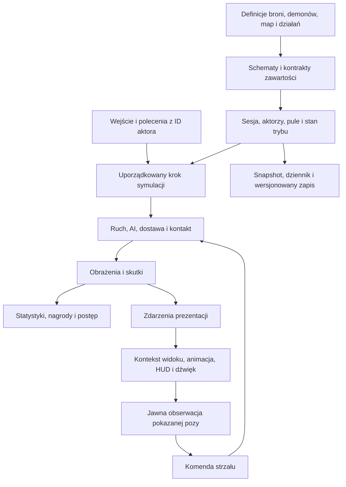

# SIGIL: BREACH — audyt gotowości bazy v11

Data: 27 października 2026. Audytowany kod: `7a4787c`, po poprawkach Claude'a z `a4dada8` i ich odbiorze. Zakres: gotowość architektury do rozwijania zawartości; bez przebudowy grafiki, HUD-u, balansu ani świata.

Aktualizacja po wdrożeniu napraw: [DOMKNIECIE-AUDYTU-v11.md](DOMKNIECIE-AUDYTU-v11.md).
Poniższy audyt zachowuje ustalenia i reprodukcje stanu sprzed napraw.

## Ocena

**Projekt ma solidną strukturę do stopniowego dodawania broni, demonów, ataków, efektów i map w obrębie obecnego modelu gry. Nie wymaga kolejnej masowej przebudowy architektury. Nie nazwałbym jednak obecnego stanu bezwarunkowo domkniętą bazą.**

W pierwszej części reprodukcji znalazłem trzy konkretne luki: utratę wejścia drugiego aktora przy dzieleniu większego kroku czasu, niepełną walidację strategii AI oraz utratę sprawcy okresowego efektu demona. Następnie zweryfikowałem dodatkowy przegląd Claude'a i odtworzyłem sześć dalszych problemów, opisanych w sekcji 10 — w tym zależność replaya od pliku rekordu i zapis podczas odtwarzania. To poprawki lokalnych kontraktów. Nie unieważniają wykonanej pracy v10/v11, ale należy je zamknąć, zanim uznamy te kontrakty za wzorzec dla nowej zawartości.

Odrębnie pozostają odbiór płynności i feelingu oraz nierozstrzygnięte kryterium regresji wydajności z punktu 7 v11. Testy potwierdzają wiele własności kodu; nie potwierdzają, że strzelanie jest satysfakcjonujące. Nie ma też podstaw do deklaracji stałych 60 FPS.

**Rekomendacja:** ograniczony pakiet napraw z obu części audytu, domknięcie pomiaru i odbiór normalnej gry; następnie rozwój małymi, kompletnymi rozszerzeniami. Nie proponuję kolejnego wielkiego „fundamentu v12” ani przygotowania całego przyszłego świata przed dodaniem pierwszej nowej broni.

## 1. Co sprawdzono i co zostało już wykonane

Najpierw zakończono część naprawczą i zapisano ją w `7a4787c`. Dwie poprawki Claude'a były już w repozytorium. Sprawdzono je, uzupełniono pominięty wariant nieznanego sprawcy obrażeń (`nil`) i wykonano pełną weryfikację. Szczegóły: [odbiór poprawek](ODBIOR-POPRAWEK-v11.md).

Audyt obejmuje przekrój całego projektu: katalogi zawartości i schematy, tworzenie sesji, aktorów i trybów, kolejność symulacji, ruch i kolizje, trafienia i obrażenia, AI, efekty, prezentację, UI, zasoby, zapisy, dziennik, testy oraz narzędzia weryfikacji i pakowania. Prześledzono drogi od definicji do wykonania i zapisu, a nie tylko nazwy folderów. Nie jest to deklaracja ręcznego sprawdzenia każdej linii każdego pliku ani matematyczny dowód braku błędów.

Inwentaryzacja `game/src` obejmuje **306 modułów Lua**, w tym 78 w `content`, 40 w `render`, 29 w `ui`, 25 w `combat`, 25 w `session`, 20 w `enemies` oraz pozostałe warstwy. Duże pliki wygenerowanych masek i anatomii zawierają dane, dlatego ich długości nie należy traktować jak złożoności algorytmu. Kontrola kompilacji całego drzewa obejmuje 519 plików Lua.

Dowody na audytowanym drzewie:

| Kontrola | Wynik i granica wniosku |
|---|---|
| `TEST.ps1 -Suite All` | PASS: 4288 sprawdzeń mechaniki/zasobów, 36 wejścia; kompilacja 519 Lua; zero naruszeń sprawdzanych reguł architektury |
| Golden i stan 0.33 | Referencje i sześć skrótów golden bez zmiany; nie przeliczano wzorca pod nowy wynik |
| 606 renderów względem E0 | 601 identycznych; pozostałe pięć ma te same różnice numeru wersji co wcześniej |
| Zasoby, osiem cykli | Stabilne liczby uchwytów po zwolnieniu, brak utrzymanych właścicieli cykli; nie jest to gwarancja pamięci dla dowolnie większego katalogu |
| Trzy pełne benchmarki | Mediany i p95 zwykłego poligonu w budżecie 16,67 ms; część p99 i pojedynczych klatek poza nim |
| Dodatkowy proces audytu | Trzy nowe problemy odtworzone poza źródłami gry, także z prawdziwymi sesjami; opis poniżej |

Odcisk drzewa `game/` przed i po reprodukcjach:
`7BB72ED4B96C5A1C748624E067CD37FD1F42BF9D4FEB2AA62FA35B1AD1D0CCDE`.

Lokalne dowody znajdują się w `work/v11-review-20261027/`: `evidence.json`, `all/`, `pixels.json`, `budget-summary.json`, `resources/`, `inventory.json`, `probes/main.lua`, `probes/audit.stdout.txt` i `probes/audit.evidence.json`. `work/` jest ignorowane przez Git; ten dokument zawiera istotne wyniki, ale surowe artefakty nie będą automatycznie dostępne po samym sklonowaniu repozytorium. Kod wyjścia 0 reprodukcji oznacza, że potwierdziła ona opisane błędy, a nie że zachowanie gry było prawidłowe.

## 2. Potwierdzone luki wymagające zamknięcia

### A. P2 — efekt okresowy demona traci tożsamość sprawcy

Miejsce: [session/damage_outcomes.lua](../game/src/session/damage_outcomes.lua), wiersze 53–54 i wywołanie w `creatureBlow`; [combat/effects.lua](../game/src/combat/effects.lua), `sourceOf`, `aliveSource` i wykonawca `periodic`.

`creatureBlow` przekazuje do `Outcomes.enemy` liczbowy identyfikator demona jako `owner`, ale etykietę `'creature'` jako `source`. Przy nakładaniu efektu kod zachowuje jawnego właściciela tylko wtedy, gdy jest on napisem, czyli identyfikatorem rycerza. Dla demona przekazuje dalej etykietę. `Effects.sourceOf` interpretuje taką wartość jako `knight`, bez identyfikatora.

**Reprodukcja:** dwa rycerze, demon-sprawca i demon-cel; cel ma 500 HP. Kontakt przez rzeczywiste `Game:damageBody` zawiera efekt `periodic`, 0,6 s długości, puls co 0,2 s, 6 obrażeń, `cancelOnSourceDeath=true`. Zapisana instancja ma `sourceSide='knight'`, `sourceId=nil`, mimo że sprawca ma ID 4. Po ustawieniu HP sprawcy na zero i przesunięciu czasu o 0,21 s cel traci kolejne 6 HP, a efekt nadal istnieje.

**Znaczenie:** nowy demon z podpaleniem lub podobną umiejętnością nie zachowuje poprawnie kontraktu źródła. Anulowanie sprawdza niewłaściwe ciało. Puls traci również identyfikator pierwotnego demona. Nie twierdzę, że każda obecna animacja czaru jest dotknięta tym problemem: reprodukcja wykorzystuje obsługiwany efekt okresowy, a nie sam wygląd pocisku.

**Poprawka:** przenosić tożsamość źródła niezależnie od etykiety zdarzenia. Nie odgadywać rycerza z samego braku tabeli. Zachować istniejącą regułę statystyk dla świata i jednego rycerza; `nil` nie może samoczynnie nabierać znaczenia innego sprawcy.

**Warunek odbioru:** demon → demon, demon → rycerz, drugi rycerz → demon, nieznane źródło; osobno anulowanie po śmierci i efekt, który ma przetrwać sprawcę. Sprawdzić `owner` pulsu/zabójstwa, snapshot i dziennik oraz brak rekursywnego nakładania efektu przez jego własny puls.

### B. P2 — większy krok symulacji odrzuca wejście dodatkowych aktorów

Miejsce: [session/simulation.lua](../game/src/session/simulation.lua), wiersze 35–57.

`Simulation.update` dzieli czas na kroki do 1/120 s. Po pierwszym kroku z `dash` lub `slide` buduje nową, ręcznie wyliczoną tabelę wejścia. Nie przenosi `input.actors`, więc dalsze kroki nie dostają poleceń pozostałych rycerzy.

**Reprodukcja:** `update(1/30, {dash=true, actors={audit_second={forward=1}}})` wykonuje cztery podkroki. Pierwszy zawiera `actors`, pozostałe trzy już nie. W rzeczywistej pustej sesji drugi rycerz przebywa **0,004319106 m**, a przy czterech równoważnych wywołaniach po 1/120 s — **0,037777778 m**. Przycisk uniku pierwszego rycerza jest w obu wariantach aktywny tylko na początku.

**Granica:** aplikacja obecnie podaje stałe 1/120 s, więc ten wynik nie dowodzi utraty ruchu w zwykłej rozgrywce jednoosobowej. Dotyczy publicznej ścieżki `Game:update` użytej przez narzędzie, test, bota lub przyszły inny kontroler z większym krokiem. Komentarz tej funkcji obiecuje obsługę takich wywołań.

**Poprawka:** zachować pełną strukturę wejścia przy podziale czasu; wygaszać wyłącznie komendy jednorazowe zgodnie z ich kontraktem. Nie mutować tabeli dostarczonej przez wywołującego. Regułę rozpatrzyć także dla wejścia poszczególnych aktorów, zamiast dopisywać kolejną ręczną listę pól.

**Warunek odbioru:** równoważne 1/30 i cztery razy 1/120 dla ruchu dwóch rycerzy, z unikiem/ślizgiem i bez nich; bez powtarzania akcji jednorazowych. Sprawdzić odtworzenie i zachowanie oryginalnej tabeli wejścia.

### C. P2 — błędne nazwy zachowań AI przechodzą walidację zawartości

Miejsce: [session/content_contracts.lua](../game/src/session/content_contracts.lua), `Contracts.creature`; [enemies/ai.lua](../game/src/enemies/ai.lua), wiersz 321; [enemies/target.lua](../game/src/enemies/target.lua), wiersze 30–37.

Definicja demona sprawdza typ pól `move.style` i `move.targeting`, ale kontrakt połączenia danych z wykonawcami weryfikuje przede wszystkim ataki i efekty. Nie sprawdza istnienia obu strategii. Nieznany styl ruchu cicho zamienia się w `Styles.keep`; nieznana strategia celu wywołuje błąd dopiero przy wyborze celu.

**Reprodukcja:** wariant `imp` z `move.style='misspelled_style'`, `move.targeting='misspelled_target'`. `Creature.define`, `Contracts.creature`, utworzenie sesji i spawn przechodzą. Dopiero `Target.choose` kończy się `unknown targeting strategy misspelled_target`.

**Znaczenie:** dodawanie treści jest możliwe bez przebudowy AI, lecz literówka może zmienić zachowanie po cichu lub przerwać walkę. To bezpośrednio wpływa na wygodę i bezpieczeństwo dalszego rozwoju.

**Poprawka:** walidować istnienie i wywoływalność zarejestrowanych strategii na granicy kompozycji. W razie cyklu zależności wydzielić niewielki rejestr zachowań, zamiast importować symulację do definicji zawartości. Odróżnić jawny domyślny styl od nieprawidłowej podanej nazwy.

**Warunek odbioru:** błędna nazwa zostaje odrzucona przed rozpoczęciem świata; poprawny własny styl i selektor celu przechodzą. Wbudowane demony zachowują dotychczasowe wyniki i animacje.

## 3. Dlaczego obecna architektura jest dobrym fundamentem

To nie jest już porządek polegający tylko na przeniesieniu plików do folderów. Istnieją użyteczne, sprawdzane granice odpowiedzialności:

- **Definicja i instancja są rozdzielone.** Zawartość opisuje parametry i rodzaje zachowań, a aktor przechowuje własną broń, amunicję, czasy i wyposażenie. Testy wykrywają mutowanie współdzielonych definicji.
- **Mechanika i prezentacja mają osobny stan.** Zdarzenia symulacji uruchamiają feedback; widok nie jest właścicielem HP czy amunicji. Kontekst aktora i obserwatora usuwa dużą część dawnych założeń o jednym `player`.
- **Kolejność działania jest jawna.** `systems/index.lua` wyznacza porządek ruchu, kontaktów, ataków, pocisków, efektów i postępu trybu. Symulacja i dekoracja mają rozdzielone strumienie losowości.
- **Wspólne operacje mają jeden przebieg.** Definicja broni wybiera dostawę; kontakt prowadzi do wspólnego rozliczenia materiału, strefy, obrażeń i skutków. Nowa broń nie musi implementować własnego systemu nagród czy śmierci.
- **Istnieją dowody rozszerzalności.** Testy naprawdę wstawiają trzecią/czwartą broń, zmienioną anatomię, nowe pozy, tryb z celami, drugiego aktora i dodatkowy widok. Nie są to wyłącznie komentarze „tu kiedyś będzie można”.
- **Weryfikacja dotyczy określonych źródeł.** Golden, zapis źródła wyników, fixture starszego wydania, rendery i izolowane procesy utrudniają przypadkowe uznanie starego raportu za dowód nowej wersji.

Uproszczony przepływ odpowiedzialności:

Ostatnie połączenie jest celowe: hitscan ma badać pokazaną pozycję demona według jawnego kontraktu. Nie oznacza to uzależnienia całej fizyki od bieżącej kamery ani wykonywania odczytu GPU przy każdym trafieniu.

Kompozycja danych i małych strategii lepiej odpowiada temu projektowi niż rozbudowana hierarchia klas typu `Demon → LatającyDemon → OgnistyLatającyDemon`. Dziedziczenie definicji służy tworzeniu wariantów; wykonawcy służą dodawaniu zachowania. Nie trzeba zmieniać silnika ani wprowadzać nowego frameworka ECS.

## 4. Ile realnie wymaga dodanie nowej zawartości

| Zmiana | Miejsca pracy | Czego nie trzeba przebudowywać | Granica |
|---|---|---|---|
| Kolejna zwykła broń palna | `content/weapons`, definicja, teksty, atlas dłoni i animacje, sposób zdobycia | Ruchu postaci, wspólnego kontaktu, całego HUD-u i statystyk | Istniejące rodzaje dostawy i stan amunicji |
| Broń z nową dostawą | Rejestr `combat/weapon_delivery`, wykonawca i jego dane; grafika/feedback | Każdego przeciwnika i każdej funkcji strzału | Nowa fizyka dostawy wymaga kodu, nie tylko ID |
| Inny typ przeładowania | Mechanizm w `combat/reload`, metadane i sekwencja ręki | Logiki gracza i wszystkich innych broni | Nowe utrwalane pola broni trzeba dodać do kontraktu stanu/zapisu |
| Nowy demon z obecnymi zachowaniami | `content/creatures`, rejestracja w katalogu, wygląd, pozy, anatomia i bake maski | Ogólnego spawn, kontaktu i rozliczenia śmierci | Po poprawce C błędne strategie mają być odrzucane wcześnie |
| Nowy atak demona | Schemat działania, wykonawca `Attacks.kinds`, telegraph, kontakt i animacja | Całego AI każdego demona | Nowa wielofazowa polityka bossa wymaga własnej logiki faz |
| Nowy efekt kontaktu | Definicja `effect`, wykonawca apply/tick i feedback | Każdej broni, która go nakłada | Naprawić A; opisać stacking, anulowanie i sprawcę |
| Umiejętność/wyposażenie | Definicja w `content/abilities`, ewentualnie wykonawca `combat/abilities`, slot i art | Całej klasy postaci | Obsługa techniczna nie zmienia założenia „człowiek bez magii” |
| Inny układ mapy | Dane mapy i rejestr `content/maps/index` | Algorytmów ruchu, UI i każdego potwora | W obrębie obecnej siatki, wysokości i pokładów |
| Obiekt świata | Dane/stan i interakcja; `WorldObjects.register` do rysowania | Głównej pętli renderera | Sama rejestracja grafiki nie dodaje kolizji ani zapisu |
| Nowy tryb z celami | Rejestr `run/modes`, `modeData`, widoki zapytań i sekcja zapisu | Każdego ekranu i algorytmu walki | Kontrakt trybu obejmuje też reset, koniec i odtworzenie |

Główne źródła: [weapon_extension](../game/tests/cases/weapon_extension.lua), [hand_art_extension](../game/tests/cases/hand_art_extension.lua), [creature_extension](../game/tests/cases/creature_extension.lua), [content_contracts](../game/src/session/content_contracts.lua), [world_objects](../game/src/render/world_objects.lua) i [ROZSZERZANIE](../game/docs/ROZSZERZANIE.txt).

Przykład ważnego rozróżnienia: broń strzelająca skończonymi pociskami ognia może wykorzystać dostawę `projectile`, typ obrażeń `fire` oraz zdefiniowany efekt okresowy. Samo `damageType='fire'` nie tworzy płomienia, podpalenia ani animacji. Ciągły miotacz ognia potrzebuje wykonawcy emisji, reguły zużycia paliwa, kontaktu i prezentacji. To lokalne rozwinięcie istniejącego podziału, nie przepisanie przeciwników.

## 5. Matematyka, trafienia i animacje

**Obrażenia:** [combat/damage.lua](../game/src/combat/damage.lua) skupia czyste obliczenia: dystans, moc, strefę, pancerz, penetrację, odporność, osobno obrażenia HP, naruszenie gardy i impuls. Pancerz demona jest współczynnikiem, a ochrona rycerza zużywalną pulą. To jawnie różne modele, nie przypadkowo wymieszane zmienne. Współczynniki są regułami gry, nie deklaracją realistycznych dżuli.

**Ruch:** zamknięte wzory integracji w `physics/kinematics`, kontakt mas w `body_physics`, przesunięcia z kolizją w `collision`, lot w `ordnance_flight` i przecięcia w `sphere_cast` stanowią sensowny podział. Testy `terrain_motion` sprawdzają m.in. podparcie, lądowanie, przeszkody i zachowanie precyzji tuż nad podłożem. To silniejszy fundament niż regulowanie każdego ruchu osobnym losowym mnożnikiem. Nowy rodzaj fizycznego oddziaływania nadal wymaga określenia jednostek, czasu i kolejności zastosowania.

**Anatomia:** kształt ma identyfikator niezależny od strefy obrażeń i materiału. Dwie kończyny mogą należeć do tej samej strefy. Testy wariantów anatomii potwierdzają rozdzielenie liczby kształtów od logiki obrażeń. Aktualne demony są trafiane przez opisaną, malowaną powierzchnię z maską, a nie jeden prostokąt.

**Rogi:** obecny materiał `horn` ma zerowy udział w obrażeniach HP i własną reakcję kontaktu; nie implementuje fizycznego odbicia trajektorii. Rykoszet to osobny przyszły kontrakt dostawy: normalna, kierunek po odbiciu, pozostała energia i ograniczenie liczby odbić. Nie należy twierdzić, że jest gotowy tylko dlatego, że istnieje materiał o tej nazwie.

**Pozy i trafienie:** nazwane pozy, kotwice i metadane CPU oddzielają rozmieszczenie grafiki od kolejności brył. `combat/observation` przenosi obserwowaną geometrię wraz z aktorem, czasem i ważnością; pociski lecące używają kontaktu w bieżącej symulacji. Dzięki temu dopisanie klatek nie powinno automatycznie przesuwać ręki, głowy czy kontaktu ataku. Własny arkusz nadal trzeba poprawnie oznaczyć i sprawdzić na granicach klatek.

**Świadoma granica:** demon pozostaje billboardem. Jawny obserwator nie czyni płaskiego malowidła modelem 3D. Opcjonalny katalog `hit_volumes` istnieje, ale w grze jest pusty. Pełna, niezależna od obserwatora objętość wszystkich potworów nie została wykonana i nie jest potrzebna do zwykłego dodania kolejnego malowanego demona.

**Feeling:** `feedback/weapon_motion` reaguje na ruch, zmianę kierunku, chód, lot i lądowanie, korzystając ze sprężyn. Architektura pozwala dostrajać te reakcje bez zmiany obrażeń. Sam fakt istnienia tych wzorów nie potwierdza dobrego odczucia ciężaru. Odbiór powinien objąć obie bronie, trafienie/chybienie, przerwanie ataku, śmierć, skok, lądowanie, ślizg i powrót z przeładowania, w zwykłej walce.

## 6. Mapy, skala i koszty

Mapa nie jest już na stałe kwadratem dawnej areny. Schemat przechowuje szerokość i głębokość; test `space_scale` sprawdza także nawigację na 256×256. `floor_layers` obejmuje mapę 256×128 z mostem, ruchem nad i pod nim, pociskami oraz oświetleniem. Oznacza to działanie konkretnych algorytmów na takich danych, nie obietnicę pełnej gry w 60 FPS z dowolną liczbą obiektów.

`world/arena` aktualizuje rewizję geometrii; renderer i nawigacja uwzględniają ją przy odświeżaniu danych. Przyszła modyfikacja mapy powinna korzystać z tej ścieżki, a nie zmieniać wyłącznie tabeli widocznych kafli. Lokalne pola nawigacji, cache i indeks przestrzenny ograniczają koszt. Dowolne ruchome platformy, strumieniowany otwarty świat czy pełne geometryczne wnętrza 3D byłyby nowymi funkcjami.

**Obecny pomiar płynności:** w cięższych zwykłych scenach 20 przeciwników najgorsze p95 z trzech prób wyniosło 16,4294 ms, a p99 19,7328 ms. Pojedynczy pomiar klatki doszedł do 43,9320 ms. Sceny diagnostyczne 96/256 ciał są wyraźnie droższe. Pomiar nie obejmuje desktopowego present/vsync, więc nie jest pomiarem opóźnienia całego toru do monitora. Szczegóły i warunki są w raporcie odbioru.

Kryterium Claude'a „+5% **lub** w granicach szumu A/A” nie daje dwóch jednoczesnych ograniczeń. Duży szum nadal może przepuścić regresję. Dlatego historyczny wynik względny pozostaje nierozstrzygnięty; nowa seria absolutna nie zastępuje pomiaru par przed/po. Nie zamknięto punktu 7 samą zmianą opisu progu.

**Start i katalog:** zmierzone pierwsze wejście na poligon trwało 888,590 ms rozłożone na 17 wyświetlonych zadań, największy dostawca 57,367 ms; pierwsza grająca klatka poligonu 7,996 ms, bez leniwego ładowania PNG. Podział poprawia możliwość pokazania ładowania, lecz nie oznacza, że każde zadanie mieści się w jednej klatce 60 Hz.

`render/weapon.loadAtlases` i `render/ability_art.load` przechodzą przez zarejestrowane katalogi. Osiem cykli potwierdza zwalnianie obecnych zasobów; nie dowodzi stałego kosztu przy stu unikalnych arkuszach. Gdy katalog realnie urośnie, należy wybierać zestaw potrzebny sesji/poziomowi i mierzyć VRAM oraz czasy wejścia. Nie trzeba dziś budować pełnego streamingu dla dwóch broni.

## 7. Zapis, odtworzenie, UI i utrzymywalność

**Zapis to kilka różnych kontraktów.** Snapshot bieżącej sesji, dziennik poleceń, zapis sekcji sesji i checkpoint wyprawy nie są tym samym. `Save.declare` pozwala deklarować sekcje u właścicieli; walidacja poprzedza przywrócenie. Dziennik ma kontrolę wersji i źródeł; obsługa starszego formatu nie oznacza replaya dowolnego wydania.

Przykład istotny dla przyszłych broni: checkpoint `run_save` zachowuje z ekwipunku przede wszystkim ID, kolejność oraz `mag` i `reserve`. Nie zapisze automatycznie nowej temperatury, zużycia, ulepszenia czy specjalnego ładunku, tylko dlatego że dopisano pole do tabeli broni. Wprowadzenie takiego stanu wymaga decyzji, czy przetrwa zapis, śmierć i reset, oraz stosownej sekcji/migracji. To oczekiwana lokalna praca przy nowej funkcji, a nie wada wymagająca obecnie generalnego przepisywania zapisu.

**Pola zmieniane poza poleceniem** muszą trafiać do dziennika. Naprawa `actorSet` jest właśnie przykładem tego wymagania. Nowy kontroler powinien przejść rzeczywisty cykl wejście → polecenie → zapis/odczyt → porównanie stanu, nie tylko test wywołania pojedynczej funkcji.

**UI obsługuje więcej niż dwie bronie, ale ma granice.** Testy trzeciego/czwartego slotu przechodzą. Checkpoint ma limit dziewięciu broni, a obecne powiązania wejścia i widoczny układ mają własną pojemność. To nie jest gotowy dowolnie duży ekwipunek ani automatyczny layout. UI operuje na projektowej przestrzeni 1280×720; nowe długie nazwy, glify, liczby i języki wymagają sprawdzenia faktycznego rysunku. Nie jest to zalecenie zmiany zaakceptowanego HUD-u.

**Własność zasobów jest wyraźniejsza.** Rejestr zasobów rozróżnia warianty obrazów i ich właścicieli; renderer ma ścieżkę zwalniania. Dźwięki mają katalog receptur i ponowne użycie głosów. Nowy efekt powinien korzystać z tych właścicieli, zamiast zakładać wieczny globalny obraz lub tworzyć źródło dźwięku na każdy pellet.

**Nie wszystkie katalogi mają identyczne API.** Część korzysta z `Registry`, część udostępnia zwykłe tablice strategii, a stworzenia mają listę ID i wpisy katalogu. Nie uniemożliwia to rozwoju. Nie należy jednak opisywać obecnego stanu jako jednolitego systemu pluginów z identyczną walidacją wszędzie. Poprawka C powinna uszczelnić konkretną granicę; stopniowe ujednolicenie rejestracji można robić przy realnej potrzebie.

**Duży plik nie zawsze jest problemem.** Wygenerowanych masek nie należy ręcznie „upraszczać”. Większe moduły AI, dziennika, zapisu i renderera mają rozpoznawalne odpowiedzialności. Dalszy podział ma sens wtedy, gdy nowe zachowanie zaczyna mnożyć warunki po ID broni/demona lub mieszać wykonawcę z zapisem i prezentacją. Sam limit liczby linii nie jest dobrym powodem refaktoru.

**Narzędzia pomagają zachować kontrolę.** Kompilacja, kontrola architektury, izolowanie QA i odciski pakietów są przydatną częścią bazy. W tym zadaniu nie tworzono nowej paczki BUILD i nie publikowano wydania. Przegląd skryptów pakowania nie jest równoznaczny z przetestowaniem świeżego instalatora.

## 8. Zalecany warunek zamknięcia i następny krok

Przed nazwaniem bazy domkniętą:

1. Odizolować plik rekordu i zapis postępu od replaya — szczegóły w sekcji 10. Wynik ma być powtarzalny także po zmianie danych na dysku; odtwarzanie nie może zapisywać postępu.
2. Naprawić A — źródło efektu okresowego — i dodać testy właściciela, śmierci źródła oraz odtworzenia. Poprawić również rozpoznanie właściciela w raporcie ładunku, nie zmieniając przy okazji zasad obrażeń sojuszniczych.
3. Naprawić B — wejście w podkrokach — i udowodnić równoważny ruch dwóch aktorów bez wielokrotnego wykonania przycisków jednorazowych.
4. Naprawić C — walidację strategii AI — bez zmiany zachowania istniejących demonów.
5. Uszczelnić pochylenie po trafieniu, niezależność buforów geometrii i unieważnianie obserwacji po teleportacji. Testy mają używać także publicznych poleceń bez ochrony ze strony aplikacji.
6. Poprawić źródło danych stożka śrutu, aktualność instrukcji oraz jawnie rozdzielić rejestrację nowego ID od zamierzonego zastąpienia wpisu. Nie projektować nowego HUD-u.
7. Wykonać pełne All na końcowych, stabilnych źródłach. Zachować referencje i nie poprawiać golden po to, żeby ukryć zmianę mechaniki. Wyjątki wynikające z napraw muszą mieć osobny dowód; np. poprawny stożek z glifem zmieni swój rozstaw, ale nie układ i styl HUD-u.
8. Domknąć punkt 7 uczciwym wynikiem par przed/po lub jawną decyzją o udokumentowanym odstępstwie. Równolegle ocenić kwantyle i zacięcia zwykłej gry; nie redukować płynności do mediany.
9. Przeprowadzić B2 na obecnym poligonie. Oddzielić konkretne uwagi gracza o strzelaniu, ruchu i czytelności od wyników automatycznych.

Po tym proponuję **jeden mały pionowy etap zawartości**, a nie od razu dziewięć kręgów: jedna broń lub jeden demon obejmujący definicję, animację, kontakt, feedback, zapis i test. To praktyczne potwierdzenie, że autor nie musi dopisywać wyjątków w kilkunastu rdzeniowych modułach. Jeśli musi — poprawić ten punkt rozszerzenia na podstawie konkretnego przypadku.

Każde rozszerzenie powinno odpowiedzieć na sześć pytań:

- Kto jest właścicielem stanu i gdzie go resetuje?
- Który istniejący wykonawca działań obsługuje zachowanie, a co jest naprawdę nowe?
- Jak przebiegają kontakt, obrażenia, sprawca i anulowanie?
- Co zapisujemy i jak odtwarzamy ten stan?
- Kto ładuje/zwalnia art i jak sprawdzamy zgodność animacji z trafieniem?
- Który test wykaże błąd i jaki jest koszt przy planowanej liczbie instancji?

Nie wymaga to produkcyjnego split-screenu, sieci, pełnego 3D ani dowolnego systemu modów. Te cechy nie są warunkiem dobrej bazy obecnego FPS-a.

## 9. Odpowiedź na główne pytanie

**Tak: obecna konstrukcja pozwala dodawać typową broń, demona, atak lub układ mapy bez masowego przepisywania kodu. Nie: nie daje jeszcze podstaw do bezwarunkowego stwierdzenia, że wszystkie fundamenty są zamknięte i dalsze rozszerzenia nie ujawnią żadnych luk.**

Najważniejsze zmiany architektoniczne są już wykonane. Pozostałe potwierdzone problemy mają mały, określony zakres. Po ich naprawie i uczciwym odbiorze wydajności/feelingu rozsądniej będzie rozwijać zawartość na istniejących kontraktach niż ponownie projektować całą bazę od początku.

W trakcie tej drugiej, audytowej części zadania nie zmieniono plików gry. Nie zmieniono także `docs/podrecznik-codex/`, grafiki, HUD-u ani zawartości menu.

## 10. Weryfikacja dodatkowego przeglądu Claude'a

Uzupełnienie z 27 października 2026, na niezmienionym kodzie gry z `7a4787c`. Przed przeglądem potwierdzono, że poprzednie zmiany i raport były już zapisane (`7a4787c`, `3157139`). Nie było nowych zmian runtime do commitowania.

**Ogólny wniosek Claude'a jest trafny, ale jego końcowa lista „trzy luki + pochylenie” jest za krótka.** Pomija własne istotne znaleziska z odtwarzaniem i efektami ubocznymi. Należy zamknąć te kontrakty, nie tylko zakwalifikować je jako temat przyszłej przeglądarki replayów. Rozszerzony zakres napraw jest ujęty w sekcji 8.

### Reprodukcje dodatkowych problemów

W osobnym headless procesie LÖVE wykonano sześć reprodukcji. Odczyt rekordu i zapis wyprawy zastąpiono funkcjami testowymi w pamięci procesu; nie zmieniano zapisów użytkownika ani źródeł gry. Dowody: `work/v11-claude-review-20261027/probes/main.lua`, `review.stdout.txt` i `review.evidence.json`. Odcisk źródeł przed/po pozostał taki sam jak wyżej. To lokalne, ignorowane przez Git materiały audytu, nie nowe testy zarejestrowane w All.

| Przypadek | Wynik reprodukcji | Ocena |
|---|---|---|
| `classic`: zakończenie przez rzeczywiste `Game:interact`, zapis i replay | Podstawiony rekord 1000 podczas nagrania, 2000 podczas replaya. Błąd końcowy: `modeData["bestScore"]: expected 1000, got 2000` | Potwierdzony problem także w jednoosobowej sesji; `testing=true` blokuje zapis, ale nie ten odczyt |
| Wyprawa: odtworzenie nagranego `start` | `Journal.replay` wywołał `run_save.write` jeden raz; testowy zapis niczego nie zapisywał na dysk | Odtwarzanie nie ma własnej gwarancji braku zapisów; poleganie na ustawieniu `testing` przez wywołującego jest za słabe |
| Ten sam kontakt i kierunek impulsu, sterowany rycerz po przeciwnej stronie | `flinchSide` zmieniło się z 1 na -1, `flinchLeanV` z -0,1875 na +0,1875 | Źródło pochylenia zależy od sterowanego rycerza, mimo niezmienionego kontaktu |
| `B.prepare` dla dwóch obserwatorów, osobne tablice wyników, testowy demon `hit='volumes'` | Wewnętrzna tablica brył jest wspólna; x bryły pierwszego wyniku zmieniło się z 16,655527 na 15,344473 po drugim przygotowaniu | Potwierdzony alias bufora; nie dotyczy obecnych malowanych demonów |
| Ładunek rycerza B; A poza zasięgiem, B w wybuchu | B traci 45 HP, `explosionReport.selfDamage=0` | Błędny raport właściciela; nie oznacza utraty `b.owner` w całej obsłudze wybuchu |
| Publiczne `Game:act('catalog', 'field_seal_…')` | Pozycja zmieniona, generacje obserwacji bez zmiany; `Game:shoot` zaakceptował komendę z obserwacją sprzed teleportacji | Unieważnienie musi należeć do teleportacji, nie tylko do przejścia ekranu aplikacji |

**I/O i deterministyczność.** Źródła: [run/classic.lua](../game/src/run/classic.lua), `finish`; [run/descent.lua](../game/src/run/descent.lua), `save`; [session/journal.lua](../game/src/session/journal.lua), `replay`. Wynik aktualnej walki powinien być deterministyczny, a trwały rekord profilu obsługiwany przez właściciela I/O. Jeśli zewnętrzny rekord ma należeć do odtwarzanego stanu, trzeba jawnie utrwalić go jako wejście. Replay powinien mieć własną politykę zakazującą trwałych zapisów, również przy błędzie; nie wystarczy wymagać od przyszłego UI pamiętania o fladze testów. Test odbiorczy: różne dane profilu na dysku, ten sam wynik symulacji, zero wywołań trwałego zapisu w replayu.

**Pochylenie.** Źródła: [combat/rules/hit_response.lua](../game/src/combat/rules/hit_response.lua), końcówka `R.react`; [enemies/animation.lua](../game/src/enemies/animation.lua), dodanie `flinchLean` do pozy. To nie jest wyłącznie kosmetyka, bo wspólna poza wpływa na powierzchnię trafienia. Poprawka powinna określić przestrzeń reakcji: kontakt/kierunek i sprawca są danymi świata, a ich przedstawienie zależy od obserwatora. Samo zastąpienie „sterowany” przez „strzelec” bez sprawdzenia obu widoków może pozostawić inny wariant tego samego problemu.

**Bryły.** Źródła: [enemies/geometry.lua](../game/src/enemies/geometry.lua), `cache[e]`; [combat/ballistics.lua](../game/src/combat/ballistics.lua), `prepare`. Kontrakt osobnych tablic `into` jest pozorny dla wewnętrznych brył. Powinny należeć do konkretnego przygotowanego wyniku lub mieć jawnie krótką żywotność, której konsumenci przestrzegają. Ważne doprecyzowanie: `Observation.capture` już kopiuje bryły, więc drugi widok nie nadpisuje automatycznie wcześniej utrwalonej obserwacji strzału. Obecny katalog `hit_volumes` jest pusty.

**Ładunek.** Źródło: [combat/explosives.lua](../game/src/combat/explosives.lua), `explode`. Start zapisuje `owner=p.id`, a obrażenia demonów dostają poprawne `b.owner`. Błędny wybór `Bodies.controlled(g)` dotyczy `thrower` przy rozliczeniu rycerzy i raportu `selfDamage`. Wszystkie obrażenia rycerzy są ponadto oznaczane etykietą `'self'`; jej znaczenie dla uniku i trafień sojuszniczych należy ustalić jawnie. Nie należy opisywać tego jako błędnego przypisania wszystkich zabójstw ładunkiem.

**Teleport.** Źródło: [run/field/visits.lua](../game/src/run/field/visits.lua), `seal`. Podniesienie generacji obserwacji i unieważnienie powiązanych buforowanych komend powinno następować przy faktycznej zmianie miejsca, z testem wywołania przez publiczne API. Reset poligonu ma własną ochronę; ten wynik dotyczy odwiedzenia pieczęci.

### Pozostałe uwagi: prawdziwe, ale wymagające właściwego zakresu

- **Zapasy i sanktuarium:** odczytują sterowanego rycerza. To ograniczenie interakcji, nie dowód niesprawnego ruchu czy strzelania drugiego aktora. Przy rozwoju należy jawnie wskazać wykonującego interakcję i zasady wspólnych zasobów. Nie trzeba przy tym dodawać split-screenu do menu.
- **Czyszczenie efektów:** `Encounter.clearWorld` usuwa `effectState` tylko sterowanego. `clearStage`, używane przy rozpoczęciu fali, jest inną funkcją. Nie należy utożsamiać tych cykli życia. Warto przetestować pełny reset i nową falę osobno, dla wszystkich aktorów, zgodnie z ustaloną regułą trwania efektu.
- **Rycerz–rycerz:** brak obsługi kolizji między nimi potwierdza zakres implementacji. Czy sojusznicy mają się blokować, to reguła gry, a nie automatycznie błąd matematyki. Trzeba ją określić przed dodaniem towarzyszy/kooperacji; nie zmieniać po cichu pod pretekstem refaktoru.
- **SIGIL09:** zapis rodzaju `session` obejmuje sekcje mapy i pul, nie pełny dowolny moment rozgrywki. To nie jest snapshot ani checkpoint wyprawy. Nie potwierdzałem w tym uzupełnieniu identycznego zakresu w wydaniu 0.33. Potrzebny jest uczciwy opis zakresu, a kompletne wznawianie w środku walki wymaga dodatkowych sekcji i testów.
- **Stożek śrutu:** oba rysowania HUD-u używają `Weapons.spread(g, nil, actor)`, a strzał `Loadout.spread`, które uwzględnia modyfikator trybu. Dla `choke` dane mają mnożnik 0,72. Ujednolicenie odczytu usunie rozbieżność; nie wymaga zmiany stylu ani kompozycji interfejsu.
- **Duplikaty ID:** `Registry.register` rzeczywiście zastępuje istniejący wpis. To zachowanie API, a nie przypadkowa korupcja. Bezpieczniejszy kontrakt to osobna, jawna operacja zastąpienia oraz odrzucenie przypadkowego duplikatu. Trzeba jednak zachować zamierzone przypadki podmiany w narzędziach i testach.
- **Instrukcja:** nagłówek `INSTRUKCJA.txt` nadal wskazuje Foundation 0.33, a odniesienie do bieżącego planu wymaga aktualizacji.
- **Liczby testów:** 119 plików w `tests/cases` potwierdzone. „Prawie 1900” nie jest licznikiem całego bieżącego All: ostatni pełny przebieg ma 4288 sprawdzeń mechaniki/zasobów i 36 wejścia. Liczby należy porównywać w tym samym zakresie. Nie traktuję liczby asercji jako dowodu jakości wszystkich testów.
- **Sekrety:** w tym zadaniu nie przeprowadzałem pełnego skanowania sekretów ani historii Git. Nie powtarzam ogólnego zapewnienia o ich braku jako własnego wyniku audytu.

### Wydajność i kolejność dalszych prac

Nowe „A/A **i** p95 ≤ 16,7 ms” jest logicznie lepsze od wcześniejszego „lub”, ale sam szeroki rozrzut A/A nadal nie stanowi dowodu braku regresji. Przy niestabilnym pomiarze wynik powinien pozostać nierozstrzygnięty. Próg absolutny p95 i względna regresja odpowiadają na inne pytania; p95 nie wyklucza zacięć ogona rozkładu.

Przypuszczenie o GC nie jest jeszcze ustaleniem. Potrzebne jest powiązanie wolnych klatek z alokacjami/GC oraz czasem symulacji, renderowania i oczekiwania na GPU. Bez tego nie należy zmieniać ustawień odśmiecania ani nazywać ich przyczyną. W tej części nie powtarzano pełnych benchmarków, ponieważ źródła gry nie zmieniły się.

Po naprawach kolejna broń lub demon jako kompletny, mały etap rzeczywiście będzie lepszym sprawdzianem rozszerzalności niż kolejna duża reorganizacja. Nie rekomenduję jednak zaczynać tego etapu po samych czterech poprawkach wymienionych w zakończeniu Claude'a, pozostawiając potwierdzone problemy replaya i trwałych zapisów bez rozwiązania.
