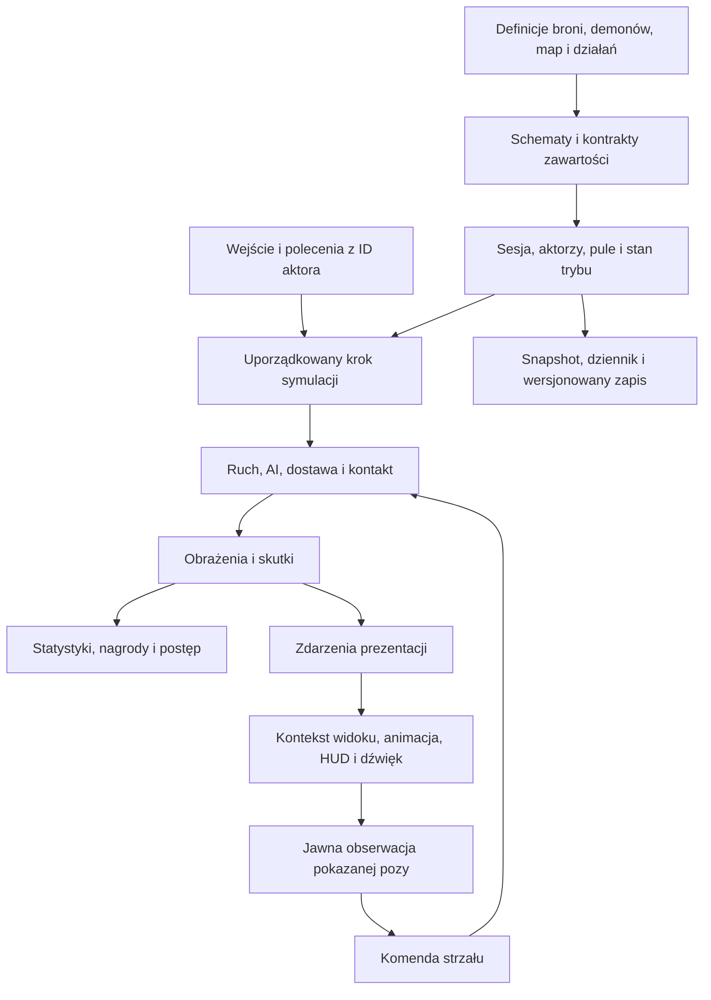

# SIGIL: BREACH — historia

Wszystko, co już było: zmiany każdej wersji i ich odbiór, audyty, analizy, stare plany i raporty. Najnowsze na górze w każdym rozdziale wersji. Nowa wersja dopisuje sekcje `ZMIANY-<wersja>.txt` i `ODBIOR-<wersja>.txt` na górze rozdziałów „Zmiany wersji” i „Odbiór wersji” (`BUILD.ps1` ich szuka). Starsze plany (`PLAN-*`, podręcznik matematyki, dawne konteksty) usunięto w porządkach 2026-11-03; są w historii gita, np. `git show e44c509:game/docs/PLAN-SOULS-v13.md`.

## Spis rozdziałów

- Zmiany wersji
- Odbiór wersji
- Raport Astry 0.44
- Analiza obrazu i strzelania V01 (Astra)
- Przegląd zmian przez Astrę (2026-11-03)
- Audyt 2026-11-03: audyt Claude
- Audyt 2026-11-03: audyt Astry
- Audyt 2026-11-03: prompt audytu
- Audyt 2026-11-03: dawny prompt dla nowego Claude
- Analiza rozgrywki 2026-11-02: plan
- Audyt 2026-11-02: raport końcowy
- Audyt 2026-11-02: postęp
- Audyt 2026-11-02: próba właściciela
- Audyt 2026-11-02: audyt Claude
- Audyt 2026-11-02: audyt Astry
- Audyt 2026-11-02: prompt audytu
- Audyt 2026-11-02: dawny prompt dla nowego Claude
- Postęp napraw audytu (2026-11-01)
- Punkt 1: wydajność
- Plan dopracowania poligonu
- Raport poligonu 2026-10
- Poradnik poligonu i walki 2026-10
- Audyt gotowości bazy v11
- Domknięcie audytu v11
- Odbiór poprawek v11
- Dawny kontekst
- Poradnik edycji gry właściciela (ok. 0.33)
- Plan po audycie 2026-11-03 i jego postęp (zastąpiony wieczorem 2026-11-03)
- Analiza 2026-11-03b: prompt (czytelność walki, ekran, sklep, dźwięk, animacje, znajdźki)
- Analiza 2026-11-03b: Claude
- Analiza 2026-11-03b: Astra
- Raport Astry P4 (animacje i efekty, 0.45)
- Przegląd skalowalności i jakości (2026-11-08)
- Przegląd jakości i powiązań kodu (2026-11-07)
- Przegląd skalowalności projektu (2026-11-07)
- Analiza silnika ruchu i strzału (2026-11-07)
- Plan Exorcista (zastąpiony 2026-11-07)
- Analiza Exorcista — ciężar, animacje i audio (2026-11-07)
- Plan sprzed Exorcista (zastąpiony 2026-11-07)
- Analiza audio sześciu postaci (2026-11-06)
- Plan sprzed przeglądu audio (zastąpiony 2026-11-06)
- Analiza Margrave'a (2026-11-06)
- Plan sprzed Margrave'a (zastąpiony 2026-11-06)
- Analiza Furfura (2026-11-06)
- Plan sprzed Furfura (zastąpiony 2026-11-06)
- Analiza Ember Thralla (2026-11-05)
- Plan sprzed Ember Thralla (zastąpiony 2026-11-05)
- Analiza Plague Gardenera (2026-11-05)
- Plan sprzed Plague Gardenera (zastąpiony 2026-11-05)

## Zmiany wersji

_Dawniej: `game/docs/ZMIANY.txt`_

SIGIL: BREACH / HISTORIA ZMIAN 0.2–0.44 (jeden plik, najnowsze na górze)

Dawniej osobne pliki ZMIANY-<wersja>.txt w game/docs i docs/history.
Każda sekcja zaczyna się nagłówkiem z dawną nazwą pliku, więc odwołanie
„ZMIANY-0.29.txt” w kodzie, planach lub starszych dokumentach wskazuje
sekcję o tym nagłówku. Treść sekcji pozostała bez zmian.

Nowa wersja: dopisz na samej górze sekcję z nagłówkiem ZMIANY-<wersja>.txt.
BUILD.ps1 odmawia budowy, gdy sekcji bieżącej wersji (src/core/build.lua)
brakuje. Opisy historyczne są zapisem tamtej chwili, a nie bieżącym API.
Bieżący stan opisują ARCHITEKTURA.txt, ROZSZERZANIE.txt i DEVELOPMENT.txt.


########################################################################
ZMIANY-0.45.txt
SIGIL: BREACH 0.45 / plan z 3 listopada wieczorem (docs/PLAN.md, decyzje D11–D20)

- G4a, jeden świat podzielony na obszary, 2026-11-09 (decyzja właściciela 8):
  obszar drogi może zadeklarować granice na swojej mapie (`bounds`, lista
  prostokątów); obszar bez granic to reszta mapy (jak dziś kaplica).
  `Way.areaAt` mówi, w którym obszarze stoi punkt, `Way.areasOf` podaje obszary
  mapy. Rycerz jest w obszarze, w którym stoi: przekroczenie granicy to krok,
  nie podróż (świat się nie przebudowuje), z nowym zdarzeniem `AreaEntered`.
  Garnizony wszystkich obszarów mapy stoją od początku; stwór obszaru, w którym
  rycerza nie ma, śpi (`dormant`: nie rusza się i nie widzi), chyba że już
  poluje. Identyfikator posterunku jest jedyny na całej mapie. Indeks
  przestrzenny ciał zostaje na moment, gdy obszar przekroczy ok. 40 stworów.
  Przy jednym obszarze nic się nie zmienia. Gra i golden bez zmian.

- G5c, podział pielgrzymki i kierunki warstw, 2026-11-09: format pliku drogi
  (walidacja, pole wznowienia, odczyt puli, deklaracja sekcji) wyszedł
  z `run/pilgrimage.lua` do `run/pilgrimage_save.lua` (1176 → 805 i 399
  linii); tryb przekazuje mu tylko `area` i `stand`. `render/gallery.lua` nie
  sięga już po ekran `ui/interface`, tylko po czcionkę przez
  `ui/skin` (`Skin.font`). Nowe reguły checkera: RENDER USES A SCREEN
  (rysowanie świata korzysta tylko ze środków malarskich `ui`: układ, skórka,
  tusz, czcionki, pieczęcie) i COMBAT USES THE SESSION (walka korzysta tylko
  z infrastruktury sesji: pule, sygnały, tworzenie, encje, zdolności, zasady
  trybów; składanie gry w `session/game.lua` i słuchaczach korzysta z walki,
  nie odwrotnie). Gra i golden bez zmian.

- G6a, narzędzia: osobne zapisy przebiegów i nieznane globale, 2026-11-09:
  na Linuxie każdy przebieg testów zapisuje pliki gry w swoim katalogu QA
  (`XDG_DATA_HOME=<qa>/save` w `tools/linux/project.sh`), nie we wspólnym
  `~/.local/share/love/sigil-breach-qa`; dwie bramy z dwóch klonów już się nie
  nadpisują. Na Windows LÖVE bierze katalog z systemu, nie ze zmiennej, więc
  tam bez zmian (bramy po kolei). Nowa reguła checkera UNKNOWN GLOBAL: kod gry
  (`src/`) nie czyta ani nie pisze żadnej globalnej poza Lua i `love`;
  sprawdzane na kodzie bajtowym LuaJIT, łącznie z funkcjami zagnieżdżonymi,
  a numery rozkazów reguła odczytuje z próbnych fragmentów (LuaJIT w LÖVE
  z `toolchain/` różni się od systemowego). `docs/TECHNIKA.md` bez
  nieaktualnych odwołań (`work/qa-v<wersja>`, `ROZSZERZANIE.txt`,
  `DEVELOPMENT.txt`), z opisem miejsca raportów i zapisów przebiegów na
  Linuxie. Gra i golden bez zmian.

- G5b, dźwięki czynów jako zdarzenia, 2026-11-09: symulacja nie wybiera już
  dźwięków. Dziesięć wywołań `Presentation.cue` z symulacji (flaska, egzekucja,
  zakup, drzwi przejście i otwarcie, odpoczynek, odzyskanie dusz, pusty spust,
  unik, wejście w strefę) to teraz zdarzenia z `session/event_catalog.lua`
  (dziewięć nowych, egzekucja już była). Który dźwięk i jak głośno: tabela
  `content/event_cues.lua` (te same głośności co dotąd); odtwarza je słuchacz
  `feedback/event_cues.lua` po kroku symulacji (różnica poniżej jednego
  kroku, 8 ms). Pusty spust i unik słychać, jak dotąd, tylko dla rycerza,
  który je wykonał na ekranie. Reguła checkera SIMULATION SOUND. Gra i golden
  bez zmian.

- G5a, poziom postaci zamiast flagi `boss`, 2026-11-09: ciało ma pole `tier`
  (`common`, `elite`, `boss`) zamiast flagi `boss`, która znaczyła elitę.
  Reguły pytają `Rules.elite(e)`: elita i prawdziwy boss zachwiewają się
  zamiast przerwania, dłużej są zablokowane po pękniętej gardzie i nie
  dostają obrażeń od uderzenia o ciało. Szablon `Creature.elite` (dawniej
  `Creature.boss`); Margrave (`boss`) i Furfur to elity. Zapis: pula
  w wersji 11, migracja zamienia `e.boss` na `e.tier`. Identyfikator stwora
  `boss` (Margrave) zostaje: to tylko nazwa, a jego zmiana dotknęłaby zapisów
  i setek odwołań. Checker: liczba całkowita jako klucz tabeli (`[10] =`)
  to indeks, nie strojenie. Zachowanie i golden bez zmian.

- F5, testy kontraktu z danych, 2026-11-08: nowy zestaw `contracts`
  (`tests/cases/contracts.lua`) generowany z definicji. Każdy atak każdego
  stwora (dziś 53) przechodzi całe życie w jednym pokoju: rozpoczyna się,
  wypuszcza i kończy albo od razu odmawia (żniwa Gardenera bez zasianego
  ogrodu), bez błędu, z położeniem skończonym i bez śladów innego właściciela;
  ciało zabite w połowie zamachu albo przy wypuszczeniu nie zostawia
  czekającego znaku. Każdy stwór ma atlas, anatomię, maski i tekst nazwy.
  Nowy stwór albo nowy rodzaj ataku dostaje te sprawdzenia bez pisania testu.
  Istniejące testy postaci zostają; ich sprawdzenia nazw póz i dźwięków
  pokrywa dalej kontrakt sztuki i dźwięku (`enemies/art_contract.lua`,
  `audio/contracts.lua`), więc ich usuwanie odkładam do przebudowy danej
  postaci. Gra i golden bez zmian.

- G3, style rysowania z rejestru, 2026-11-08: moduły rysowania nazwane po
  postaciach stały się malarzami rodzin stylów w `render/painters/`:
  `pool_rites.lua` (dawne `ash_art`, style `Rites.pools`), `lightning_rites.lua`
  (dawne `storm_art`, style `Rites.lightnings`) i `pigment.lua` (dawne
  `garden_art`). Rejestr `render/painters.lua` odnajduje je po katalogu; każdy
  malarz deklaruje, co rysuje (ślady według rodzaju, pozostałości, rzuty,
  pociski), i sam rozpoznaje swoje po danych. `hazard_kinds`, `effects`,
  `cast_accents` i `passes/projectiles` pytają rejestr i nie znają żadnego
  malarza; kolejność rysowania bez zmian. Nazwy pocisków i rodzajów ataków
  malowanych pigmentem przeszły z kodu do danych stylu
  (`content/art/garden.lua`). `combat/garden.lua` (złoża posiadane przez ciało,
  z limitem) to teraz ogólny klocek `combat/deposits.lua`; zapisane pole
  `garden` zostaje (zmiana wymagałaby migracji). `combat/stream.lua`
  i `render/ritual_art.lua` już są ogólne (strumień, pieczęcie świata).
  Obraz bez zmian. Gra i golden bez zmian.

- F4d, teksty stwora w pakiecie, 2026-11-08: nazwa, karta bestiariusza
  i paski stanu każdego stwora (klucze `creature_<id>…`, 25 wpisów) przeszły
  z `content/text.lua` do `words.lua` jego pakietu; `text.lua` dopisuje je
  przez `content/creature_packages.lua`. Reguła checkera PLAYER TEXT dopuszcza
  `content/creatures/<id>/words.lua`. Teksty bez zmian. Pakiet stwora ma teraz:
  `init.lua` (definicja), `sheet.lua`, `anatomy.lua`, `audio.lua`,
  `voices.lua`, `words.lua`. Poza pakietem zostają: jego miejsce na mapie
  i w pielgrzymce, wpis katalogu i zaopatrzenia (dane świata, nie postaci),
  maski (wspólny wypiek) i style rysowania (G3). Gra i golden bez zmian.

- F4c, dźwięk stwora w pakiecie, 2026-11-08: banki głosów sześciu stworów
  przeszły z `audio/banks/` do ich pakietów jako `voices.lua` (Ember Thrall:
  imp, Iron Thrall: armored, Star Acolyte: stolas, Gardener: buer, Margrave:
  boss, Furfur: furfur), a ich profile z `content/creature_audio.lua` jako
  `audio.lua`. Nowy moduł `content/creature_packages.lua` podaje części danego
  rodzaju ze wszystkich pakietów; `content/creature_audio.lua` i
  `audio/recipes.lua` zbierają je stamtąd, więc nowy stwór nie edytuje tych
  plików. W `audio/banks/` zostają banki wspólne (trafienia, medale, rytuały).
  Checker: części pakietu są osiągalne z jego `init.lua`. Receptury i profile
  bez zmian. Gra i golden bez zmian.

- F4b, arkusz i anatomia w pakiecie stwora, 2026-11-08: arkusz atlasu
  i anatomia każdego stwora leżą w jego pakiecie (`sheet.lua`, `anatomy.lua`);
  listy atlasów (`content/art/sheets/index.lua`, `content/art/anatomy/index.lua`)
  tylko je wskazują, w tej samej kolejności. Wspólne pomocniki anatomii
  (`author`, `leap`, `evade`) zostają w `content/art/anatomy/`. Skrypty
  eksportu arkusza i anatomii (Linux i Windows) instalują plik do pakietu
  i zakładają katalog; komunikaty narzędzi i TECHNIKA wskazują nowe miejsca.
  Maski trafień zostają jednym plikiem wypiekanym ze wszystkich atlasów
  naraz (`content/art/hit_masks.lua`, z kodekiem i pochodzeniem źródeł):
  to wynik wypieku, nie plik pisany ręcznie, więc świadomie nie dzielę go
  na pakiety. Skrypty Windows bez próby (brak Windows). Gra i golden bez
  zmian.

- F4a, stwór jako pakiet, 2026-11-08: każdy stwór ma własny katalog
  `content/creatures/<id>/`; jego definicja to `init.lua` tego katalogu.
  Nazwa modułu (`src.content.creatures.<id>`) się nie zmienia (LÖVE ładuje
  `?/init.lua`), więc zapisy, przeładowanie stworów na poligonie (F5)
  i odwołania działają bez migracji. Checker czyta `init.lua` jako moduł
  katalogu; sonda ścieżek (`tools/linux/check-work-paths.sh`) i narzędzie
  `tools/art/chapel_hall` szukają też `?/init.lua`. Gra i golden bez zmian.

- G2, rejestr efektów sigili, 2026-11-08: sigil to dane i rodzaj efektu.
  `content/sigils.lua` daje każdemu sigilowi pole `effect` (Stolas: verdict,
  Furfur: riposte, Buer: reprisal, Paimon: impetus); rodzaje są w rejestrze
  `combat/sigil_kinds.lua` i podpinają się pod momenty walki (koszt uniku,
  doskonały unik, flaska, przeładowanie, strzał, trafienie, rozliczenie salwy,
  rana, odzysk). `combat/sigils.lua` przechodzi po noszonych sigilach
  w kolejności katalogu i nie zna żadnego po nazwie. Nowy sigil wskazuje
  istniejący rodzaj; nowy rodzaj to jeden wpis w rejestrze. Stan sigili
  zostaje pod tymi samymi kluczami (zapis bez migracji). Liczby i zachowanie
  bez zmian: sonda porównała stary i nowy interpreter w 36 000 losowych
  momentach walki (wartości, stan, zdrowie, odzysk): zero różnic.

- G1c, koniec zamrożonych kopii ataków, 2026-11-08: usunięte
  `content/migrations/` (kopie ataków Margrave'a, Furfura i Gardenera,
  925 linii), `storage/definition_migration.lua` i pole `savedAttacks`
  definicji stwora. Po G1a nowe zmiany treści nie potrzebują kopii. Walka
  zapisana w puli starszej niż wersja 7 (sprzed nazw w listach i sprzed
  zmian, które te kopie obsługiwały) nie jest już wznawiana dokładnie:
  pielgrzymka wznawia teren w przybliżeniu, jak przy każdej nieczytelnej
  walce (rycerz, stwory, ich miejsca i zdrowie zostają; ginie to, co było
  w locie: pocisk, rozpoczęty cios). Usunięta też martwa gałąź wersji 1–2
  puli (domyślne pola aktora). Rodzaj ataku `pool`, którego nie nosi dziś
  żaden stwór, zostaje w silniku; jego przykład przeszedł do wsparcia testów
  (`tests/support/pool_attack.lua`). Gra i golden bez zmian.

- G1b, sigile w zapisie bez odrzucania pliku, 2026-11-08: odczyt zapisu
  pielgrzymki nie odrzuca już pliku, gdy noszone sigile przekraczają miejsca,
  znalezione kopie albo limit sigila (dawniej wpisany na sztywno limit 3
  i „Cannot read the save” po podniesieniu kosztu sigila). Nadmiar jest
  zdejmowany w kolejności katalogu, aż zmieści się w miejscach; liczba kopii
  nie przekracza limitu oferty ani znalezionych. Zły typ (np. ułamek kopii)
  nadal odrzuca plik. Gra i golden bez zmian.

- G1a, zapis definicji po identyfikatorze, 2026-11-08: zapis wskazuje
  definicję z listy jej id, a nie miejscem na liście. Krok ścieżki elementu
  listy, którego elementy mają różne id, to `{ $key = id }`
  (core/data_tree.lua); odczyt szuka elementu o tym id. Wstawienie,
  usunięcie albo przestawienie ataku w liście stwora nie podmieni już ataku
  wznowionego po Continue: ten sam atak wraca, a atak, którego postać już
  nie ma, czyni walkę nieczytelną (teren wznawia się w przybliżeniu, jak
  dotąd przy każdej nieczytelnej walce), nigdy innym atakiem. Pula zapisu
  ma wersję 10; migracja 9→10 czyta starą ścieżkę według dzisiejszej treści
  i zapisuje ją po id. Wersja sekcji zapisu, gdy jej nie podano, to ostatnia
  migracja plus jeden (storage/save.lua), więc wersji nie da się podnieść
  bez migracji. Gra i golden bez zmian.

- E6d, gest strzału, 2026-11-08 (punkt 4 planu Exorcista): wystrzał jest
  jednym gestem. Dotąd pchnięcie wzdłuż luf miało szczyt po 42 ms, a uniesienie
  i nadgarstek po 67 ms; pchnięcie odbijało 16% za spoczynek, a kamera
  uspokajała się razem z rękami. Teraz pchnięcie ma szczyt po 50 ms, razem
  z nadgarstkiem, blisko uniesienia (67 ms), i chwyt zatrzymuje broń bez odbicia
  (1%). Wszystko w rękach uspokaja się przed otwarciem zamka (0,26 s).
  Kamera daje krótki akcent przed rękami: te same 2° podbicia, szczyt po 33 ms,
  uspokojenie po 167 ms zamiast 258 ms (miernik `feel`: 217 ms zamiast ok. 320
  ms z E0). Ręce niosą resztę ciężaru. Jedna łuska jest teraz słabsza w każdym
  kanale: wstrząs i rozszerzenie widoku też biorą moc wystrzału (0,025 i 0,8
  zamiast 0,05 i 1,6). Silnik: sprężyna pchnięcia z danych broni (weight.backK,
  weight.backD; bez nich wspólna). Exorcist: nadgarstek 420/35, pchnięcie
  420/34, viewKickRate 34. Judge bez zmian (sonda: liczby identyczne).
  Cel, rozrzut, obrażenia, odrzut ciał i kadencja bez zmian. Malowane klatki
  strzału bez zmian. Rozstaw celownika (HUD) bez zmian: kanał recoil zostaje.

- E6c, gesty uniku, ślizgu, skoku i dobycia, 2026-11-08 (punkt 3 planu
  Exorcista): silnik ma ogólny gest ciała w trzech fazach. Przyjęcie ciężaru
  to impuls przeciw ruchowi, gdy gest się zaczyna. Podtrzymanie to miejsce
  broni, dopóki gest trwa. Odzyskanie chwytu to impuls w górę i z powrotem,
  gdy gest się kończy. Liczby każdego gestu (unik, ślizg) są w profilu rąk
  broni. Exorcist w uniku zostaje za ruchem, trzymany bliżej i niżej (1,4 px)
  i pochylony za ruchem; na końcu uniku chwyt wraca i po 0,6 s nic z gestu nie
  zostaje. W ślizgu trzymany nisko (2,6 px ponad dawne opuszczenie) przy
  stałych lufach; wyjście ma wyraźny impuls chwytu. W skoku ręce mocniej
  siadają przy odbiciu (×1,25) i później podążają za wznoszeniem. Dobycie:
  broń szybko wznosi się i wyhamowuje w barku (w 60 ms o 38 px obrazu 450 px
  wyżej niż dawne liniowe wysunięcie), potem kolba osiada (do 1,6 px i 0,012
  rad); po 0,20 s, gdy broń może strzelić, jest dokładnie na miejscu.
  Pierwszeństwo ręki: przeładowanie wznowione przy dobyciu oraz flaska i proch
  zabierają osadzenie; przeładowanie usztywnia też gesty jak dotąd. Gest
  należy do broni, która go zrobiła: zmiana broni w uniku zaczyna nową bez
  gestu; MOTION off, reset i pauza czyszczą lub zatrzymują go jak resztę rąk.
  Nowe pola widoku są deklarowane i wygładzane w obrazie. Judge ma zera
  w gestach i dawne liniowe dobycie: porusza się dokładnie jak przedtem.
  Mechanika (czasy uniku i ślizgu, zamiana broni po 0,20 s, strzał)
  bez zmian. Rysunek broni bez zmian.

- E6b, ciężar noszenia Exorcista, 2026-11-08 (punkt 2 planu Exorcista):
  pierwszy własny profil rąk broni. Dotąd start, hamowanie, zmiana kierunku,
  lądowanie i spoczynek wyglądały identycznie dla obu broni, a Exorcist różnił
  się tylko większym kołysaniem w chodzie, w każdej osi. Teraz dwie ręce na
  ciężkiej broni: lufy zostają przy starcie trochę dalej i później (0,94
  wobec 0,83 jednostki obrazu 450 px, 150 wobec 142 ms) i osiadają bez
  cofnięcia za spoczynek; kolba trzyma broń równo w zmianie kierunku (pochył
  0,009 wobec 0,015 rad) i w kroku (obrót w chodzie 0,0036 wobec 0,0059),
  a ciężar mocniej siada w dół (3,8 wobec 3,4); lądowanie siada głębiej
  (4,2 wobec 3,7) i nie odbija. W spoczynku broń jest trzymana oszczędniej
  (oddech x 0,44 zamiast 0,60, y 1,06 zamiast 1,44), z wolnymi, drobnymi
  korektami chwytu poza rytmem oddechu; unik je wycisza. Silnik dostał
  nazwy ruchu dip.landing, pose.quietLower i pose.grip* z wartościami, przy
  których Judge porusza się dokładnie jak przedtem (sonda: wszystkie liczby
  Judge'a identyczne). Rysunek broni bez zmian; przesuwa się tylko jej obraz,
  o ułamki piksela do około piksela. Szybkość ruchu, kadencja, celowanie
  i symulacja bez zmian.

- E6a, broń jako profil silnika, 2026-11-08: ręce niosą broń według jej
  własnego profilu. Definicja broni może mieć pole hands: nadpisania wspólnej
  tabeli ruchu rąk (content/hand_motion.lua) pod tymi samymi nazwami, na
  przykład głębsze opuszczenie w uniku albo inna sprężyna celowania.
  feedback/hand_profile.lua składa profil broni w ręku, a weapon_motion czyta
  liczby tylko przez niego. Profil z nazwą ruchu, którego ręce nie mają, jest
  odrzucany przy definicji broni. Broń ma też własny bank dźwięku
  przeładowania: reload.voices i reload.sounds nadpisują głos i głośność
  etapu (otwarcie, ładowanie, zamknięcie) jej mechanizmu; zdarzenie etapu
  niesie teraz broń przy każdym etapie. Masa, pęd, celowanie, noszenie
  i kształt odrzutu (podbicie, cofnięcie, obrót, nadgarstek, kopnięcie
  widoku) były już danymi broni (weight). Exorcist i Judge nie mają jeszcze
  własnych nadpisań: obraz i dźwięk bez zmian.

- F3e, klocki mechanik, 2026-11-08: nowy moduł enemies/mechanics.lua zbiera
  to, z czego składają się rodzaje ataku: wyrzut (origin: skąd pocisk
  opuszcza ciało), pocisk prosty (launch), pocisk łukiem (lob), znak na
  ziemi należący do ciała (deposit) i serię ciosów w odstępach na zegarze
  ciosu (series, z własnym zadeklarowanym stanem). Rodzaje bolt, fan, pool,
  salvo, storm, sow i rytuał na ziemi (pattern) składają się z tych klocków
  zamiast z własnych kopii; salwa i burza dzielą jedną serię. Fala, promień
  i burza w pokoju to rodzaje zagrożeń (enemies/hazards.lua), więc zostają
  klockami po stronie zagrożeń. Ruch ciała jest wspólny od E2. Strumień ma
  własny kształt styku, wspólny z obrazem (combat/stream.lua), i nie
  rozkłada się na te klocki bez zmiany zachowania. Nowy rodzaj złożony
  z klocków nie wymaga zmiany silnika. Zachowanie bez zmian.

- F3d, poza na zegarze symulacji, 2026-11-08: trzy zegary w pozie stwora
  czytały zegar obrazu (g.time), który biegnie także w pauzie, na mapie
  i w menu: unoszenie Stolasa (klatka, wysokość, pochylenie), oddech
  w spoczynku i drżenie rany. Poza ustawia bryły trafień, więc sama pauza
  przesuwała maskę trafień stwora. Teraz te zegary to zegar symulacji
  (g.elapsed); obraz rysowany między dwoma krokami czyta go między nimi
  (poseTime w render/presentation.lua), więc ruch na ekranie zostaje płynny
  przy 144 Hz. Widoczna zmiana: w pauzie, na mapie i na ekranie śmierci
  unoszący się, oddychający i drżący stwór stoi nieruchomo, a ogień, niebo
  i światła dalej się ruszają. W grze ruch jest ten sam, z innym
  przesunięciem fazy. Golden bez zmian.

- F3c, poza z rejestru stanów, 2026-11-08: Anim.pose
  (enemies/animation.lua) nie jest już łańcuchem warunków. Pyta po kolei
  stany ciała z rejestru Anim.states (martwe, powalone, wyczerpane, ból,
  przejście fazy, zamach, cios, odpoczynek, chód, spokój), a pierwszy, którego
  warunek zachodzi, rysuje ciało. Stwór albo mod dodaje własny stan przed
  wybranym (Anim.state(id, { before = ... })), bez zmiany Anim.pose; rejestr
  rdzenia umie wstawić wpis przed innym (Registry:insert). Obraz i maski bez
  zmian.

- F3b, rodzaj kończy własny stan, 2026-11-08: miejsce oznaczone przez
  piorun przed ciosem (dawne pole ciała pendingHazard) jest teraz stanem
  jego rodzaju (e.act.mark). Rejestr rodzajów (combat/action_kinds.lua) nie
  zna już pól żadnego rodzaju: rodzaj sam porzuca to, co oznaczył
  (abandon), puszcza chwyt (release) i zwalnia odwołania do świata, gdy
  ciało upada (forget). Rodzaj może zmienić kształt swojego stanu: deklaruje
  version i migrations, zapis pul notuje wersje rodzajów, które je mają,
  a wczytanie podnosi starszy stan w samym rodzaju, bez nowej migracji
  całego zapisu. Zapis pul ma wersję 9. Zatrzymanie przed ciosem
  (holdLeft, holdSpan), łańcuch i ciąg ciosów zostają polami ciała: to
  zegary stanu ciała wspólne dla każdego rodzaju, jak windup, wygładzane
  w obrazie (render/presentation.lua), a łańcuch i ciąg trwają dłużej niż
  jeden atak. Zachowanie bez zmian.

- F3a, stan ataku należy do jego rodzaju, 2026-11-08: dziewięć pól, które
  znał tylko jeden rodzaj ataku (strumień: trafione ciała; żniwa: oznaczone
  łaty; szarża: zwroty; cięcie: ślad; chwyt: trzymany i czas uchwytu; salwa
  i burza: wypuszczone pociski), zeszło z płaskiego rekordu stwora
  (session/components.lua) do e.act: tabeli, którą rodzaj deklaruje
  (state = { pole = znaczenie }) i która powstaje świeża przy każdym
  rozpoczęciu ataku. Zapis pul ma wersję 8; starszy zapis przenosi te pola
  do e.act przy wczytaniu. Zachowanie bez zmian.

- E3b, mysz tylko obraca, 2026-11-08: ruch myszy zmienia wyłącznie kierunek
  patrzenia. Dawne kołysanie od myszy (swayX, swayY w app/input.lua) było
  zapisywane, wygaszane i wygładzane, ale nic go nie rysowało; usunięte
  razem z polami, wartością swayDecay i wpisami na listach. Obraz bez zmian.

- E3a, krok rycerza publikuje fakty, 2026-11-08: ruch rycerza
  (player/feel.lua) nie pisze już żadnego pola widoku i nie wybiera dźwięku.
  W chwili zdarzenia publikuje fakt (początek kroku, ślizg, uderzenie w mur,
  odepchnięcie zatrzymane przez mur, przebyta droga, wybicie, lądowanie,
  koniec kroku), a sprężyny kamery, kołysanie, przechył, FOV uniku,
  przysiad po lądowaniu, licznik kroków i dźwięki ślizgu, skoku, lądowania,
  kroku i uderzenia liczy prezentacja (feedback/motion.lua). Tak samo odmowa
  („nie teraz”) z player/intent.lua. Rytm kroków przeniesiony do
  feedback/gait.lua. Sprężyny nie są już prowadzone dla rycerzy, których
  nikt nie ogląda. Obraz i dźwięk bez zmian.

- F2d, migracje z deklaracji stwora, 2026-11-08: stwór, którego ataki
  zamrożono dla starszych zapisów, deklaruje to w swojej definicji
  (savedAttacks = { { through, module } }: Margrave do wersji pul 6,
  Gardener 4, Furfur 5). Reguły przepisania ścieżek w zapisie
  (storage/definition_migration.lua) powstają z tych deklaracji; osobna
  lista content/migrations/pool_definitions.lua usunięta. Wznawianie
  starych zapisów bez zmian.

- F2b, listy audio z deklaracji, 2026-11-08: banki głosów (stworów,
  rytuałów, medali i trafień) to pliki katalogu audio/banks; recipes.lua
  wczytuje każdy plik stamtąd zamiast własnej listy dziewięciu modułów.
  Pole, którego wartość jest nazwą głosu, mówi to w swoim schemacie
  (voice = true: dźwięki stworów, ataków, także zagnieżdżone, np. ślad
  palącego cięcia, i strzał broni); kontrakt audio sprawdza każde takie pole
  zamiast listy kluczy, więc głos ataku zagnieżdżonego i strzału broni jest
  teraz sprawdzany przy starcie. Sekcje profilu audio stworów deklaruje
  czytnik, który je gra (audio/creature_profiles.lua). Dźwięk bez zmian.

- F2a, bronie sklepu z deklaracji broni, 2026-11-08: broń sprzedawana przy
  ognisku deklaruje swoje miejsce w zbrojowni (content/weapons.lua:
  shop = { order }), a karta wynika z jej ilustracji (content/art/
  weapon_frames.lua: card, komórka arkusza kart). Sklep, jego polecenia
  i arkusz kart nie trzymają już listy dwóch broni (ui/fire_shop.lua,
  app/commands.lua, ui/skin.lua). Wygląd i kolejność kart bez zmian.

- E2c, jedna ścieżka lotu, 2026-11-08: skok stwora i padające ciało mają
  jedną ścieżkę na każdej mapie (enemies/flight.lua, enemies/body.lua).
  Wcześniej mapa bez podwyższeń szła osobną drogą: inny wzór czasu
  lądowania (Kinematics.flatFallTime, usunięty), lot bez pod-kroków,
  bez stropu i z limitem sześciu przejść upadku. Teraz ciało ląduje o
  czasie swojej podłogi, chyba że ruch z krawędzi podniósł podłogę pod nim;
  wtedy ten czas jest tylko granicą pod-kroku.

- E2b, równe omiatanie każdego rycerza, 2026-11-08: ruch stwora (szarża,
  wypad, skok) spotyka każdego rycerza w tej samej części kroku, w której
  sam się porusza (combat/body_contact.lua: moveEnemy z ułamkami kroku).
  Wcześniej tylko sterowany rycerz był omiatany co pod-krok, a pozostali
  od migawki początku kroku do miejsca z jego końca: stwór ruszający się
  przez ćwierć kroku zderzał się z miejscem, do którego drugi rycerz
  dopiero dojdzie. Jeden rycerz bez zmian.

- E2a, jedno ciało: lot i pchnięcie, 2026-11-08: rycerz, skok stwora
  i padające ciało lecą przez jedno Kinematics.flight, a pchnięcie rycerza
  słabnie przez to samo Physics.drag co u stworów (wcześniej trzy kopie
  wzoru lotu i własna kopia oporu). Różnica, która zostaje do E2c, ma nazwę:
  Kinematics.flatFallTime (płaski świat bez podwyższeń) obok fallTime.
  Brama: reguła BODY MOTION w src/player i src/enemies.

- E5e, liczby odczucia rąk i ciosów w treści, 2026-11-08: ruch rąk z bronią
  (nowy content/hand_motion.lua: zaparcie przy przeładowaniu, stopa,
  bezwładność celowania, odchylenie, przechył, zanurzenie, lot, odepchnięcie,
  opuszczenie broni, oddech i poza), dźwięki i znaczniki ciosu, werdykty
  trafień i serce (tuning.lua: weight) oraz kontakty ciała odczuwane
  w rękach (tuning.lua: contact) mają nazwy w treści. Zachowanie bez zmian.

- E5d, impuls jako zdarzenie, 2026-11-08: ciosy w rycerza, ściana, wybicie
  i lądowanie, potwierdzenia trafień, zachwianie, uchwyt, wstrząsy świata,
  wybuch i zawalenie odpowiadają przez jeden zapis (feedback/impulses.lua:
  Impulses.react). Zdarzenie podaje siłę (wielkość fizyczną, którą nazywa
  profil), kierunek w oczach patrzącego i odległość; profil w nowym
  content/view_reactions.lua mówi, ile każdy kanał z tego bierze. Kanały mają
  wspólne granice, szczyt (wstrząs, puls kadru) zostaje przy silniejszym.
  Siła odpowiedzi bez zmian. Liczby odczucia przeniesione z tuning.lua
  (shot, world, feel) i z kodu do profili. Brama: reguła IMPULSE WRITE,
  a zapadka liczb bez nazwy obejmuje teraz feedback/.

- E5c, wartości startowe pól widoku, 2026-11-07: pole widoku z wartością
  startową ma ją zapisaną raz (session/fields.lua: Fields.start); nowy
  widok, widok ciała bez obserwatora i wyczyszczony ruch biorą ją stamtąd.
  Odczyty w feedback/ nie mają już własnych zapasów `or 0` (76 miejsc).
  Wiek strzału miał wcześniej trzy różne zapasy (10, 99, nieskończoność),
  teraz ma jeden (content/tuning.lua: viewDefaults). Brama: reguła VIEW START.

- E5b, podbicie w klatce błysku, 2026-11-07 (decyzja właściciela): kamera
  i dłonie ruszają w tej samej chwili strzału co błysk. Impuls strzału
  liczy się od początku jego kroku, a wiek błysku jest pokazywany zegarem
  obrazu, więc błysk nie wyprzedza już obrazu i płynie między krokami.
  Szczyt podbicia wypada o jeden krok (8,3 ms) wcześniej, siła bez zmian.
  Sprężyny dłoni (przechył, uniesienie, cofnięcie) i ich granice są
  w content/tuning.lua (camera.hands), jedna tabela dla strzału i powrotu.

- E5a, wstrząs kamery, 2026-11-07: strzał dołącza do wstrząsu już
  pokazanego zamiast go zastępować; słabszy nie zbija silniejszego.

- E4, płynny obraz stworów, 2026-11-07: przy ekranach innych niż 120 Hz
  stwory nie zacinają się już co kilka klatek w przygotowaniu, ciosie,
  skoku, unoszeniu i wyjściu z portalu; ładunek prochowy leci płynnie.
  Wygładzanie wynika z deklaracji pól. Tylko obraz: symulacja i golden
  bez zmian.

- E1b, ukos rycerza, 2026-11-07: chód na ukos płaci udział kroku w bok
  właściwy dla 45° (o ok. 3% szybciej niż dotąd). Nowy wzorzec golden Linux.

- E1, jedne zasady ruchu, 2026-11-07: spowolnienie kroku w bok i w tył,
  chwila po strzale przed unikiem i nietykalność uniku 0,32 s obowiązują
  w każdym trybie, także w testach. Tryb decyduje tylko o wytrzymałości.
  Golden bez zmian.

- F1, jedna nazwa modułu, 2026-11-07: brama architektury odrzuca moduł
  wczytany pod dwiema nazwami i nazwę dwóch modułów. Ujednolicono 249 nazw
  w 145 plikach i jedną kopię funkcji pomocniczej. Bez zmian gry i golden.

- E0, miernik odczucia, 2026-11-07: nowy zestaw `feel` mierzy obraz
  pokazywany graczowi (pętla aplikacji, wygładzona próbka) przy sześciu
  częstotliwościach ekranu i nierównych klatkach: zamrożone klatki,
  opóźnienie od wejścia, kształt i uspokojenie podbicia po strzale, ruch
  każdego stwora. Znane wady są trzymane z etapem planu, który je usuwa.
  Bez zmian gry, zasobów i golden.

- Przegląd jakości i powiązań kodu, 2026-11-07: pomiar kosztu zmian,
  zależności, liczb w kodzie i spójności nazw. PLAN uzupełniono
  o fundament F1–F5 do akceptacji. Bez zmian gry, zasobów i golden.

- Silnik ruchu i strzału, analiza 2026-11-07: przegląd skalowalności
  projektu i analiza fizyki ruchu oraz strzału na polecenie właściciela
  (silnik ogólny, postacie w silniku). Nowy PLAN E0–E7 do akceptacji;
  plan Exorcista zachowano w całości w HISTORII i włączono jako E6.
  Bez zmian gry, zasobów i golden.

- Exorcist, analiza 2026-11-07: prześledzono ciężar noszenia, gesty,
  odrzut, kamerę, audio i zależności. PLAN zawiera zakres do akceptacji;
  poprzedni plan audio zachowano w całości niżej. Bez zmian gry i zasobów.

- Audio sześciu postaci, wdrożenie zaakceptowane 2026-11-06: rozdzielono
  odgłosy ciała, przygotowania i wykonania, przelot/kontakt pocisku oraz
  groźny przebieg i wygaśnięcie pola. Źródła podążają za ciałem, pociskiem
  i najbliższym punktem fali; panorama, odległość i zasłonięcie reagują na
  ruch gracza. Alarm, odskok i zderzenie również uwzględniają ściany.
  Przerwanie wygasza głos, pauza go zawiesza, a Continue odtwarza właściwą
  fazę bez ponownego uderzenia dawnego pioruna. Zapis i symulacja bez zmian.
- Sześć odrębnych charakterów głosu otrzymało mocniejsze, indywidualne
  przetwarzanie oraz własne kontakty z podłożem i materiały ataków. Stolas:
  odegrane ludzkie krzyki i jęki w fali/rozdarciu, oddzielone od głosu maga.
  Iron: ludzki głos w pancerzu i nagrany łańcuch; Gardener: zdławienie,
  mokre kontakty, nasiona i korzenie; Furfur: zwierzęcy ryk i burza;
  Ember: krótkie wysiłki i oddech; Margrave: zdarty głos, żar i ciężar.
  Nowe nagrania marc3122, AuraVoice i kyles: CC0, pochodzenie przy WAV.
- Poprawiono rywalizację o 28 głosów i ochronę strzału; nakładające się
  rytuały mają wspólny budżet poziomu, ponieważ sonda 24 chórów wykazała
  przesterowanie. Pojedynczy czar zachowuje poziom, osobni rzucający nie
  tracą automatycznie odgłosu przez wspólny typ obrażeń. Żadnych zmian
  grafiki, HUD-u, obrażeń, HP, czasów SI ani pozostałych zasad walki.

- Audio sześciu postaci, 2026-11-06: zakończono ponowną analizę głosów,
  ataków, ruchu i słyszalności. PLAN zawiera propozycję do akceptacji:
  sześć odrębnych charakterów, krzyki potępionych w czarach Stolasa,
  spójne wyzwalanie, przestrzeń i miks. Wdrożenie nie rozpoczęło się;
  kod, WAV, PNG, balans i golden pozostają bez zmian. Szczegółowy raport
  i poprzedni PLAN Margrave'a zachowano na końcu HISTORII.

- Margrave, 2026-11-06, końcowy krok zaakceptowanego pakietu: gotowa
  elita po 0,9 s oczekiwania korzysta z istniejącej kolejki do wolnego
  miejsca ataku. Nie zwiększa limitu napastników, nie odbiera rozpoczętej
  serii i nie skraca przygotowań ani odpoczynku. Jedyny parametr produkcyjny
  tego kroku to move.attackWait Margrave'a; pozostałe postacie bez zmian.
  Oczekiwanie przeżywa Continue. Stan niegotowy, martwy, ogłuszony,
  niewidoczny, zbyt odległy lub z innym celem nie blokuje pozostałych.

- Margrave, 2026-11-06, lądowanie, animacje, efekty i głos:
  kontakt lądowania obejmuje rzeczywisty obrys uderzenia o promieniu 1,5 m,
  zamiast pudłować przez odstęp między ciałami. Zachowano 56 obrażeń,
  prędkość i zamrożony cel skoku. Przed niską falą jest 0,5 s przerwy;
  wcześniejsze trafienie nie wymusza następnego. To druga, oddzielna
  zmiana balansu zaakceptowanego pakietu; kolejka grupowa jest następnym krokiem.
- Włączono istniejący obrót ciała zgodny z kierunkiem ataku. Pocisk żaru
  wychodzi z punktu anatomii tasaka ku już zapamiętanemu celowi; ściana
  między ciałem a tasakiem blokuje wypuszczenie. Zapis pools v7 zachowuje
  starsze rozpoczęte czynności, a przyszłe wybory korzystają z nowej treści.
  Zimny start wczytuje katalog zamrożonych definicji także przy ponownym
  odczycie już zmigrowanego pliku; zapis nie może wskazać dowolnego modułu.
- Nowe sekwencje wykorzystują wyłącznie istniejące 32 klatki. Fizyczne
  cięcie ma zgaszony ślad, płonące cięcie osobny materiał, a bliski cios
  pokazuje tasak uderzający w posadzkę na rzeczywistym obwodzie kontaktu.
  Popiół ostrzega również pod poziomą kamerą; płomienie mają wysokość
  rzeczywistego zagrożenia. Niegroźny gasnący osad różni się od aktywnego
  ognia. Płomienie pochodzą z istniejącego zaakceptowanego arkusza palenisk;
  żaden PNG, wzorzec baza/, maska, stojący ogień ani HUD nie został przemalowany.
- Własny zdarty głos potępieńca i oddzielne materiały tasaka, kamienia
  oraz żaru: 45 WAV w 22 rolach, warianty obecności, wysiłku, bólu
  i trzy śmierci. CC0: rubberduck oraz ArcadeParty; źródła, przetwarzanie
  i sumy zapisano w assets/sounds/margrave/provenance.json. Warianty
  korzystają z RNG audio, wspólnych limitów i suwaków. Pozostałe postacie,
  ich próbki, HP, obrażenia oraz nagroda Margrave'a pozostają bez zmian.

- Margrave, 2026-11-06, pierwszy krok zaakceptowanego wdrożenia:
  seria tasaka ma najwyżej trzy ciosy, wliczając odpowiedź na zbyt wczesny
  unik. Wspólny opcjonalny budżet pochodzi z treści, przeżywa Continue
  i odnawia się przy nowym zobowiązaniu. Pozostałe postacie zachowują
  swoje reguły. Zachowano zmienne przytrzymania i pełny końcowy odpoczynek
  1,2 s. Starsza zapisana seria bez budżetu kończy się według starych reguł.
  Ten commit obejmuje jedną zmianę balansu; lądowanie, obraz, głos i kolejka
  grupowa pozostają kolejnymi krokami zaakceptowanego planu.

- Dokumentacja, 2026-11-06: analiza Margrave'a i plan DO AKCEPTACJI.
  Potwierdzono pudło lądowania, nieograniczone serie, rozjazd kierunku
  ciała i tasaka, znikanie zapowiedzi pod graczem, oczekiwanie w grupie
  oraz brak własnych głosów. Zapisano pełny inwentarz i pomiary.
  Rekomendacja: dopracować obecny zestaw, ograniczyć serię do trzech
  ciosów, naprawić lądowanie z uczciwą przerwą przed falą i rozróżnić
  gesty/materiały. Poprzedni PLAN Furfura zachowano w całości.
  Bez zmiany kodu, grafiki, audio, balansu ani golden.

- Furfur, 2026-11-06, wdrożenie zaakceptowanego planu: szarża ma jeden
  nawrót zamiast dwóch. Przed nim ciało hamuje i obraca się z ograniczoną
  prędkością do zapamiętanego celu; wypuszczony przebieg nie naprowadza się.
  Zachowano pełne 1,2 s odpoczynku. Dobitka jest dostępna po tym odpoczynku,
  ma osobny zamach i rzeczywisty zasięg poroża; usunięto pudło o 3 cm.
  Nieskuteczne kopnięcie zastąpił powolny zwrot z ciosem poroża. Dwa zwykłe
  zamachy pokazują kierunek istniejącego ruchu ciała. Bez zwiększania HP,
  obrażeń, nagrody, liczby aktów ani okna pękniętej gardy.
- Burza nie namierza nowych miejsc za ścianą. Już postawione znaki pozostają
  nieruchome; śmierć usuwa zagrożenia. Sygnały wzniesione na obwodzie
  rzeczywistego obszaru są widoczne z poziomej kamery. Piorun ma wysokość
  zagrożenia, gest poroża własny akcent, a gasnący ślad nie zadaje obrażeń.
  Wykorzystano istniejące malowane tekstury; żadnego przemalowania PNG,
  ognia, ogona, ciała ani chronionego HUD-u.
- Opcjonalna kolejka przyznaje wolne miejsce gotowemu Furfurowi czekającemu
  co najmniej 0,9 s. Nie podnosi limitów atakujących i nie przecina rozpoczętej
  serii. Sprawdza cel, widoczność, gotowość i możliwość ataku bez losowania.
  Sekcja zapisu pools v6 zachowuje stare rozpoczęte czynności Furfura przez
  zamrożone definicje; nowe wybory korzystają z aktualnego zestawu.
- Czytelniejsze przygotowania, nawrót, zwrot, odskok i powroty wykorzystują
  istniejące 37 klatek. Powrót i reakcja na obejście pokazują tył zgodnie
  z obserwatorem; punkty emisji biorą pozycję z anatomii poroża.
- Własny głos Furfura: oddech, pomruk, pościg, alarm, wysiłek poszczególnych
  czynności, odpoczynek, ból i trzy śmierci. 45 próbek mono PCM 44,1 kHz
  w 22 rolach, osobne materiały kopyt, poroża i burzy, warianty i wspólne
  limity źródeł. CC0: msantoro11 (Deer Meewing 01.wav), Ogrebane i ArcadeParty;
  pochodzenie, licencje, przetwarzanie i sumy w assets/sounds/furfur/provenance.json.
  Materiały są własną syntezą. Nie zmieniono próbek innych stworów.

- Dokumentacja, 2026-11-06: analiza Furfura i plan DO AKCEPTACJI.
  Potwierdzono niedostępną dobitkę, błędny kontakt kopnięcia, niewidoczny
  zwrot szarży, oczekiwanie za drobnicą, namierzanie burzy za ścianą
  i znikanie jej znaku pod graczem. Zapisano pomiary, inwentarz ataków,
  kierunek animacji/głosu, zależności i plan testów. Poprzedni PLAN Embera
  zachowano w całości. Bez zmian gry, zasobów, balansu i golden.

- Ember Thrall, 2026-11-05: dopracowano najliczniejszego przeciwnika wręcz
  bez nowego czaru, zwiększania 360 HP, obrażeń, prędkości czy czasów ataków.
  Drugi pazur, cios po lądowaniu i odwrót mają osobne sekwencje istniejących
  póz. Odwrót nie pokazuje zamachu, kręgu zagrożenia ani odgłosu cięcia.
  Cztery arkusze Embera, maski, anatomia i baza są identyczne bajtowo.
- Fizyczne cięcie po skoku korzysta z zaakceptowanej, zgaszonej sekwencji
  pazurów w kości, ochrze i czerwieni. Skok pokazują ciało i jego cień;
  usunięto zdalny krąg wskazujący punkt celowania zamiast rzeczywistego
  lądowania. Kurz i odgłos kontaktu powstają w miejscu opadnięcia ciała.
  Żadnej nowej tekstury ani zmiany chronionego HUD-u.
- Wspólna rezerwacja ataku obejmuje krótką przerwę rozpoczętej serii.
  Grupa nie wpuszcza czwartego atakującego przed wznowieniem następnego
  ciosu. Przerwanie, śmierć i inny cel nadal zwalniają miejsce. Naprawiono
  również wykryty podczas odbioru cios przez ścianę: próbka dalekiego pazura
  musi mieć wolny odcinek od ciała do punktu kontaktu, nie tylko wolną drogę
  końcówki między klatkami. Reguła jest wspólna, bez wyjątku nazwy potwora.
- Ember ma własny suchy głos: oddech, pomruk, pościg, alarm, wysiłek czterech
  ataków, odzyskanie oddechu, ból i trzy wykonania śmierci. Osobne są szelest
  przygotowania, pazury, wybicie, odwrót i lądowanie. 35 próbek mono PCM,
  warianty bez natychmiastowych powtórzeń, istniejące priorytety i limity
  28+28 źródeł. Źródła głosu CC0: Ogrebane i ArcadeParty; autorstwo, adresy,
  sumy i przetwarzanie zapisano w provenance. Materiał ruchu jest syntezą
  krótkich włókien/szmerów podłoża, bez kopiowania dźwięków innych gier.
- Dodano testy attack-slots i ember-thrall, rozszerzono natywny test miksu.
  Dwa identyczne przebiegi golden uzasadniają nowy wzorzec Linux: rezerwację
  serii, blokowanie ciosu przez kamień i wybór masek przez istniejące pozy.
  Wzorca Windows nie zmieniano.

- Dźwięk trzech postaci, 2026-11-05: Stolas, Iron Thrall i Plague Gardener
  mają po trzy wykonania śmierci, warianty bólu/alarmu/pomruków i wysiłku
  ataków oraz osobne głosy ruchu i powrotu po wysiłku. Łącznie 91 plików
  (wcześniej 50); 35 alternatywnych wykonań i sześć nowych głosów kontekstu.
  Pochodzenie i przetwarzanie CC0 zapisane przy każdej rodzinie nagrań.
- Własne zapowiedzi, wysiłek i wykonania tych postaci mają pełniejsze ciało
  próbki, większy poziom i łagodniejsze tłumienie odległości. Wyjątkowo ciche
  wypuszczenie Stolasa używało cichego fragmentu źródłowego; wybrano pełniejszy.
  Ciało przy przygotowaniu chroni priorytet ostrzeżenia. Nie podbito wspólnych
  dźwięków używanych przez inne stwory ani broni gracza.
- Wspólny odtwarzacz obsługuje opcjonalne warianty bez powtórzeń pod rząd,
  na osobnym generatorze losowym i z dotychczasową pulą 28+28 Source.
  Zwykłe głosy zachowują dawną głośność; wszystkie warianty podlegają suwakom,
  pozycji i tłumieniu przez ściany. Powrót po wysiłku nadal dzieli budżet sali
  z oddechami. Bez zmian grafiki, SI, balansu, trafień, zapisów i golden.

- Plague Gardener, 2026-11-05: wdrożono zaakceptowaną przebudowę czterech
  ataków przy zachowaniu 520 HP. Wymioty wychodzą z ust w namierzonym
  kierunku, mają 4 m zasięgu, 0,8 s przygotowania, 0,6 s działania i 0,8 s
  odpoczynku. Wydech nie śledzi celu po wypuszczeniu. Splunięcie i trzy
  nasiona lecą fizycznie; dopiero podłoże tworzy plamę. Ściana i ciało
  zatrzymują pocisk. Żniwo zapowiada pełny zasięg przez 1 s i zużywa własne
  dojrzałe plamy. Limit trzech obejmuje również nasiona w locie.
- Wolniejszy obrót ciężkiego ciała (2,1 rad/s), różne sekwencje istniejących
  póz dla czterech gestów. Żadnego przemalowania postaci: oba arkusze Buera
  są identyczne bajtowo. Dawny boczny rysunek plucia oddzielono przez jawny
  wielokąt efektu w anatomii i shaderze, także w cieniu. Źródłowe maski alfa
  po ponownym wypieczeniu są identyczne; anatomia wyklucza odłączony efekt.
- Nowe, zgaszone malowane nasiona, zasiew, wyrwanie korzeni i przestrzenny
  rozprysk używają rzeczywistej pozycji, kierunku i czasu ataku. Do bazy
  dodano po jednym reprezentatywnym kadrze ogrodu i rozprysku; katalog
  obejmuje 154 tekstury. Chroniony HUD, inne postacie i ogień nie zmienione.
- Osobne oddech, pomruk, alarm, ból, śmierć i wysiłek każdego ataku, obok
  odgłosów materiału czarów. 21 nagranych próbek z udokumentowanych źródeł
  CC0, z filtrowaniem i zapasem głośności. Głos wypuszczenia jest opcjonalną
  właściwością każdego ataku, obsługiwaną przez wspólny system audio.
- Wspólne rodzaje wykonania stream/sow/harvest, rezerwacja pola w locie,
  zapis właścicieli i ostrzeżeń. Migracja sekcji pools 4→5 zachowuje stare
  rozpoczęte ataki i ich pociski; po ich zakończeniu działa nowy zestaw.
  Dwa identyczne golden uzasadniają nowy wzorzec Linux. Windows niesprawdzony.

- Dokumentacja, 2026-11-05: właściciel zaakceptował korektę grafiki z 9867b7f.
  Następny zakres to Plague Gardener: analiza i plan przed wdrożeniem.
  Zapisano aktualne pomiary oraz propozycję czterech przebudowanych ataków,
  ruchu, animacji i głosu. Nowy PLAN ma status DO AKCEPTACJI, poprzedni
  zachowano w całości na końcu HISTORII. Bez zmian gry i zasobów.

- Audyt spójności 2026-11-05, na polecenie właściciela: utworzono `baza/`
  jako bibliotekę porównawczą poza runtime. 44 reprezentatywne wzorce mają
  źródło Git i SHA-256. Początkowe postacie, broń, HUD, materiały i ogień
  pochodzą z pierwszego commitu 31c4c3a; późniejsze rodziny porównano z nimi.
  Nowy projekt wymaga propozycji i akceptacji przed wdrożeniem oraz dodaniem
  jednego obrazu do bazy. Nie wolno zapisywać tam każdej animacji.
- Iron Thrall korzysta wyłącznie z pikseli oryginalnego arkusza 6×4 wskazanego
  przez właściciela. Usunięto siedem zastępczych PNG (także stary strike-matte),
  a pięć ataków złożono z istniejących póz. Techniczne przepakowanie dodaje
  przezroczyste obramowanie klatek, bez retuszu, skalowania i redukcji kolorów.
  Spoczynek ponownie używa czterech oryginalnych póz. Anatomia została
  dopasowana do oryginału; luźna tkanina nadal przepuszcza strzały, ciało
  zachowuje strefy. Dźwięk, zegary, obrażenia i reguły pięciu ataków pozostają.
- Przejrzano wszystkie 158 początkowych plików rastrowych, w tym czcionki,
  otoczenie, efekty, broń i UI. Wspólną przyczyną 22 rozjazdów było przemalowanie
  4dd68aa: filtr medianowy, ograniczenie do 24/26 kolorów i uproszczenie faktury.
  Przywrócono dokładne wcześniejsze PNG: stojący ogień i rekwizyty, materiały,
  horyzont, mur, ogólne efekty/czary/rytuały, hazardy, ręce flaski, trzy ikony
  ślubów i dziesięć medali. Pełna lista z pochodzeniem jest w katalogu bazy
  i provenance zasobów. Właścicielskie ciemne obrazy amunicji, broń i dolny
  pasek HUD nie zostały zmienione.
- Brama Architecture na Linuxie sprawdza katalog wszystkich 152 wynikowych
  tekstur, niezmienność 44 wzorców i brak zależności runtime od `baza/`.
  Nowy/zmieniony/utracony obraz wymaga jawnego przeglądu. Test visual-identity
  porównuje piksel po pikselu wszystkie klatki Iron Thralla i ich próbkowanie;
  negatywne próby odrzucają podmianę pod tą samą nazwą, nową ilustrację oraz
  zmianę filtra, mipmap i skali. QA źródeł czyta metadane zamiast zgadywać
  nazwy plików. Eksport arkusza zachowuje filtry i oznaczenie kroków szarży.

- Dodatkowe polecenie właściciela: przed commitem grafiki obowiązują trzy
  kontrole spójności (arkusz, rendery w grze, przejścia animacji) i test
  regresji. Jawnie wskazano bazowy arkusz Iron Thralla 6×4; odrzucono też
  starszy strike-matte v12. Szczegóły i SHA-256 bazy w STYLU.


- Korekta zasad po odrzuconym odbiorze, 2026-11-05: utrwalono nadrzędny
  obowiązek zachowania istniejącej faktury, tożsamości i stylu wszystkich
  zasobów. Nowe animacje nie upoważniają do przemalowania postaci.
  Zasada jest w START-HERE, AGENTS, STYLU i WIZJI. PLAN zapisuje kolejność:
  korekta Iron Thralla, następnie audyt wszystkich tekstur i ognia.

- IRON THRALL, 2026-11-05: dopracowano pięć istniejących ataków jako walkę
  ciężkiego ciała: pazur, szeroki zamach, bark, cios za plecy i pięści w ziemię.
  Dodano 15 malowanych póz według dołączonego Inferno i istniejącej postaci:
  osobne przygotowania, bieg i zaparcie szarży, kontakt z podłożem i powrót.
  Nawrót i kroki czytają istniejący czas oraz rzeczywisty ruch; nie zatrzymują SI.
- Naprawiono fizyczny pazur: stare dwie klatki prowadziły punkt kontaktu obok
  stojącego celu. Nowa dłoń przechodzi przez środek sylwetki. Nie powiększono
  niewidzialnego zasięgu, HP ani obrażeń, nie skrócono ostrzeżeń. Dobór nowych
  póz celowo zmienia również maskę trafianego ciała. Dodano anatomię 15 klatek,
  75 niezależnych punktów kontroli i wypiek masek; wcześniejsze 201 masek bez zmian.
- Efekty to matowy ślad pazurów, ciemny odcisk żelaza oraz niski grzbiet
  odłamków po uderzeniu w ziemię. Wysokość obrazu odpowiada 0,5 m kontaktu;
  skok omija falę, pozostawiony popiół jest nieszkodliwy. Bestiariusz i instrukcja
  wyjaśniają szarżę, skok i słabszy pancerz nóg.
- Jedenaście nagranych głosów CC0: oddech, pomruk, wykrycie, ból, śmierć,
  pięć wysiłków przygotowania i głos szarży. Głos ciała gra obok żelaza,
  a przerwanie zatrzymuje obie warstwy. Tłum współdzieli istniejący limit
  oddechów i puli głosów. Progi i źródła zapisano w proweniencji WAV-ów.
  Kroki szarży działają również bez zegara chodu i milczą podczas zaparcia.

- Brama Linux, 2026-11-05: naprawiono wspólną przyczynę wcześniejszych
  FAIL-i weight i cienia. Shader próbkował mipmapowane tekstury konturu
  wewnątrz warunku zależnego od alfa; pigment dodatkowo po discard.
  Niejawne pochodne takiego odczytu są niezdefiniowane w GLSL. Odczyty
  poprzedzają teraz rozbieżne sterowanie, przy zachowanych mipmapach,
  kolorach, maskach i regułach cienia. Dotyczy obu ścieżek rysowania ciał.
- Test porównuje wszystkie bajty obrazu zamiast co drugiego wiersza RGB
  i sprawdza ponowne rysowanie tej samej sceny osobno dla ciał pojedynczych
  oraz grupowanych. Żadne kryterium zgodności ani cienia nie zostało osłabione.

- STAR ACOLYTE, trzecia iteracja (2026-11-05), po wyborze właściciela:
  niska fala do przeskoczenia oraz wysokie rozdarcie do ominięcia bokiem.
  `star-ray` używa istniejącego wykonawcy wave: wysokość 0,35 m, szerokość
  0,8 m, prędkość 8 m/s, zasięg 9 m, zwłoka po geście 0,35 s. Przygotowanie,
  odpoczynek, obrażenia 40 i HP postaci pozostają. `star-lance` zachowuje
  42 obrażenia, szerokość 1,2 m, ostrzeżenie 0,45 s i aktywność 0,20 s;
  jego malowana kurtyna pokazuje rzeczywistą wysokość 2,2 m.
- Nowy arkusz erupcji według dołączonego Inferno: trzy klatki niskiego
  grzbietu, trzy wynurzania i opadania potępionych. Wspólna ograniczona
  siatka rysuje wstęgę fali i ściany rozdarcia. Popiół za przebytą falą
  i po rozdarciu jest wyłącznie obrazem. Pozostałe fale stworów zachowują
  swój wygląd. Pole art podróżuje z zagrożeniem także przez zapis.
- Czary zbierają pigment w obu namalowanych dłoniach. Po wypuszczeniu
  zostaje krótki ślad 0,18 s; salwa powtarza go według rzeczywistych
  wypuszczeń. Nowe istniejące pozy zastępują klatki z dawnym błękitnym
  blaskiem. Punkty dłoni są w anatomii; obrysy i maski samych klatek
  nie zmieniły się, ale wybór pozy zmienia maskę widoczną podczas walki.
- Cztery dodatkowe, suche głosy ciała przy rzucaniu: pomruk, inkantacja,
  rozkaz i wdech. Grają obok odgłosu rytuału; przerwanie lub śmierć
  zatrzymuje obie warstwy. Te same źródła CC0 co w drugiej iteracji,
  proweniencja i obróbka w assets/sounds/stolas/provenance.json.
- Test shotguna zachowuje dokładną pozę sprzed drobnego trafienia zamiast
  utożsamiać windup Stolasa ze starymi klatkami 7–9. Pierwsza pełna brama
  wykryła tę zależność; oczekiwanie nieprzerwanego przygotowania zostaje.

Druga iteracja (stan przed powyższym dopracowaniem):

- STAR ACOLYTE, druga iteracja po próbie właściciela: poprzedni dźwięk
  był odrzucony jako podobny do szuflady, oba ataki liniowe oraz jasny krąg
  pod stopami wymagały zmiany. Pozostałe czary i teleport zachowują kierunek.
- Oba rytuały są rozdarciem posadzki z potępionymi, bez pionowych powielonych
  obrazków. Malowidło powtarza się w swojej skali na jednej ograniczonej
  siatce. Popiół pojawia się po zakończeniu obrażeń w końcowym kierunku rysy.
  Krąg Stolasa zastąpił ciemny wieniec piór i demonicznych głów; jaśniejsze
  wewnętrzne znaki nadal oznaczają to samo okno kontry. Inferno dołączone
  do generacji; bez podnoszenia szczegółowości postaci ani zmian HUD-u.
- Rysa zamiatająca: śledzenie przez pierwsze 75% przygotowania, szerokość
  0,9 m. Prosta: śledzenie do wypuszczenia, szerokość 1,2 m, aktywność
  0,20 zamiast 0,02 s. Ostrzeżenia na ziemi nadal 0,55/0,45 s; po ich
  utworzeniu cel nie podąża za graczem. HP i obrażenia bez zmian. Szerokość
  należy do wspólnej definicji beam i zapisywanego zagrożenia, nie wyjątku
  po nazwie stworzenia. Ściany, kontratak i unik korzystają ze wspólnego kontaktu.
- Nagrany głos zastąpił proceduralną barwę pierwszej iteracji. Stolas ma
  oddech, pomruk, zauważenie, ból, śmierć oraz odróżnione przygotowania
  czarów. Czternaście krótkich plików mono CC0; autorzy iletzy i AntumDeluge,
  źródła i obróbka w assets/sounds/stolas/provenance.json. Runtime i eksport
  QA czytają tę samą recepturę. Stan głosu jest wyłącznie prezentacją:
  słabe klucze, zatrzymanie przy pauzie/śmierci, pierwszeństwo ostrzeżeń,
  odstęp między oddechami całej grupy oraz ograniczenie nakładania bólu.
- Lokalnie na Omarchy: okna SIGIL otwierają się na pulpicie 2 bez zmiany
  aktywnego pulpitu. render_unfocused pozwala ukończyć ładowanie i QA na
  niewidocznym pulpicie. Reguła jest w konfiguracji użytkownika, nie gry.

Pierwsze podejście do Stolasa (poniżej); dźwięk i linie zastępują punkty powyżej:

- STAR ACOLYTE / Stolas, 2026-11-04: właściciel wybrał dopracowanie
  obecnych pięciu czarów i teleportu. Odskok kończy ruch przed następnym
  czarem, jego odnowienie działa także podczas rzucania, a wybór strony
  uwzględnia ścianę i prześwit całej drogi. Końcowy krok nie przekracza
  pozostałego czasu; animacja i prędkość czytają rzeczywisty ruch.
- Osobne gesty pojedynczego pocisku, wachlarza, salwy, dwóch rytuałów
  i teleportu; trzy gesty salwy wybiera licznik naprawdę wypuszczonych
  pocisków, bez drugiego zegara. Powrót z czaru ma kolejne malowane pozy.
  Nowe klatki zachowują wzorzec istniejącego Stolasa i Inferno; pierwszy
  wariant odrzucono przy porównaniu proporcji twarzy i malarskiego modelunku.
  HP, obrażenia, czasy czarów, ekonomia i pozostałe stworzenia bez strojenia.
- Na dodatkowe polecenie właściciela: czterofazowe zniknięcie i powrót,
  rozdzierany tynk, brunatne pióra, potępione twarze w pociskach i kolejno
  otwierana rysa na ziemi. Malowane klatki zastępują ogólny blask rzucania.
  Teleport zapamiętuje oba końce zdarzenia; efekt nie goni późniejszej
  pozycji stworzenia. Bez znikania maski trafienia, zmiany geometrii czaru
  ani przedłużania obrażeń przez pozostałości efektu.
- Ostatni etap, dźwięk Stolasa: sześć różnych ostrzeżeń, zduszony lament,
  suche pęknięcie przy czarze i powrocie. Barwę budują niskie formanty,
  szelest i krótka odpowiedź kamiennego wnętrza, bez ostrego pisku.
  Powrót odzywa się raz w rzeczywistym miejscu lądowania; wcześniej
  nakładały się dwa głosy. Nieudany teleport nie udaje udanego powrotu.
  Pozostają ograniczenie liczby głosów, priorytety ostrzeżeń i suwaki.


- Ustalenie właściciela, 2026-11-04: po zakończeniu zmian i wymaganej
  weryfikacji Codex robi commit bez osobnego pytania; obejmuje także nowe
  pliki należące do zadania. Używa skonfigurowanej tożsamości Git.
  Push nadal tylko na polecenie. Zastępuje to dawny domyślny tryb bez commitów.
- Porządki Linux / Omarchy, 2026-11-04: usunięto PROMPT-NOWY-AGENT.md,
  lokalny NOWY-KOMPUTER.md i wygenerowany katalog work/ w repozytorium.
  START-HERE.txt pozostaje wejściem; instrukcje agentów są w docs/AGENTS.md,
  decyzje gry w WIZJI, a ograniczenia grafiki w STYLU. Zapisano zasadę:
  zwykła praca w głównym repo, klon tylko do potrzebnej izolacji lub
  porównania; po przeniesieniu zmian i weryfikacji usuwamy go z wynikami.
- Linux zapisuje QA i warsztat poza repozytorium, w
  ~/Work/tries/sigil-breach-<SHA-256 ścieżki repo>/work. Każdy klon ma
  osobny katalog; ręczne QA, pomiary i edytor anatomii mają osobne podkatalogi.
  SIGIL_TRIES_DIR zmienia bazę; SIGIL_UI_QA_DIR jawnie wybiera ręczny raport.
  Pełny All czyści tylko zablokowane qa/, zachowując rollback i dane obok.
  Wspólna reguła Lua/bash, sprawdzenie ścieżek i aktualizacja artefaktów CI.
  Skrypty Windows pozostają bez zmian zgodnie z zakresem właściciela.
- Test behavior przelicza kliknięcia FOV przez skalę i marginesy interfejsu.
  Omarchy może zmienić proporcje okna przez kafelkowanie; stary test
  rozciągał każdą oś osobno i klikał poza właściwym przyciskiem. Reguły gry,
  wygląd interfejsu, symulacja i oczekiwania testu pozostają takie same.

- Dokumentacja, 2026-11-04: AGENTS.md wskazuje instrukcje projektu dla
  kolejnych zadań Codexa. Zapisano natywne Omarchy, katalog Work/tries,
  używanie skonfigurowanej tożsamości git, zgodę na edycję istniejących
  zmian w zakresie zadania oraz pracę nad jednym celem z kontrolą regresji.
  Bez zmian kodu, grafiki, dźwięku i wersji gry.
- Linux w pełni: każde polecenie ma parę. scripts/win/*.ps1 i tools/win/*.ps1
  to Windows, scripts/linux/*.sh i tools/linux/*.sh to Linux, z tym samym
  zakresem: TEST (wszystkie zestawy, formatowanie, Architecture, render,
  narzędzia), FORMAT, RUN, BUILD, MEASURE, BAKE-HIT-MASKS, CHECK-CREATURE,
  EXPORT-SHEET, EXPORT-ANATOMY, ANATOMY-EDITOR, arkusze kontaktowe i
  powiększenia. Repozytorium ma LÖVE 11.5 (AppImage) i StyLua 2.6.0 dla
  Linuxa w toolchain/, więc PowerShell na Linuxie nie jest potrzebny. Paczka
  na Linuxa: game.love, AppImage i run.sh oraz obszar deweloperski. Przy okazji
  naprawiona zła ścieżka FORMAT w scripts/win/EXPORT-SHEET.ps1. Maski wypieczone
  na obu systemach są identyczne bajt w bajt.
- Astra, 2026-11-04, dalszy zakres 0.45: efekty jako malowane sceny
  Giovanniego da Modeny. Stolas: rysa Kocytu, twarze i dłonie, pióra
  oraz odłamki przy odskoku i teleportacji; Furfur: pęknięcie fresku;
  Margrave: ostre języki ognia; Buer: plama z bladymi dłońmi.
  Nowe klatki pocisków i wybuchu Q, bez cyfrowej aury i rozmywania.
  Zegary, promienie, obrażenia i definicje przeciwników bez zmian.
- Audyt stylu: przemalowane niebo, kamień i atlas posadzek, amunicja,
  ikony ślubów, cały zestaw plakietek, misy ognia, dekoracje oraz tła kart broni.
  Grafiki demonów, broni i dolnego HUD-u pozostają identyczne.
- Flaska: sześć przemalowanych klatek przy tym samym geście i torze;
  suchy łyk raz w fazie sip, potwierdzenie tylko przy faktycznym leczeniu.
- P5: nowy zapis zaczyna z Judge'em; Exorcist 300 przy każdym zapalonym
  ogniu, zakup trwały, 2 naboje w broni i 20 w zapasie. Bez posiadanej
  strzelby jej amunicja pozostaje na ziemi. Stare zapisy zachowują obie
  bronie bez rekompensaty. Arsenal / Vows / Sigils, skutek przed → po,
  widoczne blokady. Hartowanie +I 250; +II nadal zamknięte.
- P6: pojemność 4, najwyżej trzy kopie, ręczne zakładanie i zdejmowanie
  wyłącznie przy zapalonym ogniu. Stolas, Furfur, Buer, Paimon według
  tabeli PLAN; limit premii obrażeń +35%, naliczenie raz na zdarzenie.
  Trzy nowe miejsca relikwii: Paimon oraz sekretne kopie Stolasa i Buera.
  Historyczne pieczęcie leżą płasko, bez odbijania i obracania znaków.
  Migracje pilgrimage/pools usuwają dawny automatyczny efekt sigili.
- Złoty wzorzec zmieniony świadomie tylko dla nowego startu Judge'a,
  nowych relikwii i ręcznego wyposażania; nie dla efektów ani elit.
  Zmiany bez commita zgodnie z poleceniem właściciela.

- P1a (D15): relikwia z mapy podniesiona raz zostaje podniesiona. Dotąd
  ranga rosła od razu, a zabranie utrwalało dopiero ognisko, więc po
  śmierci ta sama relikwia leżała znowu i podnosiła rangę drugi raz
  (Astra: relic_stolas 1 → 2 → 3). Teraz podniesienie od razu zapisuje
  ją jako zabraną (run.taken), w przeciwieństwie do zwykłych zapasów (D10).
  Złoty wzorzec: zmienia się przejście niezgrabnego rycerza (ginie, a
  relikwia nie leży drugi raz).
- P1b: animacja ataku, który sam liczy swoją długość (burza Furfura:
  pięć piorunów, 2,08 s; salwy), biegnie przez całe uderzenie. Dotąd
  liczyła się względem 0,4 s jednego pioruna i jedna klatka stała 1,875 s
  („zacina się”). Każdy rodzaj ataku z własną długością rejestruje ją też
  dla pozy (enemies/actions.lua). Zegary SI i złoty wzorzec bez zmian.
- P1c (D11): krótsze okna elit. Odsłonięta garda Furfur 1,5 → 1,2 s,
  Margrave 1,6 → 1,2 s. Regeneracje 1,5 → 1,2 s: Margrave overhead,
  ash-grip, ash-catch; Furfur crown. Sonda 4 strategii w komnatach (dwa
  ziarna, obie elity): stanie i cofanie przegrywają jak dotąd; okrążanie
  z wygranej przy 33–50% HP do 3 porażek na 4 próby (Furfur raz wygrywa
  z 58% HP); czytanie ciosów bez zmian (12–17 s, 79–100% HP).
- P2 (D17): cztery poziomy dźwięku: Master, Effects, Music, Ambience.
  Efekty (broń, kroki, stwory, ostrzeżenia, interfejs) miały dotąd stałą
  głośność; odgłosy pomieszczeń szły torem efektów, a teraz mają własny.
  Stary zapis: jeden poziom przechodzi do Music i Ambience. Ekran ustawień:
  wiersze co 44 px, poziomy w dwóch wierszach po dwa. Zapis każdego
  poziomu w settings-v03.txt.
- P3 (D18): spokojniejszy ekran. Z niszy narzędzi znika napis SHIFT i mały
  miernik (wytrzymałość pokazuje pasek nad HUD-em). Pomoc i zegar: pierwsze
  90 s, pauza i mapa. Nazwa miejsca: 4 s po zmianie. Pasek zwykłego stwora:
  po trafieniu, gaśnie po 4 s; stwory z banerem bez zmian. Bez sumy
  obrażeń przy pasku, bez opisu efektu medalu w walce. DRINKING tylko przy
  odmówionym strzale, bo gest flaski mówi to sam. Kompozycja dolnego paska
  bez zmian; licznik DEATHS zostaje.
- P4 (D11, D19; Astra, xhigh; przegląd Claude): nowe klatki elit. Furfur:
  gest błyskawicy (poroże, narastająca energia, błysk), akcent przy każdym
  z pięciu piorunów burzy. Obie elity: odsłonięcie to ugięcie i trzy
  warianty oddechu zamiast kołysania jednej klatki (krzywa zależna od
  postępu okna). Margrave: warianty bólu, regeneracji i uderzenia.
  Najdłuższa klatka: exposed 1,5–1,6 → 0,28–0,37 s, recover 0,70 → 0,25 s,
  burza 1,87 → 0,31 s. Nowe maski trafień (189 klatek), bo poza wybiera
  maskę: próba drill zmienia się (w jednym miejscu 20,7 obrażeń), oba
  przejścia kaplicy nie. Flaska: szyjka pod kamerę, dnem do góry, ręka bez
  wyjazdu w lewo, gest trwa do końca picia. Promień Stolasa: punkt skupienia
  przy dziobie, narastające pęknięcie, płomień i odłamki na istniejących
  zegarach, kontrast rdzenia 4,5–5:1. Amunicja: łuski spięte drutem i
  naboje w płótnie, ciemniejsze warianty wybrane przez właściciela (Astra
  wybrała jaśniejsze dla kontrastu), odbicie światła 0,85 → 1,25, dół
  paczki na posadzce zamiast 0,24 m nad nią. Późniejsze matowe przemalowanie
  amunicji właściciel odrzucił: w grze zostają te ciemniejsze obrazy.


########################################################################
ZMIANY-0.44.txt
SIGIL: BREACH 0.44 / czytelność trafienia i malowana flaska

- Pomiar przed zmianami: 576 salw Judge'a i Exorcista, sześć gatunków,
  3/6/10 m, spoczynek, ruch boczny, fazy ataku, skok i unik Stolasa,
  ponowny strzał oraz strzał po szybkiej zmianie broni. Żadna salwa
  wycelowana w środek malowanego ciała nie chybiła. Judge: 288/288;
  śrut Exorcista: 93,1/72,8/50,3% trafionych promieni dla 3/6/10 m.
  To pomiar kontrolowanych scen, nie obietnica trafienia każdego skrzydła.
  Rozrzut, dekoracyjne efekty, osłonięte stopy i fizyczny unik nadal działają.
- Trafienie: hitFlash 65 -> 80 ms. Mediana różnicy L* po 33,3 ms wzrosła
  z 5,57-6,21 do 8,19-9,10 w czterech ujęciach obu broni z 3 i 10 m.
  Podkład czterech cienkich kresek: alfa 0,55 -> 0,85; wymiary i kolory
  znacznika bez zmian. Krótki akcent krwi lub materiału powstaje w punkcie
  rzeczywistego promienia, nie w średniej między trafionymi skrzydłami.
  Pudło daje akcent w miejscu kontaktu ze ścianą/podłogą i istniejący ślad.
- Exorcist: końce dwóch faz ognia 65/120 -> 80/140 ms, automatyczne
  podtrzymanie 120 -> 140 ms. Cykl 0,94 s bez zmian. ARSENAL: quietInk
  0,42 -> 0,55. Kształt i kompozycja dolnego HUD pozostają bez zmian.
- Włócznia Stolasa: malowany kościany rdzeń i ciemna krawędź w tym samym
  polu rites-fresco-v36.png. Rozmiar, alfa, inne trzy pola i czas zagrożenia
  bez zmian. W parze kontrolnej udział pikseli poniżej 1,5:1 spadł
  z 38,45 do 29,70%; mediana kontrastu wzrosła z 1,75 do 2,37:1.
- Judge IRON: trzy warianty B1 z atakiem 1,5-4 kHz przez 8 ms; energia
  poniżej 150 Hz około 75%, RMS pierwszych 100 ms zachowany z dokładnością
  0,001 dB, szczyt najwyżej 0,679. Odsłuch A/B w work/astra-044.
- Flaska: sześć malowanych klatek ręki, opuszczenie broni, uniesienie,
  przechył, opuszczenie flaski i powrót broni. Ręka korzysta z istniejącego
  shadera oświetlenia. Postęp wynika z casting.left i czasu zdolności
  (obecnie 0,95 s). Cios, anulowanie lub śmierć natychmiast kończą gest;
  zapis odtwarza odpowiednią fazę. Dotychczasowy zakaz uniku w stanie
  drinking zostaje: nie zmieniano reguł picia ani kosztów.
- Dodane testy flask-art i hit-feedback, rozszerzony firing-feedback.
  Dwa zgodne przebiegi golden przechodzą istniejący wzorzec; symulacja
  i zegary SI bez zmian. Nie dodano zamrażania ciał ani dźwięku łyku.
- Warianty tonów Iron Thralla i Stolasa odrzucone: generowanie naruszało
  szczegóły sylwetki, fakturę i zgodność z maskami. Ich arkusze pozostają
  oryginalne; cel kontrastu Iron Thralla nie został w tej wersji osiągnięty.

Dowody, ograniczenia, wycinki, nagranie i lista plików:
work/astra-044/RAPORT.md. Wygląd i dźwięk wymagają odbioru właściciela.


########################################################################
ZMIANY-0.43.txt
SIGIL: BREACH 0.43 / naprawy po audycie z 2026-11-03

Plan i decyzje właściciela: docs/audyt-2026-11-03/ (RAPORT-KONCOWY.md, DECYZJE.md),
postęp punkt po punkcie: docs/audyt-2026-11-03/POSTEP.md.

- A01: bramka znów chroni. Cztery asercje przeczyły celowym zmianom 0.42 i zostały
  dopasowane do obecnych reguł: pusty Judge nie strzela, ale odzyskuje naboje zapasowe
  do 6 i nigdy ponad (tests/suites/weapons.lua); arkusze przeładowań liczą transakcje
  bez naboi zapasowych (qa/reviews/weapon_timeline.lua); elity są wyraźnie
  wytrzymalsze od każdego moba, a długość ich walki trzyma souls_gate, nie HP
  (tests/cases/enemy_durability.lua); powód odmowy w sklepie bierze cenę oferty
  (tests/suites/interface.lua). Render look-fire-menu pokazuje menu ognia (kaplica
  uśpiona), a nie odmowę pod tą nazwą. Test trasy kaplicy liczy jako drop tylko paczkę
  stwora, nie skrytkę mapy. Bot idzie tylko po zapas, który może wziąć.
  souls-gate i souls-bots zostają czerwone do B01: stojący i strzelający bot wygrywa
  z elitą, czyli elity jeszcze nie egzaminują.
- A05: okno kary po ciosie stwora znów ma pełną długość. Od 0.42 ciało stało najwyżej
  0,7 s regeneracji, a odpowiedzi (na przeładowanie, picie, przytulenie) mogły wejść
  zaraz potem, choć opis obiecywał, że resztę regeneracji „idzie, ale nie może
  uderzyć”. Teraz pole spent (session/components.lua) trzyma całą regenerację: nic,
  także odpowiedź, nie wychodzi przed jej końcem; przerwa między atakami (cooldown)
  biegnie obok, jak przed 0.42 (enemies/actions.lua: Attacks.rest, enemies/ai.lua).
  Reakcja na unik w rytmie serii (Margrave ash-catch, Furfur gore-return) była
  nieosiągalna, bo seria kasowała się przed pytaniem o odpowiedź; teraz odpowiedź jest
  sprawdzana przed dalszym ciosem serii, a unik liczy się, póki trwa jego ochrona.
- A03: odpoczynek jest bezpieczny. Przyjęty odpoczynek, podróż i przebudzenie po śmierci
  usuwają to, co stwory zostawiły i co nadal może zranić rycerza (plamy, znaki, pociski;
  run/pilgrimage.lua: calm). Wcześniej plama trucizny martwego Buera paliła rycerza tuż po
  odpoczynku. Pocisk lecący w promieniu pościgu (14 m) liczy się jak walka: ognisko odmawia.
- A06: pasek pod bronią pokazuje grawer broni w ręku (P.hud przekazuje worn; wcześniej
  pokazywał grawer drugiej broni). Teksty nie obiecują już odradzania przy ognisku
  (strona zasad, początek drogi, komunikat odpoczynku, wskazówka sklepu: „każda broń nosi
  swój”). Podpowiedź przy ognisku mieści się w ramie: odmowa w pościgu to „HUNTED: NO
  REST”, a gdy tekst z długą nazwą ogniska nie mieści się nawet najmniejszym pismem, nazwa
  ustępuje, klawisze zostają. Komunikat sklepu poligonu schodzi o rozmiar zamiast wchodzić
  w kolumnę salda. Rozstrzygnięcie właściciela (DECYZJE.md, D10): zebrane znajdźki po
  odpoczynku nie wracają, jak w Doomie; zgodnie z tym poprawiono tylko teksty.
- A02 (decyzja właściciela D9): Continue wznawia drogę tam, gdzie gracz ją zostawił.
  Każdy zapis za życia rycerza na drodze niesie stan pola (run/pilgrimage.lua: fieldOf):
  miejsce, zdrowie, ward, naboje każdej broni, łyki i ładunki, broń w ręku, co padło i co
  zebrano od ostatniego ogniska oraz stwory, które ścigały rycerza (miejsce, zdrowie).
  Wznowienie niczego nie dolewa: wyjście nie jest odpoczynkiem ani ucieczką, ścigający
  ściga dalej z tego samego miejsca, ognisko odmawia. Wcześniej Continue leczyło do pełna,
  odnawiało amunicję i stawiało zabitych od ognia, a dusze za nich zostawały (farma).
  Śmierć zostaje śmiercią: droga zostawiona po zgonie budzi przy ognisku jak dotąd.
  Pole zapisu jest sprawdzane jak reszta (validField), stary zapis bez niego działa jak dawniej.
- B01, elity (decyzja właściciela: 20–35 s dobrej walki, stanie i strzelanie ma zawodzić).
  Pomiar przed zmianą (bot, komnaty poligonu): bot stojący i strzelający wygrywał
  z Margrave'em w 13,5 s z 86% HP, cofający się z 84–89%, z Furfurem 15% HP.
  Trzy zmiany, każda z pomiarem:
  1. Furfur w stylu „duel” szedł do rycerza po prostej i przy rycerzu za rogiem lub
     filarem stał zablokowany (9,3 s z 12 s ruchu). Styl duel idzie teraz trasą
     (enemies/styles.lua), jak pozostałe.
  2. Rycerz strzela do 42 m, a elity sięgały dystansowo tylko na 11 m: elita, która nie
     mogła przejść przez przejście, stała bezbronna. Błyskawica Furfura sięga 18 m, pas
     ognia Margrave'a 16 m, włócznia 18 m (telegrafy bez zmian).
  3. HP: Margrave 1680 -> 2700, Furfur 1400 -> 2250. Bot z idealnym celem zadaje ok.
     135 obrażeń/s. Hipoteza do próby właściciela (nie pomiar): przy celności człowieka
     walka trwa ok. 25–35 s.
  Uwaga z przeglądu Astry: trzy dźwignie weszły jednym commitem, wbrew regule jednej
  zmiennej (DEVELOPMENT.txt); kryteria B01 nie są w pełni potwierdzone, ocenia je B02.
  Próby bez skutku, cofnięte: waga włóczni Margrave'a (dostępna tylko po pasie ognia),
  garda elit 360/320 -> 600/540 (jedno przełamanie na walkę i tak), przytrzymanie każdego
  cięcia (boty rzadko dostają cięcia).
  Po zmianie: stanie i strzelanie przegrywa z oboma (2/2), cofanie przegrywa z oboma,
  okrążanie przegrywa z Margrave'em, a z Furfurem wygrywa (71% HP; Furfur jest elitą,
  która zmusza do ruchu). Bot czytający ciosy wygrywa w 12–17 s z 79–100% HP.
  souls_gate: stojący strzelec ginie, elita go przeżywa (próg z ery gąbek „ponad 60%
  życia” zastąpiony „przeżywa”), ostrzał nie odbiera ciosów (Margrave 0,8, Furfur 0,7:
  jego szarżę z założenia przerywa strzał w oknie, a 18 m błyskawicy podniosło jego tempo
  bez ostrzału). Sprawdziany „bot odruchowy” i „bot czytający połowę ciosów” są tylko
  wypisywane: wygrywają w 12–23 s (odruchowe 43–95% HP, połowiczne 41–95% HP). Plan v13
  przeznaczał je dla najtrudniejszych ciał; wrócą przy pierwszym prawdziwym bossie
  (BOSS_GATE), a dla elit ocenia je próba właściciela.
- Poprawki po niezależnym przeglądzie Astry (docs/audyt-2026-11-03/PRZEGLAD-ASTRY.md):
  1. Wyjście bez zabójstwa od ostatniego zapisu niczego nie zapisywało, więc Continue
     znów leczyło i odnawiało. Każdy krok gry na drodze oznacza pole jako zmienione
     (run.moved); wyjście, pauza i śmierć zapisują je raz (P.unsaved, P.flush).
  2. Wznowienie gubiło pocisk w locie, rozpoczęty cios, resztkę skrytki, drop stwora
     i ranę śpiącego ciała. Pole niesie teraz sekcję pools zapisu sesji (wszystkie stwory
     z ich zegarami, pociski, zagrożenia, znajdźki, rycerz z akcją w toku), spakowaną,
     więc origin dziennika zostaje zwykłymi danymi, oraz zegar sesji.
  3. Po B01 (błyskawica 18 m) dało się odpocząć pod zapowiedzianym ciosem. Ognisko
     odmawia, gdy czuwający stwór widzi rycerza w zasięgu swoich ciosów albo gdy obok
     leży znak stwora, który wciąż poluje; pozostałości po martwych i śpiących usuwa
     odpoczynek.
  4. Test sklepu sprawdza dokładną brakującą kwotę; arkusz przeładowań przywraca naboje
     zapasowe Judge'a także po błędzie; komentarze nie obiecują odnawiania zapasów.
  Odłożone (przed dodaniem obszarów): przejście do innego obszaru i powrót przywraca
  niezabezpieczonych zabitych (istniało wcześniej; kaplica ma dziś jeden obszar).
- C01 (decyzja właściciela D8): rozwój w świecie. Grawery (Focus, Pierce, Breaker, Precision)
  i pieczęcie Goecji (Stolas, Buer, Furfur) leżą w kaplicy jako relikwie (nowy rodzaj zapasu
  relic, content/pilgrimage.lua: supplies; najlepsze w salach elit), nie są sprzedawane przy
  ognisku (na poligonie nadal tak). Wzięta relikwia jest własnością drogi: grawer posiadany,
  pieczęć o rangę wyżej; zakłada się od razu, gdy jest wolne miejsce. Przy ognisku grawery
  i pieczęcie zmienia się za darmo; pieczęci nosi się naraz dwie (Shop.sigilSlots). Dusze
  kupują tylko śluby, wycenione pod jedno przejście kaplicy (1420 dusz): flaska 150/338,
  wigor 120/270, hartowanie 250 na broń, razem 1378. Zapis niesie założone pieczęcie (stary
  zapis zakłada wszystkie znalezione). Znaleziska rysuje malowana tablica pieczęci albo ikona
  grawera, dopóki Codex nie namaluje relikwii.
- D03: wybuch ładunku trzęsie widokiem w pełni do 3 m, słabiej z odległością (20% siły przy
  16 m), a dalej wcale (feedback/world_feedback.lua, tuning.world.blastNear/Reach/Far).
  Wcześniej daleki wybuch trząsł jak bliski i przykrywał telegrafy.
- R01 (pomysł właściciela): Stolas ma włócznię gwiazdy (star-lance), atak z laserem
  celowniczym. Rzut blokuje linię od dłoni do rycerza i rysuje ją na podłodze przez 0,45 s,
  potem cała linia (14 m) uderza naraz (42 obrażeń). Zejście z linii w porę chroni, strzał
  w oknie rzutu (0,4 s) go odbija. Zbudowane na istniejącym promieniu sweepline bez obrotu.
- D05, mikro-zatrzymanie: wprowadzone i WYCOFANE. Wstrzymanie stworów na 0,025 s przy
  salwie od 120 zdrowia i 0,03 s przy zabójstwie odbierało koszt staniu i strzelaniu do
  grupy Ember Thralli (creature-pressure czerwony; samo zabójstwo też). Odczucie trafienia
  ma iść przez obraz, nie przez czas SI: wersję tylko wizualną (zamrożenie klatki ciała)
  rozważa analiza V01 z Astrą.
- V01 (analiza Astry obrazu, znaczników i odczucia strzelania, docs/audyt-2026-11-03/
  V01-ASTRA.md; nagranie work/visual-v01): wdrożone dwa punkty P0. Linia włóczni Stolasa
  (i każdego promienia w oczekiwaniu) jest rysowana mocniej: content/art/rites.lua ray.warned
  0,3 -> 0,48, kontrast z płytami 1,29 -> 1,52:1, pole rażenia bez zmian. Złote narożniki
  pękniętej gardy trwają swoje pełne 0,22 s (ui/hud.lua: breakMarks), zamiast znikać razem
  ze znacznikiem trafienia po ok. 0,14 s. Pozostałe propozycje (podkład znaczników, dłuższy
  błysk trafienia, poza strzału Exorcista, tony demonów, rdzeń linii, atak Judge iron) czekają
  na decyzję właściciela.
- D02 (do odsłuchu właściciela A/B w grze): nagrane brzmienia od Codexa Astry (paczka
  work/sound-ab, offline, warstwowe). F7 przełącza CLASSIC (dotychczasowa synteza), IRON AND
  POWDER (B1) i STONE AND EMBER (B2), z komunikatem na ekranie; wybór zostaje w ustawieniach.
  Zestaw zastępuje strzał Judge'a i Exorcista (z własnym basem i salą: synteza nie dokłada
  wtedy hall i thud), trafienie w ciało, pancerz i głowę, potwierdzenie zabójstwa i wybuch
  ładunku. Trzy ujęcia na zdarzenie, nigdy to samo dwa razy z rzędu (osobny generator, nie
  rusza losowania walki); głośność wyrównana wzmocnieniem z manifestu paczki.
  content/sound_sets.lua, audio/audio.lua, assets/sounds/. Po wyborze właściciela: jeden
  zestaw na stałe, przełącznik do usunięcia.
- D04 (czeka na zgodę właściciela na wygląd): w niszy ARSENAL broń w ręku ma najciemniejszy
  tusz i o stopień większe pismo, druga jest przygaszona (ten sam tusz, krycie 0,42). Wcześniej
  złoto broni w ręku drukowało się na pergaminie jako brąz, a muted drugiej jako czerń, więc
  nieużywana broń czytała się pierwsza. Nisza, kształt i kompozycja paska bez zmian. Przed i po:
  docs/audyt-2026-11-03/gui/arsenal-przed.png, arsenal-po.png.
- B01b (uwaga właściciela: elita z pękniętą gardą stała jak zawieszona, za długo, także po
  odbitym czarze, co ułatwiało walkę): otwarcie elity trwa 1,6 s (Margrave, było 2,8) i 1,5 s
  (Furfur, było 2,6). Ciało otwarte na egzekucję chwieje się i przysiada przez cały czas
  otwarcia (enemies/animation.lua, combat_defaults.exposedReel), a jego złoty puls jest
  jaśniejszy i wolniejszy (render/renderer.lua: tell). Boty: stojący przegrywa, czytający
  wygrywa (Margrave 12,8 s, Furfur 14,6 s). Do oceny właściciela w ruchu.

########################################################################
ZMIANY-0.42.txt
SIGIL: BREACH 0.42 / The Chapel, uczciwe połączenia

Etapy 0–3 planu z docs/audyt-2026-11-02/RAPORT-KONCOWY.md (Etap 4 czeka na
decyzje D5 i D6). Postęp punkt po punkcie: docs/audyt-2026-11-02/POSTEP.md.

- Znacznik trafienia (uwaga właściciela: X za bardzo rzucał się w oczy): cztery krótkie, cienkie
  kreski odsunięte od środka, z delikatnym cieniem zamiast czarnego obrysu, gasnące na końcu, jak
  w strzelankach typu Call of Duty. Zabójstwo: ten sam znak w zgaszonej czerwieni fresku, nieco
  dłuższy, z małym skokiem. Po drugiej uwadze właściciela (znacznik większy od stwora): kreski od 4 do
  8 px od środka (zabójstwo do 9), 1,5 px grubości, około setnej części wysokości ekranu. Malowane
  ikony HUD ładują się razem ze skórą, nie przy pierwszym rysowaniu (wykryła to kontrola startu).
  Krzyż celownika zostaje w kości słoniowej, kolor niesie tylko znacznik
  (biały trafienie, niebieski pancerz, czerwony zabójstwo, złote narożniki garda bez zmian).
- Amunicja po próbie właściciela („ciągły brak naboi”), po konsultacji z Codexem Astra (work/ammo-consult):
  ognisko dobija każdy zapas do tego, co daje, ale nie zabiera naboi zebranych ze stworów ponad to
  (wcześniej odpoczynek ustawiał zapas na sztywno); paczki, które Margrave i Furfur zrzucają przy
  zmianie fazy (2 x 14 łusek), leżą za krawędzią ciała po stronie rycerza, a nie 0,15 m od środka
  żywego stwora; zapas Judge'a z ogniska 44 -> 72 (jedyna zmiana balansu). Łuski zostają rzadkie.
- Amunicja na podłodze (prośba właściciela): w kaplicy leży 6 skrytek (content/pilgrimage.lua:
  supplies): naboje Judge'a po bokach i przed nawą (8, 8, 6) i we wschodniej sali (10), łuski
  w kryptach i w zachodniej sali (po 4). Wracają przy każdym odpoczynku, jak stwory.
  P.problems sprawdza, czy każda leży w zasięgu i nazywa istniejącą broń.
- Więcej amunicji na podłodze (prośba właściciela: „w połowie walki z najtwardszym brak naboi”):
  8 skrytek, razem 68 naboi Judge'a i 18 łusek; obie sale najtwardszych mają po skrytce naboi
  i łusek. Zebrana skrytka wraca po 60 s także bez odpoczynku (cacheReturn w content/
  pilgrimage.lua, restock w run/pilgrimage.lua; g.run.caches liczy, jak długo jej nie ma).
- Analiza rozgrywki z Astrą (docs/analiza-rozgrywki-2026-11-02/PLAN.md), etapy 1-4 na prośbę
  właściciela („zrób zmiany, ja sprawdzę odczucie”):
  1. Uczciwy cios: przytrzymanie po zamachu (hold) było niewidoczne, ciało stało na ostatniej
     klatce zamachu z błyskiem „teraz”. Animacja (enemies/action_phase.lua) liczy zamach i
     przytrzymanie razem (nowe pole holdSpan), błysk (render/renderer.lua: tell) w ostatnich
     0,18 s przed prawdziwym ciosem. Zwykłe stwory przytrzymują rzadziej: Ember Thrall
     claw-late { 0, 0, 0.3 } (było 0.1/0.3/0.55), opancerzony cleave { 0, 0, 0.4 }.
  2. Stwory bez slotu ataku nie stoją przy rycerzu: gdy sloty są zajęte, 'flank' krąży
     w odległości flank.wait 3,2 m (combat_defaults). Odpowiedzi (przeładowanie, flaska) liczą
     się do limitu atakujących (pomijają tylko odstęp). Ember Thrall i Stolas: maxAttackers 3.
     Ember Thrall: skok od 2,05 m (luka 2,05-2,6 bez ciosu zamknięta), waga odskoku 14 -> 5.
     Sonda (3 Ember Thralle, opancerzony, Stolas): czekanie w zasięgu bez slotu 14-36% -> 2-11%
     czasu walki, trafienia stojącego rycerza 66 -> 86/min.
  3. Judge nie zostaje pusty: poniżej 6 naboi w sumie jeden wraca do zapasu co sekundę
     (content/ammo/magazine.lua: spare, spareEvery; tuning revolverSpare/revolverSpareEvery).
  4. Ogniska sal bocznych budzą za ogniem, plecami do strażnika (fire.wake w content/
     pilgrimage.lua); wcześniej 5,5 m przed nim i twarzą do niego, w jego zasięgu.
  Podróż tylko do zapalonych ognisk była już w kodzie; teraz nie jest też proponowana (napis
  przy ognisku pilgrim_prompt_alone, przycisk w menu ognia wyłączony), dopóki inne nie płonie.
- Ulepszenia przy ognisku, pierwszy pakiet z projektu (docs/analiza-rozgrywki-2026-11-02/
  OGNISKO-ULEPSZENIA.md, wybór właściciela „5 ulepszeń”):
  - każda broń nosi własny grawer (g.run.worn: broń -> grawer; oferta grawera ma pole weapon,
    E.modifiers w run/economy.lua składa listę dla trybu); stare zapisy zakładają swój jeden
    grawer na jego broń (validWorn w run/pilgrimage.lua);
  - Judge: BREAKER (garda x1,25: 44 -> 55, Buer w 2 strzały w tułów), PRECISION (głowa x1,60
    zamiast x1,35, Stolas w 3 strzały w głowę); Exorcist: FOCUS 180, PIERCE 220 (było 100);
  - hartowanie: temper_judge i temper_exorcist, śluby z polem glyph, każda ranga to glif
    broni raz więcej (obrażenia x1,08, tuning.temperDamage), 300 dusz, jedna ranga;
  - śluby: wigor +15 HP, 160 i 360 dusz; flaska +1 łyk, 200 i 500; po dwie rangi. Ślub osłony
    usunięty (dublował wigor, nie był odczuwalny); zapis z nim go pomija.
  HUD pod bronią pokazuje grawer broni w ręku.
- Znajdźki jak w Doomie (właściciel; wariant „wracają przy odpoczynku i śmierci”):
  - 22 miejsca w content/pilgrimage.lua: supplies (19 z amunicją, razem 126 naboi Judge'a
    i 28 łusek; 3 łyki flaski, nowy rodzaj 'flask' w session/interactions.lua i content/
    supplies.lua, malowany obrazem ikony flaski). Pole kind (domyślnie 'ammo').
  - Zebrane nie wraca aż do odpoczynku, podróży albo śmierci (P.populate); 60-sekundowy
    powrót skrytek (cacheReturn, restock, g.run.caches) usunięty, bo zachęcał do czekania.
  - Częściowe zebranie: take zwraca, ile dał; co się nie zmieściło, zostaje na ziemi jako
    mniejsza paczka (dotyczy też zrzutów stworów i zdrowia). Z pełnym zapasem nic się nie zbiera.
  - Menu ognia: zakładki broni filtrują listę (D.offers w ui/chapel.lua): oferty z polem weapon
    tylko pod swoją bronią, śluby pod każdą. Kupowanie się nie zmienia.
- Kierunek hybrydy, kroki 1-3 (docs/analiza-rozgrywki-2026-11-02/KIERUNEK-HYBRYDA.md):
  1. Elity: Margrave 9000 -> 1680 HP, garda 2600 -> 360; Furfur 10000 -> 1400, 2800 -> 320; bez
     pancerza zamachu (shell 0,3 / 0,35 usunięte); egzekucja 20% HP; 25 dusz w treści (250 na
     drodze, było 1500) i 2 łuski; dwa akty (drugi przy 50%, bez zrzutów łusek); cztery
     rodziny ciosów każdy (reszta repertuaru czeka na prawdziwych bossów). Margrave: cięcie 45,
     cięcie wsteczne 42, z góry 65, włócznia 30, 1,2 s na karę po końcu serii; Furfur: poroże
     40, szarża 65 i 1,2 s otwarcia po niej (było 0,24).
  2. Pieczęcie Goecji (Stolas, Buer, Furfur) jako śluby z polem glyph albo trait i ranks, do
     trzech kopii, 150/225/338 dusz; ikony z malowanych pieczęci (assets/art/sigils, ui/skin.lua).
     Stolas: glif Judge'a add headMultiplier 0,12 na kopię (nowe pole add w glifach broni,
     dodawane po wszystkich set); Buer: rallyRate 0,08/0,10/0,12 (session/listeners.lua);
     Furfur: dodgeEdge 0,35/0,5/0,65, doskonały unik uzbraja strzał na 2 s (combat/dodge.lua),
     combat/combat.lua zużywa go raz na pociągnięcie spustu.
  3. Ognisko nie odradza świata: odpoczynek zabezpiecza zabitych z posterunków i zebrane znajdźki
     (run.slain, run.taken, zapisywane; secure w run/pilgrimage.lua), śmierć przywraca tylko to,
     co od ostatniego odpoczynku. Podróż też niczego nie odradza. Odmowa tylko, gdy czuwający
     stwór jest bliżej niż K.huntReach 14 m.
- Stwory „zacięte” (właściciel: stoją i nic nie robią za długo). Sonda bez okna (60 s, rycerz
  stoi / krąży / buja się): Margrave stał ponad 0,8 s naraz 16-20 razy, razem 20-23 s z 60;
  Furfur 12-14 razy, 13-15 s; opancerzony i Stolas do 12 s. Prawie zawsze w stanie recover po
  ciosie, plus stanie i patrzenie w stylu duel. Poprawki:
  - Attacks.rest (enemies/actions.lua): ciało stoi najwyżej recoverStill 0,7 s, resztę
    regeneracji idzie, ale nie może uderzyć (doliczona do e.attack). Okno kary dla rycerza ma
    tę samą długość; pace dalej nie skraca regeneracji.
  - Stwór, który dojdzie tam, gdzie ostatnio widział rycerza (albo utknie po drodze), słyszy go
    w promieniu senses.hearRange 12 m i idzie dalej, dalej odpuszcza (było: stał do 8 s).
  - duel wait: Margrave 0,8 -> 0,3, Furfur 0,5 -> 0,2.
  Po poprawce ta sama sonda: elity najwyżej 2 takie chwile na minutę (do 1,9 s razem), stado
  0-4 s.
- R08: dokumenty wejściowe zgodne z 0.42: START-HERE.txt i docs/KONTEKST.txt przepisane,
  INSTRUKCJA.txt (kaplica, sterowanie, okna bufora, zachwianie, unik, ward), ROZSZERZANIE.txt
  bez usuniętego Execution.read, DEVELOPMENT.txt z katalogami QA i sprzętem odniesienia.

- R01: odmowa zapisu nie kasuje obowiązku zapisu. Gra próbuje ponownie w następnej spokojnej chwili, nie co klatkę. Odmówiony zapis przy ognisku, drzwiach lub śmierci też czeka na ponowienie.
- R02: odpoczynek, retry i podróż zaczynają od czysta, jednym resetem wspólnym z poligonem (run/actor_reset.lua). Trucizna Buera nie pali po odpoczynku, odrzut śmiertelnego ciosu nie przesuwa obudzonego rycerza, picie rozpoczęte przed odpoczynkiem nie zjada ładunku z napełnionej flaski, wciśnięty wcześniej strzał lub unik nie wykonuje się po starcie.
- R03: serię buduje tylko zabójstwo pociskiem broni i liczy się dla tej broni, którą zdarzenie zabójstwa nazywa, nie dla trzymanej. Ładunek Q, egzekucja, uderzenie o ścianę i ogień nie budują serii ani jej nie przerywają. Śrut, który doleci po zmianie broni, liczy się dla broni, z której wyleciał.
- R04: egzekucja tylko w zasięgu ręki: bez ściany między rycerzem a ciałem i w pionie od 0,6 m pod stopami do 2,6 m nad nimi (combat_defaults: execution.below, above). Ten sam test kontaktu co cios stwora (combat/area_contact.lua). Podpowiedź EXECUTE znika razem z możliwością.
- R05: HEALTH i WARD na pasku to prawdziwy procent maksimum (Characters.percent, wardShare). Pełne zdrowie po ślubach to 100%, nie 130%. Pasek wardu mierzy się wobec maksimum wardu (śluby w kaplicy, 100 na poligonie), nie wobec stałej 100. Nisze, układ i kolory bez zmian.
- R06: --frame-watch mierzy minutę samej gry: zamyka menu ogniska, robi retry po śmierci, podaje stany i strzały. Sprostowany wpis ODBIOR-0.40.
- R07: Furfur daje 150 dusz w jednostkach treści (1500 w portfelu), tyle co Margrave. Decyzja właściciela D7.
- R09: romb trafienia w głowę jest biały jak każde trafienie (złoto należy tylko do pękniętej gardy). Usunięte: martwy przepis dźwięku multikill, martwe gałęzie e.guardianFell z napisem „Return to the gate”, stary komentarz o czerwieniejącym celowniku. Zakładka Exorcista nazywa się EXORCIST, nie SHOTGUN (SHOTGUN zostaje jako rodzaj broni).

Etap 1, czytelność bez zmiany designu:
- G01: audyt układu traktuje wielokropek w napisie gry jako błąd (ELIDED). Ucięte napisy naprawione: seria w niszy ARSENAL (pieczęć i licznik, np. x3, zamiast „TRIPTY...”), przycisk mapy „BACK TO COMBAT [TAB]”, przycisk poligonu w menu „PROVING [ F2 ]” obok NEW WAY.
- G02: ślad obrażeń na pasku celu należy do widoku (g.view.damageTrail), sumuje ciosy z wyników trafień, a jego czas płynie w zegarach symulacji, nie w rysowaniu. Pierwszy strzał ma sumę, odwrócenie wzroku nie zamraża czasu, inny cel i inna sesja nie mieszają się.
- G03: najwyżej jeden komunikat nad sceną: przy medalu komunikat staje pod nim, a podpowiedź znika. Podpowiedź o flasce tylko wtedy, gdy flaska ma łyk.
- G04: unik wciśnięty w chwili po strzale mówi „AFTER THE SHOT” (bez stuknięcia odmowy; unik i tak wykona się zaraz potem). Napis odmowy pod celownikiem jest w kości słoniowej, nie czerwony: czerwień przy celowniku tylko dla zabójstwa.
- G06: mała pieczęć serii stoi przy wierszu broni, do której należy seria i jej bonus.
- G05: w niszy zdolności malowane znaki ładunku Q i flaski F (Codex, assets/art/icons) z klawiszem i dużą liczbą użyć z dala od krawędzi; przy więcej niż dwóch przedmiotach zostają dawne małe wiersze. Rząd uniku: znak wytrzymałości, SHIFT i złoty pasek (czerwony, gdy brak oddechu na unik). Niskie zdrowie: czerwony także nagłówek HEALTH. Sklep: trzy śluby mają trzy różne ikony, nagłówek mówi EXORCIST i ward wobec własnego maksimum. Nisze, kształt i kompozycja paska bez zmian.

Etap 2:
- L02 (decyzja D1): ognisko nie przyjmuje ściganego rycerza. Gdy jakiś żywy stwór czuwa, [E] przy ognisku nie leczy ani nie cofa stworów, tylko mówi „Something is awake and hunting you. No fire takes you in now.”, podpowiedź przy ognisku mówi NO REST WHILE YOU ARE HUNTED, a podróż do innego ogniska też odmawia.
- L03 (decyzja D2): amunicja ze stworów (run/drops.lua, content: ammo w definicji stwora). Każda rodzina daje swoje naboje: lekkie ciała (Ember Thrall, Stolas) naboje rewolwerowe Judge'a, ciężkie (Buer, opancerzony) rzadsze łuski Exorcista. Zwykłe zabójstwo: szansa 35–50% na paczkę o lekko losowej wielkości (Thrall 2–4, Stolas 3–5, Buer 1–2, opancerzony 2–3). Egzekucja zawsze daje skromną paczkę (3/4 naboi, 2 łuski, 4 łuski od Margrave'a i Furfura), także gdy ciało przeżyje; wtedy paczka leży pod nogami rycerza. Margrave i Furfur po śmierci zawsze zostawiają 6–8 łusek. Losowanie z generatora sesji, więc dziennik odtwarza te same zrzuty. Paczki namalował Codex (assets/art/pickups): łuski i naboje różnią się kształtem. Po uwadze właściciela paczki leżą na posadzce w świetle kaplicy (supplies: light 0,85), bez stałego blasku i bez podskakiwania. Liczby to pierwsza propozycja do strojenia po próbie właściciela.
- L04: nauka. Pierwsza strona pomocy (F1) to THE RULES OF THE FIGHT: trzy ilustracje-pieczęcie Codexa (złoty pierścień, pęknięta garda, egzekucja; assets/art/rules) z krótkim opisem i po jednym zdaniu o rally, seriach, wytrzymałości, amunicji ze stworów i ogniskach. Bestiariusz jest na kolejnych stronach. Lekcje po pierwszym zdarzeniu (feedback/lessons.lua): pierwszy złoty pierścień, pierwsza pęknięta garda, pierwsza seria, pierwsze naboje ze stwora. Każda raz na sesję, w miejscu podpowiedzi, dopiero gdy nikt nie ściga rycerza (systems/clocks), i nie przy medalu.
- L05 (decyzja D4): koniec kolejki. Limit dwóch obudzonych (seenPack) usunięty: co rycerz widzi przed sobą, rusza. Alarm (enemies/ai.lua): stwór, który zauważy rycerza, budzi śpiących, którzy go widzą w promieniu 14 m (senses.alarmRange), a ci kolejnych. Otwarta sala rusza razem, także ci za plecami rycerza; część za ścianą budzi się, gdy rycerz do niej wejdzie albo alarm ją dosięgnie. Przed wykryciem Stolas w nawie i Buer w kryptach patrolują, reszta stoi na warcie.
- L07: ekran śmierci mówi, co zadało ostatni raniący cios: „Struck down by {stwór}.” albo „Struck down by your own powder charge.” Pocisk i ogień należą do stwora, który je wypuścił, nawet martwego (g.lastHarm, Queries.lastHarm).
- L09 (decyzja D3): unik ogranicza tylko wytrzymałość. Ładunki uniku usunięte (dashCharges, dashRecharge, pole dash, napis NO DODGES LEFT). Trzy uniki z pełnego paska, czwarty czeka; po wysiłku odnowa rusza po 0,4 s (było 0,55). Doskonały unik oddaje wytrzymałość jednego uniku. Trucizna spowalnia odnowę wytrzymałości tak, jak dawniej odnowę ładunków. W niszy uniku jeden pasek wytrzymałości zamiast dwóch kresek. Poza trybem z wysiłkiem (stary poligon bez attrition) unik niczym nie jest ograniczony.

Etap 3:
- E01: retry przenosi na mapę obszaru ogniska, przy którym rycerz ostatnio odpoczywał, nawet gdy zginął za drzwiami w innym obszarze. To, co tam runęło, zostaje; echo czeka tam, gdzie padł, i drzwi prowadzą z powrotem do niego.
- E02: powrót z poligonu (i każdej wizyty) do menu maluje świat menu za stroną ładowania (app/navigation: adopt z przygotowaniem), więc pierwsza klatka menu niczego nie buduje i gra nie wygląda na zawieszoną. Benchmark mierzy osobno czas strony (return_loading_ms) i pierwszą klatkę po niej.
- E03: nowy zestaw tests/cases/chapel_route.lua: 90 s kaplicy botem na prawdziwej mapie, ze wszystkimi stworami (zabójstwa, dusze, zrzuty, alarm, odmowa odpoczynku w pościgu, retry przy ognisku). Ręczne uruchomienia gry bez SIGIL_UI_QA_DIR piszą do work/qa-direct (Release.handOutput), więc nie nadpisują raportów trwającego TEST.ps1. To była przyczyna jednorazowego „Report was not written by run”. CI zostaje przy Architekturze: Mechanics rysuje i wymaga OpenGL 3.3, którego runnery nie gwarantują.
- Alarm z L05 po pomiarze: przechodzi jeden krok i tylko w obrębie strefy mapy wołającego (senses.alarmHops = 1). Pierwsza wersja budziła łańcuchem prawie całą kaplicę w 2 sekundy.
- Chodzenie: próba prostej drogi do celu (enemies/walking.lua) tylko w promieniu 8 m i co 0,15 s (walk.straight, walk.lineCheck). W profilu był to największy koszt kroku, gdy wiele stworów wracało na posterunki.


- Naprawa crasha malowanych cyfr (astra-fix): trzecia pieczęć kosztowała 337,5 duszy
  i zostawiała np. 17,5 w portfelu. Ceny ślubów są całkowite, zaokrąglane w górę
  (trzecia pieczęć: 338); HUD dodatkowo zaokrągla dusze, echo i amunicję tylko
  przy wyświetlaniu. Procenty zdrowia/osłony i liczby obrażeń już były zaokrąglane.

- Wydajność kaplicy (astra-fix, Intel Arc, 3600 klatek walki, 46 strzałów,
  pomiary pojedynczo, bez OBS): shader pomija próbkowanie cieni świateł zerowych
  i poza zasięgiem. Zwykły potok, 100%: mediana 4,81 -> 3,93 ms (-18,3%),
  p95 7,65 -> 6,39, p99 11,60 -> 9,76; ponad 16,7 ms: 9 -> 6 klatek.
  Próba z jit.profile i jawną synchronizacją GPU: mediana 13,65 -> 10,91 ms,
  p95 17,90 -> 14,16; GPU wait 8,32 -> 6,31; update 1,37 -> 1,36 ms.
  Ta próba obejmuje koszt synchronizacji/odczytu, nie oznacza FPS normalnej gry.
- Settings/pauza: 3D resolution 100/75/50%, zapisywane; domyślnie 100%.
  Skala zmienia tylko scenę, HUD jest natywny, projekcja celownika pozostaje
  zgodna z promieniem strzału. 75%: 1440x675 zamiast 1920x900 (-43,75% pikseli).
  W próbie z synchronizacją GPU po shaderze: 10,91 -> 9,30 ms, p95 14,16 -> 12,53,
  GPU wait 6,31 -> 4,84. W zwykłym potoku 3,93 -> 4,03 ms (p95 6,39 -> 6,81):
  brak dodatkowego zysku czasu klatki na tej maszynie; opcja zmniejsza koszt GPU,
  przydatny przy jego większym obciążeniu. Bez automatycznej zmiany jakości.
  Digest walki fd34e459 jednakowy we wszystkich sześciu przebiegach. W siedmiu
  obrazach kontrolnych tylko 11/12 096 000 pikseli różni się o 1/255 kanału;
  sceny i światła zachowane. Sonda frame-watch ma jeden compositor zamiast dwóch,
  raportuje fazy, GPU wait i digest; parametry opisuje DEVELOPMENT.txt.

- astra-fix2, sklep: kwota AFTER stoi obok komunikatu zakupu, a informacja
  o odpoczynku ma osobny pełny wiersz. Usunięto 20 kolizji tekstu bez zmiany
  malowanych czcionek, ram i treści; audyt obejmuje obie strony obu zakładek
  broni, także grawery Judge'a, hartowanie i pieczęcie Goecji.
- astra-fix2, golden: wzorzec uaktualniony po dwóch identycznych przebiegach
  dla celowych zmian AI, odnowy naboi Judge'a, znajdziek i krótszego Furfura.
  Zachowano scenariusze i historię komentarzy; końcowy golden 10/10.
- astra-fix3, amunicja: strefa komunikatu odpowiada teraz wnętrzu ramy,
  a pole centrowania mieści 252 px malowanego napisu „1 BARREL / 10 PELLETS”.
  Usunięto przekroczenie o 1 px na stronę; rama, czcionka i pozycja tekstu bez zmian.

########################################################################
ZMIANY-0.41.txt
SIGIL: BREACH 0.41 / The Chapel

Strzelanie i nagroda po strzale, według game/docs/PLAN-STRZELANIE.md.

Strzał:
- Nie bierze wytrzymałości. Kosztuje chwilę ciała: 0,22 s po shotgunie i 0,12 s po rewolwerze nie ma uniku, a naciśnięty unik wykona się zaraz potem.
- Unik wymaga pełnych 26 wytrzymałości i nie robi długu. Na pasku jest znacznik progu.
- Unik nie blokuje rąk, ale strzał z uniku oddaje resztę jego ochrony.
- Lekkie zachwianie spowalnia, ale nie blokuje strzału. Ciężkie blokuje dalej.
- Strzał przerywa picie, bez leczenia i bez zużycia flaski.
- Strzał, który czekał dłużej niż 0,12 s, leci tam, gdzie gracz patrzy w chwili wystrzału.

Potwierdzenia:
- Jeden dźwięk na salwę, według ważności.
- Celownik: jeden kolor, jedno znaczenie. Biały X trafienie, niebieski pancerz, złote narożniki pęknięta garda, duży czerwony X zabójstwo z krótkim skokiem. Czaszka nad celownikiem usunięta.
- Nowe dźwięki: trafienie, pancerz, głowa i zabójstwo (audio/hit_voices.lua, Codex).
- Zabite ciało zatrzymuje się na 0,06 s, zanim upadnie. Rycerz, kamera i reszta walki idą dalej.
- W kaplicy zamiast liczby na każde trafienie: suma ostatnich obrażeń przy pasku celu i blada smuga na tym pasku.
- Dusze z zabójstwa widać w niszy SOULS jako +N, sumują się przez 1,4 s. W kaplicy nie ma już napisu z punktami.

Serie i medale:
- Seria należy do broni: DIPTYCH (2), TRIPTYCH (3, przebija pancerz), TETRAPTYCH (4, mocniej łamie gardę), POLYPTYCH (5+, każde zabójstwo leczy 8). Okno 6 s, trafienie ją kończy, zabójstwo inną bronią zaczyna nową.
- Medale czynów: ABSOLVED, PARRY, ONE SHOT, LAST RITES, SMITTEN, POINT BLANK.
- Medal pojawia się na chwilę u góry widoku. Stała informacja o serii stoi w niszy ARSENAL, z paskiem czasu.
- Pieczęcie namalował Codex (assets/art/medals, provenance.json obok).
- Każdy medal ma własny dźwięk (audio/medal_voices.lua, Codex).

Balans:
- Śrut łamie gardę słabiej (impact 6 na śrucinę zamiast 12). Bez tego shotgun za darmo przerywał każdy cios.
- Ognisko uzupełnia zapas do 20 nabojów shotguna i 44 rewolweru.


########################################################################
ZMIANY-0.40.txt
SIGIL: BREACH 0.40 / The Chapel

Responsywność.

Klatka:
- LuaJIT na domyślnych limitach nie mieścił skompilowanego kodu gry i w kółko go kompilował od nowa. main.lua daje mu większe limity. W walce w kaplicy klatki ponad 16,7 ms: 566 na 3600 przed, kilka po; mediana klatki 11 ms przed, 5 ms po.
- Trasy stworów trzymają krawędzie grafu między wyszukiwaniami, a pierwszy przebieg idzie przy odpoczynku, nie w pierwszym pościgu.

Wejście:
- Unik ma bufor 0,25 s, strzał 0,35 s, więc naciśnięcie w trakcie blokady dzieje się, gdy blokada minie. Dotąd strzał miał 0,12 s, a unik wcale.
- Pusta wytrzymałość nie blokuje strzału. Strzał nadal ją zabiera, ale nie schodzi poniżej zera, więc koszt to brak uniku po serii.
- Odmowa jest widoczna. Celownik czerwienieje i rozchodzi się, gdy ręce nie mogą strzelać. Pod nim stoi OFF BALANCE, DRINKING, OUT OF BREATH albo NO DODGES LEFT, z krótkim dźwiękiem. Blokady działają jak dotąd, widać je.

Stwory:
- To, na co rycerz patrzy z 18 m lub bliżej, rusza na niego, także gdy jest poza swoim zasięgiem czujności. Najwyżej dwa naraz; kolejny dołącza, gdy któryś padnie. Bez limitu boty ginęły dwa razy częściej.

qa/reviews/frame_watch.lua (--frame-watch) mierzy klatki prawdziwej walki w kaplicy i podaje najgorsze z powodem.


########################################################################
ZMIANY-0.39.txt
SIGIL: BREACH 0.39 / The Chapel

Naprawy po audycie kodu (Claude i Codex), punkt po punkcie. Postęp i szczegóły: docs/POSTEP-NAPRAW-AUDYTU.md.

Zapis:
- Sekcja drogi ma wersję 2 z migracją z 1. Zły typ odrzuca plik, id usuniętej treści wypada.
- Zły zapis nie blokuje startu: gra próbuje kopii od najnowszej, a gdy żadna nie działa, startuje czysto i przenosi pliki pod .damaged. Niczego nie kasuje.
- Zabójstwo nie pisze już na dysk w takcie. Zapis idzie, gdy nikt nie czuwa, przy pauzie i przy wyjściu. Odpoczynek, śmierć, zakup, drzwi, odzyskanie dusz i podróż zapisują od razu.
- Powtórka sesji zaczętej z zapisu działa i nie czyta dysku.
- Trzy sloty zapisu, przycisk w menu.

Droga:
- Dane drogi to rejestr obszarów. Drzwi i podróż mogą prowadzić na inną mapę, każda mapa trzyma własną ruinę.
- Nowy obszar sprawdza P.problems: ogniska, drzwi, posterunki i patrole względem ścian, wysokości kroku i istnienia stwora.

Ekonomia:
- Ogniska sprzedają trwałe śluby: flakon, ward, zdrowie, po trzy rangi, cena rośnie dwukrotnie. Amunicja i naprawa zostały na poligonie.
- Bronie, zdolności i śluby są w zapisie.

Wydajność:
- Wybór celu nie przechodzi całego tłumu, a to, co jest za kamerą, nie jest przygotowywane.
- Gatunki ładują się na stronie ładowania, kiedy są potrzebne, a nie wszystkie na starcie.
- Limity: zwłoki 128, pola tras 64, mapa cieni 2048.
- MEASURE.ps1 kończy się błędem przy regresji. Pomiary rdzenia obejmują kaplicę.

Kod:
- Rejestr trybów w session/modes.lua, session nie importuje już run (pilnuje reguła w tools/check).
- 221 z 222 require schowanych w funkcjach przeszło na górę plików.
- Z produkcji znikły Capabilities.recognise i pola test trybów; g.testing to teraz g.ephemeral.
- Podzielone najdłuższe funkcje: feel, pociski, powtórka, HUD, siatka świata; ai.lua ma połowę dawnej długości.
- Selftest zgłasza wszystkie błędy naraz. Doszło CI dla formatu i architektury.
- Wersja jest w jednym miejscu, katalog QA to work/qa, jedna blokada na całe wydanie.

Bossowie i mechanika mobów bez zmian.


########################################################################
ZMIANY-0.38.txt
SIGIL: BREACH 0.38 / The Chapel

Sprzątanie: gra to kaplica i poligon. Usunięte z kodu: Limbo, klasyczna arena, wyprawa,
fale, tiery, zapis wyprawy, HUD i mapa klasycznej areny, tablice i posągi starej galerii.
Kto będzie chciał do nich wrócić, ma je w historii gita.

Grafika:
- Drzwi w kaplicy: dwa malowane stany (zaryglowane i uchylone) namalowane przez Codexa.
- Pierwsze ognisko budzi rycerza z ogniem za plecami, a nie przed twarzą.
- Mapa pokazuje zapalone ogniska. Etykieta ładunku w HUD już się nie ucina.
- Kaplica ładuje się na ekranie ładowania, nie w pierwszej klatce gry.

Naprawione:
- Handel przy ognisku w 0.37 nie działał: zakup pytał o fazę, której kaplica nie ma.
- Szczelina między galerią a absydą pozwalała przejść przez malowaną ścianę.
- Zapis kaplicy zgłasza błąd zapisu, a menu mówi o odzyskaniu poprzedniej kopii.
- Pasek celu działa w kaplicy.

Testy: stoją na pustej sali qa/floor.lua. Testy samych fal i starego zapisu usunięte.
Złoty wzorzec jest nowy: bot idzie nawą, bo starych scenariuszy nie ma na czym odtworzyć.


########################################################################
ZMIANY-0.37.txt
SIGIL: BREACH 0.37 / The Chapel

Koniec fal w grze: droga przez kaplicę z ogniskami. Pełne raporty:
game/docs/PLAN-v13-W*-RAPORT.md, game/docs/PLAN-v13-O1-O3-RAPORT.md.

Walka:
- Cios ma tor, a ciało ma obrót: hitbox idzie za klingą, cios można ominąć
  przez jego stronę, a wolny obrót można obejść.
- Wytrzymałość na strzał i unik, flaska zamiast leczenia z zabójstw, krótkie
  odzyskanie zdrowia za oddany cios, kontra strzałem i egzekucja.
- Margrabia i Furfur mają nową kartę ciosów. Na razie są zwykłymi, tylko
  najtrudniejszymi stworami: osobny przegląd bossów jest przed nami.
- Tam, gdzie płaci się wysiłkiem, rycerz idzie tyłem z 60% prędkości, a w bok z 85%.
- Żar: 360 HP, doskok po lądowaniu. Akolita: 320 HP. Szarża Żelaznego skręca
  za rycerzem i ponawia się po chybieniu.

Świat:
- Stwory stoją na posterunkach kaplicy, mają zasięg zauważenia i smycz, patrolują
  i czekają w zasadzkach. Stwór z posterunku słyszy strzał tylko w swoim zasięgu.
- Cztery ogniska: odpoczynek, sklep, podróż, zapis. Odpoczynek podnosi stwory.
- Dusze zostają w miejscu śmierci, druga śmierć je kasuje.
- Drzwi otwierane z jednej strony. Zawalone zostaje, drobiazgi wracają.
- Menu: nowa gra i kontynuacja, poligon jako warsztat. Napisy o falach i Limbo
  zniknęły z tego, co widzi gracz.

Zapis: nowy plik pilgrimage.save. Stare pliki wyprawy zostają nietknięte.


########################################################################
ZMIANY-0.36.txt
SIGIL: BREACH 0.36 / Trial by Ash

Walka do nauczenia się i fundament planu v12. Pełne raporty:
game/docs/PLAN-v12-R*-RAPORT.md, game/docs/PLAN-WALKA-S*-RAPORT.md.

Pakiet: EXE gracza znów zawiera tekstury .jpg sal kaplicy. Bez nich od 0.35 gra
nie wychodziła z ekranu ładowania.

Walka:
- Cios zwykłego stwora to około czwartej części zdrowia, bossa około połowy.
- Ciągi ciosów, opóźnienia, śledzenie w czasie windupu.
- Nowe rodzaje: szeroki zamach, pochwycenie, fala, promień, burza, salwa,
  wezwanie, odskok, teleport, cała sala z kręgiem ciszy, szarża ze zwrotami.
- Margrabia (2400 HP) i Furfur (2800 HP) walczą w trzech aktach jednego życia.
  Na progach zostawiają rundy i zdrowie. Rycerz bez ani jednej rundy przy żyjącym
  strażniku znajduje mały zapas obok siebie.
- Żelazny ma 260 HP i otwarte nogi, Ogrodnik 220 HP i narastającą zgniliznę.
  Żar i Akolita zachowali HP: to reguły broni.
- Malowane efekty: płonąca fala, krąg ciszy, cięcie, promień.

Fundament (plan v12):
- Postać, zdolności z zasobem i czasem rzucania, reakcje, typy obrażeń, stany ze
  statystykami, model amunicji, przeładowanie jako dane, tryby spustu, drugi tryb
  broni, stwory i zagrożenia w rejestrach, pola mapy z właściwościami, drzwi,
  opcjonalne elementy mapy, bieg z etapami, glify, zapasy, oferty, rzeczy świata.
- Modele, atlasy stworów, HUD i broń bez zmian.

########################################################################
ZMIANY-0.35.txt
########################################################################
SIGIL: BREACH / 0.35 / MALOWANA MAPA I ŻYWY POLIGON

Malowana architektura — 31 października 2026
- Cały poligon (obie sale, nawa, narteks, prezbiterium, krypty) jest bryłą:
  okrągłe filary, wnęki z głębią, sklepienia, otwarta absyda. Każda ściana ma
  własne malowidło, a światło jest wypieczone w wierzchołkach (render/kit).
- Scena liczy się w 1080 liniach zamiast 540, także poza poligonem.
- Na tej mapie filar ma 0,62 m promienia i 8,4 m wysokości, a ściany 17,5 m.
  Kule, ruch i pociski trafiają w to, co widać. Pozostałe mapy są bez zmian.
- Stopnie ołtarza, stół, postumenty i sarkofagi są solidne. Dwa usypiska przy
  ścianach zostały dekoracją, bo ułatwiały krążenie wokół bossa.

Żywa mapa — 1 listopada 2026
- 88 rzeczy do zniszczenia: filary, urny, chorągwie, ławy, świece, łańcuchy.
- Filar pęka, wali się i zabiera sklepienie; przy zewnętrznej ścianie także
  górę muru. Upadek rani demony w pobliżu, gruz zmienia trasy.
- Zniszczenia wracają po wczytaniu, reset poligonu przywraca świat.
- Sekcja zapisu 'destruction' ma wartość domyślną, starsze zapisy działają.


########################################################################
ZMIANY-0.34.txt
########################################################################
SIGIL: BREACH / 0.34 / FUNDAMENT v11

Osadzenie napisów i fresków — 29 października 2026
- Cytaty są przypięte do nazwanej powierzchni malowidła. Lokalne u/v,
  pole tekstu i margines zastępują niezależne współrzędne świata; walidacja
  odrzuca wyjście poza tynk i niejednoznacznego rodzica. Obrót/przesunięcie
  fresku przenosi tekst, ukrycie powierzchni ukrywa też inskrypcję.
- Oba cytaty przy ołtarzach odsunięte od pieczęci; glify zachowują proporcje.
  Freski przedsionka mieszczą się pod niskim sklepieniem. Bordiury powtarzają
  motyw w jednym quadzie zamiast rozciągać wzór na całą długość ściany.
- Bez edycji PNG, HUD-u, broni, demonów, audio i mechaniki. 28 nowych regresji;
  pełne TEST.ps1 -Suite All PASS: 5148 sprawdzeń mechaniki/zasobów, 36 wejścia,
  588 plików Lua / zero naruszeń architektury. Obejrzane bliskie/ukośne ujęcia
  obu ołtarzy i wejścia, także 960x540 i 4:3. Poradnik mapy uzupełniony.

Kaplica po nieudanym obrzędzie i oprawa dźwiękowa — 28 października 2026
- Najpierw obraz: zimne paleniska, wyrwane mocowania, osmalenia, spokojniejsze
  boczne freski, obniżony profil wejścia i łukowe przejścia do sal. Pozostałości
  używają wspólnego atlasu i oświetlenia; ślady podłogowe mają walidację podparcia.
- Następnie dźwięk: regiony muzyki kaplicy, wycofanie przy przywołaniu, zmiana
  nacisku podczas walki i wyciszenie po niej. Pięć istniejących warstw pozostaje
  zsynchronizowanych. Bez restartu chorału na progu i bez drugiej fazy bossów.
- Osobne zapowiedzi działań obu bossów, odgłosy przywołania/wejścia/upadku;
  przerwanie lub śmierć ucisza przygotowanie. Pola ognia i pioruny brzmią
  przy rzeczywistej aktywacji, z ograniczeniem nakładania równoczesnych plam.
- Stałe, przestrzenne źródła kropli, łańcuchów, muru i żaru. Walidacja nazw,
  zachowane pule i priorytety; odtwarzanie nie zmienia symulacji.
- HUD, broń i bazowe PNG demonów bez zmian. Mechanika i czasy ataków bez zmian
  w etapie audio. 5120 PASS, golden zgodny, 586 plików Lua / zero naruszeń.
- Pełny eksport: 73 efekty, pięć warstw, sześć miksów i przykład odsłuchowy
  przejścia kaplica/walka/cisza. Techniczne sprawdzenie nie zastępuje odsłuchu
  gracza. Szczegóły i otwarte punkty w docs/KIERUNEK-ATMOSFERY-POLIGONU.md.

Korekta odbioru walki i kaplic — 28 października 2026
- Margrave: ash-lance ma teraz krótki środkowy odpoczynek; może nastąpić
  cinder-spear z własną zapowiedzią i długim końcowym recovery. Z bliska
  furnace zostawia płytki pierścień ognia z bezpiecznym środkiem. Faza 2
  dąży do 3,8 m zamiast 5,5 m. HP, broń gracza i siła dawnych ataków bez zmian.
- Furfur: faza 2 dąży do 3,2 m. tempest-charge zachowuje ostrzeżenie,
  szybkość i kontakt zwykłej szarży; po niej może nastąpić antler-return
  przeciw celowi w zasięgu 3,3 m. Koniec daje 1,25 s recovery. Szarża
  pierwszego życia pozostaje bez zmian. Zniknięcie celu zrywa kontynuację.
- Stolas ma bliski wachlarz trzech pocisków, Buer ostrzeganą zaporę przed
  sobą z wolnymi bokami. Zachowane zdrowie i pancerz; nowe ataki mają
  osobne rest i recovery, używają normalnych dostaw oraz kontaktów.
  Przegląd obrazu przesunął zaporę bliżej Buera, aby ostrzeżenia nie ginęły
  pod bronią. Jej własny gest używa starych klatek i tych samych masek.
- Dane after/within opisują skończone kontynuacje przez wspólny wybór
  ataków. Stan zapisany w komponentach; żadnego drugiego FSM ani nazw
  bossów w wykonawcy. Walidacja blokuje cykle i błędne odwołania.
- Filary ze środka kaplic przeniesione do obrzeży pod nowe łuki. Mapa
  biblioteczna bez zmian. Brak edycji PNG, modeli, palety i HUD-u.
- Nowe regresje pokrywają realne wykonanie, snapshot, zapis, replay,
  anulowanie, zmianę celu, skończone okna i odpowiedzi na pierścień.
  Historyczne referencje 0.33 pozostają bez zmian. Golden aktywnej walki
  aktualizowany po odtworzeniu 6/6 starych wyników przez sam stary content.
- Punkt 7 (grafiki/animacje/modele) wraca do planu; przed podmianą podgląd
  do oceny użytkownika. Audio, odbiór całości i regresja wydajności otwarte.

Wyraźniejsze drugie fazy — po commicie punktu 5 (27 października 2026)
- Margrave: drugi zapas 650 HP (65% startowego po TIER), zamiast 400.
  ash-lance zmienia się z wąskiej salwy w trzy następujące po sobie pola
  ognia: zapowiedzi 0,65/0,95/1,25 s od wypuszczenia, promień 1 m,
  wysokość 0,42 m. Unik w bok lub skok pozwala minąć kontakt.
- Furfur: drugi zapas 980 HP (70% startowego po TIER), zamiast 700.
  tempest-cross w drugiej fazie zastępuje pojedynczy piorun: środek,
  dwa boki, pozostała oś (0,75/1,15/1,55 s), promień 1,05 m. Ukośne
  przejścia zostają wolne, środek jest bezpieczny po pierwszym uderzeniu.
  Pozycje zostają w miejscu zapowiedzi; nie ma późniejszego namierzania.
- Oba przejścia grają sekwencje istniejących klatek. Gesty nowych ataków
  mają własne nazwane pozy, zgodne z maskami trafień. Bez podmiany PNG,
  bez nowych paneli HUD-u i bez ukrytej odporności podczas odnowienia HP.
- Nowa dostawa pattern jest wspólna: walidowane dane, wykonawca lokalny,
  istniejące kontakty/pule/zapis/replay. Pierwsze fazy zachowują ataki.
  Niezmieniona geometria zachowuje osłony, wysokości i śmierć tylko raz.
- Celowa zmiana drugich faz zmienia golden bieżącej walki; zamrożone
  referencje 0.33 zachowują swoje trzy ataki Furfura przez adapter treści.
  Testy obejmują rzeczywiste uniki/skok, zegary, sprawcę, osłonę, AI,
  snapshot i odtwarzanie sekwencji; rendery sprawdzają gesty i uderzenia.

Dopracowanie poligonu — punkt 5 (27 października 2026)
- Publiczna mapa proving to układ zrujnowanej bazyliki: wysoka nawa,
  boczne arkady, transept, cztery kaplice prób i stopniowane prezbiterium.
  Rytm łuków opiera się na realnych kolumnach/ścianach; opcjonalne yaw
  w danych obraca żebra wraz z ich normalnymi. Zachowuje tekstury,
  broń, demony i HUD. Ołtarze boczne nie stoją na osi walki z bossem.
  Pierwotna mapa limbo oraz galeria atlasów zostają w bibliotece i QA.
- Sześć prób obecnych demonów korzysta z danych mapy i normalnych portali.
  E na medalu lub F2/przywołanie zaczyna jedną czystą próbę. Przejścia
  pozostają otwarte; przeciwnicy używają zwykłej nawigacji i kolizji.
- Następna próba usuwa stare pociski/efekty/ciała; druga faza bossa nie
  kończy starcia. Retry powtarza komnatę, RESET FIELD wraca do nawy.
  TIER i wybrany GOD MODE pozostają. Na początku GOD MODE jest włączony.
- Opisy prób używają dolnego pola kontekstu. Brak dodatkowych centralnych
  kafelków, informacji PHASE oraz instrukcji ruchu zasłaniającej starcie.
- Testy obejmują przejścia, stanowiska, walidację, komendy, fazy, reset,
  snapshot/replay i rozszerzenie samymi danymi; rendery obejmują sześć prób.
- Benchmark zachowuje historyczne obciążenia 4/20 ciał na mapie limbo.
  Osobno mierzy publiczny cykl komnat 1/3 ciał; nowe przywołanie zastępuje
  próbę, więc nie służy już do kumulowania dwudziestu kolejnych przywołań.

Dopracowanie poligonu — punkt 4 (27 października 2026)
- Dane tactics wybierają ataki według dystansu, historii i odnowień.
  Bez nich pozostaje dawny algorytm. Brak nowego FSM i odczytu wejścia
  gracza przez decyzję przeciwnika; definicje pozostają niezmienne.
- Margrave ma 1000 + 400 HP i wariant wąskiej salwy z dotychczasową
  grafiką. Furfur: 1400 + 700 HP, dobór trzech istniejących ciosów,
  osobne odnowienia i inne wagi w drugiej fazie. TIER skaluje zapasy.
- Faza to ciąg dalszy tej samej walki, nie śmierć/spawn: przejście przed
  BodyHit/EnemyKilled, odrzucony nadmiar trafienia, okno recover bez
  odporności, zachowane efekty i wystrzelone pociski. Pending cast
  jest anulowany. Punktacja, zwłoki, dusze i wyjście tylko raz na końcu.
- damageEnemy zwraca rzeczywistą utratę HP, także przy odnowieniu;
  EffectPulse używa wyniku. Snapshot/zapis/replay obejmują etap i historię.
- Bez wymiany PNG/modeli/HUD-u; użyto istniejącego tytułu furii i głosu.
  Zgodnie z uwagą użytkownika nie ma kafelka ani napisu PHASE 2.
  Nowe rendery obejmują rzeczywiste przejście, zapowiedź i wykonanie.
- Zmiana jest świadomą zmianą rozgrywki, więc aktualizuje złoty wzorzec.
  Referencje v0.33 pozostają nietknięte: test odtwarza stare definicje
  starć przez adapter wyłącznie QA, bez podmiany funkcji silnika.
  Tabela pozy porównuje wszystkie stare wiersze, dopuszcza dodanie
  nowego id ataku. Dokładne hash-e punktu 3 również są sprawdzane.
  Próba ukończenia fal ma jawny dodatkowy wariant sterowania QA
  unikający widocznych pocisków; oryginalne przebiegi pozostają w golden.

Dopracowanie poligonu — punkt 3 (27 października 2026)
- Ataki obszarowe mają skończone, walidowane volume/landVolume w danych:
  bottom, top, sample (feet/body), includeRadius. Kałuża domyślnie sięga
  do 0,42 m, lądowanie do 1 m, piorun do 2,9 m nad własnym podłożem.
- combat/area_contact wspólnie sprawdza obszar, podłoże, strop i osłonę.
  Piorun nie trafia już na dowolnej wysokości; lądowanie nie przenika ścian.
  Kałuża z górnego poziomu nie rani rycerza na dolnym. Puls interpoluje
  wysokość świata, a nie wyłącznie jump względem końcowej komórki.
- Opóźniony piorun próbkuje cel w chwili wygaśnięcia znacznika; świeżo
  wypuszczony przez AI — po ruchu tego kroku. Te same reguły dla uników.
- Promień sprawdzający osłonę (ballistics.world) uwzględnia teraz stropy;
  dotyczy również wybuchu i hitscanu. Mapy bez stropów mają dawną szybką ścieżkę.
- Pocisk ma aimHeight w definicji. Uwzględnia wysokość skaczącego strzelca
  i odległość od wylotu przy obliczaniu vy. Promień kontaktu i prezentacji
  pochodzi ze wspólnego projectile_shape; bazowe grafiki/rozmiary bez zmian.
- Kałuże zachowują ID sprawcy także bez efektu okresowego. Ich geometria
  jest polem komponentu, więc obejmuje ją snapshot i kontrola integralności.
- Świadoma aktualizacja trzech pośrednich skrótów golden: zmiana vy od
  wylotu. Końcowe stany i wszystkie skróty trafień pozostały identyczne.
  Próba przywracająca tylko stary mianownik W PAMIĘCI odtworzyła 6/6
  oryginałów: work/point3-final/golden-attribution/legacy-aim.csv.
- Brak przebudowy HUD-u, modeli, parametrów obrażeń, HP i amunicji.
  Niski pocisk nadal może prawidłowo trafić podczas ślizgu (głowa: 1,37 m).

Dopracowanie poligonu — punkt 2 (27 października 2026)
- Publiczny poligon nie oferuje sklepu ani próby fal. Wyłączone są też
  interakcja handlu przy Żarze i zakup przez polecenie trybu; reset nie
  odblokowuje tych narzędzi. Katalog zachowuje strzelnicę, fizykę i cele.
- Menu i pomoc opisują poligon zamiast scenariusza Limbo. Układ i grafiki
  HUD-u, arena, modele, atlasy i parametry walki pozostają bez zmian.
- Licznik celów poligonu czyta żywe ciała przez zapytanie trybu; pusty
  poligon nie pokazuje siedmiu przeciwników z nieaktywnej kolejki fali.
- Profil wydania (app/release) wybiera opcje konstrukcji sesji. Tryb kopiuje
  je do swojego rekordu; menu i wykonawcy korzystają z tej samej dostępności.
- Journal zachowuje opcje przez hak construction(g); brak opcji odtwarza
  wcześniejsze zachowanie. Backend fal, handlu i wypraw nadal jest testowany.
- Publiczne restart/continue/new_confirm nie uruchamiają wyłączonego trybu.
  Nowa sesja przez potwierdzenie zachowuje wybrany tryb i mapę.

Dopracowanie poligonu — punkt 1 (27 października 2026)
- Wspólny ciągły kontakt sfery z cylindrem: projectile i melee nie trafiają
  już w puste naroża bryły rycerza. Ruch, skok i zmiana crouch są rozliczane
  w tym samym przedziale czasu. Punktowy hitscan i malowane maski bez zmian.
- Opcjonalne bryły demonów uwzględniają promień pocisku oraz normalną
  kontaktu obrzeża; nie podmieniono produkcyjnych modeli na bryły.
- Pełny reset próby usuwa rany, stagger, impulsy, hit-stop i opóźniony
  feedback. Uzupełnienie zasobów oraz granica fali zachowują własne reguły.
- PlayerHit/KnightHit.info.contact niesie diagnostykę rzeczywistego źródła
  kontaktu. To dane zdarzenia, bez dodatkowego hit-testu i bez nowego HUD-u.
- Opcjonalny eksport benchmarku zachowuje wspólny numer klatki dla faz
  renderowania i symulacji. Analiza nie uzasadniła jeszcze zmiany runtime
  ani wyłączenia GC; odbiór wydajności v11 pozostaje osobnym otwartym punktem.
- Etapy, zakres i odbiór: docs/PLAN-DOPRACOWANIA-POLIGONU.md w korzeniu repo.

E0 — odniesienie sprzed refaktoru
- Zamrożone rzuty stanu okresowe i przy zdarzeniach, przypisanie nagród,
  tabela póz i pięć checkpointów SIGIL09 z 0.33. Referencje nie były
  regenerowane po zmianach. Zachowany złoty wzorzec i 606 obrazów bazy.

E1 — nazwane pozy
- Arkusz deklaruje nazwane sekwencje i ich zegary. Numery klatek nie
  należą do AI ani reguł zwłok. Dłuższy malowany upadek nie przedłuża
  osłaniania przed pociskiem. Próby przestawienia atlasu chronią trafienia.

E2 — właściciel stanu trybu
- Tryb ma własny rekord i wspólne haki cyklu życia, świat posiada
  pieczęcie/sekret, a spotkanie strażnika. Queries udostępnia pożyczone
  widoki i jawne kopiowanie. Nowy tryb ołtarzy jest tylko próbą QA.

E3 — niezależny aktor i źródło skutków
- Broń, przeładowanie, spust i sekwencja strzałów należą do rycerza.
  Statystyki i skutki łańcucha obrażeń zachowują właściciela.
- Komendy i próbki wejścia wskazują aktora. Journal v5 rejestruje
  dołączenie, odejście i zmianę sterowania; preflight odrzuca obce ID
  przed mutacją. Zgodność formatu v2–v5 dotyczy tego samego wydania.

E4 — obserwator trafienia
- Symulacja jawnie podaje obserwatora geometrii. Kamera nie zmienia
  wyniku strzału. Obserwacja łączy punkt wystrzału i geometrię tej samej
  próbki tego samego strzelca; generacje świata i aktora są oddzielne.

E5 — kontekst prezentacji
- Aktor odpowiada za HUD/ręce, widz za kamerę/światła/audio. Prywatny stan
  powstaje tylko dla obserwowanych rycerzy; ślady świata powstają raz.
- Osobne historie interpolacji, reset i jawne zwalnianie widoków.
  Input.new(actor, device) wiąże urządzenie z aktorem. Dwa płótna są
  próbą techniczną, bez opcji split-screen w menu.

E6 — zgodność i zasoby
- Adaptery SIGIL06–08 porównane z osobnymi projekcjami utworzonymi przez
  kod E0. Odczyt, ponowny zapis i odczyt zachowują stan starego formatu.
- Rozszerzony resource-plateau ćwiczy rzeczywiste przejścia aplikacji,
  replay, dodatkowy widok i zwalnianie zasobów. Usunięty cykl utrzymujący
  sesję przez stempel pożyczonego widoku; ważność pytań kontekstów
  unieważnia ta sama komenda sesji.
- Przepisy rozbudowy 17–22, raport E6 i pomiary etapów E3–E5 oraz kosztu
  drugiego widoku. Formalny odbiór wydajności wymaga decyzji użytkownika
  o kryterium wobec rozrzutu A/A. B2 pozostaje oceną człowieka.

Poprawki po przeglądzie E5–E6
- Zabójstwo z łańcucha bez rycerza (cios demona, jego pchnięcie) znów daje
  napis zabójstwa i błysk złamania jedynemu rycerzowi, jak w 0.33.
  Odbiorcę feedbacku wyznacza ta sama reguła co księga statystyk. Przy
  kilku rycerzach takie zabójstwo nie należy do nikogo.
- Dziennik v5 zapisuje stan zmieniany poza komendami także dla rycerzy
  innych niż sterowany (wpis 'actorSet'): buforowany spust i skok
  drugiego urządzenia oraz generację jego obserwacji. Wcześniej taki
  przebieg rozjeżdżał się przy odtworzeniu.

Domknięcie audytu — 27 października 2026
- Efekty okresowe zachowują ID sprawcy (także demona), anulowanie po jego
  śmierci i przypisanie pulsów. Pełny reset czyści efekty wszystkich rycerzy.
- Podkroki symulacji zachowują wejście każdego aktora; unik/ślizg to nadal
  pojedyncze zdarzenia. Teleport poligonu unieważnia obserwację i bufor strzału.
- Pochylenie trafionego demona korzysta ze źródła kontaktu, a widoki rzutują
  tę samą reakcję. Zmiana źródła nie interpoluje dwóch różnych układów.
  Bufory brył dwóch obserwatorów nie nadpisują się. Wybuch raportuje
  obrażenia własne rzucającego, niezależnie od sterowanej postaci.
- Walidacja odrzuca nieznane style ruchu i strategie celowania przed grą.
  Registry odrzuca powtórne register; jawne replace zachowuje walidację
  i kolejność wpisów.
- Journal zapisuje externalInputs: rekord classic i wynik checkpointu.
  Replay nie odczytuje aktualnego rekordu i nie zapisuje plików, także
  bez flagi testing. Stary dziennik bez utrwalonego rekordu przy wygranej
  classic daje jawny błąd brakującego wejścia, zamiast zależeć od dysku.
- Wskaźnik stożka śrutu uwzględnia glif choke w obu istniejących HUD-ach.
  Ich układ, grafiki i menu pozostają bez zmian; poprawiono obliczenie.

Balans i pliki graficzne nie są zmieniane. Różnice wizualne względem 0.33
to numer 0.34, poprawiony stożek z choke oraz reakcje z jawnym sprawcą.
Źródła i dowody: PLAN-v11-E0…E6-RAPORT.md oraz PLAN-v11-POMIARY.md.

########################################################################
ZMIANY-0.33.txt
########################################################################
SIGIL: BREACH / 0.33 / FUNDAMENT v10

Plan: game/docs/PLAN-FUNDAMENT-v10.md (przyjęty 2026-10-25, wykonany
2026-10-26). Wydanie 0.33 (2026-10-26): baza bez założeń jednego poligonu.
Każda z tych zmian to teraz definicja, dane i mały moduł z testem: nowy
aktor dowolnej strony, większa lub wielopoziomowa mapa, setki ciał, nowy
demon z nowym atlasem, nowy rodzaj zapisywanego stanu, nowy obiekt świata
lub slot HUD, długie nagranie dużej walki (tabela: plan, 

V0 — stan odniesienia i zapadki (2026-10-25)
- Checker: cztery zapadki skalowania (knight-references 154, pool-arrays 99,
  mode-records 57, player-text 340); licznik pliku może tylko maleć.
- Pomiary: krok symulacji z przebudzoną populacją i ze zwłokami, populacje
  do 512, diagnostyczna sala qa_crowd (tylko QA), jawna długość próbki
  dziennika. Tabela odniesienia w planie, sekcja V0.
- Rozgrywka, balans, wygląd i zapisy bez zmian; złoty wzorzec bez zmian.

V1 — encje z cyklem życia (2026-10-25)
- Złoty wzorzec v2 (commit dowodowy na niezmienionej symulacji): stworzenia
  w kolejności id z pul żywych i szczątków, bez zegara stanu martwych.
- Świat ECS posiada członkostwo pul i indeks id; cały kod gry zmienia
  i czyta pule przez session/world.lua (zapadka pool-arrays 99 → 0).
- Zwłoki osiadłe i po 25 s rysowania przechodzą do puli remains i nie są
  już krokowane; koszt kroku nie zależy od liczby zwłok.
- Rycerze są pulą (knight1...), g.player to sterowany rycerz.
- Definicje treści są pieczętowane w testach; zmiana pola istniejącej
  definicji przerywa przebieg.
- Poprawka: interpolowana próbka prezentacji nie sięga do żywych pul.
- Rozgrywka, balans, wygląd i zapisy bez zmian; skróty v2 bez zmian.

V2 — strony, cele i jedna droga obrażeń (2026-10-26)
- Strony (content/factions.lua) i cele stworzeń (enemies/target.lua):
  demon walczy z najbliższym wrogim ciałem; domyślnie z rycerzem jak dotąd.
- Ataki, zagrożenia, pociski, wybuch i efekty ranią każde ciało, które
  ich strona może zranić; jedna droga obrażeń g:damageBody.
- Rycerze jako pula: wszyscy się regenerują, każdy ma swój unik; rycerz
  inny niż sterowany pada bez końca walki (KnightFell).
- Pozy zwracają się do widza (core/roles.lua); druga kamera jest możliwa.
- Zapadka knight-references 153 → 1. Rozgrywka, balans, wygląd i zapisy
  bez zmian; skróty v2 bit w bit.

V3 — przestrzeń w skali (2026-10-26)
- Mapy prostokątne (width × depth); indeks przestrzenny ciał dla separacji
  i strzałów (krok przy 512 ciałach 16,2 → 2,85 ms).
- Nawigacja w oknie wokół celu i po regionach sektorów, klasy prześwitu,
  pamięć pól LRU; droga przez mapę 256 × 256 bez przechodzenia całej mapy.
- Warstwy podłogi: płyty nad podłogą (most). Ruch, lądowanie, sufit,
  wzrok, strzał, pocisk, ładunek, nawigacja i renderer znają poziom ciała.
- Dowolna liczba świateł z raportem przekroczenia; ciała jednego obrazu
  rysowane razem (96 demonów: 137,6 wywołań wobec 182,9 przy 20 w 0.32).
- Mapy diagnostyczne QA: qa_bridge (256 × 128, most, 200 kaganków).
- Rozgrywka, balans, wygląd i zapisy bez zmian; skróty v2 bit w bit,
  rendery showcase identyczne piksel w piksel.

V4 — zapis jako dane ze schematem (2026-10-26)
- Nowy format SIGIL09: drzewo sekcji z wersjami, czytane bez wykonywania
  kodu, ze schematem, sumą kontrolną i migracjami; błąd odrzuca cały plik.
- Sekcje deklarują ich właściciele: checkpoint wyprawy, mapa, pule ze
  stronami. Nowa sekcja to jedna deklaracja.
- Zapis atomowy: plik obok, zamiana, poprzedni zostaje; przerwany zapis
  nie niszczy ostatniego pełnego.
- Zapisy SIGIL06/07/08 wczytują się jak dotąd; kolejny zapis jest w SIGIL09.
- Rozgrywka, balans i wygląd bez zmian; skróty v2 bit w bit.

V5 — nagrywanie dużych walk (2026-10-26)
- Dziennik v4: strzał zapisuje tylko ciała w swoim korytarzu, obraz bez
  strzału tylko nagłówek, ciało niezmienione jako odwołanie, zmienione jako
  różnica pól. Dzienniki v3 nadal się odtwarzają.
- 96 ciał: przyrost dziennika 2,52 MB/s → 70 KB/s; 10 minut walki to
  29,6 MB (limit 64 MiB); limit komend obejmuje 10 minut celowania myszą.
- Rozgrywka, balans i wygląd bez zmian; skróty v2 bit w bit.

V6 — otwarta prezentacja (2026-10-26)
- Renderer w ośmiu przejściach; obiekty świata (pieczęć, Żar, bramy,
  zapasy, dekoracje, galeria) rysują się przez rejestrację, nowy rodzaj
  bez zmian renderera.
- HUD z deklaracji slotów: dowolna liczba broni i każdy slot wyposażenia
  z klawiszem (Q, F, C); z obecnym zestawem wygląda jak dotąd.
- Wszystkie napisy dla gracza w tabeli tekstów (523 klucze). Zmiana języka
  zmienia każdy napis bez zmian kodu; napisy malowane bez malunku piszą się
  glifami.
- Ekrany pytają tryb, nie czytają jego rekordu. Poligon i ataki demonów
  podzielone na moduły.
- Rozgrywka, balans i wygląd bez zmian; 596 renderów identycznych, skróty
  v2 bit w bit.

V7 — potok treści dla nowych demonów (2026-10-26)
- Każdy atlas demona to jeden plik arkusza (cięcia, kolejność, stopy,
  kotwice); klatki gry są jego wynikiem.
- Narzędzia: EXPORT-SHEET (arkusz z obrazów), EXPORT-ANATOMY (anatomia jako
  dane albo z masek części), ANATOMY-EDITOR (edytor regionów), CHECK-CREATURE
  (lista braków demona).
- Próba: demon z nowym atlasem wchodzi do gry z samych danych i wyników
  narzędzi.
- Rozgrywka, balans i wygląd bez zmian; maski i klatki bit w bit, 596
  renderów identycznych, skróty v2 bit w bit.

########################################################################
ZMIANY-0.32.txt
########################################################################
SIGIL: BREACH / 0.32 / FUNDAMENT POD ROZWÓJ

Zakres: wykonanie planu PLAN-FUNDAMENT-v9.md. Nadal jeden poligon, dwa
rodzaje broni palnej i fizyczne wyposażenie człowieka. Bez nowego kręgu,
kampanii, LIMBO TRIAL ani przebudowy obecnego menu/HUD.

- Definicje, instancje symulacji i zasoby prezentacji mają jawnych właścicieli.
  Uszkodzone listy, zakresy i brakujące wykonawcy/referencje są odrzucane.
- Efekty kontaktu/statusu/pulsu mają wspólne schematy i wykonawców. Obecnym
  broniom nie dodano nowych obrażeń ani statusów w ramach refaktoru.
- Katalog grafiki broni/wyposażenia obsługuje nazwane prostokąty, kotwice,
  fazy i dowolną liczbę klatek. Ruch i animacja nie posiadają drugiego
  zegara trafień. Podgląd geometrii ataków czyta prawdziwe dane kontaktu.
- Katalog broni obsługuje warianty widocznych komór czytające rzeczywistą
  amunicję (także naboje w drodze do komory); rysunek nie wpisuje nabojów do
  symulacji. Dłonie, wylot i ekranowe położenie mają jawne kotwice. Obecnie
  obie bronie używają sprawdzonych arkuszy v16; nowe ilustracje wejdą przez
  same dane (content/art/weapon_frames.lua), bez zmian kodu.
- Rzut granatu: dłoń wspierająca rzuca, a broń w tym czasie zjeżdża poza
  kadr i wraca na swoje miejsce (dane gestu w content/equipment_art.lua).
- Na mapie z wysokościami wzrok biegnie między oczami ciał: rycerza (skok,
  kucnięcie) i stwora (namalowana głowa w aktualnej pozie). Wysokość ciała
  w tłoku to namalowana sylwetka w aktualnej pozie, chyba że dane ciała
  podają własne height/eye.
- Żywe cykle ujawniły dwie usterki: wznowienie otwartej strzelby z jednym
  pozostałym nabojem pomijało faktyczne doładowanie, a łuski rodziły się
  nad komorami z powodu starego ekranowego offsetu. Jawny stan transakcji
  rozróżnia pozostawiony nabój od doładowania, a łuska wiąże pomierzoną
  komorę i dalej leci samodzielnie. Rewolwer nie otrzymał fikcyjnego
  wyrzutu łusek: jego obecny model nie raportuje liczby zużytych łusek.
- Przerwanie otwartego rewolweru spustem pokazuje zamknięcie przez istniejące
  0,25 s oczekiwania na gotowość. Nazwane pozy czytają znacznik symulacji;
  podgląd nie zmienia amunicji ani czasu następnego strzału.
- Nowe tryby tworzy ta sama fabryka w aplikacji i replay. Poligon ma
  osobne katalogi, stanowiska, narzędzia resetu i wykonawców poleceń.
- Scenografia i nazwane miejsca należą do mapy. Testowa geometria sprawdza
  przesuniętą podłogę, schody, podest, podwyższoną kolumnę, pociski,
  lądowania i zejścia. Żadna nowa mapa nie trafia do zwykłej rozgrywki.
- Współdzielone tekstury mają kontrolowany czas życia. Start i galeria
  ładują etapami; błędy można ponawiać, częściowe ładowanie anulować.
- Większe katalogi i dłuższe teksty mają paginację oraz pomiar bitmapowego
  tuszu. Zachowane bieżące układy; odstęp wierszy też jest częścią odbioru.
- Journal v3 współdzieli identyczne obserwacje, zachowuje geometrię oraz
  wynik trafień, waliduje wejście i źródłowy fingerprint przed replay.
  Ten sam numer wersji nie wystarcza do uznania dwóch buildów za identyczne.
  Dekoder nie wykonuje kodu zapisanego w pliku, ma ograniczenia wielkości,
  głębokości i liczby wartości oraz zachowuje format dotychczasowego encodera.
- Narzędzia czekają na stan portalu/zasobów, nie zakładają natychmiastowego
  spawnu. Smoke i pomiary pełne są osobne, z limitem czasu i identyfikacją
  źródeł. Profil CPU nie jest przedstawiany jako pomiar pełnej klatki GPU.
- Osobne paczki Player i Developer, manifesty SHA, kontrola nieświeżych
  wyników (identyfikator przebiegu w raporcie, jedna sesja QA na katalog)
  i uruchomienie poza repo. Gracz dostaje archiwum gry tylko w EXE.
- Wspólne zasoby GPU nazywają wariant obrazu raz: powtarzane co klatkę
  wyszukanie nie alokuje (alokacja Lua na klatkę z ok. 15 do ok. 4 KiB). Dołączona instrukcja ROZSZERZANIE.txt
  wskazuje wykonane przykłady rozszerzeń oraz ich testy.

Wyniki odbioru wiąże manifest konkretnej paczki oraz raporty z tego samego
SHA. Opisy roboczych prób i liczniki ze starszych wersji nie są certyfikatem
tej paczki. Ludzki odbiór feelingu B2 oraz stan pełnej korekty chwytu broni
są jawnie oddzielone w ODBIOR-0.32.txt i raporcie wdrożenia.


########################################################################
ZMIANY-0.31.txt
########################################################################
SIGIL: BREACH / Foundation 0.31

Zakres: fundament i ta sama arena testowa. Dwie bronie fizyczne, sześć
istniejących demonów. Bez nowych map, kampanii, łupów ani magii gracza.

1. CZAS STRZAŁU
Hitscan przyjmuje jawną obserwację ostatniej pokazanej pozy: geometria CPU,
ID części/ciała i kamery, bez kopiowania zdrowia ani całego świata.
Kliknięcie, przytrzymanie i krótki bufor mają osobne pokrycie kontrolera.
Obrażenia, gardę i żywe identyfikatory rozliczamy teraz; obecna ściana
nadal zatrzymuje strzał. Stare/obce obserwacje są odrzucane, reset sesji,
fokus i pauza nie odtwarzają dawnych zamiarów. Pocisk w locie nadal trafia
aktualne ciało w chwili kontaktu. Journal przechowuje tę samą komendę.

W kontrolowanych --hit-timing: held 393, mousepress 381, press-buffer 393
ważne wnętrza sylwetek; zero dawnych chybień/zmian strefy, materiału lub
obrażeń. To reprodukcje, nie procent skuteczności gracza ani pixel-perfect.
Oracle order rozpoznaje luźny płaszcz jako przepuszczalny: poprawienie
testu usuwa wcześniejsze fałszywe alarmy bez powiększania anatomii.

2. KONTAKT I FIZYKA
Odrzut salwy jest skierowany zgodnie z ważonym impetem trafień. Eksplozja
odrzuca od swojego środka; pozycja gracza po rzucie tego nie zmienia.
Granat odbija się od okrągłej kolumny, jej brzegu i blatu, z zachowaniem
pozostałego czasu kroku; nie od kwadratu otaczającego kolumnę.
Wyodrębniony physics/ordnance_flight nie importuje gry ani renderera;
strojenie jest przekazywane z warstwy walki. Blast czyta także fizyczną
wysokość skoku kotwicy tułowia. Regresje: styczna, narożnik, normalna,
zjazd z okrągłego brzegu, różne kroki czasu, źródło impulsu i skok.
Są to świadome poprawki zachowania, nie kosmetyczny refaktor.
Złoty wzorzec zmienił sześć skrótów stanu/kontaktów. Diagnostyka w pamięci
z dawnym hit_response i explosives odtworzyła wszystkie 6/6 starych
wyników. Zmian nie powodują obserwacja, grafika ani zapis. Odepchnięcie
zmienia dalsze pozycje i kontakty; poprawka granatu także mieszany drill.
Nie zmieniano HP, mocy broni ani nagród pod wynik testu. Pełna atrybucja:
work/qa-observation/golden-attribution.txt i cztery tabele wariantów.

3. ROZBUDOWA I BŁĘDNE DANE
Wspólny kontrakt ID dla rejestrów, broni, wyposażenia i zapisu SIGIL08.
Action.build odrzuca zerowy pulse, wadliwe okna/relacje czasów, krzywe
obrażeń i referencje. Walidacja transakcyjna nie zostawia połowy wpisu.
Katalog ability_art łączy sampler, obraz, kotwice, anatomię, bake i
poświadczenie. Startup sprawdza kompozycję całej zawartości.
Trzecia sekwencja oraz FX są testowymi rozszerzeniami na istniejących PNG.
Animacja dłoni pochodzi z faktycznego AbilityCast, nie zawsze ze slotu Q.
Menu i HUD zachowują układ 0.30. Prezentacja wielu slotów wyposażenia nie
jest wdrożona; pozostaje zależnością przy dodawaniu nowego przedmiotu.
Obraz świeżo rzuconego ładunku pojawia się płynnie przy przekazaniu z ręki
przez pierwsze 120 ms; powracający
lub starszy granat pozostaje widoczny. Zmiana nie dotyczy trajektorii.
Opcjonalne nagrywanie ma granicę 64 MiB szacowanego tekstu lub 72000
komend (to nie limit RAM). Kończy kompletną komendę z kontaktami i stanem.
Eksport po zabiciu ostatniego celu czeka na VolleyResolved, również gdy
ta sama komenda osiąga limit. Test odtwarza wyeksportowany dziennik.

4. ZAKRES POLIGONU
Pozostaje obecna szybka potyczka i katalog poligonu, bez dodatkowego trybu.
WAVE TRIAL sprawdza jedną wybraną falę lub strażnika; sklep katalogu działa
na zasobach testowych. Pełny normalny cykl fal/sklepu/śmierci/echo nie jest
oferowany z menu. Biblioteka wypraw i jej testy pozostają w kodzie.
Próby komponentowe nie zastępują odbioru ekonomii pełnej sesji przez gracza.

5. PIERWSZE WEJŚCIE
Przyczyną przycięcia było 17 newImage galerii w pierwszej klatce.
Jawna plansza przygotowania ładuje najwyżej jeden obraz na krok; nie
uruchamia wtedy czasu walki ani zamiarów. Esc bezpiecznie wraca.
Pomiar Intel Arc/1280x720: pierwszy field 746.168 -> 47.829 ms; galeria
695.682 -> 0.939 ms. Przygotowanie trwa 883.746 ms w 17 krokach, max 73.150 ms
na obraz. Koszt przeniesiono przed walkę, nie usunięto. Cache nadal zajmuje
148.711 MiB / 17 obrazów. Filtry i pigment demonów pozostają zachowane.

6. GRAFIKA ZNAKÓW I PORTALI
Nowa malowana medalia na posadzce i ołtarzach, w kolorach obecnego fresku.
Źródłowe pieczęcie Goetii są nakładane bez zmian kresek i bez lustrzanego
odbicia. Brakujące znaki nie są wymyślane generatywnie. Galeria pokazuje
czytelny podpis oglądanego obiektu; wielki pływający znak nie zasłania
plansz. Ta sama medalia to podstawa portalu przywołania. Promienie ciosów
i ich ostrzeżeń pozostają regułą walki, oddzielną od ozdobnika.
PNG: assets/art/ritual-medallion-v31.png. Prompt/pochodzenie:
assets/art/ritual-provenance-v31.json; narzędzie wbudowane image_gen.

7. OTWARTE
Styl pojedynczej nowej pozy chwytu został zaakceptowany przez użytkownika.
Ręczny retusz tej pozy, zaakceptowany po blokadzie generatora, pozostaje
pracą warsztatową w work/art-proposals-v31. Pełny atlas nie jest zintegrowany;
chwyt i spójność całego cyklu obu broni wymagają dalszego odbioru.
Produkcja zachowuje stare PNG broni i wszystkie zaakceptowane demony.
Odbiór feelingu i balansu przez gracza nadal otwarty (B2).

8. DOMKNIĘCIE BRAMEK TESTÓW
Nowy przegląd foundation_ui po raz pierwszy objął audytem menu i HUD sesji
classic (ekranów testów, gracz ich nie widzi) i wykrył 18 błędów układu:
przyciski QUICK SKIRMISH / PROVING GROUND na opisach stanowisk oraz napis
SHIFT szerszy niż sztywne 62 px klawisza. Oba przyciski sesji classic stoją
teraz pod panelem, a jej klawisz SHIFT ma 78 px. release.lua miał końce
linii CRLF i zatrzymywał FORMAT. Menu i freskowy pasek HUD gracza bez zmian
(identyczne z 0.30).

9. STARE PLIKI W ARCHIWUM
Nieużywane grafiki, dawne czcionki TTF i 5 wycofanych narzędzi tools/art
(88 plików, 126 MiB, w tym 25 PNG z porządków 0.29) są w ZIP-ie w old/
w katalogu głównym, z manifestem SHA-256 i RESTORE.ps1; nie trafiają do
paczki. 19 sprawdzeń, które czytały dawne atlasy, sprawdza teraz atlasy
używane w grze (wymiar, przezroczyste tło, siatka) i loader na arkuszu
czarów (nierówne pasma i cięcia kolumn); liczba sprawdzeń bez zmian.

10. LISTY Z DANYCH, PORZĄDKI KODU
Katalog poligonu, posągi i pady galerii oraz karty bestiariusza powstają
z definicji stworzeń (catalog.field, catalog.bestiary; A.listed) zamiast
z list w UI i świecie; kolejność i teksty bez zmian. Rotacja fal to dane
(waves.rotation), nowy demon dochodzi bez porównań nazw. Flaga armored
zastąpiona ogólnym e.variant. Zapadka liczb bez nazw: dozwolone 1097 ->
277 (stan faktyczny). Usunięte nieużywane importy, martwe pola X.radius/
X.fuse i alias dźwięku 'lance'; ikona rewolweru w atlasie UI ma swoją nazwę.
Interakcje [E] i podpowiedzi, pozwolenia (fala, zatrzymanie czasu,
nieśmiertelność), poziom nowego demona i dane paska HUD pyta się trybu
(run/modes.lua) zamiast czytać g.run / g.testField w sesji i UI; dystans
podpowiedzi echa ma nazwę (expedition.echo.prompt). Zachowanie bez zmian.
Powtarzalne zrzuty QA: LuaJIT tej wersji losuje ziarno haszy napisów per
proces, więc pairs(halls) zmieniało kolejność tablic galerii w każdym
uruchomieniu (~230 zrzutów różniło się drobnymi pikselami nakładających się
plansz); hale są listą. Cząstki losują z g.rng.present (w QA stałe ziarno,
w grze zegar, jak wcześniej love.math), dźwięki generują się w kolejności
nazw, wiersze hit-frame-rects.csv są posortowane.

11. MUZYKA I ODCZUCIE RUCHU (po paczce 0.31; ZIP jej jeszcze nie zawiera)
Muzyka: męski chór chorałowy w modusie I (D, strój pitagorejski) nad
trzymanym isonem, organum kwintę niżej z organami, bicie serca na bębnie
ramowym, dzwony nad pustymi kwintami organów. Pierwsza fraza to Dies irae
(XIII w., domena publiczna), dalsze frazy własne, na słowach sekwencji.
Wszystko syntezowane w kodzie przy starcie (0,36-0,46 s, pętla 30 s, bez
plików). Nastroje: menu (chorał), spokój, walka (narasta z zagrożeniem w
pobliżu: serce, organum), strażnik (dzwony), odpoczynek, śmierć, zwycięstwo.
Dawny buczący pomruk 41 Hz usunięty (gryzł się z D). Odsłuch: --audio-export.
Wysokości chorału na sucho: wszystkie nuty +-6 centów (vibrato i chór).
Dźwięki ruchu (przepisy jako dane, audio/recipes.lua): unik (odbicie buta,
powietrze, kolczuga), idealny unik (dzwonki sanktuarium, szept, ciężar),
ślizg (zgrzyt nagolenników, iskry), skok, lądowanie, rzut ładunku i lont.
Głośność w oknie 50 ms względem starych: unik +7,8 dB, ślizg +12,9 dB,
skok +8,3, lądowanie +6,4, rzut +7,7 dB; unik nadal ok. 6 dB pod strzałem.
Obraz ruchu: drobiny pigmentów fresku (sadza, popiół, wapno, ochra,
sinopia, złoto, żar). Unik: popiół w miejscu startu, złote drobiny przed
oczami, złocenie brzegów kadru (dawny zimny błękit). Idealny unik: świat na
chwilę staje się rysunkiem sinopii na wapnie, w miejscu powidoku wznosi
się złoty cień. Ślizg: iskry spod nagolenników, kurz. Lądowanie, skok,
ładunek w locie: kurz i żar. Drobina bliżej niż 0,7 m od oka maleje, zamiast
zasłaniać widok. Podgląd: --movement-review.
Tylko prezentacja: liczby ruchu bez zmian, złoty wzorzec 6/6 identyczny,
menu i pasek HUD nietknięte (zrzuty menu porównane z wersją sprzed zmian).

12. DŹWIĘKI BRONI (po paczce 0.31)
Proch czarny w kamiennej nawie. Egzorcysta: obie lufy naraz, 6 ms od siebie
(ka-BUM), wybuch prochu i jego trzaskające dopalanie, opadający niski
bas, odbicia ścian po 47/93/141 ms. Sędzia: ostry trzask, dzwonienie
żelaznej ramy, bęben obracający się do następnej komory. Pogłos nawy po
strzale (hall) to teraz prawdziwy pogłos (RT60 2,4 s, sam ogon).
Przeładowania mają własne głosy każdego mechanizmu (dawniej obie bronie
grały te same trzy kliknięcia): zamek łamany - dźwignia, zawias i opadające
lufy z wysuwanymi łuskami, dwie łuski wsunięte, zatrzask; bęben - zapadka,
swobodny obrót i stuk ramienia, wypadające łuski, naboje do komór,
zatrzaśnięcie z grzechotką zapadki. Pusta komora: kurek bije w próżnię.
Głośność (okno 50 ms) w granicach +-2 dB od dawnych dźwięków.
Nazwy głosów etapów: content/tuning.lua reload.<mechanizm>.voices.
Odsłuch wszystkich efektów i muzyki: --audio-export (sounds/, music/).

13. PORTALE W KATALOGU POLIGONU (po paczce 0.31)
Atlas portalu (portal-fresco-v23.png, 8 klatek) był używany tylko przez
fale (WAVE TRIAL, wyprawa); katalog F2 stawiał demony od razu (spawnAge 1),
więc na poligonie portalu prawie nie było widać. Teraz cel lub grupa z
katalogu otwiera bramę w swoim miejscu: 1,2 s świecenia (klatki 1-6), potem
demon wychodzi (klatki 6-8, krótka pauza AI jak w falach), zwrócony do
rycerza. Otwierające się bramy liczą się do limitu 20. Bez zmian: manekiny
stanowisk, szybka potyczka, pola galerii, podgląd pozy i F.spawn narzędzi.
Fale i katalog dzielą jedną drogę przybycia (run/spawner.lua: gate,
arrivals, welcome); złoty wzorzec 6/6 identyczny. Podgląd: --summoning-review
(summoning-catalog-sequence.png).

Pełne wyniki wydania: work/qa-v31, weryfikacja EXE: package-verification.txt.
Nie przenosić sum PASS z poprzedniej wersji; źródłem liczb są świeże raporty.


########################################################################
ZMIANY-0.30.txt
########################################################################
SIGIL: BREACH / 0.30 / FOUNDATION

Jedna arena, dwie bronie fizyczne, obecne modele i ilustracje pozostają.
To domknięcie rozszerzalności i prawdziwości informacji, nie nowa zawartość.

BROŃ
Definicja może dziedziczyć dane przez extends. Mechanizm przeładowania,
dostawa (delivery), payload attack, masa i ilustracja są osobnymi wyborami.
Domyślne hitscan zachowuje istniejącą salwę. Projectile korzysta z tego
samego rozliczania anatomii, materiału, pancerza, odporności i reakcji.
Odległość liczy się z rzeczywistej drogi pocisku. W locie zachowane są
definicja, numer strzału i slot, również po zmianie broni. Wielopociskowy
strzał liczy jedno celne pociągnięcie spustu. Pocisk nie przeskakuje osłony
przez sztuczne przesunięcie miejsca narodzin do wylotu lufy.
Projectile kończy lot na pierwszym kontakcie; pierce jest na razie cechą
hitscan. Nieobsługiwane połączenie jest jawnie odrzucane.
Testowa broń z ogniowymi obrażeniami przechodzi pełną drogę do renderera,
HUD, przeładowania, zapisu i dokładnego replay. Nie trafia do gry.
HUD arsenału pokazuje definicje z wyposażenia, przewijając dwa malowane pola.

WYPOSAŻENIE I ZAPIS
Zapis SIGIL08 zachowuje kolejność slotów oraz użycia, także checkpointu.
SIGIL06/07 pozostają odczytywane. Obcy/zdublowany identyfikator i użycia
ponad limit dają czytelną odmowę odczytu, nie ciche nadpisanie.
Abilities.give dodaje wyposażenie bez zmiany definicji postaci.
Każdy rzut ma własne parametry lotu, zapalnika, promienia i obrażeń;
drugi przedmiot nie korzysta przypadkiem ze stałych powder.
Odrzucona rejestracja nie zmienia wpisów ani ich kolejności.

INFORMACJA I OBRAZ
Komunikat zabójstwa przełamanego pokazuje odzyskane HP, nie potencjalne.
Pasek gardy i mechanika korzystają ze wspólnego efektywnego progu.
Celownik i renderer korzystają ze wspólnej projekcji kamery, również podczas
resztkowego odrzutu po szybkiej zmianie broni. HUD otrzymuje tę samą próbkę
prezentacji co świat; wartości HP/amunicji pozostają aktualnym stanem.
Naprawione zasłanianie opisu ruchu broni przez przycisk ustawień.
Oba audyty sprawdzają także późniejszy panel zasłaniający wcześniejszy tekst.
Cache geometrii tuszu ma limit, sprawdzony na 20000 dynamicznych napisów.
Źródłowe PNG oraz paleta fresków nie są zmienione.
Rozrzut innych liczb pocisków używa par o złotym kącie; zatwierdzone
wzory10/20 są zachowane dokładnie. Dane wzoru są w content/ballistic_pattern.
Walidacja modyfikatorów, koloru błysku, podziału pocisków na naboje i
mechanizmu przed strzałem zapobiega częściowemu zużyciu zasobów po błędzie.

GRANICE
Obrażenia fire nie oznaczają automatycznie podpalenia w czasie. Strumień,
łańcuch, ricochet czy nowy status wymagają własnego zachowania i jego testu,
nie przepisywania postaci. Nowy wygląd wymaga rejestracji ilustracji i QA.
Pozostaje odbiór feelingu/balansu B2 przez człowieka. Automatyczne wyniki,
próby botów i rendery nie są deklaracją atrakcyjności gry.
Pomiar actual-shot wykrył niezamkniętą różnicę ostatnio widocznej i bieżącej
pozy: patrz ODBIOR-0.30.txt i hit-outcomes*. Nie ukrywamy jej w ogólnej sumie
PASS mechaniki. Retrospekcja geometrii nie została wprowadzona bez kontraktu
bufora/obserwacji/przeszkód/replay.


########################################################################
ZMIANY-0.29.txt
########################################################################
SIGIL: BREACH / 0.29 / TRUE SURFACE

Dopracowanie rdzenia 0.28 bez nowej zawartości: ten sam poligon, dwie bronie,
obecni przeciwnicy, te same ilustracje, czcionki i chwyty broni. Złoty wzorzec
(playtest, human, drill i skróty kontaktów) jest bit w bit taki sam jak w 0.28:
rozgrywka w scenariuszach testowych się nie zmieniła. Punktów anatomicznych
nie przesuwano, progów i tolerancji testów nie luzowano.

1. HITBOXES POKAZUJE TO, CZYM GRA ROZSTRZYGA
Było: widok poligonu rysował stare walce, a strzał liczył maskę i regiony.
Jest: pigment bieżącej klatki w kolorze strefy (głowa/tułów/nogi), wzór
materiału, turkus = blokuje bez rany, fiolet = ozdoba bez kontaktu, szary =
padające ciało, które zasłania; osobno biały pierścień ruchu i czerwone punkty
kontaktu ataku w aktywnym oknie (dłoń, czoło szarży, krąg lądowania skoku).
Sprawdzone obrazami w ruchu, ataku, skoku, uniku, przewróceniu, upadku i przy
odsłoniętym bossie (hit-overlay-*.png w raportach --hit-review/--showcase).

2. JEDNA ZASADA PADAJĄCEGO CIAŁA (enemies/corpse.lua)
Było: strzał przestawał się zatrzymywać po 0,33 s (osiadanie pochylenia), choć
malowany upadek Sługi, Żelaznego, Akolity i Furfura trwa 0,44 s — przez 0,11 s
kule przechodziły przez widocznie padające ciało. Pociski rycerza pomijały
każde zabite ciało. Jest: zasłania, dopóki upadek nie pokazuje ostatniej
klatki, pochylenie nie osiadło lub ciało jest w powietrzu; ta sama reguła dla
strzału natychmiastowego i pocisków. Bez HP i nagród; po osiadaniu przepuszcza.
Rycerz nie ma dziś broni pociskowej, więc druga część dotyczy przyszłej broni.
Test falling-bodies: za ciałem, w połowie upadku, dokładnie na granicy,
ciało w powietrzu, boss, śrut bez rany i nagrody, przebicie Sędzią, ściana
przed ciałem, pocisk przed i po osiadaniu.

3. PRZEŁAMANIE PRZY ZABÓJSTWIE: DECYZJA I PRZYCZYNY W JEDNYM MIEJSCU
Rules.offBalance(e, causes) ustala decyzję oraz przyczyny (garda, poważna
rana, upadek, krótkie ogłuszenie, potknięcie bossa); EnemyKilled je niesie,
telemetria tylko liczy. Wcześniej telemetria odtwarzała przyczyny osobno
i mogła rozjechać się z grą; ogłuszenie i potknięcie trafiały do „inne”.
Reguła bez zmian: poważna rana nadal liczy się jako przełamanie (ocena B2).

4. ANIMACJA UMIEJĘTNOŚCI, REPREZENTACJA TRAFIENIA, ANATOMIA
Wybór arkusza umiejętności sprawdza każdy możliwy arkusz: istota ze skokiem
i unikiem pokazuje unik (wcześniej nigdy). Dziś żaden demon nie ma obu, więc
gracz tego nie widział; regresja na kopii testowej. Dawna kalibracja walców
malowanych demonów usunięta (B.prepare liczył je przy każdym strzale dla
wszystkich ciał). Reprezentację wybiera stworzenie: appearance.hit.
Anatomia: jedna konwencja (UV klatki), jawne konwersje z metadanych,
rozmiary źródeł sprawdzane z PNG, maski związane z obrazem i prostokątem
klatki, wspólna walidacja Anatomy.problems. Regiony po konwersji identyczne
z 0.28 (największa różnica 5e-16). Nowe: appearance.regions — wariant może
inaczej opisać części tej samej ilustracji. Materiał ma pole debris: efekty
nie pytają już o nazwy metal/bone/horn.

5. ŁAŃCUCH I KROK SYMULACJI
Wejście -> poza (enemies/pose) -> kontakt (surface/melee/projectiles) ->
obrażenia (Damage.surface) -> reakcja (rules) -> prezentacja (zdarzenia
'present') jest jednokierunkowy; render nie zmienia pozy ani RNG (test).
Pomiar --step-study: ten sam skrót przy 30/60/144/240/zmiennym FPS (700
kroków). Zmiana samego kroku: 1/240 przesuwa kontakty o ≤ 1 krok, 1/60 do
0,025 s; marsz demona ma błąd O(dt) 0,46 % przy 1/120 — zostawiony.

6. KOSZT (--core-measure, przed -> po, ten sam komputer)
Maski: plik 9033 -> 1408 KiB (RLE, wybrane pomiarem --mask-formats spośród
hex/przycięte/upakowane/RLE), pamięć 1375 -> 715 KiB, wczytanie 28,7 ->
32,8 ms (dekodowanie raz przy starcie; nigdy na promień, bez przycięcia przy
pierwszym strzale). Salwa 20 promieni na 20 ciał 0,126 -> 0,100 ms.
Pociski: 10 na 20 demonów 0,716 ms / 161 KiB -> 0,076 ms / 2,9 KiB na krok.
Snapshot: zapis 2,71 -> 0,45 ms, odtworzenie 2,27 -> 0,26 ms. Pazur bez
alokacji punktu dłoni. Długa sesja (300 fal): rekordy telemetrii 900 -> 0
(zwalniane przy śmierci i usunięciu ciała). Journal: eksport 16 ms bez zmian.
Wersja w nagłówku dziennika z core/build.lua, nie z efektu importu aplikacji:
dziennik nagrany w grze odtwarza się w narzędziu bez aplikacji.

7. ROZBUDOWA (test creature-extension, tylko w teście)
Istota na ilustracji Sługi z własną adnotacją (tułów pocięty na 2-4 płyty,
jedna strefa), skokiem Sługi i unikiem Akolity, nowym materiałem „płyta”
(połowa rany, podwójna garda, stop przebicia, iskry) — przez niezmienione
systemy, bez warunku na nazwę. Po teście wszystko usunięte.
Test pokazał też, że część tułowia Sługi to błona skrzydła (25 % rany): to
zamierzony stan danych, nie błąd.

8. ŚWIADOMIE ZOSTAWIONE
Poważna rana = przełamanie (B2). Skrzydła z piór Akolity = ciało, błona Sługi
chroni (decyzja do B2, opis w ANATOMIA-I-FIZYKA). Geometria względem jednego
widza (billboard). Tryby classic i descent zostają (testy/złoty wzorzec oraz
sesja gracza z uśpioną wyprawą). Narzędzie do rysowania regionów: ocena
w ANATOMIA-I-FIZYKA, do zrobienia przy pierwszym nowym atlasie.

Szczegóły: ARCHITEKTURA (pkt 7, 9, 12-14), ANATOMIA-I-FIZYKA, DEVELOPMENT.

DOMKNIĘCIE PO AUDYCIE / 2026-10-22
- Walidacja: fallback z czterech różnych narożników obwodu; zerowe pole,
  powtórzenia i skrzyżowana kolejność są odrzucane. Istniejące regiony bez zmian.
- Aktualność masek: SHA-256 wszystkich pełnych PNG, dokładny UV i filtr,
  reguły klasyfikacji. Podmiana obrazu pod tą samą nazwą/rozmiarem wykrywana.
  Ponowny bake: 168 klatek, 53 760 wierszy, zero zmian wartości komórek.
- Snapshot: jawne invalidateDefinitions() po dopisaniu definicji przez
  narzędzia; wykrywanie podmiany modułu. Bez migracji żywych sesji.
- Wybrane testy nie nadpisują pełnego raportu: suite-ID-results.txt.
- Pełny przegląd trafień pamięta środek tułowia w UV klatki zamiast ponownie
  skanować jej 320 x 320 komórek przy każdym kroku. Pozycję świata liczy
  nadal z bieżącej pozy; liczba kroków i promieni kontrolnych bez ograniczeń.
  Limit czasu TEST.ps1 jest konfigurowalny, timeout pozostaje błędem testu.
- Skok i unik: dopasowany pigment istniejących klatek do bazowego fresku.
  Sługa ma przygaszoną ochrę i czerwień, Akolita spokojniejsze światła.
  Grupowanie wyłącznie RGB; obrys, alfa, pozy, kotwice i trafienia zachowane.
  QA porównuje 16 klatek oraz pary scen z tym samym oświetleniem.
  Wariant generatora odrzucono ze względu na zmieniony kontur; aktywne PNG
  potworów nie zostały podmienione.
  Po uwadze o czerwieni dodano selektywną korektę nadmiernie czerwonego pigmentu
  skoku; test potwierdza brak dodatkowych zmian zieleni, błękitu i alfy.
  Oglądane także w cieniu, przy błysku i po zamianie miejsc obu postaci.
- Porządki: 25 nieaktywnych PNG / 50 089 155 bajtów przeniesione do
  work/archive-art-v29, manifest SHA i przywracanie. Pozostały materiały
  używane przez grę, testy i warsztat oraz historyczne pieczęcie.

Wyniki i granice odbioru: ODBIOR-0.29.txt. Końcowy dowód testów samego EXE
powstaje osobno w WERYFIKACJA-PACZKI.txt podczas tools/verify.ps1.


########################################################################
ZMIANY-0.28.txt
########################################################################
SIGIL: BREACH / 0.28 / FLESH AND IRON

1. ZACHOWANY MALARSKI STYL
Dotychczasowe modele są wzorcem: rozwój animacji nie oznacza ich wymiany.
155 PNG/JPG identyczne SHA-256 względem 0.27. Nie dodano ostrego modelu
z załączonej propozycji. Broń ma łagodniejsze próbki pigmentu (32 pozycje,
średnia różnica sąsiednich próbek mniejsza o 26,2%), bez zmiany alfa i obrysu.
Oświetlenie, dawne klatki i czytelna sylwetka pozostają spójne z freskiem.

2. TRAFIENIE W MALOWANĄ POSTAĆ
Wspólna poza w enemies/pose nie zależy od GPU ani kalibracji hitboxu.
Maski 320×320, wypiekane offline dla 168 klatek, rozróżniają pigment i kontur
żywego ciała. W środku: ręcznie opisane regiony id/zone/material, dowolna
liczba nóg, rąk i dodatków. Ostatni region wygrywa tam, gdzie części się
nakładają. Kontur i przerwy nie są już zastępowane walcem wokół demona.
101 pierwotnych niezależnych punktów obrazu daje właściwe trafienie z 3/8/16 m;
nie przesuwano ich, by dopasować test do nowego kodu.
Naprawione przewrócenie, czaszka bossa, skok/unik, rogi i strzał odwrócony
od dotykającego ciała. Salwa zamraża pozę PRZED hałasem: wybudzenie nie
zmienia widocznej głowy w plecy przed rozliczeniem tej samej kuli.

3. MATERIAŁ, IMPET, ZASŁANIANIE
Wspólny Damage.surface nakłada politykę materiału na dotychczasowy wzór
odległości, części ciała, ratingu pancerza i odporności. HP i bazowa moc
dwóch broni nie były podnoszone/obniżane w celu zamaskowania zmian trafień.
Róg: bez HP, z gardą; czaszka: podatna; błona: 25% rany/gardy; płyta: stop
penetracji. Tasak może blokować bez zadawania HP właścicielowi. Szata na
ciele nie daje odporności. Efekt, luźny płaszcz: brak kontaktu biologicznego.
Padające ciało blokuje w oknie osiadania, bez HP/nagród. Po osiadaniu
przepuszcza. Każda śrucina ma własny kontakt; śmierć od jednej nie otwiera
dziury kolejnym w tej samej salwie. Materiał trafia też do efektu kontaktu.
Rykoszetu nie dodano bez wiarygodnej normalnej i specyfikacji energii.

4. KONTAKTY W CZASIE I ODPOWIEDZIALNOŚCI
Niski skok i szarża sprawdzają względną drogę obu ciał, bez przeniknięcia
i końcowego wypchnięcia przy lądowaniu. Częściowo aktywny krok ma właściwe
okno kontaktu. Dłoń/pysk z obrazu + zasięg akcji zastępują anonimowy punkt
pazura. Pocisk o promieniu liczy ciągły kontakt ze światem i malowaną
powierzchnią. Osobne moduły: enemies/contact_anchor, physics/sphere_cast.
Maskowy sweep jest konserwatywny o połowę przekątnej komórki; nie jest
dokładną siatką 3D. Hitscan ma zerowy promień. Wybuch ma odrębną ekspozycję
środka ciała. Ruch, przyjęcie kuli i geometria ataku mają własne zadania.

5. POWTÓRKI, ZŁOTY WZORZEC I UZASADNIENIE RÓŻNIC
Journal v2 kontroluje pełny początkowy/końcowy stan, RNG i każde trafienie;
domyka zewnętrzne zmiany przed eksportem. Diagnostyka wskazuje pierwszy
różny stan/kontakt. Dziennik zawiera shapeId, zone, material, punkt, dystans,
obrażenia i penetrację. Złoty wzorzec trzech scenariuszy ma odtąd także
skróty kontaktów i próbkę stanu początkowego (krok 0).
Zmiana wzorca jest zamierzona: usunięto trafienia w powietrze walca oraz
dodano rzeczywiste kończyny/rogi, słabe punkty leżących, zasłonę trupa,
zatrzymanie na metalu i wcześniejszy czas kontaktu niskiego skoku. To zmienia
wyniki kolejnych strzałów i decyzje botów; zgodność ze starym skrótem byłaby
błędem. Dawne testy celujące w środek walca przeniesiono na niezależnie
wskazany pigment. Progi zabicia/wytrzymałości obu broni zachowano. Obrażenia
tej samej części maleją z dystansem; suma salwy może wzrosnąć, gdy dodatkowa
śrucina trafi głowę zamiast tułowia. Testy sprawdzają te dwie rzeczy osobno.

6. TELEMETRIA I KOSZT
Czasy od pojawienia, świadomości, pierwszej rany i aktywnej walki; rodzaje
kontroli; leczenie potencjalne/odzyskane/zmarnowane mierzone oddzielnie.
Benchmark mierzy przygotowanie i 20 pełnych zapytań dla 1/10/20 mieszanych
demonów, z DDA świata, maskami i kontaktami. Nie obejmuje efektów/renderingu
i nie jest estymacją FPS. Wyniki oraz alokacje: hit-performance.txt/csv.

7. WERYFIKACJA I GRANICE
Automatyczne regresje, callbacki wejścia i zapis, kontrola architektury,
renderowanie oraz pomiar wnętrz ramek. Podsumowania wykonanych przebiegów:
TESTY.txt, STEROWANIE-TESTY.txt, RENDER.txt, GUI-UKLAD.txt w paczce.
Źródła, archiwum LOVE, EXE i DLL porównuje SHA-256 verifier. Potwierdzenie
powstaje dopiero po wykonaniu testów gotowego EXE: WERYFIKACJA-PACZKI.txt.
Oglądano m.in. małą pomoc 960×540, bossa exposed, sekwencję strzał/upadek,
skok i porównania obu broni. Automat nie zastępuje testowania myszą.
GPU: 1 159 492 promienie, 47 460 w pasie krawędzi i 289 rozbieżności poza nim.
To wysoka zgodność, nie bitowa identyczność filtrowania CPU/GPU. Raport
hit-timing.csv mierzy odstęp widzianej/rozliczonej pozy przy różnych FPS.
Małe różnice filtrowania, brak głębi sprite'a i interpolacja są jawne.
B2 (przyjemność, czytelność i trudność w sesjach człowieka) pozostaje do
odbioru przez gracza. Nadal jedna arena; nowych map/kampanii/łupów nie dodano.

Szczegóły, źródła badawcze i przepis na rozbudowę: ANATOMIA-I-FIZYKA-0.28.txt.


########################################################################
ZMIANY-0.27.txt
########################################################################
SIGIL: BREACH / 0.27 / SEEN AND STRUCK

Plan v7 (PLAN-ROZWOJU-v7.md): etapy D0 i H0. Rozgrywka bez zmian — złoty
wzorzec identyczny z 0.25/0.26 (playtest 0c96c388/3afa2f9e, human
47261c4a/a714fb54, drill cda87f5f/907dd06d). H0 tylko MIERZY; naprawy brył
należą do H1–H4.

1. D0 — DOKUMENTACJA BEZ SPRZECZNOŚCI
- INSTRUKCJA to teraz aktualna specyfikacja (historia: ZMIANY, plany: PLAN).
  Usunięte bloki „NOWE W 0.25/0.26”; ich zasady przeniesione do właściwych
  działów (ciała, unik, widok, broń w świetle sceny).
- Leczenie: „zwykłe zabójstwo nie leczy”, zabójstwo przełamane leczy — z pełnym
  warunkiem (także poważna rana i pierwsze trafienie Sędziego w Sługę).
- Zapis: gra zapisuje SIGIL07 i czyta SIGIL06 (było „SIGIL06”).
- Pancerz głowy: per część ciała (Margrabia i Furfur mają nagą czaszkę).
- Strzały rycerza trafiają tylko żywe ciała; pociski demonów sprawdzają drogę.
- Magia: rycerz jej nie używa; sloty F/C to przyszłe wyposażenie; usunięte
  „zaklęcia gracza” i „mana” z ARCHITEKTURY i komentarzy kodu.
- Wysokość terenu: symulacja zna Ground.height, renderer rysuje od 0.
- KONWENCJE: zasada „specyfikacja / historia / plany” i „bez magii”.
- PLAN-ROZWOJU-v6.md oznaczony jako zastąpiony przez v7.

2. H0 — POWTÓRKI POLIGONU
- Polecenia trybu idą przez sesję: Game:act(nazwa, ...) (ready, retry,
  closeShop, buy, catalog). Akcje katalogu poligonu (cele, stacje, reset,
  tier, god mode, zamrożenie, pozy, zasoby) to polecenie 'catalog' w trybie
  poligonu — dziennik je zapisuje.
- Pola ustawiane przez aplikację między poleceniami (stan gry, pauza, mapa,
  pomoc, wyczyszczone zamiary) dziennik zapisuje jako wpis 'set'.
- Nagłówek dziennika ma punkt początkowy sesji; powtórka dziennika zaczętego
  w środku sesji odmawia zamiast rozjechać się po cichu.
- Test: dziennik poligonu (cele, tier, god mode, pauza, reset) odtwarza się
  bit w bit.

3. H0 — POMIAR TRAFIEŃ WZGLĘDEM TEGO, CO WIDAĆ
- render/renderer.lua: R:enemyPlacement — jedna transformacja sprite'a dla
  shadera i pomiaru (bez zmiany obrazu).
- qa/hit_truth.lua: „prawda obrazu” — reguła piksela shadera na CPU (siatka
  320, próg alfa 0,30, kontur żywych ciał, filtr obrazu). Sprawdzona względem
  GPU: 35 262 zgodnych z 35 304 punktów poza pasem krawędzi (99,9 %; przegląd
  przerywa się poniżej 99,5 %).
- qa/reviews/hit_truth.lua (w showcase; osobno: lovec game --hit-review):
  prawdziwe przebiegi każdego demona (przybycie, chód, zamach, cios,
  odzyskanie, zachwiania, przewrócenie, skok, unik, śmierć) i raporty:
  hit-fit.txt/.csv, hit-shots.txt, hit-dying.txt, hit-engine.txt,
  hit-landmarks-<demon>-<klatka>.png, hit-frame-rects.csv.
  Zastępuje qa/reviews/hitbox_review.lua (mierzył klatki podglądu).
- qa/data/hit_landmarks.lua: 101 punktów anatomicznych na 15 klatkach żywych
  póz (przewrócenia, Margrabia 5/7/8/9, Furfur 13), oznaczonych na powiększeniach
  (tools/art/landmarks/crops.ps1). Test tests/cases/hit_landmarks.lua: punkt
  leży na pigmencie/powietrzu tak, jak gra go rysuje; 39 ocenianych punktów
  działa, 54 to znane wady przypisane do etapów (41 H3, 13 H4) — test wymaga,
  żeby nadal zawodziły, dopóki etap ich nie naprawi.

4. CO ZMIERZONO (liczby: work/qa-v27)
- Przewrócenie (Sługa, Żelazny, Akolita, Ogrodnik): bryła głowy w 100 %
  nad powietrzem w pozie leżącej; czaszka na posadzce nie jest trafialna.
- Margrabia: czaszka trafia tułów w pozach 5, 7, 8 (3–16 m) i nic w pozie 9
  (odsłonięty); powietrze obok czaszki to „głowa”. Furfur 13: czaszka nie
  jest trafialna.
- Bossowie nigdy nie są przewracani za życia: ich klatki upadku widzą tylko
  zwłoki (korekta szkicu v6).
- STRZAŁ Z BLISKA: gdy Sługa lub Żelazny stoi przy rycerzu, oko rycerza jest
  wewnątrz bryły demona — każdy strzał, w dowolną stronę, trafia jego tułów
  lub nogi, głowa jest nieosiągalna. W przebiegach: Sługa 560 z 1438 żywych
  kroków, Żelazny 424 z 1266, Furfur 123 z 2591.
- Bryły zależą od danych klatek rejestrowanych przez renderer: symulacja bez
  renderera liczyłaby głowę Margrabia do 0,69 m inaczej.
- Kolejność kontaktów: dwa Sługi w linii — 71 % promieni zgodnych z tym, co
  widać; padające zwłoki przed żywym — promień w narysowane zwłoki leci dalej
  (zasada etapu H7). Salwa Egzorcysty: 14 z 20 śrucin zgodnych, 2 na krawędzi.
- Poza widziana a rozliczana: najwyżej jeden krok symulacji (1/120 s); ciało
  przesuwa się średnio 8 mm na krok; wyjątek — lądowanie skoku na rycerzu
  przesuwa Sługę o 0,42 m w jednym kroku (kontakt ciał).
- Koszt: promień przez bryły 0,075 µs, odczyt maski piksela 0,015 µs (oba
  pomijalne: salwa 20 śrucin na 20 demonów < 0,05 ms) — wydajność nie
  ogranicza wyboru reprezentacji (plan v7, sekcja 4).

WERYFIKACJA
FORMAT, pełne testy (selftest 2906 sprawdzeń, input, showcase z przeglądem
trafień), złoty wzorzec bez zmian, BUILD.


########################################################################
ZMIANY-0.26.txt
########################################################################
SIGIL: BREACH / 0.26 / WEIGHT OF THE SHOT

Po Twoim teście 0.25: przegląd zmian planu v5 (naprawy), broń wtopiona
w scenę, odczucie strzału, pomiar hitboxów (poprawki w PLAN-ROZWOJU-v6.md).
Rozgrywka (symulacja) bez zmian: złoty wzorzec identyczny z 0.25
(playtest 0c96c388/3afa2f9e, human 47261c4a/a714fb54, drill
cda87f5f/907dd06d). Zmienia się tylko to, co widać i słychać.

1. GDZIE JEST TELEMETRY.TXT
- Gra ze źródeł (RUN.ps1): %APPDATA%\LOVE\sigil-breach-prototype\telemetry.txt
- Paczka EXE: %APPDATA%\sigil-breach-prototype\telemetry.txt
- F9 zapisuje wpis i pokazuje pełną ścieżkę na ekranie.

2. PRZEGLĄD ZMIAN v5 — CO NAPRAWIONO
Doraźne:
- Idealny unik wywoływany przez „g.afterimage and g:afterimage()” (obejście pod
  atrapy testowe) -> moduł combat/dodge.lua (Dodge.afterimage, Dodge.perfect),
  wywoływany wprost przez ataki, pociski i pioruny. Unik przez powidok przestrzega
  teraz tych samych zasad co zwykły (sesja w grze, rycerz podatny na ciosy) —
  wcześniej powidok pomijał tryb nieśmiertelności.
- Pocisk bez pakietu dostawał udawany pakiet { impact = 1 }; teraz idealny unik
  dotyczy tylko ciosów z pakietem, jak na ścieżce obrażeń.
- Raport sesji sprawdzał stan gry co klatkę i każdy wpis sumował wszystko od
  początku poligonu. Teraz słucha zdarzeń (śmierć, wszystkie demony na poligonie
  powalone, WaveCleared, F9) i każdy wpis ma „to starcie” oraz „od początku
  pomiarów”. Próba fal nie pisze już pliku własnym kodem — zgłasza WaveCleared.
- Dziennik poleceń (--record) nagrywał tylko pierwszą sesję, nie poligon.
  Application:adopt nagrywa każdą sesję, która staje się aktywna.
- Odśmiecacz: przegląd kandydatów tempa w benchmarku zastąpiony pomiarem tempa,
  którego używa gra.
- Zapasowe ilości znajdziek w kodzie („amount or …”) usunięte: każda znajdźka
  dostaje ilość tam, gdzie powstaje (mapa, tryb, łup).
Duplikaty:
- Wyprawa przekierowywała polecenia poligonu (start, gotowość, ponów, sklep,
  śmierć, liczba demonów) — te same przekierowania były w trybie poligonu.
  Teraz tylko tryb (Modes.act); wyprawa ma jeden ogólny strażnik „tylko sesja
  wyprawy zapisuje, wczytuje i postępuje” (bez nazwy poligonu). Zakup bez zapisu:
  Descent.trade (poligon), z zapisem: Descent.buy (wyprawa).
- Katalog broni poligonu istniał podwójnie (stała lista i lista z loadoutu).
- „Rycerz przy Żarze” liczony w dwóch miejscach -> Sanctuary.near.
Spójność z architekturą:
- Wstrzymanie świata (worldStop) czytane w systemach -> session/capabilities.lua
  (held, missilesFly, groundActs), jedyne miejsce zasad trybu.
- Oba zegary wstrzymania (impactSlow, worldStop) odlicza systems/clocks.

3. BROŃ WTOPIONA W SCENĘ
Broń była rysowana bez światła sceny (odcień nie ciemniejszy niż 0,6, pełny
kontrast i nasycenie) i odcinała się od fresku. Teraz shader rąk
(render/shaders.lua: hands) z danymi w render/weapon_art.lua (look): światło
pochodni przy rycerzu (podłoga 0,5), nasycenie 0,80, kontrast 0,84, 7 % mgły
żaru, cień ku dołowi kadru 28 %. Rozmiar i klatki bez zmian; błysk lufy nadal
świeci po swojemu. Przegląd strzału porównuje geometrię przez ten sam shader.

4. ODCZUCIE STRZAŁU
- Widok podskakuje przy strzale: Egzorcysta 2° (powrót ok. 0,25 s), Sędzia 1°
  (ok. 0,15 s), krytycznie tłumione; test pilnuje, że widok wraca na linię strzału
  przed następnym możliwym strzałem. Sam strzał nigdy się nie przesuwa.
  Ruch obrazu wyłączony w ustawieniach = brak podskoku.
- Pod huk strzału niski łomot: strzelba 0,36, rewolwer 0,14 głośności.
- Dane w definicji broni: weight.viewKick, viewKickRate, thump.

5. HITBOXY — POMIAR (qa/reviews/hitbox_review.lua, w showcase)
Raport hitbox-review.txt/csv i arkusze hitbox-<demon>.png w work/qa-v26.
Bryły nad pustymi pikselami: 28–46 % średnio; najgorsze: przewrócenie i upadek
(głowa nad leżącym ciałem) oraz pozy chwiania Margrabiego (czaszka poza bryłą
głowy, więc słaby punkt nie działa). Plan napraw: PLAN-ROZWOJU-v6.md.

WERYFIKACJA
Pełny zestaw (selftest, input, showcase) i BUILD; złoty wzorzec identyczny
z 0.25. Nowe testy: idealny unik i dane ładunków uniku (consistency), raport
sesji na zdarzeniach (session_report), podskok widoku (fight_feel).


########################################################################
ZMIANY-0.25.txt
########################################################################
SIGIL: BREACH / 0.25 / WEIGHT OF BODIES

Plan: docs/PLAN-ROZWOJU-v5.md (etapy G0–G7, decyzje D1–D8 przyjęte z
rekomendacjami). Dopracowanie rdzenia: odczucie, logika, matematyka, fizyka,
silnik. G0–G2 bez zmiany rozgrywki (złoty wzorzec identyczny), G3–G5 to
świadome zmiany rozgrywki z nową bazą złotego wzorca po każdym etapie.

POMIARY (populacja 5 modeli człowieka, fale 1–5; work/qa-v25/
playtest-population.txt). „Wprawni” to te same modele z unikiem zgranym
z ciosem i prochem rzucanym w grupę (nowe w G0).

                         przed (0.24)        po (0.25)
podstawowi  obrażenia    126,5               140,6
            kontrola     3,1 %               3,1 %
            zabicie      4,71 s              4,89 s
            przełamane   2,6 % zabójstw      11,3 % zabójstw
wprawni     obrażenia    121,6               125,3
            kontrola     3,6 %               3,9 %
            zabicie      4,73 s              4,96 s
            przełamane   4,6 %               16,4 %   (cel 15–25 %: spełniony)
            idealne uniki 0 na przebieg      1,2 na przebieg
Wygrane 5/5 w obu grupach przed i po. Audyt AI bez zmian: 0 s utknięcia,
0–1 anulowań na minutę w obu scenariuszach.

CELE D7 — UCZCIWIE
- Zabójstwa przełamane 15–25 %: spełnione (16,4 %).
- Kontrola 8–12 %: NIE spełniona (3,9 %). Pomiar pokazał, że to nie zależy od
  długości zachwiania (przegląd: 3,1–3,9 % przy czasach do 2× dłuższych), tylko
  od zabójczości: strzelba zabija demona, zanim da się go kontrolować, a
  kontrola liczy cały czas życia demona razem z dojściem do rycerza. Osiągnięcie
  celu wymaga decyzji o zabójczości broni albo innej definicji pomiaru
  (np. czas od pierwszego trafienia) — do decyzji po ręcznym teście.
- Idealne uniki ≥ 1 na falę: NIE spełnione u botów (0,24 na falę). Mechanika
  jest osiągalna (wcześniej 0), boty robią unik tylko przed ciosem wręcz w
  zasięgu 3,4 m; ocena należy do ręcznego testu.

G0 POMIAR [=]
- Boty: opcjonalne umiejętności modelu (unik zgrany z ciosem, proch w grupę);
  przebiegi referencyjne i złoty wzorzec bez zmian. Raport populacji: dwie
  grupy, udział zabójstw przełamanych, idealne uniki, ładunki, każda fala
  osobno, porównanie z celami.
- Twoja gra zostawia dane: śmierć, oczyszczona potyczka i F9 dopisują
  statystyki walki do telemetry.txt w folderze zapisu gry (src/app/
  session_report.lua); z --record także dziennik poleceń. Świeży poligon mierzy
  od nowa.
- --population: same populacje botów (9 s), do strojenia.
- Benchmark: najgorsza klatka z pracującym i zatrzymanym odśmiecaczem, alokacja
  symulacji na krok, pierwsza klatka nowej sesji.

G1 SPÓJNOŚĆ [=]
- Ładunki uniku z danych (były wpisane jako 2 w czterech miejscach).
- Poligon: przyciski broni z loadoutu, pełne zdrowie i osłona z danych ciała
  i sklepu.
- Glif FOCUS jako dana broni (glyphs.choke.spread).
- Przeładowanie: progi czasu w content/tuning.lua (reload); łuski wyrzuca
  prezentacja na zdarzenie ReloadStage (spent).
- Liczby obrażeń przeniesione do prezentacji (feedback/damage_numbers.lua);
  symulacja już nie pisze g.view.
- Usunięta atrapa limbo_layout i martwe ścieżki (sufit „expanded”, B.falloff).
- Nazwane liczby: stany, błyski, blokady kontaktu, rzut zabijający, zasięg
  Żaru i znajdźki, hałas strzału (fire.noise), próg przebicia (minRetain),
  powierzchnia podłogi, tarcie i obrót ładunku; usunięty zapas „or 25”.
- shotAge / swapAge przeniesione do g.view.
- Mysz jako polecenie sesji Game:look; dziennik zapisuje je i nadal czyta
  stare wpisy 'aim'.
- Jedna funkcja efektywnego pancerza (Damage.rating) dla obrażeń i raportu:
  goła czaszka bossa nie pokazuje już pancerza.
- Stany mnożą się w stałej kolejności (determinizm między wersjami LuaJIT).

G2 SILNIK [=]
- physics/ground.lua: jedna wysokość podłogi (mapa: floor). Strzał, ładunek,
  pociski, bryły trafień i promień ciosu liczą się od niej; test: mapa z
  podłogą 0,6 m walczy jak Limbo przesunięte w górę.
- Wspólne pola przepływu (jedno na komórkę celu, kolejka tablicowa).
- Tryby odpowiadają na polecenia (Modes.act: ready, retry, closeShop, buy,
  lose, reward, remaining); aplikacja, zdarzenia i HUD pytają tryb, nie wyprawę.
- Klawisze gry jako dane (src/app/bindings.lua); sloty zaklęć 1–3: Q, F, C.
- Odśmiecacz: pełne sprzątanie przy przejściach (start, wejście na poligon),
  tempo 100 / 400. Najgorsza klatka 13–15 ms -> ok. 1,6 ms (zwykła scena) i
  3,2 ms (20 demonów). Pierwsza klatka 770 ms to jednorazowy start gry, nie
  wejście do walki (nowa sesja: 18 ms).

G3 FIZYKA CIAŁ [Δ]
- Rycerz i demony są ciałami: własny ruch (chód, unik, doskok) nigdy nie
  przechodzi przez żywe ciało ani go nie pcha — kto wszedł w drugie ciało,
  zatrzymuje się na kontakcie. Pęd z ciosów przechodzi przez kontakt prawem
  mas (P.contact), jak domino. Zwłoki nie blokują, demon w skoku przelatuje
  (combat/body_contact.lua, systemy knightContact i bodies).
- Rozsuwanie demonów według mas (Żelazny ustępuje 1/1,4 tego co Sługa).
- Pościg poza wzrokiem: prosto do najdalszej osiągalnej komórki trasy (do 5),
  bez zygzaka od środka do środka komórki.
- Wybuch sprawdza rycerza na wysokości piersi (missiles.chest 1,05).
- Rycerz o mur: połowa obrażeń jako dana (knight.slamShare).
Skutek: obrażenia modelu człowieka 126,5 -> 140,5 (nie da się przejść przez
demona), zabicie 4,71 -> 4,89 s; kontrola bez zmian.

G4 ODCZUCIE WALKI [Δ]
- Zachwiany rycerz nie strzela (0,22–0,49 s) — zgodnie z opuszczoną bronią.
- Strzał przerywa przeładowanie broni w ręku, gdy są w niej naboje, a nowe
  jeszcze nie weszły: rewolwer do 1,16 s (wychylony bęben zatrzaskuje się
  w 0,25 s), strzelba do otwarcia zamka (0,26 s).
- Przełamanie gardy rycerza (0,06 s) zatrzymuje też pociski, kałuże, pioruny
  i ładunki (g.worldStop); zamrożenie idealnego uniku dotyczy tylko demonów.
- Mysz: jedna czułość na obu osiach (pion był o 8,7 % wolniejszy), patrzenie
  w górę i w dół do 1,2 rad (69°, było 52°).
- Idealny unik przez powidok: cios, który w czasie uniku trafiłby miejsce,
  z którego unik się zaczął (pazur, szarża, lądowanie skoku, pocisk, piorun),
  jest idealnym unikiem. Wprawne modele: 0 -> 1,2 na przebieg.

G5 MATEMATYKA I PĘTLA NAGRODY [Δ]
- Zabójstwo przełamane: także demon, który w ostatnich 2 s miał przełamaną
  gardę, upadł albo dostał ciężką ranę (breakKill.window). Bez okna strzelba
  zabijała, zanim przełamanie miało znaczenie.
- Zachwianie demonów: lekkie 0,10 + 0,10 r -> 0,16 + 0,14 r; ciężkie
  0,30 + 0,08 (r − 1), max 0,60 -> 0,36 + 0,10 (r − 1), max 0,70 s.
- Przebicie liczy koszt z pancerza przebitej części ciała.
Przegląd (work/v5-measure): okno 1,0 / 1,5 / 2,0 / 2,5 s i dłuższe zachwiania;
wybrany najmniejszy zestaw spełniający cel zabójstw przełamanych.
docs/matematyka/index.html zaktualizowany (wzory, tabela 7, stałe, 15.1, 15.3).

ZŁOTY WZORZEC
0.24: playtest ce5a0757/e5d7dbe3, human 6a5d353b/85953a37, drill
d7d716e6/918cd167 (G0–G2 identyczne). Po G3, G4, G5 nowe bazy; obecna:
playtest 0c96c388/3afa2f9e, human 47261c4a/a714fb54, drill cda87f5f/907dd06d.

WERYFIKACJA
2686 sprawdzeń, 0 błędów (selftest, input, showcase); 295 plików Lua,
0 problemów architektury, 0 krawędzi symulacja -> prezentacja; nienazwane
liczby w kodzie symulacji 1189 -> 1097. Nowe testy: tests/cases/
session_report, consistency, engine, bodies, fight_feel, break_loop.

OGRANICZENIA I DALEJ
- Renderer rysuje świat od podłogi 0 (symulacja zna Ground.height; mapa
  z poziomami wymaga jeszcze rysowania i podłogi per komórka).
- Cel kontroli i liczba idealnych uników do oceny po Twoim ręcznym teście
  (telemetry.txt + F9).
- Ekonomia wyprawy nietknięta (wyprawa ukryta).


########################################################################
ZMIANY-0.24.txt
########################################################################
SIGIL: BREACH / 0.24 / SPÓJNA LOGIKA

ZAKRES: logika ataków demonów i jeden model matematyki dla wszystkich ciał.
Grafika z 0.23 (portale, skok Sługi Żaru, unik Akolity) bez zmian.

GRAFIKA CODEXA — STAN
Portale (portal-fresco-v23.png): zapowiedź 1,2 s i narodziny 0,6 s
odtwarzają wszystkie 8 klatek atlasu, kolor według rodzaju demona.
Skok Sługi i unik Akolity: wszystkie 8 + 8 klatek wybierane ze stanu AI.
Bronie (shotgun-iron-v16, revolver-iron-v16): po 16 klatek, strzał
i przeładowanie używają wszystkich; jedyna nieużyta klatka (rewolwer 4)
jest kopią spoczynku. Wszystko jest widoczne w grze.

ATAKI BEZ ZAPĘTLEŃ
Przed: demon zaczynał zamach, cel znikał za filarem, zamach był anulowany
i natychmiast zaczynany od nowa (8 anulowań / minutę u Sług).
Teraz:
- początek ataku celuje w gracza, jeśli zapamiętany punkt jest za murem;
- przy zwolnieniu ataku dystansowego cel jest odświeżany, jeśli gracz
  jest widoczny, a stary punkt nie;
- przerwany atak kończy się przerwą cancelPause 1,2 s (skracaną przez
  agresję poziomu), zmianą strony okrążania i nową decyzją za 1,25 s;
- demon wciśnięty w gracza (< 1,25 m) robi krok w bok zamiast stać.
Żelazny Niewolnik dostał szarżę barkiem (3–7 m, zamach 0,8 s, pancerz
podczas ataku ×2) — wcześniej przy krążącym graczu nie atakował wcale.
Szarża zatrzymana przez mur wydaje głuchy łomot.

Audyt (qa/scenarios/ai_audit.lua, 60 s, raport ai-audit.txt):
              przed            teraz
stojący gracz  anulowane 0, zablokowany 2,7 s → 0 s
krążący gracz  Sługi: 8 anulowań → 0;  Niewolnik: 0 ataków → 7

JEDEN MODEL MATEMATYKI
Stałe przeniesione z kodu do danych (content/enemies.lua):
- i-klatki gracza 0,32 s i uniku 0,20 s → player.body.iframes/dashIframes;
- tarcie pchnięcia gracza 9 / w powietrzu 3,5 → player.body.drag/airDrag;
- tarcie demonów 14 → defaults.drag (ciało może mieć własne);
- próg zatrzymania trafienia (impuls ≥ 36) → defaults.hitPausePush;
- zanik drgnięcia ×7 → defaults.flinch.decay;
- demon zestrzelony w locie ląduje powalony na defaults.knockdown
  (ten sam czas co podcięcie), zamiast osobnej liczby 0,35;
- przerwanie ataku zawsze defaults.interruptRecover 0,35 s;
- grawitacja upadku ciał = grawitacja świata (tuning.gravity), nie kopia 18,5;
- udział tarczy gracza 0,55 czytany z player.body.shieldShare.

KONTRA = ZDERZENIE PĘDÓW (combat/rules.lua: R.guard, R.meetRush)
Każdy atak, który przesuwa ciało (doskok, szarża, skok), zapisuje prędkość
biegu (e.rushVX/VZ). Reguły czytają tylko ją, nie rodzaj ataku.
- garda: impact + min(0,6·P, 3,8 · masa · prędkość zbliżania); kontra od
  0,5 m/s zbliżania (strzał w bok biegnącego to nie kontra). Sędzia w doskok
  Sługi: 65,6 (dawniej ×1,5 = 66, kalibracja zachowana).
- pchnięcie dodaje się do biegu jako wektor: skok leci dalej z sumą (strzał
  w twarz skraca skok), bieg zwalnia, a jeśli cios odwróci pęd, bieg staje,
  ciało leci do tyłu i jest przewrócone.
- Sędzia w szarżę barkiem Żelaznego łamie jego hiperpancerz (87 ≥ 72),
  w zamachu nie. Dwie kule w szarżę Furfura łamią gardę bossa.

ZACHWIANIE: DWA STOPNIE, JEDEN WZÓR DLA KAŻDEGO CIAŁA
r = (G − P)/P. Lekkie (r < 1): 0,10 + 0,10·r, ciało zaparte (40 % pchnięcia).
Ciężkie (r ≥ 1): 0,30 + 0,08·(r − 1), max 0,60 s, pełne pchnięcie.
Każdy czas utraty równowagi (zachwianie, przewrócenie) dzielony przez
stabilność S = body.stability lub √masa: Sługa 1, Żelazny 1,18, gracz 1,22,
bossowie 1,5 (dana). Przewrócenie 0,45/S (boss 0,30 = dawne bossTrip).
Gracz: własne stopnie (0,22–0,40 s po S) i bez zapierania (pchnięcie to
jego informacja zwrotna). Usunięte stałe: staggerBase/Gain/Max,
counterGuard, bossFalter, bossTrip.
Uwaga do gry: ciężkie zachwianie trwa dłużej niż dawne 0,35 s, więc
strzelba jest mocniejsza. Model człowieka przyjął 87 zamiast 107 obrażeń.
Do oceny w grze.

BAZA POD ROZBUDOWĘ
- Rejestr rodzajów ataków (enemies/actions.lua: Attacks.kinds): commit, aim,
  execute, strike, duration, unseen, requires. Nowy rodzaj = jeden wpis.
- Bronie: pakiet strzału w danych (weapons.lua: attack), glify jako
  modyfikatory set/scale. Weapons.attack(g, slot).
- Fale: rodzaj spoza rotacji (nowy demon) też się pojawia; Waves.build.
- Test schematu (tests/cases/content_schema.lua): każde stworzenie, atak,
  broń i fala sprawdzone względem reguł (wymagane pola rodzaju, pakiety,
  unikalne id, „demon wolniejszy od rycerza”, ciągłość stopni).
- Nowe testy: tests/cases/momentum_counter.lua (9 sprawdzeń).
Następny krok: mechanizmy broni (łamana/bębenkowa) i umiejętności gracza
jako rejestry tego samego typu.

WERYFIKACJA (po drugiej części)
2556 sprawdzeń, 0 błędów; 193 pliki Lua, 0 problemów architektury.
Audyt AI bez zmian (0 anulowań, 0 s utknięcia).

CZĘŚĆ 3 / WSZYSTKIE BRAKI Z DOKUMENTACJI WDROŻONE
- POMIARY (combat/telemetry.lua), te same w grze i w botach:
  czas kontroli = % życia demonów, gdy nie mogą działać; czas zabójstwa;
  zachwiania lekkie/ciężkie, kontry, przewrócenia, podcięcia, rany,
  zabójstwa przełamanych, idealne uniki, trafienia przyjęte.
  Poligon: wynik próby fal na ekranie + plik telemetry.txt w folderze
  zapisu; ekran śmierci pokazuje czas kontroli. Raporty botów też.
- ZABÓJSTWO PRZEŁAMANEGO LECZY: demon zabity w zachwianiu, przewróceniu lub
  odsłonięciu leczy 0,25 × jego garda (Sługa 9, Ogrodnik 12,5). Napis
  BREAK KILL, puls ramki.
- IDEALNY UNIK: cios w trakcie samego uniku (0,155 s). Raz na unik: zwrot
  ładunku uniku, demony zamierają 0,25 s, napastnik w zasięgu 3,5 m dostaje
  swój cios na gardę. Napis PERFECT DODGE, puls widoku.
- REŻYSER TEMPA (content/waves.lua: director, run/spawner.lua): napięcie =
  obrażenia gracza gasnące z τ 8 s; przerwa między stadami × 0,6–1,6;
  spokojny i zdrowy gracz: +1 demon naraz. Portale nadal 1,2 s.
- POSTAWA WG ZDROWIA: odbudowa gardy × (0,5 + 0,5 · HP/HPmax).
- OGIEŃ: ładunek prochowy zadaje ogień — omija rating pancerza (odpowiedź
  na Żelaznego). Ogrodnik podatny (−25 %), Margrabia odporny (40 %).
- SŁABE PUNKTY BOSSÓW: czaszka bez pancerza; tułów jak dotąd; nogi mocniej.
- GRACZ O MUR: szarża Furfura ma impuls pchnięcia 230 (3,41 m/s > 3,2).
  Poprawka: przebudowany pakiet ciosu gracza gubił pole push.
- WIDOCZNOŚĆ: przewrócenie gra namalowane klatki upadku i wstawania;
  ciężkie zachwianie pokazuje klatkę odrzutu, głuchy cios i puls ramki;
  odwrócony pęd = napis KNOCKED DOWN. Klatka 67e-balance-tiers.
- BROŃ JAKO DANE: pole fire (naboje na pociągnięcie, śruciny, zamek,
  gotowość, dźwięk, błysk, dym, automatyczne przeładowanie). combat.lua nie
  rozróżnia już strzelby i rewolweru. Zostaje reload.lua (2 mechanizmy).

POMIAR BOTÓW (5 fal):
model człowieka: obrażenia 87 → 141 (rani się w 4 z 5 fal, było 1),
  czas kontroli 4,5 %, czas zabójstwa 4,8 s.
bot idealny (rewolwer): obrażenia 169 → 185, czas kontroli 13 %,
  11 zabójstw przełamanych (64,9 HP leczenia).
Boty nie trafiają idealnych uników — do sprawdzenia w grze.

WERYFIKACJA (część 3): 2567 sprawdzeń, 0 błędów; 195 plików Lua,
0 problemów architektury; audyt AI bez zmian; nowe testy
tests/cases/push_forward.lua, schemat broni (fire) w content_schema.

CZĘŚĆ 4 / PRZEGLĄD CAŁOŚCI (szlif)
Przejrzane: reguły walki, obrażenia, strzał, pociski, walka wręcz, wybuchy,
AI, ataki, ciało, zagrożenia, ruch gracza, sesja, poligon, spawner, dane.
NAPRAWIONE BŁĘDY
1. Garda zbierała obrażenia w czasie blokady (1,15 s) — pierwszy dotyk po
   blokadzie dawał zawsze ciężkie zachwianie. Teraz blokada = nic nie wchodzi.
2. D.core przy błędnych danych ataku zwracał 3 wartości zamiast 4 — strzał
   kończyłby się błędem Lua (push = nil). Teraz zawsze cztery zera.
3. Pęd biegu przerwany tym samym ciosem znikał (ciało stawało w miejscu).
   Teraz cały pęd (bieg + pchnięcie) niesie ciało dalej, z tym samym limitem.
4. Sługa zestrzelony w locie lądował „przewrócony” bez flagi — grafika
   pokazywała zwykły ból zamiast upadku. Teraz Rules.knockDown (klatki upadku).
5. Unik Akolity przerwany zachwianiem wznawiał się po nim. Teraz przerwanie
   kończy unik.
6. Idealny unik dało się „wyklikać” przebiegając przez własny ładunek
   prochowy (zwrot uniku + zamrożenie demonów za darmo). Teraz tylko cios
   demona.
7. Apteczka pokazywała +25 nawet gdy leczyła mniej. Teraz pokazuje ile
   naprawdę dała (to samo dla amunicji).
8. Reżyser tempa nie zerował napięcia między próbami fal na poligonie.
DUPLIKATY I STAŁE ZASZYTE W KODZIE
- Bryła rycerza (promień 0,22, wysokość 1,80/1,95, odstęp od podłogi
  0,05/0,08) była w pięciu miejscach z różnymi liczbami: walka wręcz,
  pociski, zagrożenia, lądowanie skoku, ruch. Teraz jedna: player.body
  radius / height / feet. Pociski trafiają w czubek głowy na 1,80 + promień
  pocisku (było 1,95 bez względu na promień).
- Maks. zdrowie 100 i zapas 72 wpisane w apteczki, sklep fal, spawner,
  wyprawę → dane ciała rycerza i profilu broni.
- Granice odporności (−25 %…60 %) liczone osobno dla demonów i gracza →
  jedna funkcja Damage.resistance.
- Odrzut broni (F.kick) i Weapons.canFire wybierały broń po numerze →
  czytają profil broni w ręku.
- Drobne: zdublowane wyliczenie rzutu zabijającego i kąta drgnięcia,
  zbędny warunek w okrążaniu.
SPRAWDZONE I CELOWO ZOSTAWIONE
- Piorun Furfura anulowany, gdy mur zasłoni cel w chwili rzutu — to zasada
  v10 (test ją pilnuje); poprawiłem tylko opis flagi „unseen”.
- Martwego kodu brak (nieużywane są tylko wywołania silnika LÖVE).
- Kopie małych funkcji (len, clamp, finite) w wielu plikach — styl, bez
  wpływu na zachowanie.
POMIAR: POPULACJA GRACZY
Jeden przebieg bota jest chaotyczny (bot idealny po poprawkach: 185 → 81
obrażeń bez zmiany balansu). Dlatego nowy raport playtest-population.txt:
5 modeli człowieka (refleks 0,22–0,38 s, celność, obrót).
Wynik: wygrane 5/5, obrażenia średnio 126,5 (93–142), czas kontroli 3,1 %,
czas zabójstwa 4,71 s.
TESTY: 2577+ sprawdzeń, 0 błędów; nowe tests/cases/polish_regressions.lua
(po jednym sprawdzeniu na każdy naprawiony błąd); 196 plików Lua,
0 problemów architektury; audyt AI bez zmian.

CZĘŚĆ 5 / PRZEBUDOWA KODU POD ROZWÓJ (bez zmiany zachowania)
Opis całości: docs/ARCHITEKTURA.txt (warstwy, wzorce, przepisy „jak dodać”).
- WARSTWA CORE: src/core/mathx.lua zastępuje 32 kopie clamp/finite/len/
  distance/lerp/angle/approach w 24 plikach. Kontrola architektury zna
  warstwę core (wolno jej używać wszędzie, sama nie zależy od niczego).
- FASADA REGUŁ: combat/rules.lua (600 linii, 8 odpowiedzialności) to teraz
  fasada nad combat/rules/{body, conditions, spawning, impulse, balance,
  hit_response, contact, knight}.lua. API bez zmian.
- AI — WZORZEC STAN: AI.update = ciało -> zmysły -> obsługa stanu
  (AI.states.windup / strike, reszta „wolny”). Style ruchu jako strategie
  (AI.styles.flank / keep); test schematu sprawdza style w danych.
- DANE — PROTOTYP I REJESTR: jeden plik na demona (content/creatures/),
  content/knight.lua, content/combat_defaults.lua, content/conditions.lua
  (efekty stanów przeniesione z kodu reguł do danych), content/creature_kit
  (packet, derive). content/enemies.lua to rejestr (A.creatures, A.each).
  Pazur Żelaznego = derive(pazur Sługi, zmiany) zamiast kopii.
- BRONIE — STRATEGIA: mechanizmy przeładowania (breech, cylinder) w
  rejestrze combat/reload.lua; profil broni podaje mechanism. Ładowanie
  dotyczy przeładowywanej broni, nie numeru 1/2.
- ZNAJDŹKI — STRATEGIA: Interactions.supplies (health, ammo z polem slot).
- STRZAŁ — KROKI: C.shoot (250 linii) = ready -> discharge -> Volley
  (trace, pierce, apply) -> confirm.
- RENDER — PRZEBIEGI: R:draw (315 linii) = 9 nazwanych przebiegów w tej
  samej kolejności (kontrakt głębi). Promień pierścienia skoku z danych.
- Drobne: układ atlasu (rozszerzony/kompaktowy) w jednej tabeli animacji;
  martwa gałąź w klasycznym HUD; packet() z polem push.
WERYFIKACJA: 2578 sprawdzeń, 0 błędów; 215 plików Lua, 0 problemów
architektury. Audyt AI i populacja 5 modeli człowieka dają DOKŁADNIE te
same liczby co przed przebudową (symulacja deterministyczna) — zachowanie
gry nie zmieniło się. Klatki renderera bez zmian.

DOKUMENTACJA
docs/matematyka/index.html — pełny opis modelu (wzory, wykresy, kalkulator
trafienia, zrzuty z silnika, porównanie z grami referencyjnymi, ocena listy
Gemini, czego brakuje). Opublikowana też jako strona (artifact).
Pęd sumuje się tak samo u demonów i gracza (R.addPush): dwa szybkie
ciosy rzucają dwa razy dalej niż jeden, ale suma nigdy nie przekracza
pułapu pojedynczego ciosu vmax / masa (lub samego ciosu zabijającego).
Wcześniej drugi cios u demona nadpisywał pierwszy — u gracza się sumował.

WERYFIKACJA
Wszystkie testy (selftest, input, showcase) przechodzą, formatowanie OK,
191 plików Lua, 0 problemów architektury. Nowe sprawdzenia w
tests/cases/impulse_law.lua: sumowanie pędu, pułap, dane ciała rycerza.


CZĘŚĆ 6 / MODERNIZACJA E0–E11 (plan v3; zachowanie gry bez zmian)

Cel: baza pod hub/bazę, więcej demonów, zaklęć, broni, map i trybów bez
cofania się do fundamentów. Każdy etap kończył się tym samym złotym
wzorcem symulacji (playtest ce5a0757/e5d7dbe3, human 6a5d353b/85953a37,
drill d7d716e6/918cd167) — rozgrywka jest bit w bit taka sama.

- E0 ZŁOTY WZORZEC: qa/golden.lua (skrót FNV-1a stanu symulacji),
  scenariusz drill (40 s walki z każdym systemem), tests/golden/baseline,
  test niezmienności definicji.
- E1 FUNDAMENT src/core: class, schema, registry, events, ecs, scheduler,
  rng (dwa strumienie), timers, strict, serialize, mathx.
- E2 DEFINICJE (Type Object): content/defs (packet, body, action z
  rejestrem rodzajów, creature z extends/from i Creature.boss, knight,
  weapon, condition). Pliki stworzeń zawierają tylko różnice; usunięte
  fallbacki danych w kodzie (domyślne uzupełnia schemat).
- E3–E4 ECS: komponenty i prefaby (session/components.lua), pule nad
  tablicami sesji (session/world.lua), fabryka bytów, tryb ścisły w
  testach (wyłapał niezadeklarowane pola rycerza: heat/heatDelay/overheat).
- E5 SYSTEMY: src/systems/{clocks, knight, combat, world} + jedno miejsce
  kolejności systems/index.lua, uruchamiane przez core/scheduler.
- E6–E7 ZDARZENIA: katalog ~29 rodzajów, faza 'sim' (nagrody, combo,
  hit-stop, pomiary) i 'present' (dźwięk, cząstki, kamera); emitery w
  walce, AI, ataki, ciała, spawner, ładunki, pociski, znajdźki.
- E8 TRYBY: run/modes.lua (field, expedition, classic: init, start,
  progress; nowe tryby przez g.mode), session/capabilities.lua (jedno
  miejsce czytające flagi trybu), app/screens.lua (rejestr klawiszy
  ekranów; input.lua bez nazw ekranów).
- E9 LICZBY: nazwane grupy w content/combat_defaults (walk, flank, keep,
  senses, separation, attacks, claw, missiles, hazards), content/waves
  (portal), content/tuning (explosives), dane trybów content/classic,
  content/expedition, content/shop; enemies/hit_volumes.lua (kalibracja);
  wysokości kafli w physics/collision (wcześniej 4.2/4.8/4.175 w czterech
  plikach); wysokość oczu rycerza w jego ciele; ui/palette.lua (35
  literałów kolorów). Sklep jako Strategia (E.kinds). Zapadka liczb w
  tools/check (1397 nienazwanych liczb, głównie dane kalibracji i krzywe
  animacji; może tylko maleć).
- E10 ZAPIS I POWTÓRKI: session/snapshot.lua (Memento: przywrócona sesja
  gra dalej identycznie), session/journal.lua (dziennik poleceń jako
  tekst; odtworzenie daje tę samą walkę bit w bit). Zapis wyprawy SIGIL06
  bez zmian.
- E11 PORZĄDEK: tests/support/fixtures.lua w 50 plikach testów (check,
  near, sesje startowe), katalog pól sesji src/session/fields.lua
  (~170 pól z właścicielem; złoty test odrzuca nowe niezadeklarowane),
  Registry:unregister, Action.defineKind, ścisły wybór rodzaju ataku (bez
  cichego zastępowania bełtem), test rozszerzalności (nowy demon, rodzaj
  ataku, tryb i ekran dodane i usunięte bez zmian w systemach),
  ARCHITEKTURA i KONWENCJE przepisane.

WERYFIKACJA: 2623 sprawdzeń, 0 błędów (selftest, input, showcase);
266 plików Lua, 0 problemów architektury; złoty wzorzec identyczny.


CZĘŚĆ 7 / PLAN v4 F0–F9 (modernizacja techniczna; rozgrywka, balans,
wygląd i stare zapisy bez zmian; złoty wzorzec identyczny po każdym etapie)

- F0 STRAŻNICY: tools/check pilnuje kierunku symulacja -> prezentacja
  (zapadka, było 26 krawędzi) i emiterów zdarzeń (GuardBroken/KnockedDown
  usunięte z katalogu; AttackCancelled, WaveCleared, ModeStarted emitowane).
- F1 SYMULACJA BEZ PREZENTACJI: session/presentation.lua (haki), feedback/
  install.lua; enemies/corpse.lua (stan zwłok z feedback), arytmetyka
  pancerza w combat/damage, galeria podzielona (world/gallery + render/
  gallery), transients w feedback, mysz przez hak. 0 krawędzi; test
  headless: symulacja z wyłączoną grafiką/dźwiękiem daje ten sam skrót.
- F2 STAN WIDOKU: ~90 pól prezentacji pod g.view; strażnik metatabeli
  sesji; katalog pól podzielony (sim / view).
- F3 ARSENAŁ PO ID: player.loadout + player.arsenal[id]; bronie w
  rejestrze po id (exorcist, judge) z danymi HUD i arkusza rąk; mechanizmy
  przeładowania na rekordzie broni; UI/wejście bez założenia dwóch broni
  (klawisze 1–9, kółko = następny slot). Zapis SIGIL07 (arsenal=id:mag:
  reserve...), SIGIL06 wczytywany z migracją. Test: trzecia broń z danych
  strzela, przeładowuje się, zapisuje i wczytuje.
- F4 UMIEJĘTNOŚCI: Ability.define, player.abilities + abilityState,
  combat/abilities.lua (wspólny rzucający; throw = proch, bolt = pocisk);
  pociski rycerza trafiają demony (side 'knight'); g:cast(slot) zamiast
  g:pulse(); zapis kit=id:uses. Test: zaklęcie-pocisk ze slotu 2.
- F5 WYGLĄD JAKO DANE: appearance w definicji stworzenia, guardian zamiast
  kind == 'boss'; renderer, efekty, animacja, portale, HUD, galeria i
  poligon czytają dane (0 porównań po nazwie demona).
- F6 MAPY: content/maps/limbo.lua + rejestr map; world/arena buduje z
  danych (siatka identyczna — suma kontrolna w teście); Ember, bramy, strefy
  i start rycerza z mapy; druga mapa testowa buduje się i jest grywalna.
- F7 EKRANY: ui/views.lua (draw + controls, łańcuch dostawców), ekrany w
  ui/screens/ (hud, map, menu, pause, help, ending), ui/kit.lua;
  ui/interface.lua 800 -> 235 linii, bez łańcuchów if g.state.
- F8 TRYBY I ZAPIS: każda sesja nazywa tryb (g.mode), polityka trybu
  (phased, freezable, invincible) w session/capabilities; tryb w zapisie;
  dziennik z nagłówkiem odbudowuje sesję; --record + F9 zapisuje dziennik.
- F9 SPRZĄTANIE: stałe ruchu i kamery rycerza nazwane (tuning motion,
  camera); zapadka liczb 1397 -> 1189; dokumentacja.
WERYFIKACJA: 2647 sprawdzeń, 0 błędów (selftest, input, showcase);
285 plików Lua, 0 problemów architektury, 0 krawędzi symulacja->prezentacja;
złoty wzorzec ce5a0757/e5d7dbe3, 6a5d353b/85953a37, d7d716e6/918cd167.


########################################################################
ZMIANY-0.23.txt
########################################################################
SIGIL: BREACH / 0.23 / BREATHING FRESCOES

ZAKRES: grafika i odtwarzanie animacji na aktualnej mechanice 0.22.

PORTALE
Malowana szczelina w wypalonym fresku: rozdarcie, otwarcie, ruch płomieni,
zamknięcie i dogasanie. Atlas 4 x 2, przezroczyste tło i otwór portalu.
Kolor ostrzeżenia nadal rozróżnia rodzaj przywoływanego demona.
Klatki wynikają z istniejącego zegara zapowiedzi 1,2 s i narodzin 0,6 s.
Portal respektuje głębię świata i nie zapisuje jej przed sylwetką demona.

NOWE RUCHY POSTACI
Osobne malowane klatki skoku Sługi Żaru i uniku Akolity Gwiazd.
Przygotowanie, wybicie, lot i lądowanie odpowiadają istniejącym stanom AI.
Unik korzysta z istniejącego kierunku i czasu, z odbiciem grafiki w bok.
Ból, przerwanie ataku i śmierć mają pierwszeństwo przed nowymi obrazami.
Animacja jest próbkowana ze stanu gry: pauza i liczba klatek renderowania
nie przesuwają dodatkowego zegara ani nie zużywają losowości rozgrywki.

BEZ ZMIAN MECHANIKI
Obrażenia, fizyka, AI, hitboxy, zasady fal i balans pozostają z wersji 0.22.
Nie powstały nowe mapy, bronie ani umiejętności.

PLIKI
assets/art/portal-fresco-v23.png
assets/art/imp-leap-fresco-v23.png
assets/art/stolas-evade-fresco-v23.png
src/render/portals.lua, src/render/ability_art.lua

WERYFIKACJA
Testy klatek, granic atlasów, priorytetów i niezmienności stanu gry.
32 sceny z natywnego renderera, w tym wszystkie fazy obu nowych ruchów
uruchomionych przez prawdziwe AI, sześć rodzajów portalu i zasłanianie murem.
Tryb --summoning-review zapisuje obrazy i raport; --showcase zawiera go też.
Przegląd działa poza ekranem, bez dźwięku i przechwytywania myszy.

2540 sprawdzeń mechaniki i zasobów. 190 plików Lua, 0 problemów architektury.
24 pomiary czaszki/żeber w obu kierunkach uniku; błąd środka czaszki 0.
Współrzędne malowanych punktów mają dokładność jednego piksela źródłowego;
raport ability-registration-v23.csv podaje też surowe wyniki w metrach.
16 pól postaci: zero przeciętych nieprzezroczystych pikseli na brzegach.
Porównanie SHA-256 z kopią sprzed prac: 96 istniejących modułów src,
zmienione tylko release.lua, render/renderer.lua i render/portals.lua;
nowy moduł render/ability_art.lua. Mechanika pozostała identyczna.

POCHODZENIE GRAFIKI
Atlasy powstały przez wbudowane imagegen. Końcowe PNG skopiowano bez
przeróbek rastrowych; dopasowanie klatek odbywa się w rendererze.
Pełne prompty, iteracje i źródła: assets/art/ability-provenance-v23.json
oraz assets/art/portal-provenance-v23.json.


########################################################################
ZMIANY-0.22.txt
########################################################################
SIGIL: BREACH / 0.22 (robocza) / TYLKO POLIGON

TRYB GŁÓWNY ZAMKNIĘTY
- Wyprawa (fale + sklep + zapis) zniknęła z gry: menu ma SKIRMISH [SPACJA],
  PROVING GROUND [F2], HELP, SETTINGS, QUIT. ENTER/SPACJA w menu = potyczka.
- Zapis wyprawy nie jest czytany ani pokazywany; pliki pozostają nietknięte.
- Kod wyprawy (run/descent.lua) zostaje jako biblioteka: poligon korzysta
  z tych samych broni, sklepu i fal. Wróci, gdy powstanie baza.
- Wspólny spawner fal (run/spawner.lua): portale, stada, okrążanie — używany
  przez wyprawę i próbę fal na poligonie (bez cyklu zależności).

STACJE POLIGONU (katalog F2, rząd STATIONS)
- RANGE: pięć manekinów na 4/8/12/16/20 m wzdłuż nawy, rozstawionych tak,
  by żaden nie zasłaniał drugiego; podpisy odległości widoczne do 24 m.
  Manekin = prawdziwy demon wybranego poziomu (TIER), który nie chodzi i nie
  atakuje, leczy się między strzałami i wstaje 1,5 s po zabiciu — wszystkie
  liczby, strefy, garda, rany i rzuty ciał są prawdziwe.
- PHYSICS: rząd trzech manekinów (domino), manekin przy ścianie (uderzenie
  o mur) i jeden żywy Sługa do podcięcia strzałem w nogi w trakcie doskoku.
- WAVE TRIAL: prawdziwy spawner na fali z pokrętła TIER (5 = Margrabia),
  prawdziwe obrażenia; po oczyszczeniu raport: czas i otrzymane obrażenia.
- Galeria, pola przywołań, posągi i tablice tekstur zostają.

PORTALE
- Kolor mówi, co nadchodzi: Sługa — żar, Żelazny — żelazo, Akolita — błękit,
  Ogrodnik — zieleń zarazy, Margrabia — ogień.
- 1,2 s zapowiedzi jako zegar: zewnętrzny pierścień się zamyka, wewnętrzny
  jaśnieje, z ziemi rośnie przypalenie, wznosi się skręcona kolumna żaru,
  sigil kręci się coraz szybciej i rozbłyska w ostatniej chwili.
- Przybycie: dym, iskry w kolorze portalu, głęboki puls; demon wychodzi
  z posadzki przez 0,6 s (posadzka zasłania tonące ciało, bryły trafień
  podążają za pozą).

TESTY: 2401 sprawdzeń (+11: tests/cases/stations.lua), wejście przepisane na
menu bez wyprawy, rendery (nowe klatki 67-station-range, 67b-station-physics,
67c-portals, 67d-arrival), formatowanie, architektura (186 plików, 0 problemów).
Nie zmieniono numeru wydania. Nikt jeszcze nie grał tej wersji.


########################################################################
ZMIANY-0.21.txt
########################################################################
SIGIL: BREACH / 0.21 (robocza) / WYZWANIE JAKO FIZYKA I DANE

DIAGNOZA (0.20)
- Gracz 5,25 m/s; Sługa 2,6, Żelazny 2,15, Akolita 1,7 — cofanie się
  unieważniało każdy atak wręcz.
- Pociski celowały w miejsce gracza w chwili zamachu: każdy ruch w bok unikał.
- Najwyżej 2 atakujących naraz, odstęp 0,24 s; fala 4 = te same demony
  co fala 1, tylko więcej.

ZASADY (content/enemies.lua, combat/rules.lua, enemies/actions.lua, ai.lua)
1. POZIOM FALI (jak współczynnik Risk of Rain 2), stosowany przy narodzinach:
   t = numer fali (poligon: pokrętło TIER 1–5 w katalogu F2).
   prędkość ×(1 + 0,05·(t−1)), obrażenia ×(1 + 0,08·(t−1)),
   zdrowie ×(1 + 0,06·(t−1)), agresja (przerwy między atakami i cooldowny
   umiejętności) ÷(1 + 0,12·(t−1)); naraz atakuje 2/2/3/3/4 demonów;
   wyprzedzanie celu 0/0,5/0,75/1/1. ZAPOWIEDZI ATAKÓW NIGDY SIĘ NIE SKRACAJĄ.
   Obrażenia skalowane na kopii pakietu danego demona (dane wspólne nietknięte).
2. CHÓD JAKO FIZYKA: ciało przyspiesza do prędkości marszu z a = accel/√masa
   (Sługa 18, Żelazny 12, bossowie 8), hamuje 2× szybciej, zwalnia przed
   celem w drodze hamowania. Ciężkie demony ruszają i skręcają później.
   Prędkości: Sługa 4,0, Żelazny 3,0, Akolita 2,4, Ogrodnik 3,0,
   Margrabia 2,2, Furfur 2,6 — każdy, nawet na poziomie 5, wolniejszy od gracza.
3. SKOK SŁUGI (nowy rodzaj ataku 'leap', same dane): 3,5–7,5 m, przysiad
   0,45 s, łuk balistyczny w grawitacji świata (wierzchołek 1 m, lot ~0,46 s),
   lądowanie w miejscu wyprzedzonym o 0,25 s ruchu gracza, 18/80 w promieniu
   0,87 m. Punkt lądowania oznaczony na posadzce od przysiadu. Własny
   cooldown 2,6 s (umiejętności mają teraz osobne czasy odnowienia).
   Trafienie w locie = kontra; przełamana garda w powietrzu: ciało spada
   i ląduje powalone (≥ 0,35 s). Okulały Sługa doskakuje krócej.
4. WYPRZEDZANIE CELU: Akolita (0,85) i Margrabia (0,5) liczą punkt przecięcia
   z prędkością gracza w chwili zamachu (dwie iteracje czasu lotu + zamach),
   skalowane poziomem; punkt w murze cofany połówkami. Zmiana kierunku po
   rozpoczęciu zamachu nadal unika.
5. UNIK AKOLITY (od poziomu 2): gdy celownik spoczywa na nim (stożek 0,06 rad,
   < 16 m) — skok w bok 6,5 m/s przez 0,24 s, odnowienie 3,5 s ÷ agresja.
6. HIPERPANCERZ: Żelazny Sługa w zamachu i ciosie ma podwójną gardę (72):
   cios, który łamie go w marszu, w ataku nie przerywa. Kontra ×1,5 nadal działa.
7. FALE: limit żywych demonów 5/6/7/8 (było 4/5/6/7), skład bez zmian.

TESTY: 2384 sprawdzeń (+14 w tests/cases/difficulty.lua), wejście, rendery,
formatowanie i architektura (183 pliki, 0 problemów). Nikt jeszcze nie grał.
Do obserwacji w grze: czy skok nie jest zbyt częsty przy 3 atakujących,
czy wyprzedzanie Akolity na poziomie 4–5 nie jest za ostre, czy chód
z przyspieszeniem nie wygląda „ślizgowo”.

CZĘŚĆ 2 / DOPRACOWANIE (pomiar zamiast zgadywania)
NARZĘDZIE: bot fal (qa/scenarios/playtest.lua) raportuje obrażenia na falę
i nacisk (ataki/min, skoki, uniki). Nowy „model człowieka” (reakcja 0,30 s,
obrót 5 rad/s, błąd celu 0,03 rad, pole widzenia 100°, unik tylko widzianego
ataku) zapisuje work/qa-v19/playtest-human.txt. Tylko raport — bez progu.

DIAGNOZA Z POMIARU
- Idealny bot: 0 obrażeń w falach 1–4; demony pojawiały się pojedynczo
  (co 1,2–1,6 s) i ginęły zanim doszły.
- Model człowieka też 0: stały ruch w bok przy 5,25 m/s unikał wszystkiego —
  skok przewidywał tylko 0,25 s ruchu (przy ~0,9 s zamachu i lotu),
  pocisk Akolity (5,1 m/s) był wolniejszy od gracza.

ZMIANY
- Fale przychodzą STADAMI (Doom Eternal): 2/2/3/3 demony naraz z różnych
  portali; kolejne w stadzie wolą portale poza polem widzenia (okrążenie).
  Każdy portal nadal świeci 1,2 s; przerwa po stadzie + 0,7 s na demona.
  Demony pojawiają się w kolejności kolejki.
- Skok przewiduje miejsce gracza w chwili lądowania: udział 0,6 na poziomie 1
  do 1 na wyższych; znacznik lądowania pokazuje ten punkt — zmiana kierunku
  lub unik nadal ratuje.
- Pociski: Akolita 7,0 m/s (było 5,1), Ogrodnik 5,0 (było 3,4).
- Odczucie: przysiad przed skokiem (ciało się spręża), lądowanie z pyłem,
  łomotem i drżeniem tylko blisko; unik Akolity z przechyłem i świstem.

POMIAR PO ZMIANACH (model człowieka): fale 1–3: 0, fala 4: 18,6, boss: 87,1;
nacisk 40 ataków/min, 25 skoków, 9 uników. Bot porusza się idealną sinusoidą,
więc fale 1–3 wymagają oceny w prawdziwej grze.
TESTY: 2386 sprawdzeń, wejście, rendery, formatowanie, architektura.

CZĘŚĆ 3 / DOMKNIĘCIE LISTY GEMINI
NOWE
- PODCIĘCIE: cios w nogi ≥ 40 obrażeń gardy w demona w doskoku, skoku lub
  szarży: demon wypada z ataku i leży ≥ 0,45 s; szarża bossa kończy się
  od razu z pauzą 0,30 s. Napis „TRIPPED”, łomot, puls ramki.
  (Kula Sędziego w nogi: 44 · 1,35 = 59 — podcina wszystko, co pędzi.)
- KONTRA = PRZEWRÓCENIE: kontra łamiąca gardę daje co najmniej 0,45 s.
- RANA: ofiara zatrzymuje się 0,07 s (hit-stop tylko ofiary).
- UDERZENIE O MUR: krótki puls ramki (prezentacja).

STATUS PROPOZYCJI GEMINI
 1. Jedno prawo impulsu v = J/m z miękkim nasyceniem ........ wdrożone (0.20)
    Rozdział push / garda w danych broni ...................... wdrożone (0.20)
    Gracz pod tym samym prawem (masa rycerza 1,5) ............. wdrożone (0.20)
 2. Oszołomienie z nadwyżki gardy ............................. wdrożone (0.20)
    Odbudowa gardy: opóźnienie + % / s ......................... wdrożone, dane
      ciała różne dla gracza (0,5 s / 60 %) — propozycja 1,5 s była za surowa
    Bossowie: garda, zachwianie, okno odsłonięcia, długa blokada  wdrożone
 3. Próg ciężkiej rany Żelaznego Sługi ......................... wdrożone jawnie
      (opcja B; teza o 12,05 m była błędna — spadek tylko zmniejsza)
 4. Strefy głowa / tułów / nogi, okulawienie ................... wdrożone
    Podcięcie szarży strzałem w nogi ........................... wdrożone (0.21)
    Nogi „×1,35 impulsu” .................. zmienione: × gardy, nie pchnięcia
    Głowa „pełna penetracja pancerza” ..... odrzucone: zniosłoby tożsamość
      Żelaznego Sługi; głowa ma już ×1,35 rany i ×1,25 gardy
 5. Grawitacja „szarży” 12 → 18,5 ........ wdrożone dla ładunku prochowego
      (to on miał 12; szarża Furfura nie ma grawitacji)
    Kontra (pęd na pęd) ×1,5 gardy + przewrócenie .............. wdrożone
    Domino: ciało wbite w ciało rani jak mur ................... wdrożone
 6. Skok ze ślizgu bez ścięcia prędkości ....................... wdrożone
    DI pod pchnięciem ................ wdrożone (teza o blokadzie WASD błędna)
    Mikro-hitstop / puls przy ranie, kontrze, murze ............ wdrożone
 7. Lista wdrożeniowa (rules, weapons, enemies, explosives) .... zamknięta

TESTY: 2390 sprawdzeń (+4), wejście, rendery, formatowanie, architektura.


########################################################################
ZMIANY-0.20.txt
########################################################################
SIGIL: BREACH / 0.20 (robocza) / JEDNO PRAWO IMPULSU

Źródło: przegląd propozycji (Gemini) sprawdzony na kodzie 0.19. Przyjęte
z poprawkami; trzy twierdzenia okazały się błędne (na dole).

1. JEDNO PRAWO PCHNIĘCIA (combat/rules.lua: R.shove)
   v = vmax · (1 − e^(−J / skala)) / masa,  vmax 6 m/s, skala 120.
   To samo dla demonów, gracza, ciał i wybuchu. Zniknęły osobne wzory
   strzelby, rewolweru i gracza oraz twarde min(1, impact/110).
   Broń rozdziela dane: impact = obrażenia gardy, push = impuls fizyczny
   (Sędzia: guard 44, push 25 — łamie postawę, nie odrzuca).
   Gracz-rycerz ma masę 1,5 (zbroja), demon 1, Żelazny Sługa 1,4.

   Kalibracja (prędkość pchnięcia, m/s)      0.19 -> 0.20
   strzelba z przyłożenia (20 śrucin, 240)    4,80 -> 5,19
   strzelba 8 m (~15 śrucin, ~149)            4,80 -> 4,27
   strzelba 9 śrucin (108)                    4,80 -> 3,56
   strzelba 3 śruciny (36)                    1,87 -> 1,56
   Sędzia                                     1,13 -> 1,13
   pazur Sługi w gracza (55)                  1,38 -> 1,47
   szarża Furfura w gracza (160)              4,00 -> 2,94
   piorun (90)                                2,25 -> 2,11
   własny wybuch z bliska (150)               3,75 -> 2,85

2. GARDA (POISE) — jedna reguła, dane ciała
   Oszołomienie z nadwyżki gardy (stopnie jak w Doom):
     t = clamp(0,10 + 0,20 · (zebrane − garda) / garda, 0,10, 0,35)
   Sędzia w Sługę: 0,14 s (było 0,10); 3 śruciny: 0,10 (było 0,24);
   pełna salwa: 0,35 (było 0,24). Gracz: dwa pazury 0,21 s (było 0,32),
   szarża Furfura 0,35 s.
   Odbudowa (Souls): brak przez regenDelay po ciosie, potem regenRate ·
   garda / s. Demony 1,2 s i 40 %/s; gracz 0,5 s i 60 %/s (42/s).
   Bossowie mają gardę (Margrabia 420, Furfur 560). Przełamanie = zachwianie
   0,15 s: atak opóźniony, NIGDY anulowany; 2 s „odsłonięcia” (pół pancerza);
   blokada 6 s. Mikro-oszołomienie przy mocnym ciosie zostaje.

3. STREFY TRAFIEŃ (content/enemies.lua: defaults.zones, damage.lua)
   głowa: rana × mnożnik broni, garda × 1,25
   tułów: × 1
   nogi:  rana × 0,8, garda × 1,35, pchnięcie bez zmian; cios w nogi ≥ 50 %
          gardy => „okulały” 1,5 s (ruch × 0,65).
   Strefy nie zmieniają pchnięcia: noga destabilizuje, nie odrzuca dalej.

4. KONTRA I DOMINO
   Cios w demona w trakcie jego doskoku lub szarży: garda × 1,5 (i błysk).
   Ciało wbite w inne szybciej niż 3,2 m/s rani je jak uderzenie o mur:
   (v − 3,2) · 6 / √masa, oprócz istniejącej wymiany pędu i gardy.

5. ŚWIAT I RUCH GRACZA
   Ładunek prochowy spada z grawitacją świata 18,5 (było prywatne 12);
   rzut przeskalowany √(18,5/12), więc zasięg łuku zostaje.
   Skok ze ślizgu nie ścina prędkości w jednym ticku: nadwyżka nad 7,2 m/s
   zanika (półtrwanie ~0,43 s).
   DI: kierowanie przeciw pchnięciu hamuje je do × 1,8 szybciej.

6. RANA ŻELAZNEGO SŁUGI
   woundAt 0,50 (60 HP): Sędzia w korpus 53,8 nie rani (margines 6,2),
   w głowę 72,7 rani. Wcześniej 53,8 vs 54,0 — próg przypadkowy.

7. PREZENTACJA
   Rana zadana przez gracza lub kontra przełamująca gardę: krótki puls
   ramki i uniesienie widoku; okulawienie: głuchy dźwięk.

SPROSTOWANIA DO PROPOZYCJI
- „Szarża ma grawitację 12” — nie; 12 miał ładunek prochowy (explosives),
  szarża Furfura nie ma grawitacji. Poprawiono ładunek.
- „Odrzut blokuje WASD” — nie; pchnięcie już się dodawało do ruchu.
  Dodano tylko DI.
- „0,2 HP decyduje przy 12,05 m” — nie; spadek obrażeń tylko zmniejsza,
  więc strzał w korpus nigdy nie ranił. Problem był kruchością przyszłego
  strojenia, nie zasięgiem. Margines ustalono jawnie.
- Opóźnienie odbudowy 1,5 s także dla gracza było zbyt surowe (pojedynczy
  Sługa łamałby gardę co drugi pazur): ta sama reguła, inne dane ciała.

TESTY: 2365 sprawdzeń mechaniki (17 nowych: tests/cases/impulse_law.lua),
wejście, rendery, formatowanie i architektura (182 pliki, 0 problemów).
Zmienione 4 stare asercje zgodnie z nowymi zasadami (skok ze ślizgu,
grawitacja ładunku ×2, pęd przy trafieniu w głowę). Numer wydania nie
został zmieniony (src/app/release.lua). Nikt jeszcze w to nie zagrał.

CZĘŚĆ 2 / PO PIERWSZEJ GRZE (uwagi: mięso armatnie pada od jednego strzału,
nogi i kontry niewidoczne, bossowie i ogłuszenie gracza nieczytelne)

WYTRZYMAŁOŚĆ (z pomiaru rzeczywistego wzoru śrutu, bez losowania)
   Sługa Żaru      85 -> 112: przeżywa salwę z 8 m (~102), ginie z
                   przyłożenia (240) i w ciasnej parze (~120 każdy);
                   para rozstawiona 1,2 m na 3–5 m: 96–108 każdy (dobicie).
   Akolita Gwiazd  70 -> 76: salwa z 8 m (~81) lub głowa z Sędziego (94,5)
                   zabija; korpus z Sędziego (70) już nie.
   Ogrodnik Zarazy 100 -> 150, próg rany 0,40 (60).
   Żelazny Sługa   120 -> 170, próg rany 0,40 (68): korpus Sędziego 53,8
                   nie rani, głowa 72,7 rani.
   Garda bossów: Margrabia 300, Furfur 400 (dwie salwy z bliska / ~7 kul).

CZYTELNOŚĆ REGUŁ
   Pasek gardy pod paskiem zdrowia celu i bossa: złoto rośnie z ciosami,
   szarzeje i kurczy się w czasie blokady, pulsuje przy „odsłonięciu”.
   Zachwianie bossa: poza bólu na czas pauzy, napis „FALTER / EXPOSED”,
   pęknięcie, puls ramki; nazwa bossa „… / EXPOSED” na złoto, ciało tli się.
   Kontra: napis „COUNTER”, ostry ton, czerwona liczba obrażeń.
   Noga: „CRIPPLED”, ochrowa liczba, widoczne kulenie przy chodzie,
   krótszy doskok okulałego Sługi (te same warunki prędkości).
   Ogłuszenie gracza: broń opada z linii celu na czas ogłuszenia, niski
   dźwięk pęknięcia gardy; własne dane ciała: 0,22–0,40 s (ta sama reguła).

TESTY: 2370 sprawdzeń (+5), wejście, rendery (nowe klatki 26b, 26c, 32b),
formatowanie, architektura. Zmienione asercje projektowe 0.13: „salwa
z 8 m zabija Sługę” i „rozstawiona para zawsze ginie” — zastąpione nową
zasadą; ciasna para nadal ginie.


########################################################################
ZMIANY-0.19.txt
########################################################################
SIGIL: BREACH / 0.19 / RECOIL AND RECKONING

STRZAŁ MA WIDOCZNY RUCH
- Naprawiono dobór grafiki: przy strzale używana była stale klatka gotowości,
  mimo że atlas zawierał namalowany odrzut i powrót. Teraz renderer używa
  tych klatek również przy ostatniej amunicji i bez zapasu do przeładowania.
- Egzorcysta: odrzut 0–65 ms, opanowanie broni do 120 ms, następnie sięgnięcie
  do zamka i dotychczasowy fizyczny cykl ładowania. Sędzia: odrzut 0–90 ms,
  opanowanie do 190 ms, powrót do celowania. Czas nie zależy od liczby klatek.
- Błysk prochu podąża za punktem wylotu zapisanym osobno dla każdej pozy.
  Namalowana sylwetka pracuje razem ze sprężyną odrzutu i ruchem dłoni.
- Ręczne przeładowanie nie udaje strzału; zmiana broni nie odtwarza starego
  odrzutu. MOTION OFF pozostawia informację o strzale bez kołysania kamery.

ŚMIERĆ JAKO SKUTEK TRAFIENIA
- Animacja śmierci postępuje podczas lotu i nie zaczyna się od nowa po
  lądowaniu. Ciało kończy w namalowanej pozie pozostającej na posadzce.
- Sylwetka zachowuje czytelność w momencie trafienia, a potem stopniowo
  ciemnieje. Usunięto natychmiastowy skok jasności martwej postaci.
- Śmiertelny kontakt daje małą, kierunkową smugę ciemnej krwi zamiast
  dużej radialnej chmury. Siła wynika z impetu i rozliczonego trafienia.
- Kontakt z posadzką ma osobny moment: odgłos, niski malowany pył i ślad
  w miejscu lądowania odrzuconego ciała. Pierwsze lądowanie zgłasza się raz;
  odbicie nie produkuje kolejnych nagród ani powtarzanego efektu.
- Wielkość odpowiedzi podłoża wynika z masy i prędkości kontaktu, z limitem
  artystycznym. Nowe efekty nie pobierają losowań używanych przez AI.

ZAKRES I WERYFIKACJA
Ta poprawka używa istniejących malowanych atlasów. Nie zmienia obrażeń,
pancerza, celowania, szybkostrzelności, rozliczeń amunicji ani sił odrzutu
ciał. Jedna arena, dwie bronie fizyczne i format zapisu SIGIL06 pozostają.

Nowe testy sprawdzają faktyczną klatkę renderera, widoczność faz przy
30/60/144 Hz, przerwania, amunicję i niezależność celowania od grafiki.
Śmierć jest sprawdzana w sześciu archetypach oraz przy lotach 30/120 Hz.
Review firing-review-v19: rzeczywiste strzały, klatki gry, pomiar sylwetek
i wolnego środka celowania. Sceny śmierci używają jawnego fixture 1 HP,
żeby ocenić kończące trafienie; nie są demonstracją balansu bossów.
Aktualne liczby i wyniki: work/qa-v19 oraz WERYFIKACJA-PACZKI.txt w wydaniu.

Odniesienie: id Software DOOM, linuxdoom-1.10/info.c — odrębne stany broni,
śmierci i trwałego ciała. Wykorzystano zasadę czytelnej sekwencji, nie zasoby.
https://github.com/id-Software/DOOM/blob/master/linuxdoom-1.10/info.c


########################################################################
ZMIANY-0.18.txt
########################################################################
SIGIL: BREACH / 0.18 / REFAKTOR STRUKTURY

- main.lua jest adapterem LÖVE. Aplikacja, fizyczne wejście i komendy menu
  mają oddzielnych właścicieli w src/app.
- Sesja rozdziela fabrykę stanu, pipeline symulacji, skutki trafień,
  interakcje, zasoby przejściowe, sanktuarium i reset spotkania.
- Usunięto cykle descent/test_field i skin/reliquary oraz powielone resety.
- Mapa kolizji powstaje bez GPU; siatka jest tworzona dopiero przy rysowaniu
  i ponownie używana do zmiany rewizji świata.
- Nazwy i katalogi opisują funkcje: content, physics, combat, player, enemies,
  session, run, feedback, render, ui, audio, storage. Testy i QA są osobno.
- Usunięto osiem nieużywanych/zdublowanych modułów lub aliasów, nieużywany
  legacyPanel i dwanaście kopii skryptów build/verify. Nie usuwano testów
  regresji tylko dlatego, że pochodziły ze starszych wersji.
- Testy nie czytają poprzednich raportów i nie dziedziczą ręcznych sum.
  Jeden rejestr, jeden kolektor, świeży status, policzone faktyczne asercje.
- Numer wydania pochodzi z jednego pliku. RUN, TEST, BUILD i verifier
  współdzielą konfigurację i bezpieczne operacje na paczce.
- Kod sformatowano jednym narzędziem z weryfikacją AST. Dodano kontrolę
  składni, brakujących importów, martwych modułów, cykli i granic zależności.
- Instrukcja rozwoju i aktualna architektura są w game/docs. Starsze dokumenty
  przeniesiono do docs/history, a warsztat produkcji atlasów do tools/art.

Nie zmieniono zasobów graficznych, balansu, mapy ani formatu zapisów.
Wersja źródłowa: 2291 testów mechaniki/zasobów i 52 testy wejścia, bez błędów.
Pełny wynik testów zbudowanego EXE znajduje się w WERYFIKACJA-PACZKI.txt.


########################################################################
ZMIANY-0.17.txt
########################################################################
SIGIL: BREACH 0.17 / Powder and Weight
20 października 2026

Małe gesty strzału i noszenia. Zachowany kierunek B: popiół, ciemne
żelazo, drewno i malowane wapno; horror ożywionego fresku. Jedna arena,
EXORCIST i JUDGE. Obrażenia, celowanie, amunicja i zegary bez zmian.

JUDGE wykonuje po strzale krótki obrót nadgarstka i wraca do chwytu.
EXORCIST ma bardziej osiowe uderzenie, podparte drugą dłonią.
Wylot i płomień dzielą tę samą zaokrągloną kotwicę obrazu broni.
Kroki dodają mały impuls w chwili rzeczywistego kontaktu stopy.
Chwyt reaguje na wznoszenie i opadanie; hamowanie i skręty zachowują
dotychczasową bezwładność. Zatrzymanie przy ścianie nie tworzy kroków.

Ślady kul są malowanym przezroczystym atlasem. Trafienia w tynk
zostawiają ciemne pęknięcie z jasną krawędzią, w posadzkę — szary ubytek.
Ślad jest przypisany do powierzchni, pozostaje po zmianie perspektywy
i stopniowo zanika. Nakładający się śrut pogłębia ślad; limit to 96.
Ekspozycja toru strzału jest krótka, przemieszczająca się, prochowa,
ograniczona do rozwiązanego trafienia. Bez dodatkowych pocisków i obrażeń.
Obie bronie zostawiają mały dym prochowy. Wiele efektów ma wspólną pulę.

MOTION wyłącza dekoracyjne sprężyny bez zaległego szarpnięcia po powrocie.
Ślady na otoczeniu pozostają, ponieważ wynikają z fizycznych trafień.
Zegar efektów działa tylko w symulacji; rysowanie nie zużywa ich życia.

Sprawdzenia obejmują dotychczasowe regresje, nowe sprężyny 30/60/120 Hz,
ślady 30/60/144 Hz, pełne kadry po strzale, zmieniony punkt widzenia,
widoczność celu i wariant ograniczonego ruchu. Raport konkretnej gotowej
paczki: WERYFIKACJA-PACZKI.txt. Przegląd nie zastępuje Twojej oceny feelingu.

Grafika: assets/art/impact-scars-v17.png, oryginalna przezroczystość.
Prompt i pochodzenie: assets/art/prompts-detail-v17.json (built-in image_gen).
Atlasy broni, portretu i liter 0.16 pozostają aktywne.


########################################################################
ZMIANY-0.16.txt
########################################################################
SIGIL: BREACH 0.16 / ASH AND IRON
20 października 2026

Kierunek wybrany przez użytkownika: przede wszystkim propozycja B.
Surowe matowe żelazo, ciemne drewno, popiół i wapno. C pozostaje drobnym
akcentem: malowane postacie w skrajnych niszach HUD-u.

GRAFIKA
- Dwa nowe atlasy fizycznych broni, po 16 namalowanych póz źródłowych.
  Rozgrywka wykorzystuje 14 póz strzelby i 13 rewolweru. Odrzut używa
  niezmiennej bryły broni, ciągłej sprężyny i osobnej grafiki prochu.
- Egzorcysta ma surowe podwójne lufy, zawias i rygiel. Sędzia ma ciężką
  żelazną lufę i wychylany bęben. Usunięto złote oprawy i wielkie medaliony.
- Nowe ramy GUI i rycerz z zamkniętym wizjerem w sześciu stanach.
  Portret mieści się pod łukiem; ornament menu nie rozciąga ludzkich figur.
- 70 nowych liter łacińskich i polskich, 12 znaków liczbowych,
  8 nagłówków i 15 rozmiarów atlasów PNG. Dotychczasowa ilustrowana
  interpunkcja jest zachowana. W grze nie rasteryzujemy czcionki TTF.
- Skrócone wąskie etykiety, m.in. RES., x 3 i AI / SHOTS.
  Galeria pola prób pokazuje aktualne wersje wszystkich zmienionych atlasów.
- Faza przeładowania jest w polu AMMO. Usunięto środkową tabliczkę,
  która zakrywała pracujące dłonie, zawias i bęben.
- Karty bestiariusza mają własne pola tekstu i odstępy między nazwami.

RUCH I ANIMACJE
- Chwyt płynnie usztywnia się przez 0,10 s i rozluźnia przez ostatnie
  0,12 s przeładowania. Zniknął skok dłoni przy nagłej zmianie mnożnika
  noszenia z 0,48 do 1. Oddech korzysta z tej samej obwiedni.
- Klatki otwarcia, wkładania amunicji i zamknięcia są powiązane z
  faktycznymi momentami mechaniki. Przerwane przeładowanie nie rysuje
  zamkniętej broni, kiedy jej mechanizm pozostaje otwarty.
- Każda klatka ma jawny prostokąt, kotwicę chwytu i położenie wylotu.
  Ładowanie broni nie zgaduje już chwytu z ostatniego widocznego piksela.
- Furfur i strażnik korzystają z czasu własnego ataku, szarży i odpoczynku.
  Animacja nie kończy się według stałego zegara słabego przeciwnika.
  Strefy trafień nadal korzystają z tego samego transformu co sprite.

ZAKRES
Zachowana jedna arena, dwa rodzaje broni, amunicja, obrażenia, pancerz,
czas przeładowań, Q jako proch, zapis i angielski interfejs. Historyczne
pieczęcie Goetii nie zostały przerysowane ani zastąpione wymyślonymi.
Mapy, fabuła, łupy i nowe mechaniki pozostają późniejszym etapem.

WERYFIKACJA
Mechanika, wejście i rzeczywiste rendery są sprawdzane oddzielnie.
Raporty: work/qa-v16. Paczka ma własny raport WERYFIKACJA-PACZKI.txt.
Weryfikacja nie jest deklaracją subiektywnej perfekcji ani testem gracza.
Prompty nowych obrazów: assets/art/prompts-weapons-v16.json,
assets/art/prompts-gui-v16.json oraz assets/fonts/painted-v16/prompts-v16.json.


########################################################################
ZMIANY-0.15.txt
########################################################################
SIGIL: BREACH 0.15 / Weight and Intent
Podstawa: źródła użytkownika 0.14, nie starszy EXE 0.13.

ODCZUCIE I UCZCIWOŚĆ CELOWANIA
- Skok i strzał pamiętają krótkie naciśnięcie przez 0,12 s.
  Ostatni ułamek okna jest rozpatrywany przed wygaszeniem.
- Pauza, mapa, pomoc, sklep i utrata fokusu odrzucają zaległe akcje.
  Przytrzymany skok zachowuje wcześniejsze powtarzanie po lądowaniu.
- Kroki, kolczuga i kołysanie broni mają wspólną fazę chodu wynikającą
  z przebytej drogi. Nadwyżka drogi nie ginie między krokami.
- Nie ma kroków przy skoku, ślizgu ani ostatnim fragmencie uniku.
- Przechył wynika z prędkości po kolizji; wciskanie ruchu w ścianę
  nie przechyla nieruchomej postaci.
- Usunięto pionowe rozjechanie kamery i prawdziwego promienia strzału.
  Impuls ciała pracuje teraz w dłoniach (do 4 px).
- Wyłączenie MOTION usuwa resztki sprężyn również podczas pauzy;
  ponowne włączenie nie odtwarza starego szarpnięcia.
- Rytm serca zachowuje pozostałą część czasu między klatkami.

FIZYKA I REAKCJE
- Zderzenie ciał o różnych masach zachowuje pęd wzdłuż normalnej.
  Nie tworzy energii i zachowuje ruch styczny. Rozchodzące się ciała
  nie dostają kolejnego impulsu.
- Blokada powtórnego slamu wygasa także po zatrzymaniu odrzutu wroga.
  Wcześniej mogła pozostać na nim bez końca.
- Cios gracza o ścianę korzysta ze wspólnego raportu obrażeń:
  rzeczywiste HP/osłona, kierunek, reakcja broni i jeden łomot.
  Nie dodaje kolejnego popchnięcia i nie leczy gracza poniżej 0,5 HP.
- Obrażenia, HP, pancerz i parametry dwóch broni 0.14 zachowano.

GRAFIKA I CZYTELNOŚĆ
- Malowane liczby nie prześwitują przez ściany/okrągłe filary.
- Rozmieszczenie rozdziela wartości i zostawia wolny celownik.
  Całe glify mieszczą się w scenie, nie przyklejają się do jej krawędzi.
- Duże wartości używają cyfr atlasu, nie zapisu wykładniczego.
- Tablice galerii mierzą tusz liter, mają margines i nie nachodzą
  na siebie, liczby obrażeń, celownik ani pasy interfejsu.
  Niemieszcząca się tablica jest pomijana w całości, a nie przycinana.
- Czwarta strefa Buera ma kolor barku/tułowia, nie białą bryłę.
- Skrócono opisy amunicji i wstęp pomocy do wnętrza plansz; grawer
  w HUD nie dotyka dolnej krawędzi. Audyt wnętrz przerywa test renderów
  przy błędzie, zamiast zostawiać go tylko w raporcie.
- Zachowano freskowe atlasy i angielski interfejs użytkownika.
  Ta aktualizacja nie regeneruje obrazów ani nie zmienia kierunku sztuki.

ORGANIZACJA KODU
- AI: fasada stanu + enemy_actions, enemy_body, enemy_hazards.
  body_physics zawiera czystą matematykę. Usunięto cykl Rules -> AI -> Rules.
- player_intent zarządza czasem życia akcji; movement_gait fazą chodu.
- render_numbers oddziela prezentację od obrażeń. Rozmieszczenie
  ma limit 24 wpisów i ponownie używa tablic roboczych.
- preferences przejmuje walidację i zapis ustawień.
- qa_runtime i test_suite usuwają powtarzane ścieżki uruchamiania QA.
  release jest wspólną tożsamością wersji okna, menu i trybu testowego.
- Dokładny podział i równania: ARCHITEKTURA-0.15.txt.

ZAKRES I WERYFIKACJA
Zachowano otwartą galerię 0.14, sześć archetypów, przebijającą kulę
Sędziego, dwie bronie i fizyczny Q. Nadal jedna arena testowa.
Nie dodano map, fabuły, broni ani łupów.
Nowe testy obejmują matematykę kontaktów, życie wejścia, chód, celownik,
raport ściany i czytelność. Wyniki konkretnej paczki: TESTY.txt,
STEROWANIE-TESTY.txt i WERYFIKACJA-PACZKI.txt.
Automatyczne sprawdzenie nie dowodzi idealnego feelingu dla człowieka.


########################################################################
ZMIANY-0.14.txt
########################################################################
SIGIL: BREACH 0.14 (robocza, ze źródeł) — prawa świata i odczucie walki

SYSTEM
- Nowe src\archetypes.lua: wszystkie istoty jako dane (ciało, ruch,
  dźwięki, lista ataków z pakietami obrażeń). enemy_defs.lua jest widokiem
  zgodności generowanym z archetypów.
- Nowe src\rules.lua: jedna odpowiedź ciała dla wroga i gracza, stany,
  ciężka rana, garda, popchnięcie. combat.react i G:damagePlayer delegują.
- damage.lua: odporność całkowita, stała redukcja (soak), pancerz miejsca.
- ai.lua bez nazw demonów: rodzaje ataków lunge/bolt/fan/pool/charge/strike,
  style ruchu flank/keep, wybór ataku z danych. Zachowanie 0.13 identyczne.
- Pociski, kałuże, piorun i eksplozja niosą pakiety (typ, impet).
- Gracz: popchnięcie od ciosów, oszołomienie po przełamaniu gardy, rana,
  zatrucie spowalnia odbudowę uniku. Garda gracza 70: jeden pazur nie oszałamia, dwa szybkie tak.

ODCZUCIE
- Liczby obrażeń przy trafieniu (głowa/zabicie wyróżnione).
- Ugięcie ciała na stronę trafienia, waga zabicia, błysk zapowiedzi ataku,
  błysk ciężkiej rany.

CIĘŻAR (src/weight.lua, opis: SYSTEM-SWIATA §12)
- Odrzut z fizyki broni (pęd/masa); strzelba cięższa w celowaniu.
- Uderzenie o ścianę i zderzenia ciał dla demonów i gracza.
- Cios w gracza: odrzut broni, odwrót głowy, łuki kierunku w kolorze
  typu obrażeń, łomot, hit-stop przy przełamaniu gardy.
- Bliskie minięcie pocisku: świst i łuk. Pociski: rozmiar z impetu,
  kolor typu, ślad lotu, bez czarnych dysków.
- Potwierdzenie: złote nawiasy i dźwięk przełamania, kolory liczb
  (rana, przełamanie), ton precyzji.
- Demony: ugięcie na sprężynie zależne od masy, poza bólu przez całe
  oszołomienie, drżenie rany; upadek ciał z lotem, lądowaniem, odbiciem
  i ślizgiem (niezależny od FPS).
- Bohater: uniesienie obrazu i pchnięcie broni przy strzale, pogłos sali,
  skłon przy lądowaniu, kolczuga w krokach, serce poniżej 30 HP.

BALISTYKA, ARENA, POLIGON, JĘZYK
- Przebicie kulą Sędziego (CoD), okrągłe filary dla strzałów i ruchu,
  uczciwe promienie pocisków ze znacznikiem na posadzce.
- Otwarta arena (588 pól), łuki na prawdziwych filarach.
- Poligon jako galeria: posągi demonów, tablice tekstur, pola przywołań,
  podgląd ostatniego strzału przy włączonych hitboxach.
- Cała gra po angielsku, nowe malowane napisy (Codex, ten sam krój).

TESTY
- tests_rules_v14.lua: 20 sprawdzeń praw świata, tests_weight_v14.lua: ciężar i upadki: 31 sprawdzeń, w tym potwór dodany wyłącznie
  danymi. Razem 1865 mechaniki/zasobów; sterowanie i rendery przechodzą.
Opis: SYSTEM-SWIATA-0.14.txt. Kopia źródeł sprzed zmian:
work\backup-0.13-before-rules\.
EXE nie jest przebudowany (BUILD.ps1).


########################################################################
ZMIANY-0.13.txt
########################################################################
SIGIL: BREACH 0.13 — Ciężar i cień

• Strzelba ma gęstszy środek wiązki i zachowuje szerokie promienie.
• Celne trafienie głowy: 1,15× śrut, 1,35× rewolwer. Pancerz nadal działa.
• Natychmiastowa szybka potyczka w menu; ten sam poligon i osobny stan.
• Krótsze wejście do fali, widoczny pierwszy portal, pełne ostrzeżenie.
• Ruch broni zależy od drogi, skrętu, przyspieszenia i rodzaju ruchu.
• Zderzenia i upadki mają reakcję obliczaną z pędu i energii.
• Trafienia tynku, podłoża, pancerza i ciała mają odrębne animowane efekty.
• 24 nowe malowane pozy czuwania; łącznie 152 klatki sześciu archetypów.
• Ściany zasłaniają światło, demony rzucają cienie na podłogę.
• Ciemniejsze niebo i wnęki, czytelne lokalne ognie oraz Żar.
• Portret rycerza z zamkniętym wizjerem w sześciu malowanych stanach.
• Poligon pokazuje też liczbę śrucin trafiających głowę.
• Skorygowane głowy Stolasa i Buera oraz pochylone barki Buera.
• HP kończy się na zerze; osłona, utrata zdrowia i nadmiar są rozliczane osobno.
• Audyt sześciu archetypów: rzeczywiste trafienia, dystans, pancerz i zapas.

Zostaje jedna arena. Człowiek bez magii. Bez nowej fabuły i map.
Przedmioty/łupy oraz presja rosnąca w czasie są zapisane na kolejny etap,
po ocenie tej wersji ruchu i strzelania. Historia inspiracji i matematyka:
PLAN-0.13.txt i CZUCIE-WALKI-0.13.txt.


########################################################################
ZMIANY-0.12.txt
########################################################################
SIGIL: BREACH — 0.12 / Ożywiony fresk
20 października 2026

CAŁOŚĆ OPRAWY
Nowy kierunek to poruszanie się wewnątrz malowidła: wapienny tynk,
ochra, umbra, żelazowa czerwień i chłodna dal. Wymienione aktywne
materiały świata, panorama, malowidła ścienne, dekoracje, Żar,
przeciwnicy, bronie, efekty, portret i malowane ramy interfejsu.
Usunięta globalna posteryzacja i duże pęknięcia przyklejone do ekranu.
Powierzchnie zachowują modelunek i pigment źródłowej ilustracji.

Różne role czterech odniesień:
- Giovanni da Modena: materialność, kontur i demoniczna anatomia.
- Michał Anioł: ciężar ciała, napięcie gestu, skala.
- Bosch: nakładanie planów, niepokojące hybrydy i dalekie zdarzenia.
- Memling: porządek kompozycji, rytm i czytelność interfejsu.
Dokładne uzasadnienie i źródła: KIERUNEK-ARTYSTYCZNY.txt.

PRZECIWNICY I ANIMACJA
128 aktywnych klatek sześciu archetypów. Osobno sprawdzone zamachy,
uderzenia, reakcje, upadki i ułożenie stóp. Celowane nowe ilustracje
zastąpiły klatki z obciętymi kończynami lub fragmentem sąsiedniej pozy.
Atlas ma zmierzone granice, a nie założoną z góry równą siatkę.
Nowa anatomia Furfura i głowy ujęte w trzech czwartych mają odpowiednio
przesunięte bryły trafień. Rogi i skrzydła nie stają się prostokątem
przyjmującym obrażenia. Nadal są to przybliżenia anatomiczne, nie
kolizja każdego piksela ilustracji.

BROŃ I EFEKTY
Nowa fizyczna strzelba, sześciostrzałowy rewolwer oraz ładunek
prochowy. Matowe żelazo, drewno, skóra i malowany modelunek.
Oddzielna krótka animacja błysku pozwala widzieć trafiany cel.
Sylwetka gotowej strzelby nie zmienia przypadkowo kształtu przy strzale.
Przeładowanie i fazy strzału korzystają z rzeczywistych zegarów gry.
Nowe arkusze pyłu, krwi, dymu oraz demonich pocisków i zapowiedzi ataku.
Efekty nie zmieniają zasięgu ani chwili zadania obrażeń.

GUI
Jasny, malowany pas statusu z ciemnym pigmentem i portretem wpisanym
w łuk. Menu i panele są częścią tej samej oprawy.
Litery, polskie znaki, cyfry i nagłówki nadal pochodzą z bitmap PNG;
ich barwa zależy od podłoża. Nie ma powrotu do zwykłej czcionki TTF.
Wartości składane są z glifów, również dla wielkich liczb.
Napisy pomocnicze i komunikaty bojowe mają spokojne pola pod tekstem.
Kontrolujemy wnętrza namalowanych pól, nie tylko nachodzenie prostokątów.

SYMBOLE I POLE TESTOWE
Historyczne pieczęcie zachowane z udokumentowanych plików źródłowych.
Nie zostały zastąpione wygenerowanymi podobiznami znaków.
Ozdobne kręgi ataków są własną grafiką, nie podpisujemy ich jako źródła.
F2: ten sam katalog demonów, bossów, znaków, póz i prób strzeleckich.
Pozostaje JEDNA arena 31×31. Geometria przejść i kolizje mapy zachowane;
zmieniono jej wygląd, rytm łuków, materiał posadzki i wnęki malowideł.

ZACHOWANE MECHANIKI
Człowiek bez magii, fizyczna amunicja i proch. Ruch, ślizg, unik,
balistyka, indywidualne śruciny, pancerz, opadanie obrażeń z dystansem,
cztery fale i strażnik, sklep, dusze i echo po śmierci pozostają.
Format zapisów i identity głównej gry bez zmian.

KONTROLA
W paczce: TESTY.txt, STEROWANIE-TESTY.txt, GUI-BITMAPY-AUDYT.txt,
GUI-UKLAD.txt, RENDER.txt, PRZEGLAD-WIZUALNY.txt, KOLIZJE-PRZEGLAD.txt,
ANIMACJE-BRONI.txt, ANIMACJE-ATAKOW.txt oraz raport pomiaru wydajności.
Wyniki dotyczą testów i renderów rzeczywistego silnika poza ekranem.
Nie przedstawiamy ich jako ręcznego przejścia gry na pulpicie.
Dokładne prompty i pochodzenie ilustracji są w source/assets/art/
prompts-fresco-*-v12.json. Poprzednia wersja 0.10 została zachowana.


########################################################################
ZMIANY-0.10.1.txt
########################################################################
SIGIL: BREACH 0.10.1 / klimat grozy i feeling (ten sam poligon Limbo 31x31)

Zmiany wyłącznie w rendererze i odczuciu ruchu/strzału. Bez nowych map,
fabuły ani wymiany atlasów. Gotowy EXE 0.10 nie zawiera tych zmian,
dopóki nie zostanie przebudowany przez BUILD.ps1.

NIEBO (Bosch, prawe skrzydło Ogrodu rozkoszy ziemskich)
- Usunięto pomarańczowy sierp księżyca i trójkątne „góry”.
- Proceduralne niebo zakotwiczone w świecie: czarny, zadymiony nieboskłon,
  łuna odległych pożarów nad horyzontem, sylwetki zrujnowanych wież
  z żarzącymi się oknami, unoszące się iskry. Jeden dominujący pożar
  daje stały punkt orientacji.

ŚWIATŁO I MGŁA
- Niższe światło otoczenia; pochodnie (trzy niewspółmierne fale migotania)
  i bliskość nosiciela wycinają przestrzeń z mroku.
- Mgła z sadzy i umbry zamiast chłodnej, niebieskoszarej.
  Przy podłodze tlący się, czerwonawy opar.
- Sadza zbiera się u stóp murów, górne partie toną w dymie.
- Popiół spada na całej arenie; co piąta drobina to unosząca się iskra.

CIAŁA DEMONÓW (Memling: jasne ciała na ciemnym tle)
- Cienka, ciepła poświata krawędzi ciała i ciemny kontur zewnętrzny.
- Mniej mgły na sylwetkach niż na murach, jasność zależna od pochodni,
  bliskości gracza i błysku wystrzału. Odległe demony pozostają czytelne.
- Cienie sprite'ów opadają w umbrę, kość i ciało zachowują ciepło.

BROŃ W DŁONIACH
- Oświetlona tymi samymi pochodniami i błyskiem z lufy; w mroku ciemnieje.

OBRAZ KOŃCOWY
- Grading jak fresk: cienie w umbrze, światła w kości i starym złocie,
  zachowana zgaszona czerwień krwi. Uporządkowany dithering (Bayer 4x4)
  do ograniczonej palety, delikatne ziarno i mocniejsza winieta.
- Poniżej 40 HP obraz traci kolor, a brzegi ciemnieją w rytmie serca.

MALOWANA SPÓJNOŚĆ (src\painterly.lua)
Demony już mają właściwy charakter: matowa umbra, kościane ciała,
zgaszona czerwień. Wszystko, co gracz trzyma i czyta, sprowadzono do tych
samych pigmentów: czerń kostna, umbra palona i naturalna, ochra żółta,
postarzała biel ołowiana, kraplak/cynober wyłącznie dla krwi i tkanin.
Pliki PNG pozostają nietknięte; to obróbka w shaderach.
- Broń: koniec chromu i plastiku. Lufy i okucia to malowane żelazo, kość
  i złocenie; czerwone plastikowe łuski stały się zgaszonym kraplakiem,
  mosiądz ochrą. Ciemny malarski kontur jak na sylwetkach demonów,
  światłocień z bielą ołowianą. Błysk wystrzału to malowany płomień
  zamiast komiksowej gwiazdy. Wyrzucane łuski: papier w umbrze.
- Portret: obraz tablicowy pod starym werniksem, bursztynowe przyciemnienie
  ku łukowi, jasne partie ciała bielą ołowianą, drobna stała krakelura.
- Rama relikwiarza i panele: złocenie na pulmencie (bolus prześwituje
  w przetarciach), umbra zamiast czerwonego „plastiku”, krakelura.
  Napisy i cyfry nie przechodzą przez filtr, by zachować czytelność.
- Paski: emalia w umbrowym korycie zamiast płaskich prostokątów UI.
- Ikony GUI i przedmioty na arenie w tych samych pigmentach.
- Krew i posoka ciemniejsze (bez jaskrawego „konfetti”), jad Ogrodnika
  to ciemna plama grynszpanu zamiast płaskiego zielonego dysku.
OGRANICZENIE: to filtr nałożony na istniejące, wygenerowane atlasy.
Nie przerysowuje kształtów. Pełny malarski wygląd broni i portretu
wymaga nowych ilustracji źródłowych.

FRESK Z KAPLICY BOLOGNINI (Giovanni da Modena, Inferno)
Cały obraz gry ma przypominać ten fresk, nie cyfrową grafikę.
- Post-proces widoku: kontur sinopii po ciemnej stronie krawędzi,
  szesnaście pigmentów fresku (sadza, umbry, sinopia, czerwona i żółta
  ochra, karnacja, biel wapienna, zieleń ziemi diabłów, azuryt) z ditheringiem
  uporządkowanym. Do tego dwa kolory sygnałowe, zimny płomień Żaru oraz
  cynober ostrzeżeń, żeby sygnały walki pozostały czytelne.
- Obraz rozjaśniony do ziemistych półtonów fresku. Groza ma płynąć
  z treści, a nie z czerni.
- Stałe ziarno tynku (intonaco) i malowany pas ramy: czerwona ochra,
  biała linia wapienna, ciemna linia, rzadkie odpryski tynku.
- Kolos kręgu: na północy, nad murami, w dymie i łunie stoi półprzejrzysty
  olbrzym (atlas Margrabii, jak Lucyfer z brzuszną paszczą z Bolonii).
  To wyłącznie dekoracja: bez bryły trafień, AI i światła. Projekcja ucina
  na 50 m, więc stoi w zasięgu z każdego punktu areny.
- Menu: kamera patrzy w górę na kolosa w łuku, powoli dryfuje (tylko render).
- Ramy, ikony i portret w tych samych pigmentach. Złocenia malowane
  ochrą na czerwonej ochrze, jak imitacja złota we freskach.
- Naprawiony szew nieba dokładnie na północy (szum na okręgu zamiast kąta).

KOMFORT OKA (po uwadze: kolory się zlewają, trzeba wytężać wzrok)
Pomiar work\metrics na 6 scenach QA (widok 3D):
                 0.10 oryginał   fresk v1   po poprawce
 izolowane plamki     2.4-3.7%     6-9%      2.8-5.7%
 szum sąsiedztwa      .032-.044    .049-.064 .037-.053
 nasycona czerwień    4-9%*        13-24%    9-18%  (*bez pasa ramy)
- Usunięto ziarno tynku z ruchomego widoku; dithering ograniczony do
  pobliża granicy dwóch pigmentów (spread .30 zamiast .80).
- Kontur tylko na mocnych krawędziach; płaskie partie muru wygładzane
  do otoczenia, zanim trafią do palety.
- Kolor zarezerwowany dla znaczenia: tło przechodzi w ciepłą neutralną
  umbrę. W palecie druga ciemna czerwień zamieniona na neutralną umbrę.
- Łuna nieba słabsza i spokojniejsza. Pochodnie kołyszą się wolno (~0.2–0.6 Hz,
  ±5%) zamiast migotać 7–31 Hz.
- Kolos: ciemna sylwetka o małej ilości detalu, nie konkuruje z wrogami.
- GUI i portret: mniej ditheringu.

ŚWIATŁOCIEŃ DEMONÓW I OSTROŚĆ (uwaga: potwory za jasne, obraz rozmazany)
- Usunięto wygładzanie płaskich partii w post-procesie. Było to dosłownie
  rozmycie.
- Demony wyłaniają się z mroku: niskie światło otoczenia, światło pochodni
  z boku (strona oświetlona i strona cienia na billboardzie), słaba obecność
  nosiciela, błysk wystrzału jako krótkie światło czołowe. Głowa ciemnieje
  ku górze.
- Czytelność z krawędzi, nie z zalania ciała światłem: blade obramowanie
  od łuny za postacią, dwa teksele, mocniejsze na głowie i barkach,
  najsilniejsze, gdy demon stoi w cieniu. Ciemny kontur znikał na tle muru.
- Twardsze wartości wewnątrz ciała, by anatomia przetrwała paletę.
- Ekspozycja ciemniejsza (1.28 zamiast 1.55): półtony fresku tylko tam,
  gdzie pada światło.
- Kolory sygnałowe tylko dla żywych, jasnych źródeł (osłony, ostrzeżenia),
  nie dla przypadkowych kropel krwi. Dym i rozbryzgi bardziej przejrzyste.
Pomiar 6 scen: plamki 2.7–4.2%, czerwień 5–10% (oryginał 0.10: 2.4–3.7%
plamek, 4–9% czerwieni), średnia jasność 0.09 (mroczniej niż oryginał 0.10).

DEMONY W ŚWIECIE BEZ OBWÓDKI (uwaga: obwódka nie pasuje, demony mało widoczne)
- Usunięto jasną obwódkę. Separację daje perspektywa powietrzna, jak
  w malarstwie: powietrze piekła to dym podświetlony łuną, więc odległe mury
  rozjaśniają się i spłaszczają ku ciepłemu popiołowi (ASH_HAZE). Demony mają
  ok. 5 razy mniejszą gęstość mgły i zachowują pełną skalę walorów: są
  bliższym, ciemniejszym, ostrzejszym kształtem na tle zadymionego muru.
- Pierwsze 3.5 m pozostaje czyste: podłoga u stóp nosiciela zachowuje cienie.
- Mocniejszy cień kontaktowy pod stopami osadza demona na posadzce.
- Ciemny kontur sprite'a (1 teksel) i boczne światło pochodni zostają.

GUI JAKO MALOWANA ŚCIANA
- Wnętrza paneli, pól i przycisków to malowany tynk w ciemnej umbrze
  z szerokim, spokojnym przetarciem i delikatną krakelurą, zamiast płaskiej
  czerni. Wybrany przycisk ma pole czerwonej ochry, jak barwne pasy
  dzielące sceny fresku. Nieaktywny przycisk jest chłodny i przyszarzały.
- Litery, cyfry i ilustrowane nagłówki przechodzą przez „inkaust” fresku:
  czarny kontur glifu staje się sinopią, a jasne kreski dostają lekkie
  przetarcie wapnem w dużej skali. Kształty i kontrast glifów bez zmian,
  czytelność jest pierwsza.
- Audyt GUI: bez kolizji i bez tekstu poza polami pisma.
- Wszystkie litery są już osobno wygenerowanymi obrazami (v08), lecz
  w dawnym stylu kościano-reliefowym. prompts-v11-painted.json zawiera
  prompty na nowe arkusze: wielkie i małe litery z polskimi znakami,
  interpunkcję, cyfry, 8 nagłówków oraz opcjonalnie ramę HUD i paneli
  jako malowaną dekorację kaplicy Bolognini. Układy komórek i linie pisma
  są zgodne z importerem tools/bake_ui_font. Obrazów nie wygenerowano.

PALETA Z PRAWDZIWEGO FRESKU (uwaga: odbiór kolorystyczny nadal męczący)
Diagnoza pomiarem (work\metrics\measure.ps1, 6 scen walki):
                       fresk Bolonia   gra przed      gra teraz
 średnia jasność            0.36       0.09-0.11      0.21-0.23
 kontrast (std)             0.19       0.10           0.13-0.14
 średnie nasycenie          0.24       0.51           0.21-0.24
 neutralne / ciepłe       30% / 58%    0% / 100%      39-50% / 50-61%
 nasycona czerwień          2.2%       6-12%          1.8-3.5%
Gra była ciemnym, jednobarwnym pomarańczowym brązem; oko nie miało czym
rozdzielić planów. Zmiany:
- Paleta = 16 skupień k-średnich zmierzonych na reprodukcji fresku (szarości,
  łupkowe szaroniebieskie, ciepłe ochry, karnacja, biel wapienna) + kraplak
  i płomień tylko dla nasyconej krwi/ognia + 2 kolory sygnałowe.
- Światło otoczenia neutralne, mgła w kolorze łupku, niebo szare z przytłumioną
  łuną. Pochodnie zostały ciepłe, więc ciepło niesie znaczenie.
- Ekspozycja podniesiona do ~0.21 (nadal ciemniej niż fresk dla grozy).
- Chłodne kolory sygnałowe (osłony, echo, Stolas) nie są szarzone.
- Broń: żelazo i kość w ciepłych szarościach, bez czerwonych pasków.
- Okna ruin na niebie przygaszone, nigdy w kolorze sygnału.
- Naprawiony stary błąd menu: 64 półprzezroczyste paski tła zachodziły na
  siebie o 1 px, tworząc ciemne pionowe prążki co 20 px.

LITERNICTWO JAK NA FRESKU
- tools\fresco_repaint przemalował wszystkie 99 ilustrowanych glifów
  (wielkie i małe litery z polskimi znakami, interpunkcja, cyfry) oraz
  8 ilustrowanych nagłówków: płaska biel wapienna kładziona pędzlem zamiast
  kościanego reliefu, inkrustacja czerwoną ochrą, kontur sinopią. Kanał alfa
  skopiowany bez zmian: kształty, wycinki, selektory i linie pisma identyczne
  z v08. Bez fontów TTF i bez nowego kroku AI.
- Atlasy 15 rozmiarów przebudowane (tools\bake_ui_font), testy pokrycia
  kształtów i audyt GUI przechodzą.
- Nowe kształty liter (prawdziwa majuskuła gotycka fresku) wymagają
  generatora obrazów; prompty w prompts-v11-painted.json.

SPOKÓJ OBRAZU I WYRAŹNE GRANICE
- Faktury murów i posadzki spłaszczone jak malowane płaszczyzny fresku:
  kontrast tekstury skompresowany do ok. 62%, kolor tekstur przygaszony,
  czerwone plamy na murach zniknęły (plamki na zbliżeniu muru: spadek
  o ok. 25%).
- Małe pola (HUD, podpowiedzi, przyciski) to malowany kartusz: tynk, pas
  czerwonej ochry, biała linia wapienna i ciemna kreska, czyli wyraźna,
  spokojna granica zamiast ściśniętych czaszek relikwiarza.
- Rozbryzgi trafień: mniej i ciemniejsze drobinki, cząstki nie rozbłyskują
  od wystrzału. Cynobrowy kolor ostrzeżeń tylko dla naprawdę jasnych
  sygnałów, nie dla oświetlonej krwi.
Pomiar 7 scen: jasność 0.21–0.24, nasycenie 0.19–0.23, neutralne 38–61%,
czerwień 1.5–2.7%.

MGŁA BEZ ROZMYCIA (uwaga: mgła za bardzo rozmazuje całość)
- Mgła zaczyna się dopiero 6 m od nosiciela (wcześniej 3.5 m) i ma o ok. 1/3
  mniejszą gęstość. Nigdy nie zasłania w pełni: odległa ściana zachowuje
  ok. 40% własnego kontrastu (wcześniej 8%).
- Ciemniejszy łupkowy kolor mgły nie podnosi czerni, więc dalekie plany
  zostają ciemne i czytelne, a nie mleczne.
- Opar przy posadzce o połowę słabszy.
- Demony nadal mają ok. 5 razy rzadszą mgłę niż mury, więc odcinają się od tła.
Pomiar kontrastu środkowego planu (midrms): fresk wejściowy 0.194→0.205,
ołtarz Żaru 0.246, sceny walki bez spadku (0.139–0.145).

HIERARCHIA GUI I KONIEC „SIATKI ZE SKRZYNKI”
- Zwykłe pola i przyciski mają cichą, umbrową obwódkę. Tylko wybrane pole
  dostaje pas jasnej ochry z białą linią wapienną. Wcześniej katalog poligonu
  miał ok. 25 jednakowo jaskrawych ramek i wzrok nie miał na czym się zatrzymać.
- Usunięto uporządkowany dithering (wzór Bayera 4x4) z widoku 3D, ram,
  ikon i portretu. Jego regularna siatka kropek na płaskim niebie i ciemnych
  ramach dawała efekt „siatki w drzwiach”, męczący oko. Teraz kolor jest
  przyciągany do najbliższego pigmentu fresku z 30-procentową domieszką
  koloru oryginalnego, co daje spokojne, płaskie malowane pola bez kropek.
Przejrzane ekrany: menu, pauza, sklep, pomoc, mapa, śmierć, zwycięstwo,
poligon, niskie HP, walka z bossem.

NOWE TEKSTURY JAK FRESK (uwaga: „coś sprawia, że ciężko się patrzy”)
- Przyczyna zmierzona: za dużo drobnego szumu przy słabych dużych kształtach
  (fine/large 0.50-0.59, fresk 0.39). Szczegóły w KIERUNEK-ARTYSTYCZNY.txt.
- tools\fresco_textures maluje nowy atlas textures-v11.png: mur z ciosów
  (jeden ton na kamień, łupek i szare ochry z palety fresku, jasna krawędź
  od góry i lewej, sinopia w spoinie, rzadka pojedyncza rysa), płyty posadzki,
  malowany fryz (czerwona ochra, wyciszony zygzak, imitacja marmuru) i drzwi
  z malowanymi ostrołukami. Bez kropkowania, krwi i reliefów na każdym kamieniu.
  Stary textures.png zostaje w repozytorium, nieużywany.
- Ramka obrazu: bez białych odprysków, które w widzeniu peryferyjnym migotały.
- Broń: grawer przygaszony, najjaśniejszy punkt poniżej bieli ołowianej.
- Krew i iskry: ciemniejsze i rzadsze, kolor płomienia tylko dla jasnego ognia.
Wynik: fine/large 0.41-0.45, plamki 2.6-3.8%.

NEW BEARER'S PORTRAIT (first asset of the full swap, STYL-PLAN-0.11.txt)
- 6 HUD expressions generated with Codex image_generation (WSL,
  tools\gen\codex-gen.sh, briefs in tools\gen\briefs\): strictly frontal, the face
  looks at the player as in Doom. Style: the choice from options C+D+F
  (dark panel ground, ink contour, Michelangelo's anger). Expressions 2–6 are
  edits of the approved base, so the face and framing are identical.
- Atlas game\assets\art\nosiciel-v11.png (3x2, 512 px) built by the tool
  game\tools\portrait_atlas (crop 80% so that the face fills the arch).
  Old nosiciel-fresco-v08.png stays in the repository, unused.
- The frame's central spike is in front of the hair only, not the forehead.
- Sources and rejected options (HF Qwen-Image, Pollinations): work\gen\.

FULL SWAP TO THE "INKED FRESCO" STYLE (Cuphead + Giovanni da Modena)
Generated with Codex image_generation (WSL; tools\gen\codex-gen.sh,
codex-batch.sh, briefs in tools\gen\briefs\, shared style _style.txt).
Sheets were EDITS of the existing atlases: poses, cells, baselines and
glyph positions preserved, so loaders and tests keep working. The background
of generated sheets is magenta, keyed out by game\tools\sheet_prep (despill,
hard alpha, gutter measurement, trimming shapes crossing into a neighbouring row).
Swapped (old files stay in the repository, unused):
 - bearer's portrait: nosiciel-v11.png (6 frontal expressions, as in Doom);
 - shotgun-v11.png and revolver-v11.png (16 frames each, new row cuts in weapon.lua);
 - charge-v11.png (powder charge and throw), effects-v11.png (impacts,
   blood, smoke, arc), spells-v11.png (spells and attack signals);
 - reliquary-ui-v11.png (HUD bar and panel frame as painted Bolognini
   decoration, same geometry of wells and nine-slice), ui-v11.png (icons,
   soul fire and crystal kept cold as signals), props-v11.png (braziers, statue,
   ossuary, candles, reliquary), shrine-v11.png (Ember altar, cold flame),
   frescoes-v11.png (4 murals: Lucifer devouring the damned, devils and the pit,
   the weighing of souls, the ferryman of the damned);
 - alphabet-upper/lower/punctuation-v11.png, numerals-v11.png, lettering-v11.png:
   new inked letterforms; all 99 glyphs rebuilt by the importer into 15 atlases.
Shaders: weapon, frame and icon shaders only lightly correct (the art is already in
the palette). The altar is less overexposed (teal kept). Demons and the
procedural wall textures (textures-v11) were left as they were: they already
fit the style. The ink contour on the demons comes from the sprite shader.
Tests: all three suites pass, GUI audit 0 issues. Test changed:
the active altar must have brightness ≥ .9 (was >1), because the flame
is already light in v11. test_field_ui reduces the font size when
a text would overrun its field.

FEELING
- g.shake był ustawiany, ale nigdzie nie rysowany. Teraz strzał, ciężkie
  trafienie, eksplozja i obrażenia dają krótki obrót kamery wokół osi
  widzenia. Oko i środek ekranu pozostają dokładnie na promieniu strzału
  (test „ray projects into the GUI reticle” nadal przechodzi).
- Lekkie przechylenie kamery przy ruchu bocznym.
- Zabójstwo daje krótki, ciepły skok kontrastu obrazu.
- Ustawienie „ruch kamery” wyłączone = bez wstrząsów i przechyleń.

TESTY
- TEST.ps1: 837 sprawdzeń mechaniki, 41 sprawdzeń sterowania, 119 scen.
  Poprawiono w TEST.ps1 odczyt kodu wyjścia procesu (PowerShell gubił
  ExitCode bez zapamiętanego uchwytu).
- To testy automatyczne i oględziny renderów, nie ręczny playtest.
  Poziom jasności warto ocenić na własnym monitorze.
Kopia źródeł sprzed zmian: work\backup-0.10-before-horror\
Rendery sprzed zmian: work\qa-v10-before-horror\


########################################################################
ZMIANY-0.10.txt
########################################################################
SIGIL: BREACH 0.10 / Ciężar i impet
19 października 2026

MECHANIKA
- Ciągłe zderzenie koła z siatką świata. Brak tunelowania podczas
  szybkiego ruchu, poprawny ślizg przy ścianie, brak sztucznego
  cofania wewnątrz narożników i usuwanie początkowej penetracji.
- Promień Furfur spójny podczas chodzenia, odrzutu i szarży.
- Skok i sprężyny odrzutu liczone analitycznie; ruch przyspieszony
  całkuje prędkość zamiast stosować jej końcową wartość cały krok.
- Unik wykorzystuje dokładnie .155 s; nie skraca istniejącej ochrony
  po trafieniu. Po śmierci nie można zebrać apteczki w tej samej klatce.
- Game.update dzieli czas na kroki do 1/120 s zamiast tracić czas
  powyżej 1/30 s. Maksymalny nadrabiany czas to .20 s; ograniczenie
  zabezpiecza pętlę przed kaskadą zaległych aktualizacji po zacięciu.

STRZAŁY I ŁADUNKI
- Promienie trafień działają symetrycznie przy narożnikach i krawędziach
  siatki. Pierwszy kontakt wewnątrz bryły ma dokładny czas zero.
- Pociski rozliczają zdarzenia w kolejności czasu trafienia, niezależnie
  od kolejności w tablicy. Skok i kucanie są interpolowane w kolizji.
- Tor granatu jest parabolą; odbicie zużywa tylko czas do kontaktu.
  Pozostały czas jest przeznaczany na dalszy ruch. Podparcie, toczenie,
  opadanie z krawędzi i detonacja kończą ruch we właściwym momencie.
- Wzór obrażeń, pancerz, penetracja, rozrzut, amunicja i ceny bez buffów.

DEMONY
- Aktywne okna zamachu nie rozciągają się na całą klatkę.
- Stun i hit pause zatrzymują zegar ciosu oraz odpoczynek po nim.
- Znak pioruna czeka na rzeczywiste zakończenie animacji Furfur;
  przerwanie linii ataku i śmierć rzucającego anulują oczekujący znak.
- Jad respektuje przeszkody oraz pozycję gracza w chwili impulsu.
- Odrzut oraz końcowy ruch zwłok są całkowane analitycznie.

ZAKRES
To aktualizacja mechaniki istniejącego pola testowego. Grafika 0.9,
cztery odniesienia malarskie, fizyczne uzbrojenie człowieka i zapis
SIGIL06 pozostają. Mapy i fabuła nadal odłożone.

WERYFIKACJA
Wyniki wykonanej wersji są w TESTY.txt, STEROWANIE-TESTY.txt,
KOLIZJE-PRZEGLAD.txt, GUI-BITMAPY-AUDYT.txt i WERYFIKACJA-PACZKI.txt.
Testy nie zastępują oceny trudności i odczucia sterowania przez gracza.


########################################################################
ZMIANY-0.9.txt
########################################################################
SIGIL: BREACH — ZMIANY 0.9 / Żelazo i popiół

BROŃ
- Sędzia jest fizycznym sześciostrzałowym rewolwerem: amunicja, rezerwa,
  penetracja pancerza, spadek obrażeń i pełne łamane przeładowanie.
- Zmiana broni nie powiela nabojów ani nie pozwala strzelać z otwartego
  bębna. Mechanika i obraz korzystają z jednej osi czasu przeładowania.
- Strzelba i rewolwer mają nowe ciemniejsze atlasy16 póz, osmalone żelazo,
  skórę, patynę i reliefy. Rewolwer ma oddzielny fizyczny dźwięk strzału.
- Q zastępuje magię fizycznym ładunkiem prochowym: ograniczony zapas,
  łuk lotu, lont, przesłony wybuchu i własne obrażenia. Osobny obraz
  ładunku i ręki w momencie wypuszczenia, bez drugiego granatu w dłoni.
- Usunięto leczenie za zabójstwo oraz dawną esencję i chłodzenie lancy.

TRAFIENIA I BOSSI
- Wspólna funkcja obrażeń zabezpiecza nieprawidłowe wartości wejściowe.
  Raport rozdziela faktycznie odebraneHP, absorpcję i nadmiar obrażeń.
- Sylwetki mają oddzielne anatomiczne strefy związane z pozą i ruchem.
  Głowa jest węższa niż tułów, nie obowiązuje pełny prostokąt sprite'a.
  Brak bonusu headshot: obecnie chodzi o rzeczywistą geometrię trafienia.
- Ciosy wręcz sprawdzają ruch pazurów/poroża podczas aktywnego zamachu,
  wysokość, kierunek i przesłony. Ominięcie ataku wynika z geometrii.
- Nowy boss Furfur na poligonie:24 pozy, ognisty ogon, zamach porożem,
  utrwalona szarża zatrzymywana ścianą, oznaczony wcześniej piorun.
  Zabicie demona kasuje przygotowywany przez niego piorun.
- Zaklęcia mają osobny atlas16 obrazów: ładowanie, pocisk, ostrzeżenie,
  uderzenie. Nowe trafienia kamienia/krwi/dymu/klątwy zastępują staryFX.

POLIGON I GUI
- Katalog obejmuje sześć typów wrogów i przełącznik stref trafień.
- Sklep obsługuje amunicję wybranej broni (1/2) oraz fizyczne ładunkiQ.
  Częściowe uzupełnienie pokazuje i wycenia rzeczywiście brakującą ilość.
- HUD/pomoc/komunikaty pokazują bęben, rezerwę i liczbę ładunków.
  Wszystkie aktywne napisy pozostają bitmapowymi ilustracjami glifów.
- Raport strzału na poligonie pokazuje dystans, śruciny, cele,HP i ochronę.
- Manifest jest materiałem do wyglądu postaci; zniknęła jego ekspozycja
  w menu. Jedno 31 x31 pole zostaje; nowe mapy i fabuła są odłożone.

WYDAJNOŚĆ I KOD
- Usunięto wczytywanie nieaktywnych atlasów wrogów.
- Instancjonowane drobiny, ponownie wykorzystywane bufory smug,
  uniformy i dane oświetlenia ograniczają alokacje i wywołania rysowania.
- Wspólna geometria i przygotowanie stref raz na salwę zamiast raz
  na każdą śrucinę. Osobne moduły geometrii, melee i ładunków.
- Audio ponownie wykorzystuje Source, ogranicza aktywne oraz buforowane
  głosy i zeruje położenie przy powtórnym użyciu. Przeciążenie nie gubi
  niezwróconych obiektów dźwięku.
- Wyniki pomiarów oraz ograniczenia metod opisuje raport wydajności.

ZAPIS I SPRAWDZENIE
- Zachowano format SIGIL06, identyfikator i pliki zapisu. Stare sejwy
  otrzymują początkową amunicję rewolweru i ładunki, jeśli ichnie zawierają.
- Testy obejmują matematyczną logikę, transakcje, pancerz, save/checkpoint,
  wybuchy/przesłony, geometrie, uniki, zasoby, audio i interfejs.
- Osobno oglądano atlasy i rendery; poprawiono znalezione brzegi klatek
  oraz napisy wystające w ozdobną oprawę. Raporty podają końcowe liczby.
- Paczka0.9 jest odrębna od0.8. EXE i archiwum są sprawdzane po zbudowaniu.

To nadal prototyp. Sprite'y i bryły to przybliżenie2D/3D, nie pełen
szkielet postaci. Symulacja fal z idealnym celowaniem sprawdza logikę,
nie zastępuje oceny trudności i feelingu przez gracza.
Grafiki powstały wbudowanym image_gen; prompty zapisano w assets/art.


########################################################################
ZMIANY-0.8.txt
########################################################################
SIGIL: BREACH 0.8 — Inferno
19 października 2026

KIERUNEK TEJ ITERACJI
Wspólny mroczny język obrazu dla demonów, broni, architektury i GUI.
Punkt wyjścia to Inferno Giovanniego da Modeny, piekielna część Ogrodu
rozkoszy ziemskich Boscha oraz Sądy Ostateczne Memlinga i Michała Anioła.
Nie chodzi o samo przyciemnienie: potwory mają niepokojącą anatomię,
ciężar i wyraźne sylwetki, a dekoracja przywołuje malarstwo religijne,
relikwiarze, osmalone złocenia i sceny kary. Całość pozostaje pikselowa.
Interpretacje malarstwa na trzech istniejących ścianach wzmacniają
charakter pierwotnego pola prób, bez dodawania nowych pomieszczeń.

HUD I ORIENTACJA
- Jeden dolny pas w układzie inspirowanym Doomem: amunicja, zdrowie,
  broń, centralny portret, osłona, Q, unik i dusze mają stałe miejsca.
- Nowa wygenerowana bitmapa relikwiarza zastępuje techniczny wygląd
  prostokątnych paneli. Zmienne liczby i napisy są składane z gotowych
  bitmap liter i cyfr PNG; wszystkie polskie znaki należą do atlasu.
- Litery, polskie znaki, interpunkcja i cyfry mają piksele pochodzące
  z wygenerowanych ilustracji alphabet-upper/lower/punctuation-v08.png
  oraz numerals-v08.png. Własny kod składa tekst z atlasów tych bitmap;
  aktywny alfabet nie czerpie kształtów z TTF.
- Jaśniejszy rdzeń drobnych liter, szersze przerwy między wyrazami
  i większe etykiety HUD poprawiają odczyt w oknie 960 x 540.
  Numery klawiszy mają własną kolumnę, a SHIFT osobne miejsce obok
  pasków uniku. Ostrzeżenia o amunicji otrzymały ciemną tabliczkę.
- Osiem kompletnych, wygenerowanych nagłówków w lettering-v08.png
  obsługuje painted_titles.lua, z zachowaniem proporcji liternictwa.
- Portret Nosiciela: surowa twarz, czarne włosy i ciemna zbroja,
  zgodnie z podanymi odniesieniami do Berserka, w palecie fresku.
  Maska shadera wpuszcza go w łuk relikwiarza, pod jego zwieńczenie;
  krawędzie portretu nie tworzą prostokątnego pola na ozdobnej ramie.
- Manifest Nikogo przekazany przez użytkownika jest podstawą głosu
  bohatera. Pełny tekst zachowano w MANIFEST-NIKOGO.txt; epilog otwiera
  menu. Kierunek postaci: wina, maski, potrzeba bycia prawdziwym,
  wyczerpana determinacja. Rozwinięcie opisuje dokument artystyczny.
- Trzy historyczne pieczęcie Asmodaya, Stolasu i Buera pojawiają się
  na istniejących znakach dworów w świecie i na marginesach pomocy F1.
  Reprodukcje porównano z planszami Goetii z 1904 roku; pliki PNG
  pozostają niezmienione; źródła i sumy są w assets/art/sigils/SOURCES.txt.
- Świat ma własny obszar nad pasem HUD. Celownik wskazuje środek tego
  obszaru; zmiana proporcji okna nie przesuwa go względem toru strzału.
- Przeładowanie, przegrzanie, pancerz trafionego celu i zabójstwo
  otrzymują odrębne sygnały. Menu, sklep i mapa korzystają ze wspólnej
  oprawy zamiast mieszać niepowiązane style.

DEMONY, BROŃ I RUCH
- Pięć nowych atlasów horrorowych: Sługa Żaru, Akolita Gwiazd,
  Ogrodnik Zarazy, Żelazny Sługa i Margrabia Popiołu.
- Osobne pozy ruchu, przygotowania ataku, uderzenia, powrotu, bólu,
  śmierci i widoków od tyłu. Rytm skrzydeł Akolity zależy od czasu,
  więc pracują również podczas zawisu; chód pozostaje związany
  z faktycznym przebytym dystansem, zamiast ślizgać się w miejscu.
- Animacja opiera się na pozach sprite'ów, przesunięciu i wychyleniu.
  Nie jest animacją szkieletową pełnych modeli 3D.
- Ciężar pancerza, subtelny oddech oraz krótkie, oszczędne wychylenia
  wspierają animacje. Sylwetek nie zastępuje duże sprężynowanie.
- Nowy wygląd strzelby: ciemne żelazo, zużycie, mosiężne detale
  i materialna konstrukcja, dopasowane do religijnego horroru.
- Sędzia jest palnym następcą wizualnym dawnej Lancy Stolasu.
  Nadal wykorzystuje jej prototypowe tempo, chłodzenie i profil
  obrażeń. Pełna wymiana mechaniki arsenału jest następnym zadaniem.
- Nie dodano jeszcze walki bronią białą, arsenału z różnych epok
  ani kompletnego systemu broni zdobywanej od demonów. Q pozostaje
  dotychczasową testową zdolnością; kierunek docelowy jest fizyczny.
- Celowanie jest stabilne. Wizualny odrzut, ruch broni i skoki FOV
  nie dodają ukrytego przesunięcia do obliczeń toru śrutu.

MATEMATYKA STRZAŁU
- Rozrzut powstaje w lokalnej płaszczyźnie celowania; każdy promień
  jest normalizowany. Stożek nie deformuje się przy patrzeniu w górę
  i w dół, a jego szerokość w metrach rośnie wraz z odległością.
- Każda śrucina trafia najbliższą przeszkodę lub cel. Cała salwa jest
  rozliczana przed usunięciem zabitych celów, więc śmierć od pierwszej
  śruciny nie umożliwia pozostałym przeniknięcia przez to samo ciało.
- Zachowane zależności obrażeń od dystansu, pancerza, przebicia
  i odporności. Odrzut i ogłuszenie są osobnym wynikiem trafienia.
- Wrogie pociski sprawdzają cały odcinek lotu w danej aktualizacji,
  także względem przemieszczającego się gracza. Szybki pocisk nie
  przeskakuje przez filar ani gracza między dwoma pomiarami pozycji.
- Ciągłe zderzenia obejmują ściany, filary i podłogę pola testowego.

JEDNO POLE TESTOWE
- Zgodnie z jednoznaczną decyzją użytkownika pozostaje pierwotna arena 31 x 31.
  To wspólne miejsce do rozwoju broni, animacji, bossów, postaci i balansu.
- Rozbudowa map, nowe skrzydła i sekretna komnata zostały odłożone.
  Ich kod oraz testy zachowano w archiwum rozwojowym poza źródłami
  pakowanymi do gry; nie ma do nich aktywnych przejść ani nagród.
- Sześć portali, obie paczki nabojów i medykament znajdują się na
  dostępnej podłodze starej areny. Budżet zwykłej fali to nadal
  cztery naboje i dwadzieścia punktów zdrowia.
- Testy sprawdzają całą oryginalną geometrię, dostępność portali,
  rzeczywisty ruch AI wokół przeszkód i brak pozostawionych zasobów
  w niedostępnych częściach odłożonego projektu.

OSOBNY POLIGON / KATALOG PRÓB
- Nowa opcja menu i F2 otwierają niezależny poligon na tej samej arenie.
  Wyprawa z czterema falami i strażnikiem pozostaje osobnym trybem.
- Katalog zawiera wszystkie pięć aktualnych typów przeciwników,
  w tym bossa: jeden cel lub grupa trzech, maksymalnie dwadzieścia
  żywych celów. Wybór pochodzi ze wspólnego katalogu aktualnych zasobów.
- Reset pola, pełne zasoby, przełączana nieśmiertelność, zatrzymanie
  AI i pocisków, wybór broni oraz ręczny przegląd istniejących póz.
  Wybrany typ, numer pozy i stan narzędzi są widoczne w interfejsie.
- Próby używają rzeczywistych obrażeń, pancerza, ciepła broni,
  amunicji, przeładowania, AI i cen sklepu. Próbną walutę opisano
  oddzielnie; nie dopisuje ona dusz do wyprawy.
- Przyciski prowadzą do bezpiecznych widoków trzech pieczęci.
  Osobna karta archiwum pokazuje trzy znaki Goetii i trzy pentakle
  Saturna z Klucza Salomona, z tytułem źródła i numerem ryciny.
- Powrót przywraca zachowaną instancję wyprawy w pauzie. Twarde blokady
  snapshot/save/load odcinają poligon od zapisu wyprawy niezależnie
  od flagi testowej. Testy obejmują niezmienność plików i callbacki F2.

ŻAR, WIDOCZNOŚĆ I CIĄGŁOŚĆ
- Żar Pieczęci ma dużą, odrębną sylwetkę i jasny seledynowy płomień.
  W przygotowaniu dostaje własne światło; zwykła pochodnia nie nakłada
  się już na jego sylwetkę. Nowy start kieruje wzrok w stronę sanktuarium.
- Wskaźnik podaje kierunek i odległość. Handel nadal wymaga bliskości
  oraz widoczności Żaru. W trakcie fali sanktuarium jest nieaktywne.
- Mniejszy szum podłogi, oszczędniejsze błyski i ciemniejsza krew
  pomagają odczytać cel bez rozmywania obrazu.
- Cztery fale, strażnik, ekonomia i dziewięć kręgów pozostają podstawą
  prototypu. Grywalne jest tylko Limbo; nie dodano drugiego kręgu.
- Zachowany format SIGIL06 i pliki descent-v06.a/.b. Zapisy z 0.6
  i 0.7 działają także bez nowego pola stanu sekretnej bramy.
- Echo z roboczego zapisu odłożonej rozbudowy trafia na dostępne
  pole obecnej areny. Kwota, numer fali, zakupy i postęp pozostają
  bez zmian. Nadal trzeba odzyskać dusze według zwykłych reguł śmierci.

WERYFIKACJA I ZASOBY
Końcowe wyniki należy odczytać z raportów ostatniej weryfikacji danej
kompilacji; nie przypisujemy jej liczby testów z wcześniejszego przebiegu.
Regresje obejmują dotychczasową grę, strzelanie, szybkie pociski,
proporcje ekranu, topologię mapy, faktyczne trasy AI, zapis i wejście.
Podglądy powstają w rzeczywistym rendererze przez --showcase-v08.
Rendery i symulowane przejście pomagają wykrywać błędy, ale nie
zastępują oceny strzelania, grozy i trudności podczas ręcznej gry.
Ręczna próba natywnego okna została przerwana przez Esc; nie stanowi
potwierdzenia zakupu w sklepie ani pełnej ręcznej ścieżki obsługi GUI.

Nowe ilustracje i ozdobne nagłówki wygenerowano narzędziem image_gen; nie są ręcznie
narysowanymi sprite'ami ani fotografiami skopiowanymi z muzeów.
Alfabet PNG składa wygenerowane ilustracje liter i cyfr. Historyczne
znaki pochodzą z reprodukcji oznaczonych domeną publiczną u źródła.
Wybrany zestaw, prompty i odniesienia: assets/art/prompts-v08-final.json.
Dokładniejsze zasady kierunku: KIERUNEK-ARTYSTYCZNY.txt.


########################################################################
ZMIANY-0.7.txt
########################################################################
SIGIL: BREACH 0.7 — Żelazo i popiół
19 października 2026

PLAN ZREALIZOWANY W TEJ ITERACJI
1. Wspólny bitmapowy język GUI: żelazo, mosiądz, kość i popiół.
2. Nowy HUD i sklep z czytelnymi stanami zasobów i zakupów.
3. Widoczność w walce, mniej zasłaniania widoku, spójne przedmioty.
4. Pancerz animowany razem z postacią i korekta granic atlasów.
5. Regresje logiki, rzeczywiste rendery oraz paczka Windows.

GUI
- Arkusz PNG z ramkami, stanami przycisków i ikonami. Skalowanie
  ramek zachowuje narożniki; tekst pozostaje czytelny i dynamiczny.
- Osobne, kompaktowe pola zdrowia, osłony, esencji, uniku i broni.
- Amunicja, przeładowanie, temperatura i brak nabojów widoczne przy broni.
- Informacje o wskazanym celu u góry, poza środkiem celowania.
- Kolory zasobów wspierane symbolami, podpisami i segmentami pasków.
- Sklep pokazuje zaznaczenie od razu po najechaniu myszą, również
  na niedostępną ofertę. Powód niedostępności ma pierwszeństwo przed
  starym potwierdzeniem zakupu. Czytelne stany posiadania grawerunków.
- Te same ramki w menu, pauzie, pomocy, mapie, śmierci i zwycięstwie.
- Pomoc obejmuje Żelaznego Sługę; opisy nie nakładają się na portrety.

WALKA I GRAFIKA
- Mniejsza broń na ekranie. Zmniejszone wizualne skoki FOV strzału
  i uniku; prędkość ruchu, celowanie, czasy strzału i przeładowania
  zachowane, więc zmiana wyglądu nie przestawia wyuczonego rytmu.
- Mniej nieprzezroczystego dymu i słabsze rozświetlenie po strzale.
- Ciemniejsze podłoże, chłodniejsza mgła, jaśniejsze sylwetki i cienka
  ciemna krawędź przeciwnika. Ogień nadal daje ciepłe światło.
- Podnoszone zdrowie, naboje i dusze mają symbole zgodne z GUI.
- Żelazny Sługa ma 24 osobne klatki z pancerzem: chód, przygotowanie
  ataku, cios, powrót, trafienie, upadek i widok od tyłu.
- Granice atlasów dopasowane do rzeczywistych odstępów. Tylne klatki
  zachowują głowę i rogi, ataki nie pokazują dłoni sąsiedniej postaci.
  Nierówne wysokości klatek nie zmieniają skali postaci; stopy są
  rejestrowane osobno. Poprawiono też tyły starszych atlasów.
- Zdrowia i nabojów nie można zebrać przez narożnik filaru. Sklep
  wymaga widoczności Żaru; sam promień interakcji już nie wystarcza.

CIĄGŁOŚĆ
Ta sama arena Limbo, cztery fale i Margrabia Popiołu. Zapis 0.6 jest
kompatybilny. Ceny, obrażenia i skład fal pozostają bez zmian.
Nowe bitmapy wygenerowano przez wbudowane image_gen; dokładne prompty
znajdują się w source/assets/art/prompts-v07*.json. Styl ograniczono
przez wspólną paletę, zwięzłe symbole i pikselowe próbkowanie.

WERYFIKACJA
302 kontrole mechaniki i zasobów oraz 21 kontroli wejścia i zapisu.
46 scen z prawdziwego renderera, pięć rozdzielczości/proporcji okna.
Sprawdzono m.in. małą ilość zasobów, brak pieniędzy, przeładowanie,
przegrzanie, echo, bossa, pancerz, odzyskany zapis i dalekie sylwetki.
Testy kontrolera wywołują prawdziwe callbacki LÖVE, ale nie zastępują
oceny ruchu i feelingu podczas ręcznej gry. Symulacja przejścia używa
idealnego celowania. Szczegóły w raportach dołączonych do paczki.

NAJBARDZIEJ PRZYDATNA KOLEJNA OCENA
Czy w walce czytelne są jednocześnie cel, amunicja i gotowość uniku?
Czy po strzale nadal widać reakcję trafionego przeciwnika?
Czy sklep da się obsłużyć bez zastanawiania się nad stanem oferty?


########################################################################
ZMIANY-0.6.txt
########################################################################
SIGIL: BREACH 0.6 — Żar i dusze

ZREALIZOWANY ZAKRES
Ta sama arena Limbo, nowa pętla wyprawy: przygotowanie, cztery fale,
strażnik, pierwszy fragment pierścienia. Start jest bezpieczny;
następna fala zaczyna się na wyraźne żądanie gracza.

- Wspólny model obrażeń: typ, moc, odległość, penetracja, pancerz,
  odporność. Każda śrucina nadal rozliczana osobno.
- Oddzielny impet trafienia; opancerzenie nie odbiera całej reakcji.
- Żelazny Sługa, odporność astralna Akolity, pancerz strażnika.
- Lanca jako bezkosztowa broń awaryjna z przegrzewaniem, bez blokady
  wyprawy po utracie dusz i amunicji.
- Fale 7 / 8 / 10 / 13 przeciwników, potem jeden strażnik.
- Limit jednocześnie aktywnych celów; przywołania poprzedzone znakiem.
  Portal ponownie sprawdza pozycję gracza, aby nie pojawić się w nim.
- Fizyczne dusze, magnetyzm z kontrolą ścian i zebranie reszty po fali.
- Kupiec Popiołu przy Żarze, amunicja, naprawy i dwa grawerunki.
- Utrata niesionych dusz, jedno odzyskiwalne echo, utrata starego echa
  przy kolejnej śmierci; brak wielokrotnych wypłat za opłacone cele.
- Powtórka bieżącej fali z jej początkowym wyposażeniem; zachowane
  zakupy i ukończone fale. Q ma osobną esencję i nie finansuje samo siebie.
- Lokalny zapis na granicach etapów, dwie generacje i suma kontrolna.
- HUD fal i waluty, mapa dziewięciu kręgów, oznaczenie echa/Żaru,
  sklep z rzeczywistą ceną i stanem po zakupie, sterowanie klawiaturą.
- Ciemna stal pancerza, mniejsze złote dusze, boczny Żar pozostawiający
  czytelny widok na arenę. Zachowany ruch i oprawa wcześniejszej wersji.

ZAPLANOWANE DALEJ
Pełne sanktuarium i osobiste wątki postaci SIGIL, kolejne kręgi oraz
bardziej rozbudowane warianty przeciwników. Obecna mapa wyraźnie oznacza
osiem niegrywalnych kręgów. Nie udajemy dziewięciu gotowych poziomów.

NAJBARDZIEJ PRZYDATNE UWAGI Z GRY
Czy normalne fale wymagają zmiany pozycji? Czy lanca przegrzewa się
czytelnie? Czy zakup między falami jest sensowną decyzją? Czy utrata
dusz motywuje do odzyskania echa bez blokowania kolejnej próby?
Ceny, skład fal i obrażenia są w małych modułach danych, gotowe do strojenia.

WERYFIKACJA
304 automatyczne kontrole: 283 mechaniki i 21 obsługi wejścia;
w tym 204 odziedziczone regresje.
Pełna symulacja ruchu, walki, kupowania i pokonania strażnika bez
teleportowania oraz bez nadawania zdrowia, amunicji czy pieniędzy.
31 rzeczywistych scen wyrenderowanych w czterech proporcjach/rozdzielczościach.
Szczegółowe raporty dołączono do paczki. Idealnie celujący bot nie jest
miarą czasu przejścia ani trudności dla człowieka.


########################################################################
ZMIANY-0.5.txt
########################################################################
SIGIL: BREACH 0.5 — OŁÓW I POPIÓŁ
19 października 2026

Główna zmiana: strzelba służy teraz także do rozbijania zwartej grupy.
Nadal rozwijamy tę samą katedrę i trzy dwory w Limbo.

ŚRUT I BALANS BRONI
- Dwie lufy wystrzeliwują 20 niezależnie rozliczanych śrucin. Pozostały
  pojedynczy nabój daje 10 śrucin i słabszy odrzut broni.
- Rozrzut ma stały kąt; szerokość wiązki w świecie rośnie z odległością.
  Każda śrucina trafia w pierwszą napotkaną przeszkodę albo demona.
  Różne śruciny z jednego strzału mogą trafić różne cele.
- Jeden strzał może zabić dwóch zdrowych, blisko stojących Sług Żaru.
  Można też dobić trzech rannych przeciwników odpowiednim ustawieniem.
- Nie ma obrażeń obszarowych udających trafienie. Demon osłania stojącego
  za nim przeciwnika również wtedy, gdy sam ginie od bieżącej salwy.
- Obrażenia całej salwy: maks. 240. Spadek energii zaczyna się od 4 m,
  dochodzi do 40% obrażeń pojedynczej śruciny przy 18 m. Skuteczność
  dodatkowo spada, kiedy coraz więcej śrucin omija sylwetkę.
- Przykładowy pomiar na pojedynczym, nieruchomym Słudze, celowanie w środek:
  3 m: 216 obrażeń; 6 m: ok. 89; 10 m: ok. 36. Szczegóły w BALANS.txt.
- Strzelba: grupa i bliski dystans. Lanca: precyzja oraz nieograniczony
  ładunek na większym dystansie. Parametry są w src/tuning.lua.
- Zapas początkowy: 28 + 2 w lufach. Paczki na mapie: 6 nabojów,
  dropy demonów: 4, pieczęcie: 8. Nagrody za sekret i przed bossem
  pozostają osobnymi, większymi uzupełnieniami.

TRAFIENIA I FEELING
- Siła pchnięcia, reakcja, dźwięk i znacznik zależą od faktycznego trafienia.
  Pojedyncza śrucina nie wywołuje pełnego odrzucenia demona.
- Lekkie trafienie nie przerywa animacji czaru; dostatecznie mocne
  uderzenie może przerwać zwykły atak. Krótka pauza dotyczy trafionego celu.
- Przeciwnik ma przerwę między mocnymi zachwianiami. Nie można stale
  blokować czarodzieja samą lancą. Strażnik nadal opiera się ogłuszeniu.
- Zabity demon zachowuje część pchnięcia podczas upadku.
- Wielokrotne zabójstwo dostaje wspólne potwierdzenie. Trafienie jednego
  żywego celu nie nadpisuje już informacji o drugim zabitym celu.
- Krótkie ślady śrutu są renderowane w przestrzeni z zasłanianiem przez
  otoczenie. Ściany i podłoga mają dokładnie wyznaczone miejsca trafień.

PRZEŁADOWANIE
- Nowy atlas strzelby: 16 klatek strzału, otwarcia, ładowania i zamknięcia.
- Jeden wspólny zegar steruje klatką, dźwiękiem i stanem amunicji.
  Pełny cykl po strzale trwa 0,94 s. Ręczne ładowanie pomija odrzut i błysk.
- Łuski wypadają po otwarciu na 0,26 s. Naboje trafiają do luf na 0,60 s.
  Zamknięcie mechanizmu jest osobnym etapem; pełny cykl kończy się na 0,94 s.
- Wypada tyle łusek, ile naprawdę wystrzelono nabojów; łuski odbijają się
  i mają krótki metaliczny dźwięk. Nie pojawiają się z pustego magazynka.
- Zmiana broni zachowuje otwarty mechanizm. Powrót do naładowanej,
  otwartej strzelby kończy zamykanie. Nie duplikuje nabojów ani łusek.
- Zmiana broni nie skraca pierwotnego odstępu między strzałami strzelby.

POSTACIE I GUI
- Nowy atlas Stolasu: 24 klatki, 6 ruchu przodem i 6 tyłem, przygotowanie
  czaru, wyrzut energii, powrót, trafienie i upadek. Kostur zachowuje rękę.
- Subtelne znaczniki po bokach celownika pokazują szerokość stożka śrutu.
- Przy amunicji widać etap przeładowania oraz informację o pojedynczej lufie.
- Pomoc i podpowiedzi wyjaśniają role obu broni.

SPRAWDZENIA
204 sprawdzenia: wcześniejszy ruch/AI/UI, rozrzut, osobne kolizje śrucin,
multikille, przesłanianie celów, graze/stagger, przerwania przeładowania,
amunicja i pełny przebieg etapu. W TESTY.txt jest lista wyników.
64 rzeczywiste sceny renderowane, w tym cały cykl broni i podwójne trafienie.
Pomiar ok. 60 FPS z VSync na tym komputerze — szczegóły w RENDER.txt.
PRZEJSCIE-TESTOWE.txt opisuje automatyczne przejście bez dodawania zdrowia,
amunicji czy teleportowania. Bot zna cele i celuje idealnie; jest to test
regresji przebiegu etapu, a nie pomiar trudności dla człowieka.

ASSETY I ŹRÓDŁA INSPIRACJI
Nowe obrazy wygenerowane wbudowanym image_gen z dotychczasowych referencji:
assets/art/shotgun-v05.png oraz assets/art/stolas-v05.png.
Dokładne prompty, referencje i tryb generowania: assets/art/prompts-v05.json.
Atlas strzelby ma zmienne odstępy między rzędami; src/weapon.lua zawiera
sprawdzone zakresy UV i wyrównuje dolny punkt każdej klatki.

Weryfikacja zasady osobnych trafień śrutu: oryginalny kod id Software,
A_FireShotgun i A_FireShotgun2 w p_pspr.c oraz P_LineAttack w p_map.c:
https://github.com/id-Software/DOOM/blob/master/linuxdoom-1.10/p_pspr.c
https://github.com/id-Software/DOOM/blob/master/linuxdoom-1.10/p_map.c
Implementacja Lua jest własna; parametry dobrano do naszego Limbo.

Nowe moduły: src/ballistics.lua, src/reload.lua, src/tests_v05.lua,
src/playtest.lua. Pełne edytowalne źródła znajdują się w katalogu source.


########################################################################
ZMIANY-0.4.txt
########################################################################
SIGIL: BREACH 0.4 — RYTM KRWI
18 października 2026

Nadal dopracowujemy ten sam poziom Limbo.

NAJWAŻNIEJSZE ZMIANY

Ruch
- CTRL podczas biegu uruchamia ślizg na 0,52 s. Początkowa prędkość
  8,7 m/s stopniowo spada; przerwa między ślizgami wynosi 0,85 s.
- SPACJA przerywa ślizg skokiem, zachowując rozpęd do 7,2 m/s.
  SHIFT przechodzi ze ślizgu w unik. Sam ślizg nie daje niewrażliwości.
- Obniżona pozycja jest uwzględniona w celowaniu i trafieniach pocisków.
  Można prześlizgnąć się pod wysokim pociskiem; ślizg nie omija ścian.
- Rozpęd po uniku w powietrzu nie jest już natychmiast ścinany do biegu.
  Zwykły ruch nadal szybko reaguje na zmianę kierunku i puszczenie klawiszy.
- Obraz interpoluje pozycje pomiędzy krokami symulacji 120 Hz. Mysz nadal
  obraca kamerę bez wygładzania ani opóźnienia interpolacją.

Animacja i broń
- Nowy atlas Sługi Żaru: 24 klatki, w tym 6 biegu przodem i 6 tyłem,
  6 faz zamachu/ataku/powrotu oraz trafienie i kolejne etapy upadku.
- Prędkość animacji biegu wynika z przebytej drogi. Osadzenie stóp jest
  mierzone osobno dla każdej klatki wszystkich czterech typów demonów.
- Delikatne wychylenia, oddech i zmiana sylwetki podkreślają zamach.
- Broń płynnie obraca się i przemieszcza podczas otwarcia, ładowania
  i zamknięcia. Reaguje też na przyspieszenie, hamowanie i ślizg.
- Broń zajmuje mniej miejsca w polu widzenia. Lanca w spoczynku nie
  przeskakuje już pomiędzy dwiema różniącymi się sylwetkami.

Oprawa
- Nowy atlas efektów: 4 klatki odprysków kamienia, krwi, dymu i energii.
  Efekty mają przezroczystość, wygasają i są zasłaniane przez geometrię.
- Po strzale zostaje krótka smuga dymu. Zabite demony zostawiają ślad
  na podłodze; jego kolor zależy od typu przeciwnika.
- Pociski rzucają krótkie kolorowe światło na pobliskie otoczenie.
- HUD pokazuje CTRL, aktywny ślizg i jego odnowienie. Pomoc F1 opisuje
  nowe sterowanie. Karta Sługi Żaru korzysta z nowego sprite'a.
- Nadal działa przełącznik ruchu kamery, mapa, pauza i ustawienia 0.3.

WERYFIKACJA
161 sprawdzeń zachowania: wcześniejsza walka i cały przebieg Limbo,
AI, menu, nowe sterowanie, zasięg i kolizje ślizgu, skok z rozpędu,
celowanie, buforowanie Ctrl, pauza, interpolacja i ograniczenie efektów.
42 sceny renderowane: broń, bieg, zamach, ślizg, VFX, światło, interfejs;
również 4:3 i ultrawide. Pomiar 180 pełnych klatek: ok. 60 FPS z VSync
na tym komputerze (szczegóły w RENDER.txt, nie jest to gwarancja wydajności).
Ocena odczucia ruchu i ciężaru broni pozostaje przedmiotem kolejnej próby.

PLIKI DLA DEVELOPMENTU
src/presentation.lua — interpolacja obrazu, bez zmian stanu symulacji
src/atlas.lua — pomiar przezroczystych marginesów i osadzenie stóp
src/effects.lua — cykl życia efektów i śladów, limity 48 / 40
src/tests_v04.lua — nowe sprawdzenia na rzeczywistych modułach gry
src/tuning.lua — prędkości, ślizg, skok, unik i parametry broni
Pozostałe moduły opisane są w INSTRUKCJA.txt.

GRAFIKI
Wygenerowane wbudowanym image_gen na potrzeby tego prototypu:
assets/art/imp-v04.png — edycja z referencji imp-v03.png, 6 × 4
assets/art/effects-v04.png — nowa grafika, 4 × 4
Oba pliki mają rzeczywisty kanał alfa. Dokładne prompty i tryb generowania
są w assets/art/prompts-v04.json. Starsze grafiki i prompty pozostają
w źródłach jako część historii projektu.


########################################################################
ZMIANY-0.3.txt
########################################################################
SIGIL: BREACH 0.3 — ŻYWE LIMBO
18.10.2026 | LÖVE 11.5 / Lua | Windows x64

Wciąż rozwijamy ten sam poziom testowy. Układ pomieszczeń, przejścia i trzy
pieczęcie zostały zachowane. Nie dodano drugiego kręgu.

CO ZMIENIONO

1. Animacja powiązana z zachowaniem
   Cztery osobne arkusze po 16 póz: krok, zamach, uderzenie/czar, powrót,
   reakcja na trafienie, trzy etapy upadku oraz chód oglądany od tyłu.
   Tempo chodu zależy od przebytej drogi; stojący demon nie przebiera nogami.
   Sylwetka zapowiada moment ataku. Po uderzeniu zostaje czas na kontrę.
   Sprite obrócony plecami do gracza pokazuje tylny cykl. Nadal jest to
   świadomy styl sprite'ów 2.5D, z widokiem przód/tył, a nie model 3D.

2. Różne role przeciwników
   Sługa Żaru: obchodzi po bokach, przygotowuje skok i uderza w zadeklarowanym
   kierunku. Można zejść z linii ataku, odskoczyć albo przerwać zamach strzelbą.
   Akolita Stolasu: utrzymuje dystans, cofa się i przemieszcza w bok podczas
   oczekiwania na kolejny czar.
   Pomiot Buera: pluje i wyznacza kręgi jadu. Najpierw jest ostrzeżenie,
   potem szkodliwa kałuża. Wyjście z kręgu lub skok omija obrażenia.
   Margrabia: wachlarze pocisków, zapowiedziane pola zagrożenia, mocniejsza
   druga faza. Lanca nie blokuje go bez końca.

   Wspólne zasady: widoczność, usłyszany strzał, pamięć ostatniej pozycji,
   droga wokół filarów, separacja, limit dwóch równoczesnych ataków zwykłych
   demonów i krótki odstęp między przygotowaniami. Przywołanie daje 0,6 s
   na zauważenie nowego wroga. Atak spoza pola widzenia ma dłuższy zamach.
   Po rozpoczęciu zamachu cel zostaje zamrożony: brak automatycznego
   śledzenia uskoku gracza. Ściana może przerwać planowany strzał.

3. Klimat i spójność
   Ciemniejszy kamień, wspólna mgła i mniej jaskrawe sprite'y. Cienie pod
   postaciami, popiół, proporce, świece, ossuaria, anioły i relikwiarz.
   Nowe animowane kadzielnice zastępują geometryczne płomienie.
   Oryginalna proceduralna warstwa chóru i tła oraz rytm narastający w walce.
   Ostrzegawcze pomruki, głos Stolasu i dźwięki czarów mają kierunek i dystans.

4. GUI i dostęp do informacji
   Stałe miejsca zdrowia i amunicji, oznaczenie wybranej broni, widoczne
   naboje w komorach, postęp cyklu przy celowniku i wskaźnik kierunku obrażeń.
   Q pokazuje gotowość i koszt 40 esencji; SHIFT pokazuje dwa ładunki uniku.
   Cel zmienia się wraz z przebiegiem próby. Mapa podpisuje trzy dwory,
   bramę i gracza; pauzuje walkę. Nawigacja do pieczęci pojawia się poza walką.
   F1: sterowanie i trzy karty demonów z poradą jak reagować na każdy atak.
   Menu i ustawienia obsługują mysz oraz klawiaturę. Ustawienia obejmują
   czułość, FOV 85–115, muzykę/tło, ruch kamery, podpowiedzi i wyciszenie.
   UI zachowuje proporcje na 4:3 i szerokich ekranach, z prawidłową obsługą
   kliknięć. Ustawienia zapisywane w settings-v03.txt w danych LÖVE.

5. Powód, żeby powtórzyć próbę
   Łańcuch szybkich zabójstw dodaje punkty, otrzymanie obrażeń przerywa go.
   Podsumowanie pokazuje czas, wynik, otrzymane obrażenia, pieczęcie i sekret.
   Lokalny rekord jest zapisywany po zwycięstwie. Ranga S: poniżej 3 minut
   i 100 otrzymanych obrażeń; A: poniżej 5 minut; inaczej B.
   Jeden mały sekret w istniejącym zachodnim dworze nagradza oglądanie
   otoczenia. Nagrody nie da się wielokrotnie odebrać.

BADANIE GIER I PRZEŁOŻENIE NA IMPLEMENTACJĘ

DOOM — animacja i czytelna presja
Jake Campbell (id Software) opisuje ścisłe powiązanie zachowania AI z
animacją całego ciała. Prezentacja o push-forward combat wskazuje ruch,
agresję i pozyskiwanie zasobów w walce jako spójne filary.
Wniosek projektowy: najpierw czytelny zamiar i skutek, potem trudność.
Implementacja: wspólne stany AI/animacji, zapowiedź, uderzenie, odpoczynek,
przerwanie zwykłego ataku i leczenie za zabójstwa z bliska.
https://www.gdcvault.com/play/1024186/Bringing-Hell-to-Life-AI
https://www.gdcvault.com/play/1024940/Embracing-Push-Forward-

DUSK — spójna estetyka i nauka przez krótkie starcie
David Szymanski w wywiadzie opisuje początek jako szybkie oswojenie ruchu
i zachowań wrogów przez grę. Podkreśla także wartość własnej, konsekwentnej
estetyki. Nie trzeba zmieniać gry w prezentację tutoriali, aby była czytelna.
Wniosek projektowy: zróżnicować napięcie, zachować jednolity język wizualny
i pozwolić poznać przeciwnika w praktyce.
Implementacja: to samo krótkie Limbo, oszczędne podpowiedzi, opcjonalne F1,
ciemniejsza wspólna paleta, dźwiękowe ostrzeżenia i spokojniejsze przerwy.
https://www.gamedeveloper.com/design/more-than-a-throwback-how-i-dusk-i-nails-the-best-parts-of-90s-fps-games
https://store.steampowered.com/app/519860/DUSK/

ULTRAKILL — opanowanie systemów i powtarzalność
Oficjalny opis akcentuje mobilność, leczenie krwią przeciwników, kombinacje,
rangi, sekrety i opanowywanie poziomów. Karta Steam ma ocenę przytłaczająco
pozytywną w chwili sprawdzenia; to potwierdza odbiór, nie dowodzi jednej
przyczyny sukcesu.
Wniosek projektowy: powtórzenie ma dawać widoczny postęp umiejętności.
Implementacja: prosta seria zabójstw, wynik, czas, ranga, rekord i sekret.
To autorski, niewielki system punktacji; nie kopia systemu stylu ULTRAKILL.
https://store.steampowered.com/app/1229490/ULTRAKILL/

GUI — sprawdzenie źródeł, nie zgadywanie na podstawie stylu
Kod statusu DOOM rozdziela zdrowie, amunicję, osłonę, posiadane bronie i
klucze oraz sprzężenie zwrotne obrażeń. Menu ma jawny wybór pozycji.
Implementacja: stabilne bloki informacji, kontekstowe komunikaty,
oznaczenie wyboru i pełna obsługa myszą/klawiaturą. Nie kopiowano kodu DOOM.
https://github.com/id-Software/DOOM/blob/master/linuxdoom-1.10/st_stuff.c
https://github.com/id-Software/DOOM/blob/master/linuxdoom-1.10/m_menu.c

Wnioski o tym, dlaczego te rozwiązania zachęcają do gry, są interpretacją
projektową materiałów twórców. Ostateczny balans naszej areny wymaga Twojego
ogrania; testy automatyczne nie mierzą przyjemności z walki.

GRAFIKI
Tryb: wbudowane narzędzie image_gen, z referencją poprzedniego arkusza.
Użyte pliki w source/assets/art/:
 imp-v03.png, stolas-v03-fixed.png, buer-v03.png, boss-v03.png,
 props-v03.png oraz zachowane bronie i tekstury z 0.2.
Dokładne prompty: source/assets/art/prompts-v03.json
                  source/assets/art/prompts-v03-refinements.json
Render Stolasu odbija UV dwóch klatek, aby laska pozostawała w tej samej ręce.

WERYFIKACJA
115 testów logiki i wejścia: regresje ruchu i broni, przejście do finału,
walka z bossem bez nieśmiertelności, zachowania AI, uniki, jad, przerwanie
zamachu, etapy animacji, przyciski, proporcje UI oraz powrót z mapy i pomocy.
29 ujęć renderera: broń, demony, ostrzeżenia, upadek, mapa, pomoc, ustawienia,
wynik oraz rozmiary od 960x540 do 1720x720. Raporty TESTY.txt i RENDER.txt.
Pomiar z prezentacją obrazu: około 60 FPS z VSync na tym komputerze;
nie jest to gwarancja wydajności na każdej konfiguracji.

ŹRÓDŁA DO DALSZEJ PRACY
src/ai.lua — role, pamięć, planowanie, ataki i zagrożenia.
src/animation.lua — wybór klatek zsynchronizowany ze stanem.
src/interface.lua — HUD, mapy, menu, pomoc i geometria kliknięć.
src/retro_renderer.lua — obraz 2.5D, sprite'y, światło i atmosfera.
src/soundscape.lua — proceduralne warstwy muzyczne.
src/tuning.lua — bazowe parametry poruszania i broni.


########################################################################
ZMIANY-0.2.txt
########################################################################
SIGIL: BREACH 0.2 — RYTM I PIKSELE

CO SIĘ ZMIENIŁO
Nowe, wygenerowane grafiki: atlas czterech demonów z fazami marszu, ataku
i śmierci; sześć klatek strzelby; sześć klatek lancy; cztery tekstury świata.
Postacie są teraz billboardami 2D osadzonymi w scenie 3D. Świat i broń
renderują się w 640x360 przy proporcji 16:9, bez rozmywania pikseli.
HUD ma pikselowy krój pisma i ciemne, grawerowane panele.

Strzelba strzela z dwóch luf. Każdy strzał to 12 oddzielnych śrucin,
z uwzględnieniem najbliższej przeszkody, wysokości i rozrzutu.
Z bliska zabija pomniejszego demona; z dystansu skuteczność spada.
Automatyczny cykl trwa 0,88 sekundy: błysk, odrzut, otwarcie komór,
wyrzucenie łusek, włożenie dwóch nabojów, zamknięcie. Można cały czas biec.
Przełączenie broni przerywa cykl bez powielania amunicji.
Spóźnione kliknięcie zapamiętywane jest przez 120 ms.

Dźwięk strzelby ma osobne warstwy huku, krótkiego trzasku i ogona.
Otwarcie, wsunięcie nabojów i zamknięcie mają osobne dźwięki.
Trafienia dają odrzut przeciwnika, przerwanie zwykłego ataku, błysk,
cząsteczki i krótkie spowolnienie jego reakcji. Ciała zostają na ziemi.
Boss opiera się przerywaniu ataków lancą.

Bieg: 5,25 jednostki/s zamiast 3,55. Krótkie rozpędzenie i hamowanie,
normalizacja ruchu po przekątnej, kontrola w powietrzu i bufor skoku.
Przytrzymanie spacji pozwala na kolejne skoki po lądowaniu.
Unik: około 2,4 jednostki, dwa ładunki z szybszą regeneracją.
Fizyka działa w stałym kroku 120 Hz. Kamera nie wygładza wejścia myszy.
Broń ma własny odrzut, kołysanie i reakcję na zmianę kierunku celowania.
W pauzie C przełącza dodatkowy ruch kamery. Celowanie pozostaje bezpośrednie.
Zabicie demona w promieniu 3,5 jednostki odzyskuje 5 punktów zdrowia.

PODSTAWY PROJEKTU — ŹRÓDŁA PIERWOTNE
1. id Software, GDC 2018: Embracing Push Forward Combat in DOOM.
   https://www.gdcvault.com/play/1024940/Embracing-Push-Forward-
   Materiał opisuje agresję, szybkość i zdobywanie zasobów od przeciwników.
   Wniosek dla SIGIL: ruch podczas całej obsługi broni, premia za bliską walkę.

2. ULTRAKILL, opis gry opublikowany przez producenta na Steam.
   https://store.steampowered.com/app/1229490/ULTRAKILL/
   Opis wskazuje mobilność, unikanie ataków, leczenie krwią i zróżnicowane bronie.
   Wniosek dla SIGIL: kontrola w powietrzu, krótkie uniki i leczenie po bliskim zabiciu.

3. DUSK, opis gry opublikowany przez producenta na Steam.
   https://store.steampowered.com/app/519860/DUSK/
   Punkty odniesienia: tradycja lat 90., dwulufowa strzelba, pikselowa przemoc.
   Wniosek dla SIGIL: duże, czytelne sprite'y, cielesna reakcja na strzał,
   wyraźny rytm broni. Nie kopiujemy grafiki, kodu ani wartości balansu DUSK.

4. AMID EVIL, opis gry opublikowany przez producenta na Steam.
   https://store.steampowered.com/app/673130/AMID_EVIL/
   Punkt odniesienia: charakterystyczny fantastyczny arsenał.
   Wniosek dla SIGIL: osobne sylwetki, kolory i odczucia strzelby oraz lancy.

Wartości przyspieszenia, rozrzutu, obrażeń, odrzutu i czasów w tej wersji
są naszym doborem do testów, a nie odtworzeniem parametrów powyższych gier.
Subiektywny feeling pozostaje do oceny po zagraniu.

GRAFIKI I POCHODZENIE
Wygenerowane przez wbudowane narzędzie image_gen, bez API/CLI fallback:
source/assets/art/enemies.png   — atlas 4x4, 1254x1254, alpha
source/assets/art/shotgun.png   — atlas 3x2, 1536x1024, alpha
source/assets/art/lance.png     — atlas 3x2, 1536x1024, alpha
source/assets/art/textures.png  — atlas 2x2, 1254x1254
Dokładny zestaw promptów: source/assets/art/prompts.json.
Klatki są wybierane w czasie renderowania; oryginalne atlasowe pliki zachowano.
Font VT323: Google Fonts, autorzy projektu VT323, licencja SIL OFL 1.1
w source/assets/fonts/VT323-LICENSE.txt. DejaVu ma osobny LICENSE.txt.

WERYFIKACJA
74 testy: ruch przy 30/60/120 Hz, normalizacja przekątnej, hamowanie,
uniki i ściany, skok i sterowanie w powietrzu, śrut i przesłanianie celu,
reload i przerwanie cyklu, wszystkie sześć klatek strzelby, źródła alpha,
obsługa klawiszy, AI, całe przejście trzech pieczęci i walka z bossem.
17 podglądów renderowania: obie bronie, fazy cyklu, demony, boss, mapa,
menu, pauza, mniejsze i większe okno. Obejrzane kadry działania broni.
Na tym komputerze pomiar 180 pełnych klatek z prezentacją: około 60 fps
przy włączonej synchronizacji pionowej. To pomiar tego prototypu i tej sceny,
nie gwarancja wydajności na innych komputerach.

Struktura etapów pozostała: jedno grywalne Limbo, trzy pieczęcie i boss.

## Odbiór wersji

_Dawniej: `game/docs/ODBIOR.txt`_

SIGIL: BREACH / ODBIÓR WYDAŃ 0.29–0.44 (jeden plik, najnowsze na górze)

Dawniej osobne pliki ODBIOR-<wersja>.txt. Każda sekcja zaczyna się
nagłówkiem z dawną nazwą pliku; odwołanie „ODBIOR-0.30.txt” wskazuje sekcję
o tym nagłówku. Obowiązuje sekcja bieżącej wersji; starsze opisują, co
wtedy sprawdzono i czego nie zamknięto.

Nowa wersja: dopisz na samej górze sekcję ODBIOR-<wersja>.txt. BUILD.ps1
odmawia budowy, gdy sekcji bieżącej wersji brakuje. Odbiór B2 (ocena
gracza w normalnej grze) jest zawsze osobny od dowodów automatycznych.


########################################################################
ODBIOR-0.45.txt
SIGIL: BREACH 0.45: odbiór

- G4a, jeden świat podzielony na obszary, 2026-11-09: nowe sprawdzenie
  w `extension`, czerwone przed zmianą: obszar próbny wykrojony z mapy kaplicy
  ma garnizon od początku, uśpiony; rycerz wchodzi krokiem, świat zostaje ten
  sam, obszar się zmienia, zdarzenie `AreaEntered`, stwór się budzi. Golden bez
  zmian. Pełne Linux All PASS w osobnym klonie: 9246 sprawdzeń, golden 10
  PASS, `feel` 186 PASS. Windows niesprawdzony.

- G5c, podział pielgrzymki i kierunki warstw, 2026-11-09: RENDER USES A
  SCREEN na starym kodzie 1 (`render/gallery` → `ui/interface`), po zmianie 0;
  COMBAT USES THE SESSION 0 (zabezpieczenie na przyszłość). Zestawy
  pielgrzymki (166, zapis 162, sigile 88) bez zmian. Rendery pokazu: 788 obrazów identycznych z bramą G6a.
  Golden bez zmian. Pełne Linux All PASS w osobnym klonie: 9245
  sprawdzeń, golden 10 PASS, `feel` 186 PASS. Windows niesprawdzony.

- G6a, narzędzia, 2026-11-09: UNKNOWN GLOBAL na obecnym kodzie 0; próba
  mutacji (jedno odwołanie do starej zmiennej `boss` w `hit_response.lua`)
  zgłoszona jako `reads boss`, także na LÖVE z `toolchain/`. Pierwsza brama
  zatrzymała się w checkerze: `jit.vmdef` ładował się z systemu i nie pasował
  do LuaJIT bramy; poprawione. Izolacja: po bramie globalny katalog ~/.local/share/love/sigil-breach-qa nietknięty, zapisy przebiegu w work/qa/save klonu. Pełne Linux All PASS
  w osobnym klonie: 9245 sprawdzeń, golden 10 PASS, `feel` 186 PASS.
  Windows niesprawdzony.

- G5b, dźwięki czynów jako zdarzenia, 2026-11-09: reguła SIMULATION SOUND
  (żaden kod symulacji nie woła `Presentation.cue`): na starym kodzie 10
  miejsc, po zmianie 0. Nowe sprawdzenie w `extension`: unik słychać przez
  jego zdarzenie, a dźwięk nazywa treść. Golden bez zmian. Pełne Linux All
  PASS w osobnym klonie: 9245 sprawdzeń, golden 10 PASS, `feel` 186 PASS.
  Windows niesprawdzony.

- G5a, poziom postaci zamiast flagi `boss`, 2026-11-09: nowe sprawdzenie
  w `content-contracts`, czerwone przed zmianą: ciało stoi na `tier`, schemat
  nie zna `boss`, stary zapis dostaje `tier`. Po drodze golden wykrył błąd
  zmiany nazwy: w `combat/rules/hit_response.lua` zostało sześć odwołań do
  starej zmiennej `boss`, które czytały nieistniejącą zmienną globalną;
  poprawione, golden znów identyczny. Checker nie łapie dziś odczytu
  nieznanej globalnej: dopisane do G6. Pełne Linux All PASS w osobnym
  klonie: 9244 sprawdzeń, golden 10 PASS, `feel` 186 PASS. Windows
  niesprawdzony.

- F5, testy kontraktu z danych, 2026-11-08: `contracts` 165 PASS. Próba
  mutacji: wyłączenie gaszenia znaków zmarłego właściciela
  (`enemies/hazards.lua`) zatrzymuje kontrakt (`furfur/lightning struck down
  in its windup`); wyłączenie samego `ActionKinds.forget` nie, bo te znaki
  gasi też właściciel. Golden bez zmian. Pełne Linux All PASS w osobnym
  klonie: 9243 sprawdzeń, golden 10 PASS, `feel` 186 PASS. Windows
  niesprawdzony.

- G3, style rysowania z rejestru, 2026-11-08: nowe sprawdzenie w
  `extension`, czerwone przed zmianą: malarz zarejestrowany sam rysuje swój
  styl, a miejsca rysowania nie nazywają żadnego malarza (na starym kodzie
  7 miejsc). Zestawy grafiki postaci (Margrave 23, Star Acolyte 37, Iron
  Thrall 23, Furfur 18, Gardener 90) bez zmian. Rendery pokazu (`--showcase`)
  porównane bajt w bajt z bramą sprzed zmiany: 788 obrazów, wszystkie identyczne. Golden bez zmian.
  Pełne Linux All PASS w osobnym klonie: 9078 sprawdzeń, golden 10 PASS,
  `feel` 186 PASS. Windows niesprawdzony.

- F4d, teksty stwora w pakiecie, 2026-11-08: nowe sprawdzenie
  w `content-contracts`, czerwone na starym `text.lua`: każdy stwór ma
  `words.lua`, a wspólna tabela tekstów nie zna jego kluczy. Golden bez zmian.
  Pełne Linux All PASS w osobnym klonie: 9077 sprawdzeń, golden 10 PASS,
  `feel` 186 PASS. Windows niesprawdzony.

- F4c, dźwięk stwora w pakiecie, 2026-11-08: nowe sprawdzenie
  w `content-contracts`, czerwone przed zmianą: każdy stwór trzyma głosy
  i profil dźwięku w pakiecie. Zestawy dźwięku stworów (lifecycle 112, mix
  887, Gardener 71, Iron Thrall 55, Star Acolyte 72) bez zmian. Golden bez
  zmian. Pełne Linux All PASS w osobnym klonie: 9076 sprawdzeń, golden 10
  PASS, `feel` 186 PASS. Windows niesprawdzony.

- F4b, arkusz i anatomia w pakiecie stwora, 2026-11-08: nowe sprawdzenie
  w `content-contracts`, czerwone przed zmianą: każdy arkusz i każda anatomia
  z list atlasów są w pakiecie stwora. `EXPORT-SHEET.sh furfur`
  i `EXPORT-ANATOMY.sh stolas --install` uruchomione: instalują do pakietu.
  Ponowny eksport nie odtwarza bajt w bajt ręcznie poprawionego arkusza
  Furfura ani autorskiej anatomii Stolasa (zapisuje ją jako dane); tak było
  przed zmianą, pliki przywrócone.
  Golden bez zmian. Pełne Linux All PASS w osobnym klonie: 9075
  sprawdzeń, golden 10 PASS, `feel` 186 PASS. Windows niesprawdzony.

- F4a, stwór jako pakiet, 2026-11-08: nowe sprawdzenie w
  `content-contracts`, czerwone przed zmianą: każdy stwór ma własny katalog
  z `init.lua`. Pierwsza brama zatrzymała się na sondzie ścieżek, która
  ładuje grę zwykłym `package.path` bez `?/init.lua`; poprawione. Golden bez
  zmian. Pełne Linux All PASS w osobnym klonie: 9074 sprawdzeń, golden 10
  PASS, `feel` 186 PASS. Windows niesprawdzony.

- G2, rejestr efektów sigili, 2026-11-08: nowe sprawdzenia, czerwone przed
  zmianą: w `extension` sigil wyłącznie z danych z własnym rodzajem efektu
  wzmacnia strzał (50 → 60); reguła SIGIL NAMES (żaden kod walki ani jej
  odczucia nie nazywa sigila; na starym kodzie 19 miejsc, po zmianie 0);
  w `content-contracts` każdy sigil wskazuje znany rodzaj. `sigil-builds`
  (88) bez zmian. Golden bez zmian. Pełne Linux All PASS w osobnym klonie:
  9073 sprawdzeń, golden 10 PASS, `feel` 186 PASS. Windows niesprawdzony.

- G1c, koniec zamrożonych kopii ataków, 2026-11-08: sprawdzenia wznowienia
  z kopii (Gardener, Margrave, Furfur) i ich deklaracji zastąpione jednym,
  w `content-contracts`: walka sprzed nazw nie jest wznawiana jako inny atak
  i nie ma katalogu kopii. Wykonanie rodzaju `pool` sprawdzane dalej na
  przykładzie z testów; stary zapis pielgrzymki z pulą w wersji 3 wczytuje
  się z sigilami z kolekcji (`sigil-builds`). Golden bez zmian. Pełne Linux
  All PASS w osobnym klonie: 9071 sprawdzeń, golden 10 PASS, `feel` 186 PASS.
  Windows niesprawdzony.

- G1b, sigile w zapisie bez odrzucania pliku, 2026-11-08: w `sigil-builds`
  dawne sprawdzenie „zapis ponad pojemność jest odrzucany” zastąpione nowym,
  czerwonym przed zmianą: zapis ponad miejsca zdejmuje sigile, aż się
  zmieszczą; nowe: sigil z obniżonym limitem zdejmuje kopie ponad limit.
  Ułamek kopii nadal odrzucany. Golden bez zmian. Pełne Linux All PASS
  w osobnym klonie: 9082 sprawdzeń, golden 10 PASS, `feel` 186 PASS.
  Windows niesprawdzony.

- G1a, zapis definicji po identyfikatorze, 2026-11-08: trzy nowe
  sprawdzenia w `content-contracts`, czerwone przed zmianą: zapisany atak
  jest tym samym atakiem po wstawieniu innego przed nim; atak usunięty ze
  stwora nie zostaje odczytany jako inny; zapis sprzed zmiany dostaje id przy
  odczycie. Golden bez zmian. Pełne Linux All PASS w osobnym klonie:
  9081 sprawdzeń, golden 10 PASS, `feel` 186 PASS. Windows niesprawdzony.

- E6d, gest strzału, 2026-11-08: pięć nowych sprawdzeń w `weight`
  (tests/cases/weight.lua), czerwone przed zmianą: jedna łuska wstrząsa
  i rozszerza widok mniej niż dwie; kanały rąk mają szczyt w 20 ms i nie
  odbijają ponad 6%; ręce uspokajają się przed otwarciem zamka; kamera ma
  szczyt przed rękami, do 34 ms, i uspokaja się co najmniej 50 ms wcześniej;
  strzał Judge'a jak dawniej. Rendery sześciu chwil strzału (8–258 ms)
  przed/po: malowane klatki bez zmian. Golden bez zmian. Pełne Linux All PASS
  w osobnym klonie: 9078 sprawdzeń, golden 10 PASS, `feel` 186 PASS.
  Windows niesprawdzony. Odczucie ocenia właściciel w drugiej próbie.

- E6c, gesty uniku, ślizgu, skoku i dobycia, 2026-11-08: dwanaście nowych
  sprawdzeń w `weight` (tests/cases/weapon_motion.lua), czerwone przed
  zmianą (brak gestu): unik przyjmuje ciężar przeciw ruchowi i trzyma broń
  blisko; unik w lewo jest lustrem w prawo; chwyt wraca i nic nie zostaje;
  Judge bez gestu; ślizg niżej przy stałych lufach; wyjście ze ślizgu
  z impulsem chwytu; skok: głębsze odbicie i późniejsze wznoszenie rąk;
  dobycie: wznosi się i osiada w barku, na miejscu po 0,20 s; dobycie Judge'a
  jak dawniej; wznowione przeładowanie zabiera osadzenie; zmiana broni
  w uniku nie przenosi gestu; MOTION off usuwa gest w toku. Sonda: liczby
  Judge'a identyczne. Rendery sześciu chwil (unik +40 ms, koniec, wyjście
  +50 ms, ślizg, dobycie 60 i 170 ms) przed/po: rysunek bez zmian. Golden
  bez zmian. Pełne Linux All PASS w osobnym klonie: 9073 sprawdzeń,
  golden 10 PASS, `feel` 186 PASS. Windows niesprawdzony.

- E6b, ciężar noszenia Exorcista, 2026-11-08: siedem nowych sprawdzeń
  w `weight` (tests/cases/weapon_motion.lua), czerwone przed zmianą, bo obie
  bronie odpowiadały identycznie: lufy strzelby zostają przy starcie dalej
  i później niż rewolwer; hamowanie bez cofnięcia; strzelba równiejsza
  w zmianie kierunku; w chodzie mocniej siada, mniej się obraca; lądowanie
  głębsze, bez odbicia; spoczynek oszczędniejszy; unik wycisza korekty
  chwytu strzelby, a oddech rewolweru zostaje. Sonda przed/po (start,
  hamowanie, zmiana kierunku, obrót, chód, lądowanie, spoczynek, unik):
  liczby Judge'a identyczne. Rendery pięciu chwil przed/po: rysunek bez
  zmian. Golden bez zmian. Pełne Linux All PASS w osobnym klonie: 9061
  sprawdzeń, golden 10 PASS, `feel` 186 PASS. Windows niesprawdzony.
  Odczucie ocenia właściciel w drugiej próbie (strzelanie, po punkcie 4).

- E6a, broń jako profil silnika, 2026-11-08: nowe testy w `extension`,
  czerwone przed zmianą: fikcyjna trzecia broń (bez dodawania jej do gry,
  D20) z profilem rąk opuszcza się w uniku do 11 jednostek, a Exorcist dalej
  do 4; profil z literówką w nazwie ruchu jest odrzucany; fikcyjna broń na
  mechanizmie łamanym ładuje się własnym głosem (roundsIn), a Exorcist dalej
  głosem mechanizmu (shellIn). Reguła HAND PROFILE: tabelę rąk czyta tylko
  profil broni; na starym kodzie 1 miejsce, po zmianie 0. Golden bez zmian.
  Pełne Linux All PASS w osobnym klonie: 9054 (o 3 więcej) sprawdzeń, golden
  10 PASS, `feel` 186 PASS. Windows niesprawdzony.

- F3e, klocki mechanik, 2026-11-08: nowy test w `extension`, czerwony
  przed zmianą (brak modułu klocków): rodzaj ataku złożony w teście tylko
  z serii i znaku na ziemi, użyty przez niezmienioną SI, zostawia trzy znaki
  co 0,25 s w miejscu celu i znika po usunięciu. Reguła ATTACK STATE czyta
  też stan deklarowany przez klocki. Testy `furfur`, `plague-gardener`
  i `star-acolyte` (burza, zasiew, salwa) bez zmian. Golden bez zmian.
  Pełne Linux All PASS w osobnym klonie: 9051 (o 1 więcej) sprawdzeń, golden
  10 PASS, `feel` 186 PASS. Windows niesprawdzony.

- F3d, poza na zegarze symulacji, 2026-11-08: nowe testy w `animation`,
  czerwone przed zmianą: pauza (sam zegar obrazu) nie zmienia pozy ciała
  unoszącego się, oddychającego i rannego. Reguła POSE CLOCK (tools/check):
  żaden moduł src/enemies nie czyta g.time; na starym kodzie 5 miejsc, po
  zmianie 0. Render przed i po (Stolas w czterech chwilach jednej pauzy, co
  0,25 s): przed zmianą wysokość ciała spada z 0,18 do 0,11 i ciało się
  przesuwa, po zmianie klatka, wysokość i pochylenie są te same. Pierwsza
  brama padła na pięciu testach: `feel` (zamrożone klatki Stolasa przy
  144 Hz, bo obraz nie wygładzał zegara symulacji; teraz poseTime),
  `shotgun`, `geometry` (art) i `weight` (enemy_idle), które próbkowały
  unoszenie i oddech zegarem obrazu, oraz `shot-observation`.
  W tym ostatnim pocisk celowany w namalowany korpus chochlika trafia
  w klatce oddechu 27, a w klatce 28 przelatuje obok. Fixture zaczyna teraz
  w 3,25 s, więc cały lot przypada na klatkę 27. Brak trafienia w klatce 28
  jest osobnym znaleziskiem o masce trafień, niezmienionym. Golden bez
  zmian. Pełne Linux All PASS w osobnym klonie: 9050 sprawdzeń (o 3 więcej), golden
  10 PASS, `feel` 186 PASS. Windows niesprawdzony.

- F3c, poza z rejestru stanów, 2026-11-08: nowe testy w `animation`,
  czerwone przed zmianą: wszystkie stany ciała są w rejestrze w swojej
  kolejności; stan dodany przed bólem rysuje ciało i znika po usunięciu.
  Sonda (wszystkie stwory w 2100 krokach walki do śmierci oraz każdy stan
  ustawiony ręcznie, 14075 linii klatki, uniesienia, pochylenia i skali)
  identyczna przed i po zmianie oraz w dwóch przebiegach nowego kodu. Golden
  bez zmian. Pełne Linux All PASS w osobnym klonie: 9047 sprawdzeń (o 2
  więcej), golden 10 PASS, `feel` 186 PASS. Windows niesprawdzony.

- F3b, rodzaj kończy własny stan, 2026-11-08: nowe testy
  w `content-contracts`, czerwone przed zmianą (brak ActionKinds.forget):
  przerwany piorun anuluje swój znak, a upadły rzucający go puszcza; zapis
  sprzed zmiany przenosi znak do e.act; rodzaj w wersji 2 podnosi stan
  z zapisu bez wersji, a stanu z zapisu z bieżącą wersją nie rusza. Reguła
  ATTACK STATE dostała warunek: rejestr rodzajów nie wymienia stanu żadnego
  rodzaju; na starym rejestrze 7 miejsc, po zmianie 0. Testy pioruna
  w `intent` i `encounters` czytają e.act.mark. Golden bez zmian. Pełne
  Linux All PASS w osobnym klonie: 9045 sprawdzeń (o 3 więcej), golden
  10 PASS, `feel` 186 PASS. Windows niesprawdzony.

- F3a, stan ataku należy do jego rodzaju, 2026-11-08: reguła ATTACK STATE
  (tools/check: każde pole e.act zadeklarowane przez rodzaj, symulacja nie
  trzyma go na ciele) na starym kodzie z samymi deklaracjami 56 miejsc, po
  zmianie 0. Nowy test w `content-contracts`: zapis sprzed zmiany przenosi
  rozpoczętą szarżę do e.act, ciało bez ataku zostaje bez niego. Test
  starego Continue Furfura (`furfur`) przechodzi przez nową migrację.
  Pierwsza brama padła w `contact-receipts`, `weapons` i `collision`: testy
  wprowadzają ciało w cios ręcznie, bez rozpoczęcia ataku; rodzaje zakładają
  teraz stan same, gdy go brak (ActionKinds.act). Golden bez zmian. Pełne
  Linux All PASS w osobnym klonie: 9042 sprawdzenia (o 1 więcej), golden
  10 PASS, `feel` 186 PASS. Windows niesprawdzony.

- E3b, mysz tylko obraca, 2026-11-08: nowy test w `core` (prawdziwy
  sterownik, ruch myszy nie zmienia żadnego pola liczbowego widoku) czerwony
  przed zmianą (swayX, swayY), zielony po. Sonda widoku z E3a: po zmianie
  identyczna z wcześniejszą poza usuniętymi polami sway. Golden bez zmian.
  Pełne Linux All PASS w osobnym klonie: 9041 sprawdzeń (o 1 więcej),
  golden 10 PASS, `feel` 186 PASS. Windows niesprawdzony.

- E3a, krok rycerza publikuje fakty, 2026-11-08: reguła MOVEMENT
  PRESENTATION (tools/check: moduł src/player nie pisze pól widoku i nie
  wybiera dźwięku) na starym kodzie 33 miejsca, po zmianie 0. Sonda
  w osobnym klonie (usunięta): 480 kroków chodu, ukosu, ślizgu, skoku,
  uniku, trzech strzałów, odepchnięcia w mur, z drugim oglądanym rycerzem;
  każde pole widoku obu rycerzy i każdy dźwięk co krok, 589 tys. linii,
  przed i po identyczne bajt w bajt (przed: dwa identyczne przebiegi).
  Golden bez zmian. Pełne Linux All PASS w osobnym klonie: 9040 sprawdzeń,
  golden 10 PASS, `feel` 186 PASS. Windows niesprawdzony.

- F2d, migracje z deklaracji stwora, 2026-11-08: nowe testy
  w `content-contracts` czerwone przed zmianą (żadna kopia w
  content/migrations nie była zadeklarowana przez stwora). Po zmianie
  zielone: każda kopia ma swojego stwora, a stary atak Margrave'a wznawia
  się z kopii, którą stwór wskazuje. Testy starych Continue (`furfur`,
  `plague-gardener`, `margrave-landing`) zielone. Golden bez zmian. Pełne
  Linux All PASS w osobnym klonie: 9040 sprawdzeń (o 2 więcej), golden
  10 PASS, `feel` 186 PASS. Windows niesprawdzony.

- F2b, listy audio z deklaracji, 2026-11-08: nowe testy w `weapons`
  (tests/cases/audio.lua) czerwone przed zmianą: brak katalogu banków;
  brakujący głos śladu palącego cięcia Margrave'a i brakujący dźwięk strzału
  Judge nie zatrzymywały startu. Po zmianie zielone; żywe dane przechodzą
  nowy kontrakt bez poprawek (żaden istniejący głos nie był błędny).
  Narzędzie architektury rozumie wczytanie całego pakietu
  (`'src.audio.banks.' ..`): każdy moduł pakietu jest zależnością.
  Po drodze: błąd przy starcie w zestawie z oknem zostawia ekran błędu LÖVE
  i proces czeka do limitu czasu (tu 900 s) bez raportu; brama ma własne
  limity, więc kończy się FAIL. Golden bez zmian. Pełne Linux All PASS
  w osobnym klonie: 9038 sprawdzeń (o 30 więcej: każde pole głosu ataku
  sprawdzane osobno), golden 10 PASS, `feel` 186 PASS.
  Windows niesprawdzony.

- F2a, bronie sklepu z deklaracji broni, 2026-11-08: nowy test
  w `extension` (trzecia broń z `shop = { order = 3 }` pojawia się jako
  trzecia karta i daje się wybrać wspólnym poleceniem) czerwony przed
  zmianą (schemat broni nie znał pola), zielony po. Dwa nowe sprawdzenia
  zatrzymują bramę, gdy oferta broni wskazuje broń bez deklaracji sklepu
  albo broń w sklepie nie ma karty na arkuszu. Golden bez zmian. Pełne
  Linux All PASS w osobnym klonie: 9008 sprawdzeń (o 4 więcej), golden
  10 PASS, `feel` 186 PASS. Windows niesprawdzony.

- E2c, jedna ścieżka lotu, 2026-11-08: nowy test w `attack-contact`
  (skok i upadek na mapie płaskiej i na mapie z podwyższeniami równymi
  zero, przy 60 i 144 Hz, porównane dokładnie) czerwony przed zmianą,
  zielony po. Golden: dwa przebiegi identyczne i zgodne ze wzorcem, wzorzec
  bez zmian (scenariusze nie trafiają w różnice obu ścieżek). Pełne Linux
  All PASS w osobnym klonie: 9004 sprawdzenia (o 2 więcej), golden 10 PASS.
  Windows niesprawdzony.

- E2b, równe omiatanie każdego rycerza, 2026-11-08: nowy test w
  `attack-contact` czerwony przed zmianą (stwór idący przez ćwierć kroku
  zatrzymany przez drugiego rycerza, który był w tej ćwierci 3,4 m dalej),
  po zmianie zielony; drugi test pilnuje, że rycerz spotkany w tej ćwierci
  nadal zatrzymuje stwora. Golden identyczny ze wzorcem (scenariusze mają
  jednego rycerza). Pełne Linux All PASS w osobnym klonie: 9002 sprawdzenia
  (o 2 więcej), golden 10 PASS. Windows niesprawdzony.

- E2a, jedno ciało: lot i pchnięcie, 2026-11-08: reguła BODY MOTION na
  starym kodzie: 4 własne kopie (feel 1, body 1, flight 2), po zmianie 0.
  Symulacja bez zmian: golden identyczny ze wzorcem. Pełne Linux All PASS
  w osobnym klonie: 9000 sprawdzeń, golden 10 PASS, `feel` 186 PASS.
  Windows niesprawdzony.

- E5e, liczby odczucia rąk i ciosów w treści, 2026-11-08: liczby bez nazwy
  w weapon_motion 83 → 0, weight 57 → 0, movement_impact 24 → 0 (feedback/
  razem 468 → 304; zapadka obniżona). Sonda przebiegu (chód, skręt, skok
  i lądowanie, dwa strzały, cios z pancerzem, przeładowanie, niskie zdrowie,
  bliski pocisk, wszystkie werdykty, rysowanie znaczników; obie bronie,
  z ruchem i bez): 677 linii pozy rąk, pól widoku, 122 dźwięków i 16 łuków
  identyczne bajt w bajt przed i po. Pełne Linux All PASS w osobnym
  klonie: 9000 sprawdzeń, golden 10 PASS bez zmian wzorca, `feel` 186 PASS.
  Windows niesprawdzony.

- E5d, impuls jako zdarzenie, 2026-11-08: nowa reguła IMPULSE WRITE na
  starym kodzie: 17 zapisów omijających wspólny zapis (weight 10,
  movement_impact 2, world_feedback 2, listeners, shot_feedback,
  weapon_motion); po zmianie 0. Sonda 118 przypadków (ciosy z pięciu stron
  i pięciu sił, ściana, wybicie, lądowanie, potwierdzenia, zachwianie,
  wybuch w ośmiu odległościach, z ruchem i bez): 1003 z 1006 wartości
  identyczne co do bitu, trzy różne o 7·10⁻¹⁵ (kolejność mnożenia przy
  ścianie). Liczby bez nazwy w feedback/: 508 → 468. Test kontraktu:
  profil zapisany tylko w danych odpowiada siłą, kierunkiem i odległością;
  wiele ciosów mieści się w jednej granicy; słabszy szczyt nie obniża
  silniejszego; nieznany kanał zatrzymuje grę. Pełne Linux All PASS
  w osobnym klonie: 9000 sprawdzeń (o 5 więcej), golden 10 PASS bez zmian
  wzorca, `feel` 186 PASS. Windows niesprawdzony.

- E5c, wartości startowe pól widoku, 2026-11-07: reguła VIEW START czerwona
  przed zmianą (86 odczytów z zapasem w feedback/), po zmianie 0. Obraz
  i symulacja bez zmian: golden bez zmian, `feel` 186 PASS. Pełne Linux
  All PASS (8995 sprawdzeń, Input, Render, Tools).

- E5b, podbicie w klatce błysku, 2026-11-07: czerwone przed zmianą: podbicie
  za błyskiem w 12 z 14 strzałów (np. 60 Hz: błysk 16,7 ms, podbicie
  33,3 ms). Po zmianie 0 z 14: ta sama klatka przy 30, 60, 144, 165 Hz
  i nierównych klatkach; przy 120 i 240 Hz klatka po kliknięciu pokazuje
  samą chwilę strzału (błysk i podbicie na starcie), podbicie rusza
  w następnej (16,7 / 4,2 ms). Szczyt Exorcista 0,0349 rad przy 50 ms
  (60 Hz), Judge'a 0,0178 rad przy 33 ms; uspokojenie 309–333 / 197–233 ms.
  Wiek błysku bez zamrożonej klatki. Cztery testy czytały surowy stan
  zaraz po kroku strzału (odrzut 12, wiek 0, chwyt do 0,13 s): poprawione
  na nową chwilę strzału, ten sam sens. Golden bez zmian. Pełne Linux All
  PASS (8995 sprawdzeń, Input, Render, Tools). Odczucie w grze ocenia
  właściciel.

- E5a, wstrząs kamery, 2026-11-07: czerwone przed zmianą 0,5 → 0,010; po
  zmianie 0,492 ze strzałem i 0,492 bez (to samo wygaszanie). Pełne Linux
  All PASS (143 zestawy, 8995 sprawdzeń, Input 50, Render, Tools). Golden
  bez zmian.

- E4, płynny obraz stworów, 2026-11-07: `feel` 186 PASS; ten sam test na
  kodzie sprzed zmiany: 108 czerwonych (każdy stwór i atak, 144 Hz
  i nierówne klatki). Miernik doprecyzowano: zacięcie liczy się w płynnym
  ruchu, nie przy zmianie malowanej klatki. Golden bez zmian. Pełne Linux
  All PASS (143 zestawy, 8995 sprawdzeń, Input 50, Render, Tools). Odbiór
  płynności w grze należy do właściciela.

- E1b, ukos rycerza, 2026-11-07: czerwone przed zmianą 4,683 m, po zmianie
  4,834 m (oczekiwane 4,825 ± 0,03). Golden: dwa identyczne przebiegi,
  nowy baseline_linux; Windows niesprawdzony. Sondy `souls-gate` (4 liczby)
  i `souls-bots` (9 wyników) przed i po identyczne. Pełne Linux All PASS
  (143 zestawy, 8892 sprawdzenia). `weapons` 441 → 439: dwa sprawdzenia
  dźwięków `antler-return` Furfura liczą się tylko, gdy ten atak padnie
  w nagranej walce, a po zmianie ukosu nie pada; kruchość testu do F5,
  nie ubytek gry.

- E1, jedne zasady ruchu, 2026-11-07: czerwone przed zmianą: cofanie
  1,110 m w testach i 0,715 m na poligonie, unik 0,20 i 0,32 s; po zmianie
  0,715/0,715 m i 0,32/0,32 s. Pełne Linux All PASS (143 zestawy,
  8894 sprawdzenia, Input 50, Render, Tools); golden w dwóch przebiegach
  bez zmian. Test E1 wykrył błąd ukosu (E1b, osobny commit). Windows
  niesprawdzony.

- F1, jedna nazwa modułu, 2026-11-07: pełne Linux All PASS (143 zestawy,
  8892 sprawdzenia, Input 50, Render, Tools). Czerwona próba reguły:
  `W` zamiast `Arena` w `player/feel.lua` daje 2 błędy MODULE NAME.

- E0, miernik odczucia, 2026-11-07: pełne Linux All PASS (143 zestawy,
  8892 sprawdzenia, Input 50, Render, Tools, startup), w osobnym klonie
  z plikami identycznymi z commitem. `feel` 84 PASS. Chód, skok i unik
  bez zamrożonych klatek we wszystkich częstotliwościach; opóźnienie
  w granicy pętli. Potwierdzone znane wady: wysokość skoku stwora 27
  i unoszenie Stolasa 25 zamrożonych klatek przy 144 Hz (E4); podbicie
  kamery za błyskiem w 12 z 14 strzałów (E5); cofanie 1,110 m w testach
  i 0,715 m na poligonie (E1); strzał zaniża wstrząs 0,5 do 0,010 (E5).
  Windows niesprawdzony.

- Przegląd jakości i powiązań kodu, 2026-11-07: pomiary skryptami na
  `9319e39` (graf require bez cykli, 5941 literałów poza treścią,
  68 aliasów wielokrotnych, 22–37 plików na przebudowę stwora).
  Analiza, nie wdrożenie; testy gry nie były potrzebne.

- Silnik ruchu i strzału, analiza 2026-11-07: pełne Linux All na
  `d518491` przed analizą PASS (142 zestawy, 8808 sprawdzeń, Input 50,
  Render, Tools, startup). Sonda 144 Hz w osobnym klonie: 48/288
  powtórzonych klatek wysokości skoku stwora i zegara unoszenia, 0/288
  dla pozycji i skoku rycerza. To analiza, nie wdrożenie; Windows
  niesprawdzony; po zmianie samych dokumentów nie uruchamiano testów.

- Exorcist, analiza 2026-11-07: 1366 nowych sprawdzeń PASS
  (weapons 441, weight 882, shotgun 43), ślady 60/120/240 Hz,
  50 renderów i eksport obecnych odgłosów. Potwierdzono kasowanie
  silniejszego wstrząsu przez strzał i jednakowy shake jednej/dwóch luf.
  Ruch używa ready, obsługa pozostaje syntezowana także w zestawach B1/B2.
  Pełny raport i źródła: „Analiza Exorcista — ciężar, animacje i audio”.
  To analiza, nie wdrożenie ani odbiór brzmienia; czekamy na akceptację PLAN.
  Nie uruchamiano nowego All. Windows i odsłuch agenta niesprawdzone.

- Audio sześciu postaci, wdrożenie 2026-11-06 — pełna brama Linux PASS;
  odbiór artystyczny brzmienia pozostaje otwarty.
  Czerwony test odtworzył 16 błędów przestrzeni, poziomów i aktywacji;
  po rozszerzeniu creature-audio-lifecycle: 112 PASS. Dodatkowo natywny
  zapis 24 nakładających się chórów przekraczał pełną skalę: peak 1,321,
  2918 próbek >= 1. Po budżecie rytuałów: peak 0,385 i zero przekroczeń.
  Konserwatywny test 24 chórów z Exorcistem: peak 2,043 → 0,614, PASS.
  Pojedyncze odgłosy zachowują poziom; ograniczenie dotyczy sumy rytuałów.
- Miks i zasoby: creature-audio-mix 887 PASS; 324 wykonania / 161 rodzin
  sześciu postaci, maksimum próbki 0,400, minimum RMS 0,0643, największy
  krok między próbkami 0,1559. Warianty, trzy śmierci, końcówki i zapas
  sygnału sprawdzone technicznie. Osobne zestawy: Stolas 72, Iron 55,
  Gardener 71, Ember 117, Furfur 128, Margrave 182 PASS. Dwa wcześniejsze
  przebiegi golden w tej implementacji identyczne, zgodne z baseline_linux;
  wzorców nie zmieniano. Pierwsze All wykryło nieaktualne oczekiwanie
  cloven_step w teście kroku Embera; zmieniono je na ember_step, dodając
  jawne wymaganie dokładnie jednego kontaktu, bez osłabiania kontroli stanu.
  Drugie All zatrzymał dawny test natychmiastowego ucinania ostrzeżenia:
  sprawdza teraz spadek poziomu po 10 ms i zakończenie w 30 ms, także przy
  pełnej puli zwalniającej obiekt Source. Oddzielna integracja weapons:
  441 PASS. Sprzątanie pola toleruje brak przydzielonego źródła.
- Prawdziwe śmiertelne trafienie odtworzyło jeszcze nakładanie alarmu
  żywego stworzenia na jego śmierć. Po poprawce alarm wygasa, nowy głos
  śmierci pozostaje, a wypuszczone pola mają własne życie. Dowód:
  creature-audio-death-red-real; wcześniejsza niekompletna fikstura zdarzenia
  (brak damage) nie stanowiła dowodu błędu gry. Końcowe All: Architecture,
  8808 Mechanics/Assets (w tym golden i integracja), Input 50, Render
  oraz Tools PASS. Dziewięć świadectw ma exitCode 0, sourceStable true
  i ten sam fingerprint źródeł:
  A5AB00CDB05367485095C8E2622FD4B0D4DDB178D2AA072EBF75CF3C364A2D1D.
  Po pierwszym błędzie Mechanics dokończono Input/Render/Tools osobno;
  wcześniejsze nieudane przebiegi zachowano jako dowody, nie wynik końcowy.
- Izolowany pomiar aktualizacji (mediana p95 z trzech prób): 1 ciało
  0,0579 → 0,0596 ms, 6 ciał 0,1705 → 0,2007 ms, 24 ciała
  0,7483 → 0,7918 ms. To koszt aktualizacji bez renderowania, z backendem
  null i przyspieszonym czasem symulacji; nie pomiar FPS całej gry.
  Maksimum 28 żywych źródeł, limitu nie podnoszono. Surowe powtórzenia,
  w tym wolniejszy pierwszy przebieg po zmianie, zachowano w CSV.
- Rzeczywisty miks OpenAL Soft: 36 s sześciu SI, muzyka, obrót słuchacza,
  dźwięki Judge'a i Exorcista, trzy zestawy broni. Szczyt 0,551 → 0,529;
  zero przekroczeń pełnej skali. Odgłosy strzałów wyzwalano skryptem — nie
  jest to ręczne granie ani przebieg bota używającego rzeczywistej broni.
  Dziennik potwierdza głosy fali/rozdarcia Stolasa, kontaktów pocisków
  i fali Iron Thralla. Krótkie porównania mono przy poziomie dla 6 m mają
  osobno oznaczoną oś czasu; są prezentacją próbek, nie dodatkowym miksem gry.
- Osobny natywny zapis zwykłej kaplicy: 45 s prawdziwego wejścia bota,
  ruchu, strzałów i trafień. Szczyt 0,717, zero przekroczeń pełnej skali,
  maksymalnie 28 źródeł, 2231 wyzwoleń w 92 rodzinach. Dwa ponowienia po
  śmierci; na końcu 65,6 HP i jedno zabójstwo w aktualnym podejściu.
  To próba audio, nie dowód ukończenia kaplicy ani odbiór balansu.
  Pomiar końcowy pochodzi z klonu o identycznym fingerprint jak zielone All.
- Dowody i odsłuch: work/qa-direct/creature-audio-delivery-20261106/,
  w tym listen/*-before-after.wav, before/after-native-combat.ogg,
  listen/chapel-actual-bot.ogg, samples-final.csv, measurements.json,
  źródła CC0 i stabilne świadectwa sond oraz pełnej bramy.
  Natywne testy sprawdzają także pauzę, suwaki, ruch, ściany, przerwanie,
  ponowne użycie źródła i odtworzenie faz po Continue. Brak wiarygodnego
  odsłuchu agenta w słuchawkach/głośnikach; klimat, komfort, maskowanie
  i normalna gra pozostają do próby właściciela. Windows niesprawdzony.
  Grafika i katalog baza/ bez zmian. Formatowanie i końcowy diff poprawne;
  sumy 324 WAV zgodne z pochodzeniem. Własny klon pomiarowy i przypisany
  katalog wyników usunięto po zachowaniu dowodów. Push nie został wykonany.

- Audio sześciu postaci, analiza 2026-11-06: 792 nowe sprawdzenia PASS
  (miks 627, Stolas 59, Iron Thrall 47, Gardener 59). Natywne sondy
  i 243 wykonania / 144 rodziny, z nieaktywnymi definicjami i wspólnymi
  odgłosami. Potwierdzono: brak aktualizacji przestrzeni długiego głosu,
  pomijanie świata w części wywołań, wyciszanie drugiej aktywacji pola
  przez wspólny cooldown i brak odgłosu aktywacji piekielnej fali Stolasa.
  To dowody stanu wejściowego, nie naprawa ani artystyczny odbiór.
  Pięć nowych stabilnych świadectw i dziewięć wcześniejszego All są
  zgodne z grą 5C885CC4A492814BC64B65F408E447D80285D64A8DE1F020FBE6C2E8459B7F54.
  Nowego pełnego All nie uruchamiano; Windows niesprawdzony. Brak
  wiarygodnego odsłuchu: metryki nie potwierdzają klimatu ani maskowania.
  Dowody: zewnętrzne work/qa-direct/creature-audio-analysis-20261106/.
  Klon pomiarowy usunięto po zachowaniu wyników. Czekamy na akceptację PLAN.

- Margrave, kolejka grupowa, 2026-11-06: czerwony test przed zmianą
  potwierdził wyprzedzenie czekającego Margrave'a przez świeżego Embera.
  Po zmianie margrave-queue 36 PASS, w 60/120/240 Hz, z prawdziwym plikiem
  Continue, kontrolą nieprzerywania serii i braku skutków ubocznych
  odczytu kolejki. Izolowane margrave-strings 85, landing 74, margrave 182,
  furfur 128, boss-pressure 30, souls-gate 6 oraz souls-bots 9 PASS.
  Dwa golden identyczne z dotychczasowym wzorcem; żadnej zmiany baseline.
  Test kolejki uruchomiony osobno oraz razem z całością.
  Końcowe Linux All PASS, exit 0: 8402 Mechanics/Assets, Input 50,
  Architecture 711 Lua / 0 problemów, Render i wszystkie Tools.
  Dziewięć stabilnych świadectw:
  5C885CC4A492814BC64B65F408E447D80285D64A8DE1F020FBE6C2E8459B7F54.
  Każdy z trzech kroków gry miał własne zielone All przed commitem:
  d37c143 (seria), a47a6ae (lądowanie/obraz/głos), następnie kolejka.
  Windows niesprawdzony. Push nie wykonywano. Rytm walki, czytelność
  znaków i barwa głosu pozostają do próby właściciela w grze.
- Te same 36 swobodnych scenariuszy po 20 s, pomiar w osobnym klonie:
  w grupie czterech Emberów wypuszczenia 1–4 → 5–6 w pierwszym akcie
  i 1–4 → 5–7 w drugim. Średni bezruch w stanie ruchu 4,828 → 3,808 s
  oraz 5,389 → 2,821 s; najdłuższy 3,583 → 2,392 s i 3,583 → 1,842 s.
  Scenariusze bez grupy nie zmieniły liczby czynności ani czasów stanów.
  Odniesienie to stan po wcześniejszym ograniczeniu serii i naprawie
  lądowania, więc pomiar wyodrębnia wpływ kolejki.
- Mediany trzech p95 aktualizacji CPU (1/4/12/32 ciał): po kolejce
  0,2533/0,4484/1,1114/1,2962 ms, przed 0,1840/0,4314/0,8025/1,1195 ms.
  Rozrzut pojedynczych przebiegów jest większy niż część tych różnic;
  pomiar nie dowodzi dokładnego narzutu kolejki ani poprawy FPS. Osobny
  stres efektów i audio poprzedniego etapu pozostaje aktualny, bo ten
  krok nie zmienia renderowania, próbek ani zarządzania źródłami.
  Dowody i źródła sond: work/qa-direct/margrave-queue-final-20261106;
  komplet raportów All w margrave-final-all-20261106. Własny klon
  pomiarowy i jego roboczy katalog usunięto po zachowaniu dowodów.

- Margrave, dopracowanie lądowania/obrazu/głosu, 2026-11-06:
  nowa weryfikacja izolowana PASS: margrave 182, margrave-landing 74,
  margrave-art 23, creature-audio-mix 627, furfur-art 18, elite-art 89,
  anatomy-data 17, hit-landmarks 389, painted-surfaces 15, boss-pressure 30,
  souls-gate 6 i souls-bots 9. Zestawy uruchomione osobno i następnie
  w pełnym przebiegu. Dwa golden po 10 PASS są identyczne i zgodne
  z dotychczasową bazą Linux; żadnej aktualizacji baseline Windows.
  Pełna brama Linux All PASS, exit 0: 8366 Mechanics/Assets, Input 50,
  Architecture 710 Lua / 0 problemów, Render i Tools. Dziewięć stabilnych
  świadectw: 99DBF3031CE2A54A2AB3B5EC12525494DEA6A4F7336D5BA2EF3D7F5718759CE2.
  Raporty zachowane w margrave-refinement-all-20261106.
- Dowód przed/po: ta sama sonda lądowania 0/24 → 18/24 trafień.
  Dystanse 4,5/7/10 m trafiają za 56; sześć prób z 11 m pozostaje
  zamierzonym chybieniem przy ograniczonej prędkości. Sonda 54 skoków
  potwierdza unik następującej fali po trafieniu lądowaniem: skok w oknie
  0,55–0,70 s po kontakcie, w 60/120/240 Hz. Brak ukrytego naprowadzania.
  Rozjazd kierunku ciała i ciosu usunięty. Zapowiedź ognisk pod poziomą
  kamerą: wcześniej 0, teraz 14921 zmienionych pikseli sceny przy t=0,808 s.
  To obecność obrazu, nie pomiar postrzeganej czytelności. Po odejściu
  znaku poza kadr zero pikseli nie oznacza utraty ostrzeżenia pod graczem.
- Zapis: rzeczywiste pliki we wszystkich fazach 13 osiągalnych czynności,
  odtworzenie dalszej symulacji, śmierć i reset; stary plik pools v6
  i następnie zmigrowany v7 odczytane w dwóch świeżych procesach. Stara
  rozpoczęta czynność zachowuje promień 1,1 i dawną przerwę, nowe wybory
  1,5 i 0,5 s. Emisja sprawdzona na dwóch wysokościach i przy kolumnie.
- Trzy kontrole grafiki wykonane i obejrzane: (1) wszystkie 32 klatki
  na czterech tablicach obok zaakceptowanej bazy, bez zmiany pikseli,
  twarzy, anatomii, materiałów i detalu; (2) 177 końcowych kadrów przy
  identycznym świetle z 3/6/10 m, 15 tablic wszystkich faz, ruchu,
  trafienia i śmierci; (3) 113 kadrów rzeczywistych przejść czynności
  na dziesięciu tablicach oraz 22 końcowe pary efektów. Początkowe ujęcia
  z kamerą w murze odrzucono i powtórzono w poprawnej lokalizacji.
  Oględziny wykryły rozciąganie płomienia w ukośne pasy; czerwony test
  geometrii, poprawka pionowego grzbietu i ponowne rendery potwierdziły
  usunięcie tego błędu. Nie ruszono tekstury ognia świata ani katalogu bazy.
  To kontrola spójności, a nie zastępstwo odbioru artystycznego właściciela.
- Audio: 252 scenariusze trzech zgodnych czasowo Margrave'ów ze strzałami
  i muzyką, zero próbek poza zakresem, najwyższy szczyt 0,99241.
  Warianty, tłumienie, suwaki i limity przechodzą testy. Sam nowy głos
  zapowiedzi popiołu nie jest głośniejszy od starego wspólnego efektu;
  działa razem z osobną warstwą materiału. Nie wykonywano wiarygodnego
  odsłuchu, więc klimat i rozpoznawalność wymagają odsłuchu właściciela.
  Przygotowano margrave-voice-review.wav oraz dwa miksy walki w katalogu
  margrave-audio-final-20261106. Techniczny PASS nie zatwierdza brzmienia.
- Wydajność, mediany trzech p95 aktualizacji CPU dla 1/4/12/32 ciał:
  przed 0,2064/0,5236/0,9642/1,2105 ms, po 0,1840/0,4314/0,8025/1,1195 ms.
  To nie FPS ani oczekiwanie GPU; różnice nie dowodzą optymalizacji.
  Osobny stres z audio: 3/12/36/96 pól, p95 wysłania rysowania
  0,9823/1,9750/5,0040/12,3200 ms; limit 28 głosów, 32 osady, po zakończeniu
  zero żywych źródeł. Pomiar na Intel Arc MTL/Mesa 26.2.5 w odrębnym
  klonie o identycznym fingerprincie; własne klony i ich katalogi usunięte.
  Bot uczący się wygrywa w 12,8 s z 88 HP i 15 ward, nieostrożny ginie
  w 9,6 s (3/3 ziarna); to sonda techniczna, nie czas walki człowieka.
- Dowody: zewnętrzne work/qa-direct/margrave-refinement-final-20261106,
  margrave-distance-final-20261106, margrave-flame-projection-green-r2-20261106,
  margrave-legacy-after-r2-20261106, margrave-landing-jumps-20261106
  i margrave-audio-final-20261106; wcześniejsze czerwone wyniki zachowane.
  Jedna próba natywnego testu grafiki przekroczyła 180 s bez raportu;
  ponowny test przez aplikację i niezależny harness przeszedł z vblank_mode=0.
  Przyczyna tamtego timeoutu nie została rozstrzygnięta. Windows niesprawdzony.

- Margrave, limit serii, 2026-11-06: pełne Linux All PASS, kod wyjścia 0.
  Architecture: 702 Lua / 0 problemów; Mechanics/Assets 7943, Input 50,
  Render i Tools PASS. Dziewięć świadectw ma stabilny fingerprint
  F23330D83F6A0E56424C131F7A3D224C04DF74AC51F6D0518C95D7A841C1D1EE.
  Dwa osobne golden są identyczne i zgodne z dotychczasowym wzorcem;
  żadnej aktualizacji baseline. Windows niesprawdzony.
  Nowy test margrave-strings: czerwony przed zmianą, potem 85 PASS
  w 60/120/240 Hz, z reakcją na unik, zapisem budżetu i końcowym odpoczynkiem.
  Ta sama sonda 100 ziaren: maksimum 8 → 3 ciosy, najdłuższy czas
  do odpoczynku 10,53 → 3,79 s. Sonda po zmianie w odrębnym klonie
  o identycznym fingerprincie; własny klon i jego roboczy katalog usunięte.
  Dowody: zewnętrzne work/qa-direct/margrave-strings-*-20261106.
  Pierwszy przebieg All przerwało zakończenie procesu sterującego (143),
  bez raportu błędu gry; jego logi zachowano. Pełny ponowny przebieg
  zakończył się poprawnie. W tym kroku nie zmieniono grafiki ani dźwięku.

- Analiza Margrave'a, 2026-11-06: DO AKCEPTACJI, jeszcze bez wdrożenia.
  Nowe elite-art PASS 89, boss-pressure PASS 30, souls-gate PASS 6;
  21 odtworzeń stanu w pamięci PASS. Lądowanie: 0 trafień w 24 próbach,
  luka kontaktu 0,20 m; najdłuższa ze 100 serii osiem ciosów / 10,53 s.
  Zapisano 117 prób ataków, 36 swobodnych scenariuszy, 120 kontaktów,
  90 prób skoku, osiem śmierci, 150 kadrów i poprawione porównanie 32
  klatek z bazą. Przeanalizowano kierunek, emisję i widoczność efektów.
  Ostatnie All Furfura ma dziewięć stabilnych świadectw zgodnych z grą;
  pełnego All tutaj nie powtarzano. Windows i wiarygodny odsłuch nie
  były wykonywane. Rytm, wygląd i głos przyszłych zmian wymagają nowej
  weryfikacji oraz próby właściciela; pomiary nie są odbiorem artystycznym.

Codex, 2026-11-06 — Furfur, wdrożenie zaakceptowanego planu; pełna brama Linux PASS.
- Dowody poza repo: Work/tries/sigil-breach-fcd220901f33f62b2f468c3244397c0be71f943d3a6fffa5bf5b128cc0949d3e/work/qa-direct/.
  Początek na eb6f6cc; analiza i pomiary wejściowe są niżej. Sondy oraz
  ich źródła zachowano, własne klony pomiarowe i przypisane im katalogi usunięto.
- Przed/po: dobitka i odpowiedź na obejście nie trafiały w 18 próbach.
  Teraz kontakty przechodzą w 60/120/240 Hz i z trzech dystansów, a obrót
  nie przekracza określonej prędkości. Nowy test wykrywał również dawną
  rozbieżność między kierunkiem ruchu zwykłego zamachu a ciałem.
  Burza po utracie widoczności: wcześniej cztery nowe znaki i 200 HP straty,
  teraz zero nowych znaków i zero obrażeń w tej samej próbie za osłoną.
- 36 scenariuszy swobodnej SI po 20 s, te same dystanse i ziarna: Furfur
  w grupie czterech Impów wypuszcza teraz 5–8 czynności w pierwszym akcie
  i 6–8 w drugim (wcześniej po 2–5). Średni bezruch w stanie ruchu spadł
  z 4,994 do 2,803 s i z 3,444 do 2,243 s. Najdłuższy ciągły postój
  w grupie spadł z 2,808 do 2,117 s oraz z 2,100 do 1,783 s.
  Solo nadal 11–14 i 11–12 czynności; nie usuwano przygotowań ani odpoczynku.
  Wyniki: furfur-final-20261106/free-r2, porównanie furfur-free-r2-20261106.
- Widoczność: w tej samej scenie pozioma kamera wewnątrz znaku wcześniej
  nie pokazywała ani jednego zmienionego piksela. Teraz przy t=0,5 s pioruna
  jest ich 24509, przy t=0,908 s burzy 43951. To pomiar obecności obrazu,
  nie gwarancja percepcyjnego kontrastu. Po odejściu w bok znak może znaleźć
  się poza kadrem: zero pikseli wtedy nie oznacza utraty ostrzeżenia pod graczem.
- Trzy kontrole grafiki: (1) wszystkie produkcyjne PNG, maski i baza
  niezmienione; VISUAL CATALOG PASS, pięć tablic wszystkich 37 klatek obok
  bazy przy tej samej skali; bez nowej twarzy, materiałów i detalu; (2) rzeczywiste kadry
  w jednym świetle z 3/6/10 m, także burza i śmierć; (3) 94 kadry czynności
  i 52 końcowe dodatkowe kadry trafienia, upadku oraz chybionej szarży. Kontrola
  usunęła klatkę galopu z nieruchomego początku dobitki. Pierwsza próba
  nawrotu wyszła poza kadr; końcowa kamera śledząca pokazuje zatrzymanie,
  tył, obrót i ponowne opuszczenie poroża. Nie dodano nowych kątów sylwetki:
  wykorzystywane są istniejące ujęcia przednie i tylne.
  Źródła: furfur-final-20261106/review i furfur-extra-review-r2-20261106.
- Audio: 252 modelowane miksy jednego/trzech Furfurów, strzałów obu broni
  we wszystkich zestawach i pełnej muzyki, master 0,7: zero przesterowań,
  największy szczyt 0,99073. Wcześniejszy wariant miał 56 przesterowanych
  przypadków przy trzech identycznych, jednoczesnych wykonaniach — zachowano
  raport przed masteringiem. Sam głos zapowiedzi burzy ma przy 4/10 m RMS
  o 1,30/2,68 dB wyższy od dawnego ostrzeżenia, dodatkowo gra materiał burzy.
  To nie pomiar każdego możliwego miksu ani wiarygodny odsłuch barwy.
  Próbki do odbioru: furfur-audio-final-20261106/furfur-voice-review.wav
  oraz furfur-combat-shot.wav i furfur-combat-revolver.wav. Receptę zachowano
  obok pomiarów; wszystkie 45 sum audio zgadza się z provenance.
- Izolowany pomiar CPU: mediany trzech przebiegów p95 aktualizacji
  1/4/12/32 ciał = 0,2267/0,2629/0,4235/0,6831 ms; wcześniej
  0,1596/0,2185/0,2980/0,5788 ms. Koszt wzrósł, zmienił się też faktyczny
  przebieg walki. Bez audio i GPU present; nie przedstawiać tego jako FPS.
  Klon ma inne końce linii w części plików tekstowych niż checkout główny,
  więc inny fingerprint; badany Lua i PNG są zgodne. Końcowe All bada repo główne.
  Osobna próba wymuszonych równoczesnych burz przy 32 ciałach: 64 znaki,
  maksymalnie 28 grających + 28 zachowanych źródeł i 24 ślady, po zwolnieniu
  zero grających. p95 aktualizacji z audio 0,245 ms, zgłaszania rysowania
  2,143 ms; nie jest to czas ukończenia pracy GPU. Wyniki: furfur-final-20261106.
- Osobno PASS: furfur 128, furfur-art 18, creature-audio-mix 500, boss-pressure 30.
  Testy obejmują realną kolejność zajmowania miejsc, nieaktywnych kandydatów,
  inne cele, ściany, zapis plikowy i snapshot w fazach czterech ataków,
  starą szarżę z zapisu, śmierć podczas sześciu faz czarów i niegroźny ślad.
  Dwa identyczne końcowe golden: furfur-golden-3/4-20261106. Zmieniono tylko
  Linux drill na 22f5bba4/e20ec9f5 i kontakty 9ed2129e/352; oba przebiegi
  kaplicy zachowały dotychczasowe wartości. Przyczyna to zatwierdzona zmiana
  czynności Furfura i sekwencji masek, nie korekta przypadkowej regresji.
- Pierwsze All: 7825 zaliczonych sprawdzeń i jeden FAIL boss-pressure,
  oczekujący wygaśnięcia dobitki w 1,1 s. To stara granica sprzed naprawy
  okna 1 s krótszego od odpoczynku 1,2 s. Zastąpiono ją sprawdzeniem
  dostępności po 1,21 s i tuż przed nową granicą (2,39 s), oraz wygaśnięcia
  po niej (2,41 s). Dodatkowo rzeczywista SI przy 60/120/240 Hz nie rozpoczyna
  żadnego nowego ataku przez pełne 1,2 s odpoczynku. Po FAIL dokończono
  Input, Render i Tools — wszystkie PASS. Dowody pierwszego przebiegu
  zachowano w furfur-all-first-20261106.
- Końcowe `scripts/linux/TEST.sh All --timeout 1800`: PASS, 7858 Mechanics/Assets,
  Input 50, Architecture 701 Lua / 0 problemów, Render oraz wszystkie pięć
  narzędzi (benchmark/core-measure/step-study/audio-export smoke, startup pełny).
  Dziewięć receiptów ma exitCode=0, sourceStable=true i jeden fingerprint
  838597049E18B2CBABAA7CA21301A6C2D567B267CDF9CD17146F09ED52F95455.
  Czas 750 s. Raporty: qa-direct/furfur-all-final-20261106. Końcowy diff
  sprawdzony; brak zmian PNG, chronionego HUD-u, skryptów Windows i jego golden.
- Oddzielne odkrycie nawigacji: po utracie celu przy narożniku duże ciało
  może utknąć, choć pole trasy ma drogę. W odtworzeniu pozycja gracza jest
  prawidłowa dla jego promienia 0,22 m. Zapamiętany punkt i kilka węzłów
  trasy są jednak zajęte dla promienia Furfura 0,55 m; klasa pozioma
  nawigacji zmienia się dopiero powyżej 0,6 m. Sonda pokazuje np. węzeł
  (6,10) z odległością 3 i jednocześnie W.solid=true. To niespójność
  wspólnego pola i fizycznego prześwitu, nie powód do zmniejszenia ciała
  ani odczytywania pozycji ukrytego gracza. Nie zmieniano nawigacji innych
  stworów; zakres tej naprawy wymaga osobnego przeglądu tras i map.
  Dowód: furfur-extra-review-r2-20261106/furfur-extra.stdout.txt.
- Windows niesprawdzony; jego golden nie zmieniono. Odbiór rytmu, jasności
  zapowiedzi i grozy głosu pozostaje próbą właściciela, poza technicznym PASS.

Codex, 2026-11-06 — Furfur, wyłącznie analiza i plan do akceptacji.
- Stan wejściowy 162aa88, wersja 0.45, czyste repo. Potwierdzono zgodność
  ostatniego All PASS z obecnym fingerprintem; pełnego All nie powtarzano.
  Dzisiaj elite-art PASS 89, boss-pressure PASS 29, souls-gate PASS 6.
- Zachowano 81 prób czynności, 36 poprawionych prób SI, 18 prób dwóch
  wadliwych kontaktów, 15 przywróceń pamięciowego stanu, cztery próby śmierci,
  sondy widoczności/zasłon, kadry, WAV i trzy pomiary w izolowanym klonie.
  Dobitka i kopnięcie nie trafiają w badanych przypadkach; burza po utracie
  widoczności zadaje 200 HP czterema nowymi znakami za ścianą (60/120/240 Hz).
- Obraz znaku/pioruna pod graczem nie zmienia pikseli badanego obszaru sceny
  w poziomym widoku z 7 m; cofanie i spojrzenie w dół są kontrolą dodatnią.
  To pomiar czytelności istniejącego obrazu, nie odbiór nowej grafiki.
- Szczegółowe wyniki, ścieżki, ograniczenia i odrzucone dane w rozdziale
  „Analiza Furfura (2026-11-06)”. Zachowano skrypty sond poza repozytorium.
  Własny klon pomiarowy i jego katalog roboczy usunięte. Audio bez
  wiarygodnego odsłuchu i bez pełnego miksu. Windows niesprawdzony.
- Zmiany dotyczą wyłącznie PLAN i HISTORII. Kod/PNG/audio/golden bez zmian;
  nie wdrażano propozycji ani nie przeprowadzano odbioru ich efektów.

Codex, 2026-11-05 — Ember Thrall, zaakceptowany plan wdrożenia.
- Punkt wyjścia `304388d`, czyste repo, wersja 0.45. Poprzednie All: 7328
  sprawdzeń mechaniki/zasobów, Input 50, pozostałe bramy PASS. Przed zmianą
  zachowano 90 prób czynności/reakcji, 18 prób grup i rendery. Czerwone nowe
  testy wykryły oddawanie miejsca w przerwie serii, mylący odwrót oraz brak
  głosów ciała. Po zmianie attack-slots PASS 11, ember-thrall PASS 117,
  creature-audio-mix PASS 375. Testy uruchomiono osobno; wspólny przebieg All
  sprawdza też ich izolację. Progi i istniejące wzorce grafiki nie osłabione.
- Dowód limitu: przed zmianą 6/6 prób ośmiu Emberów miało cztery jednoczesne
  przygotowania/ciosy przy limicie 3. Przy żywym celu po zmianie próby
  mieszczą się w limicie; kontynuacje nadal występują. Testowane także 60/120/240 Hz,
  zwolnienie miejsca, inny prawidłowo wrogi cel i przywrócenie przerwy serii.
  Sonda nie strzela: nie jest pomiarem zdolności gracza do ukończenia mapy.
- Dowód geometrii: pounce przed poprawką zabierał 34 HP przez pojedynczy
  blok i przez pełną ścianę. Po poprawce 0 HP w obu próbach. Zwykły trafiony
  pazur nadal zadaje 34, skok 36; późny unik boczny unika każdego ciosu przy
  trzech częstotliwościach. Zapis/przywrócenie pięciu czynności w windup,
  strike i recover daje ten sam pełny stan. Przygotowanie przerwane lub
  zakończone śmiercią nie uderza. Wypuszczony skok nie naprowadza się:
  różnica prędkości po odejściu celu wyniosła tylko 2,06e-13 m/s (zaokrąglenie).
- Dawny krąg lądowania był przesunięty o 0,47 m względem kontaktu ciał przy
  dystansach 3/5/7,5 m. Nowy render nie obiecuje zdalnego punktu kontaktu;
  trajektoria, cień i kurz wynikają z ciała. Skok gracza w wybranym momencie
  sondy nie omija pazurów ani opadającego Embera; nie oznacza to dowodu dla
  wszystkich możliwych momentów skoku. Nie zmieniano pionowej geometrii.
- Kontrola grafiki 1: cztery produkcyjne PNG Embera, oryginał w baza oraz
  ponownie użyte malowane pazury mają identyczne SHA-256 jak w HEAD przed
  zmianą. Porównano źródłowe klatki z bazą oraz istniejącymi arkuszami.
  Nie aktualizowano katalogu ani nie wprowadzono zastępczej faktury.
- Kontrola grafiki 2: natywne rendery 2,5/5/9 m w tym samym świetle,
  58 kadrów na dystans. Obejrzano zmianę gestów obok niezmienionego spoczynku.
  Zachowane twarz, rogi, kości, tkanina, skrzydła, kontur i skala detalu.
  Istniejące osiem póz skoku oraz ich pigment runtime pozostawiono bez zmian.
- Kontrola grafiki 3: rzeczywiste przejścia przygotowanie → atak → przerwa
  serii → drugi cios → powrót i odwrót. Zniknął atakujący gest odwrotu;
  nie zmieniono zegara kroku, wykrycia czy pościgu. Nowa kolejność póz nie
  tworzy nowych obrysów/masek, ale wybiera istniejące w innych momentach,
  dlatego golden zmienił się celowo. Techniczne PASS nie zastępuje odbioru
  czytelności gestów przez właściciela.
- Audio: czerwony test trzech idealnie wyrównanych zapowiedzi z Exorcistem
  wykazał szczyt 1,556. Skorygowano szczyty nowych nagrań i udział materiału
  przygotowania, bez obniżania broni lub zmiany globalnego miksu. Końcowa
  próba 252 kombinacji 1/3 Emberów, trzech dystansów, obu broni i wszystkich
  ich nagrań oraz pełnej muzyki bez duckingu: zero próbek poza zakresem,
  szczyt najwyżej 0,975 przy master 0,7. To wybrane scenariusze, nie dowód
  dla dowolnego nakładania wszystkich dźwięków gry.
- Z 10 m RMS nowego wysiłku pazura 0,06206 wobec dawnego snarl 0,04463
  (+2,86 dB przy rzeczywistych poziomach zdarzeń). 35 WAV: szczyt do 0,38,
  warianty, łagodne końce, mute, pula i losowanie niezależne od symulacji
  sprawdzone natywnie. 32 ciała przez 10 s mieszczą oddechy w budżecie sali.
  Przerwanie/śmierć uciszają przygotowanie, pauza/mapa/help/dystans/atak
  zatrzymują głos obecności. Odsłuch właściciela: ember-voice-review.wav
  i ember-combat-shot/revolver.wav w ember-audio-final-20261105. Agent nie
  ma wiarygodnego odsłuchu; nie deklaruje zatwierdzenia barwy ani grozy.
- Golden Linux: dwa identyczne przebiegi i późniejszy PASS po uzasadnionej
  aktualizacji. Windows nieuruchomiony; jego wzorzec pozostaje bez zmian.
- Dowody: zewnętrzny work/qa-direct/ember-*-20261105*, przede wszystkim
  ember-review-20261105 (near/combat/far/actual/responses/groups/golden-1/2),
  ember-focused-final-20261105-r2, ember-audio-final-20261105 oraz wcześniejsze
  czerwone ember-red-20261105, ember-mix-red-20261105 i edges w pierwszym
  ember-focused-final-20261105. Skrypty robocze poza repozytorium.
- Ograniczenie sondy grupy: dawny licznik obejmował też ostatnią klatkę
  po śmierci gracza. W niej część stworów przechodzi na pusty cel, więc
  suma wszystkich przygotowań nie jest liczbą atakujących żywy wspólny cel.
  Zachowano surowy wynik 4 i dodano osobny licznik przy żywym graczu.
  Nie zmieniano zachowania świata w klatce kończącej śmierć.
- Pełne `scripts/linux/TEST.sh All --timeout 1800` PASS: Architecture
  (695 Lua, katalog grafiki i ścieżki), Mechanics/Assets 7572, Input 50,
  Render/showcase i Tools. Dziewięć świadectw ma wspólny stabilny fingerprint
  95B2B1B84D258C9EFF6318583007E18F87AD82710DAAFBD9655D549EE53C26E1;
  701 s od pierwszej do ostatniej bramy. Raporty zachowano także w
  ember-full-gate-20261105. Przegląd końcowego diffu bez zmian spoza zakresu;
  pełny test pozostał ważny po aktualizacji samych dokumentów. Brak push.
- Izolowany klon: trzy przebiegi HEAD i trzy po naniesieniu zmian, ten sam
  scenariusz 240 klatek rozgrzewki + 600 aktualizacji przy 120 Hz i 50 zleceń
  rysowania. Mediany p95 aktualizacji CPU dla 1/8/24/64 ciał (ms):
  0,3408/1,0093/0,9782/1,7914 → 0,2775/0,8090/1,1587/1,8778.
  Dla 24 i 64 ciał wynik wzrósł o 0,1805 i 0,0864 ms; nie deklarujemy
  optymalizacji. P95 zlecania rysowania przy 64 ciałach: 1,7844 → 1,6795 ms.
  Intel Arc MTL / Mesa 26.2.5; bez GPU present i odtwarzania audio, nie FPS.
  To koszt całej zmienionej potyczki, nie wyizolowanego dodatkowego raycastu.
- W tym samym klonie powtórzono sondy przed/po z osobnym licznikiem żywego
  celu: sześć prób ośmiu Emberów 4 → 3, sześć grup mieszanych 4–5 → 3.
  Zachowano również surowe wartości po śmierci. Klon, jego katalog wyników
  roboczych oraz tymczasowa aplikacja zostały usunięte; dowody są w
  ember-performance-final-20261105 (summary.json, CSV i cleanup.txt).
- Dodatkowe 36 natywnych kadrów w ember-lifecycle-final-20261105 obejmuje
  spoczynek, chód, przygotowanie, trafienie, ból, powrót i kolejne chwile
  śmierci przy 2,5/5/9 m. Obejrzano wszystkie trzy plansze. Z bliska ciało
  może zasłonić kamerę, a po upadku znajdować się poniżej jej pola widzenia;
  nie uznano tej zmiany kadru za znikanie tekstury. Brak przemalowania.

Codex, 2026-11-05 — głosy i miks Stolasa, Iron Thralla oraz Gardenera.
- Stan początkowy `31af872`. Zachowano 50 oryginalnych nagrań, PCM i czerwony
  wynik nowego testu: po jednej śmierci, brak rozróżnienia ruch/odpoczynek,
  siedem badanych własnych zapowiedzi/wykonań zbyt cichych w próbie z 10 m.
- Celowane 442 sprawdzenia PASS: 277 nowego miksu, 59 Stolasa, 47 Irona,
  59 Gardenera. Testy obejmują trzy wykonywane warianty śmierci, brak
  bezpośredniego powtórzenia, rzeczywiste Source, głośność z 10 m, PCM
  wszystkich 91 nagrań, suwaki/mute, priorytety, limit puli, przerwanie
  warstw, śmierć i ciszę przy pauzie/mapie. Tłum 128 stworów zachowuje
  wspólny budżet oddechów. Sprawdzenie stanu i RNG nie wykazało mutacji.
- Przed/po z 10 m, przy tym samym żądanym poziomie odtwarzacza: gwiazda
  Stolasa RMS 0,02371 → 0,06570 (+8,85 dB), szarża Irona 0,02205 → 0,06570
  (+9,48 dB), przygotowanie Wymiotów 0,01891 → 0,06570 (+10,82 dB).
  Wcześniej najsłabsze wypuszczenie Stolasa: 0,00918 → 0,06570 (+17,10 dB).
  To poziomy sygnału RMS, nie deklaracja subiektywnie odczuwanej głośności.
- Natywna sonda poziomów 0/4/6/10/20/33 m oraz trzykrotne zwolnienie
  i ponowne załadowanie wszystkich szablonów PASS (35 alternatyw).
  Mastering nie zwiększa szczytu żadnej próbki ponad 0,58. Suma wybranych
  trzech postaci i strzałów, w tym nakładające się przygotowania i wypuszczenia,
  ma zapas w badanych scenariuszach. To pomiar modelu miksu, nie odsłuch
  ani dowód braku przesterowania przy dowolnej liczbie jednoczesnych zdarzeń.
- Pierwszy przebieg nowego testu ujawnił nadal ciche wypuszczenie Stolasa;
  poprawiono przyczynę w próbce. Pierwsza próba All zatrzymała się w
  Architecture na dynamicznym imporcie nowego testu; zamieniono go na jawne
  istniejące zależności. Nie osłabiono progów testów ani wzorców.
- Po przerwie właściciela potwierdzono błąd izolacji nowego testu: pozostawiał
  pełną pulę 28 Source dla następnego sprawdzenia ponownego użycia.
  Sonda przed/po: reuse=false przy 28 → reuse=true przy 0. Naprawiono
  własność i sprzątanie stanu testu, bez osłabienia testu istniejącego.
- Rozszerzono kontrolę miksu do 178 kombinacji trzech stworów, obu broni
  i ich nagranych zestawów, dystansów 0/4/10 m oraz pełnej muzyki walki
  bez ściszania ostrzegawczego. Szczyt najwyżej 0,978 przy master 0,7;
  zero próbek poza zakresem w tych scenariuszach. 41 nowych WAV zajmuje
  3,57 MiB; pliki pochodzenia obejmują SHA-256 wszystkich 91 nagrań.
- Końcowe All po naprawie izolacji PASS: Architecture (692 Lua), Mechanics
  (7328), Input (50), Render i Tools; 692.47 s, dziewięć świadectw
  ze stabilnym, wspólnym fingerprintem źródeł. Golden PASS bez zmiany wzorca.
  Osobne Input/Render/Tools również PASS. Windows niesprawdzony. Odbiór barwy,
  rozpoznawalności i odczucia grozy należy do właściciela: środowisko agenta
  pozwala mierzyć i eksportować PCM, lecz nie udostępnia wiarygodnego odsłuchu.
  Nie deklarowano osobistego usłyszenia ani zatwierdzenia nowych brzmień.
- Dowody w zewnętrznym work/qa-direct: trio-audio-before, trio-audio-after-r2,
  trio-audio-mix-evidence i trio-audio-final-gates. Przykład dziewięciu
  śmierci: death-performances.wav, kolejno Stolas, Iron, Gardener.


Codex, 2026-11-05 — dopracowanie Plague Gardenera po akceptacji planu.
- Dowód przed/po: wcześniejszy root-brace tworzył pola, a namalowane plucie
  nie trafiało stojącego z przodu gracza na 2,8–3,2 m. Zapisano czerwone
  testy nowego wykonania i osobny czerwony test rozjazdu ust z osią ataku.
  Teraz natywna sonda z 3 m: przód 28 obrażeń, odejście ±2,5 m po blokadzie
  kierunku 0. Osobne testy dowodzą chybienia z tyłu, za ścianą, na innym
  piętrze i po zakończeniu. Zwykły skok nie omija wydechu na wysokości ciała.
  Osobna sonda zwykłego ruchu (36 prób, bez przestawiania współrzędnych):
  reakcja 0,25 s pozwala ominąć wszystkie cztery ataki w 60/120/240 Hz;
  opóźnienie 0,65 s powoduje 28 obrażeń od Wymiotów we wszystkich trzech.
- Celowane: 92 sprawdzenia mechaniki Gardenera i 57 audio PASS; wykonanie
  i kontakty 60/120/240 Hz, przerwanie, śmierć, rezerwacje, podłoże/ściana/
  strop, pełny zapis Continue lotu, ogrodu i Żniwa oraz migracja starego
  rozpoczętego ataku. Powiązane kontrakty, wolumeny, pielgrzymka, anatomia,
  niezależne punkty ciała, malowane powierzchnie, souls-bots i souls-gate PASS.
  Kontrola tożsamości grafiki 20 PASS, katalog 154/154 + 7 prób negatywnych.
- Trzy odrębne kontrole spójności grafiki wykonano przed commitem:
  (1) źródłowe klatki i wszystkie używane fazy efektów przy bazie Buera oraz
  Inferno; zgodna paleta ochry/brunatnej oliwki, matowa faktura i skala detalu;
  (2) natywne rendery 3/6/12 m w tym samym świetle, z osobnym porównaniem
  oryginalnej klatki 7 przed/po odłączeniu bocznego plucia — zachowane usta,
  twarz, brzuch i przedramię; (3) spoczynek, chód, przygotowanie, wypuszczenie,
  skutek, powrót i śmierć, dla wszystkich czterech czynności. Tę samą postać
  potwierdzają niezmienione SHA obu źródłowych PNG. Dwie wczesne wersje
  przestrzennego wydechu odrzucono: wielka płachta i zbyt gęsty wir.
  Ostateczny rozprysk nie zasłania całej sceny. To oględziny Codexa,
  a nie deklaracja osobistego odbioru artystycznego przez właściciela.
- 54 próby przed i 54 po: 100 HP/40 ward, skończona amunicja, dwie bronie,
  dystanse 3/6/8 m, trzy seedy, stanie/krążenie/czytanie. Idealne celowanie
  w tułów wygrywało wszystkie próby przed i po. Po zmianie Exorcist 1,89–2,83 s,
  Judge 4,37 s; nieruchomy Judge średnio traci 16 zamiast 30 HP+ward.
  W tym scenariuszu Gardener nie stał się trudniejszy dla perfekcyjnego
  strzelca. Nie podniesiono HP i nie osłabiono kontr, żeby wymusić porażkę bota.
- 27 prób grup w rzeczywistej geometrii kaplicy: dwóch Gardenerów, krypta
  Gardener/Imp, wschodnie wejście Gardener/Stolas/Imp; trzy strategie i seedy.
  Nieruchomy bez strzałów ginie odpowiednio po 15,36–22,62 / 9,05–9,98 /
  5,42–6,02 s. Krążący bez strzałów ginie w krypcie i wejściu, ale przez 30 s
  utrzymuje 91–100 HP przeciw parze w otwartej sali. Czytający i strzelający
  bot wygrywa 9/9 prób. Brak przejścia środka ciała przez kamień; maksimum
  3 ogniska na właściciela, 6 dla pary. Nie dowodzi to trudności dla człowieka
  ani konieczności zmiany kierunku na każdej otwartej arenie.
- Pomiar przed/po w osobnym klonie, 600 mierzonych kroków po rozgrzewce,
  50 rysowań 1280×720, 1/8/32/128 stworów. Średnia aktualizacja (ms):
  0,059→0,072 / 0,157→0,179 / 0,455→0,538 / 1,730→2,227; p95 dla 128:
  2,077→2,683. Średni czas zlecenia rysowania 128: 1,939→2,156 ms.
  To koszt CPU w tym scenariuszu, bez pomiaru zakończenia pracy GPU; nie
  maksymalny koszt 384 równocześnie rozwiniętych plam. Wzrost jest jawny.
- Golden: dwa identyczne przebiegi dały playtest 1acdbfc7/e459aff1,
  human e150ef62/dd3f8dbf, drill c01ecbea/7062f8b8; kontakty odpowiednio
  65449712/132, f9d7aa69/191, 73abe184/368. Celowa zmiana wykonania, obrotu
  i harmonogramu istniejących póz; wzorca Windows nie zmieniono.
- Pierwszy Mechanics ujawnił utratę condition=poisoned w nowym depozycie
  i dawny odczyt attack.pool w kontroli obrazu. Przywrócono warunek trucizny
  i podłączono kontrolę do rzeczywistego depozytu; nie obniżono oczekiwań.
  Stary golden był celowo niezgodny. Pierwszy test nowych nagrań wykrył
  nadmierny skok próbki splunięcia; poprawiono filtrację, próg testu bez zmian.
- Odsłuch pozostaje ograniczeniem: zweryfikowano poziomy, ciągłość, źródła,
  niezależny głos ciała, tłum 128 stworów, pauzę, dystans, anulowanie i śmierć.
  Narzędzie nie udostępnia temu agentowi odbioru audio, więc nie deklaruje
  odsłuchu ani zatwierdzenia barwy w grze. Właściciel powinien ocenić grozę
  i czytelność miksu przy normalnej głośności. Windows niesprawdzony; bez push.
- Końcowa pełna brama Linux `scripts/linux/TEST.sh All --timeout 1800`:
  PASS, exitCode=0, 741,24 s. Mechanics/Assets 7035, Input 50, Architecture
  691 Lua / 0 naruszeń, Render i Tools PASS; wszystkie 9 świadectw ma
  sourceStable=true i ten sam fingerprint źródeł. Oddzielne Input/Render/
  Tools po pierwszym nieudanym Mechanics również PASS. Nie ma pozostałych
  FAIL w końcowym raporcie. Dowody w uzgodnionym katalogu
  Work/tries/sigil-breach-fcd220901f33f62b2f468c3244397c0be71f943d3a6fffa5bf5b128cc0949d3e/work/qa-direct/:
  gardener-analysis, gardener-red, gardener-mouth-red, gardener-directions,
  gardener-art-final, gardener-related-complete2, gardener-audio-final,
  gardener-golden-1/2, gardener-reaction oraz gardener-final-gates.
  Ostatni render trafienie/chybienie: gardener-directions-final. Pomiary klonu zachowano
  w gardener-measurements i porównano bajtowo; własny klon oraz przypisany
  katalog wyników usunięto. Skrypty sond: gardener-evidence-scripts.

Właściciel / Codex, 2026-11-05 — odbiór audytu i analiza następnego stworzenia.
- Właściciel: „jest ok”, zgoda na commit audytu. Poprawki były już zapisane
  w 9867b7f; potwierdzono czyste repo i wcześniejszą pełną zieloną bramę.
- Nowy zakres: Plague Gardener, najpierw analiza i plan do akceptacji.
  Przebadano obecne cztery ataki, obejrzano 16 rzeczywistych kadrów,
  wykonano 38 krótkich scenariuszy pomiarowych na niezmienionej grze.
  Oba uruchomienia sond: exitCode=0, sourceStable=true. Wyniki i granice
  interpretacji są w rozdziale analizy; nie są odbiorem przyszłej poprawki.
- Właściciel wskazał nieintuicyjność obrazu i zaproponował wymioty przed
  siebie. Projekt czterech czynności w PLANIE czeka na jego akceptację.
  Bez generowania obrazów, implementacji, zmiany golden i push.

Codex, 2026-11-05 — audyt spójności wszystkich tekstur i korekta Iron Thralla.
- Pokrycie: 158/158 początkowych obrazów obejrzanych na 21 opisanych planszach;
  71 identycznych z pierwszym commitem, 82 dodane później, pięć podmienionych
  pod pierwotną nazwą. Każdy plik ma przypisany wzorzec i decyzję w
  `baza/catalog.json`. Siedem odrzuconych arkuszy usunięto, jeden techniczny
  atlas dodano: wynik to 152 tekstury. Porównanie wszystkich 24 par z 4dd68aa
  wykazało 22 cofnięte przemalowania; dwa obrazy amunicji były już wcześniej
  przywrócone zgodnie z wyborem właściciela i pozostały nietknięte.
- Dowód czerwony: visual-identity wskazał 24 klatki Iron Thralla spoza
  zaakceptowanego malowania. Nowa kontrola katalogu wskazała dokładnie 22
  rozjazdy bajtów przed przywróceniem plików. Dodatkowa negatywna próba wykryła
  lukę kontroli filtra, gdy spoczynek współdzieli już sprawdzony obraz; poprawiono
  walidację każdego źródła, zachowując jednokrotne porównanie jego pikseli.
- Dodatkowa przyczyna rozbieżności trafień: baker i provenance zakładały
  filtr liniowy dla każdego dodatkowego PNG, podczas gdy techniczna kopia
  oryginału zachowuje najbliższe próbkowanie. Sonda wskazała jeden kontakt
  w niewidocznym miejscu. Filtr jest teraz częścią metadanych klatki;
  generator masek, provenance i GPU korzystają z tego samego ustawienia.
  Oczekiwanie zerowej liczby niewyjaśnionych trafień pozostaje niezmienione.
- Pierwsza Mechanics ujawniła brak przywróconych oznaczeń luźnej tkaniny,
  sztywną nazwę dawnego idle w QA oraz założenie, że dwa stany nie mogą używać
  tej samej klatki. Przywrócono przepuszczanie tkaniny, QA odczytuje rzeczywiste
  źródło, a wymóg odmiennych malowanych komórek nadal obowiązuje. Oddzielny
  test wymaga czterech różnych póz spoczynku. Kryteria trafień, masek, granic
  klatek i skali nie zostały poluzowane.
- W starym QA idle brakowało trybu poligonu: previewFrame nie wybierał
  żądanej pozy. Dodano tryb i 24 asercje potwierdzające rzeczywistą klatkę.
  Próby energii trafienia oraz przebijania pancerza mają ustaloną pozę i cel
  na torsie; wcześniejszy poziomy strzał po przywróceniu grafiki trafiał w
  odsłoniętą rękę. Niezależne piksele prób wytrzymałości przeniesiono do
  oryginalnego arkusza z uwzględnieniem samego obramowania, nie do kolidera.
  Zachowano oczekiwane obrażenia, absorpcję i zatrzymanie pocisku przez metal.
- Kontrola wizualna 1: wszystkie pliki źródłowe i pary stary/nowy, następnie
  każda aktywna klatka sześciu stworów w jednakowej skali świata i z filtrem
  używanym w grze. Iron: oryginalne malowanie we wszystkich 28 stanach arkusza;
  1 572 876 porównań pikseli źródłowych, zero przemalowanych pikseli.
- Kontrola wizualna 2: natywne sceny sześciu stworów i rekwizytów z 3/6/12 m,
  identyczne światło i kamera. Stojący ogień odzyskał dawną fakturę. Sprawdzono
  również wszystkie 16 klatek zdolności z istniejącymi profilami pigmentu:
  surowa jasna plansza nie jest finalnym wyglądem w grze. Zachowano wcześniej
  dopracowane rytuały Stolasa; nowe rendery nie wykazały potrzeby ich cofania.
- Kontrola wizualna 3: obejrzano po 14 rzeczywistych klatek przygotowania,
  uderzenia i powrotu każdego z pięciu ataków Iron Thralla oraz sześć faz
  flaski. Przejścia zachowują pierwotną twarz, pancerz, tkaninę i fakturę.
  Porównanie ognia przed/po używa tej samej sceny, kamery i światła.
  Arkusz właściciela ma własne skróty perspektywiczne i kadrowanie kończyn;
  nie domalowywano ich ani nie wymieniano na odrzucone nowe ilustracje.
  Katalog i dokładna zgodność plików nie są automatyczną oceną artystyczną
  ani akceptacją nowego projektu przez właściciela.
- Maski: wszystkie 173 maski innych stworów są identyczne z HEAD po
  rozkodowaniu wierszy. Zmiany dotyczą wyłącznie przywróconych 28 klatek
  Iron Thralla. Dwa niezależne golden dały identyczne pliki: playtest
  a416f22f/0f418894, human b6593f81/f709d142, drill 122d2542/f1953305,
  kontakty odpowiednio b6de1242/147, dac355dc/173 i 466ba09c/370.
  Dopiero wtedy zaktualizowano wzorzec Linux, z uzasadnieniem zmiany póz
  i rzeczywistych masek. Wzorzec Windows nie był zmieniany.
- Końcowy showcase: obejrzano ponownie scenę strzału i ciosu Iron Thralla,
  ognisko, sklep z przywróconą ikoną oraz aktywne pola Margrave'a i Buera.
  Przywrócone faktury zachowują spójność w oświetleniu i obok istniejącego UI.
- Pełna brama Linux `scripts/linux/TEST.sh All --timeout 1800`: PASS,
  exitCode=0, 756,5 s. Architecture: 677 plików Lua / zero naruszeń,
  katalog tekstur i siedem prób negatywnych/pozytywnych PASS. Mechanics:
  6878 PASS, w tym visual-identity 13, hit-landmarks 389, weight 882,
  shot-observation 20, geometry 365 i golden 10. Input 50 PASS, Render PASS,
  Tools PASS (pomiary w trybie smoke). Wszystkie dziewięć świadectw ma
  sourceStable=true i ten sam odcisk końcowych źródeł. Mniejsza liczba
  sprawdzeń niż przed korektą wynika m.in. z usunięcia odrzuconych 15 klatek
  oraz ich punktów; zachowano kryteria i dodano regresję oryginalnego malowania.
  Zapisano także pierwszą nieudaną Mechanics i czerwone sondy przed naprawą.
- Dowody: ~/Work/tries/sigil-breach-fcd220901f33f62b2f468c3244397c0be71f943d3a6fffa5bf5b128cc0949d3e/work/qa-direct/texture-audit;
  wcześniejszy czerwony visual-identity: sąsiedni iron-style-before. Bez nagrań,
  pakowania, push i zmian skryptów Windows; ta platforma pozostaje niesprawdzona.

Właściciel, 2026-11-05 — doprecyzowanie po wskazaniu obrazów.
- Wzorzec Iron Thralla: bazowy arkusz 6×4 armored-fresco-v12.png. Osobny
  armored-strike-matte-fresco-v12.png też nie spełnia stylu i jest odrzucony.
- Wymagane wielokrotne oględziny przed commitem i test, który wykrywa
  poprzedni rozjazd. Powtórzenie naruszenia właściciel nazwał karygodnym.
- Zapis dokumentacyjny, bez zmian gry i bez deklaracji naprawienia obrazu.


Właściciel, 2026-11-05 — ODRZUCONY WYGLĄD IRON THRALLA z 18c25e0.
- Nowe animacje zmieniają fakturę i wygląd postaci. To naruszenie istniejących
  wymagań, a nie nowa preferencja właściciela. Agent błędnie uznał zgodność
  ogólnego motywu za wystarczającą mimo różnic względem oryginalnego modelu.
- Wcześniejsze PASS-y pozostają wynikami technicznymi; nie świadczą o
  zgodności stylu. Nowych odrzuconych arkuszy nie używać jako wzorca.
- Właściciel odrzucił również obecny wygląd ognia i zlecił po naprawie
  Iron Thralla przegląd każdej tekstury oraz wcześniejszych podmian.
- Ten wpis zapisuje decyzję i obowiązki; nie deklaruje naprawienia grafiki.
  Zmiana dotyczy tylko dokumentacji, więc testów gry nie uruchamiano.

Codex, 2026-11-05 — Iron Thrall, zakres zlecony po dopracowaniu Stolasa.
- Analiza: miał już pięć ataków i odpowiedzi na obejście pleców/przytulenie,
  lecz wszystkie używały tego samego przygotowania i uderzenia. Brakowało
  oddechu, bólu, śmierci i własnego wysiłku przy atakach; szarża nie miała
  kroków, bo jej ruch nie zwiększa zegara chodu. Zachowano rolę zwykłego
  opancerzonego sługi (560 HP), wszystkie pakiety obrażeń i czasy akcji.
- Ostrzeżenia: pazur 0,56 s, bark 0,80 s (co drugi z przytrzymaniem 0,45 s),
  zamach 0,72 s (możliwe przytrzymanie 0,40 s), cios za plecy 0,50 s,
  pięści 0,86 s. Nawrót barku ma realne zaparcie 0,40 s. To istniejące
  reguły, teraz odróżniane sylwetką, odzyskaniem równowagi i głosem.
- Dowód kontaktu: przed zmianą pazur zadawał 0 zamiast 30 obrażeń stojącemu
  graczowi z 1/1,6/2 m; po zmianie dokładnie 30, z zachowanym uniknięciem
  przez późny unik w bok. Punkty ręki w starych klatkach omijały środek celu.
  Poprawiono malowany gest i jego rzeczywisty punkt, bez rozszerzania sfery.
  Pierwszą sondę poprawiono, aby odcinała kolejną automatyczną odpowiedź
  stwora: jej obrażenia nie mogą udawać trafienia testowanego pazura.
- Fala: z 3 m wypuszczenie 0,867 s od początku zamachu, trafienie stojącego
  około 1,133 s. Skoki w 0,85/0,95 s dają 0 obrażeń; w 0,50 lub 1,15 s — 26.
  Ściana blokuje, Continue zachowuje skok i pojedynczy kontakt. Ten sam
  wynik przed/po: zmieniono czytelność istniejącej fali, nie jej trudność.
- Nowe testy: walka 21 PASS, gesty/efekty 23 PASS, dźwięk 45 PASS.
  Czerwone próby: 7 błędów pazura, 11 pierwotnego zróżnicowania gestów,
  24 brakujących zachowań dźwięku; dodatkowo przypadek pozy nawrotu bez
  cache definicji. Po poprawkach wszystkie przeszły. Hit-landmarks 521 PASS:
  38 żywych klatek, 240 punktów sprawdzanych z 3/8/16 m. Kontrola zachowania
  oryginalnych masek: wszystkie 201 identyczne; teraz 216 klatek z maskami.
- Golden Linux: dwa identyczne przebiegi przed przeniesieniem wartości;
  zmiana uzasadniona nowymi pozami/maskami i działającym kontaktem pazura.
  playtest 9d079cf9/f298cf18, human 289b31af/63954170, drill 1a5fcb89/d35eff44;
  kontakty odpowiednio 5b3980dc/151, ecf47677/155, 6e664cd9/352.
  Wzorzec Windows niezmieniony; wymaga własnych dwóch przebiegów.
- Koszt rysowania na izolowanym klonie, Intel Arc MTL, bez VSync:
  dwa naprzemienne przebiegi przed/po, po 60 klatek rozgrzewki i 90 próbek,
  pełne rysowanie z odczytem piksela. 32 atakujących/6 fal: 4,19–4,26 →
  5,24–5,86 ms; 128/25 fal: 5,00–5,34 → 7,76–8,25 ms; 256/51 fal:
  7,42–7,87 → 11,47–11,61 ms. Nowe pionowe grzbiety i ich pozostałości mają
  mierzalny koszt, choć geometria i pula dźwięku pozostają ograniczone.
  To obciążeniowa scena renderera, nie wynik FPS całej gry ani opóźnienia wejścia.
- Dźwięki: StarNinjas, https://opengameart.org/content/16-monster-growls;
  ArcadeParty, https://opengameart.org/content/zombie-skeleton-monster-voice-effects.
  CC0, mono 44,1 kHz PCM16, pasmo 75–2600 Hz, krótki pogłos, łagodne krańce,
  peak ≤ 0,56 i RMS ≤ 0,105. 128 mieszanych ciał współdzieli rytm oddechu.
  Pomiary poziomów nie zastępują odsłuchu i oceny grozy przez właściciela.
- Pierwsza pełna brama wykryła stary licznik 28 klatek oraz różnicę
  rejestracji trzech stóp o 1–2 px. Licznik teraz jawnie wymaga 43 klatek,
  a stopy odpowiadają pomiarowi oficjalnego narzędzia (co najmniej 3 piksele
  alfa > 0,65). Nie osłabiono kontroli obrazu. Fresco 346 PASS, pipeline 17 PASS.
  Dwa kolejne golden na końcowych danych dały te same wartości.
  Osobno po pierwszym FAIL: Input, Render i Tools PASS. Kontrakt treści
  odrzuca również recover/turn wskazujące nieistniejący atak.
- Końcowe dwa pomiary kosztu po korekcie rejestracji stóp: 32/6 fal
  4,78–4,80 ms; 128/25 fal 7,06–7,26 ms; 256/51 fal 10,51–10,87 ms.
  Nie zastępują naprzemiennego porównania powyżej ani nie oznaczają
  przyspieszenia: pokazują rozrzut kolejnych sesji natywnego GPU.
- Kontrast w nawie, 6,7 m: mediany obszarów 3×3 przy niezależnych punktach
  twarzy, korpusu i nóg wynoszą 1,03–3,36:1 względem pustego tła. Nie jest
  to ocena całej sylwetki; nie wszystkie miejsca spełniają 1,5:1. Dawny
  punkt czytelności Iron Thralla pozostaje otwarty, bez rozjaśniania
  całego malowidła. Raport contrast.txt zachowuje wyniki każdej pozy.
- Boty: souls-bots 9 PASS (uczący się rycerz wygrywa próbę iron 3 razy),
  souls-gate 6 PASS. Przebieg kaplicy przed: 6 zabójstw/4 śmierci; po:
  8 zabójstw/6 śmierci, maksimum 10 czuwających. Sanktuarium nieosiągnięte
  w obu wersjach; nie jest to potwierdzenie trudności startu z Judge’em.
- Pełna brama Linux TEST.sh All --timeout 1800: PASS, końcowy exitCode=0.
  Architecture: 674 pliki Lua, 5401 ścieżek, 0 naruszeń; Mechanics 6977
  PASS (w tym 89 Iron Thralla, weight i golden); Input 50 PASS, Render PASS,
  Tools PASS. Dziewięć świadectw ma sourceStable=true i ten sam fingerprint:
  845044A1C0C0E6CB9565A41BED9E6436F5876F8CB1BEDA8599F34E7C6B17DA1E.
  Końcowy diff i proweniencje sprawdzone; nowe pliki mają zgodne SHA-256.
  Windows niesprawdzony. Własny klon pomiarowy i przypisane mu wyniki
  usunięto po zachowaniu dowodów w głównym katalogu QA poza repozytorium.
- Dowody: Work/tries/sigil-breach-fcd220901f33f62b2f468c3244397c0be71f943d3a6fffa5bf5b128cc0949d3e/work/qa-direct/
  iron-thrall-before i iron-thrall-after: czerwone próby, pomiary, rendery,
  golden, wyniki testów. Klimat gestów, efektów i głosu pozostaje do odbioru
  właściciela. Chroniony HUD, elity i mapa nie były zmieniane. Push niezamówiony.

Codex, 2026-11-05 — usunięcie wcześniejszych błędów bramy.
- Odtworzenie na Intel Arc MTL / OpenGL 4.6 / Mesa 26.2.5: nieruchoma
  scena 35 ciał dawała 1014 różnych pikseli między ścieżkami rysowania
  i 923/1035 między powtórzeniami tej samej ścieżki. Błąd pozostawał
  po wyłączeniu cieni i JIT; pozy były identyczne. Diagnostyczne wyłączenie
  mipmap usuwało różnice. Poprawka zachowuje mipmapy i usuwa nieokreślony
  odczyt w shaderze. Nie ma podstaw do przypisywania błędu samemu Linuxowi.
  Reguła GLSL: https://registry.khronos.org/OpenGL/specs/gl/GLSLangSpec.4.60.html
  (implicit derivatives in non-uniform control flow).
- Po zmianie: 0 różnych pikseli we wszystkich sześciu porównaniach;
  test cienia 10 PASS, 3574 przyciemnione / 0 rozjaśnionych pikseli.
  Nowy test przed poprawką: trzy FAIL-e zgodności; po: weight 858 PASS.
  Symulacja, źródłowe obrazy, wypieczone maski i golden nie zmieniły się.
- Koszt na izolowanym klonie, dwa naprzemienne przebiegi, 30 klatek
  rozgrzewki + 60 próbek pełnego rysowania z odczytem 1 piksela:
  32 ciała: mediany 3,72–3,76 → 3,67 ms; 128: 4,14–4,19 → 4,44–4,47 ms;
  256: 5,28–6,03 → 5,86–5,88 ms. Koszt przy 128 ciałach ok. 0,3 ms;
  rozrzut 256 nie pozwala na mocniejszą tezę. Nie jest to pomiar opóźnienia wejścia.
- Pełna brama Linux, natywne GPU: Architecture 670 plików / 5317 ścieżek,
  Mechanics 6677 PASS, Input 50 PASS, Render PASS, Tools PASS.
  Dwa pełne przebiegi mają po 9 zgodnych świadectw, exitCode=0 i sourceStable=true,
  fingerprint 6987D22E2846CC2C91CBA6A7928DA5377398A8DFC4592E56DA13FE4909C7669C.
  Drugi przebieg dodatkowo zapisuje końcowy exitCode=0 całego skryptu
  (pierwszy transport terminala zwrócił 143 już po wszystkich PASS-ach).
  Na niewidocznym pulpicie użyto SDL_VIDEODRIVER=x11 i vblank_mode=0;
  ustawień gracza ani konfiguracji pulpitu nie zmieniano. Windows niesprawdzony.
- Dowody poza repozytorium: Work/tries/sigil-breach-fcd220901f33f62b2f468c3244397c0be71f943d3a6fffa5bf5b128cc0949d3e/work/qa-direct/
  gate-fixes-before oraz gate-fixes-after (obrazy różnic, regresja, pomiar,
  logi i kopia raportów pełnej bramy). Odbiór obrazu i dźwięku Stolasa
  pozostaje osobną decyzją właściciela. Push niezamówiony.

Codex, 2026-11-05 — trzecia iteracja STAR ACOLYTE: fala, rozdarcie, dłonie i głos.
- Kierunek zatwierdzony w rozmowie: niska fala do przeskoczenia i wysokie
  rozdarcie do ominięcia bokiem. Nadal zwykły kruchy mag, bez podnoszenia
  HP/obrażeń, zmian elit, broni, HUD-u, mapy ani zegarów SI dla odczucia.
- Dowód przed/po: na rzeczywistym skoku, 6 m od maga, skok 0,72 s po
  wypuszczeniu dawał 40 obrażeń, teraz 0. Skok zbyt wczesny (0,05 s) nadal
  daje 40; mur chroni; wznowienie w trakcie fali zachowuje skok i pojedyncze
  trafienie. Rozdarcie trafia skaczącego za 42, zejście w bok daje 0.
  Zachowane poprawione czerwone próby mają trzy oczekiwane błędy fali.
  Pierwsza wersja sondy ręcznie wywoływała execute bez zmiany windup na
  strike, więc uruchamiała czar dwukrotnie: nie jest podstawą porównania.
- Sonda skoku: 504 próby na wersję, 30/60/120 Hz, dystanse 3/6/8 m,
  start skoku co 0,05 s. Poprzednie obie linie: brak skutecznego skoku.
  Fala po zmianie: ok. 0,25–0,30 s okna (granica próbkowania 0,05 s),
  przy 6 m skok 0,65–0,90 s po wypuszczeniu, przy 8 m 0,90–1,15 s.
  Przy 3 m 0,30–0,55 s dla 60/120 Hz, 0,25–0,50 s dla 30 Hz.
  To pomiar rytmu i fizyki, nie odbiór trudności przez człowieka.
- Testy celowane: 41 ruch/rytuały, 37 grafika, 57 dźwięk — PASS.
  Anatomia 17, niezależne punkty trafień 356, powierzchnie 15,
  attack-contact 30, attack-followups 51, creature-pressure 45 — PASS.
  Obraz sprawdzono renderami etapów; pigment fali ma wysokość i zasięg
  z fizyki, UV nie wychodzą poza komórkę, rysowanie nie mutuje symulacji.
  Czerwony test dłoni przed zmianą: 10 błędów; po: dwa punkty skupienia
  i utrzymany ślad po geście, także przy salwie.
- Dwa identyczne golden Linux: d4d19581/e426f88c, 309f8e54/268527fd,
  30ea43a9/bdecd8ef; kontakty 99bb8675/134, d9a060ab/172,
  1c419a1d/381. Wzorzec zmieniono dla nowej fali i wyboru póz, nie dla
  samej oprawy ani uzyskania PASS. Stan końcowy drill i jego kontakty
  są identyczne z poprzednim; przebieg w czasie jest inny.
- Bot kaplicy w pełnym przebiegu: 6 zabójstw, 4 śmierci, maksimum 10
  czuwających, sanktuarium nieosiągnięte; wcześniej druga iteracja 6/6.
  Nie jest to potwierdzenie startu z Judge'em; P7 pozostaje próbą człowieka.
- Koszt renderowania, ten sam izolowany klon, natywny Intel Arc/Mesa,
  1280×720, mieszanka dwóch równoczesnych rytuałów: 1/8/32/128 sztuk,
  mediany przed 5,02/4,86/5,40/9,13 ms; po 5,57/5,54/7,43/17,58 ms.
  P95 przy 128: 9,87 → 18,53 ms; wywołania 150 → 278. To rzeczywisty
  koszt pionowego pigmentu, nie deklaracja przyspieszenia. Nowe tekstury
  to wspólne +6 MiB, a siatka ma maks. 384 wierzchołki i jest używana
  ponownie. Brak osobnych tekstur/siatek na moba. Pomiar syntetycznego
  tłumu nie gwarantuje kosztu przyszłej mapy.
- Głosy rzucania: cztery pliki mono 44,1 kHz, peak 0,252–0,377, RMS
  0,085, bez ostrego pasma i bez klipowania. Montaż cast-voice-preview.wav
  łączy czar, głos i wypuszczenie (peak 0,451); nie jest nagraniem gry.
- Dowody: qa-direct/star-acolyte-r3-before i star-acolyte-r3-after
  w zewnętrznym katalogu wyników tego repozytorium w ~/Work/tries.
  Proweniencja nowego atlasu: stolas-eruptions-provenance-v45.json,
  narzędzie wbudowane image_gen, referencje Inferno i istniejące rytuały.
- Końcowa brama Linux: Architecture PASS (670 Lua, 5317 odwołań ścieżek),
  Mechanics 5818 PASS i wyłącznie wcześniejszy FAIL weight (piksele 35
  ciał); Input 50 PASS; Render wcześniejszy FAIL w lighting_review.lua:87
  (cień ma zaciemniać wyłącznie widoczną posadzkę); Tools PASS: benchmark,
  core-measure, step-study, audio-export jako smoke oraz pełny startup-check.
  Dalsza część showcase nie została wykonana po błędzie cienia. Celowane
  rendery Stolasa i kontrole obrazu przeszły osobno. Windows niesprawdzony.
  Wszystkie 9 świadectw ma sourceStable=true i odcisk
  580EB616C6E371264D921E2CC65087C7475FE892A7520B7946FEE34DB5E9192A.
  Wyniki: star-acolyte-r3-after/final-gate; nie ogłaszamy zielonego All.
- Dodatkowa sonda uniku przy 6 m: fala 40 → 0 dla uniku 0,75/0,85/0,90 s
  po wypuszczeniu; wczesny i spóźniony nadal trafiony. Rozdarcie 42 → 0
  przy uniku 0,30 s, przy 0,45 s za późno. Ślad po ataku nie daje obrażeń.
- Shotgun: po aktualizacji dwóch założeń o starych numerach klatek PASS
  43; nadal dokładnie sprawdza nieprzerwaną pozę oraz trzy kolejne gesty.
  Wynik pierwszego pełnego przebiegu i obu diagnoz zachowany osobno.
- Diff przejrzany pod kątem wspólnych executorów, zapisu, pul audio i
  renderowania; brak zmian skryptów Windows. Własny klon oraz jego
  przypisany katalog wyników usunięte. Źródła sond i potrzebne kadry
  zachowane przy raporcie. Właściciel 2026-11-05 wyraźnie polecił commit
  całego dopracowania mimo dwóch przedstawionych wcześniejszych błędów
  bramy; jest to wymagane odstępstwo od docs/AGENTS.md. Brak push.
  Błędy odtworzono na Linuxie przed zmianami, ale nie potwierdzono, że
  przyczyną jest sam system; Windows pozostaje niesprawdzony.
  Odbiór artystyczny i próba walki właściciela pozostają otwarte.

Druga iteracja, zachowana jako punkt odniesienia:

Codex, odbiór 2026-11-05 — druga iteracja STAR ACOLYTE po uwagach właściciela:
- Zakres potwierdzony: oba ataki liniowe, jasny krąg pod nogami i wszystkie
  odgłosy Stolasa, w tym głos samego moba. Poprzednie brzmienie nie jest
  zaakceptowane. Odbiór nowej barwy oraz obrazu nadal należy do właściciela.
- Czerwone testy przed zmianą: brak breath/hurt/death i cisza nieatakującej
  postaci; oba beam nie śledzą ruchu w przygotowaniu, nie mają szerokości,
  prosta linia ma tylko 20 ms aktywności. Zachowano logi i kadry pierwszej
  iteracji w qa-direct/star-acolyte-r2-before. Stan wyjściowy jest pełnym
  pierwszym podejściem, nie samym HEAD 844254c.
- Sonda izolowana, 240 Hz, pusty poligon, 3 dystanse na każdy czar i 7
  strategii, ruch 4 m/s: wąska linia przed zmianą chybiała gracza, który
  przeszedł w przygotowaniu i się zatrzymał (0/3), po zmianie trafia 3/3.
  Reakcja 150 ms po znaku pozostaje skuteczna (0/3 trafień przed i po).
  Reakcja 300 ms: 0/3 → 3/3 trafień. Stanie: 3/3 w obu. Ciągły ruch:
  0/3 w obu. Szeroka rysa trafiała już 19/21 prób, po zmianie także 19/21,
  ale zmieniły się trafione strategie: poprawiona odpowiedź na wczesne
  odejście blisko maga, zmiana kierunku może go zmylić. To sonda zachowania,
  nie dowód trudności dla człowieka. Surowe dane: lines.csv przed/po.
- Testy zakresu: ruch/rytuały 35, grafika 25, dźwięk 40; powiązane weapons
  362, attack-contact 30, attack-followups 51, creature-pressure 45,
  souls-gate 6, souls-bots 9 — PASS. Sprawdzenia obejmują
  trafienie brzegu i ominięcie rysy, mur, zapis w ostrzeżeniu, stały cel po
  wypuszczeniu, okno kontry, brak zielonej obwódki klucza, brak mutacji
  symulacji, ciszę w pauzie i poza zasięgiem, tłum oraz serię trafień.
- Bot kaplicy: pierwsza iteracja 10 zabójstw/3 śmierci, druga 6/6,
  maksimum 10 czuwających w obu, sanktuarium nadal nieosiągnięte.
  Test przechodzi (12 sprawdzeń), ale trudniejszy rytuał pogarsza ten
  przebieg. Nie zmieniano elit ani nie osłabiano testu; potrzebna próba
  człowieka. Znany niezaliczony odbiór startu z Judge'em pozostaje otwarty.
- Golden Linux: dwa identyczne przebiegi dały 5ccfe78a/abbfa791,
  4bf5ec3d/1af323c7, bb4e668d/bdecd8ef; kontakty 5754c2cb/165,
  04542afa/164, 1c419a1d/381. Wzorzec zmieniono wyłącznie dla świadomego
  śledzenia/szerokości/czasu beam. Drill pozostał identyczny. Dalszy golden
  PASS 10. Windows i jego wzorzec nie były uruchamiane ani edytowane.
- Pomiary w tym samym tymczasowym klonie: 128 nieatakujących ciał odzywa
  się 8 razy/10 s łącznie. Obsługa obecności 2,70 → 7,96 mikrosekundy
  mediany, P95 po 20,03 mikrosekundy. Wspólna pula nadal ograniczona do
  28 głosów; nagrania dekodowane tylko przy starcie. Peak 0,309–0,580,
  RMS 0,036–0,095, mono 44,1 kHz, wygaszone końce. Parametry sygnału nie
  zastępują odsłuchu. Próbki body/spell-voices.wav to montaż, nie rozgrywka.
- CPU symulacji 1/8/32/128 ciał, mediany z 3 przebiegów: przed
  0,0081/0,0488/0,3810/2,3039 ms; po 0,0089/0,0367/0,2838/1,6311 ms.
  Rozrzut przy 128: 1,35–2,52 → 1,54–3,14 ms; zmienił się przebieg
  walki, więc nie wnioskujemy o przyspieszeniu. Statyczny render 128 ciał:
  ok. 8,28 → 7,88 ms, 343 wywołania w obu, tekstury 380,29 → 386,29 MiB.
  Nowy atlas kosztuje wspólne 6 MiB, bez kopii na stworzenie. Przy 128 aktywnych rysach: 774 → 150 wywołań rysowania,
  ok. 10,17 → 9,09 ms. Siatka ma stały limit 16 części na rytuał; nie
  powstają osobne zasoby na każdego maga. To syntetyczny stres, nie mapa.
- Brama końcowa: Architecture PASS (670 Lua), Mechanics 5780 PASS i wcześniejszy FAIL weight; Input 50 PASS; Render wcześniejszy FAIL cienia; Tools PASS. Wyniki w qa-direct/star-acolyte-r2-after/final-gate,
  obok kadry i odsłuchy. Wszystkie 9 świadectw ma sourceStable=true,
  odcisk 1ED728B5B3AF70C5C8CFC8D7684A59BD975320E2DF90E11742D077A5B047984C.
  Natywny Linux, bez Xvfb, bez pakowania i wideo.
  Nie ogłaszamy zielonej bramy ani zatwierdzenia kierunku artystycznego.
- Własny klon i jego katalog wyników usunięte; potrzebne dowody i sondy zachowane poza repozytorium. Diff przejrzany i przygotowany w indeksie. Commit wymaga wyraźnego odstępstwa właściciela od zielonej bramy; push niezamówiony.

Pierwsze podejście, zachowane jako punkt odniesienia:

Codex, 2026-11-04 — STAR ACOLYTE, analiza i realizacja:
- Punkt wyjścia: main 844254c, 0.45. Bazowa brama ma dwa wcześniejsze błędy:
  weight (piksele 35 ciał) oraz cień w Render. Odcisk źródeł identyczny z
  przebiegiem porządków; jego świadectwa zachowano przed zmianami.
- Fakty z kodu i sondy: Stolas ma bolt, fan, salvo, dwa beam i blink.
  Wszystkie przygotowania pokazywały 7/8/9, wypuszczenia 10/11, powrót 12.
  Gotowy atak przerywał odskok; jego reszta wracała po rzucaniu. Odnowienie
  upływało tylko w swobodnym ruchu. Kierunek uniku nie sprawdzał ściany.
- Pomiar graniczny, 120 Hz: bot z natychmiastowym śledzeniem głowy wygrywał
  9/9 nieruchomych prób z 3/7/11 m w 1,358 s, czterema strzałami Judge'a,
  bez straty HP/ward. To perfekcyjne celowanie, nie symulacja człowieka.
  Stojący biernie ginął po 5,15–17,09 s. Kruchy mag ma dać się szybko
  ukarać; z tych wyników nie wynika potrzeba podniesienia HP ani obrażeń.
- Zależności: wybrana poza steruje zarazem obrazem i maską trafienia.
  Nowe źródło wymaga anotacji twarzy/kończyn, kotwic i wypieczenia masek.
  Odskok korzysta z istniejących pól sesji; zapis nie dostaje nowego schematu.
  Przerwanie przez trafienie nadal kończy ruch. Zdarzenia rzucenia,
  dźwięki i efekty rytuałów korzystają z istniejącej ścieżki. Sprawdzane są
  zapis w trakcie uniku i salwy, śmierć, odpoczynek oraz walka w grupie.
- Wniosek projektowy: od Dooma bierzemy wyraźne role przeciwników i presję
  pozycji, od Souls zobowiązanie do gestu i czytelne okno kary. To nasza
  interpretacja, bez kopiowania liczb balansu. Źródła pierwotne:
  wywiad z Martinem i Strattonem w Game Developer,
  https://www.gamedeveloper.com/design/-make-me-think-make-me-move-new-i-doom-i-s-deceptively-simple-design
  oraz poradnik wydawcy Elden Ring,
  https://www.bandainamcoent.com/news/elden-ring-introduction-part-4-combat-guide
- Zachowane czasy (przygotowanie / aktywna faza / pełny powrót, sekundy):
  star 0,74/0,23/0,34; fan 0,90/0,23/0,65;
  trio 0,95/1,14/1,05 (pociski co 0,42);
  ray 0,90/0,50/1,30; lance 0,60/0,30/1,00;
  slip 0,34/0,20/0,50. Rytuały ostrzegają dodatkowo przez 0,55/0,45 s;
  szeroki przesuwa się po ziemi, wąski wymaga zejścia z linii. Okna kontry
  trio/ray/lance: 0,45/0,45/0,40 s. Bez nowych czarów i wyjątków po nazwie
  stworzenia w kodzie SI albo animatora.
- Dowody przed zmianą: regression-red-complete, bolt-salvo-red,
  wall-evade-red, teleport-anchor-red, rites-red i audio-red. Odtwarzają
  urwanie ruchu, powielone gesty, odskok w ścianę, błędne miejsce powrotu,
  dwufazowe efekty i wspólny głos wszystkich czarów. Po poprawkach:
  star-acolyte PASS 24, star-acolyte-art PASS 22, star-acolyte-audio PASS 18.
  Wśród sprawdzeń: pełna sekunda po odtworzeniu zapisu, trzy rytmy salwy,
  rzeczywiste punkty teleportu mimo odroczonego zdarzenia, nieprzezroczysty
  środek każdego pocisku obejmujący dotychczasowy promień kolizji, stały
  limit śladów teleportu oraz brak wpływu rysowania na symulację.
- Sonda 27 pojedynków: celowanie w korpus, opóźnione śledzenie (200 ms),
  opóźnione śledzenie ze strafowaniem; 3 dystanse i 3 ziarna. Przed/po
  27/27 zwycięstw bota. Dwa pierwsze warianty nadal 1,792/1,408 s;
  strafowanie 1,408–4,033 → 1,408–4,417 s. W dwóch bliskich próbach ruch
  odskoku trwał 0,075 → 0,250 s, droga 0,559 → 1,671 m (z odrzutem trafienia).
  Właściwy odskok zachowuje 0,24 s i 1,56 m. Naprawa usuwa urwanie ruchu;
  nie dowodzi trudności dla człowieka ani nie czyni zwykłego maga minibossem.
- Pomiary w jednym klonie, bez drugiej ciężkiej próby równolegle, LÖVE 11.5,
  natywny Intel Arc / Mesa. CPU: mediana median trzech przebiegów dla
  1/8/32/128 ciał: 0,0087/0,0424/0,3138/1,5998 ms przed oraz
  0,0097/0,0428/0,3753/1,9717 ms po. P95 przy 128: 1,922 → 2,245 ms.
  Pełny odskok zmienia też przebieg walki; koszt przy 128 wzrósł o ok. 0,37 ms.
  Statyczny render 1280×720, 60 próbek po rozgrzaniu, odczyt piksela jako
  synchronizacja CPU/GPU: przy 128 ciałach 8,57 → 8,21 ms, P95 9,85 → 9,06 ms.
  To pomiar całej ścieżki, nie sam GPU, a różnicy nie traktujemy jako poprawy
  wydajności. Wywołania rysowania 341 → 343; wspólne tekstury 366,30 →
  380,29 MiB (+14 MiB, bez kopii na każdego stwora). Nie badano całej przyszłej mapy.
- Obraz: 12 nowych póz, ręczna anatomia, maski wypieczone z faktycznych PNG,
  niezależne punkty twarzy przy 3/8/16 m. CHECK-CREATURE stolas: complete;
  fresco 327, hit-landmarks 356, anatomy-data 17, named-poses 15,
  painted-surfaces 15, attack-followups 51, creature-pressure 45,
  souls-gate 6, souls-bots 9 — PASS w próbach powiązanych.
  creature-pressure nadal używa historycznej definicji 0.33; żywego Stolasa
  sprawdzają dodatkowo nowy zestaw i sonda pojedynków. Porównano wszystkie
  sześć akcji, trzy wypuszczenia salwy i oba miejsca teleportu w rendererze
  gry, z podłączoną prezentacją zdarzeń. Bez zmian HUD-u i jego chronionych nisz.
- Dźwięk: dziesięć nowych krótkich receptur, generowanych raz przy starcie;
  bez nowych Source podczas syntezy w walce. Szczyty 0,286–0,597, RMS
  0,082–0,097; bez obcięcia sygnału, ostrego skoku na końcach i zwiększania
  miksera. Wspólne weapons (w tym audio) PASS 358. Odsłuch porównawczy
  stolas-listening.wav jest złożonym przykładem mono z klasycznym Judge'em,
  z tymi samymi głośnościami przed/po, bez normalizacji; nie nagraniem gry.
  Szczyt miksu 0,325 w obu, RMS 0,061 → 0,034. Subiektywna groza, wygoda
  odsłuchu i czytelność w pełnym miksie wymagają próby właściciela.
- Golden: dwa identyczne przebiegi Linux dały nowy świadomy wzorzec dla
  odskoków oraz póz/masek; komentarz w baseline_linux.lua. Końcowe efekty
  i dźwięk zachowują wszystkie sześć tych wartości; golden PASS 10.
  Windows oraz baseline.lua nieweryfikowane i niezmieniane.
- Końcowa brama Linux: Architecture PASS (667 Lua, 0 naruszeń), Mechanics
  5736 zaliczonych sprawdzeń, jedyny FAIL: wcześniejszy weight dla 35 ciał.
  Input PASS 50, Tools PASS (benchmark, core-measure, step-study,
  audio-export smoke oraz startup-check). Render ponownie FAIL na tym
  samym warunku cienia w qa/reviews/lighting_review.lua:87; późniejsza
  część showcase nie została wykonana. Nowe rendery Stolasa wykonano
  niezależnie. Dziewięć świadectw ma sourceStable=true i odcisk
  1031E61E0912A040FD5B03C9AE3C5B4FBF06A8D3B2FC3E8D321C3F5CDFEA65F5.
  Nie zmieniano tolerancji ani wzorców obrazu, aby ukryć wcześniejsze błędy.
  Brama ogólna pozostaje NIEZALICZONA. Zgodnie z AGENTS commit czeka na
  wyraźne odstępstwo właściciela po przedstawieniu wyników; push niezamówiony.
- Przebieg bota w całej kaplicy (chapel-route): przed 8 zabójstw, 5 śmierci,
  po 10 zabójstw, 3 śmierci; maksymalnie 10 czuwających w obu. Sanktuarium
  nieosiągnięte w obu. Spadek liczby sprawdzeń tego zestawu 11 → 9 wynika
  z dwóch mniej śmierci (każda sprawdza powrót do ogniska), nie usunięcia
  testów. P5 i odbiór startu przez człowieka nadal otwarte.
- Dowody poza repo: $SIGIL_WORK/qa-direct/star-acolyte-before i
  star-acolyte-after; brama w $SIGIL_WORK/qa. Zachowane CSV, czerwone testy,
  PNG przed/po, dwa zgodne golden i WAV. Skrypty sond zachowane z wynikami;
  własny klon pomiarowy i przypisane mu wyniki usunięto po weryfikacji.
  Odbiór stylu, gestów w ruchu i głosów pozostaje po stronie właściciela.

Polecenie właściciela, 2026-11-04 — zatwierdzenie porządków:
- Po przedstawieniu dwóch wcześniejszych błędów bramy (weight i cień
  w Render) właściciel wyraźnie polecił commit wszystkich obecnych zmian,
  dodanie nowych plików i push na origin/main. Dotyczy to tego zakresu;
  wymagania testów dla kolejnych zmian pozostają zgodne z docs/AGENTS.md.
- Od końcowej bramy opisanej niżej zmieniono tylko instrukcje i wpisy
  dokumentacji. Kontrola diff i UTF-8 bez BOM; bez powtarzania testów gry.
  Wynik bramy pozostaje NIEZALICZONY; nie zmieniono tolerancji ani wzorców.

Codex, 2026-11-04 — porządki dokumentów i wyniki Linuxa poza repozytorium:
- Sondy przed zmianą wykazały zapis ręcznego QA do work/qa-direct oraz
  skryptów do repozytoryjnego work/qa. Po zmianie check-work-paths przechodzi:
  zgodność Lua/bash, zapis ręczny i jawny katalog, osobne wyniki klonów
  o tej samej nazwie, stabilna ścieżka przez dowiązanie, spacje i polskie
  znaki, odmowa względnej bazy oraz czyszczenie wyłącznie z blokadą.
  Próba czyszczenia wspólnego Work/tries jest odrzucana; dane sąsiednie,
  rollback i blokada zostają. Test działa w Architecture bez grafiki.
- Podczas weryfikacji ujawniło się zależne od okna kliknięcie FOV w behavior.
  Kontrolowana sonda 960×1080: przed poprawką FAIL tego samego warunku,
  po przeliczeniu przez U.viewport PASS 39. Ręczne love . --suite=behavior
  potwierdziło zapis do zewnętrznego qa-direct. Omarchy może dopasować
  okno do kafelka; test nie zakłada już stałych proporcji.
- Końcowe All na Intel Arc / Mesa: formatowanie, kontrola ścieżek i
  Architecture PASS (663 pliki Lua, 0 naruszeń); Mechanics 5639 zaliczonych,
  w tym behavior 39, golden 10 i floor-layers 16. Jedyny błędny zestaw
  mechaniki to wcześniejszy weight (różnica pikseli dla 35 ciał).
  Osobny Input PASS 50. Render ponownie zatrzymuje wcześniejszy warunek
  cienia w qa/reviews/lighting_review.lua:87; dalszy showcase niewykonany.
  Tools PASS: benchmark/core-measure/step-study/audio-export smoke oraz
  startup-check. Dziewięć świadectw ma stabilny, ten sam odcisk bieżącego
  kodu; dowody w $SIGIL_WORK/qa/*.evidence.json i qa/tool-smoke/.
  Brama Linux pozostaje NIEZALICZONA wyłącznie na dwóch wcześniejszych
  błędach obrazu; ich przyczyn nie rozstrzygano w tym zadaniu. Nie zmieniano
  tolerancji, złotego wzorca ani skryptów Windows. Bez commita i pakowania.
- Usunięto tylko wygenerowany work/ repozytorium i własny przejściowy katalog
  wyników ze skróconym identyfikatorem. Pozostaje jeden katalog raportów
  pod Work/tries z pełnym identyfikatorem; żaden klon nie był tworzony.
  Usunięcie promptu i NOWY-KOMPUTER oraz przeniesienie AGENTS do docs są
  zgodne z poleceniem właściciela. Skrypty Windows nietknięte.

Codex, 2026-11-04 — przegląd projektu na natywnym Omarchy:
- Stan zastany: main, d10e5e1, wersja 0.45. LÖVE 11.5 z repozytorium,
  Intel Arc (MTL), Mesa 26.2.5; X11, zapisy QA odizolowane w /tmp.
  Przywrócono prawa wykonywania zgodne z indeksem gita. Kod gry bez zmian.
- Linux All zatrzymał się na Mechanics: 5639 zaliczonych sprawdzeń;
  weight: różny obraz przy zbiorczym i pojedynczym rysowaniu 35 stworów
  (tests/cases/draw_batching.lua:43). floor-layers i golden przeszły.
- Osobno dokończono pozostałe etapy. Input: 50 PASS. Render: FAIL w
  qa/reviews/lighting_review.lua:87, warunek przyciemniania podłogi
  przez cień stwora; dalsza część showcase nie została wykonana.
- Architecture: 662 pliki Lua, 0 naruszeń; formatowanie i kontrola platform
  PASS. Tools: benchmark, core-measure, step-study i audio-export w trybie
  smoke oraz startup-check PASS. Osobne --chapel-look PASS; obrazy obejrzane.
- Dziesięć świadectw uruchomień ma stabilny, ten sam odcisk źródeł.
  Świadectwa i logi: work/qa/*.evidence.json oraz work/qa/tool-smoke/;
  błędy: test-results.txt i source-showcase.stdout.txt. Wyniki są poza gitem
  i kolejny pełny All je usuwa. Brama Linux NIEZALICZONA; przyczyn błędów
  nie rozstrzygnięto. Wcześniejszy zielony odbiór Windows pozostaje historią.
- Właściciel ocenia 0.45 „na razie dobrze”, chce jednego celu naraz i poda
  następny zakres później. Nie oznacza to pełnego odbioru P7 ani zgody
  na dalsze funkcje. Bieżące utrwalenie instrukcji zmienia tylko dokumenty;
  sprawdzenie diff/UTF-8 bez BOM, bez ponownego uruchamiania testów gry.

Astra, 2026-11-04 — efekty oraz P5/P6:
- Raport plik po pliku, dowody i ograniczenia: work/reszta/RAPORT.md.
  55 arkuszy efektów (53 ataki, odskok Stolasa, Q), flaska, karty,
  kaplica, menu oraz audyt stylu: work/reszta/klatki/.
- Testy czerwone przed zmianą: fire-shop, sigil-builds, faza sip,
  migracja starego zapisu i dyskretne klatki hazardów; dowody w
  work/reszta/testy. Układ sklepu sprawdzony przy 1280×720, 960×540,
  1024×768. Historyczna orientacja pięciu pieczęci sprawdzona na GPU.
- Kryterium P5 „trzy trasy bota bez grindu” NIEZALICZONE. Przed i po
  zmianie ten sam pilot Judge'a ginie: 72,258 / 72,258 / 28,225 s,
  zabójstwa 5 / 5 / 1, minimalny zapas 31 / 31 / 61 nabojów,
  brak czasu z pustym całym zapasem. To nie dowodzi nieprzechodniości
  gry; nie dowodzi też ukończenia. Balansu elit nie zmieniano.
- P7 nadal wymaga próby właściciela. Pierwsze arkusze Stolasa pokazano
  i zapytano o kierunek; w chwili pracy brak odpowiedzi. Ocena klimatu
  i odsłuch nie są zastąpione testem automatycznym. +II niewłączone.
- Końcowy wynik pełnego Windows All: PASS; 6447 mechanika/zasoby, 50 sterowanie, 144 sceny; render i wszystkie próby narzędzi/startu zielone. Źródło stabilne; work/reszta/testy/final-windows..

Sprawdzone automatycznie:
- P1a: test pilgrimage (relikwia Stolasa z mapy: podniesienie, śmierć,
  ponowna próba): czerwony przed poprawką („a relic taken before a death
  is not laid again”), zielony po niej; ranga 1. Złoty wzorzec Windows
  odświeżony dwoma identycznymi przebiegami.
- P1b: test attack-followups: poza burzy w połowie (1,04 s) ma fazę 0,5;
  przed poprawką 1,0 (czerwony), po niej zielony. Złoty wzorzec bez zmian.

- P1c: sonda elit (odzyskana z historii gita) przed, po odsłonięciu i po
  regeneracjach. Druga zmiana nie zmieniła wyników: te ciosy nie padają w
  krótkich komnatach. Złoty wzorzec: drill zmieniony świadomie, oba
  przejścia kaplicy bez zmian (dwa identyczne przebiegi).
- P2: testy w tests/cases/app.lua (migracja starego poziomu, zapis czterech
  poziomów, zero efektów). P3: testy interfejsu i audyt układu w showcase.
- P4: raport Astry (rozdział „Raport Astry P4”): elite-art 88, flask-art 27,
  hit-landmarks 356, porównanie 18 450 promieni na fazę.
- Złoty wzorzec Linuksa odświeżany osobno w WSL.

Niesprawdzone: gra ręczna, odsłuch. `weight` i `floor-layers` na Linuxie
czekają na prawdziwą kartę graficzną.

Do oceny właściciela: czy elity przestały się „zacinać”, gest błyskawicy,
trudność przy oknach 1,2 s, flaska, promień Stolasa, amunicja, nowy ekran
ustawień i cztery suwaki, spokojniejszy ekran w walce.


########################################################################
ODBIOR-0.44.txt
SIGIL: BREACH 0.44: odbiór

Sprawdzone automatycznie:
- Sonda przed/po: po 576 salw, 0 całkowitych pudeł przy celowaniu w ciało;
  brak rozjazdu projekcji celownika i promienia. 40 960 próbek sylwetek:
  26 próbek stóp zasłoniętych podłogą, jedna próbka dokładnie na granicy
  teksela (niepewność zaokrąglenia), bez błędu wnętrza malowanego ciała.
  Surowe CSV, scenariusz i wycinki w work/astra-044.
- hit-feedback: 7 sprawdzeń; przywrócenie hitFlash 65 ms daje czerwony
  test czytelności po 33,3 ms. 80 ms daje zielony. Akcent krwi/materiału
  w rzeczywistym miejscu kontaktu; pudło bez znacznika trafienia.
- flask-art: 24 sprawdzenia; sześć właściwych klatek w rzeczywistym draw,
  shader rąk, zakończenie, cios, anulowanie, śmierć, zapis/odtworzenie,
  podwojony czas zdolności, brak wpływu rysowania na stan symulacji.
- firing-feedback 32, weight 808, geometry 316, open-presentation 38,
  aim-truth 12, anatomy-data 17, hit-landmarks 220, painted-surfaces 15,
  weapon-art-review 4, ability-art 85 sprawdzeń bez błędów.
- Golden: dwa przebiegi po 10 sprawdzeń, identyczne golden-current.lua,
  SHA-256 CFE9A54506CFE842C22F1760E6A710A351010E241A3BF2307143BC7644FB1679.
  Dotychczasowy baseline przechodzi; nie został nadpisany.
- Pełna brama: TEST.ps1 -Suite All -TestTimeoutSeconds 1800.
  Jej końcowy wynik i świadectwo są zapisane w work/astra-044/RAPORT.md
  oraz work/qa; raporty second/fourth/failure są celowymi próbami raportera.
- Film 30 fps z rzeczywistego renderera, klatki PNG i pary przed/po
  w work/astra-044. Film to sceny kontrolne i fragment walki bota,
  bez ścieżki dźwiękowej; Judge IRON ma osobny plik odsłuchu A/B.

Odbiór właściciela (B2): czeka. Do oceny: czy trafienie jest czytelne
w ruchu, wielkość i charakter malowanej ręki, nowy rdzeń włóczni oraz
atak Judge IRON. Nie zastąpiono arkuszy Iron Thralla/Stolasa, bo pierwsze
warianty naruszały styl i zgodność z anatomią. Nie zamknięto celu kontrastu
Iron Thralla. Nie zmieniano balansu, trudności ani czasu SI.


########################################################################
ODBIOR-0.43.txt
SIGIL: BREACH 0.43: odbiór

Sprawdzone automatycznie:
- A01: weapons 347, weight 807, interface 19, chapel-route 9, weapon-art-review 4
  sprawdzeń bez błędów; --chapel-look: look-fire-menu pokazuje menu ognia.
  Znane czerwone do B01: souls-gate, souls-bots (elita przegrywa ze stojącym botem).
- A05, tests/cases/attack_followups.lua: opancerzony po cleave (regeneracja 1,05 s)
  przy przytulonym rycerzu uderza dopiero po 1,05 s (przed naprawą: 0,7 s); Furfur
  odpowiada gore-return na unik w rytmie serii. Oba sprawdzenia czerwone bez naprawy.
  encounters 74, souls-balance 59, souls-engine 33, responsiveness 39 bez błędów.
- A03, tests/cases/pilgrimage.lua (safeRest): plama martwego Buera przy ognisku nie rani
  po odpoczynku i znika (bez naprawy: rani); lecący pocisk w pobliżu to odmowa.
- A06: tests/cases/pilgrimage.lua (engravings): Choke na Exorcist, Breaker na Judge,
  pasek pokazuje grawer broni w ręku. tests/cases/open_presentation.lua (firePrompts):
  trzy podpowiedzi ogniska z najdłuższą nazwą w 5 rozdzielczościach bez wyjścia z ramy
  (przed naprawą: INTERIOR przy 960x540). Pełne Mechanics: tylko znane czerwone B01.
- A02, tests/cases/pilgrimage_save.lua (resumes): po zabiciu 3 stworów, 20 HP, 2+5 naboi
  Judge'a, łyk mniej i ścigającym opancerzonym zapis przy wyjściu i nowa gra z tego slotu:
  dusze te same, rycerz w tym samym miejscu z 20 HP, tymi samymi nabojami i łykami,
  zabici leżą, opancerzony ściga z tego samego miejsca z tym samym zdrowiem, ognisko
  odmawia; po śmierci i wyjściu: budzi przy ognisku, zabici od ognia stoją. Bez zapisu pola
  test jest czerwony. pilgrimage-save 155, pilgrimage 167 sprawdzeń.
- B01: souls-gate 6 i souls-bots 9 sprawdzeń bez błędów (stojący strzelec ginie przed
  Margrave'em w 17,7 s i przed Furfurem w 13,4 s). Sonda 4 strategii x 2 ziarna:
  docs/audyt-2026-11-03/POSTEP.md (B01). Złoty wzorzec odświeżony po dwóch zgodnych
  przebiegach.
  Do próby właściciela (B02): czy elity nie są za łatwe dla gracza, który dobrze celuje,
  a słabo czyta ciosy (boty odruchowe i połowiczne wygrywają); czy okrążanie Furfura
  ma wygrywać; czy 25–35 s to dobra długość.
- Przegląd Astry, poprawki: tests/cases/pilgrimage_save.lua (resumes): wyjście bez
  zabójstwa jest zapisane, pocisk w locie leci dalej, rozpoczęty cios trwa, resztka skrytki
  i drop leżą, śpiący ranny zachowuje ranę, zegar biegnie dalej (bez odtworzenia pools:
  czerwone). tests/cases/pilgrimage.lua: Furfur widzący rycerza z 14-18 m i znak
  polującego stwora to odmowa odpoczynku. Pełny -Suite All zielony na 4cf8ebd.
- C01, tests/cases/pilgrimage.lua (relics): nieznalezione nie są sprzedawane, trzy kopie
  Buera to trzy rangi, dwie pierwsze pieczęcie założone, trzecia czeka, zmiana za darmo,
  grawer znaleziony jest posiadany i założony, zapis trzyma znalezione i założone; ceny ślubów
  całe. P.problems: każda relikwia leży w zasięgu i nazywa ofertę do znalezienia.
  Do oceny właściciela: miejsca relikwii i czy dwie pieczęcie naraz to dobra liczba.
- D03, tests/cases/rules.lua: wybuch 2 m = pełny wstrząs, 10 m słabszy, 20 m żaden.
- R01, tests/cases/attack_followups.lua: linia włóczni Stolasa pojawia się przed uderzeniem,
  rycerz na linii obrywa, ten, kto zszedł 2 m w bok po jej pojawieniu się, nie. souls-bots
  i souls-gate bez zmian. Do oceny właściciela: czytelność linii w ruchu.
- D05: wycofane po pełnym -Suite All (creature-pressure: stojący strzelec z Exorcistem
  przestawał płacić za stanie). Lekcja procesu: R01 i D05 weszły po testach wybranych
  zestawów, nie całości; pełny przebieg wykrył też, że lecąca gwiazda Stolasa (R01) psuła
  scenariusz testu spokojnego zapisu (test nie sprzątał pocisków; poprawiony).
- D02, tests/cases/app.lua: 42 ujęcia leżą na miejscu, preferencja trzyma zestaw i odrzuca
  nieznany, F7 idzie CLASSIC -> IRON -> STONE -> CLASSIC. Odsłuch: właściciel (F7 w grze
  albo work/sound-ab/odsluch.wav).
- D04: geometry 316, interface 19, open-presentation 38, equipment-presentation 14 bez uwag;
  rendery przed/po niszy ARSENAL w docs/audyt-2026-11-03/gui. Wygląd: zgoda właściciela.
- B01b: souls-gate 6, souls-bots 9, animation 206, boss-pressure 29, encounters 74,
  hit-landmarks 220 bez błędów; golden odświeżony. Wygląd chwiania: nagranie / próba.

Odbiór właściciela (B2): czeka.

########################################################################
ODBIOR-0.42.txt
SIGIL: BREACH 0.42: odbiór

Sprawdzone automatycznie:
- R01, tests/cases/pilgrimage_save.lua (refusals): odmowa dysku zostawia zapis do zrobienia, nie ponawia go co klatkę, ponawia po 5 s spokoju i zapisuje dusze; odmówiony odpoczynek trafia na dysk przy następnej okazji.
- R02, tests/cases/pilgrimage.lua (freshStarts): po odpoczynku z trucizną Buera, odrzutem, unikiem i piciem w toku, po śmiertelnym ciosie z odrzutem i po podróży rycerz przez 0,6 s nie traci zdrowia ani wardu i nie przesuwa się; flaska zostaje pełna.
- R03, tests/cases/chain.lua (origins): prawdziwy wybuch ładunku zabija trzy stwory przy zerze strzałów i nie tworzy serii; egzekucja nie zmienia serii; zabójstwo śrutem Exorcista z Judge'em w ręku dokłada do serii Exorcista, a bonus zostaje na Exorciście.
- R04, tests/cases/souls_balance.lua: ciało w zasięgu jest do egzekucji; ściana między nimi i 8 m wysokości ją wyłączają, powrót przywraca; dawne sprawdzenia egzekucji przechodzą.
- R05, tests/cases/pilgrimage.lua: po ślubach pełne zdrowie to 100%, pełny ward to pełny pasek, 100 z 110 to 91%, połowa wardu to 50%, żywy rycerz ma co najmniej 1%, zero wardu to 0 (nie -0).
- R06, --frame-watch: mierzy tylko klatki gry. Śmierć robi retry, menu ogniska zamyka się od razu, raport podaje stany i liczbę strzałów, a pomiar trwa do pełnej minuty gry. Przebieg 2026-11-02 (obok działał Codex, więc maszyna nie była spokojna): 3600 klatek gry, 55 strzałów, sklep 2 klatki poza pomiarem, mediana 4,83 ms, p95 7,38, p99 9,57, 8 klatek ponad 16,7 ms. Pomiar na spokojnej maszynie: R06 w E04.
- R07, tests/cases/pilgrimage.lua: każdy stwór z posterunku płaci dusze, Furfur tyle co Margrave.
- R09: skan bez multikill i feedback_guardian_fell; pełne Mechanics zielone. Romb obejrzany na renderach Etapu 1.
- G01: pełny Render z nową regułą ELIDED znalazł jedno ucięcie (PROVING GROU...), naprawione; scena serii obejrzana (look-chain.png). Test rozszerzenia z celowo długimi nazwami pomija tę regułę.
- G02: tests/cases/damage_trail.lua: pierwszy cios ma sumę, ciosy się dodają, czas płynie przy odwróconym wzroku, inny cel zaczyna własny ślad, druga sesja ma własny.
- G03, G04: look-medal-crowded, look-low-flask, look-low-flask-empty, look-recovering obejrzane: medal, opis i komunikat bez nakładania; podpowiedź o flasce znika przy pustej; „AFTER THE SHOT” w kości słoniowej. tests/cases/responsiveness.lua: unik po strzale mówi hud_recovering.
- G05: geometry (bitmap UI, 255 scen w pięciu rozdzielczościach): 0 uwag; rendery look-first-fire, look-low-flask-empty, look-no-breath, look-fire-menu obejrzane w powiększeniu. Wymaga zgody właściciela na wygląd (zmiana treści w niszach).
- L02, tests/cases/pilgrimage.lua: przy czuwającym stworze [E] przy ognisku nie leczy (20 HP zostaje), podpowiedź mówi HUNTED, podróż odmawia; po uśpieniu odpoczynek działa. Złoty wzorzec: przejście bota zmienia się (odmówiony odpoczynek).
- L03, tests/cases/drops.lua: 40 Thralli zostawia od 5 do 35 paczek naboi Judge'a po 2–4, opancerzony daje łuski, Margrave zawsze 6+ łusek, egzekucja płaci raz (3 naboje), egzekucja Margrave'a, który przeżywa, kładzie łuski pod nogami i rycerz bierze je od razu, te same zabójstwa dają te same zrzuty. Render look-ammo-drops obejrzany. - astra-fix, crash: suite pilgrimage 156/156 (wszystkie rangi ślubów całkowite,
  trzecia pieczęć 338, 355 -> 17, odmowa przy 337, kodowanie/odczyt zapisu i echo).
  Geometry: nowa regresja malowanych cyfr z 17,5 / 23,4 / 1,5 przechodzi i nie
  zmienia stanu gry; cały zestaw pozostaje czerwony przez 20 kolizji istniejącego
  komunikatu odpoczynku w czterech scenach sklepu, w pięciu rozmiarach okna.
  Raporty: work/astra-fix/crash. APPDATA skierowane do work/astra-fix/appdata,
  bo sandbox odmawia zapisu w zwykłym katalogu użytkownika. StyLua wykonane.

- astra-fix, wydajność: suite intent 159/159, aim-truth 12/12; architecture
  649 plików Lua, 0 problemów. Geometry: te same 20 kolizji komunikatu odpoczynku
  co przed optymalizacją, bez nowych problemów; Settings obejrzane na PNG.
  Golden jest nieaktualny już przed optymalizacją: izolowana kopia 7214322 i kod
  końcowy dają identyczne wszystkie sześć wyników (golden-current.lua SHA-256:
  FF522635534C1B35C3E18388EC556F8F65432355728D9D3DA7F69149572DFB07).
  Wzorca nie aktualizowano. Frame-watch A/B: trzy warianty z synchronizacją GPU
  i trzy zwykłego potoku, raporty work/astra-fix/{perf-*,normal-*}; wyniki ZMIANY.
  Sonda obrazu: 7 scen A/B/A/B, stabilne; 11 pikseli o 1/255 różnicy jednego
  kanału, nie deklarujemy identyczności bajtowej obrazu. Skala 75% obniża koszt
  GPU, lecz nie przyspieszyła dodatkowo zwykłego potoku w tym scenariuszu.
  Bez zmian AI/fizyki, bez pełnego TEST.ps1, pakowania ani aktualizacji golden.

Niesprawdzone: czy Margrave'a da się teraz zabić w grze; to próba właściciela (PROBA-WLASCICIELA.md, krok 9).
- L04, tests/cases/lessons.lua: każda mechanika ma tekst; pomoc otwiera się na zasadach; seria w trakcie pościgu jest zapamiętana, ale pokazana dopiero po nim, przez czas lekcji i nigdy drugi raz. look-help obejrzany; geometry i open-presentation (zmiana języka) zielone. Zrozumienie zasad przez nowego gracza ocenia właściciel.
- L05, tests/cases/responsiveness.lua (sight): trzeci widoczny stwór nie czeka; alarm budzi stwora za plecami rycerza, a nie budzi stwora za ścianą (ściana sprawdzona: nie widzą się). Trudność po zmianie: pomiar bota w L06.
- E01, tests/cases/pilgrimage_save.lua (areas): śmierć w drugim obszarze przed odpoczynkiem, retry przy ognisku kaplicy na jej mapie, ruina zachowana, drzwi z powrotem, echo odzyskane, potem zapis i wczytanie drugiego obszaru jak dotąd. Przed naprawą padało na „and wakes at his own fire, on its map”.
- E02, tests/cases/mode_lifecycle.lua: powrót przygotowuje świat, do którego wraca. --benchmark --qa-smoke (obok działała sonda bota): pierwsza klatka menu po powrocie 22–27 ms (audyt: 1650–1720 ms), strona ładowania 1,8–2,3 s z postępem.
- E03: tests/cases/chapel_route.lua zielone (90 s: 12+ zabójstw, zrzuty, ponad dwa stwory naraz, żadnego odpoczynku w pościgu); na próbę 6 minut tej trasy w grze liczy się w 27 s. Pełne Mechanics zielone.
- Trudność po D1–D4 (bot, 6 minut, 0/10/30% chybień): 7–9 / 10–12 / 18–20 śmierci, sanktuarium raz na sześć przebiegów (audyt 0.41: 3 śmierci i sanktuarium przy 0%). Tabela i wnioski: docs/audyt-2026-11-02/POSTEP.md. Balans czeka na próbę właściciela.
- E04: sprzęt odniesienia zapisany w DEVELOPMENT.txt. --frame-watch A/A na spokojnej maszynie: mediana 5,11 / 4,95 ms, p95 7,59 / 7,67, p99 11,46 / 10,61, ponad 16,7 ms 13 / 11 z 3600 klatek gry (41 strzałów, 0 klatek sklepu). Odsłuch: nikt jeszcze nie słyszał dźwięków trafień, medali ani nowych; ocenia właściciel (PROBA-WLASCICIELA.md).
- Amunicja: tests/cases/pilgrimage.lua (reserves): nowa droga ma dokładnie 20/72, odpoczynek zostawia 35 łusek zebranych ponad 20 i dobija naboje z 3 do 72; tests/cases/drops.lua: paczki fazowe Margrave'a leżą za krawędzią jego ciała, mniej niż 4 m od rycerza. Pełne Mechanics zielone po aktualizacji złotego wzorca. Czy brak amunicji przestał uwierać, ocenia właściciel.
- Skrytki z amunicją: tests/cases/pilgrimage.lua: po starcie leży tyle paczek, ile skrytek, a P.problems kaplicy jest puste (wszystkie w zasięgu); pełne Mechanics zielone po aktualizacji złotego wzorca.
- Zacięte stwory: sonda bez okna przed i po (liczby w ZMIANY.txt); attack-followups i encounters zaktualizowane do nowej reguły (cała regeneracja zostaje oknem, ciało stoi tylko jej część; Ember Thrall bez luki między pazurem a skokiem) i zielone, razem z action-presentation, ability-art, collision, animation, pilgrimage, drops. Odczucie ocenia właściciel.
- Kierunek hybrydy 1-3: tests/cases/pilgrimage.lua (odpoczynek zostawia zabitych martwymi i zapisuje slain, żywi nie; daleki czuwający nie blokuje ognia; śmierć przywraca zebrane po odpoczynku, nie przed; pieczęcie Buera i Furfura ustawiają cechy, Stolas dodaje się do PRECISION niezależnie od kolejności), drops (elita: 2 łuski, nic przy zmianie aktu), pilgrimage-save zielone. Pełnych testów i złotego wzorca nie puszczano; czas walki z elitami i odczucie ocenia właściciel.
- Znajdźki: tests/cases/pilgrimage.lua (caches): bierze tyle, ile się mieści, reszta zostaje; pełna broń nic nie bierze; zebrane nie wraca przez 120 s; odpoczynek kładzie wszystko raz; łyk dodaje jedno użycie flaski. P.problems: wszystkie 22 miejsca osiągalne. Suite pilgrimage i pilgrimage-save zielone; menu z zakładkami nie oglądane (ocenia właściciel).
- Ulepszenia przy ognisku: tests/cases/pilgrimage.lua (wigor 115, brak ślubu osłony, flaska kończy się na 2 rangach, grawer Judge'a i Exorcista noszone naraz, hartowanie w liście modyfikatorów, mocniejszy i łamiący gardę strzał Judge'a, wszystko przetrwa zapis) i pilgrimage-save zielone. Pełnych testów nie puszczano; odczucie ocenia właściciel.
- Etapy 1-4 planu analizy rozgrywki: sprawdzone tylko suite pilgrimage (zielone, także nowe miejsca budzenia w P.problems) i sonda AI bez okna (liczby w ZMIANY.txt). Pełnych testów i złotego wzorca nie puszczano na prośbę właściciela (najpierw jego ocena odczucia); złoty wzorzec na pewno się zmieni.
- Powrót skrytek: tests/cases/pilgrimage.lua (caches): zebrana skrytka nie wraca przed minutą, wraca po niej, raz. Suite pilgrimage i pełne Mechanics zielone po aktualizacji złotego wzorca; Render przekracza 300 s przy włączonym OBS także na poprzednim commicie (6:45), więc nie oceniony. Odczucie ocenia właściciel.
- L07, tests/cases/pilgrimage.lua (causes): cios Stolasa zapisuje jego nazwę, śmierć od własnego ładunku mówi to wprost; look-dead obejrzany.
- L09: responsiveness (trzy uniki, czwarty nie; brak oddechu mówi dlaczego), consistency i push_forward (doskonały unik oddaje wytrzymałość, nie więcej niż maksimum), rules (trucizna połowi odnowę), złoty wzorzec zaktualizowany. Odczucie uniku do oceny w grze.

- astra-fix2, sklep: geometry 316/316; bitmap UI 276 scen, 7128 granic tekstu,
  zero problemów. Wszystkie 56 wpisów sklepu w ui-layout-audit bez uwag,
  w 960x540, 1280x720, 1024x768, 1720x720 i 1920x1080. Obie strony zakładek
  Exorcista i Judge'a obejrzane na PNG, także długie opisy i ikony pieczęci;
  20 zrzutów jednakowych przed/po izolacji scen od zapisu gracza. Dowody:
  work/astra-fix2/geometry-verified. Pomocniczy audyt stref ma jedną osobną
  uwagę: komunikat amunicji „1 BARREL / 10 PELLETS” wystaje o 1 px na stronę;
  to nie kolizja tekstów i nie sklep, pozostawiono poza zakresem tej naprawy.
- astra-fix2, golden: dwa świeże przebiegi przed aktualizacją wzorca dały
  identyczne sześć wyników (golden-a i golden-b, SHA256 pliku wynikowego
  FF522635534C1B35C3E18388EC556F8F65432355728D9D3DA7F69149572DFB07).
  Oczekiwane niezgodności starego baseline wyjaśniono celowymi zmianami;
  po aktualizacji golden 10/10, ten sam wynik. Scenariusze nadal mają sens,
  lecz nie sprawdzają planowanego odpoczynku ani zakupów pieczęci i cen;
  drill obejmuje Furfura, nie Margrave'a. Nie zmieniano scenariuszy.
  Analiza: work/astra-fix2/GOLDEN-ANALIZA.md; raport golden-verified.
  Zestawy uruchamiane pojedynczo, APPDATA w work/astra-fix2/appdata,
  bez edycji gry podczas testu; StyLua na trzech zmienionych plikach Lua.

Niesprawdzone:
- Odczucie i balans w grze: bot nie zastąpi gracza.
- Pakowanie: bez -Package, zgodnie z ustaleniem.

astra-fix3, amunicja: geometry 316/316 (zawiera bitmap_ui); 441 wpisów
audytu stref bez uwag, w tym poprzednie przekroczenie o 1 px na stronę.
Niezależny bitmap UI: 276 scen, 7128 granic tekstu, zero problemów.
StyLua i git diff --check poprawne. Dowody: work/astra-fix3/geometry.

########################################################################
ODBIOR-0.41.txt
SIGIL: BREACH 0.41: odbiór

Sprawdzone automatycznie:
- tests/cases/chain.lua i tests/cases/responsiveness.lua: seria na broni, bonusy tylko na niej, koniec serii przez czas, trafienie, inną broń i odpoczynek; strzał bez kosztu, odsłonięcie, unik bez długu, cel strzału z bufora.
- Sonda walki: odbicie ciosu działa obiema broniami, egzekucja w grupie jest bezpieczna, przeładowanie przy dwóch mobach jest karane.
- Bot przez kaplicę: 6–15 śmierci na 6 minut, jak w 0.40 (około 12). Dochodzi do sanktuarium z prawie pustą bronią, ale strzela, gdy tylko widzi cel, i często po kilku śmierciach; cel 60–70% zużycia zapasu pozostaje do sprawdzenia przez gracza.

Niesprawdzone:
- Odczucie i balans w grze: bot nie zastąpi gracza.
- Układ medali oglądany na zrzutach, nie w ruchu.
- Dźwięki medali i trafień: nikt ich nie słyszał, głośność szacowana z przepisów.
- Czerwony znacznik i pasek celu oglądane na zrzutach, skok i smuga nie w ruchu.
- Pakowanie: bez -Package, zgodnie z ustaleniem.


########################################################################
ODBIOR-0.40.txt
SIGIL: BREACH 0.40: odbiór

Sprawdzone automatycznie:
- --frame-watch: minuta walki w kaplicy z prawdziwym renderem, bez vsync, 1280x720, na tej maszynie.
  Sprostowanie z 0.42: ten pomiar był zawyżony. Bot otworzył menu ogniska w klatce 445 i nikt go nie zamknął, więc większość minuty mierzyła sklep (4 strzały). Właściwy pomiar: ODBIOR-0.42, R06.
- Test tests/cases/responsiveness.lua: bufor uniku i strzału, odmowy z powodem, budzenie widzianych stworów, limit dwóch naraz.
- Bot przez kaplicę: około 12 śmierci na 6 minut, jak przed zmianą (około 11); bez limitu dwóch około 25.

Niesprawdzone:
- Odczucie gracza. Bot nie powie, czy gra jest responsywna; to ocena do zrobienia w grze.
- Inne komputery. Liczby są z tej maszyny.
- Pakowanie: bez -Package, zgodnie z ustaleniem.


########################################################################
ODBIOR-0.39.txt
SIGIL: BREACH 0.39: odbiór

Sprawdzone automatycznie:
- Selftest źródeł: 5729 sprawdzeń, 0 uwag architektury, złoty wzorzec bez zmian po podziale funkcji.
- Psute zapisy: 13 rodzajów złych plików, migracja z wersji 1, kopia poprzednia, restore przerwany w połowie, usunięta treść. Gra zawsze startuje, a pliki zostają pod .damaged.
- Moment zapisu: zabójstwo nie pisze, walka nie pisze, cisza pisze, a sześć zdarzeń zapisuje od razu i każde jest sprawdzone wczytaniem.
- Powtórka sesji od zera i z zapisu, przy innym pliku na dysku.
- Prawdziwa mapa: bot dochodzi do każdego ogniska i drzwi, wszystkie komory i stacje poligonu działają na proving.
- Drugi obszar na innej mapie: drzwi, podróż, zapis, ruina, na tymczasowych danych testu.
- Test przez prawdziwe klawisze: slot zapisu, pauza zapisuje, podmiana świata przechodzi przez stronę ładowania.

Niesprawdzone:
- Workflow CI nie był uruchomiony, repozytorium nie było wypychane. Obejmuje format i architekturę; testy z grafiką zostają lokalne, bo potrzebują GPU.
- MEASURE.ps1 z kodem błędu: logika zmieniona, pełnego porównania przed i po nie uruchamiano.
- Limit pól tras nie ma własnego testu, bo mapa kaplicy ma za mało regionów, żeby go dobić.
- Drugi obszar istnieje tylko w teście. Prawdziwego drugiego obszaru w grze nie ma.
- Ceny ślubów nie były oceniane w grze przez gracza. Ikony ślubów to istniejące ikony.
- Odbiór B2 (ocena gracza w normalnej grze) pozostaje osobny.


########################################################################
ODBIOR-0.38.txt
SIGIL: BREACH 0.38: odbiór

Sprawdzone automatycznie:
- Selftest źródeł: 5518 sprawdzeń, 0 uwag architektury. Mniej niż w 0.37, bo testy fal,
  Limbo i starego zapisu usunięto razem z tym kodem.
- Test przez prawdziwe klawisze: menu, wejście do kaplicy, odpoczynek, pauza, kontynuacja,
  nowa gra.
- Test drogi: posterunki, smycz, odpoczynek, zakup przy ogniu, podróż, śmierć, dusze, drzwi
  z obu stron, zapis i zniszczenia.
- Złoty wzorzec jest nowy, bo stare scenariusze stały na usuniętej mapie. Dwa przebiegi z rzędu
  dają te same skróty.
- Grafika drzwi, ogniska, mapa, śmierć i menu obejrzane w klatkach z gry (--chapel-look).

Złagodzone na czas odłożonych bossów:
- souls_bots tylko mierzy wygrane z Margrabią i Furfurem, a przy stadzie wymaga, by bot
  uczący się żył dłużej niż stojący i zabił więcej, nie żeby wygrał.
- souls_gate wymaga 4 śmierci na 6, nie 6 na 6, u rycerza, który tylko się rusza.

Nie zamknięte:
- Gra nie ma zakończenia: bossy są odłożone, a Margrabia i Furfur to najtrudniejsze moby.
- Liczby botów nie mówią, jak trudno będzie człowiekowi.

Odbiór B2 (ocena gracza w normalnej grze): otwarty.


########################################################################
ODBIOR-0.37.txt
SIGIL: BREACH 0.37: odbiór

Sprawdzone automatycznie:
- Selftest źródeł: 6065 sprawdzeń, 0 uwag architektury.
- Test drogi przez kaplicę: posterunki, smycz, odpoczynek, sklep, podróż, śmierć, dusze,
  drzwi z jednej strony, zapis i zniszczenia.
- Złoty wzorzec zmieniony celowo. Stare dane Żara, Akolity i Żelaznego oraz pełna prędkość
  chodu w bok i tyłem odtwarzają 6 z 6 poprzednich skrótów.
- Bot na mapie: 6 do 14 śmierci w 6 minut, pierwsze ognisko w 2 z 6 przebiegów.

Złagodzone na czas odłożonych bossów:
- souls_bots tylko mierzy wygrane z Margrabią i Furfurem.
- souls_gate wymaga 4 śmierci na 6, nie 6 na 6, u rycerza, który tylko się rusza.

Nie zamknięte:
- Gra nie ma zakończenia: bossy są odłożone, a Margrabia i Furfur to najtrudniejsze moby.
- Kod fal, Limbo i klasycznej areny jest jeszcze w src jako fikstura testów. Gracz do niego
  nie dochodzi.
- Drzwi nie mają własnej grafiki.
- Liczby botów nie mówią, jak trudno będzie człowiekowi.

Odbiór B2 (ocena gracza w normalnej grze): otwarty.


########################################################################
ODBIOR-0.36.txt
SIGIL: BREACH 0.36: odbiór

Sprawdzone automatycznie:
- TEST.ps1 -Suite All: 5944 sprawdzenia, 0 uwag architektury.
- Bot nieuważny ginie z Margrabią po 11,5 s, z Furfurem po 6,7 s, ze stadem po 6,3 s.
- Bot uczący się wygrywa każde z sześciu starć i stado, a każdy cios każdej istoty
  da się uniknąć z odległości, do której jest zrobiony.
- Pełna wyprawa kończy się wygraną bota znającego strażnika.
- Pakiet treści przechodzi start, walkę, dziennik, zapis, klatkę, drugi etap i
  wyrejestrowanie bez zmian w game/src.
- 93 klatki 21 nowych ciosów z gry: work/souls-frames.
- Pakiet gracza: filtr przepuszczał tylko .png i .lua, więc 25 tekstur .jpg sal
  kaplicy z 0.35 nie trafiało do EXE i gra stawała na ekranie błędu ładowania.
  Teraz wypadają z EXE tylko dokumenty o grafice (.json, .txt), a test
  --package-smoke kończy się błędem zamiast czekać na przycisk.
- Dowód pakietu pisze tools/verify.ps1: work/qa-v33/installed-packages.

Pomiar 0.35 → 0.36 (MEASURE.ps1, 3 pary, nic obok; ms, mediana):
- Klatka zamrożona: ciężka 9,49 → 9,61, zwykła 6,20 → 6,21. Bez regresji.
- Klatka żywa, 20 ciał (limit gry): 12,00 → 12,25. Rozrzut ponad 5%, więc protokół
  mówi „niejednoznaczne”, ale kosztu nie widać.
- Klatka żywa, 256 ciał (diagnostyka): 32,00 → 37,23, czyli 1,16. Przed poprawkami
  1,33 w jednej serii, a na spokojnej maszynie 1,11. Traktować jako regresję.
- Krok symulacji: 20 ciał 0,10 → 0,14 (regresja), 256 ciał 2,12 → 2,91 (1,37,
  niejednoznaczne). To koszt nowej logiki walki. Budżet kroku to 8,33. Przyjęte.
- Pojedynczy przebieg przy 256 ciałach chodzi między 34 a 45 ms. Do diagnozy
  służą fazy z benchmark.txt i profil, nie jedna liczba.

Niesprawdzone:
- Odbiór B2: nikt jeszcze nie grał w tę walkę. Boty mają idealny cel i znają każdy
  telegraf, więc czas walki, uczciwość i przyjemność ocenia człowiek.
- Bot wygrywa z bossem w 18-26 s. Człowiek potrzebuje więcej, ale ile, nie wiadomo.
- Rzecz świata zatrzymuje tylko rycerza, nie stwory (PLAN-v12-R8-RAPORT.md).

########################################################################
ODBIOR-0.35.txt
########################################################################
SIGIL: BREACH / ODBIÓR 0.35 (MALOWANA MAPA I NISZCZENIE)

Dowód automatyczny: TEST.ps1 -Suite All, prawdziwe klatki --hall-review
i --hall-ruin, zawalenie strzałami przez zwykłą ścieżkę broni. Czas klatki
około 7 ms przy 1920×1080 na zintegrowanej karcie to pomiar orientacyjny.

Niezamknięte: ocena B2 w normalnej grze, MEASURE.ps1 i bramka wydajności,
walka z bossem na zawalonej mapie, ruch ciała pod świeżym gruzem, powtórka
dziennika z zawaleniem. Wyłom w absydzie jest skromniejszy niż wzorzec.
Filar opada pionowo; nie ma fizyki brył. Paczka BUILD.ps1 nie była budowana.


########################################################################
ODBIOR-0.34.txt
########################################################################
SIGIL: BREACH / ODBIÓR FUNDAMENTU 0.34 (PLAN v11)

Zakres techniczny: nazwane pozy, właściciele stanu trybu i aktora,
obserwator geometrii, konteksty prezentacji, niezależne wejście oraz
zgodność zapisów, dzienników i cyklu życia zasobów. Jeden dotychczasowy
poligon, dwie bronie, dotychczasowy HUD i oprawa pozostają produkcją.
Tryb ołtarzy, dodatkowi rycerze i dwa płótna są próbami poza menu.

Dowód końcowy: TEST.ps1 -Suite All na nieruchomym game/, następnie
resource-plateau i porównanie pikseli. Raport PLAN-v11-E6-RAPORT.md
oddziela wyniki techniczne od oceny człowieka i decyzji wydajnościowej.
Evidence source-*.evidence.json w work/qa-v33 wiąże źródła, runtime
i świeży proces. Nazwa qa-v33 jest zachowanym katalogiem narzędzi;
numer wydania bierze się z src/core/build.lua, nie z nazwy tego folderu.
Test źródeł nie jest poświadczeniem nowego ZIP/EXE — to wymaga BUILD.

B2 — nadal do oceny gracza w normalnej grze:
1. Obie bronie, szybka zamiana, strzały pojedyncze i ciągłe; puste oraz
   częściowe magazynki; przerwanie i wznowienie przeładowania.
2. Ruch, unik, ślizg, skok, lądowanie i kontakt z kolumnami/ciałami.
3. Czytelność zamachu i trafienia oraz satysfakcja ze strzelania.
4. HUD, F1 i katalog w używanej rozdzielczości; pigment i chwyt broni.
5. Wydajność podczas zwykłej walki i wejścia na poligon, stare zapisy.

Formalny odbiór wydajności (punkt 7 zakończenia planu) jest otwarty.
Pomiary mają mediany i IQR; A/A ujawnia rozrzut samej maszyny. Praktyczne
kryterium mediana <= 1,05x albo różnica w rozrzucie A/A wymaga wyraźnej
akceptacji użytkownika. Automatyczny PASS mechaniki tego nie zastępuje.

Ograniczenia jawne:
- Drugi rycerz ma niezależną broń, wejście i prezentację, ale split-screen
  nie został włączony w menu ani odebrany jako funkcja produktu.
- Billboard z maską w płaszczyźnie zachowuje kompromis geometrii opisany
  w E4. Nowa kamera nie jest obserwatorem fizyki.
- Dziennik odrzuca inne wydanie/odcisk źródeł. v2–v5 oznacza zgodność
  formatu w obrębie wydania, nie odtwarzanie nagrań 0.33 w 0.34.
- Nagrywanie startuje przy konstrukcji sesji. Sieć, predykcja i wspólny
  ekran kilku graczy wymagają osobnego zakresu, nie wynikają z tych prób.
- Nowe zachowanie wymaga lokalnego wykonawcy w rejestrze. Baza nie
  obiecuje dowolnej nowej mechaniki wyłącznie przez zmianę danych.

########################################################################
ODBIOR-0.33.txt
########################################################################
SIGIL: BREACH / ODBIÓR FUNDAMENTU 0.33 (PLAN v10)

Ważność dowodu: game SHA + uruchomiony EXE SHA + świeży raport procesu.
Czytaj TESTY, STEROWANIE-TESTY, RENDER, GUI-UKLAD, PACKAGE-MANIFEST i raport
relokacji z tej samej paczki. Brak któregoś dowodu nie oznacza PASS.
Plan: game/docs/PLAN-FUNDAMENT-v10.md. Dowody każdego etapu są w jego
sekcji „Wykonano”, zestawienie celów w sekcji „Zamknięcie”; pomiary etapów
poza źródłami, w work/v10-*.

Zakres regresji: walka na poligonie bez zmian (złoty wzorzec v2 i skróty
kontaktów bit w bit), rendery showcase i audytu GUI identyczne piksel
w piksel z bazą sprzed V3 poza numerem wersji w menu (5 obrazów menu),
audyt GUI bez problemów układu, zapisy SIGIL06/07/08 wczytywane przez
adapter, dzienniki v2/v3 odtwarzane. Próby nowych możliwości (aktor innej
strony, most, setki ciał, sekcja zapisu, obiekt świata, HUD 4 + 3, język,
demon z nowym atlasem, nagranie 10 minut) są w testach i poza menu.

B2 — ODBIÓR GRACZA: NIE ZOSTAŁ ZASTĄPIONY TESTEM AUTOMATYCZNYM.
Plan v10 nie zmieniał rozgrywki, więc lista 0.32 obowiązuje bez zmian.
Do sprawdzenia przez użytkownika w normalnej grze:
1. Obie bronie: pojedyncze i ciągłe strzały, szybka zamiana, pusty magazynek,
   częściowy zapas, przerwanie i wznowienie przeładowania.
2. Ruch: start/stop, skręt, ślizg, unik, skok, kolizja z kolumną i ciałem.
3. Czy zamach demona jest czytelny, unik uzasadniony, a trafienie/zabójstwo
   daje zrozumiałą i satysfakcjonującą odpowiedź obrazu i dźwięku.
4. Zwykły HUD/F1/katalog: czy tekst siedzi w planszy, zachowuje oddech,
   nie zlewa się z ornamentem i pozostaje czytelny w używanej rozdzielczości.
5. Czy w normalnej grze nic się nie zmieniło względem 0.32 (wydajność przy
   wielu demonach, napisy, zapis i wczytanie wyprawy).
6. Chwyt i styl: pigment, proporcje i dłoń w całym cyklu, nie tylko idle.

Ograniczenia jawne:
- Sprite to billboard z maską w płaszczyźnie; cienie są ograniczoną
  projekcją 2.5D.
- Rycerze inni niż sterowany podlegają regułom walki, ale nie mają jeszcze
  własnego sterowania (wejście, broń w ręku, kamera).
- HUD wielu slotów wyposażenia jest gotowy, ale produkcja wyposaża tylko Q;
  układ kilku przedmiotów (skrócone tagi w wąskim polu) nie przeszedł B2.
- Tabela tekstów ma jeden język (angielski); drugi język wymaga tłumaczenia
  i malowanych napisów albo zgody na napisy glifami.
- Upload pojedynczego PNG może przekroczyć budżet jednej klatki mimo
  etapowania. Limit nagrywania to szacowany tekst (64 MiB) i 216000 komend.

########################################################################
ODBIOR-0.32.txt
########################################################################
SIGIL: BREACH / ODBIÓR FUNDAMENTU 0.32

Ważność dowodu: game SHA + uruchomiony EXE SHA + świeży raport procesu.
Czytaj TESTY, STEROWANIE-TESTY, RENDER, GUI-UKLAD, PACKAGE-MANIFEST i raport
relokacji z tej samej paczki. Brak któregoś dowodu nie oznacza PASS.
Stan roboczy ma plan game/docs/PLAN-FUNDAMENT-v9.md; raport wykonania
całego zadania znajduje się poza źródłami, w work/foundation-v9.

Zakres regresji: dotychczasowa walka na poligonie, obserwacja widocznej
pozy, materiały/strefy, ochrona i HP, przerwania/przeładowania, zapis/replay,
interfejs i zasoby. Próby rozszerzeń są testowe, a nie dodatkową treścią
udającą gotową kampanię. Dotychczasowe wzorce wyników nie mogą być
aktualizowane wyłącznie po to, aby test przeszedł.

B2 — ODBIÓR GRACZA: NIE ZOSTAŁ ZASTĄPIONY TESTEM AUTOMATYCZNYM.
Do sprawdzenia przez użytkownika w normalnej grze:
1. Obie bronie: pojedyncze i ciągłe strzały, szybka zamiana, pusty magazynek,
   częściowy zapas, przerwanie i wznowienie przeładowania.
2. Ruch: start/stop, skręt, ślizg, unik, skok, kolizja z kolumną i ciałem.
3. Czy zamach demona jest czytelny, unik uzasadniony, a trafienie/zabójstwo
   daje zrozumiałą i satysfakcjonującą odpowiedź obrazu i dźwięku.
4. Zwykły HUD/F1/katalog: czy tekst siedzi w planszy, zachowuje oddech,
   nie zlewa się z ornamentem i pozostaje czytelny w używanej rozdzielczości.
5. Chwyt i styl: pigment, proporcje i dłoń w całym cyklu, nie tylko idle.

Grafika F12 (stan wydania, commit 998b189): gra używa ponownie sprawdzonych
arkuszy shotgun-iron-v16 i revolver-iron-v16 (siatka 4 x 4, 16 nazwanych
póz; źródła: assets/art/weapon-provenance-v16.json). Katalog broni zachował
warianty widocznej amunicji, więc następny atlas wejdzie jako dane.
Retuszowane arkusze fresco-v32/v33 z etapu F12 nie są w grze ani w gicie:
leżą lokalnie w work/weapon-art-v32-v33-backup, a ich warsztat jest
w tools/art/weapon_cycles_v32. Pliki QA weapon-*-scene-v32.png noszą
historyczną nazwę i pokazują aktywne arkusze v16.
Filmstripy i raporty techniczne są w work/foundation-v9 oraz powiązanym
katalogu QA; nie stanowią za użytkownika odbioru B2. Modele i pigment
demonów są chronioną referencją tego etapu.

Ograniczenia jawne:
- Heightfield ma jedną podłogę dla x/z. Most nad pomieszczeniem wymaga
  innego modelu przestrzeni; nie deklarujemy go jako już obsługiwanego.
- Cienie są ograniczoną projekcją 2.5D, a nie pełnym ray tracingiem.
- Upload pojedynczego PNG może przekroczyć budżet jednej klatki mimo
  etapowania; pomiary po pierwszym starcie procesu nie oznaczają zimnego OS.
- Limit nagrywania zależy od liczby komend/obserwacji i jest limitem
  szacowanego tekstu, nie gwarancją długości sesji ani limitem całego RAM.
- Automatyczne próby nie dowodzą przyjemności grania. B2 ma osobny wynik.


########################################################################
ODBIOR-0.31.txt
########################################################################
SIGIL: BREACH / ODBIÓR FOUNDATION 0.31

Źródła: C:\Users\nahiko\Documents\dev\sigil-breach\game
Aktualne raporty: work/qa-v31. Weryfikacja faktycznego EXE:
package-verification.txt; sumy PASS odczytywać z tego wykonania.
Opis zmian i ograniczeń: ZMIANY-0.31.txt, ROZSZERZANIE.txt.

WDROŻONE I SPRAWDZANE
1. Jawna obserwacja ostatnio pokazanej pozy dla hitscan. Osobne kontrolowane
   próby kliknięcia, przytrzymania i bufora nie wykazują wcześniejszych
   chybień/zmian strefy, materiału i obrażeń we wnętrzach sylwetek.
   Dane historyczne to geometria, a nie HP. Obecne przesłony nadal obowiązują.
   Pocisk w locie używa aktualnego kontaktu. To nie gwarancja zgodności
   każdego pikselowego brzegu maski: zaokrąglenia nadal są granicą pomiaru.
2. Impuls od źródła kontaktu; blast zależy także od fizycznej wysokości
   skoku, a lot granatu od faktycznie okrągłych boków i blatu kolumny.
3. Walidacja referencji i relacji czasowych; ID zgodne z zapisem.
   Rozszerzenia broni, wyposażenia, animacji i FX sprawdzone osobnymi
   definicjami testowymi. Nie dodano ich jako nowej zawartości produkcyjnej.
4. Zakres pozostaje przy obecnym poligonie. Menu i HUD mają układ 0.30,
   bez nowego trybu. WAVE TRIAL to pojedyncza wybrana fala sandboxu;
   sklep katalogu używa zasobów testowych. Pełna normalna sesja z ekonomią
   i śmiercią/echo nie jest oferowana z menu.
5. Koszt tekstur galerii rozłożony na widoczne przygotowanie. Zimny pomiar
   przenosi ~693 ms newImage poza pierwszą klatkę pola. Preload nie jest
   darmowy: 17 obrazów, ~884 ms łącznie i ~149 MiB cache. Nie nazywać tego
   usunięciem kosztu ani pomiarem rzeczywistego FPS monitora.
6. Malowana podstawa rytualna, niezmienione historyczne pieczęcie i jeden
   podpis oglądanego eksponatu. Osobny przegląd ritual-art weryfikuje UV,
   okluzję i brak wpływu grafiki na stan walki.

ODBÓR CZŁOWIEKA — NADAL OTWARTY
1. W menu wybierz QUICK SKIRMISH, a przez F2 katalog poligonu. Zacznij od
   istniejącej potyczki, potem wybieraj konkretne próby ruchu i trafień.
2. Porównaj obie bronie: strzał, szybka zamiana, przerwanie przeładowania,
   kontakt z mięsem/pancerzem, informacja o przełamaniu i zabójstwie.
3. Sprawdź ruch przy kolumnach, skok/ślizg/lądowanie/unik i tłum demonów.
   Rozpoznaj przygotowanie ataku, aktywny cios i powrót po ataku.
4. Sprawdź wybraną falę i sklep jako osobne próby. Oceń czytelność, tempo
   i chęć powtórzenia starcia; zachowaj telemetrię F9. Reset i testowe zasoby
   poligonu nie pozwalają uznać tego za odbiór ekonomii pełnej sesji.
5. Oceń HUD i kontrast w walce. Automatyczne testy ink bounds nie
   zastępują patrzenia na faktyczny obraz w ruchu.

CHWYT BRONI — STYL POZY ZAAKCEPTOWANY, CYKL OTWARTY
Użytkownik zaakceptował styl pojedynczej nowej pozy oraz jej ręczny retusz
po blokadzie generatora. Praca pozostaje warsztatowa w work/art-proposals-v31;
pełny atlas nie jest zintegrowany, a produkcyjne PNG pozostają zachowane.
Odbiór całego cyklu obu broni nadal wymaga czytelnego chwytu i spójnego
pigmentu obok zaakceptowanego demona, także w finalnym oświetleniu gry.

PREZENTACJA PRZYSZŁEGO WYPOSAŻENIA
AbilityCast i katalog animacji pozostają rozszerzalne. HUD wielu slotów
wyposażenia nie jest wdrożony; wymaga osobnego projektu i odbioru przy
dodawaniu przedmiotu do produkcyjnego zestawu. Obecny HUD pozostaje jak w 0.30.

DECYZJA O ROZBUDOWIE
Rdzeń jest zabezpieczony lepiej niż w 0.30; nie uznajemy B2 ani pełnego cyklu
chwytu za zamknięte na podstawie PASS. Najpierw odbiór obecnego cyklu i korekta
artystyczna. Świat, dodatkowe mapy i loot pozostają na później. Nowa
mechanika może wymagać nowego handlera; nie powinna wymuszać przerabiania
wszystkich postaci, HUD, obrażeń i zapisu równocześnie.


########################################################################
ODBIOR-0.30.txt
########################################################################
SIGIL: BREACH / ODBIÓR FUNDAMENTU 0.30

Źródła: C:\Users\nahiko\Documents\dev\sigil-breach\game
Wyniki aktualnego wydania: work/qa-v30; wcześniejsze pomiary: qa-foundation-*.

Weryfikacja automatyczna: patrz świeży test-results.txt, input-results.txt,
raporty GUI i package-verification.txt. Nie przenosić sum testów z 0.29.
Każdy etap i ograniczenie opisuje docs/ZMIANY-0.30.txt.

ODBÓR CZŁOWIEKA — OTWARTY
1. Obie bronie: strzał, szybka zamiana, przeładowanie/przerwanie, powrót.
2. Ruch przy filarach, ślizg/skok, lądowanie, unik, tłum przeciwników.
3. Rozpoznanie przygotowania ciosu, aktywnego ataku, powrotu i przełamania.
4. Normalna sesja przygotowanie/fale/sklep/śmierć/odzyskanie; bez zasobów QA.
5. Oceń celownik w odrzucie, czytelność HUD, dźwięk ostrzeżeń i kontaktów.
6. Chwyt obu broni nadal wymaga osobnego przeglądu artystycznego i korekty
   zaakceptowanych klatek. Ta wersja nie zmienia ich ilustracji.

Nie uznawać B2 za zamknięte na podstawie botów lub samej liczby PASS.
Nie dodajemy map ani kampanii w celu przykrycia problemów istniejącej walki.

POZOSTAŁA ZGODNOŚĆ CZASOWA TRAFIEŃ — ZMIERZONA, NIE NAPRAWIONA
--hit-timing: 6 demonów x 6 harmonogramów FPS. Środek rzeczywiście
namalowanej głowy/tułowia ostatniej pokazanej klatki, osobno current resolver.
Held: 392 ważne próby, 5 chybień, 4 zmiany strefy; press-buffer: to samo.
Native mousepressed przed update: 381 ważnych prób, 1 chybienie
(armored/60FPS, klatka chodu1->2, różnica zegara8.333ms).
Nie traktować tych proporcji jako statystyk zwykłej gry. To reprodukcje
kontrolowane; replay/raport kontaktu poprawnie opisuje obecne rozstrzygnięcie.
Wybór znaczenia czasu strzału wymaga osobnej implementacji i weryfikacji,
nie powiększania brył lub korekty procentów w raporcie. Nie deklarujemy
pełnej gotowości do masowej produkcji zawartości przed tym odbiorem.

WYDAJNOŚĆ — ZMIERZONE GRANICE
work/qa-foundation-performance/REVIEW.txt: pełny render + post + GUI,
3904 mierzone klatki, stabilne tekstury/cache podczas 4 powrotów arena/menu.
Readback jest osobno mierzonym oczekiwaniem, nie dowodem rzeczywistego FPS.
Na zmierzonym Intel Arc pierwszy render pola po menu kosztował ~787ms;
około522MiB tekstur obejmuje UI i dodatkowy canvas benchmarku. To jawne
koszty startu/pamięci do budżetowania przed dokładaniem atlasów.

KOLEJNOŚĆ DALSZEGO DOMKNIĘCIA BAZY
1. Czas trafienia: ustalić kontrakt osobno dla kliknięcia, przytrzymania,
   zbuforowanego strzału i pocisku w locie. Jeżeli hitscan odwołuje się do
   pokazanej obserwacji, musi zachować identyfikatory części, czas i pozycję
   kamery oraz zasady wobec śmierci celu i zmian przeszkód. Nie cofać HP ani
   całego świata. Obserwacja wejściowa musi przechodzić przez zapis replay.
   Odbiór: powtórzyć obecne reprodukcje i sprawdzić brak strzałów przez
   przesłony, podwójnych obrażeń i skutków nieaktualnej obserwacji.
2. Pierwsze wejście na poligon: ustalić źródło skoku ~787 ms, oddzielając
   dekodowanie, upload tekstur, kompilację shaderów i pierwszy render.
   Odbiór: pomiar zimnego procesu i kolejnych wejść, bez utraty pigmentu
   lub dokładności geometrii; nie nazywać benchmarku z readback pomiarem FPS.
3. B2: krótka sesja człowieka na zwykłych zasobach, z zapisem wejścia i
   telemetrii. Osobno ocenić strzał, ruch, informację o kontakcie i balans.
   Zmieniać jeden parametr naraz i porównać tę samą sytuację. Automatyczne
   testy zabezpieczają reguły, lecz nie zastępują tego odbioru.
4. Chwyt broni: poprawić zaakceptowane klatki bez wymiany modeli demonów,
   sprawdzić cały cykl strzału/przeładowania i spójność matowego fresku.

Po tych punktach wykonać ponowną próbę rozszerzenia poza produkcyjną
zawartością oraz zweryfikować wynikowy EXE. Dopiero wtedy zwiększać zakres
świata. Nowy algorytm może wymagać modułu; nie powinien wymagać zmian we
wszystkich postaciach, rozliczaniu obrażeń, HUD i zapisie jednocześnie.


########################################################################
ODBIOR-0.29.txt
########################################################################
SIGIL: BREACH / DOMKNIĘCIE AUDYTU 0.29 / 2026-10-22

ZAKRES
Zachowane mechaniki, modele bazowe, jedno pole prób i dwie bronie. Poprawiono
walidację anatomii i aktualności masek, kontrakt snapshotów i raporty testów.
RLE: 168 klatek / 53 760 wierszy, brak zmian zdekodowanych komórek względem
kopii odniesienia. Nie zmieniono HP, obrażeń, pozy, kotwic ani czasów animacji.

GRAFIKA
Korekta RGB istniejących klatek skoku i uniku: spokojniejszy mikrokontrast,
światła i pigment; osobna kompresja nadmiernej czerwieni skoku. Bez zmiany
alfy i obrysu. Próbę generowania zmieniającą proporcje odrzucono.
Obejrzano wszystkie 16 klatek, pary w arenie, cień, błysk strzału i zamianę
miejsc. Automatyczna kontrola alfy: zero różnic we wszystkich 16 klatkach.
Selektywna korekta czerwieni: zero dodatkowych zmian zieleni/błękitu/alfy.
Same statystyki barw nie dowodzą jakości artystycznej; załączone obrazy
pozwalają ocenić rezultat w faktycznym rendererze gry.

ASSETY
25 nieużywanych PNG / 50 089 155 B przeniesiono do work/archive-art-v29.
110 pozostawionych plików assets/art, w tym 86 PNG, identycznych SHA-256
z kopią odniesienia; 25 archiwalnych również zachowało oryginalne sumy.
Archiwum ma manifest, uzasadnienia i RESTORE.ps1. To odchudzenie aktywnego
projektu/paczki, nie deklaracja odzyskania miejsca na dysku. Zachowane
źródła fontów, pieczęcie, wejścia narzędzi i starsze obrazy używane w testach.

WERYFIKACJA ŹRÓDEŁ
- 346 plików Lua: kompilacja, formatowanie, zero błędów granic architektury.
- 3082 sprawdzenia mechaniki/assetów i 36 sprawdzeń rzeczywistych callbacków.
- Pełny showcase: 143 sceny GUI w pięciu formatach i dodatkowe sekwencje
  broni, kontaktów, przeciwników, portali i oświetlenia.
- 409 wpisów audytu / 11 175 kontroli wnętrz pól GUI: zero wykrytych problemów.
- Przegląd trafień: 12 046 żywych kroków; zero kontaktów przy strzale
  odwróconym od dotykającego demona. Poza nie zależy od wczytania renderera.
- Końcowa korekta czerwieni sprawdzona dodatkowo przez --pigment-review.
  Pełny przegląd będzie ponownie wykonany na zbudowanym EXE przez verify.ps1;
  o jego zaliczeniu świadczy WERYFIKACJA-PACZKI.txt, nie sam ten dokument.
- Pierwszy showcase przerwał limit 300 s. QA ponownie skanowało środek
  tułowia w 320 x 320 komórkach przy każdym kroku. Teraz pamięta dokładne UV
  dla tej samej maski/anatomii, a transformuje je dla każdej bieżącej pozy.
  Pełne próbkowanie zachowane. Kolejny kompletny przebieg zaliczony.

POMIAR RDZENIA PO POPRAWKACH (ten komputer; nie prognoza FPS)
Snapshot capture 0,402 ms; restore 0,350 ms. Przygotowanie 20 ciał i salwa
20 promieni 0,125 ms. 10 pocisków przeciw 20 demonom 0,0733 ms/krok.
300 fal po 3 demony: zero zaległych rekordów telemetrii. Szczegóły i koszty
alokacji w work/qa-core-final/core-measure.txt. Czasy zależą od sprzętu.

GRANICE
W pomiarze CPU/GPU pozostają znane 289 różnic poza pasem krawędzi na
1 159 492 promienie; 47 460 próbek leży w pasie krawędzi. Korekta koloru
tego nie zmienia i nie jest dowodem idealnej zgodności mipmap.
Automatyka nie ocenia przyjemności gry ani nie zastępuje sesji człowieka B2.
Chwyt broni, nowe mapy, kampania i dalsze rozbudowy pozostają poza tą iteracją.

URUCHOMIENIE I DOWODY
Gotowa paczka: outputs/SIGIL-BREACH-0.29/SIGIL-BREACH.exe.
Końcowe testy EXE, zgodność źródeł i ZIP: WERYFIKACJA-PACZKI.txt.
Porównania grafiki i raporty: katalog QA paczki oraz work/qa-v29.

## Raport Astry 0.44

_Dawniej: `docs/audyt-2026-11-03/RAPORT-ASTRY-044.md`_

Wdrożyłam **0.44** w klonie `sigil-astra-044`, na bazie `aa7b1e9`, bez commitów i delegowania. Poprawiłam potwierdzenie trafienia, punkt kontaktu, ślad pudła, pozę Exorcista, czytelność ARSENAL i włóczni Stolasa, dźwięki Judge IRON oraz dodałam animację picia. Nie zmieniałam balansu ani zegarów SI. Warianty tonów stworów zostały odrzucone ze względu na naruszenie stylu i sylwetki.

**Pełne `TEST.ps1 -Suite All -TestTimeoutSeconds 1800` jest zielone, kod zakończenia 0.** Wynik: 6044 sprawdzenia mechaniki/zasobów, 50 wejścia, showcase ze 144 scenami i 5275 sprawdzonymi granicami elementów UI, wszystkie testy narzędzi i startu. `hazard-art` przeszedł w pełnym przebiegu: 43 sprawdzenia. Wpisy `FAIL second`, `fourth`, `failure` są wyłącznie celowymi próbami raportera. Wszystkie dziewięć etapów ma ten sam, stabilny odcisk źródeł. [Świadectwa i podsumowanie](C:/Users/nahiko/Documents/dev/sigil-astra-044/work/astra-044/verification/SUMMARY.json).

Materiały: [nagranie.mp4 — 29,49 MiB](C:/Users/nahiko/Documents/dev/sigil-astra-044/work/astra-044/nagranie.mp4), [kopia poniżej 30 MiB — 15,87 MiB](C:/Users/nahiko/Documents/dev/sigil-astra-044/work/astra-044/nagranie-ponizej-30MiB.mp4), [Judge IRON A/B](C:/Users/nahiko/Documents/dev/sigil-astra-044/work/astra-044/judge-iron-AB.wav). Oba filmy: H.264, 1280×720, 30 fps, 46 s; sprawdzone przez ponowne odkodowanie. Film jest niemy, obejmuje sceny kontrolowane i fragment rzeczywistej walki bota z Margrave'em. Odsłuch WAV zawiera kolejno trzy pary oryginał/wariant.

Najpierw sprawdziłam rejestrację. Sonda używa alfy malowanego arkusza odczytanej przez położenie renderera do wyboru środka ciała, niezależnie od maski trafień. Obejmuje 3/6/10 m, obie bronie, spoczynek, ruch boczny, przygotowanie/uderzenie/powrót z ataku, skok Ember Thralla i rzeczywisty unik Stolasa. Każdy przypadek wykonuje strzał świeży, kolejny w pierwszym dozwolonym momencie oraz strzał po szybkiej zmianie broni. Między obserwacją a rozstrzygnięciem upływa 33,3 ms ruchu. To 32 reprezentatywne pozy i 576 salw na przebieg.

| Stwór | Salwy przed / po | Całkowite pudła przed / po |
|---|---:|---:|
| Ember Thrall | 108 / 108 | 0 / 0 |
| Stolas | 108 / 108 | 0 / 0 |
| Iron Thrall | 90 / 90 | 0 / 0 |
| Buer | 90 / 90 | 0 / 0 |
| Margrave | 90 / 90 | 0 / 0 |
| Furfur | 90 / 90 | 0 / 0 |

Judge trafił 288/288 promieni. Exorcist trafił 1787/1920 śrucin z 3 m (**93,1%**), 1397/1920 z 6 m (**72,8%**) i 966/1920 z 10 m (**50,3%**). Pozostałe śruciny to rozrzut; żadna cała salwa nie ominęła ciała. Wyniki CSV przed/po są identyczne. Maksymalny błąd projekcji celownika względem promienia wyniósł 2,28×10⁻¹³ px. Ruch celu między obserwacją a strzałem dochodził do 0,355 m; w badanych środkach ciała nie spowodował rozbieżności trafienia.

Dodatkowa siatka 40 960 punktów zawierała 11 642 próbki trafialnej farby, 442 dekoracyjne, 27 180 powietrza i 1696 próbek krawędzi. Nie wykryła rozbieżności alfa z maską. Spośród trafialnych próbek 26 leżało na najniższych fragmentach stóp zasłoniętych płaszczyzną podłogi; jedna próbka Margrave'a wypadła dokładnie na narożniku teksela i zmieniała wynik przy przesunięciu UV o 0,000001. To granica numeryczna konturu, nie odtworzony błąd wnętrza ciała. Surowy raport zachowuje tę pojedynczą niezgodność, zamiast ją usuwać.

`hittable=false` obejmuje m.in. luźną tkaninę Iron Thralla i efekty zaklęć. Błona skrzydła pozostaje trafialna, z istniejącym mnożnikiem obrażeń 0,25; otwory alfa pozostają powietrzem. Stolas wykonuje fizyczny odskok, bez dodanej nietykalności. Nowe miejsce kontaktu/pudła pomaga zobaczyć, dokąd poszedł strzał. Nie znalazłam powtarzalnego błędu rejestracji środka ciała, więc nie zmieniałam balistyki, anatomii ani `combat/observation.lua`. Ten pomiar nie dowodzi poprawności każdego punktu konturu i każdego możliwego opóźnienia.

[Wycinki sześciu przypadków](C:/Users/nahiko/Documents/dev/sigil-astra-044/work/astra-044/checks/hit-cases.png). Dane: `work/astra-044/before-grid/` i `after/` — `shots.csv`, `masks.csv`, `grid-occlusions.csv`; narożnik teksela: `film/boundary.csv`. Powtórzenie: `work/astra-044/scripts/run.ps1 -Stage repeat -Task probe` przy zamkniętych innych testach. Skrypt tymczasowo dodaje sondę do wejścia gry i przywraca plik bajt w bajt; końcowy `game/main.lua` jest niezmieniony.

Czytelność trafienia mierzyłam z par renderów różniących się wyłącznie błyskiem ciała, w liniowej luminancji sRGB przeliczonej na L*. Mediana ΔL* po 33,3 ms:

| Ujęcie | 0.43 | 0.44 |
|---|---:|---:|
| Judge, 3 m | 5,80 | **8,54** |
| Judge, 10 m | 6,21 | **9,10** |
| Exorcist, 3 m | 5,57 | **8,19** |
| Exorcist, 10 m | 5,86 | **8,63** |

Cel ≥7 został osiągnięty przez wydłużenie błysku 65→80 ms, bez dodatkowego rozjaśniania shadera. Podkład znacznika ma alfa 0,85 zamiast 0,55; cztery kreski, ich wymiary i kolory pozostają bez zmian. Akcent kontaktu trwa 67 ms i powstaje na rzeczywistym promieniu, zamiast w średniej mogącej wypaść między skrzydłami. Pudło pokazuje kontakt ze ścianą/podłogą oraz istniejący trwały ślad. [Wycinki przed/po](C:/Users/nahiko/Documents/dev/sigil-astra-044/work/astra-044/checks/flash-before-after.png).

Rdzeń włóczni sprawdziłam na wspólnym obszarze obu wariantów, obejmującym także ciemną krawędź; maska pomiarowa to suma pikseli zmienionych względem tła o więcej niż 2/255. Udział kontrastu poniżej 1,5:1 wynosi: centrum **39,15→31,84%**, jasna płyta **44,78→30,95%**, ciemna płyta **38,57→31,56%**, widok boczny **36,10→27,39%**. Mediana centralna: **1,73→2,35:1**. Cel <40% spełniony we wszystkich czterech parach. Wstępny pomiar na osobnych maskach, zapisany w ZMIANY, dawał 38,45→29,70%; wspólny obszar jest surowszym porównaniem. To nowe pary kontrolne, nie dokładne odtworzenie kamery V01. Pierwszy wygenerowany wariant pogarszał wynik i został odrzucony. [Wycinki włóczni](C:/Users/nahiko/Documents/dev/sigil-astra-044/work/astra-044/checks/lance-before-after.png).

Judge IRON ma 8 ms ataku w paśmie 1,5–4 kHz. Udział energii poniżej 150 Hz spadł z **87,12/84,74/82,22% do około 75%**. RMS pierwszych 100 ms zmienił się o mniej niż 0,001 dB. Szczyty trzech plików: **0,639 / 0,679 / 0,611**, poniżej 0,95. Są to pomiary plików źródłowych, przed wzmocnieniem miksera gry; szczegóły w `audio-measurements.json`.

Zmiany plik po pliku; poniższe ścieżki zaczynają się w `game/`:

| Plik | Zmiana i uzasadnienie |
|---|---|
| `src/content/combat_defaults.lua` | `hitFlash` 0,065→0,08 s, żeby błysk pozostał czytelny po 33 ms. |
| `src/ui/hud.lua` | Podkład znacznika 0,55→0,85; `quietInk` ARSENAL 0,42→0,55. Chroniona kompozycja HUD bez zmian. |
| `src/content/effect_art.lua` | Krótkie sekwencje kontaktu krwi i materiału z istniejącego malowanego atlasu. |
| `src/feedback/impact_response.lua` | Emisja zwartego akcentu w rzeczywistym miejscu kontaktu; także przy pudle w powierzchnię. |
| `src/feedback/shot_feedback.lua` | Jeden akcent na trafiony cel, z konkretnego promienia salwy. |
| `src/content/art/weapon_frames.lua` | Exorcist: końce faz 0,08/0,14 s, `automaticFireUntil` 0,14 s; cykl 0,94 s bez zmian. |
| `assets/art/rites-fresco-v36.png` | Kościany rdzeń i ciemne obrzeże w obecnym polu promienia. Oryginalna alfa, rozmiar i pozostałe trzy pola zachowane dokładnie. |
| `assets/sounds/judge/B1-1.wav` | Pierwszy wariant IRON z krótkim atakiem; zachowany RMS. |
| `assets/sounds/judge/B1-2.wav` | Drugi wariant IRON z tymi samymi ograniczeniami. |
| `assets/sounds/judge/B1-3.wav` | Trzeci wariant IRON z tymi samymi ograniczeniami. |
| `assets/art/flask-hands-v44.png` | Nowy malowany arkusz 1536×1024, sześć klatek; przezroczystość uzyskana z zamówionego klucza magenta. |
| `src/content/abilities.lua` | Przypisanie gestu rąk do flaski. |
| `src/content/equipment_art.lua` | Atlas, uchwyty, fazy i ścieżka ręki; rozróżnienie gestu podczas przygotowania i po użyciu. |
| `src/feedback/ability_feedback.lua` | Faza picia pochodzi z istniejącego `casting.left` i czasu zdolności; brak osobnego zegara, który przetrwałby anulowanie. |
| `src/render/weapon.lua` | Ruch i przechył ręki oraz opuszczenie/powrót broni, z istniejącym shaderem rąk. |
| `tests/cases/flask_art.lua` | 24 sprawdzenia sześciu faktycznie rysowanych klatek, shadera, zakończenia, przerwania, zapisu, śmierci i zmienionej długości zdolności. |
| `tests/cases/hit_feedback.lua` | 7 sprawdzeń kontaktu obu broni, błysku po 33 ms i śladu pudła bez hitmarkera. |
| `tests/cases/firing_feedback.lua` | Sprawdzenie dłuższej pozy Exorcista, także granic faz. |
| `tests/suites/movement.lua` | Test śmierci sprawdza plamę i obecność krwi niezależnie od kolejności efektów; dodatkowo potwierdza zgon. |
| `tests/suite.lua` | Rejestracja `flask-art` i `hit-feedback` w pełnym zestawie. |
| `src/core/build.lua` | Wersja 0.44. |
| `docs/ZMIANY.txt` | Nowa sekcja `ZMIANY-0.44.txt`, z pomiarami i ograniczeniami. |
| `docs/ODBIOR.txt` | Nowa sekcja `ODBIOR-0.44.txt`, testy i zakres odbioru właściciela. Oba dokumenty zachowują CRLF i UTF-8 bez BOM. |

Poza grą, `work/astra-044/scripts/` zawiera sondę, przygotowanie zasobów, pomiary, składanie filmu i wycinków. `originals/` przechowuje materiały A/B, `variants/` wyniki generacji, `PROMPTY.md` specyfikacje ImageGen, `checks/` klatki kontrolne PNG, `film/` 1320 surowych klatek i przebieg zdarzeń. [Sześć faz picia](C:/Users/nahiko/Documents/dev/sigil-astra-044/work/astra-044/checks/flask-phases.png), [kontrola odkodowanego MP4](C:/Users/nahiko/Documents/dev/sigil-astra-044/work/astra-044/checks/decoded-mp4.png).

Test czerwony przed poprawą czytelności: przywrócenie `hitFlash=0.065` wywołuje błąd „keeps the body flash through the second 30 Hz sample”; po 0,08 przechodzi (`red-proof/red-test.txt`). Pierwszy pełny przebieg wykrył opisane założenie o ostatnim efekcie w `movement`; krew i plama były obecne. Po korekcie testu `movement` przechodzi 46 sprawdzeń i cała brama została uruchomiona ponownie.

Osobno zielone: `firing-feedback` 32, `weight` 808, `geometry` 316, `open-presentation` 38, `aim-truth` 12, `anatomy-data` 17, `hit-landmarks` 220, `painted-surfaces` 15, `weapon-art-review` 4, `ability-art` 85, `flask-art` 24, `hit-feedback` 7. Dwa przebiegi `golden` po 10 sprawdzeń dały identyczne pliki, SHA-256 `CFE9A54506CFE842C22F1760E6A710A351010E241A3BF2307143BC7644FB1679`, zgodne z istniejącym wzorcem. `baseline.lua` pozostał bez zmian. Formatowanie i architektura: 652 pliki Lua, 0 naruszeń.

Nie wdrożyłam lokalnego rozjaśnienia Iron Thralla i Stolasa: wygenerowane warianty zmieniały detale sylwetki, materiały i alfa. Oryginalne arkusze oraz anatomia zostały zachowane; **cel kontrastu Iron Thralla ≥1,5:1 pozostaje otwarty**. Nie dodałam opcjonalnego zamrażania pozy — sam błysk spełnił cel, a obraz nadal odpowiada bieżącej pozie. Nie dodałam dźwięku łyku. Istniejący stan `drinking` zabrania uniku, więc nie zmieniałam tej reguły: animację przerywają cios, anulowanie i śmierć; test potwierdza też dotychczasowy zakaz dash. Czas picia nadal wynika ze zdolności, obecnie 0,95 s.

Do oceny właściciela pozostają: czytelność trafienia w normalnej grze, wygląd i skala ręki z flaską, charakter jasnego rdzenia włóczni oraz brzmienie Judge IRON. Pomiary i film nie zastępują tego odbioru.

## Analiza obrazu i strzelania V01 (Astra)

_Dawniej: `docs/audyt-2026-11-03/V01-ASTRA.md`_

**V01 — SIGIL: BREACH 0.43, odbiór obrazu i odczucie strzelania**

**Najpierw poprawiłbym widoczność linii Stolasa i czas potwierdzenia pękniętej gardy.** Odrzut już wyraźnie różnicuje Judge’a i Exorcista. Słabszym ogniwem jest czytelność kontaktu: krótki błysk ciała, miejscami zlewająca się sylwetka oraz znikające potwierdzenie. Zachowałbym żywy mroczny fresk, wygląd demonów i broni oraz całą kompozycję dolnego HUD-u.

To moja ocena na podstawie obrazu, kodu i pomiarów, **nie opinia przebadanych graczy**. Oznaczenia: **[P]** pomiar, **[K]** ustalenie z kodu, **[O]** ocena, **[H]** hipoteza do sprawdzenia. Propozycje są materiałem dla Claude’a; zgodnie z zakazem przekazywania zadania nie konsultowałem go z innym agentem.

**Materiały i zakres**

- [Raport V01.md](C:/Users/nahiko/Documents/dev/sigil-visual-1103/work/visual/V01.md) — ta sama treść co odpowiedź końcowa.
- [Nagranie główne](C:/Users/nahiko/Documents/dev/sigil-visual-1103/work/visual/nagranie.mp4): 84 s, H.264, 1280×720, 30 kl./s, 2520 klatek, 48,67 MiB.
- [Kopia poniżej 30 MiB](C:/Users/nahiko/Documents/dev/sigil-visual-1103/work/visual/nagranie-ponizej-30MiB.mp4): ta sama długość i rozdzielczość, **22,08 MiB**.
- [Przegląd klatek odczytanych z MP4](C:/Users/nahiko/Documents/dev/sigil-visual-1103/work/visual/checks/mp4-contact-sheet.png); pełne PNG w `checks/mp4/` — 42 sztuki; dodatkowe 9 z mniejszej kopii w `checks/mp4-small/`.
- [Porównanie dźwięków F7](C:/Users/nahiko/Documents/dev/sigil-visual-1103/work/visual/audio/F7-comparison.wav): 63 s, 21 izolowanych próbek. **Filmy nie mają ścieżki audio.** WAV jest osobnym zestawieniem, nie dźwiękiem zsynchronizowanym z walką.
- 28 renderów `--chapel-look` w `work/visual/renders/`; klatki źródłowe, sondy i wycinki w `frames/`, `probes/`, `telegrafy/`, `crops/`. Podpisy na obrazach i filmie są po angielsku.

| Czas filmu | Zawartość |
|---|---|
| 00:00–00:04 | Spokojna nawa kaplicy |
| 00:04–00:10 | Tłok: trzy Ember Thralle, Stolas, Iron Thrall; następnie walka |
| 00:10–00:15 / 00:15–00:20 | Judge: 3 m / 8 m, tułów, głowa, zabójstwo |
| 00:20–00:26 / 00:26–00:32 | Exorcist: 2 m / 6 m; zabójstwo z bliska |
| 00:32–00:38 | Pancerz i przełamanie gardy Iron Thralla |
| 00:38–00:46 / 00:46–00:52 | Walka z Margrave’em / przełamanie gardy i chwianie |
| 00:52–01:00 / 01:00–01:06 | Walka z Furfurem / przełamanie gardy i chwianie |
| 01:06–01:11 / 01:11–01:16 | Stolas: nowa linia włóczni / trzy pociski |
| 01:16–01:20 / 01:20–01:24 | Ładunek: wybuch z 2 m / 10 m |

Badany commit: `415a9047facb8b50e531d7bcc60f304aee2fdfb6`. Wszystko wykonano lokalnie, bez sieci i commitów. Tymczasowy skrypt nagrania oraz gałąź `--film` zostały usunięte; końcowe `git status --short` jest puste. Pliki opracowania znajdują się w `work/visual/`.

Sceny są reżyserowane przez API gry, z jej rendererem i mechaniką: symulacja 120 Hz, zapis co cztery kroki, FOV 100, ruch prezentacyjny włączony. Podczas prób strzeleckich cele mają poligonowe `dummy=true`: nie inicjują ataków, lecz otrzymują normalne obrażenia, odrzut, rany i przełamania. Przed strzałem ustawiam dystans między środkami postaci oraz celowanie w namalowaną strefę. Walki prowadzi lokalny bot QA. Ładunek po rzeczywistym rzuceniu zostaje ustawiony na podłodze w zadanej odległości, z zachowaniem lontu. Film nie jest zapisem ręcznej gry ani testem trudności.

Nie zmieniałem parametrów obrażeń, zdrowia, broni ani ataków dla filmu. Exorcist z 6 m po trzech salwach zostawia **25,56 HP** — nie wymuszałem zabójstwa. Osobne sondy przytrzymują stany znaczników lub usuwają obiekt z renderu do pomiaru tła. Warianty A/B są wyłącznie diagnostyką poza filmem bazowym.

**Czytelność przestrzeni i sylwetek**

[P] Porównuję dwa PNG tej samej zamrożonej sceny: z badanym elementem i bez niego. Po linearyzacji sRGB liczę względną luminancję Y, kontrast `(Yjaśniejsze + 0,05)/(Yciemniejsze + 0,05)` oraz bezwzględną różnicę L* w CIELAB. Maska obejmuje piksele zmienione o ponad 2/255 w dowolnym kanale, w określonym obszarze obrazu.

To lokalny pomiar sygnału względem rzeczywistego tła, **nie certyfikacja WCAG dla gry**. Próg 1,5:1 służy porównaniu wariantów, nie oznacza automatycznie „widoczne/niewidoczne”. Maska pomija piksele identyczne i prawie identyczne, więc wynik może być optymistyczny. Mediana nie opisuje całego konturu; ruch, kolor, wielkość i zasłanianie również mają znaczenie. Pomiar wykonano na PNG, przed kompresją H.264.

W komórkach poniżej: **mediana kontrastu : 1 / mediana ΔL***.

| Miejsce i dystans | Ember Thrall | Stolas | Iron Thrall |
|---|---:|---:|---:|
| Nawa, 6 m | 1,34 / 9,9 | 1,39 / 11,1 | **1,25 / 8,2** |
| Przed freskiem, 5,5 m | 1,36 / 10,1 | **1,35 / 9,9** | 1,47 / 12,8 |
| Krypta, 5 m | 1,52 / 12,1 | 1,44 / 10,6 | 1,37 / 9,5 |
| Zachodnia komnata, 6 m | 1,41 / 11,2 | **1,33 / 9,3** | **1,25 / 8,0** |

Pełne dane, obszary pomiaru i percentyle: [silhouettes.csv](C:/Users/nahiko/Documents/dev/sigil-visual-1103/work/visual/measure/silhouettes.csv).

[O] W spokojnej kaplicy paleta jest spójna: rdza, czerń, ochra i kość tworzą fresk. W tłoku podobne barwy i podobna gęstość detalu utrudniają oddzielenie ruchomego ciała od namalowanych postaci. Najsłabsze są kaptur, tors i ramiona opancerzonego oraz skrajne partie skrzydeł i szat Stolasa. Jasna klatka piersiowa Thralla pomaga bardziej niż jego nogi i błony skrzydeł. W scenie tłoku trzy przednie ciała dodatkowo fizycznie zasłaniają dalszych przeciwników.

Konkretne miejsca:

- [Iron Thrall w nawie](C:/Users/nahiko/Documents/dev/sigil-visual-1103/work/visual/crops/pair-nave-armored-body.png): **75,2%** zmierzonych pikseli poniżej 1,5:1. [Mapa kontrastu](C:/Users/nahiko/Documents/dev/sigil-visual-1103/work/visual/crops/pair-nave-armored-contrast.png): czerwone piksele oznaczają niski lokalny kontrast, turkusowe wyższy.
- [Stolas przed freskiem](C:/Users/nahiko/Documents/dev/sigil-visual-1103/work/visual/crops/pair-fresco-stolas-body.png): **61,2%** poniżej 1,5:1; szaty i skrzydła konkurują z łukami oraz namalowanymi sylwetkami.
- [Iron Thrall w zachodniej komnacie](C:/Users/nahiko/Documents/dev/sigil-visual-1103/work/visual/crops/pair-west-armored-body.png): **70,6%** poniżej 1,5:1; ciemne partie pancerza znikają na ciemnych figurach ściany.

[P] Sprawdziłem rozjaśnienie całego opancerzonego o 10% i 18%, przy niezmienionej scenie. W nawie mediana rośnie **1,248 → 1,278 → 1,308**, ale przed freskiem spada **1,468 → 1,451 → 1,443**. [Porównanie przed freskiem](C:/Users/nahiko/Documents/dev/sigil-visual-1103/work/visual/crops/proposal-body-fresco.png). To argument przeciw globalnemu podnoszeniu jasności przeciwników. Potrzebne są miejscowe różnice tonu wewnątrz istniejącej grafiki.

**Telegrafy**

| Sygnał w sondzie | Kontrast medianowy | ΔL* | Piksele poniżej 1,5:1 |
|---|---:|---:|---:|
| Margrave w fazie błysku ciosu, względem ściany | 1,25:1 | 7,6 | 77,4% |
| Ostrzeżenie pioruna Furfur, względem podłogi | 1,86:1 | 19,0 | 32,9% |
| Aktywny piorun | 3,46:1 | 35,2 | 17,7% |
| Pocisk gwiazdy Stolasa | 1,53:1 | 11,8 | 47,6% |
| Linia włóczni, wycinek do A/B | **1,29:1** | **8,8** | **70,3%** |

Pierwszy wiersz opisuje całą widoczną sylwetkę podczas telegrafu, nie izolowaną zmianę jasności samego błysku. Pozostałe sondy izolują rysowany sygnał. Dane: [isolated-telegraphs.csv](C:/Users/nahiko/Documents/dev/sigil-visual-1103/work/visual/measure/isolated-telegraphs.csv) i [proposals.csv](C:/Users/nahiko/Documents/dev/sigil-visual-1103/work/visual/measure/proposals.csv).

[O] [Błysk Margrave’a](C:/Users/nahiko/Documents/dev/sigil-visual-1103/work/visual/crops/telegraph-cleave-flash.png) potrzebuje rozpoznawalnej pozy ciała, ponieważ sam kolor słabo oddziela go od ściany. [Pierścień Furfur](C:/Users/nahiko/Documents/dev/sigil-visual-1103/work/visual/crops/telegraph-lightning-warning.png) ma czytelną jasną krawędź, ale pod stopami może znaleźć się pod bronią albo poza kadrem. Sonda pokazuje go po odsunięciu się i spojrzeniu w dół; wysoki kontrast nie rozwiązuje zasłaniania.

[O] [Gwiazda Stolasa](C:/Users/nahiko/Documents/dev/sigil-visual-1103/work/visual/crops/telegraph-star-projectile.png) ma wyraźniejszy rdzeń niż otoczkę: 90. percentyl kontrastu wynosi 4,91:1. Najsłabszym ostrzeżeniem jest cienka linia włóczni, biegnąca po ochrowo-czarnych płytach i częściowo za lufą.

[K] Włócznia ma 0,60 s zamachu, następnie 0,45 s ostrzeżenia na podłodze i 0,30 s aktywności. [P] Podniesienie wyłącznie `ray.warned` z 0,30 do 0,48 daje w tym samym wycinku **1,29 → 1,52:1**, **ΔL* 8,8 → 13,8**, udział słabych pikseli **70,3% → 49,0%**. [Obraz A/B](C:/Users/nahiko/Documents/dev/sigil-visual-1103/work/visual/crops/proposal-lance.png). Geometria i czas ataku pozostają takie same.

**Celownik, trafienie i nagroda**

[P] [Plansza znaczników na trzech tłach](C:/Users/nahiko/Documents/dev/sigil-visual-1103/work/visual/checks/markers-grid.png) pokazuje powiększenia 4× bez wygładzania. Poniższa tabela mierzy kolorowe wnętrze kreski lub dodatkowego symbolu, osobno od ciemnego obrysu.

| Element | Fragment fresku | Ciemna nisza | Jasny płomień |
|---|---:|---:|---:|
| Kość słoniowa celownika | 8,66:1 | 15,47:1 | 1,22:1 |
| Zwykłe trafienie | 8,16:1 | 15,12:1 | **1,25:1** |
| Pancerz — niebieskie kreski | 3,67:1 | 6,79:1 | 1,78:1 |
| Głowa — biały romb | 7,48:1 | 15,86:1 | 1,67:1 |
| Zabójstwo — zgaszona czerwień | **2,00:1** | 3,61:1 | **3,31:1** |
| Pęknięta garda — złote narożniki | 7,40:1 | 9,32:1 | 2,37:1 |

[P/O] Celownik pozostaje czytelny dzięki dwóm tonom: na płomieniu jego czarny podkład ma **13,32:1**, a w niszy działa jasne wnętrze. Sam niski wynik jasnej kreski na ogniu nie oznacza niewidocznego celownika. Podkład znacznika trafienia jest słabszy: alfa 0,55. Na płomieniu **88,3%** pikseli jego jasnego wnętrza ma kontrast poniżej 1,5:1. Czerwień zabójstwa działa tam dobrze, natomiast na fresku **38,2%** jej pikseli jest poniżej 1,5:1.

[K] Obecny znacznik respektuje decyzję właściciela: cztery cienkie kreski, `markGap=4`, `hitReach=8` z dodatkiem do 2 px zależnym od ciężaru trafienia, szerokość 1,5 px. Zabójstwo ma zasięg 9 px i krótki wzrost o 10%. Pancerz dodaje ikonę 18 px obok środka; głowa romb 8×8 px powyżej; garda cztery złote narożniki odsuwające się z promienia 17 do 24 px.

[O] Te kształty pozwalają odróżniać znaczenia bez dużego X. Zwykłe trafienie i głowa nadal wymagają zauważenia małego dodatkowego rombu. Nie wykazałem, że człowiek zawsze rozpozna je w ułamku sekundy — wymaga to próby z ludźmi. Na bliskim celu znaczniki nie są głównym źródłem zasłaniania; przy małej odległej głowie konkurują z krwią, błyskiem i lufą. Nie proponuję powiększenia kresek ani zmiany czerwieni zabójstwa.

[P/K] Trafienie Judge’a trwa tu **128 ms**, mocna salwa Exorcista **140 ms**, zabójstwo **300 ms**. W zapisie daje to odpowiednio 4, 5 i około 9 klatek. Potwierdzenie gardy ma własne **220 ms**, lecz kod rysuje je wewnątrz `hitMarks()`, wywoływanego tylko podczas zwykłego hitmarkera. W obu próbach elit narożniki są widoczne **5 zamiast 7 klatek**. To konkretny problem warunku rysowania.

[O] Dolny HUD zachowuje własny charakter i czytelne duże wartości. [Wycinek nisz](C:/Users/nahiko/Documents/dev/sigil-visual-1103/work/visual/crops/hud-niches.png) wskazuje jedynie miejsce do opcjonalnego strojenia wyblakłego napisu nieaktywnej broni. Nie proponuję zmiany kształtu, układu, ornamentów ani proporcji paska.

**Odczucie strzelania: co już działa i co osłabia kontakt**

[K/P] `feedback/weight.lua` liczy impuls jako `momentum / mass`: Judge **9/1,5 = 6**, Exorcist **96/4 = 24**. Parametry pochodzą z `content/weapons.lua`. Pomiar pierwszego strzału przy 120 Hz:

| Wielkość | Judge | Exorcist |
|---|---:|---:|
| Maksimum stanu `recoil`, jednostki wewnętrzne | 0,160 po 66,7 ms | 0,638 po 66,7 ms |
| Maksimum `kickBack`, jednostki wewnętrzne | 0,546 po 41,7 ms | 0,917 po 41,7 ms |
| Uniesienie widoku | 1,02° po 33,3 ms | 2,00° po 41,7 ms |
| Odchylenie nadgarstka | 3,40° po 75 ms | 0,47° po 66,7 ms |
| Powrót widoku poniżej 10% maksimum | 150 ms | 225 ms |
| Powrót `recoil` poniżej 10% maksimum | 242 ms | 242 ms |
| Maksymalne zejście punktu transformacji broni, pierwsze 120 ms | 5,0 px | 22,6 px |
| Przesunięcie projekcji celownika w dół | 9,6 px | 18,7 px |

Piksele dotyczą kadru 1280×720; punkt transformacji broni nie jest końcem lufy. Pełne wyniki: [timing.csv](C:/Users/nahiko/Documents/dev/sigil-visual-1103/work/visual/measure/timing.csv).

[K] Judge ma `back=5`, `wrist=0.31`, sprężynę nadgarstka 210/20; Exorcist `back=2.1`, `wrist=0.014`, 280/28. Wspólna sprężyna odrzutu wynosi 270/25, osiowego cofnięcia 900/30. `weapon_motion.lua` dodatkowo daje Exorcistowi wolniejsze prowadzenie: `aim=0.78` wobec 1,00 Judge’a; sprężyna prowadzenia to `196×aim / 28×√aim`, limity 7 i 5 px przy wysokości sceny 450 px.

[O] Ta różnica jest sensowna: Judge obraca się w dłoni, Exorcist mocniej cofa i porusza widokiem. Nie znalazłem podstaw, żeby zaczynać od zwiększenia odrzutu lub losowego wstrząsu. Obie bronie mają już zdecydowany impuls i powrót przed następnym strzałem. Cykl Judge’a wynosi **380 ms**, Exorcista **940 ms**.

[K/P] Błysk oświetlenia trwa **45 ms / 65 ms** dla Judge’a / Exorcista. To inny zegar niż namalowany błysk lufy: jego jasna faza wynosi **55 ms / 45 ms**, po niej są słabsze fazy do 150 ms; automatyczne przeładowanie może zakończyć prezentację ognia Exorcista wcześniej. Dym ma siłę **0,17 / 0,30** i czas **420 / 620 ms**, czyli około 13 / 19 klatek. [Sekwencja Judge’a](C:/Users/nahiko/Documents/dev/sigil-visual-1103/work/visual/checks/judge_near-sequence.png) i [Exorcista](C:/Users/nahiko/Documents/dev/sigil-visual-1103/work/visual/checks/exorcist_near-sequence.png).

[O] Błysk daje wyraźny początek strzału. W Exorciście już około 67 ms obraz przechodzi do chwytania/powrotu broni, kiedy krew dopiero rozwija swój kształt. To kandydat do niewielkiego wydłużenia pozy strzału. Dym pozostaje przezroczysty; nie uzasadnia to ogólnego usunięcia ani silnego skrócenia efektu.

[P/K] Wstrząs po pierwszym trafieniu osiąga **0,065 / 0,080**, przy bazowym wstrząsie wystrzału **0,018 / 0,050**. Silniejsze potwierdzenie trafienia dominuje więc nad samym wystrzałem. Są to wartości stanu efektu, nie piksele; kamera zamienia je m.in. na oscylację przechyłu. W próbce efekt obejmuje 2 / 3 klatki filmu.

**Najbardziej mierzalne osłabienie kontaktu to zanik błysku trafionego ciała.** [K] `hitFlash=0.065`, lecz siła jest dalej skalowana przez `min(1, hit×13)` i ciepłe mieszanie w shaderze. [P] Dla Judge’a z 3 m różnica między tym samym ciałem z błyskiem i bez niego wynosi:

| Czas od pierwszej próbki trafienia | Kontrast błysk / ciało bez błysku | ΔL* |
|---|---:|---:|
| 0 ms | 1,46:1 | 10,9 |
| 16,7 ms | 1,30:1 | 8,0 |
| 33,3 ms | **1,16:1** | **4,9** |
| 50 ms | 1,04:1 | 1,4 |
| 58,3 ms | Brak zmienionych pikseli | — |

[O] Przy 30 kl./s druga próbka błysku jest już słaba. Na tle podobnie ciepłego fresku reakcja może wyglądać mniej zdecydowanie niż sam ruch broni.

[K/P] D05 ustawia `impactSlow` na **25 ms** po salwie zabierającej co najmniej **120 HP**, a po zabójstwie na **30 ms**. Judge za 70 HP nie uruchamia pierwszej reguły; Exorcist z 2 m za 192 HP ją uruchamia, pierwsza salwa z 6 m za 115,14 HP już nie. To mniej niż jedna klatka filmu przy 30 Hz.

D05 **nie zatrzymuje całego obrazu**: ogranicza decyzje/fazy przeciwników, a ruch od pchnięcia i reakcja ciała nadal trwają. W pierwszych 16,7 ms aktywnego `impactSlow` trafiony Thrall przesunął się o **1,74 cm**. Dlatego brak wyraźnej „zamrożonej klatki” w MP4 nie dowodzi braku działania D05. Odrębne `hitPause`, rany i zabójstwa mają własne czasy; ich nakładanie nie jest tym samym co globalny stop. Nie proponuję zmiany tych reguł walki w ramach strojenia prezentacji.

[P] Chwianie elit po pęknięciu gardy działa w 0.43. Margrave pozostaje odsłonięty przez około **1,60 s**, Furfur **1,50 s**. `exposedReel` ma częstotliwość kątową 6 rad/s, amplitudę pochylenia 0,06 i opadania 0,04. Zmierzony parametr pochylenia zmienia się mniej więcej od **−0,09 do +0,03**, wysokość do **95,8–96,0%** podstawowej. To parametr deformacji, nie kąt w stopniach. [Margrave](C:/Users/nahiko/Documents/dev/sigil-visual-1103/work/visual/checks/margrave_break-sway.png), [Furfur](C:/Users/nahiko/Documents/dev/sigil-visual-1103/work/visual/checks/furfur_break-sway.png). [O] Obecne amplitudy wystarczają do pokazania, że ciało nie zawisło; zachowałbym je.

[P/K] Ładunek daje czysty impuls wybuchu **0,09 z 2 m** i **0,05123 z 10 m**, zgodnie z tłumieniem odległości w `content/tuning.lua`. Z bliska końcowy stan wstrząsu rośnie do **0,16**, bo dochodzą własne obrażenia i reakcja rycerza: HP **100 → 88,91**, osłona **40 → 26,44**. Z 10 m pozostaje 100 HP / 40 osłony. Większego bliskiego wstrząsu nie należy interpretować jako błędu samego tłumienia wybuchu.

**Dźwięk F7**

[P/K] Zestawienie WAV korzysta z rzeczywistych receptur `classic` oraz pierwszych dostarczonych próbek `iron` i `stone`, z poziomami odtwarzania gry. Classic zawiera warstwy hall/thud; nagrane zestawy mają je już w plikach, więc kod prawidłowo ich nie dokłada. Nie normalizowałem zestawienia. Użyłem stałego wariantu 1 i bez losowego przesunięcia wysokości; zwykła gra korzysta z trzech wariantów i zmienności wysokości.

RMS dotyczy pierwszych 100 ms. T90 to czas zebrania 90% energii próbki, **nie czas słyszalności ani długość pliku**.

| Broń / zestaw | RMS 100 ms | T90 | Energia poniżej 150 Hz |
|---|---:|---:|---:|
| Judge classic | −18,63 dBFS | 114 ms | 47,8% |
| Judge iron | −18,25 dBFS | 68 ms | **87,1%** |
| Judge stone | −18,17 dBFS | 50 ms | 71,2% |
| Exorcist classic | −9,83 dBFS | 146 ms | 45,3% |
| Exorcist iron | −9,13 dBFS | 84 ms | 75,6% |
| Exorcist stone | −8,90 dBFS | 66 ms | 79,3% |

[P] W obrębie jednej broni różnice początkowego RMS mieszczą się w około 1 dB. Izolowane próbki nie osiągają przesterowania. Iron i stone skupiają energię strzału wcześniej i niżej w paśmie. Dla potwierdzeń trafienia w ciało/głowę T90 wynosi około **8–11 ms**, pancerza **13–16 ms**, zabójstwa **25–58 ms**.

[K] `weight.lua` wybiera jeden najważniejszy głos potwierdzenia salwy; przełamanie ma pierwszeństwo przed głową i zwykłym trafieniem, zabójstwo jest obsługiwane osobno. [H] Tak krótki sygnał trafienia może konkurować z początkiem strzału, a basowy Judge iron może tracić charakter na małym głośniku. To hipotezy z analizy sygnału, **nie wynik odsłuchu na słuchawkach ani pomiar maskowania w gotowym miksie**. Nie wskazuję zwycięskiego zestawu F7.

W WAV kolejno: Judge 0–9 s, Exorcist 9–18 s, ciało 18–27 s, pancerz 27–36 s, głowa 36–45 s, zabójstwo 45–54 s, ładunek 54–63 s. W każdej grupie: classic, iron, stone, po 3 s. [Pełne dane audio](C:/Users/nahiko/Documents/dev/sigil-visual-1103/work/visual/measure/audio-sets.csv).

**Odniesienia gatunkowe — zasady projektowe**

[O] Traktuję te gry jako odniesienia interpretacyjne, bez nowych badań z sieci i bez przypisywania im zmierzonych tutaj parametrów:

| Odniesienie | Zasada przydatna SIGIL |
|---|---|
| Doom 2016 / Eternal | Czytelny ciąg: kontakt → reakcja → śmierć lub okazja do dalszego działania |
| Dusk | Krótki, jednoznaczny impuls i szybki powrót, który pozwala czytać rytm kolejnych strzałów |
| Amid Evil | Rozpoznawalny rdzeń pocisku i odrębny kształt zagrożenia na bogatym tle |
| Hunt: Showdown | Rozdzielenie początku wystrzału, mechanizmu i odpowiedzi przestrzeni |
| Bloodborne | Reakcja ciała komunikuje utratę równowagi i otwarcie na dalszy atak |
| CoD | Wyłącznie potwierdzenie trafienia i nagroda; bez przejmowania stylu HUD-u |

Dla SIGIL najważniejsza jest spójność czasu tych sygnałów. Mocniejszy ruch kamery nie zastąpi widocznej reakcji celu.

**Propozycje strojenia dla Claude’a**

Ścieżki poniżej są względem `game/src/`. Wszystkie zmiany poza wskazanym A/B linii są hipotezami do porównania; nie zostały wdrożone.

1. **P0 — linia włóczni.** Problem: zlewanie z płytami. Sytuacja: gracz patrzy na Stolasa przez lufę, a ostrzeżenie biegnie po osi celowania. Zmiana: `content/art/rites.lua:19`, `ray.warned 0.30 → 0.48`. Efekt: w sprawdzonej próbce kontrast 1,29 → 1,52:1 bez zmiany pola rażenia. Sprawdzenie: nawa, jasne płyty, nisza, tłok i ruch boczny; w powtórzonym wycinku najwyżej 50% pikseli poniżej 1,5:1. Obejrzeć również mniejszy MP4.

2. **P0 — pełne potwierdzenie gardy.** Problem: własny licznik 220 ms jest ucinany przez hitmarker. Sytuacja: trzecia salwa przełamuje elitę, a nagroda znika po około 140 ms. Zmiana: `ui/hud.lua:351` i wywołanie w `aimMarks`: wydzielić rysowanie narożników i uruchamiać je niezależnie przy `breakConfirm > 0`; efektywny czas **140 → 220 ms**. Efekt: 5 → 7 próbek przy 30 Hz. Sprawdzenie: oba bossy, zwykły pancerz, głowa, zabójstwo i szybki kolejny strzał; bez zmiany rozmiaru X.

3. **P1 — podkład znaczników.** Problem: jasne kreski giną na płomieniu, czerwień miejscami na fresku. Sytuacja: cel stoi przed jasnym ołtarzem lub czerwonym malowidłem. Zmiana: `ui/hud.lua:341`, alfa ciemnego podkładu **0.55 → 0.85**; szerokość, długość, kolory i czas kresek bez zmian. Efekt oczekiwany: stabilniejszy kontur przy zachowaniu małego znacznika. Sprawdzenie: trzy tła, zwykłe trafienie/pancerz/głowa/zabójstwo, wersja skompresowana. Osobno próba z właścicielem: 20 losowanych ekspozycji po 200 ms, cel co najmniej 18 poprawnych rozpoznań; to proponowane kryterium, nie uzyskany wynik.

4. **P1 — błysk trafionego ciała.** Problem: w drugiej klatce 30 Hz pozostaje tylko ΔL* 4,9. Sytuacja: Judge trafia ciemny tors na ciepłym fresku. Zmiana: `content/combat_defaults.lua:94`, `hitFlash 0.065 → 0.080 s`, z obecnym kolorem i shaderem. Efekt oczekiwany: czytelniejsze pierwsze dwie klatki kontaktu. Sprawdzenie: powtórzyć sondę 120 Hz i porównać ΔL* po 33 ms, cel około 7 lub więcej; kontrolować, czy pigment i poza ciała pozostają widoczne. Zmiana wydłuża też obecną obwiednię jasności, więc wymaga oceny A/B.

5. **P2 — krótko dłuższa poza strzału Exorcista.** Problem: przejście do powrotu zaczyna się bardzo wcześnie względem reakcji celu. Sytuacja: salwa z 2 m i 6 m. Zmiana: `content/art/weapon_frames.lua:149`, końce faz **0.065/0.12 → 0.080/0.14 s**; dodatkowo nadpisać `automaticFireUntil` **0.12 → 0.14 s wyłącznie dla Exorcista**, po wspólnej konfiguracji. Efekt oczekiwany: nieco dłuższy moment przyjęcia impulsu. Sprawdzenie: porównanie sekwencji 0–300 ms, zachowany cykl 0,94 s i moment zatrzaśnięcia mechanizmu; bez pogorszenia widoczności środka celu. Najpierw A/B, nie równoczesne zwiększanie odrzutu i wstrząsu.

6. **P2, opcjonalnie — treść niszy broni.** Problem: mały napis nieaktywnej broni jest mocno wyblakły. Sytuacja: szybkie sprawdzenie drugiej broni. Zmiana: `ui/hud.lua:27`, alfa `quietInk 0.42 → 0.55`. Efekt oczekiwany: łatwiejszy odczyt nazwy. Sprawdzenie: nazwa nadal wyraźnie mniej dominująca od aktywnej; bez zmiany geometrii, kroju, kompozycji i ornamentu HUD-u.

**Osobne zadania grafiki i dźwięku dla Codexa**

To propozycje nowych wariantów zasobów, nie gotowe poprawione pliki.

- **Lokalne rozdzielenie tonów demonów.** Problem: kaptur i ramiona Iron Thralla oraz skraje Stolasa zlewają się z malowidłem. Sytuacja: 5–8 m, przeciwnik przed freskiem. Zmiana: warianty `game/assets/art/armored-fresco-v12.png`, `stolas-fresco-v12.png` i odpowiadających im póz; miejscowo zwiększyć różnicę jasności wybranych płaszczyzn o **5–8 L*** względem obecnej wersji, bez zmiany sylwetki i bez równomiernej poświaty. Efekt oczekiwany: łatwiejsze śledzenie barku, głowy i skrzydła. Sprawdzenie: cztery pary tła; cel dla opancerzonego w nawie mediana **1,25 → co najmniej 1,50:1**, bez pogorszenia przed jasnym freskiem. To cel odbioru wariantu, nie obietnica.

- **Opcjonalny rdzeń linii włóczni.** Problem: sama większa alfa nadal zostawia prawie połowę słabych pikseli w próbce. Sytuacja: jasna płyta i linia blisko lufy. Zmiana: wariant pola promienia w `game/assets/art/rites-fresco-v36.png`, z czytelniejszym rdzeniem w kolorze kości i ciemną krawędzią wewnątrz obecnego pasa; zachować jego rozmiar. Efekt oczekiwany: odcięcie na jasnych i ciemnych płytach. Sprawdzenie: udział pikseli poniżej 1,5:1 **70% bazowo → docelowo poniżej 40%**, po porównaniu z samym strojeniem alfa. Nie zmieniać szerokości zagrożenia.

- **Wariant ataku dźwięku Judge iron.** Problem: 87,1% energii leży poniżej 150 Hz. Sytuacja: mały głośnik oraz jednoczesne potwierdzenie trafienia. Zmiana: alternatywne `game/assets/sounds/judge/B1-1.wav`–`B1-3.wav`: krótki komponent **1,5–4 kHz przez 4–8 ms**, z celem zmniejszenia udziału basu do około **70–78%**. Zachować RMS pierwszych 100 ms w granicy **±1 dB**, szczyt poniżej **0,95**; nie podnosić globalnej głośności. Efekt oczekiwany: bardziej rozpoznawalny początek strzału. Sprawdzenie: ślepy odsłuch A/B na słuchawkach i małym głośniku, także w miksie z trafieniem oraz przełamaniem gardy. Wybór zestawu pozostaje decyzją właściciela.

Nie proponuję wariantu naruszającego design dolnego HUD-u. Zwiększanie znacznika, globalne rozjaśnianie demonów i dodanie pełnego zatrzymania świata nie wynikają z tych pomiarów.

**Weryfikacja i granice wniosków**

[P] Sprawdziłem oba kontenery MP4: H.264, po 2520 próbek obrazu i 84 s. Odczytałem klatki z gotowych plików; w głównym filmie porównanie 42 próbek z sąsiednimi klatkami źródłowymi nie wykazało zamiany kanałów RGB/BGR. Mediana błędu RGB po kompresji wyniosła około **3,68/255**. Weryfikacja plików i sumy SHA-256: [media-validation.json](C:/Users/nahiko/Documents/dev/sigil-visual-1103/work/visual/logs/media-validation.json).

Przy 30 kl./s nie da się rozstrzygać czasów 25 ms samym oglądaniem filmu; dlatego czasy pochodzą także z logów 120 Hz. Liczba widocznych klatek zależy od fazy próbkowania. Brak badania reakcji ludzi, kalibracji monitora i odsłuchu końcowego miksu ogranicza wnioski o odbiorze człowieka.

Dostępne klatki bazowe 0.42 i ich README służą orientacji jakościowej. Nie są dopasowane do obecnych kamer i chwil zdarzeń, więc nie wyprowadzam z nich procentowej poprawy między wersjami.

[Skrypt odtworzenia](C:/Users/nahiko/Documents/dev/sigil-visual-1103/work/visual/scripts/reproduce.ps1) zachowuje i przywraca dwa dozwolone punkty QA, ustawia APPDATA przed uruchomieniami LÖVE i uruchamia okna ukryte. Jego etapy wykorzystano podczas audytu; całego skryptu od początku do końca nie uruchamiano ponownie po złożeniu.

## Przegląd zmian przez Astrę (2026-11-03)

_Dawniej: `docs/audyt-2026-11-03/PRZEGLAD-ASTRY.md`_

**SIGIL: BREACH 0.43 — niezależny przegląd `41610f4..f007a1d`, 3 listopada 2026**

**Werdykt: Etapu 0 nie można jeszcze odebrać.** F04 i F07 mają działające naprawy. Continue nadal pozwala odzyskiwać zasoby i unikać śmierci, a zwiększenie zasięgu elit otworzyło odpoczynek pod zapowiedzianym atakiem. B01 poprawia walkę ze stojącym strzelcem, lecz jego zielone bramki nie potwierdzają całych kryteriów odbioru.

Przejrzałem siedem commitów przez `git log`, `git show` i porównanie zakresu, oba audyty, raport końcowy, decyzje oraz opisy 0.43. Bez sieci, delegowania i zmian w `game/`, `tools/`, `docs/`; bez commitów. Końcowy `git status --short` jest pusty, a odcisk źródeł identyczny z początkiem testów: `9663A2EA9ED4F744F84E23BA87D3B24BAF2DC77FC2EA9E71548F09D579D8E14E`. Dowód: `work/review/final-integrity.json`.

Uruchomienia LÖVE miały każdorazowo `APPDATA=(Resolve-Path work\appdata).Path` i `Start-Process -WindowStyle Hidden`. Raporty oraz sondy są w `work/review/`; zapisy standardowych testów korzystały ze wskazanego izolowanego APPDATA. W Architecture breakpoint PowerShell zmieniał wyłącznie katalog wyników `Get-Project` na `work/review/architecture`, bez edycji skryptów i bez wyłączania kontroli.

Polecenia używane dalej jako skróty dowodowe:

- **A:** `.\TEST.ps1 -Suite Architecture`, z opisanym przekierowaniem wyników.
- **T(id):** `toolchain\love-11.5-win64\lovec.exe game --suite=<id>`, przez ukryty `Start-Process`, z `SIGIL_UI_QA_DIR=work/review` jako ścieżką absolutną.
- **S:** `lovec.exe work/review/probe`. Przypadki S1–S8 sprawdzają zapis, zagrożenia, paczki, dziennik i dodatkowy obszar. Operacje plikowe `Save.write/candidates` przekierowano do sondy; produkcyjne `capture/encode/decode/restore/flush` pozostają użyte. S9–S10 porównują obecne AI z funkcją `AI.demons` odczytaną przez `git show 41610f4:game/src/enemies/ai.lua`, podmienioną wyłącznie w pamięci procesu.
- **C:** `lovec.exe work/review/combat-probe`. C1: cztery strategie, dwie elity, ziarna 1–10, krok 1/120 s. C2: elita na swoim stanowisku w kaplicy, pozostałe ciała wyłączone przez HP=0, wyposażenie początkowe, po trzy ziarna. C3: rzeczywista geometria kaplicy, zapowiedź błyskawicy i kontrola bez odpoczynku. To sondy symulacji, nie próba człowieka.

Odtworzenie poleceń zapewnia `work/review/POWTORZ.ps1`: `-Kind Architecture`, `-Kind Suite -Suite <id>` lub `-Kind Probes`. Wyniki S i C: `probe-results.txt`, `combat-probe-results.txt`; źródła sond w podkatalogach `probe/` i `combat-probe/`.

Wszystkie poniższe zestawy mają świeży raport `STATUS: PASSED`. Architecture zakończyło się kodem 0, podobnie obie sondy. Nie uruchamiałem całego `-Suite All`, osobnego Input ani pełnego Render.

| Sprawdzenie | Wynik |
|---|---:|
| Architecture | formatowanie poprawne; 649 Lua, 0 naruszeń |
| pilgrimage-save | 155 PASS |
| pilgrimage | 167 PASS |
| attack-followups | 47 PASS |
| souls-gate | 6 PASS |
| souls-bots | 9 PASS |
| golden | 10 PASS |
| chambers | 102 PASS |
| proving | 56 PASS |
| replay | 29 PASS |
| open-presentation | 38 PASS |
| interface | 19 PASS |
| weapons | 347 PASS |
| weight | 807 PASS |
| weapon-art-review | 4 PASS |
| chapel-route | 11 PASS |
| encounters | 74 PASS |

Dowody zestawów: `work/review/suite-<id>-results.txt` oraz `<id>.stdout.txt`; Architecture: `work/review/architecture/architecture.txt` i `architecture.evidence.json`.

| Commit | Ocena zmiany |
|---|---|
| `2118a76` | Poprawne rozróżnienie dropu i skrytki, wybór potrzebnych zapasów przez bota oraz asercja otwarcia menu w scenie renderu. Aktualizacje bramek wymagają zastrzeżeń z ustaleń 6 i 8. |
| `7fc9269` | F04 naprawione w sprawdzonych przypadkach; potwierdzenie porównaniem starego i nowego AI, ustalenie 9. |
| `e648495` | Naprawia truciznę po martwym Buerze, HUD i ramy. Bezpieczeństwo odpoczynku nie obejmuje nowego zasięgu B01, ustalenie 4. |
| `01dfef8` | Zapis pola jest krokiem we właściwą stronę, ale nie realizuje D9 w pełnym cyklu życia, ustalenia 1–3. |
| `bc1da54` | Dobra reguła procesu; późniejszy B01 nie zachowuje „jednej zmiennej na commit”, ustalenie 11. |
| `505be0c` | Poprawne przejście przez model amunicji; A i `pilgrimage-save` zielone. Nie usuwa pozostałych luk Continue. |
| `f007a1d` | Wyraźnie poprawia karę za stanie/cofanie, ale łączy trzy dźwignie balansu, osłabia bramki i koliduje z promieniem ogniska, ustalenia 4, 6–7, 11. |

Priorytety: **P1** — przed uznaniem podstaw za gotowe; **P2** — przed rozwojem zależnym od danego zachowania; **P3** — uzupełnienie jakości i dokumentacji.

1. **Potwierdzony błąd, P1 — Continue nie zapisuje wyjścia po samym ruchu, strzelaniu lub utracie zasobów.** Nowy stan pola korzysta ze starej flagi `dirty`, ustawianej przede wszystkim przez nagrodę za zabójstwo. `Application:flushSave` pyta o `unsaved`, a `P.flush` również wymaga `dirty`. Po poprawnym zapisie flagę wyzerowano, więc dalsza walka bez zabójstwa nie trafia na dysk.

   **Dowód:** `game/src/app/application.lua:146`, `game/src/run/modes.lua:176`, `game/src/run/pilgrimage.lua:165`. S/S1: `dirty=false`, `flush=false`; po wznowieniu pozycja `(27;31,08) → (27;33,50)`, HP `81,9 → 100`, magazynek Exorcista `0 → 2`, flaska `1 → 3`, ścigający `awake=true → false`. S/S2: pierwsza sesja bez zabójstwa nie tworzy zapisu. `work/review/probe-results.txt:1`. Nowy test `pilgrimage_save.lua:514` zawsze wcześniej zabija trzy stwory, więc omija ten przypadek mimo nazwy obiecującej wznowienie.

   **Poprawka:** oddzielić zapis bieżącego pola przy opuszczeniu sesji od odroczonego zapisu nagród. Zaktualizować również `unsaved`; samo usunięcie warunku w `P.flush` nie wystarczy. Dodać przypadki bez zabójstwa, po wcześniejszym autosave oraz po ponownej odmowie dysku.

2. **Potwierdzony błąd, P1 — nawet wykonany zapis usuwa nadlatujące obrażenia i resetuje rozpoczęty atak.** `fieldOf` nie zapisuje pocisków, zagrożeń ani fazy/czasów ataków. `resumeField` buduje przeciwników od nowa i przywraca tylko wybrane dane łowców. Samo zachowanie `awake` nie spełnia warunku D9 „wyjście nie może być ucieczką”.

   **Dowód:** `game/src/run/pilgrimage.lua:240`, `:811`, `:837`. S/S3: pociski `1 → 0`; po 0,2 s nieprzerwana sesja kończy się śmiercią z HP=0, wznowiona pozostaje w grze z HP=20. S/S4: opancerzony `windup → idle`, pozostały zamach `0,56 → 0`, mimo zachowanego `awake=true`. `work/review/probe-results.txt:3`.

   **Poprawka:** zapisywać i odtwarzać istotny stan trwającej walki, łącznie z zagrożeniami, fazami i zegarami. Objąć też stan akcji gracza, który dziś czyści `refresh`. Test powinien porównywać wynik kolejnych kroków przed i po wznowieniu, a nie wyłącznie pozycję i flagę pościgu.

3. **Potwierdzony błąd, P1 — wznowienie odtwarza pełne resztki skrytek, gubi dropy i leczy rannych nieaktywnych przeciwników.** Dla zapasów zapamiętano tylko obecność `rewardId`, a dla żywych stworów tylko stan tych z `awake=true`. To niepełny zapis świata: może dawać dodatkową amunicję albo karać za zakończenie sesji utratą nagrody i postępu obrażeń.

   **Dowód:** `game/src/run/pilgrimage.lua:837`, `:845` oraz odtworzenie przez `P.populate` w `:240`. S/S5 używa rzeczywistego `collectSupplies`: z paczki sześciu naboi pobrano jeden, po wznowieniu reszta rośnie `5 → 6`, przy zachowanym zapasie gracza `72 → 72`. Dodany drop znika: liczba paczek `23 → 22`. Ranny, nieaktywny opancerzony odzyskuje HP `123 → 560`. `work/review/probe-results.txt:6`.

   **Poprawka:** utrwalać pozostałe ilości oraz niezebrane dropy i stan wszystkich żywych stworów. Zachować rozdział między stanem bieżącej próby a stanem zabezpieczonym przy ognisku. To istotne dla D9, skończonych zasobów D10 i przyszłych nagród C01.

4. **Potwierdzony błąd, P1 — ognisko pozwala odpocząć pod zapowiedzianą błyskawicą Furfura.** B01 zwiększa zasięg do 18 m, ale `fighting` nadal rozpoznaje żywego łowcę tylko poniżej 14 m; nie uwzględnia aktywnego znaku na ziemi. `calm` kasuje ten znak podczas odpoczynku. Pierwotna plama po martwym Buerze została naprawiona, lecz nowa kombinacja pozwala leczyć się pod bieżącym atakiem.

   **Dowód:** `game/src/content/creatures/furfur.lua:178`, `game/src/content/pilgrimage.lua:24`, `game/src/run/pilgrimage.lua:366`, `:385`. C/C3: gracz przy East Fire `(38;21)`, Furfur `(41;7)`, dystans 14,32 m, widoczność i pozycja poprawne, przeciwnik wewnątrz swojego leash. Podczas zapowiedzi: `fighting=false`, wejście do `shop`, znaki `1 → 0`. Po odpoczynku HP/ward pozostają `100/40`; identyczna próba bez odpoczynku kończy się `77,5/12,5`. Dowód w końcowych wierszach `combat-probe-results.txt`.

   **Poprawka:** odmowę odpoczynku oprzeć także na ataku lub aktywnym zagrożeniu wymierzonym w gracza, z uwzględnieniem nowych zasięgów. Rozróżnić pozostałość po martwym autorze od bieżącego ostrzału. Dodać test 14–18 m; dotychczasowy `safeRest` w `game/tests/cases/pilgrimage.lua:80` sprawdza bliski pocisk i martwego Buera, więc tej regresji nie wykrywa.

5. **Potwierdzony błąd istniejący wcześniej, P2 — przejście do innego obszaru i powrót odnawia niezabezpieczone zabójstwa, zachowując dusze.** Nie przypisuję tej luki nowym commitom. Jest jednak istotna przed C01 i dokładaniem obszarów: zapis bieżącego pola nie przenosi historii opuszczonego obszaru.

   **Dowód:** `game/src/run/pilgrimage.lua:189`, `:348`: zmiana obszaru czyści świat, powrót wykonuje `P.populate` z trwałych flag. S/S8 rejestruje testowy aneks analogicznie do istniejącego `pilgrimage_save.lua:405`. Po zabiciu `nave_1`, przejściu, wznowieniu i powrocie stwór żyje, a portfel nadal zawiera 40 dusz. `work/review/probe-results.txt:10`. Samo wznowienie w aneksie przed odpoczynkiem poprawnie zachowało mapę i miejsce; śmierć po wznowieniu odtworzyła ognisko i echo 40.

   **Poprawka:** przechowywać bieżący, niezabezpieczony stan osobno dla odwiedzonych obszarów; śmierć powinna go cofać zgodnie z D10. Testować powrót przez drzwi po zabójstwie i zabraniu nagrody, nie tylko poprawność mapy i punktu odrodzenia.

6. **Ryzyko, P1 — zielone `souls-gate` i `souls-bots` nie oznaczają spełnienia B01.** Puste `BOSS_GATE` wyłącza wszystkie asercje o botach odruchowych i połowicznym czytaniu. Decyzja o krótszych elitach nie ustanawia sama w sobie wyjątku od wymagania reakcji; plan B01 nadal wymienia skuteczność prostych strategii. Zmiana została jawnie opisana, ale odłożenie oceny nie jest jej zaliczeniem.

   **Dowód:** `game/tests/cases/souls_gate.lua:11`, `:92`, `:121`; T(souls-gate) daje tylko 6 PASS. W jego logu Margrave przegrywa wszystkie sześć prób `reflex/oneSide`, a obie elity wszystkie trzy próby `human(0.5)`. Ponadto `game/tests/cases/souls_bots.lua:112` wyłącza wymóg zwycięstwa uczącego się bota właśnie dla obu elit. `enemy_durability.lua:351` i `game/docs/ZMIANY.txt:25` twierdzą, że długość walki chroni `souls_gate`, chociaż nie ma tam asercji 20–35 s. Test unikania pojedynczych ataków w `souls_bots.lua:62` używa dystansu około 3 m, więc jego PASS nie sprawdza nowych 16–18 m.

   **Poprawka:** przywrócić osobne, jawne kryteria dla elit: powtarzalność porażek prostych strategii, osiągalność zwycięstwa oraz pomiar czasu i pokazanych ataków. Zaakceptowany wyjątek projektowy powinien zmieniać kryterium, a nie pozostawiać pustą bramkę i status „zrobione”. Dodać próby nowych zasięgów i prawdziwej kaplicy.

7. **Ryzyko, P2 — B01 poprawia presję, ale 2700/2250 HP nie dowodzi 20–35 s dobrej walki człowieka.** Obie wartości HP wzrosły o około 61%; nawigacja `duel` i większy zasięg usuwają część bezpiecznych pozycji. Korzyść jest realna, lecz te trzy zmiany jednocześnie zwiększają wymagania dotyczące ruchu, zapasów i liczby trafień. Nie ma podstaw, by z samego DPS bota wyprowadzać deklarację czasu człowieka.

   **Dowód:** `game/src/content/creatures/boss.lua:42`, `:181`, `:205`; `furfur.lua:61`, `:178`; `game/src/enemies/styles.lua:138`. T(souls-bots): uczący się bot wygrywa w 12,8 s i 16,9 s, po 3/3 zwycięstwa. C/C1 daje:

   | Strategia, zwycięstwa | Margrave | Furfur |
   |---|---:|---:|
   | Stanie i strzelanie | 1/10 | 0/10 |
   | Cofanie i strzelanie | 0/10 | 0/10 |
   | Stałe okrążanie i strzelanie | 0/10 | 10/10 |
   | Istniejący `Bot.human(0.3)` | 9/10 | 10/10 |

   Okrążanie Furfura wygrywa w 16,28–18,17 s z 27,6–72 HP. Model `human(0.3)` daje w komnatach przebiegi 12,09–18,54 s. W C/C2, przy początkowym wyposażeniu i samotnej elicie w kaplicy, zwycięstwa tego modelu trwają 12,80–22,47 s dla Margrave'a i 16,73–27,52 s dla Furfura. Stojący strzelec przegrywa tam 3/3 z każdym. To wspiera decyzję „stanie ma zawodzić”; pojedyncze zwycięstwo 1/10 nie jest dowodem regularnej skuteczności. Nie dowodzi natomiast realizacji całego celu B01. `Bot.human` (`game/qa/souls_bot.lua:284`) nadal czyta dokładne zegary i dziedziczy ruch bota.

   **Poprawka:** B02 na rzeczywistej trasie, z wyposażeniem odpowiednim do obu elit, pomiarem czasu, zużycia zapasów i rozpoznanych ataków. Wynik okrążania Furfura rozstrzygnąć jawnie względem `RAPORT-KONCOWY.md:107`. Nie podnosić ponownie HP wyłącznie dla dopasowania zegara. Deklarację „przy celności człowieka 25–35 s” w `game/docs/ZMIANY.txt:73` oznaczyć jako hipotezę do próby.

8. **Uwaga, P2 — część zmian testów jest uczciwa, część zmniejsza ochronę bardziej, niż potrzeba.** Ocena poszczególnych złagodzeń:

   | Zmiana i dowód | Ocena i proponowane domknięcie |
   |---|---|
   | `souls_gate.lua:64`: „ponad 60%” → „przeżywa”; T(souls-gate): pozostaje 12%/18% HP elity | Uzasadnione decyzją właściciela: liczy się zawodność stania, nie wielkość przewagi elity. Wymaga wielu ziaren i wyposażenia, bo sam `left > 0` daje mały margines. |
   | `souls_gate.lua:68`: Furfur 0,8 → 0,7; pomiar 0,66 ataku/s bez ostrzału i 0,47 pod ostrzałem | Jest mechaniczne uzasadnienie kontry szarży, ale próg leży blisko wyniku około 0,71. Agregat nie rozróżnia prawidłowej kontry od stłumienia AI. Liczyć osobno rodzaje ataków i przyczyny przerwania; nie traktować samego PASS jako dowodu. |
   | `enemy_durability.lua:354`: obie elity >2× HP moba, bez nakazu Furfur > Margrave; T(weight): 807 PASS | Relacja HP jest rozsądniejsza od arbitralnej hierarchii. Usunąć jednak fałszywą obietnicę, że inny test pilnuje czasu, albo rzeczywiście ten test dodać. |
   | `tests/suites/interface.lua:122`: konkretna kwota → dowolne `Missing %d+ souls`; T(interface): 19 PASS | Zmiana cen uzasadnia aktualizację, ale regex akceptuje również błędną kwotę. Wyliczyć oczekiwany niedobór z aktualnej oferty i portfela. Nazwa testu dotyczy przede wszystkim zastąpienia starego komunikatu; to nadal sprawdza. |
   | `tests/suites/weapons.lua:230`: regeneracja zapasu Judge'a; T(weapons): 347 PASS | Zgodne z celową regułą 0.42. Test sprawdza brak strzału, przyrost i końcowy limit sześciu. Warto uzupełnić mieszany stan magazynka/zapasu i granicę momentu regeneracji; nie widzę tu maskowania błędu. |
   | `qa/reviews/weapon_timeline.lua:201`: czasowe `spare=0`; T(weapon-art-review): 4 PASS | Uczciwa izolacja rachunku transakcji, jawnie opisana. Nie jest testem przeładowania z włączoną regeneracją. Dodać taki przypadek i przywracanie `spare` także po błędzie, bo obecne przywrócenie w `:212` następuje tylko przy sukcesie. |

   Naprawy `chapel_route.lua:38` i `qa/souls_bot.lua:177` poprawiają trafność testów. `chapel_look.lua:114` teraz jawnie wymaga `shop`; scenariusz rzeczywiście dotyczy menu. Odświeżenie golden jest opisane w `tests/golden/baseline.lua:27`, a T(golden) odtwarza wzorzec. Golden potwierdza zgodność z nowym przebiegiem, nie jego jakość ani brak luk D9.

9. **Uwaga, P2 — F04 jest potwierdzoną naprawą, a nowe próby wykrywają dawny błąd.** `spent` blokuje zwykłe ciosy i odpowiedzi przez pełne recovery; sprawdzanie odpowiedzi przed rozwinięciem serii przywraca reakcję na unik. Odstęp nadal odpowiada równoległym zegarom recovery/cooldown, nie ich sumie, zgodnie z doprecyzowaniem audytu.

   **Dowód:** `game/src/enemies/actions.lua:206`, `game/src/enemies/ai.lua:188`, `:360`, `:394`, `game/src/enemies/answers.lua:30`. T(attack-followups): 47 PASS; T(encounters): 74 PASS. S/S9: wymagane 1,05 s, aktualny pierwszy atak 1,058 s, ze starą funkcją AI 0,700 s. S/S10: obecnie `gore-return`, dawniej `crown`. `work/review/probe-results.txt:12`.

   **Proponowane uzupełnienie:** osobny przypadek `ash-catch` Margrave'a oraz przerwania recovery przez ogłuszenie. Obecny nowy test odpowiedzi na unik dotyczy Furfura; jego wynik nie dowodzi automatycznie wszystkich rodzin i okien czasowych.

10. **Uwaga, P2 — F07, podstawowe D10 i sprawdzone ścieżki zgodności działają; nie są to pełne gwarancje Continue.** HUD dostaje `worn`, sprawdzenie rysuje obie bronie z różnymi grawerami, a trzy podpowiedzi mieszczą się w pięciu rozdzielczościach. Teksty gracza przestały obiecywać odradzanie po odpoczynku. Stare zapisy bez `field`, migracja, podstawowe drzwi i śmierć przechodzą istniejące próby. D8 pozostaje zadaniem C01; pozostawienie sklepu w tym zakresie nie jest samodzielną regresją.

   **Dowód:** `game/tests/cases/pilgrimage.lua:122`, `game/tests/cases/open_presentation.lua:207`, `game/src/ui/hud.lua:531`, `game/src/ui/chapel.lua:314`. T(pilgrimage): 167 PASS; T(open-presentation): 38 PASS; T(pilgrimage-save): 155 PASS; T(proving), T(chambers), T(replay) również zielone. Dodatkowe S/S6 odtwarza dziennik rozpoczęty z rannym graczem i aktywnym łowcą: zgodny replay, 0 zapisów na dysk. S/S8 potwierdza śmierć po wznowieniu. To zgodność nowego dziennika tej wersji; nie potwierdzam zgodności nagrań z 0.42.

   **Proponowane uzupełnienie:** rozszerzyć macierz zapisu o ustalenia 1–5. Uporządkować komentarze `game/src/run/pilgrimage.lua:59` oraz `game/src/content/pilgrimage.lua:8` i `:103`, które nadal sugerują odnawianie zapasów przy odpoczynku. Czytelność w ruchu i wygląd pozostają do odbioru człowieka; automatyczny test ram ich nie zastępuje.

11. **Uwaga, P2 — reguła procesu została zapisana, lecz B01 jej nie zachował.** `game/docs/DEVELOPMENT.txt:342` wymaga jednej zmiennej balansu na commit. `git show f007a1d` obejmuje równocześnie HP, zasięgi, trasę ruchu, zmianę kryteriów QA i golden. Opis prób kolejnych wariantów nie zastępuje rozdzielenia zmian w historii.

   **Dowód:** polecenie `git show --stat f007a1d` oraz kod wskazany w ustaleniach 6–7. `POSTEP.md:13` przedstawia A02 jako wykonane mimo reprodukcji S1–S5, a `:16` B01 jako wykonane z odłożoną oceną. Aktualna kontrola A jest zielona; nie wyciągam z tego wniosku, że historyczne `-Suite All` wykonano przed każdym commitem.

   **Poprawka:** sprostować status A02 i zakres odbioru B01. Następne korekty rozdzielać na przyczynowe zmiany z porównywalnymi pomiarami i kompletem wymaganych wyników. Nie aktualizować golden ani progów tylko dlatego, że istniejąca bramka jest czerwona.

**Czy można iść dalej?** Najpierw zamknąć P1: niezawodny zapis przy wyjściu, odtwarzanie walki i zasobów oraz odmowę odpoczynku pod aktywnym atakiem. **C01** można projektować według D8, ale wdrażanie trwałych znajdziek powinno opierać się już na poprawnym zapisie, także między obszarami. **R01** powinien wejść po tej naprawie i B02: laser musi od początku mieć test kontry, wznowienia w zapowiedzi oraz odmowy ogniska. **D03–D04** mogą być rozwijane niezależnie z porównaniem obrazu; **D05** wymaga osobnej próby rytmu walki po ustabilizowaniu B01. Obecny stan nadaje się do dalszych poprawek i próby właściciela, ale nie do ogłoszenia zakończenia Etapu 0 i pełnego odbioru elit.

## Audyt 2026-11-03: audyt Claude

_Dawniej: `docs/audyt-2026-11-03/AUDYT-CLAUDE.md`_

### Audyt Claude (Opus 5.5), SIGIL: BREACH 0.42, commit `f69a19b`

Zapisany przed odczytem wyniku Astry. Prompt: `PROMPT-AUDYTU.md` (SHA-256 `CBCA92B8…25B1`). Praca w osobnym klonie `sigil-audit-claude-1103` na `f69a19b`.

#### 0. Co uruchomiłem, a co tylko przeczytałem

| Uruchomione | Wynik |
|---|---|
| `TEST.ps1 -Suite All` | format OK, 649 plików, 0 uwag architektury; **Mechanics: FAILED, 6 przypadków** (niżej, U01) |
| `love game --chapel-look` (1280×720) | 28 renderów `look-*.png` w `work/look` klonu; obejrzałem 4 |
| pomiary z selftestu (`MEASURE …`) | odczytane z `work/qa/source-selftest.stdout.txt` |

Przeczytane: dokumenty wejściowe, poprzedni audyt i jego POSTEP, analizy z 2026-11-02, sekcja ZMIANY-0.42; kod: `combat/projectiles, dodge, weapon_delivery`, `session/game (dash), damage_outcomes`, `enemies/ai, styles, actions, ranged_kinds`, `content/knight, creatures/*, pilgrimage, shop, ammo/magazine`, `run/pilgrimage`, `render/renderer (tell)`, `feedback/weight, flinch`, `physics/collision`, `content/art/anatomy/*` (wybiórczo).

Nie sprawdzałem: grania ręcznego, odsłuchu, pomiaru klatek (w tym czasie Astra mogła obciążać maszynę; cytuję pomiary z ZMIANY-0.42), renderów 960×540 i 4K, `render/kit`, `ui/*` od środka, `journal`, `storage`, `tools`, nawigacji.

#### 1. Ocena stanu (krótko)

Technicznie projekt jest dojrzały: stały krok symulacji (`app/application.lua:382-394`), determinizm z dziennikiem i złotym wzorcem, 150 przypadków testów, 389 modułów bez cykli, dane stworów i broni walidowane schematami. Słabe miejsca nie leżą w silniku, tylko w **tempie zmian projektu**: 2 listopada w jeden dzień wprowadzono ok. 10 zmian ekonomii i walki (skrytki, znajdźki, grawery, hartowanie, pieczęcie, krótkie elity, ognisko zabezpieczające, odnawianie Judge'a), bez próby człowieka pomiędzy, a ostatnie commity zostawiły **czerwoną bramkę Mechanics**. Kierunek (hybryda souls + znajdźki) jest sensowny, ale łączny efekt nie został zmierzony i ma dwie twarde niespójności (U02, U03).

#### 2. Filary (decyzje właściciela vs moja interpretacja)

**Decyzje** (z prompta, nie powtarzam): FPS souls-like, rycerz bez magii, Judge + Exorcist, Q, F; żywy fresk; chroniony dolny pasek; elity zamiast bossów; kaplica = poligon; CoD tylko dla potwierdzeń; D1–D4, D7.

**Pętla (stan kodu):** ognisko (zapis, leczenie, zakupy, podróż, zabezpieczenie oczyszczonego) → wyjście w kaplicę → walka z grupami i elitami → zbieranie dusz, amunicji i łyków z podłogi i stworów → śmierć: echo dusz, powrót do ogniska, wraca tylko to, co nie było zabezpieczone (`run/pilgrimage.lua:323-341, 435-458`).

**Moja interpretacja zamierzonego doświadczenia:** trudność z czytania ciosów i okien (telegraf, przytrzymanie, kontra strzałem, doskonały unik), nie z paska HP; broń palna jako „miecz” z kosztem ciała po strzale; ryzyko powrotu z duszami. Niepewne: czy zakupy przy ognisku mają zostać głównym torem rozwoju (właściciel sam to podważa) — to blokuje projekt ekonomii, nie blokuje reszty audytu.

##### Logika kodu (mapa)

`app` (pętla, stały krok, ekrany) → `session/game` (stan sesji `g`, zdarzenia `Signal`, pule obiektów) → systemy w kolejności (`systems/*`: rycerz, zegary, walka) → `combat` (strzał: `volley` + `weapon_delivery`, `ballistics` po namalowanych bryłach, `projectiles`, `damage`, `rules/*`) i `enemies` (AI: czucie, alarm, sloty, style ruchu, akcje-rodzaje) → `run` (tryby: kaplica `pilgrimage`, poligon) → `feedback` (słuchacze zdarzeń: waga, błyski, dźwięk, lekcje) → `render` i `ui`. Treść w `content/*` (definicje ze schematami). Dobra separacja: reguły nie znają rysowania, rysowanie czyta stan.

##### Fizyka świata — spójna?

- Świat to siatka kafli z wysokościami pokładów, okrągłe filary jako walce (`physics/collision.lua:13-90`), ruch ciał jako ciągła kolizja okręgu z poślizgiem. Jedna grawitacja `Tuning.gravity = 18.5` dla skoku rycerza, skoku impa, upadku ciał i lotu ładunku Q (`player/feel.lua:355`, `enemies/melee_kinds.lua:340`, `enemies/body.lua:59-77`, `combat/explosives.lua:183`). Jedyny inny stały `GRAVITY = 4.9` jest w `render/kit/halls.lua:17` i dotyczy tylko spadających odłamków w rysunku.
- Trafienia w ciała liczone są w malowanych maskach anatomii (głowa / tułów / dół, materiał), ten sam model dla strzału, pocisku i egzekucji (`enemies/surface.lua`, `combat/area_contact.lua`).
- **Wniosek:** fizyka jest spójna i wystarczająca dla gry 2,5D. Nie wymaga przepisania. Do dopracowania tylko tam, gdzie gra tego potrzebuje (U06: broń jako część ciała).

##### Czy każdy pocisk jest osobny?

Tak. Każdy pocisk stwora to obiekt puli `projectiles` z `x,y,z,vx,vy,vz`, promieniem i czasem życia (`enemies/ranged_kinds.lua:27-44`). Co krok jest przeciągany kulą przez świat i walcem przez ciało rycerza z uwzględnieniem skoku i kucnięcia (`combat/projectiles.lua:49-74, 306-350`); zdarzenia są sortowane w czasie. Pocisk leci prosto (bez grawitacji), ma wysokość (wystrzał z `spec.height` ciała, celowanie w wysokość celu) i da się go: obejść krokiem, przeskoczyć/zejść pod niego, przeciąć unikiem (doskonały unik przez „afterimage”, `projectiles.lua:254-261`). Bliskie minięcie daje sygnał `NearMiss`. Strzały rycerza są domyślnie śledzone natychmiast (`hitscan`), ale silnik ma też dostawę pociskiem (`combat/weapon_delivery.lua`).

#### 3. Ustalenia

Oznaczenia: **B** potwierdzony błąd, **R** ryzyko, **H** hipoteza, **P** preferencja projektowa. Pewność: wysoka / średnia / niska.

| ID | Rodzaj | Ustalenie | Dowód | Pewność |
|---|---|---|---|---|
| U01 | B | **Bramka Mechanics czerwona na `f69a19b`**: 6 FAIL. `weapons` („an empty revolver cannot … regenerate ammunition”) i `weapon-art-review` („partial reserve fabricated ammunition”) przeczą celowej zmianie 0.42 (odnawianie Judge'a); `weight/enemy_durability` („substantial boss endurance”) przeczy celowo skróconym elitom; `souls-gate`/`souls-bots` („ash kills a knight who stands and shoots”) — Margrave już nie wygrywa z botem stojącym i strzelającym; `interface:119` („current failure reason replaces a stale purchase receipt”) — możliwa prawdziwa regresja komunikatu sklepu po `73c1431`. Commity hybrydy i astra-fix weszły bez zielonego Mechanics | `work/qa/test-results.txt` klonu | wysoka |
| U02 | B (projekt) | **Elity po skróceniu nie egzaminują**: bot „careless” (stoi i strzela) zabija Margrave'a w 13,5 s, zostaje mu 86 HP; bezczynny rycerz ginie w 11,2 s. Cel z KIERUNEK-HYBRYDA: 20–35 s dobrej walki | `MEASURE souls ash/careless: 13.5s won, HP 86`, `MEASURE ash/still: 11.175s` | wysoka dla bota na poligonie, średnia dla kaplicy |
| U03 | B (projekt) | **Ekonomia dusz nie domyka się po „ognisku, które zabezpiecza”**: pełne oczyszczenie kaplicy daje 1420 dusz (7×4 + 2×8 + 2×12 + 2×12 + 2×25 = 142 × `souls = 10`), katalog trwałych zakupów kosztuje ok. 4760 (śluby 1220, trzy pieczęcie 3×713, grawery 800, hartowanie 600). Odpoczynek już nie odradza świata, więc jedyne źródła dalszych dusz to celowa śmierć (wraca niezabezpieczone) i U04 | `content/pilgrimage.lua:26,136-176`, `content/shop.lua`, `content/creatures/*.lua: souls`, `run/pilgrimage.lua:323-341` | wysoka (arytmetyka z kodu) |
| U04 | B | **Wyjście do menu i Continue = darmowy odpoczynek i farma dusz**: zabójstwo ustawia `dirty`, zapis przychodzi w spokojnej chwili albo przy wyjściu (`P.update:478-483`, `P.flush`); Continue woła `refresh(g, true)` (pełne HP, flaska, amunicja), budzi przy ognisku i `P.populate` przywraca wszystkie stwory spoza `r.slain` (`P.init:242-264`). Portfel zostaje. Pomija też D1 (odmowę w pościgu) | kod; scenariusz: zabij 3 Ember Thralle, Esc → menu → Continue → te same stwory stoją, dusze +120 | wysoka (kod), nieodtworzone w oknie |
| U05 | B (GUI) | **Podpowiedź przy ognisku wychodzi poza ramę** w 1280×720: „Narthex Fire / NO REST WHILE YOU ARE HUNTED” ma uciętą pierwszą literę i dotyka prawej krawędzi; to samo „Sanctuary Fire / …”. Reguła ELIDED łapie tylko wielokropek | `look-medal-crowded.png`, `look-target-trail.png`, `look-fire-menu.png` | wysoka |
| U06 | R (QA) | Render `look-fire-menu` pokazuje dziś odmowę odpoczynku („Something is awake…”), nie menu ognia: scenariusz renderu nie pokrywa już sklepu po D1 | `look-fire-menu.png` | wysoka |
| U07 | P | Broń stwora jest dziś częścią malowanego ciała i ewentualnie przeszkodą: tasak Margrave'a to obszar `metal` bez strefy obrażeń (`content/art/anatomy/boss.lua:242-247`, `zone=false` blokuje strzał). Cios jest osobnym obiektem danych (akcja z pakietem, zasięgiem, śladem), niezależnym od ciała. Brak warstwy „uzbrojenia” wspólnej dla kilku ciosów | kod | wysoka |
| U08 | H | Uniki: `dashTime 0,155 s`, nietykalność uniku `rollIframes 0,32 s`, po ciosie `iframes 0,32 s` (`content/knight.lua:34-73`). Doskonały unik = cios w trakcie 0,155 s (także w miejsce startu), zwraca **całą** wytrzymałość uniku i mrozi świat 0,25 s (`combat/dodge.lua`). Okna są w normie souls-like; hojność bierze się raczej z przesunięcia 2,5 m (16 m/s × 0,155) i pełnego zwrotu. Bramka „dodging by habit is no answer” już istnieje w `souls_gate` | kod | średnia |
| U09 | H | Pociski stworów są wolne względem kroku w bok: gwiazda Stolasa 11 m/s, bełt Buera 8,5, ciężkie 10,5, Margrave 16, Furfur 14. Rycerz idzie 5,25 m/s, w bok 4,46; do zejścia z linii wystarcza ok. 0,1 s. Celowanie z wyprzedzeniem (`aimLead`, `enemies/actions.lua:129-149`) karze stały ruch w jedną stronę, zmiana kierunku po zamachu zawsze unika. To zgodne z komentarzem projektu („a change of direction dodges it”), ale sprawia, że pocisk zagraża tylko w połączeniu z presją wręcz | kod | średnia (brak gry ręcznej) |
| U10 | H | Kite'owanie po prostej **nie działa** na walczących wręcz: cofanie się to 0,6 prędkości (3,15 m/s, tylko w trybie z wysiłkiem, `player/feel.lua:152-162`), Ember Thrall 4,6 m/s ze skokiem 2,05–7,5 m i wyprzedzeniem 0,9, opancerzony 3,8, Margrave 4,6. Style ruchu to `flank`, `keep`, `duel` i unik spod celownika (`enemies/styles.lua`), są strefy (trucizna Buera, fale, błyskawice). Hipoteza właściciela częściowo nie potwierdza się w kodzie | kod | średnia |
| U11 | H | „Soczystość” istnieje w kodzie: odrzut broni z pędu i masy, cofnięcie i obrót nadgarstka, kopnięcie widoku, błysk lufy, wstrząs, dudnienie basu `thud` (`feedback/weight.lua:69-102`), błysk trafienia stwora 0,065 s (`content/combat_defaults.lua:94`, `render/renderer.lua:299-312`), sprężyna drgnięcia ciała (`enemies/flinch.lua`), zatrzymanie świata tylko przy pękniętej gardzie 0,06 s, egzekucji 0,18 s i doskonałym uniku 0,25 s. Na zwykłe trafienie nie ma zatrzymania. **Cały dźwięk jest syntezowany w kodzie** (`audio/recipes.lua`, 0 plików audio w `assets`) — najbardziej prawdopodobne źródło „płaskiego” strzału | kod | wysoka (istnienie), siła odczucia nieznana |
| U12 | R | Zmiany tego samego dnia nakładają się: odnawianie Judge'a + 19 skrytek (126 naboi, 28 łusek, 3 łyki) + drop ze stworów + krótkie elity. Poprzedni problem („ciągły brak naboi”) mógł przejść w nadmiar, a zasób przestał być decyzją. Nie zmierzone po wszystkich zmianach | ZMIANY-0.42; brak pomiaru | średnia |
| U13 | R (wydajność) | Skala dziś: 15 stworów, pomiar 0.42 (astra-fix, Arc): mediana 3,93 ms, p99 9,76 ms. Pętle O(n²): sloty ataku (`enemies/ai.lua:85-98`), wybór celu (`enemies/target.lua:43`), alarm. Przy 256 ciałach wcześniejszy pomiar 34–45 ms. Dla planowanych sal (do ok. 30 ciał) to nie problem | kod; pamięć projektu | średnia |
| U14 | R (GUI) | Nisza ARSENAL: dwie nazwy broni drobnym pismem plus pieczęć serii „x3” przy pierwszej; nie widać od razu, która broń jest w ręku (różnica tylko kolorem/stopniem). Rząd SHIFT ma pasek wytrzymałości kilka px wysokości | rendery 1280×720 | średnia |
| U15 | P | Ogniska po 0.42 to już nie „teleport leczący”: zabezpieczają postęp i nie odradzają świata, odmawiają w pościgu do 14 m. Funkcjonalnie stały się punktami kontrolnymi ze sklepem | `run/pilgrimage.lua:314-369` | wysoka |

##### Co z poprzedniego audytu (0.41)

- **Naprawione i potwierdzone kodem:** R01 (zapis), R02 (reset aktora), R03 (seria z broni zdarzenia), R04 (egzekucja), R05 (procenty), R07, G01–G06, L02 (D1), L03 (D2), L04 (strona zasad, lekcje), L05 (alarm D4), L07 (przyczyna śmierci), L09 (D3), E01–E03.
- **Straciło aktualność:** „amunicja nie zabija najtwardszych” (elity skrócone 5×), „ognisko jak teleport” (ognisko zabezpiecza), „widoczna kolejka stworów” (alarm).
- **Nadal otwarte:** L01 (próba właściciela według scenariusza — brak notatki), L06/L08 (balans po próbie), E04 (odsłuch), etap 4 (odłożony decyzją).
- **Nowe przez 0.42:** U01–U06, U12.

#### 4. Odbiór gry (z kodu i renderów; nie jest to playtest)

- **Pierwsze minuty:** cel na tabliczce („Walk the chapel. Rest at its fires.”), F1 ze stroną zasad, lekcje po pierwszym zdarzeniu. Dobrze. Niewiadoma: czy nowy gracz zrozumie znaczenie pieczęci, grawerów i hartowania (sporo pojęć naraz w menu ognia).
- **Zwykła walka:** grupa z alarmem, sloty atakujących, odpowiedzi na przeładowanie i picie, przytrzymane ciosy z uczciwym błyskiem. Projekt czytelny.
- **Walka z elitą:** dziś za krótka (U02) — trudność zamieniła się z „gąbki” w „szybki DPS-check”, którego bot zdaje bez nauki ciosów.
- **Porażka i retry:** ekran śmierci mówi, co zabiło, ile dusz w echu, że wraca to, co niezabezpieczone (`look-dead.png`). Dobrze.
- **Progresja:** zakupy zablokowane ekonomią (U03) albo dostępne obejściem (U04). To dziś najsłabsze miejsce pętli.
- **Trudność zamierzona vs nieczytelna:** nieczytelności dziś głównie w GUI (U05, U14) i niezmierzonej sumie zasobów (U12). Brak dowodów na „nieuczciwe” ciosy po 0.42.

##### Ogniska czy Doom?

Moje stanowisko: **zostawić ognisko jako kotwicę (zapis, odrodzenie, echo, wybór ryzyka), a rozwój przenieść w świat**. Uzasadnienie: (1) po 0.42 ognisko już nie odradza świata, więc główny zarzut „reset kasuje postęp” zniknął; (2) usunięcie ognisk usuwa echo i decyzję „wrócić czy iść dalej”, czyli rdzeń souls; (3) to, co właściciel lubi z Dooma (znajdźki, sekrety, wzmocnienia z ziemi), da się dodać bez usuwania ognisk — część już jest (19 skrytek, łyki). Proponowany kierunek do decyzji właściciela (D8): pieczęcie i grawery jako **znaleziska w świecie** (sekrety, nagrody za elity), ognisko tylko do zakładania/wymiany i do ślubów za dusze; dusze kupują mniej, ale każdy zakup jest odczuwalny. To jednocześnie domyka U03. Pełna pętla doomowa (bez ognisk, z automatycznym punktem kontrolnym) to wariant L, który wymaga osobnej próby i przebudowy zapisu, echa i ekonomii.

#### 5. GUI (dolny pasek chroniony)

Pasek w 1280×720 jest czytelny: duże liczby AMMO/HEALTH/WARD/SOULS, kontrast tuszu na pergaminie wysoki, nisze stałe. Zmiany tylko treści:

| # | Problem → sytuacja → poprawka → efekt → sprawdzenie |
|---|---|
| G-1 | Podpowiedź ogniska wychodzi poza ramę (U05) → gracz przy ognisku w pościgu czyta „arthex Fire…” → skrócić tekst („Narthex Fire — hunted, no rest”) lub zmniejszyć czcionkę tylko tej linii do szerokości ramy; rozszerzyć audyt układu o kontrolę szerokości tekstu wobec ramy (nie tylko wielokropka) → tekst w ramie w każdej rozdzielczości → audyt układu 5 rozdzielczości, render `look-*-hunted` |
| G-2 | Nisza ARSENAL: która broń w ręku (U14) → w walce przełączenie broni nie jest potwierdzone na pasku → broń w ręku pełną kością słoniową i większym stopniem, druga przygaszona; pieczęć serii zostaje przy swoim wierszu → odczyt w 200 ms → render przed/po, zgoda właściciela |
| G-3 | Pasek wytrzymałości przy SHIFT kilka px → gracz nie widzi, że czwarty unik się nie uda → ten sam pasek, wysokość jak paski HEALTH/WARD w tej niszy, bez zmiany kompozycji → odczyt „ile uników” → render `look-no-breath` |
| G-4 | Render menu ognia nie pokazuje menu (U06) → regresje sklepu przejdą niezauważone → scenariusz renderu usypia stwory przed zrzutem → menu znów w przeglądzie → `look-fire-menu.png` |

Nie proponuję zmian kształtu, kompozycji ani stylu paska.

#### 6. Mechaniki i spójność inspiracji

- **Wzmacnia się:** souls (telegraf, przytrzymanie, kontra, egzekucja, echo) + CoD (potwierdzenie trafienia, medale serii) + Doom (znajdźki na trasie). Odrzut broni i koszt ciała po strzale dobrze łączą FPS z souls.
- **Konflikt 1:** krótkie elity (z myślą o „gęstej mapie” jak w Doomie) kontra souls-owa nauka ciosów (U02). Rozwiązanie: nie wracać do gąbek, tylko przywrócić kary: pancerz w trakcie zamachu częściowy (np. 60–70% zamiast 100%), więcej HP do celu 25–35 s dla bota, bramka `souls_gate` z nowymi progami.
- **Konflikt 2:** obfitość amunicji (Judge odnawia + skrytki + dropy) kontra D2 „amunicja ze stworów jako decyzja” (U12). Do zmierzenia, nie do zgadywania.
- **Konflikt 3:** ognisko-checkpoint kontra sklep zbudowany pod odradzanie (U03).
- **Spostrzeżenia właściciela:** kite'owanie — w kodzie przeciwdziałane (U10); szybkie pociski / hitscan z laserem — sensowne jako **jeden** nowy rodzaj ataku dla jednej rodziny, nie globalne przyspieszenie (U09); i-frames — nie są przesadne, hojność to pełny zwrot i dystans (U08); soczystość — jest, ale zwykłe trafienie nie ma zatrzymania, a strzał to synteza (U11).

#### 7. Plan (moja propozycja)

Priorytet: P1 konieczne, P2 usprawnienie, P3 rozwój. Nakład S/M/L.

| ID | P | Problem i dowód | Zmiana i zakres | Korzyść | Zależy | Nakład / ryzyko | Ukończone, gdy |
|---|---|---|---|---|---|---|---|
| N01 | P1 | U01: Mechanics czerwone | rozdzielić 6 FAIL: zaktualizować testy przeczące celowym zmianom (Judge, elity), naprawić `interface:119` jeśli to regresja; `souls_gate` zostawić czerwone do M01 albo zmienić próg świadomie | brama znów chroni | – | S / niskie | `TEST.ps1 -Suite All` zielone; opis każdej zmiany testu |
| N02 | P1 | U04: Continue = odpoczynek i farma | zapis „w polu” zapisuje też, co zginęło od ostatniego ogniska, i Continue budzi w miejscu ostatniego ogniska z **tym samym** stanem zasobów i świata (bez `refresh(fresh)`) albo traktuje wyjście jak śmierć bez echa — decyzja właściciela D9 | koniec obejścia D1 i farmy | – | M / średnie (zapis) | test: zabij, wyjdź, Continue → stwory martwe, HP jak przy wyjściu |
| N03 | P1 | U05 | G-1 + reguła szerokości w audycie układu | czytelność | – | S / niskie | audyt 0 uwag w 5 rozdzielczościach |
| N04 | P2 | U06 | G-4 | QA sklepu | – | S / niskie | render pokazuje menu |
| M01 | P1 | U02: elity za krótkie | jedna zmienna naraz: pancerz zamachu 100% → ok. 60–70%, potem ewentualnie HP; cel: bot careless przegrywa lub kończy z <30% HP, bot „learning” wygrywa 3/3, walka 25–35 s | elita znów uczy ciosów | N01 | S / średnie | `souls_gate` ash i storm zielone z uzasadnionymi progami |
| M02 | P1 | U03: ekonomia | decyzja D8 (rozwój w świecie vs sklep); minimalnie: ceny pod 1420 dusz na przejście albo dusze za pierwsze zabicie elity jednorazowo wyższe; tabela „co kupię po pierwszym przejściu” | progresja bez farmy | D8, N02 | M / średnie | arkusz w docs + test sumy; ocena właściciela |
| M03 | P1 | U12, L01 | **próba właściciela** po N01–M02 według PROBA-WLASCICIELA, plus sonda: czas z pustymi broniami, nadwyżka naboi przy wejściu do elity, liczba zgonów | fakty zamiast domysłów | N01, M01 | S / brak | notatka z próby i liczby sondy |
| M04 | P2 | U11: dźwięk | zlecenie Codexowi: próbkowane warstwy strzału Judge/Exorcist (bas, mechanizm, ogon kaplicy) i dźwięk trafienia w ciało/pancerz/broń; podmiana syntezy tylko dla tych kilku zdarzeń | strzał „waży” | M03 (odsłuch) | M / niskie | odsłuch właściciela A/B |
| M05 | P2 | U11: zwykłe trafienie | mikro-zatrzymanie 0,02–0,03 s tylko dla trafienia Exorcista z bliska i zabójstwa, jedna stała w `tuning.feel`; nie dla każdego śrutu | trafienie czuć | M03 | S / średnie (rytm) | nagranie 30 s, ocena właściciela |
| M06 | P2 | U09, uwagi właściciela | jeden atak z celownikiem-laserem (hitscan po 0,4–0,6 s telegrafu) dla jednej rodziny (np. Margrave „włócznia” albo nowy stwór), przerywalny kontrą | zagrożenie dystansowe wymaga uniku, nie kroku | M03 | M / średnie | bot „learning” wygrywa, „careless” traci HP; test kontry |
| M07 | P3 | U07: broń jako część | warstwa `arms` w definicji stwora (materiał, dźwięk zderzenia, czy blokuje strzał, które ciosy jej używają); pierwsze użycie: trafienie w broń daje osobny znak i dźwięk, strzał w broń w oknie kontry działa jak kontra | broń ma własne właściwości bez osobnej fizyki | M04 | M / niskie | test danych, render trafienia w tasak |
| T01 | P2 | jakość procesu | reguła: commit dopiero po zielonym `-Suite Mechanics`; zmiany balansu jedna zmienna na commit z sondą przed/po | koniec nakładania | N01 | S / brak | wpis w DEVELOPMENT, przestrzegane |
| T02 | P3 | U13 | gdy sala > 30 ciał: licznik atakujących na cel zamiast pętli, siatka przestrzenna dla celu | skala | treść | S–M / niskie | pomiar 64 ciał < 8 ms update |
| R01 | P3 | D8 | znaleziska w świecie (pieczęcie, grawery) w sekretach i za elity | Doom bez utraty souls | M02 | M / średnie | 3 znaleziska, zapis, ocena |

**Kolejność:** N01 → N03, N04 → M01 → N02 → (decyzje D8, D9) → M02 → M03 (próba) → M04/M05/M06 → M07, R01, T02.

#### 8. Ograniczenia i pytania

- Nie grałem ręcznie, nie słuchałem, nie mierzyłem klatek w tej sesji.
- U02 zmierzone na poligonie (`proving`), nie w kaplicy; elita w kaplicy ma grupę wokół siebie.
- U04 nieodtworzone w oknie gry; ścieżka kodu jednoznaczna.
- Pytania do właściciela: D8 (gdzie rozwój: sklep czy świat), D9 (co znaczy wyjście z gry w trakcie: zapis stanu czy powrót do ogniska bez nagrody), cel długości walki z elitą, czy Judge ma zostać nieskończony.

#### Dopisek: weryfikacja U04 (po pierwszym zapisie tego pliku, SHA-256 `D642D744…4F3`, nadal przed odczytem Astry)

Sonda w klonie (`game/tests/cases/probe_continue.lua`, zestaw `probe-continue`): nowy slot, zabicie `nave_1..3`, HP rycerza 20, `flush` (jak przy wyjściu), nowa gra z tego slotu. Wynik: `wallet before 120 after 120; hp before 20 after 100 of 100; killed standing again 3 of 3; fire narthex`. **U04 potwierdzone w działaniu silnika** (bez okna).

## Audyt 2026-11-03: audyt Astry

_Dawniej: `docs/audyt-2026-11-03/AUDYT-ASTRA.md`_

**SIGIL: BREACH — niezależny audyt 0.42, 2026-11-03**

Oceniany commit: `f69a19bb5aa734fe739b0aa86ea3b64e9364cdf4`. Wszystkie odwołania do kodu i numery linii dotyczą tej wersji. Skrót `src/` oznacza `game/src/`. Audyt wykonałem samodzielnie, bez delegowania i bez dostępu do wyników równoległego audytu. Nie zmieniałem kodu, treści ani dokumentacji projektu. Wyniki i sondy znajdują się w `work/audit-2026-11-03/`; jedynym nowym plikiem poza `work/` jest ten raport.

**Ocena stanu.** Gra ma mocny fundament techniczny i rozpoznawalny charakter. Nie potrzebuje przepisywania silnika ani powrotu do elit o ogromnej liczbie HP. Wersja 0.42 rzeczywiście usuwa część wcześniejszych problemów: kolejkę widocznych przeciwników, ładunki uniku, skrajnie długie elity, brak awaryjnego źródła amunicji. Jednocześnie nowe zasady ognisk, znajdziek i progresji nie tworzą jeszcze konsekwentnej całości. Potwierdziłem obejście ekonomii przez Continue, niebezpieczny odpoczynek, niewłaściwy cykl znajdziek i skracanie odpoczynku przeciwników. Pełne QA nie przechodzi. Najpierw należy naprawić te kontrakty, następnie oceniać balans i kierunek rozgrywki z właścicielem podczas gry.

P1 oznacza problem do rozwiązania przed uznaniem obecnej pętli za stabilną; P2 — istotne usprawnienie; P3 — opcjonalny rozwój. „Potwierdzone” nie zawsze oznacza playtest: przy każdym ustaleniu rozróżniam odtworzenie, pomiar i analizę kodu.

**Filary i rzeczywista pętla gry.** Decyzjami właściciela są: rycerz bez magii, Exorcist i Judge, proch na Q, flaska na F, walka oparta na rozpoznawaniu ataków i zobowiązaniu po strzale, unik ograniczany wytrzymałością, żywy mroczny fresk oraz chroniony wygląd dolnego paska. Margrave i Furfur są elitami. Bossowie, zakończenie kaplicy, docelowa mapa i druga droga pozostają odłożone.

Obecna pętla to: wejście w grupę przeciwników → walka i zbieranie zasobów → dusze oraz wybór dalszego ryzyka → bezpieczne ognisko, zabezpieczenie zabitych stanowisk i zakup ulepszeń → kolejny odcinek. Śmierć pozostawia echo i cofa niezabezpieczoną część postępu. Ognisko w 0.42 ma zabezpieczać oczyszczony teren, a nie odradzać całą salę. Grawery działają osobno na broniach; hartowanie zwiększa ich siłę; pieczęcie są obecnie kupowanymi, trwałymi ślubami, a nie rozbudowanym systemem znajdowanych przedmiotów.

Moja interpretacja: Souls dostarcza czytania przeciwnika, konsekwencji decyzji i powtórki; Doom — powodów do przemieszczania się po zasoby; Call of Duty — potwierdzenia trafień i nagrody. To może działać razem. Warunkiem jest uczciwe okno ataku i spójność odpoczynku, zapisu oraz zasobów. Samo pochodzenie inspiracji nie jest problemem.

**Co faktycznie sprawdziłem.** Przeczytałem instrukcje wejściowe, dokumentację bieżących mechanik i architektury, poprzedni podwójny audyt i jego realizację, trzy analizy rozgrywki oraz istotne plany walki, strzelania, fizyki i oprawy. Starsze plany, surowe konsultacje i podręczniki sprawdzałem wybiórczo według związku z kodem. Podręczniki pozostały tylko do odczytu. Nie traktowałem starszych dokumentów jako specyfikacji nadrzędnej wobec kodu i decyzji właściciela.

Inwentaryzacja obejmuje 389 plików Lua w `src`, 185 w `tests`, 67 w `qa`, 36 plików kodu w `tools` oraz 10 głównych skryptów PowerShell. Lista jest w `work/audit-2026-11-03/inventory.csv`. Przegląd wszystkich obszarów nie oznacza przeczytania każdej linii wszystkich wygenerowanych danych.

| Obszar | Odpowiedzialność i zakres przeglądu |
|---|---|
| `main`, `conf`, `app` — 12 modułów `app` | Start, ładowanie, nawigacja, wejście i polecenia; kod oraz rzeczywiste callbacki QA. |
| `core` 18, `session` 28, `systems` 5 | Stały krok symulacji, harmonogram, katalog stanu, zdarzenia, snapshoty i replay; głęboki przegląd granic odpowiedzialności. |
| `content` 107 | Definicje, schematy, przeciwnicy, bronie, kaplica, ekonomia i teksty; szczegółowo aktywna zawartość, wybiórczo dane generowane. |
| `combat` 38, `player` 3 | Dostarczenie trafienia, obrażenia, zasoby, unik, egzekucja, pociski i serie; głęboki przegląd oraz sondy. |
| `enemies` 28 | Percepcja, przemieszczanie, wybór ataku, sekwencje i reakcje; kod, zegary i automatyczne walki. |
| `physics` 11, `world` 4 | Geometria, wysokość, ruch, kontakt, impet i materiały; kod oraz istniejące testy, bez niezależnego dowodu całej matematyki. |
| `run` 18, `storage` 4 | Odpoczynek, śmierć, zapis, ekonomia i trwałość świata; głęboki przegląd, również rzeczywisty zapis i ponowne wczytanie. |
| `render` 54, `feedback` 21, `ui` 27, `audio` 11 | Potoki renderowania, zasoby, informacja o trafieniu, interfejs i synteza audio; pomiary i obrazy. Bez odsłuchu oraz pełnej weryfikacji shaderów i atlasów. |
| `tests`, `qa`, `tools`, skrypty | Uruchomienie opisanych niżej zestawów, przegląd bramek jakości, bota, pomiarów i procesu rozbudowy. Bez budowania EXE/ZIP. |

**Uruchomienia i ograniczenia metody.** LÖVE uruchamiałem z przekierowanym `APPDATA` do `work/appdata`, izolacją zapisów i ukrytym oknem. Sondy używały limitów JIT z `game/main.lua:4`. Pomiary czasu wykonywałem kolejno, bez równoległych ciężkich zadań uruchomionych przeze mnie; sprawdzałem brak innych procesów LÖVE przed pomiarami. Nie kontroluję wszystkich procesów systemowych.

| Wykonane sprawdzenie | Wynik |
|---|---|
| `TEST.ps1 -Suite All -TestTimeoutSeconds 1200` | Format i Architecture przechodzą: 649 plików Lua, zero zgłoszonych naruszeń architektury. Mechanics: 4784 pozytywne sprawdzenia, 6 nieudanych zestawów; polecenie kończy się błędem. |
| Osobno `-Suite Input` | 50 sprawdzeń przechodzi; rzeczywiste callbacki wejścia LÖVE. |
| Osobno `-Suite Render` | Błąd starego oczekiwania dotyczącego amunicji w `weapon_timeline.lua:123`. Nie ma pełnego zaliczenia renderów. |
| Osobno `-Suite Tools` | Przechodzi; obejmuje próby narzędzi i kontrolę startu. Krótkich prób nie używam jako dowodu wydajności. |
| `--chapel-look` i własna sonda renderująca | Powstało 28 obrazów kaplicy i 11 własnych obrazów. Łącznie obejrzałem 15 wybranych, różnych obrazów z tych źródeł i QA, nie wszystkie wygenerowane. |
| Własne sondy | Stan zapisu, odpoczynek, znajdźki, zegary AI, grawery, 48 walk w komnatach i 6 przebiegów kaplicy. |
| Pełny benchmark, core-measure, dwa frame-watch | Ukończone. Dodatkowo trzy pomiary normalnej ścieżki zimnego startu. |

Logi zestawów są w `work/audit-2026-11-03/test-*.log`, zbiorcze wyniki także w `work/qa/`. Sondy i wyniki znajdują się w podkatalogach `probe`, `combat-probe`, `render-probe`; pomocniczy `RERUN.ps1 -Probe State|Combat|Render` odtwarza ich uruchomienie. Poszczególne sondy uruchomiłem; samego nowego skryptu zbiorczego ponownie nie wykonywałem.

Nie odbyłem ręcznego playtestu ani odsłuchu. Ocena odczuć jest wnioskiem z kodu, obrazów i automatycznych scenariuszy, nie opinią rzeczywistych graczy. Pierwsze podejście do własnego renderera nie mogło zmienić źródła LÖVE (`Could not set source`); zakończyłem własny wiszący proces i uruchomiłem sondę z kopią zasobów wyłącznie w `work/`. To ograniczenie sondy, nie wykryta awaria gry. Odczyt modelu CPU przez WMI został odmówiony; identyfikację Intel Arc/OpenGL 3.3 uzyskałem z LÖVE. Nie sprawdziłem innych GPU, minimalnego sprzętu ani wielogodzinnej sesji.

**Poprzedni audyt: co pozostało aktualne.**

| Obszar poprzedniego audytu | Stan w 0.42 |
|---|---|
| R01: utrata ponowienia nieudanego zapisu | Naprawione: `src/run/pilgrimage.lua:149` pozostawia `dirty` przy błędzie. Nowy problem Continue opisuję osobno. |
| R02: pozostawione stany aktora po odpoczynku | Reset aktora jest wdrożony (`src/run/actor_reset.lua:10`); stany osobiste są czyszczone. Pozostają zagrożenia świata — F02. |
| R03: seria przypisana do trzymanej zamiast zabijającej broni | Naprawione w obsłudze zdarzeń serii. Zachować przypisanie przez broń zdarzenia. |
| R04: egzekucja przez przeszkody | Sprawdzenie zasięgu uwzględnia geometrię i wysokość (`src/combat/execution.lua:19`). |
| R05 i G02–G05: skala zasobów, ślad obrażeń, medal, Q/F, informacja po strzale | Poprawki są obecne. Duże liczby, osobny komunikat po strzale i spokojniejsza prezentacja serii pomagają; nie należy ich cofać. Nie oznacza to akceptacji wizualnej właściciela po grze. |
| D1–D4 | Odmowa odpoczynku, rodzinne paczki, gwarantowany zwrot egzekucji, unik bez ładunków, grupowe alarmowanie i usunięcie kolejki widocznych stworów są zaimplementowane. Granice bezpieczeństwa i skuteczność balansu wymagają poprawek poniżej. |
| D7 | Elity płacą tyle samo: obecnie po 250 dusz. Dawne wartości nagród nie są aktualną specyfikacją. |
| E01: ponowna próba w niewłaściwym obszarze | Kolejność wyboru obszaru i odtworzenia świata poprawiona (`src/run/pilgrimage.lua:443`); odpowiednie testy przechodzą. |
| E02: powrót do menu bez strony ładowania | Poprawiony (`src/app/navigation.lua:56`). Wszystkie 6 cykli benchmarku pokazało stronę ładowania; pierwszy kompletny obraz po niej trwał 12,72–23,71 ms. To inna sytuacja niż zimny start F08. |
| E03: pomiar klatek i bramki | Frame-watch mierzy 3600 klatek gry i oddziela inne stany. Nadal są istotne luki w znaczeniu testów i w bocie — F05. |
| „Gąbki”, stary bilans amunicji i farmienia | Dawne wyliczenia dla elit 9000/10000 HP straciły aktualność. Obecnie jest 1680/1400 HP, regeneracja Judge’a i znajdźki. Potrzebna jest nowa ocena, nie powtarzanie starych liczb. |
| Nauka zasad | Strona pomocy istnieje, lecz część tekstów opisuje już nieobowiązujące odradzanie stworów — F07. |
| Etap 4: mapa, zakończenie, druga droga | Nadal odłożony. Nie kwalifikuję braku tych elementów jako regresji i nie proponuję rozpoczynania etapu. |

Nie wszystkie deklaracje porządkowania oznaczają całkowite usunięcie martwego kodu: np. `src/session/encounter.lua:39` nadal definiuje `guardianFell`, dla którego nie znalazłem wywołań. To mały temat porządkowy, nie powód do rozbudowanej przebudowy.

**Ustalenia wymagające działania.**

**F01 — P1, potwierdzony błąd ekonomii i kontynuacji; pewność wysoka.** Zapis zachowuje bieżący portfel, ale zabezpieczone zabójstwa aktualizuje dopiero ognisko. Continue odtwarza postać z pełnymi zasobami i niezabezpieczonych przeciwników. Dowód: `src/run/pilgrimage.lua:162`, `:242`, `:323`, `:743`. W sondzie zabiłem `nave1`, uzyskałem 40 dusz, ustawiłem niskie zdrowie i puste zasoby, wykonałem rzeczywisty zapis do pliku i utworzyłem nową pielgrzymkę z tego zapisu. Wynik: portfel 40, zero śmierci, 100 HP, 40 osłony, Judge 6+72, trzy łyki, `nave1` znów żywy. Kod wyjścia/pauzy opróżnia brudny zapis, więc sekwencja zabójstwo → menu → Continue pozwala ominąć bezpieczny odpoczynek i ponownie zarabiać na tym samym przeciwniku. Samych kliknięć tej sekwencji nie odgrywałem ręcznie. To nie awaria formatu zapisu, lecz niespójna granica utrwalanego postępu.

**F02 — P1, potwierdzony niebezpieczny odpoczynek; pewność wysoka.** `fighting` sprawdza żywe, czuwające ciała w promieniu 14 m, a nie aktywne ataki świata (`src/run/pilgrimage.lua:314`). `interact` leczy i otwiera sklep bez rozliczenia pozostawionych zagrożeń (`:350`). W skonstruowanej sondzie prawdziwa toksyczna plama Buera pozostała przy ognisku po śmierci jej autora. Odpoczynek był dozwolony; po zamknięciu sklepu przez 0,6 s zdrowie spadło ze 100 do 92,8, osłona z 40 do 31,2. To regresja granicy świata, mimo poprawnego resetu aktora. Gracz ma prawo interpretować przyjęty odpoczynek jako bezpieczny stan.

**F03 — P1, potwierdzona niezgodność cyklu znajdziek z wyborem właściciela; pewność wysoka.** `secure` utrwala zebrane zapasy w `run.taken` (`src/run/pilgrimage.lua:338`), a `lay` ich później nie tworzy (`:59`). Zebrałem `narthex_left`, odpocząłem, umarłem i ponowiłem próbę: paczki nie było ani po odpoczynku, ani po śmierci. Użytkownik wskazał wariant „wracają przy odpoczynku i śmierci”; obecna instrukcja opisuje już utrwalanie, podczas gdy inne opisy znajdziek nadal obiecują odnowienie. Kod jest jednoznaczny, dokumenty nie. Należy rozdzielić zabezpieczanie zabitych stanowisk od odnawiania materiałów eksploatacyjnych. Samą korektą dokumentacji nie realizuje się podanej decyzji właściciela.

**F04 — P1, błędy przebiegu ataków AI; pewność wysoka, dwie powiązane przyczyny.** `Attacks.rest` dzieli `recover` między `e.recover` i `e.attack`, lecz oba liczniki maleją równolegle (`src/enemies/actions.lua:205`, `src/enemies/ai.lua:185`). Dla rzeczywistego `cleave` z recover 1,2 s i cooldown 0,6 s powstaje 0,7 s i 1,1 s; oba wygasają po około 1,108 s, zamiast zachować pełne 1,2 s regeneracji oraz dalsze oczekiwanie zwykłego wyboru ataku. Reakcja pilna może wejść jeszcze wcześniej, po 0,7 s. To pomiar wyizolowanych prawdziwych zegarów AI, nie całej walki.

Ponadto reakcja `Events.dodged` wymaga `e.chain` (`src/enemies/answers.lua:29`), lecz `AI.free` najpierw obsługuje sekwencję, która albo rozpoczyna następny atak, albo kasuje `chain`, a dopiero potem wybiera reakcję (`src/enemies/ai.lua:350`, `src/enemies/actions.lua:212`). W normalnej ścieżce warunek reakcji na unik podczas sekwencji jest nieosiągalny. To dowód statyczny. Naprawa musi rozdzielić obowiązkową regenerację, ruch i dodatkowy cooldown; nie powinna przypadkowo usuwać świadomie zaprojektowanych pilnych reakcji.

**F05 — P1, potwierdzony problem wiarygodności bramek jakości; pewność wysoka.** Sześć nieudanych zestawów to `souls-bots`, `souls-gate`, `interface`, `weapons`, `weight`, `weapon-art-review`. Pierwsze dwa wykrywają wygraną nieruchomego strzelca z elitą. Cztery pozostałe zawierają stare oczekiwania: cenę Focus, brak regeneracji Judge’a, dawną wytrzymałość elit oraz niezmieniony zapas podczas przeładowania, w trakcie którego działa już regeneracja (`game/tests/suites/interface.lua:120`, `weapons.lua:227`, `game/tests/cases/enemy_durability.lua:352`, `game/qa/reviews/weapon_timeline.lua:123`). Nie należy ani dostosowywać gry do nieaktualnych reguł, ani mechanicznie usuwać czerwonych testów.

Dodatkowo test trasy uznaje dowolną paczkę amunicji za dowód dropu ze stworów, choć na mapie leżą gotowe zapasy; liczy odpoczynki bez wymagania ich wystąpienia i kończy część raportowania zawsze prawdziwym sprawdzeniem (`game/tests/cases/chapel_route.lua:37`). Bot idzie do każdej bliskiej paczki amunicji bez sprawdzenia zapotrzebowania (`game/qa/souls_bot.lua:174`). `chapel-look` zapisuje obraz nazwany `fire-menu` po samym `interact`, bez sprawdzenia stanu (`game/qa/reviews/chapel_look.lua:108`); u mnie obraz przedstawiał odmowę, nie sklep. Własna sonda wyrenderowała rzeczywisty sklep. Zielony test lub nazwa obrazu nie dowodzą tu deklarowanego scenariusza.

**F06 — P1, potwierdzona słaba skuteczność elit wobec prostych strategii; uogólnienie na graczy ma pewność średnią.** W 48 automatycznych walkach: sześć komnat × cztery strategie × dwa ziarna, wszystkie strategie wygrały. Strategie to nieruchome strzelanie, stałe cofanie, okrążanie i bot reagujący. W `ash` nieruchomy strzelec wygrywał po 13,46 s, zachowując 85,6 albo 51 HP; w `storm` po 10,63 s z 15,9 HP. Okrążanie Furfur kończyło walkę z 88,3 HP. Idealne celowanie bota ogranicza wniosek, ale właściciel trafnie podejrzewa strategie omijające naukę przeciwnika. Łatwe zabijanie słabych stworów samo w sobie nie jest wadą.

Jednocześnie sześć przebiegów prawdziwej kaplicy po 180 s dało 12–17 śmierci, zero odpoczynków i brak dojścia do sanktuarium. Bot spędzał 20,8–28,0 s blisko niepodniesionej paczki. Parametr `miss` dotyczył pomijania reakcji, nie procentowej celności; bot ma dodatkowe uproszczenia celowania i strzelania. Nie jest to dowód, że człowiek nie może przejść nawy. Pokazuje natomiast, że łatwy pojedynek i trudna grupa współistnieją, a obecny test trasy nie rozdziela trudności od ograniczeń bota. Dowód liczbowy: `work/audit-2026-11-03/combat-probe/combat-probe-results.txt`.

**F07 — P2, potwierdzone błędy informacji w GUI; pewność wysoka.** HUD może pokazywać grawer drugiej broni: `P.hud` nie przekazuje `worn`, więc `H.status` używa wspólnego `glyph` (`src/run/pilgrimage.lua:635`, `src/ui/hud.lua:184`). Po zakupie Choke dla Exorcista i Breaker dla Judge’a trzymany Exorcist pokazuje Breaker. Sonda i obraz potwierdzają błąd; faktyczny modyfikator broni pobierany przez `src/run/economy.lua:20` jest poprawny.

Teksty pomocy i początku nadal obiecują odradzanie stworów przy odpoczynku, a sklep mówi o jednym aktywnym grawerze bez dopowiedzenia „na broń” (`src/content/text.lua:148`, `:171`, `:282`). Komunikat `Narthex Fire / NO REST WHILE YOU ARE HUNTED` przekracza wewnętrzny obszar własnego panelu: logiczne x=19–476 wobec bezpiecznego x=32–464. `prompt` dochodzi do minimalnego fontu i nie mieści tekstu (`src/ui/hud.lua:522`). Wystąpiło to we wszystkich pięciu sprawdzonych formatach obrazu. To wymaga korekty treści i dopasowania tekstu, nie projektu nowego dolnego paska.

**F08 — P2, potwierdzone zatrzymanie pierwszej gotowej klatki; pewność wysoka co do pomiaru, średnia co do przyczyny.** Trzy zimne starty normalnej ścieżki `Application` z `capture=false` dały pierwszy rysunek menu 917,84 / 936,70 / 923,40 ms, po około 8,6–9,1 s całego startu. W dwóch rozbiciach około 0,9 s przypadało na świat, 23–31 ms na UI. W tej klatce powstawały jeszcze cztery obrazy: dwie paczki amunicji, flaska i atlas liter. Dowód: wyniki `render-probe`, `src/app/application.lua:107`, `:299`, `src/render/renderer.lua:547`, `src/render/world_art.lua:101`. Nie przypisuję całej sekundy czterem plikom: potrzebne jest rozdzielenie przygotowania zasobów i pierwszej pracy sterownika/GPU. Startowa konfiguracja QA z pominiętym przygotowaniem dawała ponad 4 s — nie używam jej jako miary normalnego startu. Pożądane jest utrzymanie widocznego ładowania aż do zakończenia tej pracy.

**Architektura, utrzymanie i skalowanie.** Najlepsze elementy bazy to jawne schematy zawartości, katalog pól stanu, rozdział aktorów i prezentacji, osobne strumienie losowości oraz odtwarzanie symulacji. Droga trafienia jest sensownie podzielona na dostarczenie, kontakt, reguły obrażeń i zdarzenia. Format zapisu waliduje dane zamiast wykonywać je jako kod, ma sumę kontrolną i kopię poprzedniego zapisu. Problem F01 nie unieważnia tych zabezpieczeń.

Dodawanie broni i stworów korzysta z istniejących definicji, schematów i wspólnych wykonawców; nie wymaga kopiowania całego systemu walki. Koszt treści nadal obejmuje animacje, maski kontaktu, dźwięk i scenariusz odbioru. Skalowalność procesu ogranicza dziś bardziej rozjazd dokumentów i testów z decyzjami niż liczba modułów. Długi plik danych lub tabeli nie jest automatycznie długiem technicznym. Najpilniejsze są testy przekraczające granice systemów: zapis–odpoczynek–śmierć, grawer–broń–HUD, zegar–sekwencja–reakcja.

CI w `.github/workflows/checks.yml` sprawdza format i architekturę; nie zastępuje pełnego lokalnego QA wymagającego LÖVE i grafiki. Nie proponuję od razu kosztownej infrastruktury GPU. Najpierw trzeba wymagać kompletnego, aktualnego lokalnego odbioru i zachowywać jego dowody.

Wydajnościowo obecna kaplica nie wykazuje potrzeby przepisywania silnika. Pełny benchmark, po 240 próbek na scenariusz, obejmował aktualizację, świat, UI i oczekiwanie przez odczyt jednego piksela końcowego obrazu:

| Scenariusz | Mediana | p95 | p99 |
|---|---:|---:|---:|
| 4 nieruchome ciała | 4,34 ms | 5,60 ms | 6,15 ms |
| 20 nieruchomych ciał, ciężkie efekty | 6,09 ms | 7,58 ms | 8,43 ms |
| 20 żywych przeciwników | 7,43 ms | 9,52 ms | 11,01 ms |
| 48 żywych przeciwników | 9,47 ms | 12,61 ms | 14,23 ms |
| 96 żywych przeciwników | 11,53 ms | 16,56 ms | 23,63 ms |

48 i 96 to sztuczne obciążenia ponad limit katalogu; aktualna kaplica ma 15 stanowisk. To zapas i ostrzeżenie przed bezrefleksyjnym zwiększaniem tłumu, a nie wymóg obsługi 96 stworów. W AI pozostają przeglądy innych ciał, których koszt rośnie wraz z tłumem; obecny pomiar nie uzasadnia wprowadzenia wielkiej nowej infrastruktury przestrzennej.

Dwa frame-watch przy 1280×720, scenie 1920×900 i wyłączonym vsync dały mediany 4,55/4,15 ms, p95 7,60/6,96 ms, p99 11,69/11,62 ms. Maksima 982/1000 ms pokazują istotne pojedyncze zatrzymania; zimny start sprawdziłem dodatkowo osobną sondą F08. To pomiar pracy klatki bez wymuszonej synchronizacji GPU, nie gwarancja FPS ani pomiar opóźnienia wejścia. Benchmark z odczytem również nie jest bezpośrednim pomiarem prezentacji na monitorze.

Core-measure: krok 20 czuwających przeciwników — mediana 0,329 ms, p95 0,784 ms; 15 w kaplicy — 0,493/1,326 ms. Snapshot około 1,215 ms, przywrócenie 0,931 ms. Dziennik 10 s z 20 celami zajmował około 1,56 MB tekstu; odtworzenie zweryfikowano. Zasoby benchmarku stabilizowały się na 128 obrazach, pięciu canvasach i około 749 MiB raportowanej pamięci tekstur. To istotny budżet dla słabszych urządzeń, lecz sześć cykli nie wykazało narastającego wycieku. Nie zastępuje to długiej sesji. Wyniki: podkatalogi `benchmark`, `core`, `frame-a`, `frame-b` audytu.

**Fizyka i pociski — odpowiedzi wprost.** Świat ma spójny własny model fizyczny dostosowany do gry 2,5D, a nie ogólny silnik brył sztywnych. Wysokość, poziomy podłoża, kontakt, odrzut i materiały występują w rzeczywistych obliczeniach. Pociski korzystają z ciągłego sprawdzania przebytego odcinka, kontakt z rycerzem uwzględnia jego ruch, proch ma tor z grawitacją i odbicia, eksplozje mają zasięg przestrzenny i zasłanianie. Wspólne reguły masy i impetu znajdują się m.in. w `src/physics/body_physics.lua:6`, tor lotu w `src/physics/ordnance_flight.lua:10`, kontakt pocisku w `src/combat/projectiles.lua:49`. Egzekucja również sprawdza wysokość i przeszkody. To dobry fundament; dopracowania wymagają granice czasu i stanów, nie automatyczna wymiana fizyki.

**Nie każdy strzał jest osobnym lecącym obiektem.** Exorcist i Judge używają hitscanu: śrut rozpatrywany jest osobnymi promieniami z początkiem i kierunkiem w przestrzeni, ale bez skończonego czasu dolotu (`src/content/defs/weapon.lua:141`, `src/combat/volley.lua:179`, `:191`). Przeciwnik nie może zareagować na taki pocisk już po jego wystrzeleniu; może wcześniej zejść z linii strzału. Nie ma powodu zmieniać tego wyłącznie dla symetrii.

Lecące pociski potworów są osobnymi obiektami: pozycja x/y/z, prędkość vx/vy/vz, promień, czas życia, autor i pakiet skutków (`src/enemies/ranged_kinds.lua:27`, `src/combat/projectiles.lua:387`). Można je ominąć ruchem lub unikiem, a Perfect Dodge obsługuje osobna logika kontaktu (`projectiles.lua:255`). Promienie, plamy i fale obszarowe są odrębnymi rodzajami ataków. Ich uczciwość zależy od telegrafu, obszaru i momentu kontaktu. Nie każde uniknięcie ataku musi wymagać Perfect Dodge.

**Broń stwora jest już częściowo oddzielona logicznie od ciała.** Definicje ataków, kotwice kontaktu i materiał trafianej powierzchni istnieją osobno (`src/enemies/contact_anchor.lua:15`, `src/enemies/attack_contact.lua`, `src/combat/melee.lua`, `src/content/ballistic_surfaces.lua`). Broń nie jest natomiast samodzielnym bytem z własnym pełnym stanem fizycznym. Właściciel trafnie wskazuje możliwą korzyść: ciało może się zachwiać, podczas gdy oręż zachowuje własny zasięg, bezwładność i właściwości kontaktu. Proponuję rozwinąć mały opis oręża dopiero przy konkretnym zastosowaniu, np. blokowaniu, rozbrojeniu albo dwóch wariantach uzbrojenia jednego stwora. Niezależna bryła i osobna symulacja każdej broni nie są teraz uzasadnione. Grafika może pozostać bez zmian; autorytatywne miejsce trafienia musi nadal odpowiadać widocznej animacji.

**Pierwsze minuty, walka i progresja.** Interfejs podaje przyciski i stan zasobów, a „AFTER THE SHOT” wyjaśnia część ograniczeń. Strzał nie zabiera wytrzymałości; ma około 0,22 s zobowiązania Exorcista i 0,12 s Judge’a. Bufory wejścia wynoszą 0,35 s dla strzału i 0,25 s dla uniku (`src/content/weapons.lua:48`, `:130`, `src/content/tuning.lua:99`). W połączeniu z poprawnym czyszczeniem wejścia po pauzie to solidna podstawa responsywności. Nie mierzyłem opóźnienia od urządzenia do wyświetlonego obrazu.

Nowy gracz dostaje jednak sprzeczne instrukcje odpoczynku. W kontrolowanym początku już po krótkiej aktualizacji można zobaczyć odmowę przy pierwszym ognisku, podczas gdy tekst każe odpoczywać i błędnie obiecuje odradzanie stworów. Samo czuwanie przeciwników jest zgodne z D4; problemem jest obietnica i brak spokojnego wyjaśnienia pierwszego działania. Nie wymaga to projektowania nowej mapy.

W pojedynkach skrócenie elit usuwa długie strzelanie do gąbki. W grupie mobilizacja wielu stworów odpowiada właścicielowi, lecz równoległe pozostałości ataków mogą nakładać się mimo limitu aktualnych zamachów. Zwiększanie szybkości wszystkich pocisków lub skracanie wszystkich uników przed naprawą F04 może tylko zwiększyć chaos. Potrzebne jest rozróżnienie: trafienie za złą decyzję, trafienie przez niewidoczne zagrożenie i trafienie przez błędny zegar.

Śmierć oraz echo tworzą czytelną stawkę, a ekran porażki podaje sprawcę. F01 osłabia tę stawkę, ponieważ Continue daje tańszy powrót niż śmierć. Judge odnawia łączny zapas do sześciu naboi, mniej więcej po jednym na sekundę. Usuwa to trwałe utknięcie bez obu broni, ale nie gwarantuje dobrego tempa walki. W przebiegach kaplicy nie było odcinka z obiema broniami całkowicie pustymi; częste zgony i odnowienie zasobów ograniczają wartość tego wyniku. Dawnego „ciągłego braku naboi” nie można dziś uznać za potwierdzony w tej samej postaci.

Aktualna kaplica daje 1420 dusz za jednokrotne zabicie całej obsady, przy 4759 za wszystkie pozycje i rangi rozwoju; na mapie leży 126 naboi Judge’a, 28 naboi Exorcista i trzy uzupełnienia flaski. To nie dowód błędu ekonomii: brak możliwości kupienia wszystkiego może wymuszać wybór. Przy zabezpieczaniu zabitych przeciwników dochód jest jednak skończony, więc trzeba jasno komunikować koszt decyzji. Nie proponuję dodawania farmienia wyłącznie po to, by wykupić cały sklep. Sens serii 4/5, poszczególnych grawerów i ślubów wymaga odbioru podczas rzeczywistej gry; sam fakt istnienia bonusu nie dowodzi jego użyteczności.

**Ogniska czy kierunek bliższy Doomowi?** Rekomenduję na razie zachować ogniska jako miejsca zabezpieczenia odcinka, odpoczynku i świadomego wyboru wyposażenia, a przepływ walki wspierać znajdźkami oraz awaryjną amunicją Judge’a. Jest to rekomendacja, nie dodatkowa decyzja właściciela. Taki podział funkcji pasuje do obecnej gry: walka może być szybka, a decyzje między starciami spokojne.

Obecna realizacja nie jest jeszcze dowodem sukcesu tej drogi: F01–F03 podważają jej reguły, a brak potwierdzonego odbioru właściciela pozostaje istotny. Usunięcie ognisk nie rozwiąże automatycznie tych błędów, skróconego recovery ani rozbieżności między pojedynkiem i tłumem. Trzeba wtedy jawnie określić automatyczny punkt odrodzenia, zabezpieczanie postępu, odzyskiwanie zasobów i sposób wyboru ulepszeń. Wariant z większą liczbą wzmocnień na ziemi może być lepszy, jeżeli najważniejsza okaże się nieprzerwana walka. Warto porównać go na tej samej obecnej zawartości po naprawach, bez rozpoczynania odłożonej mapy i bez jednoczesnej zmiany całego balansu.

**Hipotezy właściciela.**

| Spostrzeżenie | Weryfikacja i ocena proponowanego kierunku |
|---|---|
| Wrogowie tylko idą prosto; wystarczy cofać się | Nie wszyscy: istnieją flankowanie, utrzymywanie dystansu, pojedynek i uskoki (`src/enemies/styles.lua:67`, `:97`, `:115`). Buer zostawia strefy, Stolas zmienia pozycję, elity skracają dystans. Mimo tego proste strategie wygrywają próby F06. Najpierw naprawić reakcje i dostrojenie istniejących zachowań; dodanie kolejnego rodzaju AI samo nie zapewni skuteczności. |
| Pociski są za wolne | Część faktycznie daje dużo czasu: bolt Stolas około 11 m/s, Buer 8,5 m/s; inne osiągają 16 m/s. Dla 8 m i 11 m/s sam dolot to około 0,73 s, przed nim jest telegraf. Zwykłe zejście z toru powinno czasem wystarczać. Nie ma dowodu na potrzebę globalnego przyspieszenia; testować konkretne ataki i dystanse. Nowy hitscan nie jest konieczny, istnieją już inne rodzaje zagrożeń. |
| Unik daje za dużo nietykalności | Okno ochrony około 0,32 s, sam ruch 0,155 s, koszt 26 z 100, regeneracja 48/s po pauzie 0,4 s (`src/content/knight.lua:39`, `src/combat/dodge.lua:23`). Perfect Dodge ma węższy warunek związany z ruchem, jednorazowy zwrot kosztu i freeze 0,25 s; strzał przerywa dalszą ochronę. To nie bezkosztowy stały unik. Szerokość może wymagać strojenia, ale najpierw naprawić nieskuteczną reakcję na unik F04 i porównać spam z celowym timingiem. |
| Gunplay to „w 80%” efekty | Proporcja nie jest pomiarem. Oprawa ma znaczenie, ale w tej grze równie istotne są kontakt, czas ataku, trafność informacji i zasoby. Nie używałbym tej liczby jako podstawy priorytetów. |
| Brak Screen Shake | Drgania już istnieją przy strzałach i zdarzeniach (`src/feedback/shot_feedback.lua`). Rzeczywista luka: proch nakłada stałą siłę drgań bez osłabienia dystansem (`src/feedback/world_feedback.lua:157`). Warto poprawić ten konkretny przypadek i sprawdzić wyłączanie ruchu kamery; nie wzmacniać wszystkiego. |
| Brak hitstun, hitstop, knockback i błysku | Reakcje, poise, flinch, zatrzymanie i efekty trafienia są wdrożone (`src/combat/rules/hit_response.lua:116`). Ograniczona reakcja elit na małe trafienia chroni je przed ciągłym blokowaniem. Dodawanie ogłuszenia do każdego śrutu może odebrać im całą walkę. Widoczność istniejącej reakcji należy sprawdzić w ruchu. |
| Broń za słabo odrzuca | Kod ma impuls, powrót, ruch ręki i obroty (`src/feedback/weight.lua:71`, definicje broni). Teza o samym lekkim przesunięciu w dół nie odpowiada implementacji. Siły odrzutu nie ocenię rzetelnie na statycznych obrazach; potrzebna krótka próba lub nagranie, bez zasłaniania celu. |
| Płaski dźwięk | Receptury mają warstwę basową, transjenty i mechanikę: m.in. 48 Hz dla Exorcista i 85 Hz dla Judge’a (`src/audio/recipes.lua:35`, `:61`); są też potwierdzenia trafień. Istnienie warstw nie dowodzi dobrego miksu. Bez odsłuchu nie potwierdzam ani nie odrzucam zastrzeżenia; porównać przy wyrównanej głośności na słuchawkach i zwykłych głośnikach. |

**GUI i styl — małe poprawki bez przebudowy paska.** Obrazy potwierdzają spójną paletę, wyraziste duże liczby i charakterystyczną kompozycję. Zachować sylwetki demonów, broń, fresk, ornament i kształt dolnego paska. Sprawdziłem kadry spokojne, tłok, pomoc i sklep; własne rendery obejmowały 960×540, 1024×768, 1280×720, 1920×810 i 1920×1080. To nie pełny przegląd wszystkich kombinacji tekstu i animacji.

| Problem → sytuacja gracza | Proponowana mała poprawka → oczekiwany efekt → sprawdzenie |
|---|---|
| Niewłaściwy grawer → gracz zmienia broń i sądzi, że wybrał inny bonus | Przekazać do HUD grawer trzymanej broni → zgodność informacji z działaniem → zakup różnych grawerów, przełączenie obu broni, śmierć i Continue. |
| Fałszywe zasady ogniska i zbyt długi komunikat → początkujący źle przewiduje reset i nie odczytuje odmowy | Poprawić angielskie teksty, skrócić odmowę przy zachowaniu powodu → jasna reguła w istniejącym panelu → rzeczywiste stany wszystkich ognisk i pięć formatów obrazu, bez obcięcia. |
| Drobne podpisy przy minimalnym rozmiarze → odczyt Q/F/SHIFT w ruchu | Zachować duże cyfry; lokalnie poprawić grubość lub kontrast najdrobniejszych znaków. Nominalne 12 px po skali 0,75 daje około 9 px → szybszy odczyt bez zmiany kompozycji → porównanie kadrów i krótkiego ruchu w 960×540. To rekomendacja czytelności, nie potwierdzony błąd wszystkich podpisów. |
| Segmenty wytrzymałości mogą sugerować ładunki → gracz liczy kreski zamiast kosztu | Wykorzystać istniejące oznaczenie progu uniku i chwilowy pasek wytrzymałości (`src/ui/hud.lua:264`, `:289`); doprecyzować pomoc → zrozumienie trzech natychmiastowych uników i regeneracji → nowy gracz wyjaśnia powód odmowy bez znajomości kodu. |
| Regeneracja Judge’a jest ważną, łatwą do przeoczenia regułą → gracz czeka lub używa niewłaściwej broni | Krótkie objaśnienie w istniejącej pomocy i oszczędny sygnał przyrostu w obecnym polu amunicji → rozpoznanie awaryjnego zapasu → próba z obiema broniami pustymi, bez nowego stałego panelu. |
| W tłoku drgania i trafienia konkurują z telegrafami → gracz nie wie, skąd stracił HP | Najpierw skorygować siłę odległych eksplozji i sprawdzić hierarchię istniejących efektów → zachowanie ciężaru strzału i widoczności zagrożenia → ta sama scena z ruchem kamery włączonym/wyłączonym, porównanie przyczyn trafień. |

Nie stwierdziłem potrzeby przebudowy dolnego paska. Globalny biały błysk każdego trafienia lub większe potrząsanie kamerą mogłyby osłabić fresk i czytelność. Warianty naruszające chronioną kompozycję wymagałyby osobnej decyzji; ten plan ich nie zawiera.

**Plan realizacji.** Nakład S oznacza zmianę lokalną z ukierunkowaną weryfikacją; M — kilka współpracujących modułów i scenariusze integracyjne; L — serię iteracji z odbiorem podczas gry. To względny rozmiar pracy, nie obietnica terminu. Plan jest propozycją; żadnej z tych zmian nie wdrożyłem.

| ID / priorytet / rodzaj | Problem, proponowana zmiana i korzyść | Kolejność, nakład i ryzyko | Sprawdzalne ukończenie |
|---|---|---|---|
| N01 / P1 / naprawa | F01: ustalić jedną spójną transakcję Continue: zachować bieżący stan albo odtworzyć konsekwentny checkpoint. Portfel, zabójstwa i zasoby muszą pochodzić z tej samej reguły. Zakres: zapis, inicjalizacja, migracja. Przywraca stawkę śmierci i odpoczynku. | Na początku; M, wysokie ryzyko regresji zapisów. Wykorzystać istniejący format i kopie, bez nowego systemu zapisu. | Ranny gracz po zabójstwie nie dostaje przez menu darmowego leczenia i ponownej nagrody za to samo niezabezpieczone zdarzenie. Sprawdzić pauzę, wyjście, ponowne uruchomienie, śmierć i błąd zapisu. |
| N02 / P1 / naprawa | F02: objąć granicą bezpiecznego odpoczynku aktywne zagrożenia świata. Odmówić z powodem, gdy realnie zagrażają, albo jawnie rozliczyć je przy przyjętym odpoczynku. Zakres: ocena zagrożeń, odpoczynek, pociski/plamy. | Niezależnie od N01; M, średnie ryzyko. Nie przywracać odradzania zabitych stworów. | Żywy pocisk, plama po martwym autorze i atak z odległości mają zdefiniowany wynik. Po prawidłowo przyjętym odpoczynku gracz nie jest natychmiast raniony przez zaległy efekt; nie może też leczyć się pod bieżącym ostrzałem. |
| N03 / P1 / naprawa zgodności | F03: rozdzielić odnawiane zapasy od trwałych flag świata; odtwarzać je przy odpoczynku i śmierci zgodnie z wyborem właściciela. Uwzględnić częściowo zużyte paczki i starsze `taken`. | Uzgodnić z N01; M, średnie ryzyko ekonomii i migracji. | Zebrane zapasy wracają po obu zdarzeniach, zabici zabezpieczeni wrogowie pozostają martwi; zapis i wczytanie nie duplikują paczek w trakcie zwykłego działania. |
| N04 / P1 / naprawa | F04: rozdzielić obowiązkowe recovery od dodatkowego oczekiwania; poprawić kolejność sekwencji i reakcji na unik. Zakres: actions, AI, answers i integracyjne próby czasu. Daje uczciwe okna oraz działającą odpowiedź na przewidywalny unik. | Przed strojeniem U01; M, wysokie ryzyko zmiany trudności. | Test normalnej ścieżki potwierdza pełne recovery przy ruchu i bez ruchu; pilna reakcja nie skraca go przypadkowo. Reakcja na unik w sekwencji jest osiągalna, a zakończenie sekwencji nie zostawia starego stanu. |
| N05 / P1 / naprawa procesu | F05: zaktualizować cztery przestarzałe kontrakty, zachować sens bramek elit, naprawić wybór paczek przez bota i dowody odpoczynku/dropu/sklepu. Usuwa fałszywe potwierdzenia jakości. | Równolegle z N01–N04; M, średnie ryzyko osłabienia testów. Kryteria elit domknąć z U01. | Pełne `-Suite All` przechodzi; każda zmieniona asercja ma uzasadnienie w nowej regule. Test dropu odróżnia go od zapasów mapy, obraz sklepu wymaga stanu sklepu, bot nie ściga nieprzydatnego zapasu. |
| N06 / P2 / naprawa informacji | F07: przekazywać per-broniowy grawer, poprawić teksty odpoczynku i sklepu, dopasować komunikat odmowy w istniejącym polu. Korzyść: gracz może ufać UI. | Teksty reguł po N01–N03; S, niskie ryzyko. | Własny zakup dwóch grawerów pokazuje właściwe etykiety; pomoc odpowiada działaniu; wszystkie sprawdzone formaty mieszczą komunikaty bez zmiany charakteru paska. |
| U01 / P1 / usprawnienie balansu | F06: stroić istniejące ataki, domykanie dystansu, przerwania i ryzyko wymiany trafień. Zachować krótsze elity; nie przywracać gąbek jako pierwszego rozwiązania. | Po N04 i wiarygodnych sondach N05; M–L, wysokie ryzyko. Jedna grupa parametrów na iterację. | Nieruchome strzelanie nie jest niezawodną strategią przeciw obu elitom; celowe czytanie ataków daje wyraźną korzyść w kilku ziarnach. Osobny odbiór pierwszych 10 minut przez właściciela wyjaśnia przyczyny śmierci w grupie. |
| U02 / P2 / usprawnienie czytelności | Tabela GUI i hipotezy oprawy: lokalny kontrast podpisów, nauka zasobów, osłabienie drgań prochu dystansem; odsłuch i ewentualne korekty miksu. Zachowuje styl i poprawia rozumienie walki. | Po N06, weryfikacja razem z U01; S–M, niskie/średnie ryzyko. | Próba w 960×540 i w intensywnej walce pozwala odczytać HP, naboje i dostępność działań; odległy wybuch nie dominuje bliskiego; wyłączenie ruchu kamery działa; audio porównane przy równej głośności. |
| U03 / P2 / usprawnienie startu | F08: dokończyć przygotowanie zasobów i pierwszych przebiegów renderowania pod widocznym ładowaniem, zmierzyć przyczynę opóźnienia. Zakres: loading i renderer, bez przebudowy silnika. | Niezależnie; M, średnie ryzyko startu i zużycia pamięci. | Trzy normalne zimne starty nie tworzą nowych obrazów w pierwszej gotowej klatce i nie mają obecnego zatrzymania około sekundy. Proponowany cel na tej samej stacji: pierwsza gotowa klatka poniżej 100 ms; oddzielnie raportować cały czas ładowania. |
| O01 / P3 / opcjonalny eksperyment | Wątpliwość kierunku: porównać naprawioną hybrydę z wariantem automatycznego checkpointu i większej roli znajdziek, przy tych samych przeciwnikach i zasobach. Wynik może uzasadnić zmianę funkcji ognisk. | Po N01–N05 i U01; M, wysokie ryzyko projektowe. Bez etapu 4. | Krótkie porównywalne próby pokazują czas w menu, przestoje, zgony, wykorzystanie zasobów i zrozumienie progresji; właściciel wybiera na podstawie gry. Sam wariant nie staje się automatycznie nową specyfikacją. |
| O02 / P3 / opcjonalna rozbudowa | Hipoteza osobnego oręża: mały komponent danych kontaktu, materiału i parametrów broni, tylko dla konkretnej nowej mechaniki. Ułatwia warianty uzbrojenia bez zmiany sylwetek. | Po N04 i dopiero przy potrzebie blokowania/rozbrojenia/wariantów; S–M, średnie ryzyko kontaktu. | Jeden stwór obsługuje dwa warianty oręża bez duplikowania AI; kontakt zgadza się z obrazem i replayem. Brak potrzeby użytkowej oznacza niewdrażanie tego zadania. |

**Co zachować i czego jeszcze nie wiadomo.** Zachować tożsamość fresku i dolnego paska, wyraźną różnicę obu broni, krótkie elity, brak kosztu wytrzymałości za strzał, koszt decyzji po strzale, serie przypisane do broni, grupowe alarmowanie oraz istniejącą architekturę zdarzeń i odtwarzania. Naprawy powinny przywrócić wiarygodność reguł, nie wygładzić całej trudności.

Do dalszego odbioru pozostają: odczuwana responsywność i odrzut, miks dźwięku, czytelność ataków w ruchu, użyteczność wyższych serii, satysfakcja z grawerów/ślubów oraz preferencja właściciela wobec częstotliwości przystanków. Niepewności te nie blokują opisanych napraw. Blokują natomiast uczciwe stwierdzenie, że nowa pętla jest już satysfakcjonująca albo że usunięcie ognisk na pewno ją poprawi. Części zestawów przerwanych błędem, wszystkie kombinacje treści, długi czas działania i zachowanie na innym sprzęcie pozostają nieweryfikowane.

## Audyt 2026-11-03: prompt audytu

_Dawniej: `docs/audyt-2026-11-03/PROMPT-AUDYTU.md`_

### Niezależny audyt SIGIL: BREACH (2026-11-03)

Wykonaj pełny, samodzielny audyt projektu gry. Drugi model wykonuje równolegle taki sam audyt z tej samej treści, ale nie widzisz jego wyników i nie wolno Ci na nie czekać ani ich szukać. Nie wdrażaj żadnych zmian: to wyłącznie analiza i plan. Nie przekazuj zadania nikomu dalej i nie zlecaj go innym modelom.

Odpowiadaj po polsku. Oceniaj kod w commicie `f69a19b` (wersja 0.42; katalog roboczy jest na tej wersji). Numery linii podawaj wobec tej wersji.

#### Zasady pracy

- Nie modyfikuj niczego w `game/`, `tools/`, `docs/` ani w plikach głównych repozytorium. Nie rób commitów. Pliki robocze (sondy, wyniki, zrzuty) zapisuj tylko w `work/`.
- Pełny raport zapisz jako `AUDYT.md` w katalogu głównym repozytorium, w którym pracujesz, a na końcu wypisz ten sam raport jako odpowiedź końcową.
- Możesz uruchamiać testy, grę, bota, sondy i narzędzia pomiarowe. Oddziel to, co uruchomiłeś i zobaczyłeś, od tego, co tylko przeczytałeś. Jeżeli czegoś nie da się uruchomić, napisz dokładnie co i dlaczego. Pomiarów czasu nie puszczaj równolegle z innymi ciężkimi procesami; jeśli musisz, oznacz to.
- Nie ma żadnego zamówionego wyniku. Jeśli gra jest dobra w danym obszarze, napisz to. Nie zawyżaj liczby ustaleń.
- Nigdy nie zapisuj ani nie cytuj sekretów, tokenów i haseł, jeśli na jakieś trafisz.

#### Materiały

Wszystkie ścieżki względem katalogu głównego repozytorium.

- Wejście i instrukcje: `START-HERE.txt`, `docs/KONTEKST.txt`, `game/docs/DEVELOPMENT.txt`, `game/docs/ARCHITEKTURA.txt`, `game/docs/ROZSZERZANIE.txt`, `game/docs/KONWENCJE.txt`.
- Jak gra działa dziś: `game/docs/INSTRUKCJA.txt`, `game/docs/ZMIANY.txt` i `game/docs/ODBIOR.txt` (najnowsze sekcje na górze; sekcja 0.42 opisuje zmiany po poprzednim audycie). Część dokumentów bywa starsza niż kod; rozstrzyga kod.
- Poprzedni podwójny audyt (0.41, 2026-11-02) i jego realizacja: `docs/audyt-2026-11-02/` (RAPORT-KONCOWY.md, AUDYT-CLAUDE.md, AUDYT-ASTRA.md, POSTEP.md, PROBA-WLASCICIELA.md, sondy). Sprawdź, co z niego naprawiono, co nadal występuje, a co straciło aktualność.
- Analizy rozgrywki po audycie: `docs/analiza-rozgrywki-2026-11-02/` (PLAN.md, KIERUNEK-HYBRYDA.md, OGNISKO-ULEPSZENIA.md); ich surowe odpowiedzi są w `work/gameplay-consult/`, `work/hybrid-consult/`, `work/fire-upgrades-consult/`, `work/ammo-consult/`. Część tych propozycji wdrożono w 0.42 (zob. ZMIANY-0.42), część nie.
- Starsze plany i założenia: `game/docs/KIERUNEK-ARTYSTYCZNY.txt`, `game/docs/PLAN-SOULS-v13.md`, `game/docs/PLAN-WALKA-SOULS.md`, `game/docs/PLAN-STRZELANIE.md`, `game/docs/ANATOMIA-I-FIZYKA-0.28.txt`, `game/docs/SYSTEM-SWIATA-0.14.txt`, `game/docs/PLAN-v13-*`, `docs/AUDYT-GOTOWOSCI-BAZY-v11.md`, `docs/POSTEP-NAPRAW-AUDYTU.md`.
- Burza mózgów o strzelaniu: `work/brainstorm/`. Notatki dźwiękowe: `work/sounds/notes.md`.
- Podręczniki właściciela (tylko do odczytu): `game/docs/PORADNIK-EDYCJI-GRY.md`, `docs/podrecznik-codex/`.
- Kod: `game/src` (gra), `game/tests` (testy), `game/qa` (przeglądy, bot `game/qa/souls_bot.lua`, pomiary), `tools/` (architektura, build, narzędzia), skrypty `*.ps1` w katalogu głównym.

Uruchamianie (Windows, PowerShell, LÖVE 11.5 w `toolchain/love-11.5-win64`):

- `.\TEST.ps1 -Suite Architecture`, `-Suite Mechanics`, `-Suite Input`, `-Suite Render`, `-Suite All`, parametr `-TestTimeoutSeconds`; wyniki w `work/qa`.
- Jeden zestaw: `$env:SIGIL_UI_QA_DIR=(Resolve-Path work\qa).Path; toolchain\love-11.5-win64\lovec.exe game --suite=<id>` (identyfikatory w `game/tests/suite.lua`). Ręczne uruchomienia bez tej zmiennej piszą do `work/qa-direct`.
- Rendery kaplicy: `$env:SIGIL_UI_QA_DIR` ustawione na istniejący katalog, potem `toolchain\love-11.5-win64\love.exe game --chapel-look`. Powstają pliki `look-*.png`.
- Pomiar klatek: `--frame-watch` (parametry w `DEVELOPMENT.txt`); pomiary rdzenia: `.\MEASURE.ps1`, `--core-measure`, `--benchmark`.
- Gra normalnie: `toolchain\love-11.5-win64\love.exe game`. Okno z błędem Lua potrafi wisieć bez komunikatu: uruchamiaj QA z ukrytym oknem i czytaj raporty.
- Sondy bez okna: ustaw te same limity JIT co `game/main.lua`, inaczej mierzą rekompilacje (pozorne zawieszenie).
- Jeżeli zapis do `%APPDATA%` jest zablokowany przez piaskownicę, przed każdym uruchomieniem LÖVE ustaw `$env:APPDATA=(Resolve-Path work\appdata).Path` (katalog `work\appdata\LOVE\sigil-breach-qa` musi istnieć).

#### Założenia projektu podane przez właściciela

To są decyzje właściciela, nie interpretacje. Interpretacje i propozycje oznaczaj osobno.

- Gra: FPS w LÖVE 11.5 i LuaJIT, który staje się grą w stylu Souls. Rycerz bez magii, dwie bronie palne (Exorcist, strzelba; Judge, rewolwer), ładunek prochowy (Q), flaska (F), kaplica z ogniskami.
- Styl: żywy mroczny fresk. Styl demonów, HUD i broni ma się nie zmieniać.
- Dolny pasek: właścicielowi podoba się jego obecny design. Charakter, kształt, kompozycja i styl są chronione. Zadanie nie jest zgodą na jego przeprojektowanie.
- Bossowie są odłożeni. Margrave i Furfur to na razie zwykłe najtrudniejsze moby (elity).
- Kaplica to poligon testowy, nie docelowa mapa. Etap 4 poprzedniego planu (zakończenie kaplicy, mapa, druga droga; decyzje D5, D6) jest odłożony i nie wolno go zaczynać bez nowej zgody.
- Call of Duty jest odniesieniem tylko dla nagrody i potwierdzenia po strzale, nie dla mechaniki strzelania. Gra ma zostać Souls-like. Doom jest odniesieniem dla znajdziek na mapie (wdrożone w 0.42 jako wariant „wracają przy odpoczynku i śmierci”).
- Strzał nie bierze wytrzymałości, kosztuje chwilę ciała po strzale (plan 1–6 w `PLAN-STRZELANIE.md`).
- Serie zabójstw dają bonusy tylko na broni, z której były robione. Medal pojawia się chwilowo u góry ekranu, stała informacja o serii jest cicha.
- Decyzje z 2026-11-02 (po poprzednim audycie):
  - D1: ognisko odmawia odpoczynku z powodem, gdy rycerza ściga czuwający stwór.
  - D2: amunicja pochodzi ze stworów: każda rodzina daje przewidywalny rodzaj naboi; zwykłe zabójstwo ma szansę na małą paczkę o lekko losowej wielkości; ryzykowna akcja (egzekucja z bliska) daje pewny, skromny zwrot; rzadka amunicja do najmocniejszej broni pochodzi z trudniejszych przeciwników.
  - D3: unik ogranicza tylko wytrzymałość (bez ładunków), regeneracja pod szybką walkę, zwykły ruch bez kosztu.
  - D4: zaalarmowane stwory w otwartej przestrzeni ruszają wszystkie, także te z tyłu; oddzielone części sali budzą się grupą przy wejściu albo gdy dotrze alarm; przed wykryciem część patroluje, część stoi na warcie.
  - D7: Furfur płaci tyle dusz co Margrave.
- Właściciel zgłaszał wcześniej: mobów, które widzi, nie powinno być widać czekających; wejście (strzał, unik) ma być responsywne; opóźnienia mają być widoczne, a nie wyglądać na zawieszenie; „ciągły brak naboi”; elity były „gąbkami”; stwory „stały i nic nie robiły”. Część z tego zmieniono w 0.42; nie zakładaj, że skutecznie.
- Zmiany 0.42 wprowadzone na prośbę lub za wyborem właściciela, ale bez potwierdzonej oceny po grze: znajdźki jak w Doomie (amunicja i łyki flaski na mapie), grawery i hartowanie broni przy ognisku, krótsze elity, pieczęcie Goecji jako śluby, ognisko zabezpieczające oczyszczone odcinki zamiast odradzania świata, odnawianie naboi Judge'a do 6. Oceń je tak samo krytycznie jak resztę.
- Tekst w grze i na nagraniach jest po angielsku. Dokumenty w `game/docs` po polsku.
- Usuwać, nie przenosić: stary kod odzyskuje się z historii. Rozmiar pracy nie jest powodem do odkładania.
- Bez budowania EXE i ZIP, dopóki właściciel nie poprosi. Uruchamia grę przez `love .`.
- Muzykę, dźwięki, grafikę, modele i nagrania wykonuje Codex; kod i mechaniki może robić Claude albo Codex.
- Właściciel: „pracujemy razem ja i wy, a nie wy dla mnie”. Jego spostrzeżenia (na końcu prompta) masz wziąć pod uwagę i przemyśleć, a nie przyjąć bez sprawdzenia.

Jeśli czegoś nie można ustalić, nazwij niepewność i oceń, czy blokuje analizę.

#### Zakres audytu

##### 2. USTAL STAN PROJEKTU I JEGO FILARY

Przeczytaj obowiązujące instrukcje repozytorium, dokumentację, wcześniejsze ustalenia i poprzedni audyt. Sprawdź, co zostało poprawione, co nadal występuje, a co straciło aktualność.

Wyodrębnij:
- główną pętlę rozgrywki i zamierzone doświadczenie gracza;
- styl artystyczny i charakter interfejsu;
- założenia dotyczące walki, tempa, trudności i progresji;
- istniejące inspiracje oraz ograniczenia techniczne;
- logikę całego kodu;
- silnik fizyczny świata: czy jest spójny;
- czy trzeba go dopracować;
- czy każdy pocisk jest osobny (czyli ma wysokość, szybkość, czy można go zdodgować);
- uwaga twórcy: może bronie potworów powinny być oddzielone od ich ciał (nawet jeśli nie graficznie, to na ciele potwora, by ciało mogło zachowywać się inaczej, a broń mieć jeszcze własne właściwości);
- ogólnie przemyśl całość.

Oddziel potwierdzone decyzje właściciela od swoich interpretacji i propozycji. Nie wymyślaj brakujących założeń. Jeżeli czegoś nie można ustalić, nazwij niepewność i oceń, czy rzeczywiście blokuje analizę.

##### 3. AUDYT CAŁOŚCI KODU, JAKOŚCI I SKALOWALNOŚCI

Zmapuj cały kod projektu. Nie ograniczaj analizy do ostatnio zmienionych plików. Głębokość przeglądu dopasuj do znaczenia i ryzyka systemów, a na końcu wskaż zakres faktycznie sprawdzony i obszary nieweryfikowane.

Oceń:
- poprawność działania i zgodność implementacji z założeniami;
- architekturę, odpowiedzialności modułów, zależności i zarządzanie stanem;
- czytelność, duplikację, zbędną złożoność i dług techniczny;
- podatność na błędy i regresje;
- wydajność, zużycie zasobów oraz potencjalne wąskie gardła;
- możliwość dodawania kolejnych mechanik, przeciwników, broni, poziomów i treści;
- zachowanie przy większej liczbie obiektów, przeciwników, efektów i zdarzeń;
- możliwość testowania, diagnozowania problemów i utrzymywania projektu.

Rozróżnij skalowalność wydajnościową od skalowalności architektury i procesu tworzenia treści. Oceniaj je względem rzeczywistych potrzeb gry. Nie proponuj przepisywania systemów ani rozbudowanej infrastruktury bez konkretnej korzyści.

Każde istotne ustalenie poprzyj dowodem: plikiem i funkcją, zależnością, pomiarem albo odtwarzalnym scenariuszem. Wyraźnie oddziel potwierdzone błędy, ryzyka, hipotezy i preferencje projektowe.

##### 4. ODBIÓR GRY I DOŚWIADCZENIE GRACZA

Oceń grę z perspektywy osoby, która nie zna kodu ani intencji autora.

Przeanalizuj pierwsze minuty, naukę zasad, zwykłą i intensywną walkę, porażkę, ponowną próbę oraz dalszą progresję.

Sprawdź:
- czy gracz rozumie cel i dostępne działania;
- czy sterowanie i reakcje gry są responsywne, czytelne i spójne;
- czy wiadomo, dlaczego gracz otrzymał obrażenia, przegrał albo odniósł sukces;
- czy tempo, poziom trudności, nagrody i kary wspierają zamierzone doświadczenie;
- gdzie występują frustracja, chaos informacyjny, przestoje lub niejasne reguły;
- czy mechaniki są satysfakcjonujące także w połączeniu, a nie tylko osobno;
- czy ogniska to na pewno dobry pomysł w tego typu grze. Właściciel ciągle daje propozycje pójścia bardziej w stronę Dooma z usunięciem ognisk (czyli zbieranie wzmocnień, sigili, heali, flasek itd. z ziemi i znajdziek jak w Doomie, ale inaczej; zamiast z ogniska, buffy do broni też jakoś). Trzeba to przemyśleć: czy to, co robimy, to na pewno dobra droga.

Oddziel zamierzoną trudność od trudności wynikającej z nieczytelności, opóźnień, błędów lub niespójnych zasad.

Jeżeli możesz uruchomić grę, sprawdź najważniejsze scenariusze w działaniu. Nie przedstawiaj czytania kodu jako playtestu ani własnej oceny jako opinii rzeczywistych graczy. Przy braku dostępu do gry oznacz ograniczenia i zaproponuj konkretne scenariusze weryfikacji.

##### 5. GUI, CZYTELNOŚĆ I STYL ARTYSTYCZNY

BARDZO WAŻNE: właścicielowi podoba się obecny design dolnego paska. Zachowaj jego charakter, kształt, kompozycję i styl. Nie traktuj tego zadania jako zgody na jego przeprojektowanie.

Chodzi przede wszystkim o to, jak widoczne i zrozumiałe są prezentowane informacje:
- tekst, cyfry, ikony i komunikaty;
- wielkość i grubość fontów;
- kontrast względem tła;
- odstępy, wyrównanie i hierarchia informacji;
- obcinanie tekstu i nakładanie się elementów;
- skalowanie przy obsługiwanych rozdzielczościach;
- widoczność informacji podczas ruchu, walki i intensywnych efektów;
- szybkość odczytywania najważniejszych danych.

Oceń cały interfejs, ze szczególnym uwzględnieniem treści dolnego paska. Uwzględnij zarówno spokojne sytuacje, jak i najbardziej wymagające momenty rozgrywki.

Proponuj możliwie małe, skuteczne zmiany, które poprawiają czytelność i zachowują tożsamość wizualną gry. Nie zamieniaj charakterystycznej oprawy w generyczny interfejs.

Każdą ważną rekomendację opisz jako:
problem → sytuacja gracza → proponowana poprawka → spodziewany efekt → sposób sprawdzenia.

Jeżeli poprawa wymagałaby naruszenia chronionego designu, przedstaw ją osobno jako wariant wymagający decyzji właściciela.

##### 6. MECHANIKI, TRUDNOŚĆ I SPÓJNOŚĆ INSPIRACJI

Zweryfikuj działanie mechanik względem ogólnych założeń projektu oraz istniejących inspiracji Souls, Call of Duty, Doom i innych wcześniej ustalonych punktów odniesienia.

Nie traktuj tych gier jako listy funkcji do skopiowania. Sprawdź, czy obecne inspiracje tworzą spójną całość i wspierają własną tożsamość projektu.

Przeanalizuj:
- tempo walki, mobilność i pozycjonowanie;
- responsywność sterowania i używania broni;
- zachowanie przeciwników oraz czytelność zagrożeń;
- zarządzanie zdrowiem, amunicją i innymi zasobami;
- ryzyko, nagradzanie decyzji i karanie błędów;
- krzywą trudności, uczenie się i progresję;
- przepływ rozgrywki i informacje zwrotne.

Uwzględniaj systemy faktycznie obecne lub zaplanowane w projekcie — nie zakładaj, że każda wymieniona mechanika musi istnieć.

Wskaż, co działa dobrze i należy zachować, gdzie inspiracje się wzmacniają, a gdzie ich założenia wchodzą w konflikt. Oceń skutki dla odbioru gracza, trudności, jakości, dalszej rozbudowy i kosztu utrzymania.

Nie upraszczaj automatycznie gry tylko dlatego, że jest trudna. Sprawdź, czy trudność jest zamierzona, uczciwa, czytelna i możliwa do opanowania.

##### 7. WYMAGANY WYNIK AUDYTU

Przygotuj:
- krótką ocenę aktualnego stanu gry;
- mocne strony, które należy zachować;
- listę ustaleń z dowodami i poziomem pewności;
- najważniejsze ryzyka techniczne i problemy doświadczenia gracza;
- rekomendacje dotyczące GUI i mechanik;
- proponowany plan poprawek i rozwoju;
- ograniczenia analizy oraz pytania wymagające weryfikacji.

Każde zadanie w proponowanym planie powinno mieć:
- identyfikator i priorytet;
- opis problemu oraz dowód;
- proponowaną zmianę i jej zakres;
- korzyść dla gracza lub projektu;
- zależności i kolejność realizacji;
- orientacyjny nakład pracy oraz ryzyko regresji;
- sprawdzalne kryteria ukończenia.

Oddziel konieczne naprawy, usprawnienia i opcjonalny rozwój. Nie podawaj pozornie dokładnych terminów bez podstaw.

Odpowiedz też wprost (z dowodami) na pytania właściciela z punktów 2 i 4: spójność fizyki świata, czy każdy pocisk jest osobnym obiektem z wysokością i szybkością i czy da się go uniknąć, czy broń stwora powinna być oddzielona od jego ciała, oraz czy ogniska czy pętla bliższa Doomowi są lepszą drogą.

Zwięzłość: zależy nam na rzetelności, konkretnych dowodach i użytecznym planie, a nie na długości raportu.

#### Spostrzeżenia właściciela do rozważenia

Właściciel: „to są moje spostrzeżenia, macie wziąć je pod uwagę, ale też przemyśleć; pracujemy razem ja i wy, a nie wy dla mnie”. To hipotezy do sprawdzenia w kodzie i w grze, nie decyzje. Oceń każdą: czy problem występuje w tej grze, dowód, i czy proponowane rozwiązanie pasuje do Souls-like z bronią palną.

Przewidywalne SI wrogów:
Czy wrogowie idą po prostej linii prosto na gracza? Wystarczy wtedy cofać się i strzelać (tzw. kite'owanie).
Rozwiązanie: Dodaj wrogów, którzy próbują flankować, skakać na boki, albo takich, którzy zostawiają za sobą strefy zagrożenia (np. trujące plamy/ogień), odcinając drogi ucieczki.

Szybkość pocisków przeciwników:
Jeśli pociski wrogów latają zbyt wolno, gracz z łatwością ich unika bez używania Perfect Dodge.
Rozwiązanie: Zwiększ prędkość pocisków lub dodaj wrogów z atakami obszarowymi / hitscanem (z krótkim telegrafowaniem – np. laserem celowniczym przed strzałem).

Za duże marginesy błędów przy unikach (I-frames):
Jeśli ramka nietykalności podczas uniku/parowania jest zbyt długa, mechanika przestaje wymagać wyczucia czasu, a staje się przyciskiem „darmowa ucieczka”.

W retro-FPS-ach uczucie mięsistego, satysfakcjonującego strzelania (tzw. gunplay) rzadko zależy od samego kodu broni – w 80% to kwestia audio-wizualnego feedbacku (tzw. game juice).

Brak/słaby Screen Shake: Wybuchy i strzały z mocniejszych broni potrzebują dynamicznego, krótkiego drgania kamery (z zależnością od dystansu).

Brak reakcji wrogów na trafienie (Hitstun / Hitstop):
Gdy wróg oberwie, powinien na ułamek sekundy (np. 2–3 klatki) zamrozić się w klatce bólowej lub odskoczyć w tył (knockback).
Brakuje mocniejszego efektu wizualnego na samym wrogu (np. błysk na biało przez 1 klatkę przy trafieniu – tzw. hit flash).

Animacja broni i odrzut (Kickback): Jeśli broń po strzale tylko lekko przesuwa się w dół i wraca, daje to wrażenie pistoletu na kulki. Potrzebne są silne, szybkie przesunięcia pistoletu/oręża w stronę gracza i obrót na boki z wolniejszym powrotem.

Dźwięk (Audio punch): Często bas w odgłosach strzałów i wybuchów jest zbyt płaski. Dobry dźwięk strzału ma warstwę basową, klik mechaniczny i wyraźny odgłos trafienia w cel (tzw. hit sound).

Ogólnie to tylko kilka takich, co przychodzi mi do głowy.

## Audyt 2026-11-03: dawny prompt dla nowego Claude

_Dawniej: `docs/audyt-2026-11-03/PROMPT-NOWY-CLAUDE.md`_

> **Historyczny.** Aktualny prompt dla nowego agenta (Claude lub Codex) to `docs/PROMPT-NOWY-AGENT.md`. Klony audytowe wymienione niżej zostały usunięte.

Kontynuujesz pracę nad grą SIGIL: BREACH po podwójnym audycie z 2026-11-03 (Claude Opus 5.5 + Codex Astra). Rozmawiaj ze mną po polsku. Najpierw przeczytaj ten prompt do końca.

> **Stan na koniec 3 listopada (wersja 0.43, commit `19ca5b7` lub nowszy):** Etapy 0–3 tego planu są wykonane, a właściciel podjął decyzje D8, D9, D10 i określił cel elit (`DECYZJE.md`). Co zrobiono, z dowodami, opisuje `POSTEP.md`; przegląd Astry: `PRZEGLAD-ASTRY.md`; analiza obrazu i strzelania: `V01-ASTRA.md`. Sekcje „Plan” i „Pierwszy krok” niżej są historyczne. **Pierwszy krok teraz:** sprawdź `git log 19ca5b7..HEAD`, przeczytaj `POSTEP.md` i zapytaj właściciela o wynik jego próby (B02: elity, nawa, Continue, relikwie, F7 dźwięk, nisza ARSENAL, chwianie elity, linia włóczni) oraz o decyzje do propozycji V01 (P1/P2 i zadania graficzne dla Codexa). Otwarte: B03/B04 (po próbie), C02 (wariant bez ognisk, po próbie), wybór zestawu dźwięku (potem usunąć F7), niezabezpieczeni zabici innych obszarów (przed dodaniem obszarów), D05 tylko w wersji wizualnej.

#### Projekt i filary

- Repozytorium: `C:\Users\nahiko\Documents\dev\sigil-breach`. Gra w LÖVE 11.5 / LuaJIT (`toolchain\love-11.5-win64`), kod w `game/src`, testy w `game/tests`, QA w `game/qa`, narzędzia w `tools`, skrypty `*.ps1` w katalogu głównym. Wersja 0.42 (`game/src/core/build.lua`).
- FPS, który staje się souls-like: rycerz bez magii, dwie bronie palne (Exorcist — strzelba, Judge — rewolwer), ładunek prochowy Q, flaska F, kaplica z ogniskami, dusze i echo po śmierci, elity Margrave i Furfur (to moby, nie bossowie).
- Trudność ma wynikać z czytania ciosów (telegraf, przytrzymanie, kontra strzałem, doskonały unik, egzekucja), nie z paska HP. Strzał nie bierze wytrzymałości, kosztuje chwilę ciała po strzale. Call of Duty to odniesienie tylko dla potwierdzenia trafienia i nagrody (medale serii). Doom to odniesienie dla znajdziek na mapie.
- Styl: żywy mroczny fresk. Styl demonów, HUD i broni się nie zmienia.

#### Moje decyzje (obowiązują)

- **Dolny pasek HUD jest chroniony**: podoba mi się jego design. Nie zmieniaj charakteru, kształtu, kompozycji ani stylu. Wolno poprawiać czytelność treści w istniejących niszach (wielkość, grubość, kontrast, marginesy), a każdą zmianę wyglądu pokaż mi na renderze przed/po do akceptacji. Wariant naruszający design przedstaw osobno jako moją decyzję.
- Bossowie odłożeni. Kaplica to poligon testowy, nie docelowa mapa. Dawny etap 4 (koniec kaplicy, mapa, druga droga) odłożony — nie zaczynaj bez mojej zgody.
- D1: ognisko odmawia odpoczynku z powodem, gdy ściga czuwający stwór. D2: amunicja pochodzi ze stworów (rodzina daje swój rodzaj, egzekucja daje pewny skromny zwrot, rzadka amunicja z trudniejszych). D3: unik ogranicza tylko wytrzymałość. D4: zaalarmowani w otwartej przestrzeni ruszają wszyscy, oddzielone części budzą się grupą, przed wykryciem część patroluje, część stoi. D7: Furfur płaci tyle co Margrave.
- 2 listopada wybrałem: znajdźki jak w Doomie w wariancie „wracają przy odpoczynku i śmierci”, pięć ulepszeń przy ognisku (grawery i hartowanie na broń). Pozostałe zmiany 0.42 (krótkie elity, pieczęcie, ognisko zabezpieczające, odnawianie Judge'a) wprowadzono po analizach modeli; nie oceniłem ich jeszcze w grze.
- Tekst w grze i na nagraniach po angielsku; dokumenty w `game/docs` po polsku.
- Usuwać, nie przenosić (stary kod jest w historii git). Rozmiar pracy nie jest powodem do odkładania. Pracuj do końca zatwierdzonego zakresu, sam weryfikuj (testy, sondy, rendery) i raportuj raz na końcu, bez meldunków w połowie.
- Bez budowania EXE/ZIP. Gram przez `love .`. `BUILD.ps1` tylko testuje; `-Package` dopiero na moją prośbę.
- Grafikę, dźwięk, modele i nagrania robi Codex Astra (`gpt-6-astra`, high/xhigh; do audytów max/ultra). Ty robisz kod gry i walkę.
- Moje spostrzeżenia traktuj jako hipotezy do sprawdzenia: pracujemy razem.

#### Zasady pracy w repo

- Commit po każdym punkcie: `git -c user.name=Nahiko -c user.email=psmietanawork@gmail.com commit -F <plik>`; plik wiadomości bez BOM (PowerShell 5.1), na końcu `Co-Authored-By: Claude Opus 5.5 <noreply@anthropic.com>`. `git add -u` plus nowe pliki z nazwy. **Nigdy `git add game` ani `git add .`**: `game/docs/PORADNIK-EDYCJI-GRY.md` i `docs/podrecznik-codex/` to moje pliki. Bez push.
- Każdy punkt: najpierw test lub sonda, która odtwarza problem, potem zmiana, wpis w `game/docs/ZMIANY.txt` i `game/docs/ODBIOR.txt` (sekcja bieżącej wersji), wpis w `docs/audyt-2026-11-03/POSTEP.md` (utwórz), commit. Commit dopiero przy zielonym `.\TEST.ps1 -Suite All` (poza znanymi FAIL opisanymi w A01).
- Pojedynczy zestaw: `$env:SIGIL_UI_QA_DIR=<katalog>; toolchain\love-11.5-win64\lovec.exe game --suite=<id>` (id w `game/tests/suite.lua`). Rendery: `love.exe game --chapel-look` z `SIGIL_UI_QA_DIR`. Okno z błędem Lua potrafi wisieć bez komunikatu: QA uruchamiaj z ukrytym oknem i czytaj raporty. Sondy bez okna: limity JIT jak w `game/main.lua`.
- Pomiary czasu i długie sondy rób w osobnym klonie, nie równolegle z innymi ciężkimi procesami. Codex może pracować w tym samym repo równolegle: przed zaufaniem dokumentom sprawdź `git log`, `git status` i `build.lua`.
- Nigdy nie zapisuj ani nie powtarzaj tokenów i haseł (raz wkleiłem token Hugging Face — nie szukaj go i nie cytuj).

#### Stan i źródła

- Oceniany commit: `f69a19b`. Sprawdź, co doszło od tego czasu (`git log f69a19b..HEAD`), i wracaj do analizy tylko tam, gdzie są zmiany, nowe dowody albo otwarte kwestie. Nie powtarzaj audytu.
- `docs/audyt-2026-11-03/`: `RAPORT-KONCOWY.md` (synteza i pełny plan — przeczytaj w całości), `AUDYT-CLAUDE.md`, `AUDYT-ASTRA.md`, `PROMPT-AUDYTU.md`, `sonda-continue.lua`, `dane-astry/` (wyniki sond Astry: `probe-results.txt`, `combat-probe-results.txt`, `ui-layout-audit.txt`, kody sond).
- Poprzedni audyt i jego realizacja: `docs/audyt-2026-11-02/` (RAPORT-KONCOWY, POSTEP, PROBA-WLASCICIELA). Analizy rozgrywki: `docs/analiza-rozgrywki-2026-11-02/`.
- Klony audytowe (do pomiarów, nie do commitów): `C:\Users\nahiko\Documents\dev\sigil-audit-claude-1103`, `...\sigil-audit-astra-1103`.

#### Synteza audytu i status konsultacji z Astrą

Konsultacja odbyła się naprawdę: oba modele dostały ten sam prompt (SHA-256 `CBCA92B8…25B1`), ten sam commit i te same materiały, pracowały w osobnych klonach; Astra na `ultra` (potwierdzone w logu sesji), ok. 36 min, uruchamiała testy, benchmark, frame-watch i sondy. Żaden model nie grał ręcznie i nie słuchał dźwięku. Mój `-Suite All` szedł równolegle z częścią pracy Astry (możliwy wpływ na jej pomiary czasu).

Fundament jest mocny (stały krok, determinizm i powtórki, schematy treści, spójna fizyka 2,5D z jedną grawitacją 18,5, osobne pociski stworów z x/y/z i prędkością, strzały rycerza hitscan, 20 żywych stworów ok. 7,4 ms klatki). Nie przepisywać. Słabe są granice reguł wprowadzonych 2 listopada i bramka QA.

Potwierdzone problemy (dowody w raporcie):
- **QA czerwone na `f69a19b`**: 6 FAIL w Mechanics. 4 nieaktualne asercje (cena Focus 100 → 180 w `tests/suites/interface.lua:119`, brak odnawiania Judge'a w `tests/suites/weapons.lua:226` i `qa/reviews/weapon_timeline.lua:123`, wytrzymałość elit w `tests/cases/enemy_durability.lua:351`); 2 to sygnał projektowy (`souls_gate.lua:59`, `souls_bots.lua:116`: bot stojący i strzelający wygrywa z elitą). Render `look-fire-menu` pokazuje odmowę zamiast menu (`qa/reviews/chapel_look.lua:108`); test trasy liczy paczki z mapy jako drop; bot krąży przy paczkach, których nie podniesie (`qa/souls_bot.lua:174`).
- **Continue = darmowy odpoczynek i farma**: zapis przy wyjściu utrwala portfel, a Continue (`run/pilgrimage.lua` `P.init`: `refresh(g, true)` + `P.populate`) leczy, odnawia zasoby i przywraca zabitych od ostatniego ogniska. Dwie sondy: portfel zostaje, HP 20 → 100, 3/3 zabitych stoi.
- **Odpoczynek przy żywym zagrożeniu**: `fighting` patrzy tylko na ciała; plama trucizny po martwym Buerze rani po przyjętym odpoczynku (100 → 92,8 HP).
- **Znajdźki nie wracają** ani po odpoczynku, ani po śmierci (`secure` → `run.taken`), wbrew mojemu wyborowi; zmienił to późniejszy krok hybrydy `1268d37`.
- **Zegary AI**: `Attacks.rest` (`enemies/actions.lua:205`) dzieli regenerację; odpowiedzi pilne (przeładowanie, picie) czekają ≤ 0,7 s zamiast pełnej regeneracji, zwykły odstęp też się kurczy (cleave 1,2 → 1,1 s, przy małym cooldownie do 0,5 s krócej); reakcja `dodged` nieosiągalna (`enemies/answers.lua:29` vs kolejność w `ai.lua:357`).
- **GUI**: HUD pokazuje grawer drugiej broni (`P.hud` bez `worn`, `ui/hud.lua:184`); teksty obiecują odradzanie przy ognisku (`content/text.lua:148, 282`) i „One is active” (`:171`); „Narthex Fire / NO REST WHILE YOU ARE HUNTED” wychodzi poza ramę w 5 formatach (`ui/hud.lua:522`).
- **Elity za łatwe dla prostych strategii**: 48/48 walk bota wygranych (stanie, cofanie, okrążanie); Margrave pada stojącemu w 13,5 s. Jednocześnie bot w nawie: 12–17 śmierci na 180 s, 0 s z pustymi broniami.
- Wstrząs wybuchu prochu bez zależności od dystansu (`feedback/world_feedback.lua:157`). Pierwsza klatka menu po zimnym starcie ok. 0,92 s (pomiar Astry). Cały dźwięk jest syntezowany w kodzie (`audio/recipes.lua`, 0 plików audio).

Rozstrzygnięcia: ekonomia 1420 dusz na przejście wobec 4759 za katalog to nie błąd, tylko moja decyzja (D8). Elity naprawiać strojeniem ciosów po naprawie zegarów, nie powrotem do gąbek. Nowy atak z laserem odłożony do po strojeniu. Ogniska zostają (rekomendacja obu modeli, nie moja decyzja); wariant bardziej doomowy porównać później na tej samej treści (C02). Moje hipotezy: kite'owanie po prostej nie działa na walczących wręcz (cofanie 3,15 m/s), pociski są celowo do ominięcia zmianą kierunku, i-frames (unik 0,155 s ruchu, 0,32 s ochrony) w normie, soczystość jest w kodzie, ale jej siły nikt nie ocenił.

Otwarte: odczucie strzału/odrzutu/trafienia i miks; trudność nawy dla człowieka; przyczyna zatrzymania F08; decyzje D8, D9, D10.

#### Plan (propozycja modeli, NIE zatwierdzona przeze mnie)

Pełne tabele (problem, dowód, zakres, zależności, nakład, ryzyko, kryteria) w `RAPORT-KONCOWY.md`, sekcja 4. Skrót:

Decyzje do mnie: **D8** gdzie żyje rozwój (sklep czy znaleziska w świecie); **D9** co znaczy wyjście z gry w trakcie (wznowienie dokładnie tam / powrót do ogniska bez leczenia i z zachowaniem zabitych); **D10** czy znajdźki wracają przy odpoczynku i śmierci.

- Etap 0 (P1): **A01** zielona brama i prawdziwe testy (4 asercje, render sklepu, test dropu, bot; `souls-gate`/`souls-bots` zostają kryterium B01) → **A05** zegary AI → **A03** bezpieczny odpoczynek → **A06** HUD, teksty, podpowiedź w ramie, audyt szerokości tekstu → **A02** Continue wg D9 → **A04** znajdźki wg D10 → **A07** reguła procesu (commit po zielonym All, jedna zmienna balansu na commit).
- Etap 1: **B01** elity (kryterium: careless/backpedal/orbit nie wygrywają pewnie — ≥1 z 2 ziaren porażka albo <30% HP; learning 3/3 z >70% HP; walka 20–35 s) → **B02** moja próba wg uzupełnionego `PROBA-WLASCICIELA.md` → **B03** sonda zasobów i jedna zmienna → **B04** nawa.
- Etap 2: **C01** ekonomia wg D8; **C02** eksperyment ogniska vs punkt kontrolny; **C03** warstwa broni stwora tylko przy konkretnej mechanice.
- Etap 3: **D01** nagranie bazowe (Codex, od razu); **D02** odsłuch A/B i ewentualne próbkowane warstwy (Codex); **D03** wstrząs prochu z dystansem; **D04** nisza ARSENAL, pasek SHIFT, drobne podpisy (render, moja zgoda); **D05** opcjonalne mikro-zatrzymanie; **D06** zimny start.
- Etap 4 opcjonalnie: **R01** atak z celownikiem-laserem (mój pomysł) po B01/B02; **R02** skalowanie AI > 30 ciał.

#### Odbiór i sprawdzanie

- Każdy punkt ma test lub sondę, która była czerwona przed zmianą i jest zielona po niej; `-Suite All` zielone (poza opisanymi wyjątkami A01).
- Zmiany GUI: rendery w 960×540, 1024×768, 1280×720, 1920×810, 1920×1080, audyt układu bez uwag, moja zgoda na wygląd.
- Balans: sonda przed/po (komnaty: `souls_gate`, `souls_bots`; kaplica: przebieg bota 180 s), jedna zmienna na commit.
- Odczucie i dźwięk: tylko moja ocena z nagrania lub gry; nie ogłaszaj „lepiej” bez niej.

#### Co przekazywać Codexowi (Astra)

Uruchamianie: `codex exec -m gpt-6-astra -c model_reasoning_effort="high"` (xhigh dla trudniejszych), `--sandbox workspace-write -c windows.sandbox="unelevated"`, w osobnym klonie, z `$env:APPDATA` ustawionym na `<klon>\work\appdata` i istniejącym `work\appdata\LOVE\sigil-breach-qa`; prompt przez `cmd /c "... - < prompt.md"` (polskie znaki), `--json -o last-message.md`. Binarka: ścieżka z `Get-Process codex`. Jeśli LÖVE nie wystartuje w piaskownicy, Codex przygotowuje sceny i `render.ps1`, a Ty uruchamiasz je u siebie. Narzędzia nagrań: `work/film-tools` (`film.lua`, `compose.py`, `transcode.ps1`, `probe.ps1`; MJPEG 4:2:0 → H.264; kopia na telefon < 30 MiB).

Kolejność delegacji: (1) D01 nagranie bazowe — od razu po mojej zgodzie, równolegle z A01; (2) D02 warstwy dźwięku — dopiero po moim odsłuchu; (3) grafika do D04 tylko, jeśli poprawka wymaga malowanych elementów; (4) po Etapie 0 niezależny przegląd zmian przez Astrę (tylko odczyt, max/ultra). Kod gry i walki zostają u Ciebie; nie zlecaj Codexowi zmian w tych samych plikach równolegle.

Gotowa treść pierwszej delegacji (D01):

```
Nagranie bazowe SIGIL: BREACH do oceny "soczystości" walki. Nie zmieniaj kodu gry ani dokumentów w repozytorium; pracuj w osobnym klonie na commicie <HEAD z git log> i zapisuj tylko do work/film-baseline/. Odpowiadaj po polsku, napisy na nagraniu po angielsku.

Cel: właściciel ma ocenić z obrazu odrzut broni, błysk i reakcję stwora na trafienie, wstrząs kamery oraz czytelność zagrożeń, zanim cokolwiek zostanie zmienione. Dźwięk nie jest nagrywany.

Sceny (każda 6-10 s, 1280x720, 30 kl/s, prawdziwy renderer, uczciwa walka: g.testField.invincible = false):
1. Judge: 3 strzały w Ember Thralla z 3 m, potem z 8 m (trafienie w tułów i w głowę).
2. Exorcist: 2 strzały w Ember Thralla z 2 m i z 6 m; zabójstwo.
3. Exorcist w opancerzonego (trafienie w pancerz) i pęknięta garda (złote narożniki, zatrzymanie świata).
4. Ładunek Q: wybuch 2 m od rycerza i 10 m od rycerza (porównanie wstrząsu).
5. Margrave: jedna seria ciosów z telegrafem, unik zwykły i doskonały, kontra strzałem.
6. Stolas: gwiazda i salwa trzech gwiazd lecące na rycerza, zejście z linii.

Narzędzia: work/film-tools (film.lua jako game/qa/reviews/film.lua w klonie, --film w qa/runtime.lua, compose.py, transcode.ps1, probe.ps1; MJPEG z subsampling=2, potem H.264). Podpisy krótkie, angielskie, nazwa sceny i co się dzieje.

Wynik: work/film-baseline/baseline.mp4 (i kopia < 30 MiB na telefon), 3 klatki kontrolne na scenę jako PNG, oraz README.md po polsku: lista scen z czasem w nagraniu, commit, rozdzielczość, czego nie udało się nagrać i dlaczego. Sprawdź zdekodowane klatki z MP4 (kolory). Nie oceniaj jakości efektów, tylko je pokaż.
```

#### Pierwszy krok

1. Sprawdź `git log f69a19b..HEAD` i `git status`; jeśli coś doszło, oceń, czy dotyka punktów planu.
2. Uruchom `.\TEST.ps1 -Suite All` i potwierdź te same 6 FAIL (albo opisz różnicę).
3. Napisz mi krótko (5–8 zdań): stan, Etap 0 do zatwierdzenia, pytania D9 i D10 (z rekomendacją), prośba o zgodę na delegację D01.
4. Po mojej zgodzie: uruchom D01 w tle (Codex, osobny klon) i zacznij A01. Dalej według kolejności planu, punkt po punkcie z commitem i wpisem w `POSTEP.md`, do końca zatwierdzonego zakresu.

## Analiza rozgrywki 2026-11-02: plan

_Dawniej: `docs/analiza-rozgrywki-2026-11-02/PLAN.md`_

### Analiza rozgrywki i plan (2026-11-02)

Dwie niezależne analizy: Claude (kod + sonda bez okna) i Codex Astra ultra (tylko odczyt, pełna odpowiedź: `work/gameplay-consult/astra-answer.md`, moja: `work/gameplay-consult/claude-analysis.md`). Pomysły właściciela były tylko jedną z rzeczy do rozważenia, nie listą do zrobienia.

#### Diagnoza: przyczyny, nie objawy

##### 1. Walki z najtwardszymi są wyścigiem amunicji przez to, jak ustawione są liczby
| Fakt z kodu | Liczba |
|---|---|
| Pełny zapas z ogniska (Judge 6+72 x 70, Exorcist 11 pełnych strzałów x 240) | ok. 8100 obrażeń przy 100% trafień z bliska |
| Margrave / Furfur | 9000 / 10000 HP |
| W trakcie zamachu i ciosu przyjmują | 30% / 35% obrażeń |
| Exorcist traci moc | powyżej 4 m |
| Pierwszy zrzut fazowy (14 łusek) | dopiero po odebraniu 3060 / 3400 HP |
| Egzekucja Margrave'a | 8% HP, a garda (2600) też jest kupiona nabojami |

W souls-like podstawowe obrażenia (miecz) są darmowe, a zasób (wytrzymałość) wraca w sekundy. Tu każdy punkt obrażeń kosztuje zasób, który wraca tylko przy ognisku, a ognisko odradza świat i kasuje postęp walki. Pusty arsenał odbiera naraz atak, odbicie strzałem i rally (leczenie). To nie jest „gorsza gra bez naboi”, tylko brak gry. Obie analizy doszły do tego samego niezależnie.

##### 2. „Biegnie z ręką w górze i nie bije”: obraz mówi „teraz”, a reguły „jeszcze czekaj”
- Wiele ciosów ma celowe przytrzymanie po zamachu (`hold`; imp do 0,55 s, armored 0,55, Furfur 0,7, Margrave 0,9), żeby ukarać unik w starym rytmie.
- W tym czasie `e.windup` wynosi już 0, więc ciało stoi na ostatniej klatce zamachu (ręka w pełni uniesiona), a błysk „uderzam teraz” (`render/renderer.lua:303`, `windup < 0.18`) świeci przez całe przytrzymanie. Animacja (`enemies/action_phase.lua:44`) kończy zamach przed czasem. Pierścień kontry liczy oba zegary, ciało nie. **Sprawdzone w kodzie.** (znalazła to Astra)
- Sonda: zamach plus przytrzymanie to 30–38% całej walki z każdym stworem wręcz.
- W grupie (3 impy, armored, stolas) każdy stwór wręcz spędza **14–36% walki w zasięgu, gotowy, ale bez prawa ataku** (limit 2 atakujących i odstęp 0,24 s). Czeka wtedy przy rycerzu (`flank`: pierścień 1 m, krok w bok), czyli stoi obok i nie bije. (moja sonda)
- Imp: z bliska ok. 85% wyborów to odskok i późny pazur z przytrzymaniem (waga hop-back 14 wobec claw 2). Ma też martwą strefę 2,05–2,6 m, w której nie ma żadnego ciosu.
- Reakcje na przeładowanie i flaskę omijają limit atakujących: najpierw cisza, potem nagle naraz kilku, akurat gdy gracz się odnawia. Reakcja `dodged` jest w praktyce nieosiągalna. (Astra)

##### 3. Rzeczy, których właściciel nie zgłosił
- Odrodzenie przy bocznych ogniskach stawia rycerza 5,5 m od Margrave'a / Furfura, czyli w ich zasięgu `alert = 6`: mogą się obudzić bez kroku gracza. (Astra)
- Rally oddaje 4% obrażeń, więc pancerz w trakcie zamachu dusi jednocześnie amunicję i leczenie.
- Awaryjne `mercy` w praktyce nie działa (wymaga zera w całym arsenale, żywego `guardian` i braku jakiejkolwiek paczki na mapie, a daje łuski Exorcista).
- Częściowo zebrana paczka znika z resztą.
- Grawery są tylko dla Exorcista; Judge, broń podstawowa, nie ma się czym rozwijać.
- Continue po wyjściu do menu może obchodzić koszt odwrotu (wczytanie odnawia przy ogniu). Nie sprawdzone w grze.

#### Ogniska czy pętla w stylu Dooma: ocena

| Kierunek | Co to znaczy | Plusy | Minusy | Nakład |
|---|---|---|---|---|
| A. Ogniska jak teraz, tylko więcej zapasów | skrytki, większe paczki, bufor ok. 30% ponad koszt odcinka | najmniej zmian | przy każdej nowej mapie trzeba liczyć budżet; uczący się gracz nadal zostaje pusty | S |
| B. Pełna pętla doomowa (bez ognisk) | zasoby z walki (egzekucja daje naboje, glory kill zdrowie), automatyczne punkty kontrolne, oczyszczone pokoje zostają | szybsze tempo, agresja się opłaca | znika ryzyko powrotu, echo i dusze tracą sens, trzeba przebudować zapis, śluby, grawery i podróż; w pojedynku z jednym stworem nie ma „pił” do karmienia | L |
| **C. Hybryda (rekomendacja obu analiz)** | ogniska zostają (powrót, zapis, rozwój, odrodzenie), ale podstawowa broń nie może się skończyć na zawsze; łuski zostają rzadką przewagą | rdzeń souls zostaje, znika „brak naboi = brak gry” | mniej logistyki Judge'a; trzeba sprawdzić, czy skrytki nadal są potrzebne | M |

Pełne usunięcie ognisk rozwiązuje objaw (reset świata zabiera postęp) kosztem tożsamości: bez ognisk nie ma decyzji „zaryzykować dalej czy wrócić”, a kara za śmierć słabnie. Z Dooma warto wziąć tylko to, co działa: **zasób z agresji i z dobrego czytania walki**, a nie z biegania po paczki.

#### Plan (etapy, od najważniejszego)

| # | Co | Mechanika i liczby startowe | Pliki | Ryzyko dla filarów | Nakład | Grafika/dźwięk |
|---|---|---|---|---|---|---|
| 1 | **Uczciwy cios** | Przy przytrzymaniu ciało zostaje w pozie gotowości (nie na ostatniej klatce), błysk dopiero w ostatnich 0,18 s całości (zamach + przytrzymanie). Animacja liczy oba zegary. | `render/renderer.lua` (tell), `enemies/action_phase.lua`, `enemies/animation.lua` | wzmacnia odczyt ciosu | S | może osobna klatka „czeka” (Codex) |
| 2 | **Stwory bez slotu nie stoją przy rycerzu** | Czekający odchodzi na pierścień 3–3,5 m przodem do rycerza; lekkie stwory (imp, stolas) 3 naraz zamiast 2; reakcje na przeładowanie/flaskę liczą się do limitu; martwa strefa impa zamknięta (claw do 2,3 m albo leap od 2,3 m); waga hop-back 14 → 5. Przytrzymanie zwykłych stworów rzadsze: 0 w 2 na 3 ciosów. | `enemies/ai.lua`, `enemies/styles.lua`, `content/combat_defaults.lua`, `content/creatures/imp.lua` | grupa staje się groźniejsza: sprawdzić na bocie, ile śmierci | S/M | nie |
| 3 | **Judge nie kończy się na zawsze** (rdzeń hybrydy) | Pusty Judge (bęben i zapas 0) ładuje 1 nabój/s, do 6 w bębnie; można przerwać, zostają włożone. Pełne przeładowanie z zapasu zostaje 1,85 s. Exorcist i proch zostają skończone. Usunąć zepsute `mercy`. | `combat/reload.lua`, `content/reloads.lua`, `content/ammo/`, `content/tuning.lua`, `session/interactions.lua` | Judge przestaje być presją logistyczną, staje się „mieczem”; łuski zostają przewagą | M | ruch ładowania pojedynczego naboju i klik (Codex) |
| 4 | **Bezpieczne odrodzenie** | Rycerz przy bocznym ognisku poza zasięgiem `alert` (nisza albo reguła sanktuarium wokół ogniska). | `content/pilgrimage.lua`, `run/pilgrimage.lua` | brak | S | nie |
| 5 | **Czas walki z najtwardszymi** | Po 1–3: celem 60–90 s dobrej walki zamiast długości paska. Jedna zmienna naraz: najpierw pierwszy zrzut fazowy przy 80% HP (zamiast 66%), potem ewentualnie HP lub pancerz zamachu 30% → 50%. Egzekucja najtwardszego 8% → 12%, żeby czytanie skracało walkę. | `content/creatures/boss.lua`, `furfur.lua` | to są moby, nie bossowie: nie mogą udawać bossa długością paska | S | nie |
| 6 | **Zasób z dobrej gry (z Dooma)** | Doskonały unik albo odbicie strzałem oddaje 1 łuskę (raz na 4 s); egzekucja już daje paczkę. Opcja po próbie: łyk flaski oddaje 6 naboi Judge'a do zapasu (nie magazynek strzelby: 2 łuski za 45 HP to zła wymiana). Zdrowie za naboje (Bloodborne) **nie**: obciąża drugi zasób akurat wtedy, gdy gracz przegrywa. | `combat/dodge.lua`, `run/drops.lua` | nagradza czytanie ciosu | S/M | dźwięk zwrotu łuski |
| 7 | **Wzmocnienia do znalezienia w świecie** | Trwałe, jednorazowe znaleziska na opcjonalnych trasach, głównie dla Judge'a (który nie ma grawerów): szybsze przeładowanie 1,85 → 1,6 s, większy bęben 6 → 7, ciaśniejszy rozrzut Exorcista. Wpisane jako grawery, które leżą w świecie zamiast w sklepie. Nigdy obowiązkowe +obrażenia. | `content/weapons.lua` (grawery), `content/pilgrimage.lua` (miejsca), `run/pilgrimage.lua` (zapis) | żadne, jeśli są opcjonalne | M | ikony / modele znalezisk (Codex) |

Skrytki z 60-sekundowym powrotem (zrobione dziś na prośbę właściciela) zostają jako doraźna pomoc. Po etapie 3 ocenić, czy nadal są potrzebne.

#### Pierwszy krok i pomiar
Obie analizy zgadzają się: najpierw 1 i 2 (uczciwość i czytelność, bez zmiany balansu amunicji), potem 3 jako **jedyna** zmiana ekonomii przed próbą właściciela. Zmienić jedno naraz, żeby było wiadomo, co pomogło.

Po próbie zmierzyć (sonda plus ocena właściciela):
- czas z obiema broniami pustymi (poza przeładowaniem) oraz odwroty i dodatkowe przejścia przez salę wyłącznie po amunicję,
- obrażenia na wydany nabój oraz udział strzałów w pancerz zamachu,
- czas walki z Margrave'em i Furfurem oraz liczbę egzekucji i kontr,
- czy właściciel rozumiał moment ciosu i przyczynę każdej śmierci.

## Audyt 2026-11-02: raport końcowy

_Dawniej: `docs/audyt-2026-11-02/RAPORT-KONCOWY.md`_

### Raport końcowy: SIGIL: BREACH, commit 489e3a5 (0.41)

Synteza dwóch niezależnych audytów z 2 listopada 2026. Pliki źródłowe: `AUDYT-CLAUDE.md`, `AUDYT-ASTRA.md`, surowe dane: `POMIARY-CLAUDE.txt`, `SONDY-ASTRA.txt`.

#### 1. Stan projektu i zakres weryfikacji

0.41 to grywalny wycinek: jedna kaplica, 15 stworów, 4 ogniska, 2 bronie, zapis w 3 slotach. Bossów i zakończenia nie ma z decyzji właściciela. `BUILD.ps1` przechodzi w całości (5780 sprawdzeń mechaniki, render, wejście, 0 uwag architektury).

Jak prowadzono audyty:

| | Claude | Astra |
|---|---|---|
| Model i poziom | Opus 5.5 | `gpt-6-astra`, `ultra` (dostępne `low`–`max`, `ultra`; log sesji potwierdza `"effort":"ultra"`) |
| Prompt | `PROMPT-AUDYTU.md`, SHA-256 `4BC1C915…8E24` | ten sam plik bajt w bajt |
| Kod | główne repozytorium | osobny klon commitu 489e3a5 |
| Kolejność | audyt zapisany przed odczytem Astry, SHA-256 `7776DB83…C716` | wyniku nie czytałem do końca obu prac |
| Uruchamianie | testy, rendery, bot, sondy | testy `All`, rendery, benchmark, sondy; piaskownica `unelevated` |
| Czas | w tej sesji | około 21 minut |

Różnice w dostępie:
- Znam historię tej rozmowy, Astra dostała jej streszczenie w prompcie.
- Astra miała zablokowany `%APPDATA%`, dostała katalog zastępczy i wskazówkę w prompcie.
- Astra nie mogła sterować zwykłym oknem gry.
- Pomiary klatek obu stron częściowo się nakładały.

Żaden model nie grał ręcznie i nie słyszał dźwięku.

#### 2. Porównanie

| Obszar | Oba | Tylko Claude | Tylko Astra | Rozstrzygnięcie |
|---|---|---|---|---|
| Połączenia mechanik | HP z `%` | Furfur 0 dusz, martwe gałęzie strażnika | nieudany zapis gubi ponowienie; reset po odpoczynku niepełny; seria liczy trzymaną broń; egzekucja przez ścianę i 8 m w pionie; retry między obszarami | sprawdziłem kod Astry, wszystkie 5 potwierdzone. Pominąłem je, bo czytałem pętlę, a nie ścieżki błędów |
| Pętla Souls | brak nauki kontry i egzekucji; widoczna kolejka stworów | amunicja nie zabija najtwardszych; odpoczynek w walce; stromy próg nawy; górne serie nieosiągalne; brak przyczyny śmierci | brak powodu oczekiwania na unik | ustalenia się uzupełniają |
| GUI | medal zasłaniany; font 11 → 8 px przy 960×540; bez zmian w designie paska | ucięte „TRIPTY...” i „[ TAB...”; ciasne Q/F; małe znaki uniku; złoty romb; podpowiedź przy pustej flasce; dwie nazwy broni | stan `trail` w rysowaniu; do której broni należy seria | pełna suma |
| Wydajność | `--frame-watch` mierzył sklep; 15 ciał nie stanowi problemu | prawdziwa gra: 12/3600 klatek ponad 16,7 ms na spokojnej maszynie | powrót do menu 1,65–1,72 s; 740 MiB tekstur; tłum 48–96 | oba pomiary zostają |
| Dokumenty | START-HERE i INSTRUKCJA nieaktualne | KONTEKST | `ROZSZERZANIE.txt:634` | pełna suma |

Rozbieżności:

| Spór | Claude | Astra | Dowód | Stanowisko |
|---|---|---|---|---|
| Amunicja | braki przed najtwardszymi | nie zwiększać | sonda na najlepszej wysokości: Margrave 5091/9000, Furfur 4926/10000 przy 100% trafień; egzekucja 8% i 7% | Fakt potwierdzony. Astra ma rację, że liczb nie wolno ruszać przed próbą człowieka. Sprzeczność znika: najpierw decyzja, potem jedna zmienna |
| Trudność | stromy próg | bez dowodu dla ludzi | bot 0 / 0,1 / 0,3: 3 / 6–8 / 12–13 śmierci | czułość na celność potwierdzona dla bota, dla człowieka otwarte |
| Priorytety | P0 dla odpoczynku i drobiazgów | brak P0, najpierw połączenia | żaden błąd nie blokuje startu ani gry | przyjmuję kolejność Astry dla napraw. Odpoczynek w walce to potwierdzone zachowanie, ale decyzja projektowa, nie naprawa |
| Wytrzymałość | zbędny drugi limit | uznaje unik za mocną stronę | bot: `no_dodge` 170, `no_breath` 34 | limit działa rzadko, lecz działa. Niski priorytet, decyzja po grze |
| Kolejka stworów | zmienić `seenPack` | najpierw ustawienie i zasłony | sonda Astry: 2 obudzone, 4 czekają | najpierw ustawienie, reguła AI tylko za zgodą |
| Ślad obrażeń | niski priorytet | P2 z sondą | sonda: czas stoi poza celem | Astra ma rację, to mój kod z ostatniej zmiany |

Nierozstrzygnięte: odczucie strzału, miks dźwięku, trudność dla ludzi, sprzęt odniesienia, błąd `Report was not written` (raz, nieodtworzony), skutek martwego `guardianDead` w muzyce SKIRMISH, realna siła ładunku Q (sonda dała 27 obrażeń i mogła nie trafić wybuchem).

#### 3. Raport końcowy

Fundament techniczny jest mocny i nie wymaga przepisywania: determinizm, testy, architektura, wydajność przy obecnej skali, styl. Słabe miejsca to szwy między systemami i to, że pętla Souls nie jest jeszcze domknięta.

Najważniejsze wnioski:

1. **Pięć potwierdzonych błędów połączeń** psuje uczciwość: trucizna po odpoczynku, odrzut po śmierci, utrata ponowienia zapisu, seria na złą broń, egzekucja przez ścianę.
2. **Najtwardszych stworów nie da się zabić samą amunicją z ogniska.** Przy 100% trafień z całego zapasu schodzi 57% Margrave'a i 49% Furfura. Reszta to co najmniej 6 odbić zakończonych egzekucją, a gra nigdzie tego nie uczy. Limit `carried` doszedł w 0.41, a HP pochodzi z czasów bez limitu.
3. **Ognisko działa jak teleport leczący:** odpoczynek przy czuwającym stworze leczy do pełna i cofa wszystkich na posterunki.
4. **Gra nie uczy swojego rdzenia:** ani słowa o odbiciu, złotym pierścieniu, gardzie, egzekucji, rally i bonusach serii.
5. **Dolny pasek jest dobry.** Kontrast 7,5–11:1. Poprawiać trzeba wagę informacji i marginesy, nie projekt.
6. **Dowód płynności z 0.40 był zawyżony,** bo mierzył głównie sklep. Prawdziwa gra po poprawce sondy też wypada dobrze (12/3600), ale wniosek trzeba oprzeć na właściwym pomiarze.

Spójność inspiracji: Souls i Call of Duty nie kolidują, dopóki CoD dotyczy potwierdzeń. Konflikt leży między warstwą FPS (szybki bieg, dwa ładunki uniku) a kosztem pozycji oraz między rzadką amunicją a gąbczastym HP.

Efekt łączny, zasady dla całego planu:
- Nad sceną najwyżej jeden napis pod celownikiem i jeden komunikat. Podpowiedzi nauki poza gorącą walką. Inaczej nowe teksty zniszczą to, co naprawiają.
- Dolny pasek: te same nisze i kompozycja, zmieniają się tylko wielkość i marginesy treści.
- Balans po jednej zmiennej naraz, z botem i próbą właściciela. Naprawa serii obniży jej częstość, więc progi stroić po niej.
- Czerwień przy celowniku tylko dla zabójstwa, złoto tylko dla gardy.

#### 4. Plan rozwoju i poprawek

To propozycja modeli, właściciel jej jeszcze nie zatwierdził. Nakład: S, M, L. Priorytet: P1 konieczne, P2 usprawnienia, P3 rozwój.

**Decyzje właściciela:** D1 czy odpoczynek przy czuwającym stworze ma być zablokowany. D2 jak zabija się Margrave'a i Furfura: mniej HP, więcej amunicji, zdobywana amunicja czy atak awaryjny. D3 ładunki uniku czy wytrzymałość. D4 czy stwory na widoku mają ruszać wszystkie. D5 co kończy kaplicę. D6 mapa odkrywana czy pełna. D7 ile dusz daje Furfur.

##### Etap 0: uczciwe połączenia i prawdziwe dowody

| ID | P | Problem i dowód | Zmiana | Korzyść | Zależy | Nakład / ryzyko | Ukończone, gdy |
|---|---|---|---|---|---|---|---|
| R01 | P1 | `P.save` zeruje `dirty` przed zapisem (`run/pilgrimage.lua:109`), sonda: 1 próba | czyścić po sukcesie, ograniczyć ponowienia | postęp nie ginie | – | S / średnie | odmowa, potem sukces: stan zapisany, brak pętli co klatkę |
| R02 | P1 | `refresh` nie czyści efektów, `retry` impulsu; sonda: 2,7 HP po odpoczynku, 0,18 m po śmierci | wspólny reset aktora dla odpoczynku, retry, podróży | uczciwe podejście | R01 | M / średnie | testy: Buer, śmiertelny impuls, aktywna akcja |
| R03 | P1 | `Chain.kill` czyta trzymaną broń (`combat/chain.lua:21`); sonda: 3 zabójstwa ładunkiem, 0 strzałów, seria Judge'a | przenieść broń ze zdarzenia | reguła właściciela działa | – | M / średnie | ładunek nie buduje serii, zmiana broni nie przepina |
| R04 | P1 | `Execution.target` bez ściany i wysokości; sonda: przez ścianę, 8 m | wspólny warunek z zasłoną i pionem | spójny kontakt | – | S–M / średnie | brak egzekucji przez ścianę, legalna działa |
| R05 | P1 | HP i ward z `%`, pasek wardu dzieli przez 100 (`ui/hud.lua:136,168-169`); sonda 130% | liczyć wobec maksimum | prawda na pasku | – | S / niskie | 100/130 i ślub wardu zgodne z paskiem |
| R06 | P1 | `--frame-watch` mierzy sklep | zamykać sklep, raport osobno dla stanów; sprostować ODBIOR 0.40 | wiarygodny dowód | – | S / niskie | 60 s gry, ponad 40 strzałów, 0 klatek sklepu |
| R07 | P1 | Furfur 0 dusz | wartość z D7 | nagroda | D7 | S / niskie | sonda: dusze > 0 |
| R08 | P2 | START-HERE, KONTEKST, INSTRUKCJA, ROZSZERZANIE nieaktualne | zaktualizować | nowy agent nie błądzi | – | S / brak | zgodne z `build.lua` i kodem |
| R09 | P2 | złoty romb, stary komentarz, `multikill`, gałęzie `guardianFell`, SHOTGUN/EXORCIST | usunąć, ujednolicić | czystość języka | – | S / niskie | skan czysty, zrzuty |

##### Etap 1: czytelność bez zmiany designu

| ID | P | Problem i dowód | Zmiana | Korzyść | Zależy | Nakład / ryzyko | Ukończone, gdy |
|---|---|---|---|---|---|---|---|
| G01 | P1 | „TRIPTY...”, „[ TAB...” | pełne słowa lub sama pieczęć; audyt układu traktuje wielokropek jako błąd | nagroda czytelna | – | S / niskie | wszystkie serie bez wielokropka w 5 rozdzielczościach |
| G02 | P2 | `trail` w module i rysowaniu (`ui/hud.lua:346`) | stan w widoku, czas w aktualizacji | suma nie kłamie | – | M / średnie | odwrócenie wzroku, zmiana celu, dwie sesje |
| G03 | P2 | medal pod komunikatem i podpowiedzią; podpowiedź przy pustej flasce | priorytety i rozłączne miejsca; warunek flaski | nagroda i zagrożenie widoczne | G02 | M / niskie | medal + niskie HP + komunikat bez nakładania |
| G04 | P2 | brak powodu oczekiwania na unik; czerwony napis 4,3:1 | krótki sygnał po próbie, napis w kości słoniowej z tuszem | responsywność widoczna | – | S / niskie | próba po 120 i 220 ms pokazuje powód, czas bez zmian |
| G05 | P2 | Q/F 11 px przy krawędzi niszy, małe znaki uniku, niskie HP prawie bez zmiany koloru | większa liczba użyć, marginesy, wyraźniejsze znaki, ton niskiego HP; te same nisze | szybki odczyt | G01 | S–M / niskie | zrzuty 1280×720 i 960×540, zgoda właściciela |
| G06 | P2 | nie widać, do której broni należy seria | znak przy wierszu broni | wiadomo, kiedy działa bonus | R03 | S / niskie | zmiana broni i powrót |

##### Etap 2: domknięcie pętli

| ID | P | Problem i dowód | Zmiana | Korzyść | Zależy | Nakład / ryzyko | Ukończone, gdy |
|---|---|---|---|---|---|---|---|
| L01 | P1 | brak człowieka w dowodach | próba właściciela według scenariusza z raportu, notatki zgonów | fakty do balansu | Etap 0 | S / brak | notatka z próby w `PLAN` |
| L02 | P1 | odpoczynek w walce, sonda 10 → 100 HP | wg D1 | ognisko bezpieczne, nie teleport | D1 | S / średnie | odmowa z powodem albo świadome „zostaje” |
| L03 | P1 | M1: 57% i 49% | wg D2, sonda `feasible` na trasie, jedna zmienna | walka do wygrania | D2, L01 | M / wysokie | wykonalne przy celności ustalonej z właścicielem; bot; ocena |
| L04 | P1 | brak nauki rdzenia (`content/text.lua`) | jedna strona zasad, krótkie podpowiedzi po zdarzeniu, poza gorącą walką | Souls da się zrozumieć | G03 | M / niskie | każda mechanika ma tekst i test; właściciel potwierdza |
| L05 | P2 | kolejka stworów: 2 obudzone, 4 czekają | ustawienie, patrole, zasłony; regułę AI tylko po D4 | świat nie wygląda jak kolejka | L01, D4 | M–L / średnie | oględziny, bot, próba |
| L06 | P2 | stromy próg nawy, bot 0,1: 1 z 2 dochodzi | tempo i rozstawienie po L05 | uczciwy pierwszy próg | L03, L05 | M / średnie | bot 0,1 dochodzi w większości; ocena właściciela |
| L07 | P2 | brak przyczyny śmierci | linia „co zadało ostatni cios” | zrozumienie porażki | – | S / niskie | test i zrzut |
| L08 | P2 | TETRAPTYCH 1 raz, POLYPTYCH 0 na 185 zabójstw | progi pod rzeczywistą gęstość | leczenie serią osiągalne | R03, L06 | S / niskie | bot osiąga POLYPTYCH przy dobrej grze |
| L09 | P3 | dwa limity uniku | wg D3 | jedna reguła | D3, L01 | M / wysokie | jeden limit, jeden komunikat |

##### Etap 3: gotowość do rozbudowy

| ID | P | Problem i dowód | Zmiana | Korzyść | Zależy | Nakład / ryzyko | Ukończone, gdy |
|---|---|---|---|---|---|---|---|
| E01 | P2 | retry zostaje w obcym obszarze, sonda aneksu | przejście do obszaru ogniska | drugi obszar możliwy | R02 | M / średnie | wejście, śmierć, retry, powrót po echo, zapis |
| E02 | P2 | powrót do menu 1,65–1,72 s | przygotowanie przez LoadPlan | brak pozornego zawieszenia | R06 | M / średnie | pierwsza klatka nie buduje świata |
| E03 | P2 | CI tylko Architektura; 6/146 przypadków o kaplicy | scenariusz kaplicy, ocena mechaniki w CI, diagnoza `Report was not written` | mniej regresji | – | M / niskie | CI rozszerzone albo powód na piśmie |
| E04 | P3 | brak sprzętu odniesienia i odsłuchu | pomiar A/A, odsłuch właściciela | świadomy budżet | R06 | M / niskie | zapisany sprzęt, p95/p99, notatka o miksie |

##### Etap 4: rozwój

| ID | P | Problem i dowód | Zmiana | Korzyść | Zależy | Nakład / ryzyko | Ukończone, gdy |
|---|---|---|---|---|---|---|---|
| F01 | P3 | gra bez końca | koniec kaplicy wg D5 | gra się kończy | D5 | M / średnie | ocena właściciela |
| F02 | P3 | mapa ujawnia stwory | wg D6 | zwiedzanie | D6 | S–M / niskie | zrzut, test |
| F03 | P3 | jedna lokacja | druga krótka droga z istniejących elementów | test produkcji treści | E01, L06 | L / średnie | `P.problems` czyste, przejście, zapis |

Scenariusz próby L01: świeży slot, pierwsze ognisko, obie bronie, unik po strzale, kontra i egzekucja, cios z boku, odpoczynek po efekcie Buera, śmierć, odzyskanie echa, walka z Margrave'em do wyczerpania amunicji. Zapisać każdy zgon i powód.

## Audyt 2026-11-02: postęp

_Dawniej: `docs/audyt-2026-11-02/POSTEP.md`_

### Postęp planu po audycie z 2 listopada 2026 (dla kolejnego agenta)

Plan i kryteria: `RAPORT-KONCOWY.md` w tym katalogu. Właściciel zatwierdził 2026-11-02 Etapy 0–3 (zatrzymać się przed Etapem 4) i podjął decyzje:
- D1: odpoczynek przy ognisku odmawia z powodem, gdy jakiś stwór czuwa.
- D2: amunicja ze stworów. Każda rodzina daje przewidywalny rodzaj naboi (wygląd lub broń stwora to sugeruje). Zwykłe zabójstwo daje szansę na mały drop z lekko losową wielkością paczki. Ryzykowna akcja (egzekucja z bliska) daje pewny, skromny zwrot. Rzadka amunicja do najmocniejszej broni pochodzi z trudniejszych przeciwników.
- D3: unik ogranicza tylko wytrzymałość, bez ładunków, z regeneracją pod szybką walkę. Zwykły ruch bez kosztu. Szczegóły zostawione mnie.
- D4: zaalarmowani w otwartej przestrzeni ruszają wszyscy, także ci z tyłu. Oddzielone części sali budzą się grupą przy wejściu albo gdy dotrze alarm. Przed wykryciem część patroluje, część stoi na warcie.
- D7: Furfur daje 150 dusz (w jednostkach treści), tyle co Margrave.
- D5 i D6 zostają otwarte. Etap 4 (koniec kaplicy, mapa, druga droga) odłożony decyzją właściciela z 2026-11-02: kaplica to poligon testowy, nie docelowa mapa. Nie zaczynać bez nowej zgody.

#### Zasady

- Odpowiedzi do właściciela po polsku, tekst w grze po angielsku, dokumenty w `game/docs` po polsku.
- Każdy punkt: najpierw test lub sonda, która odtwarza błąd, potem naprawa, wpis w `game/docs/ZMIANY.txt` i `ODBIOR.txt` (sekcja 0.42), wpis tutaj, commit.
- Commit: `git -c user.name=Nahiko -c user.email=psmietanawork@gmail.com commit -F <plik>`, plik bez BOM, na końcu `Co-Authored-By: Claude Opus 5.5 <noreply@anthropic.com>`. `git add -u` plus nowe pliki z nazwy. Nigdy `git add game`: `game/docs/PORADNIK-EDYCJI-GRY.md` i `docs/podrecznik-codex/` należą do właściciela. Bez push i bez pakowania.
- Pojedynczy zestaw testów: `$env:SIGIL_UI_QA_DIR=<katalog>; toolchain\love-11.5-win64\lovec.exe game --suite=<id>`, wynik w `<katalog>/suite-<id>-results.txt`. Identyfikatory w `game/tests/suite.lua`.

#### Punkty

| ID | Punkt | Stan | Dowód |
|---|---|---|---|
| R01 | Ponowienie zapisu | zrobione | `pilgrimage_save.lua` `refusals`: przed naprawą padało na „its souls still wait for the disk” |
| R02 | Wspólny reset aktora | zrobione | `pilgrimage.lua` `freshStarts`: przed naprawą padało na „the rest ends the drink unpaid”, a bez resetu (sam koniec picia) na „after a rest: nothing burns”; Mechanics zielone, złoty wzorzec zaktualizowany |
| R03 | Broń ze zdarzenia w serii | zrobione | `chain.lua` `origins`; stary kod liczył trzy zabójstwa ładunkiem jako serię Judge'a (sonda Astry) |
| R04 | Egzekucja z zasłoną i pionem | zrobione | `souls_balance.lua`: przed naprawą padało na „not through a wall” |
| R05 | Liczby HP i wardu | zrobione | `pilgrimage.lua` (procenty wobec maksimum); render obejrzany razem z Etapem 1 |
| R06 | frame-watch i sprostowanie ODBIOR 0.40 | zrobione | przebieg: 3600 klatek gry, 55 strzałów, 0 klatek sklepu w pomiarze; przy okazji złapany „-0%” z R05 |
| R07 | Furfur 150 dusz | zrobione | `pilgrimage.lua`: każdy stwór z posterunku płaci, Furfur = Margrave |
| R08 | Dokumenty wejściowe | zrobione (na końcu Etapu 3) | START-HERE, KONTEKST, INSTRUKCJA, ROZSZERZANIE, DEVELOPMENT; wersja 0.42 w build.lua |
| R09 | Złoty romb, stare komentarze, `multikill`, `guardianFell`, SHOTGUN/EXORCIST | zrobione | skan czysty; Mechanics zielone (jedyny błąd `v12-proofs` po R05 poprawiony w tym commicie) |

| G01 | Ucięte napisy, wielokropek jako błąd audytu | zrobione | reguła ELIDED w `ui/skin.lua`; Render znalazł i naprawiono jedno ucięcie |
| G02 | `trail` do widoku | zrobione | `tests/cases/damage_trail.lua` |
| G03 | Priorytety komunikatów, warunek flaski | zrobione | rendery `look-medal-crowded`, `look-low-flask(-empty)` |
| G04 | Powód oczekiwania na unik, kolor odmowy | zrobione | `responsiveness.lua`, render `look-recovering` |
| G05 | Q/F, znaki, niskie HP w niszach | zrobione (czeka na zgodę właściciela na wygląd) | grafiki Codexa w `game/assets/art/icons`; geometry 0 uwag |
| G06 | Seria przy wierszu broni | zrobione | razem z G01 (`look-chain`) |
| L02 | Odpoczynek przy czuwającym stworze (D1) | zrobione | `pilgrimage.lua` |
| L03 | Amunicja ze stworów (D2) | zrobione, liczby do strojenia po L01 | `tests/cases/drops.lua`; `run/drops.lua`, pole `ammo` stworów |
| L04 | Nauka: strona zasad i lekcje | zrobione (ocena właściciela) | `tests/cases/lessons.lua`, render `look-help`; ilustracje Codexa w `game/assets/art/rules` |
| L05 | Alarm i grupy zamiast kolejki (D4) | zrobione | `responsiveness.lua` (sight); patrole nave_4 i crypt_3 |
| L07 | Przyczyna śmierci | zrobione | `pilgrimage.lua` (causes), render `look-dead` |
| L09 | Unik tylko na wytrzymałości (D3) | zrobione | wspólny commit z Etapem 1 (te same pliki) |

| E01 | Retry między obszarami | zrobione | `pilgrimage_save.lua` (areas) |
| E02 | Powrót do menu | zrobione | `mode_lifecycle.lua`; benchmark: pierwsza klatka menu 22–27 ms |
| E03 | Scenariusz kaplicy, CI, „Report was not written” | zrobione | `tests/cases/chapel_route.lua`; ręczne uruchomienia piszą do `work/qa-direct` (`Release.handOutput`); CI zostaje przy Architekturze, powód niżej |
| E04 | Sprzęt odniesienia i pomiar A/A | zrobione (odsłuch: właściciel) | `game/docs/DEVELOPMENT.txt`, ODBIOR-0.42 |
| L06 | Próg nawy | zmierzone, liczby czekają na L01 | tabela niżej; zmieniłem tylko rozsądny kształt alarmu (1 krok, w strefie) |
| L08 | Progi serii | czeka na L01 i L06 | progi stroi się pod gęstość po próbie człowieka |
| L01 | Próba właściciela | scenariusz gotowy | `PROBA-WLASCICIELA.md` |

CI: `TEST.ps1 -Suite Mechanics` uruchamia LÖVE z oknem i rysuje (OpenGL 3.3). Runnery GitHub nie gwarantują takiego sterownika, więc CI zostaje przy Architekturze i formacie. Pełne Mechanics, Input, Render i narzędzia idą lokalnie przez `BUILD.ps1`.

„Report was not written by run”: `TEST.ps1` zawsze ustawia `SIGIL_UI_QA_DIR=work/qa` i identyfikator przebiegu. Ręczne uruchomienie bez tej zmiennej (sonda, `--chapel-look`, `--suite=`) pisało jednak do tego samego `work/qa`. Puszczone równolegle z TEST-em nadpisywało jego raport „direct invocation”, a bramka słusznie odrzucała obcy raport. W audycie obie strony puszczały takie rzeczy równolegle. Teraz ręczne uruchomienia piszą domyślnie do `work/qa-direct`.

Uwagi właściciela w trakcie: paczki naboi na podłodze za jaskrawe (zrobione: światło kaplicy zamiast stałego blasku, bez podskakiwania, render `look-ammo-drops`); czerwony X zabójstwa zbyt rzucający się w oczy (zrobione kodem po Etapie 3: krótkie cienkie kreski odsunięte od środka, cień zamiast obrysu, gaśnięcie, zgaszona czerwień, krzyż bez koloru; render `look-kill-confirm`; jeśli właściciel zechce malowany znak, można zlecić Codexowi).

#### Amunicja (po uwadze właściciela, 2026-11-02)

Konsultacja z Codexem Astra (ultra, tylko odczyt): `work/ammo-consult/astra-answer.md`. Zrobione w `ee17677`: ognisko nie zabiera zebranej nadwyżki; paczki fazowe Margrave'a i Furfura leżą w zasięgu; Judge 44 → 72. W odwodzie, jeśli po próbie nadal brakuje: ratunek przy pustej broni (paczka 6 naboi Judge'a po 6 s z pustymi obiema broniami, w miejsce zepsutego `mercy` w `session/interactions.lua`), pewna paczka z Ember Thralla (szansa 0.4 → 1), krwawe naboje (zdrowie za naboje), broń biała (koszt L).

Doraźnie na prośbę właściciela (2026-11-02, po południu): więcej amunicji na podłodze (8 skrytek, razem 68 naboi Judge'a i 18 łusek; nowe w obu salach najtwardszych), a zebrana skrytka wraca po 60 s bez odpoczynku (`cacheReturn` w `content/pilgrimage.lua`, `restock` w `run/pilgrimage.lua`). Pełna analiza rozgrywki z Astrą i plan dalszych kroków: `docs/analiza-rozgrywki-2026-11-02/PLAN.md` (czeka na decyzję właściciela).

#### Pomiar trudności po D1–D4 (bot, 6 minut, sonda bez okna)

Sonda: bot `qa/souls_bot` przechodzi kaplicę od pierwszego ogniska do sanktuarium, potem do pozostałych ognisk, przez 6 minut gry, przy 0 / 10 / 30% chybień i dwóch ziarnach. Liczy śmierci, ogniska, zrzuty, strzały i odmowy odpoczynku. Audyt (0.41): chybienia 0 dawały 3 śmierci i sanktuarium po 137–188 s.

| Wariant | 0% chybień | 10% | 30% |
|---|---|---|---|
| alarm bez ograniczeń (pierwsza wersja L05) | 13 śmierci, brak sanktuarium | 17 | 21 |
| bez alarmu (sam koniec kolejki) | 9, sanktuarium 124 s | 14 | 18 |
| alarm 1 krok w strefie, prosta droga co 0,15 s (stan obecny) | 9 i 7, brak sanktuarium | 12 i 10 (raz sanktuarium 221 s) | 20 i 18 |
| jak wyżej, seenRange 12 zamiast 18 (tylko próba) | 12 i 5 (raz sanktuarium 317 s) | 10 | – |

Wniosek: D3 i D4 wyraźnie podniosły trudność nawy dla bota. Liczb balansu nie ruszam przed próbą właściciela (zasada: jedna zmienna, po człowieku). Pierwsza zmienna do rozważenia po próbie: zasięg „widzę go przed sobą” (`combat_defaults.senses.seenRange`) albo rozstawienie progów sal (west_1/2, east_1–3).

Zawieszenie sondy: z sondą bez okna (własny `main.lua`) pojedyncze odcinki gry liczyły się po 200 ms na krok. W prawdziwej grze, z jej `main.lua` i limitami JIT, 6 minut tej samej trasy liczy się w 27 s (`tests/cases/chapel_route.lua` wydłużone na próbę). To patologia JIT-a w środowisku sondy, nie błąd gry. Każdy zapis diagnostyczny ją usuwał. Przy okazji profil pokazał, że największym kosztem kroku jest próba prostej drogi stworów wracających na posterunek (`W.clear`). Ograniczyłem ją do 8 m i sprawdzania co 0,15 s.

#### Notatki

- R01: `P.save` (`game/src/run/pilgrimage.lua`) zeruje `dirty` i `waited` dopiero po wyniku zapisu. Przy odmowie `dirty` zostaje (także dla zapisów trwałych: ognisko, drzwi, śmierć), a `waited = 0`, więc kolejna próba przychodzi po `K.saveEvery` spokoju. Wynik zapisu jest paragonem w dzienniku (`storage/execution.lua`), więc powtórka zachowuje się tak samo.
- R02: nowy `game/src/run/actor_reset.lua` (`Reset.actor(g, p)`) zastąpił `Reset.actor` z `run/field/reset.lua` (tam zostało `Reset.session`). Wołają go `refresh` w `run/pilgrimage.lua` (start, odpoczynek, zakup, retry, podróż) i `run/test_field.lua` (reset próby). Nowe `Cast.stop` w `combat/abilities.lua` kończy rzucanie bez opłaty. Przy okazji wyszedł trzeci błąd: picie rozpoczęte przed odpoczynkiem kończyło się po nim i zjadało ładunek z napełnionej flaski. Złoty wzorzec: oba przejścia kaplicy zmieniają się po pierwszej śmierci (retry bez odrzutu i efektów), poligon bez zmian.
- R03: `Chain.kill(g, p, weapon)` bierze `event.weapon` z `EnemyKilled` (`session/listeners.lua`). Broń ustawia tylko `combat/volley.lua` (`self.profile.id`; tryb dodatkowy dziedziczy `id`). Zabójstwo bez broni wraca bez zmian w serii. Złoty wzorzec może się zmienić, jeśli bot zabija ładunkiem: sprawdza to pełne Mechanics po R04.

## Audyt 2026-11-02: próba właściciela

_Dawniej: `docs/audyt-2026-11-02/PROBA-WLASCICIELA.md`_

### Próba właściciela (L01)

Cel: fakty do balansu, których bot nie da. Jedna sesja, około 30–40 minut, gra uruchomiona przez `love .`. Zapisz każdy zgon i jego powód jednym zdaniem. Na końcu odpowiedz na pytania z dołu.

Przygotowanie: w menu wybierz nowy slot (świeża gra). Podpowiedzi włączone.

#### Scenariusz

1. **Pierwsze ognisko.** Odpocznij. Przeczytaj stronę zasad ([H] lub z pauzy). Czy rozumiesz złoty pierścień, gardę i egzekucję bez pytania kogokolwiek?
2. **Obie bronie.** W nawie zabij po kilka stworów Exorcistem i Judge'em. Zwróć uwagę, który stwór zostawia jakie naboje i czy wygląd stwora to sugeruje.
3. **Unik po strzale.** Strzel z Exorcista i od razu naciśnij unik. Czy widać, dlaczego unik czeka chwilę? Czy pasek wytrzymałości mówi wystarczająco dużo?
4. **Odbicie i egzekucja.** Strzel w stwora w chwili złotego pierścienia, potem dobij go z bliska ([E]). Czy egzekucja daje naboje i czy to czuć jako nagrodę za ryzyko?
5. **Cios z boku.** Daj się trafić stworowi spoza pola widzenia. Czy łuki przy celowniku mówią, skąd przyszedł cios?
6. **Odpoczynek w walce.** Obudź stwora i spróbuj odpocząć przy ognisku. Gra powinna odmówić i powiedzieć dlaczego.
7. **Efekt Buera.** Daj się podpalić Buerowi, ucieknij, odpocznij. Po odpoczynku nic nie powinno palić.
8. **Śmierć i echo.** Zgiń celowo. Czy ekran śmierci mówi, co zadało ostatni cios? Wróć po echo dusz.
9. **Margrave do wyczerpania amunicji.** Walcz z Margrave'em, aż skończą się naboje. Czy da się go zabić amunicją ze stworów, egzekucją i ładunkiem Q? Ile czasu to trwało?
10. **Alarm.** Wejdź na otwartą przestrzeń nawy tak, żeby stwory cię zobaczyły. Czy ruszają razem, czy któryś stoi i czeka?

#### Notatka z próby (do uzupełnienia)

| # | Gdzie | Co mnie zabiło | Dlaczego (moim zdaniem) |
|---|---|---|---|
| 1 | | | |

Pytania po próbie:
- Czy strzał jest ciężki i czytelny? Co byś zmienił w odczuciu strzału?
- Czy dźwięki trafień, pancerza, zabójstwa i medali są rozróżnialne i niezbyt głośne? (nikt ich jeszcze nie słyszał)
- Czy pierwsza nawa jest za trudna, w sam raz, czy za łatwa?
- Czy amunicji było za mało, w sam raz, czy za dużo? Przy którym stworze brakowało?
- Czy seria (DIPTYCH…POLYPTYCH) w ogóle się zdarzała?

Wyniki wpisz do `game/docs/PLAN-STRZELANIE.md` (sekcja „Próba właściciela”) albo podyktuj w czacie. Dopiero po tej notatce stroimy balans (L03 liczby, L06, L08), po jednej zmiennej.

## Audyt 2026-11-02: audyt Claude

_Dawniej: `docs/audyt-2026-11-02/AUDYT-CLAUDE.md`_

### Audyt Claude: SIGIL: BREACH, commit 489e3a5 (0.41)

Spisany przed przeczytaniem wyniku Astry. Wyniki na końcu pochodzą z kopii roboczej, kod gry nie został zmieniony.

Legenda pewności: **P** potwierdzone uruchomieniem albo pomiarem, **K** potwierdzone w kodzie, **H** hipoteza, **D** preferencja projektowa.

#### 1. Stan projektu i filary

Główna pętla (kod i INSTRUKCJA): rycerz idzie od ogniska do ogniska przez jedną kaplicę (mapa `proving`, 15 stworów, 4 ogniska, 2 drzwi), strzela z dwóch broni, zbiera dusze, ginie, odzyskuje dusze z echa, kupuje śluby i grawery. Odpoczynek leczy, napełnia i wskrzesza stwory.

Decyzje właściciela: lista w prompcie. Moje interpretacje: gra ma być „Souls z bronią palną”: odczyt ciosu i wiedza mają znaczyć więcej niż refleks (PLAN-SOULS-v13, „wyzwanie to wiedza, nie ruch”). Doom nie występuje w planach jako świadome odniesienie, tylko jako ogólne tempo FPS; ruch rycerza (dwa ładunki uniku, ślizg, skok) to pozostałość tej warstwy.

Niepewne i nieblokujące: czy gra ma mieć koniec przed bossami, czy mapa ma ujawniać stwory, jaką trudność ma mieć pierwsza nawa.

Stan po poprzednim audycie: naprawy zgadzają się tam, gdzie sprawdziłem w kodzie: walidacja zapisu i kopie (`run/pilgrimage.lua:176`, `:636`), brak zapisu przy zabójstwie (`:357`), zapis echa i podróży (`:377`, `:309`), niezależny od dysku start powtórki (`:130`), rejestr trybów, obszary i sloty. Punktów 9 i 12 starego audytu Codexa (klucz `×100`, blokady narzędzi) nie sprawdzałem ponownie.

#### 2. Ocena krótka

Technicznie zdrowo, a jako gra to jeszcze szkic pętli. Fundament jest lepszy niż zawartość. Największe ryzyko nie leży dziś w kodzie, tylko w tym, że elementy Souls nie zamykają się w pętlę: amunicja nie wystarcza na najtwardsze ciała, kluczowe mechaniki nie są nigdzie wyjaśnione, ognisko działa jako darmowa ucieczka z walki, a pierwsza nawa jest bardzo stromym progiem.

#### 3. Mocne strony do zachowania

- Determinizm, dziennik, złoty wzorzec, 5780 sprawdzeń i ratchety `tools/check` (0 uwag).
- Oprawa: fresk, dolny pasek. Kontrast pisma na pasku zmierzony na zrzucie to 7,5–11:1.
- Czytanie ciosu: złoty pierścień okna odbicia (`render/passes/enemy_marks.lua:42`), pierścień lądowania skoku, łuki kierunku trafień.
- Stwory karzą nawyk: `answers` przy przeładowaniu i piciu (`content/creatures/imp.lua:35`).
- Bufor wejścia z powodem odmowy (`player/intent.lua`).
- Wydajność przy 15 ciałach: w prawdziwej grze 12 z 3600 klatek ponad 16,7 ms, p99 13,9 ms (patrz P9).

#### 4. Ustalenia

##### Błędy potwierdzone

| ID | Ustalenie | Dowód | Pewność |
|---|---|---|---|
| E1 | Nazwa serii w niszy ARSENAL jest ucięta: „TRIPTY...”. Dotyczy też TETRAPTYCH i POLYPTYCH | `ui/hud.lua:144` szerokość 90 przy czcionce 12; `look-chain.png` | P |
| E2 | Na mapie ucięty przycisk: „BACK TO COMBAT [ TAB...” | `look-map.png` | P |
| E3 | HEALTH i WARD pokazują surowe punkty z `%`. Po ślubie zdrowia będzie „130%”. Pasek wardu dzieli przez stałe 100, więc pełny ward 40 wygląda na 40% paska | `ui/hud.lua:136`, `:168-169`, `content/knight.lua:9` | K |
| E4 | Furfur daje 0 dusz, Margrave 1500. Najtwardszy stwór gry nie ma nagrody | sonda: `souls 0` dla furfur | P |
| E5 | `--frame-watch` przez większość czasu mierzył sklep: bot wchodzi do menu ognia w klatce 445 i nikt go nie zamyka. Dowód „minuty walki” z ODBIOR 0.40 był zawyżony | `qa/reviews/frame_watch.lua:109`, `WORST ... shop`, tylko 4 strzały | P |
| E6 | Romb głowy jest złoty, choć zasada mówi „złoto to pęknięta garda”, a plan „biały X i romb”. Komentarz nad `aimMarks` nadal mówi, że celownik czerwienieje | `ui/hud.lua:304`, `:308` | K |
| E7 | Podpowiedź „Drink from the flask” stoi cały czas przy niskim zdrowiu, także gdy flaska jest pusta | `ui/hud.lua:496` | K |
| E8 | Medal zajmuje y 84–205, a komunikat 91–137 i podpowiedź 139–185. Rysowane później panele przykrywają medal | `ui/hud.lua:463-466`, `:485`, `:502`, `ui/layout.lua:19-20` | K |
| E9 | `e.guardianFell` nikt nie ustawia, a `Encounter.guardianFell` nikt nie wywołuje. Napis „Return to the gate and press E” jest martwy. W SKIRMISH strażnik nigdy nie będzie martwy dla muzyki | `feedback/listeners.lua:73,106`, `session/encounter.lua:39`, `audio/soundscape.lua:275` | K (skutek w muzyce H) |
| E10 | Martwy przepis `multikill` | skan przepisów | K |
| E11 | Sklep mówi SHOTGUN, HUD EXORCIST: ta sama broń pod dwiema nazwami | `look-fire-menu.png` | P |
| E12 | Dokumenty wejściowe kłamią: START-HERE to 0.33 i `work/qa-v33`, KONTEKST 0.33/0.36, INSTRUKCJA ma sprzeczne okna (0,12 s i 0,35 s) i „zachwiany rycerz nie strzela” | `START-HERE.txt:1,44`, `INSTRUKCJA.txt:21,58,67` | P |

##### Mechanika i odbiór

| ID | Ustalenie | Dowód | Pewność |
|---|---|---|---|
| M1 | Amunicji z ogniska nie wystarcza na najtwardsze ciała. Nieśmiertelny rycerz z idealnym celem wystrzeliwuje wszystko i zdejmuje Margrave'owi 57%, Furfurowi 50%. Reszta to minimum 6 odbić zakończonych egzekucją (8% i 7% życia). Bez nabojów rycerz ma tylko 3 ładunki Q, walki wręcz nie ma. Stwory bez bossów mają razem 5320 życia, a cały zapas to około 6100 obrażeń przy 100% trafień | sonda `feasible`; `boss.lua`, `furfur.lua`, `pilgrimage.lua:26` | P |
| M2 | Odpoczynek działa w środku walki: rycerz 10 HP, obok czuwający stwór, [E] daje 100 HP i cofa wszystkich na posterunki. Rycerz biegnie 5,25 m/s, szybciej niż każdy stwór (najszybszy 5,0), więc ognisko to darmowa ucieczka | sonda; `run/pilgrimage.lua:274`, `content/knight.lua:60` | P |
| M3 | Próg nawy jest bardzo stromy i czuły na celność. Bot: chybienia 0: 3 śmierci na 6 min, sanktuarium po 137–188 s. Chybienia 0,1: 6–8 śmierci, 1 z 2 przebiegów dochodzi po 327 s. Chybienia 0,3: 12–13 śmierci, 0 z 2 dochodzi. Prawie wszystkie zgony przed pierwszym celem | sonda bota (nie człowiek: nie cofa się, nie używa ognisk taktycznie) | P dla bota, H dla gracza |
| M4 | Niczego z rdzenia Souls gra nie uczy: odbicie strzałem, złoty pierścień, pasek gardy, egzekucja, rally i bonusy serii nie występują w pomocy ani w podpowiedziach. Podpowiedź startowa to tylko WASD, SHIFT, CTRL, SPACJA | `content/text.lua:121-130,399`, `look-help.png` | K |
| M5 | Bez kosztu strzału wytrzymałość wydaje tylko unik, który i tak ma dwa ładunki z odnową 0,78 s. To dwa limity na jedną akcję i dwa różne komunikaty odmowy | `content/knight.lua:57,72`, `player/intent.lua:39-46` | K |
| M6 | Górne szczeble serii są prawie nieosiągalne: w 4 przebiegach bota i około 185 zabójstwach TETRAPTYCH raz, POLYPTYCH nigdy. Leczenie, o które prosił właściciel, praktycznie nie działa przy 15 ciałach i limicie dwóch naraz | sonda `chains` | P dla bota |
| M7 | Skarga „widzę moby, a one czekają” jest załatwiona połowicznie: `seenPack=2`, trzeci i kolejni stoją na widoku. Test wręcz tego wymaga („a third waits its turn”) | `enemies/ai.lua:202-207`, `tests/cases/responsiveness.lua:177` | K |
| M8 | Gra nie ma celu końcowego. Po ogniskach nic się nie dzieje. To znana konsekwencja odłożenia bossów, ale gracz o niej nie wie | `INSTRUKCJA.txt:26` | K |
| M9 | Mapa od początku pokazuje cały układ i pozycje wszystkich stworów. To osłabia zwiedzanie i naukę | `look-map.png` | P, ocena D |
| M10 | Ekran śmierci nie mówi, co zabiło. Pokazuje czas i liczniki | `look-dead.png` | P |
| M11 | Pierwszy odpoczynek otwiera pełny ekran MERCHANT z 0 dusz; menu główne eksponuje PROVING GROUND i SKIRMISH obok głównej gry | `look-fire-menu.png`, `look-menu.png` | P, ocena D |

Działa dobrze razem: odbicie, odsłonięcie i egzekucja z bezpiecznymi klatkami; rally z agresją; przeładowanie pod presją `answers`; dusze w echu. Spięcie z Call of Duty jest zdrowe, dopóki dotyczy potwierdzeń. Konflikt: warstwa FPS (ładunki uniku, ślizg, szybki bieg) rozbraja koszt pozycji, a gąbczaste HP najtwardszych ciał przy rzadkiej amunicji to nie Souls, tylko wyścig zasobów.

##### GUI

Dolny pasek ma dobry kontrast i kompozycję. Problem to nie pismo, tylko waga informacji.

| ID | Problem → sytuacja gracza → poprawka → efekt → sprawdzenie |
|---|---|
| G1 | Licznik flaski i Q to najmniejsze pismo (11 px), choć to decyzja życia i śmierci → w walce gracz nie widzi, czy ma łyk → powiększyć cyfrę liczby użyć, nazwy zostają małe, w tej samej niszy → odczyt jednym spojrzeniem → zrzut 1280×720 i 960×540, audyt układu bez uwag |
| G2 | „Q BLAST” i „F FLASK” dotykają lewej krawędzi niszy, a „3” kolumny po prawej → tekst wchodzi w ornament → odsunąć o 4–6 px, zwęzić zakres → czysta nisza, zgodna z zasadą „tusz we wnętrzu planszy” → zrzut, `ui-layout-audit` |
| G3 | Ładunki uniku to pasek 2×20 px przy słowie SHIFT → gracz nie wie, czy ma unik → dwa większe znaki w tej samej linii, bez zmiany niszy → pewność przed unikiem → zrzut, test oczu |
| G4 | E1: nazwa serii ucięta → gracz nie czyta nagrody → użyć całej szerokości niszy pod pieczęcią albo samej pieczęci z paskiem czasu → cicha, pełna informacja → zrzut każdej serii |
| G5 | E3: procenty, które nie są procentami → po ślubach gra pokazuje bzdurę → liczba bez `%` albo prawdziwy udział, pasek wardu wobec `maxArmor` → zgodność → test z ślubami |
| G6 | Niskie zdrowie ma prawie ten sam kolor co zwykłe (`red` i `wound`) → brak sygnału na pasku → ciemniejszy lub pulsujący kolor tylko liczby, bez ruszania paska → szybszy sygnał → zrzut przy 20 HP |
| G7 | Czerwony napis odmowy ma kontrast 4,3:1 na scenie i ten sam kolor co znak zabójstwa → gubi się i łamie zasadę kolorów → ten sam napis w kości słoniowej z czarnym tuszem → czytelność i czystość języka kolorów → zrzuty na jasnym i ciemnym tle |
| G8 | E8: medal pod panelem → nagroda znika → panel komunikatu niżej lub ukryty na czas medalu → brak nakładania → test geometrii |
| G9 | Minimalne okno 960×540 daje z czcionki 11 piksele 8 → drobne nazwy tracą szeryfy → G1–G3 rozwiązują najgorsze, reszta bez zmian → zrzut w 960×540 |

Wymaga decyzji właściciela, bo dotyka chronionego paska: stałe zastąpienie DEATHS przez pasek celu serii, dodanie osobnej niszy na unik.

#### 5. Kod i skalowalność

Skalowalność wydajnościowa: wystarcza z zapasem do obecnej skali. Czasy: 12 z 3600 klatek ponad 16,7 ms na spokojnej maszynie, 196 z 3600 gdy obok działał inny proces, czyli pomiar jest wrażliwy. Pojedyncze skoki to leniwe ładowanie liternictwa przy pierwszym sklepie (24 ms, `render/resources.lua:108`) i pieczęci (1,8 ms). Klatka 1 ma 100 ms.

Skalowalność treści: nowa broń i stwór mają rejestry, schematy i CHECK-CREATURE, a nowy obszar ma `P.problems`. Najdroższa jest mapa: `proving_halls.lua` to ręczny kod, zestaw `render/kit/chapel` jest związany z tym stylem, a nowy obszar wymaga mapy, zestawu i malarstwa. Boss to 666 linii danych.

| ID | Ustalenie | Dowód | Pewność |
|---|---|---|---|
| T1 | Dwa zestawy reguł: `Capabilities.attrition` w 7 plikach. Poligon gra inaczej niż kaplica, a tylko 6 ze 146 przypadków testowych nazywa kaplicę | skan | K |
| T2 | CI uruchamia wyłącznie Architekturę. 5780 sprawdzeń działa tylko lokalnie, pełny BUILD trwa około 13 min | `.github/workflows/checks.yml` | K |
| T3 | Jeden nieodtworzony błąd narzędzia: `TEST.ps1` zgłosił „Report was not written by run” po kilkunastu sekundach, a kolejne przebiegi przeszły. Przyczyny nie znam | wynik z tej sesji | P objaw, H przyczyna |
| T4 | Stan rysowania w module HUD (`trail`, `love.timer` w rysowaniu). Nieszkodliwe dziś, ale nieobjęte testem i mieszane z rysowaniem | `ui/hud.lua:346-361` | K |
| T5 | Długie funkcje: `Reader.decode` 232, `Journal.record` 185, `R.new` 145, `Chapel.build` 145. Nie boli, to dane lub sekwencje | skan | K, D |

Nie proponuję przepisywania niczego.

#### 6. Najważniejsze ryzyka

Doświadczenie: M1, M2, M3, M4 razem. Gracz może utknąć z pustą bronią przed stworem, którego nie da się zabić bez wiedzy, której gra nie przekazuje.

Technika: T1 (testy i gra rozjeżdżają się), E5 (fałszywa pewność z pomiaru), E12 (nowy agent czyta nieaktualne dokumenty).

#### 7. Plan

Priorytety: P0 konieczne naprawy, P1 usprawnienia, P2 rozwój. Nakład: S mały, M średni, L duży.

| ID | P | Problem i dowód | Zmiana i zakres | Korzyść | Zależy od | Nakład / regresja | Kryterium ukończenia |
|---|---|---|---|---|---|---|---|
| A1 | P0 | E5 | `closeShop` w `frame_watch`, poprawić wpis w ODBIOR | prawdziwy dowód | – | S / niskie | raport pokazuje ponad 40 strzałów, 0 klatek w sklepie |
| A2 | P0 | E1, E2, E6, E7, E8, E10, E11 | drobne poprawki HUD i tekstów | czystość, brak uciętych słów | – | S / niskie | zrzuty, nowy test uciętych napisów w audycie układu |
| A3 | P0 | E3 | liczby i paski wobec maksimum | prawda na pasku | – | S / niskie | test ze ślubami 3/3 |
| A4 | P0 | E4 | dusze Furfura | nagroda | decyzja o wartości | S / niskie | sonda: dusze > 0 |
| A5 | P0 | M2 | decyzja i blokada odpoczynku przy czuwającym stworze | ognisko bezpieczne, nie teleport | decyzja D1 | S / średnie (bot, testy) | test: odpoczynek odmawia i mówi dlaczego |
| A6 | P0 | E12 | aktualizacja START-HERE, KONTEKST, INSTRUKCJA | nowy agent nie błądzi | – | S / brak | zgodność z build.lua |
| B1 | P1 | M1 | model ognia i amunicji: decyzja, potem liczby (zapas, HP najtwardszych, ewentualny awaryjny atak) | walka do wygrania | D2 | M / wysokie | sonda `feasible`: wykonalne przy zadanym poziomie trafień; bot; ocena właściciela |
| B2 | P1 | M4 | nauka: krótkie podpowiedzi przy pierwszym pierścieniu, pierwszym odsłonięciu, pierwszej serii, strona pomocy o walce | Souls da się zrozumieć | – | M / niskie | każda mechanika ma tekst, test kontraktu, ocena nowego gracza |
| B3 | P1 | M3 | krzywa nawy: rozstawienie i tempo, bez ruszania modeli | uczciwy pierwszy próg | B1, B2 | M / średnie | bot 0,1 dochodzi w większości prób; ocena gracza |
| B4 | P1 | M5 | decyzja: usunąć ładunki uniku albo wytrzymałość | jedna reguła | D3 | M / wysokie (golden, boty) | jeden limit, jeden komunikat |
| B5 | P1 | M7 | decyzja o `seenPack` lub stworach, które się ruszają, ale nie szarżują | spełnienie skargi | D4 | S–M / średnie | test i ocena właściciela |
| B6 | P1 | M6 | progi serii pod rzeczywistą gęstość | nagroda osiągalna | B3 | S / niskie | bot: POLYPTYCH osiągalny przy dobrej grze |
| B7 | P1 | M10 | linia na ekranie śmierci: co zadało ostatni cios | zrozumienie porażki | – | S / niskie | test tekstu, zrzut |
| B8 | P1 | G1–G3, G6, G7, G9 | czytelność paska bez zmiany designu | szybki odczyt | A2 | S–M / niskie | zrzuty 1280×720 i 960×540, zgoda właściciela |
| B9 | P1 | T1, T2 | testy kaplicy: scenariusz walki bez GPU, jeśli się da, i mechanika w CI | mniej regresji | – | M / niskie | CI uruchamia selftest albo jest udokumentowane, dlaczego nie |
| B10 | P1 | T3 | zdiagnozować błąd raportu | zaufanie do narzędzi | – | S / niskie | powtórzenie albo wyjaśnienie |
| C1 | P2 | M8 | koniec pętli bez bossów: zamknięcie kaplicy, napis, statystyka | gra się kończy | D5 | M | ocena właściciela |
| C2 | P2 | M9 | mapa odkrywana, bez stworów | zwiedzanie | D6 | S–M | decyzja, zrzut |
| C3 | P2 | E9 | usunąć martwe gałęzie strażnika albo SKIRMISH | mniej kodu | decyzja | S | skan czysty |
| C4 | P2 | T4, T5 | porządki tylko przy okazji | czytelność | – | S | bez zmian w złotym wzorcu |
| C5 | P2 | treść | drugi obszar, dopiero po B1–B3 | rozwój | B | L | `P.problems` czyste, bot przechodzi |

Decyzje właściciela: D1 odpoczynek w walce, D2 model amunicji i HP, D3 ładunki czy wytrzymałość, D4 stwory na widoku, D5 koniec gry, D6 mapa.

#### 8. Ograniczenia

- Nikt nie grał ręcznie. Bot nie zastępuje człowieka: nie wie, jak gracz odbiera grę, i nie odczytuje pierścieni tak jak człowiek.
- Dźwięku nie słyszałem. Nie oceniam brzmienia ani głośności.
- Oglądałem zrzuty, nie ruch. Czytelność w walce oceniam z geometrii i pojedynczych klatek.
- Nie mierzyłem pamięci ani czasu startu w tym audycie. Pomiary klatek zakłócał równoległy audyt Astry; wynik 12/3600 pochodzi z chwili spokoju.
- Render, fizyka, dziennik i narzędzia artystyczne przejrzane skanem i punktowo, nie linia po linii. Przeczytane w całości: `run/pilgrimage.lua`, `content/pilgrimage.lua`, `combat/execution.lua`, `player/intent.lua`, większość `ui/hud.lua`.
- Do weryfikacji przez właściciela: odczucie strzału, dźwięki, medale, skok znacznika, czy nawa jest za trudna dla człowieka.

## Audyt 2026-11-02: audyt Astry

_Dawniej: `docs/audyt-2026-11-02/AUDYT-ASTRA.md`_

### Niezależny audyt SIGIL: BREACH

**Stan: commit `489e3a51355dd79062c4bbc8607fc12f5fedcfea`, wersja 0.41. Audyt: 2 listopada 2026.** Wszystkie numery linii odnoszą się do tego commitu. Skrót `src/` oznacza poniżej `game/src/`.

#### Ocena i filary projektu

Gra ma wyraźną tożsamość, działającą pętlę wyprawy i rozbudowany warsztat techniczny. Największym problemem nie jest brak kolejnej warstwy architektury. Są nim niedomknięte połączenia istniejących mechanik: reset postaci, pochodzenie zabójstwa, ponawianie zapisu i komunikowanie ograniczeń działania. **Najpierw naprawiłbym te połączenia, następnie dopracował pierwsze spotkania i naukę walki.** Nie znalazłem podstaw do przepisywania silnika ani przeprojektowania HUD-u.

To obecnie grywalny wycinek Souls-like z jedną autorską kaplicą oraz poligonem, nie ukończona kampania. Brak bossów jako osobnego etapu rozwoju nie jest uchybieniem: Margrave i Furfur pełnią funkcję najtrudniejszych zwykłych przeciwników.

**Decyzje właściciela:** FPS w LÖVE 11.5/LuaJIT, rycerz bez magii, Exorcist i Judge, ogniska, żywy mroczny fresk. Styl demonów, broni oraz charakter, kształt i kompozycja dolnego paska pozostają chronione. Souls określa walkę i ryzyko; Call of Duty jest odniesieniem dla potwierdzenia strzału. Strzał nie zużywa wytrzymałości, lecz ogranicza przez chwilę unik. Serie mają należeć do konkretnej broni. Widoczni przeciwnicy nie powinni sprawiać wrażenia kolejki oczekującej. Tekst gry jest angielski.

**Stan potwierdzony kodem:** przejście od ogniska przez posterunki, zdobywanie dusz, otwieranie skrótów, odpoczynek i zakup trwałych ulepszeń; śmierć pozostawia echo, kolejna może je utracić. Odpoczynek odnawia przeciwników i zasoby. Są cztery ogniska, trzy sloty zapisu i piętnaście posterunków (`src/content/pilgrimage.lua:9`, `:57`, `:92`). Kaplica uzupełnia rezerwę do 20 nabojów Exorcista i 44 Judge’a, oprócz magazynków (`:25`). Rejestr obszarów istnieje, ale publiczna zawartość obejmuje jeden obszar.

**Moja interpretacja:** najmocniejsza obietnica gry to nauka odczytywania namalowanego ciała, wybór chwili strzału i świadome przygotowanie kolejnego podejścia. Inspiracja Doomem wspiera fizyczność trafienia, słabe punkty i rozróżnialne sylwetki; nie wymaga powrotu do nieustannego pędu. Nie ustalono docelowej długości kampanii, minimalnego sprzętu ani oczekiwanej skuteczności początkującego. Nie blokuje to wskazania błędów, ale blokuje ostateczną ocenę balansu i wymagań wydajnościowych.

#### Zakres i wykonane sprawdzenia

Audyt wykonałem samodzielnie, bez delegowania i bez dostępu do wyników równoległego audytu. Przeczytałem wskazane instrukcje, bieżące sekcje zmian i odbioru, plany Souls/strzelania, historyczne audyty oraz dziennik napraw. Dokumentację historyczną, burzę mózgów, notatki dźwiękowe i podręczniki konfrontowałem z kodem; podręczników nie czytałem semantycznie strona po stronie.

Inwentaryzacja obejmuje **385 plików w `game/src`, 57 846 linii**, w tym duże deklaracje i dane grafiki; ponadto 181 plików testowych, 67 QA, 36 plików kodu narzędzi oraz 10 głównych skryptów PowerShell. Pełna lista: `work/audit-astra/inventory.csv`.

| Obszar kodu | Odpowiedzialność i głębokość przeglądu |
|---|---|
| `app`, `player` | Uruchomienie, wejście, buforowanie, przejścia ekranów i ruch; szczegółowo najważniejsze ścieżki. |
| `core`, `session`, `systems` | Stan, pule, kolejność symulacji, zdarzenia, konteksty, snapshot i replay; szczegółowo własność i granice, wybiórczo wszystkie implementacje serializacji. |
| `combat`, `physics`, `enemies` | Strzał, obrażenia, unik, egzekucja, efekty, AI, geometria kontaktu i nawigacja; szczegółowo ścieżki wysokiego ryzyka, wybrane algorytmy geometryczne. |
| `run`, `storage`, `world`, `content` | Cała pętla kaplicy, zapis, ekonomia, katalogi i walidacja; dane generowane oceniane przez format, producentów i konsumentów, nie każdą liczbę. |
| `render`, `feedback`, `ui`, `audio` | Przebieg klatki, zasoby, HUD, potwierdzenia i priorytety dźwięków; renderowanie sprawdzone także obrazem i pomiarem. Bez odsłuchu miksu. |
| `tests`, `qa`, `tools`, skrypty | Mapa zestawów, kontrakty i ważne scenariusze, wiarygodność pomiarów, checker, blokady i pakowanie. Generatory grafiki i pakowanie: przegląd statyczny, bez uruchamiania. |

To mapa całego projektu i przegląd według ryzyka, **nie deklaracja sprawdzenia każdej linii**.

**Uruchomione przeze mnie:**

- `TEST.ps1 -Suite All -TestTimeoutSeconds 1200`: kod wyjścia 0; format poprawny, 641 plików Lua skompilowanych, 0 uwag checkera; **5780 sprawdzeń mechaniki/zasobów i 50 wejścia** zakończonych powodzeniem. To liczby asercji, nie niezależnych scenariuszy.
- Render: 144 sceny w 960×540, 1024×768, 1280×720, 1720×720 i 1920×1080; 5306 kontroli granic elementów, brak zgłoszonych problemów układu. Testy narzędzi w `All` są typu smoke; `startup-check` ma pełny przebieg.
- Osobne `--chapel-look`: 23 PNG. Obejrzałem sceny pierwszego ogniska, sklepu, pomocy, mapy, śmierci, pauzy, serii, śladu obrażeń i utraty równowagi. Dodatkowo obejrzałem rendery rozszerzonego HUD-u w 960×540, 1024×768 i 1920×1080. Nie obejrzałem ręcznie wszystkich 144 scen.
- Pełne `--benchmark`, `--core-measure` oraz `--frame-watch`; zakończone kodem 0. Własne sondy wywołujące produkcyjne moduły, w tym wstrzyknięty błąd zapisu, rzeczywisty wybuch i powtórka zachowania bota.
- Zapisy i wyniki skierowane do `work/`. Źródła pozostały niezmienione; raporty QA potwierdzają niezmienność ich odcisku. Nie zbudowałem EXE/ZIP i nie wykonałem commitów.

Dowody: `work/audit-astra/test-all.log`, `work/qa/test-results.txt`, `work/qa/input-results.txt`, `work/qa/render-results.txt`, `work/qa/ui-layout-audit.txt`, `work/audit-astra/chapel/`, `work/audit-astra/probes.stdout.txt`. Sondy można powtórzyć przez `work/audit-astra/run-probes.ps1`; ich kod znajduje się w `work/audit-astra/probe/main.lua`.

**Granica playtestu:** nie wykonałem ręcznej rozgrywki. Dla uruchomionego przeze mnie ukrytego procesu zwykłej gry nie uzyskałem sterowalnego okna w dostępnym interfejsie automatyzacji; zakończyłem go. Nie jest to dowód błędu uruchamiania gry. Gra działała w testach i rendererze. Oceny doświadczenia poniżej są analizą kodu, oględzinami i wynikami automatów, nie relacją rzeczywistych graczy.

#### Co działa dobrze i co zostało naprawione

Należy zachować:

- **Spójny fresk i charakter dolnego paska.** Duże liczby zdrowia i amunicji, jasne pola na ciemnej scenie, ornamenty i centralny hełm tworzą rozpoznawalny interfejs. Ekrany śmierci i ogniska mają czytelną hierarchię. Śmierć wprost wyjaśnia utratę poprzedniego echa.
- **Rozdział wejścia i ciężaru działania.** Symulacja 120 Hz, interpolacja bez opóźniania surowej myszy, obserwacja faktycznie pokazanego celu oraz bufory 350 ms strzału i 250 ms uniku są przemyślane (`src/app/input.lua:100`, `src/player/intent.lua:134`, `src/content/tuning.lua:98`). Testy obejmują prawdziwe callbacki LÖVE i czyszczenie wejścia przy utracie fokusu.
- **Kontakt zgodny z obrazem i czasem ciosu.** Maski malowanych ciał, strefy trafień, ścieżki aktywnych ataków, przeszkody i wysokość tworzą dużo solidniejszą podstawę niż sam test odległości. Wyjątek egzekucji opisuję osobno.
- **Walkę opartą na decyzjach.** Ograniczony unik, okna kontry, równowaga, egzekucja, odzysk zdrowia i przerwanie picia strzałem wzajemnie się uzupełniają. Koszt po strzale wynosi 220 ms dla Exorcista i 120 ms dla Judge’a (`src/content/weapons.lua:52`, `:126`).
- **Warsztat rozszerzeń.** Rejestry ze schematami, jawna kolejność systemów, osobne fazy zdarzeń, poligon, odtwarzanie i kontrakty zasobów ułatwiają dodawanie treści. `Registry.register` odrzuca duplikaty, a zamierzona podmiana ma osobne API (`src/core/registry.lua:22`).

Poprzednie audyty nie opisują już w całości obecnego stanu:

| Wcześniejszy temat | Ocena na tym commicie |
|---|---|
| Uszkodzony zapis, migracja, start gry i replay zależny od dysku | Istotnie poprawione: ograniczony parser, walidacja, kopie i odzyskiwanie, zapis pochodzenia sesji, izolacja replaya. Zestaw `pilgrimage-save` przeszedł 131 sprawdzeń. Pozostał inny błąd obsługi nieudanego zapisu — F01. |
| Zapis przy każdym zabójstwie | Poprawione: nagroda ustawia `dirty`, zapis czeka na ciszę albo trwałe zdarzenie/wyjście (`src/run/pilgrimage.lua:357`, `:379`). |
| Brak prawdziwej mapy w testach | Poprawione częściowo w sensie pokrycia: `proving` ma 56 sprawdzeń na rzeczywistej mapie. Przejścia do ognisk są jednak badane po usunięciu przeciwników (`game/tests/cases/proving.lua:16`, `:83`), więc nie dowodzą balansu całej wyprawy. |
| Jedna struktura obszaru, jeden slot, nietrwały ekwipunek, bezużyteczny sklep amunicji | Rejestr obszarów, trzy sloty, utrwalanie wyposażenia i śluby działają. Sklep ogniska sprzedaje trwałą progresję. Nie domknięto śmierci po przekroczeniu granicy obszaru — F05. |
| Koszt wyszukiwania celów, nieograniczone pozostałości i cache | Poprawione dla obecnego układu stron: `target.nearest` nie przegląda całej puli demonów, jeśli żaden nie może być wrogim celem (`src/enemies/target.lua:25`). Pozostałości mają limit 128, pola nawigacji 64. Renderer odcina ciała za kamerą. Nie oznacza to pełnego odcinania zasłoniętej sceny ani dowolnej skali tłumu. |
| Zależności trybów, sloty sklepu, klucze siatki, bramka pomiarów i raportowanie | Rejestr trybów oddzielony, dynamiczne sloty sprawdzane także dla numeru 12, wcześniejsze klucze poprawione. `MEASURE.ps1:140` zwraca błąd przy regresji lub wyniku nierozstrzygniętym. CI istnieje, ale uruchamia architekturę i format; jego zdalnego wykonania nie sprawdzałem. |

Nie odtwarzałem historycznego BUILD 0.39. Stare uwagi o falach i pełnych bossach nie są automatycznie zadaniami dla obecnej kaplicy. Wcześniejsze problemy izolacji obserwacji, pochylenia i jawnych podmian rejestrów mają obecnie dedykowane, przechodzące zestawy testowe; nie powtarzam ich jako aktualnych błędów.

#### Ustalenia wymagające działania

P1 oznacza naprawę przed dalszym rozbudowywaniem głównej pętli; P2 — istotną poprawkę w najbliższym cyklu. Nie znalazłem podstaw do zgłoszenia P0.

**F01 — P1, nieudany zapis gubi obowiązek ponowienia. Pewność wysoka; kod i sonda.** `P.save` zeruje `r.dirty` przed wynikiem `Save.write` (`src/run/pilgrimage.lua:107–120`). Po zasymulowanej odmowie zapisu następne `flush` i aktualizacja przez 10 s nie wykonały ponownej próby: licznik wywołań pozostał 1, `dirty=false`. Ostrzeżenie istnieje, więc nie jest to całkowicie cicha awaria. Jednak po ustąpieniu przejściowego błędu najnowszy postęp może pozostać niezapisany aż do kolejnego trwałego zdarzenia. Poprzedni plik nie musi zostać uszkodzony.

**F02 — P1, odpoczynek i ponowna próba nie resetują całego stanu chwilowego. Pewność wysoka; kod i sondy.** `refresh` czyści warunki, zasoby i serię, ale pozostawia efekty okresowe oraz część fizyki; `retry` nie wykonuje pełnego resetu ruchu (`src/run/pilgrimage.lua:82–106`, `:274`, `:342`). Po zastosowaniu efektu Buera i odpoczynku sonda straciła w 0,6 s 2,7 HP oraz 3,3 wardu. Po rzeczywistym śmiertelnym ciosie zachowany impuls przesunął odrodzoną postać o około 0,18 m bez wejścia. Śmierć sama czyści efekty (`src/session/damage_outcomes.lua:219`); nie twierdzę, że trucizna przeżywa śmierć. Problem dotyczy różnych niepełnych ścieżek resetu.

**F03 — P2, seria przypisuje zabójstwo broni trzymanej, zamiast broni będącej źródłem. Pewność wysoka; rzeczywisty wybuch w sondzie.** `session/listeners.chain` ignoruje źródło i broń zdarzenia, a `Chain.kill` odczytuje bieżący slot (`src/session/listeners.lua:80–85`, `src/combat/chain.lua:20–24`). Jeden wybuch zabił trzy cele; przy zerowej liczbie strzałów powstała seria 3 przypisana Judge’owi. To narusza uzgodnioną zasadę. Samo nakładanie bonusu przez `Chain.edge` poprawnie sprawdza identyfikator broni — naprawa dotyczy pochodzenia zabójstwa, nie całego systemu.

**F04 — P2, egzekucja omija przeszkody i wysokość. Pewność wysoka; sztucznie przygotowane scenariusze geometryczne.** `Execution.target` sprawdza dystans w X/Z i kierunek, bez widoczności i pionowego zasięgu (`src/combat/execution.lua:14–33`). Produkcyjne `perform` zadało 216 obrażeń przez komórkę ściany rozpoznaną przez balistykę; osobno wykonało egzekucję przy różnicy wysokości 8 m. To potwierdza błąd API, nie częstość jego napotkania w normalnym przejściu kaplicy.

**F05 — P2 przed drugim obszarem, retry nie wraca na mapę ostatniego ogniska. Pewność wysoka; sonda rozszerzenia.** Drzwi zmieniają `run.area`, lecz po śmierci `P.retry` bierze tylko współrzędne ogniska, bez `enter` do jego obszaru (`src/run/pilgrimage.lua:245–254`, `:342–351`). Po przejściu do testowego aneksu na `floor` i śmierci bez odpoczynku gracz został na `floor`, w obszarze aneksu, ze współrzędnymi Narthex 27/33,5. Obecna pojedyncza kaplica tego nie ujawnia; jest to konkretna blokada rozbudowy, nie aktualny błąd każdej śmierci.

**F06 — P2, procent zdrowia jest surową liczbą HP. Pewność wysoka; kod i sonda.** `src/ui/hud.lua:136` dopisuje `%` do `p.hp`, podczas gdy pasek niżej używa udziału w maksimum. Po trzech ślubach zdrowia pełne 130/130 daje 130%; 100/130 daje 100% mimo niepełnego paska. Wystarczy poprawić znaczenie liczby w istniejącej niszy. Nie wymaga to zmiany paska ani oprawy.

**F07 — P2, ślad obrażeń zależy od rysowania i współdzieli stan między widokami. Pewność wysoka dla mechanizmu; kod i sonda funkcji.** `trail` jest globalną tabelą modułu, a jej czas maleje tylko w `follow`, wywoływanym podczas celowania w żywy cel (`src/ui/hud.lua:346–361`, `:385–402`). Odwrócenie wzroku wstrzymuje wygaszanie; powrót może pokazać starą sumę jak świeże trafienie. Osobne sesje/widoki używają tej samej tabeli. Pierwszy strzał bez wcześniejszego śledzenia celu może nie dać sumy. Stan powinien należeć do widoku, a jego czas do aktualizacji prezentacji.

**F08 — P2, nowe komunikaty konkurują o ten sam obszar. Pewność wysoka z geometrii kodu; bez osobnego renderu tej kombinacji.** Medal zajmuje Y=84–160, tytuł zaczyna się przy Y=162; powiadomienie ma panel Y=91–137, a podpowiedź niskiego zdrowia Y=139–185. Powiadomienia i podpowiedzi są rysowane po medalu (`src/ui/layout.lua:19`, `src/ui/hud.lua:457–507`, `:528–531`). Zabójstwo przy niskim HP i domyślnie włączonych podpowiedziach zasłania nagrodę. Oglądane sceny medalu miały podpowiedzi wyłączone, więc zielony raport układu nie zamyka tego przypadku.

**F09 — P2, niekompletna informacja o odmowie uniku. Pewność wysoka; kod i sonda.** `Game.canDodge` sprawdza `recoverAt`, ale `Intent.refusal` nie ma odpowiedniego powodu; celownik sprawdza blokadę strzelania (`src/session/game.lua:192`, `src/player/intent.lua:35–49`, `src/ui/hud.lua:310–324`). Natychmiast po strzale Exorcista unik został odrzucony na 220 ms, zbuforowany, lecz `refusal=nil`. Nie proponuję usuwania kosztu strzału. Potrzebny jest czytelny sygnał tego konkretnego ograniczenia.

**F10 — P2, widoczna kolejka przeciwników nadal istnieje. Pewność wysoka co do stanu; interpretacja wizualna osobno.** `watched` budzi widocznych wrogów tylko przy liczbie obudzonych mniejszej od `seenPack` (`src/enemies/ai.lua:193–229`). Sonda początku kaplicy po 0,5 s: 2 obudzonych, 6 w przednim stożku z linią widzenia, z tego 4 czekających. Render pierwszego ogniska pokazuje ustawione w nawie ciała. Stożek/LOS nie jest dokładnym testem widocznych pikseli, ale zgadza się z oględzinami. Limit dotyczy tego sposobu budzenia; hałas i bliskość mogą obudzić więcej niż dwóch. Nie należy po prostu usuwać limitu i zamieniać początku w szturm całej kaplicy.

**F11 — P2, `frame-watch` mierzy głównie sklep. Pewność wysoka; wykonanie i powtórka sterowania.** Pętla obsługuje śmierć, lecz nie wyjście ze sklepu (`game/qa/reviews/frame_watch.lua:108–156`). Bot używa `interact` przy próbie egzekucji, co przy ognisku może otworzyć handel (`game/qa/souls_bot.lua:151`). W przebiegu były 4 strzały; odtworzenie bez renderera dało 444 klatki gry i 3156 sklepu, czas symulacji 7,408 s. Mediana całego przebiegu nie jest wiarygodnym pomiarem minutowej walki. To błąd narzędzia diagnostycznego, nie dowód wadliwego sterowania człowieka.

**F12 — P2, powrót z poligonu do menu ma ciężką pierwszą klatkę bez przygotowania. Pewność wysoka; pomiar i zgodna ścieżka kodu.** Sześć powrotów benchmarku dało około 1,65–1,72 s na pierwszą kompletną klatkę menu. `Navigation.back` wywołuje `adopt(previous)` (`src/app/navigation.lua:45–60`); dla stanu `menu` `adopt` pomija przygotowanie (`src/app/application.lua:87–92`), a `Renderer.draw` przygotowuje świat synchronicznie (`src/render/renderer.lua:545–565`). To powtarzalny moment mogący wyglądać jak zawieszenie. Czas zależy od sprzętu; nie przypisuję całych 1,6 s konkretnej funkcji bez jej profilowania. Należy objąć ten powrót istniejącym planem ładowania.

#### Wydajność, skalowalność i doświadczenie

Pełny benchmark: Intel Arc Graphics, OpenGL 3.3, sterownik 32.0.101.8826, okno 1280×720, wewnętrzna wysokość sceny 900, VSync wyłączony. Poniżej **czas kompletnej próbki z odczytem końcowego canvasu**, nie FPS ekranu ani opóźnienie wejścia. Po 240 próbek na wariant:

| Scenariusz | Mediana | p95 | p99 |
|---|---:|---:|---:|
| 4 ciała, zamrożone efekty, bez kroku symulacji | 5,60 ms | 6,77 ms | 7,63 ms |
| 20 ciał, dużo zamrożonych efektów, bez kroku symulacji | 7,97 ms | 9,71 ms | 10,99 ms |
| Przygotowany tłum 20, z aktualizacją | 8,28 ms | 10,70 ms | 13,23 ms |
| Przygotowany tłum 48, z aktualizacją | 11,70 ms | 17,18 ms | 35,10 ms |
| Przygotowany tłum 96, z aktualizacją | 14,09 ms | 18,62 ms | 22,30 ms |

Rdzeń: krok symulacji 15 obudzonych ciał kaplicy miał medianę **0,268 ms**, p95 **0,664 ms**; samo ponowne obsadzenie posterunków **7,19 ms**, bez pełnej transakcji odpoczynku i zapisu. Dla 20 ciał w scenariuszu rdzenia: mediana **0,460 ms**, p95 **0,845 ms**. Po przeniesieniu 19 zwłok do pozostałości: p95 **0,036 ms**. To mocne argumenty za zachowaniem obecnej architektury dla kilkunastu przeciwników.

**Skalowalność wydajnościowa:** warianty 48/96 pokazują rosnący koszt i ogony rozkładu. Nie jest to obietnica takiej liczby przeciwników w gotowym poziomie. Wyniki nie są monotoniczne i pochodzą z pojedynczego przebiegu na współdzielonym komputerze. Nie wykonywałem porównania A/A ani A/B przez `MEASURE.ps1`; nie rozstrzygam regresji względem starszych commitów. `frame-watch` miał medianę 5,66 ms i maksimum 966 ms, lecz z powodu F11 oraz zimnej pierwszej klatki nie traktuję tych liczb jako oceny płynności walki.

Po rozgrzaniu benchmark raportował około **740–742 MiB tekstur**, 113–114 obrazów i 5 canvasów; liczby zasobów pozostawały stabilne podczas kolejnych powrotów. To nie dowód wycieku, ale istotny budżet przy kolejnych atlasach. Krótkie 300 cykli rdzenia nie wykazało narastania sterty; nie zastępuje to wielogodzinnej sesji. Raporty: `work/audit-astra/benchmark/benchmark.txt`, `work/audit-astra/core20/core-measure.txt`, `work/audit-astra/frames/frame-watch.txt`.

**Skalowalność architektury:** dane przeciwnika/broni można dodawać przez istniejące kontrakty; nowy rodzaj zachowania nadal wymaga wykonawcy, prezentacji i testów. To właściwa granica, nie wada. Najbardziej zagrożone są skrzyżowania własności: aktor–broń–zdarzenie oraz sesja–obszar–zapis–widok. F02, F03, F05 i F07 wskazują właśnie te miejsca. Nie ma uzasadnienia dla nowego ECS, wielowątkowości czy przebudowy wszystkich fasad. Wystarczą wspólne kontrakty resetu i pochodzenia zdarzeń oraz usunięcie stanu z rysowania.

**Skalowalność produkcji treści:** poligon, schematy, maski i kontrola prawdziwej mapy pomagają. Kosztem nowego demona będą głównie kompletna animacja, anatomia trafień, czytelność ciosów i odbiór, nie samo dopisanie rekordu. Drugą lokację należy sprawdzić jako pełną drogę z zapisem i śmiercią, nie tylko rejestrację mapy. Dokumentacja wejściowa wymaga aktualizacji: `START-HERE.txt:1` nadal opisuje 0.33, `INSTRUKCJA.txt:49` nazywa F/C przyszłymi slotami, a `ROZSZERZANIE.txt:634` odsyła do usuniętego `Execution.read`. Notatki dźwiękowe o niepodłączonych głosach też są historyczne — `src/audio/recipes.lua:580–582` już je importuje.

**Pierwsze minuty:** cel „przejdź kaplicę, odpoczywaj przy ogniskach” i podstawowe klawisze są widoczne. Pomoc nie wyjaśnia jednak dostatecznie kontry strzałem, egzekucji, odzysku zdrowia, kosztu po strzale ani utraty ochrony uniku po strzale (`src/ui/screens/help.lua:76–92`, `src/combat/combat.lua:89–92`). To ryzyko uczenia się przez niezrozumiałą karę, nie wynik badania początkujących. Proponuję krótkie wskazówki uruchamiane przez zdarzenie i jedną aktualną stronę zasad; bez zatrzymywania każdej walki.

**Trudność i spójność:** świeże testy pokazują, że stojący i strzelający bot ginie z Margrave’em po 9,9 s, z Furfur po 5,5 s; proste odruchy też przegrywają. Zwykłe ciała są znacznie łatwiejsze w izolacji. To wspiera zróżnicowanie ról, ale nie dowodzi czytelnej krzywej dla człowieka. Bot zna fazy i parametry ataku. Nie rekomenduję automatycznego obniżania HP, skracania ciosów ani zwiększania amunicji. Obecne zapasy trzeba ocenić na trasie między ogniskami przy chybieniach i używaniu obu broni; seria z limitem sześciu sekund nie powinna skłaniać początkującego do samobójczej pogoni kosztem zasad Souls.

**Porażka i dalsza progresja:** echo, ponowna próba, stałe skróty i trwałe śluby tworzą spójną pętlę. Ekran śmierci dobrze wyjaśnia karę. Niesprawiedliwe są zachowane efekty/impulsy po odpoczynku i ewentualna utrata niezapisanego postępu, nie sama utrata dusz. Brak finału kampanii i kolejnych obszarów to zakres obecnej treści, nie błąd techniczny.

##### Małe poprawki czytelności bez zmiany designu

| Problem → sytuacja gracza | Poprawka → spodziewany efekt | Sprawdzenie |
|---|---|---|
| F06: liczba zdrowia przeczy paskowi po ulepszeniu. | Liczyć procent względem maksimum w tej samej niszy → jednoznaczny stan zdrowia. | 0/100, 100/130 i 130/130; zachowana geometria i ornament. |
| F08: medal, informacja i rada walczą o uwagę przy niskim HP. | Ustalić priorytety i rozłączne miejsca w górnej części; odroczyć mniej pilny komunikat → nagroda nie zasłania zagrożenia. | Jednocześnie medal, niskie HP, egzekucja, echo i komunikat; pięć rozdzielczości. |
| F09: kliknięty unik czeka po strzale bez wyjaśnienia. | Krótki znak/podpis gotowości uniku przy obecnym celowniku, pokazany po próbie → widoczny koszt bez rozwadniania walki. | Próby tuż przed i po 120/220 ms; żadnego wydłużenia blokady. |
| Drobne opisy wyposażenia/serii tracą szczegóły w 960×540; font 11 skaluje się do około 8 px. Ocena wizualna, nie pomiar rozpoznawalności. | W obrębie obecnych pól dobrać grubsze glify, odstępy i krótsze etykiety; pełna ceremonialna nazwa pozostaje na medalu → szybszy odczyt. | Odczyt F/Q, liczby użyć, rezerwy i serii w ruchu, także na najmniejszym oknie; porównanie przed/po. |
| Seria jest związana z bronią, ale po zmianie slotu jej stały znak nie wyjaśnia właściciela (`src/ui/hud.lua:139–159`). | Dyskretne powiązanie znaku z właściwym wierszem broni → wiadomo, kiedy bonus działa. | Seria Exorcista, zmiana na Judge’a, powrót; bez nowego stałego panelu. |

Nie proponuję zmiany kształtu, wysokości, podziału ani kompozycji dolnego paska. Nie ma tu wariantu wymagającego naruszenia chronionego designu. Kontrast demonów z freskami i rozróżnianie sygnałów audio wymagają próby w ruchu oraz odsłuchu. Bez tego nie uzasadniam zmiany palety, stylu demonów ani głośności całego miksu.

#### Plan napraw i rozwoju

Nakład: **S** — lokalna zmiana z ukierunkowaną weryfikacją; **M** — kilka powiązanych ścieżek i zestawów testowych; **L** — kilka iteracji zawartości i odbioru. To względna skala pracy, nie obietnica terminu. Dowody Fxx są częścią opisu zadań.

##### Konieczne naprawy

| ID / priorytet / problem | Zmiana i korzyść | Kolejność, nakład, ryzyko | Sprawdzalne ukończenie |
|---|---|---|---|
| N01 / P1 / F01 | Czyścić `dirty` dopiero po sukcesie; zachować oczekującą próbę i ograniczyć częstotliwość ponowień. Chroni postęp. | Pierwsze; S; ryzyko średnie, zapis/replay. | Przejściowa odmowa, późniejszy sukces, flush i ponowne uruchomienie zachowują najnowszy stan; brak pętli zapisu co klatkę. |
| N02 / P1 / F02 | Ustalić wspólny reset stanu chwilowego aktora dla odpoczynku, retry i podróży; wykorzystać istniejących właścicieli efektów/ruchu. Przywraca uczciwe podejście. | Po N01; M; ryzyko średnie. | Testy efektu Buera, śmiertelnego impulsu, równowagi i aktywnej akcji; po resecie brak obrażeń/ruchu bez nowej przyczyny, wyposażenie i progresja zachowane. |
| N03 / P2 / F03 | Przenosić źródłową broń ze zdarzenia zabójstwa do serii; jawnie obsłużyć granat, egzekucję i opóźnione trafienia. Przywraca regułę właściciela. | Niezależne od N01–02; M; ryzyko średnie. | Prawdziwe strzały budują właściwą serię; trzy zabójstwa granatem przy zerze strzałów jej nie budują; zmiana broni nie przepina pochodzenia. |
| N04 / P2 / F04 | Dodać przeszkody i pionowy zasięg do wspólnego wyboru celu egzekucji oraz promptu. Przywraca spójność kontaktu. | Niezależne; S/M; ryzyko średnie przy geometrii. | Brak wykonania przez ścianę i między niedostępnymi poziomami; legalna egzekucja po kontrze nadal działa przy krawędzi zasięgu. |
| N05 / P2 / F05 | Retry przełącza na obszar ogniska przed odrodzeniem i zachowuje ruiny/echo właściwych map. Odblokowuje kolejną lokację. | Po N02, przed nowym obszarem; M; ryzyko średnie. | Wejście do B bez odpoczynku, śmierć, retry w A, powrót po echo w B; także zapis i ponowny start. |
| N06 / P2 / F06 | Poprawić obliczenie procentu HP bez zmiany oprawy. Eliminuje sprzeczne wskazania. | Niezależne; S; ryzyko niskie. | Liczba i pasek zgadzają się dla wszystkich rang ślubu; pełne zdrowie to 100%. |
| N07 / P2 / F07 | Przenieść historię obrażeń do stanu widoku i aktualizacji prezentacji, zasilanej wynikami trafień. Odczyt przestaje zależeć od liczby rysowań. | Przed końcowym odbiorem GUI; M; ryzyko średnie. | Pierwsze trafienie, odwrócenie wzroku na ponad 0,7 s, zmiana celu, dwie sesje i dwa widoki nie mieszają ani nie zamrażają historii. |
| N08 / P2 / F08–09 | Rozdzielić komunikaty nad sceną i pokazać powód oczekiwania na unik; pozostawić istniejące reguły czasu. Poprawia czytelność intensywnej walki. | Po N03 i N07 do odbioru łącznego; M; ryzyko niskie/średnie. | Przypadki z tabeli GUI przechodzą testy geometrii i oględziny; koszt strzału i bufor wejścia nie zmieniają się. |
| N09 / P2 / F11 | Naprawić scenariusz bota pomiarowego; raportować czas i percentyle osobno dla walki, menu, śmierci i ładowania. Zapobiega fałszywym wnioskom. | Przed strojeniem wydajności; S/M; ryzyko niskie. | Pełne 60 s aktywnej symulacji scenariusza; jawne liczby strzałów/ciosów i stanów; sklep nie może po cichu zastąpić walki. |
| N10 / P2 / F12 | Przy powrocie do menu przygotować jego świat przez istniejący LoadPlan, zanim nastąpi ciężkie rysowanie. Usuwa pozorne zawieszenie przejścia. | Po N09 dla odbioru; M; ryzyko średnie, nawigacja/zasoby. | Kilka powrotów z poligonu pokazuje postęp przygotowania; pierwsza klatka menu nie przebudowuje synchronicznie świata. Porównać czasy i liczbę zasobów przed/po. |

##### Usprawnienia

| ID / priorytet / problem | Zmiana i korzyść | Kolejność, nakład, ryzyko | Sprawdzalne ukończenie |
|---|---|---|---|
| U01 / P2 / F10 | Zmienić ustawienie posterunków, patrole i zasłanianie widoków na początku kaplicy. Widoczny świat przestaje wyglądać jak kolejka. Bez automatycznego zwiększania presji ani zmiany mechanik mobów. | Po N02, N03, N08; M/L; ryzyko średnie dla trudności. | Oględziny początku i podejść z kilku kierunków; brak widocznej biernej kolejki, nadal możliwe świadome rozdzielenie spotkań; pomiar aktywnych zagrożeń i prób nowych graczy. |
| U02 / P2 / nauka i czytelność | Wprowadzić krótkie objaśnienia kontry, egzekucji, odzysku i kosztu strzału; poprawić drobne opisy w istniejących niszach. Zaktualizować instrukcję, wejście do repo i odsyłacze API. | Po N08, razem z U01; M; ryzyko niskie. | Nowy gracz potrafi wyjaśnić odmowę uniku i sposób otwarcia egzekucji; odczytuje zasoby w 960×540; instrukcja zgadza się z callbackami i kodem. |
| U03 / P2 / nieustalony budżet sprzętu i miksu | Po N09 wykonać kontrolowane pomiary na sprzęcie docelowym oraz odsłuch zwykłego trafienia, pancerza, zabójstwa, multikilla i ostrzeżeń w walce. Profilować konkretną drogą fazę przed optymalizacją. | Po N09–10; M; ryzyko niskie dla pomiaru. | Ustalony sprzęt odniesienia, aktywny scenariusz, stabilność A/A, p95/p99 i zasoby; ostrzeżenia rozróżnialne pod ogniem. Osobno udokumentowany odbiór dźwięku. |

##### Opcjonalny rozwój

**O01 / P3 — druga krótka droga z istniejących elementów.** Dopiero po N05 oraz odbiorze U01–02. Problem do rozwiązania: sprawdzenie produkcji treści poza jedną kaplicą, nie brak kolejnej abstrakcji. Zakres: obszar, ognisko, skrót i spotkania z obecnymi przeciwnikami; bez bossów i nowych systemów. Korzyść: realny test rejestrów, zapisów i tempa progresji. Nakład L, ryzyko średnie. Ukończenie: pełne przejście w obie strony, śmierć przed i po zapaleniu ogniska, odzyskanie echa, zapis/wczytanie, walidacja mapy i odbiór gracza. To propozycja rozwoju, nie warunek zamknięcia obecnych napraw.

#### Ograniczenia i pytania do weryfikacji

- Nie było ręcznego playtestu, badań graczy, odsłuchu, pomiaru fizycznego opóźnienia myszy/klawiatury, testów innych GPU ani wielogodzinnej sesji. Nie podaję ich domniemanych wyników.
- Pełny eksport dźwięków i `step-study` nie były uruchamiane poza profilem smoke. Pakowania nie uruchamiałem zgodnie z zakazem; oceniałem jego kod. Nie przeprowadzałem kompletnego audytu bezpieczeństwa zależności i historii Git.
- Wynik `startup-check` potwierdza etapy ładowania, obsługę błędu i anulowania. Jego pierwsze menu używa flagi przechwytywania, która zmienia przygotowanie (`game/qa/runtime.lua:45`, `src/app/application.lua:309`); nie przenoszę jego zimnych opóźnień wprost na zwykły start gry.
- Do ustalenia pozostają: sprzęt i rozdzielczość odniesienia, oczekiwana długość drogi między ogniskami oraz docelowy poziom opanowania zasad przez początkującego. Nie trzeba czekać na te odpowiedzi z N01–N10.
- Najważniejsza próba z człowiekiem: świeży slot, pierwsze ognisko, walka obiema broniami, unik po strzale, kontra i egzekucja, obrażenia z boku, odpoczynek po efekcie Buera, śmierć i odzyskanie echa. Zanotować konkretne pomyłki i przyczyny zgonów. Dopiero wtedy rozstrzygać o zmianie zapasów, trudności lub intensywności efektów.

## Audyt 2026-11-02: prompt audytu

_Dawniej: `docs/audyt-2026-11-02/PROMPT-AUDYTU.md`_

### Niezależny audyt SIGIL: BREACH

Wykonaj pełny, samodzielny audyt projektu gry. Drugi model wykonuje równolegle taki sam audyt z tej samej treści, ale nie widzisz jego wyników i nie wolno Ci na nie czekać ani ich szukać. Nie wdrażaj żadnych zmian: to wyłącznie analiza i plan. Nie przekazuj zadania nikomu dalej.

Odpowiadaj po polsku. Oceniaj kod w commicie `489e3a5` (katalog roboczy jest na tej wersji). Numery linii podawaj wobec tej wersji.

#### Zasady pracy

- Nie modyfikuj niczego w `game/`, `tools/` ani w plikach głównych repozytorium. Nie rób commitów. Pliki robocze zapisuj tylko w `work/`.
- Pełny raport zapisz jako `AUDYT.md` w katalogu głównym repozytorium, w którym pracujesz, a na końcu wypisz ten sam raport jako odpowiedź końcową.
- Możesz uruchamiać testy, grę, bota i narzędzia pomiarowe. Oddziel to, co uruchomiłeś i zobaczyłeś, od tego, co tylko przeczytałeś. Jeżeli czegoś nie da się uruchomić, napisz dokładnie co i dlaczego.
- Nie ma żadnego zamówionego wyniku. Jeśli gra jest dobra w danym obszarze, napisz to. Nie zawyżaj liczby ustaleń.
- Nigdy nie zapisuj ani nie cytuj sekretów, tokenów i haseł, jeśli na jakieś trafisz.

#### Materiały

Wszystkie ścieżki względem katalogu głównego repozytorium.

- Wejście i instrukcje: `START-HERE.txt`, `game/docs/DEVELOPMENT.txt`, `game/docs/ARCHITEKTURA.txt`, `game/docs/ROZSZERZANIE.txt`, `game/docs/KONWENCJE.txt`.
- Jak gra działa dziś: `game/docs/INSTRUKCJA.txt`, `game/docs/ZMIANY.txt`, `game/docs/ODBIOR.txt` (najnowsze sekcje na górze). Część dokumentów jest starsza niż kod; rozstrzyga kod.
- Założenia i plany: `docs/KONTEKST.txt`, `game/docs/KIERUNEK-ARTYSTYCZNY.txt`, `game/docs/PLAN-SOULS-v13.md`, `game/docs/PLAN-WALKA-SOULS.md`, `game/docs/PLAN-STRZELANIE.md`, `game/docs/PLAN-v13-*`, `docs/AUDYT-GOTOWOSCI-BAZY-v11.md`.
- Poprzedni audyt i jego naprawy: `work/audit/claude.md`, `work/audit/codex-report.md`, `docs/POSTEP-NAPRAW-AUDYTU.md`.
- Burza mózgów o strzelaniu: `work/brainstorm/`. Notatki dźwiękowe: `work/sounds/notes.md`.
- Podręczniki: `game/docs/PORADNIK-EDYCJI-GRY.md`, `docs/podrecznik-codex/`.
- Kod: `game/src` (gra), `game/tests` (testy), `game/qa` (przeglądy, bot, pomiary), `tools/` (architektura, build, narzędzia), skrypty `*.ps1` w katalogu głównym.

Uruchamianie (Windows, PowerShell, LÖVE 11.5 w `toolchain/love-11.5-win64`):

- `.\TEST.ps1 -Suite Architecture`, `-Suite Mechanics`, `-Suite Input`, `-Suite Render`, `-Suite All`, parametr `-TestTimeoutSeconds`; wyniki w `work/qa`.
- Jeden zestaw: `$env:SIGIL_UI_QA_DIR=(Resolve-Path work\qa).Path; toolchain\love-11.5-win64\lovec.exe game --suite=<id>`.
- Rendery kaplicy: `$env:SIGIL_UI_QA_DIR` ustawione na istniejący katalog, potem `love.exe game --chapel-look`. Powstają pliki `look-*.png`.
- Pomiar klatek: `--frame-watch`; pomiary rdzenia: `.\MEASURE.ps1`, `--core-measure`, `--benchmark`. Bot: `game/qa/souls_bot.lua`.
- Gra normalnie: `toolchain\love-11.5-win64\love.exe game`.
- Jeżeli zapis do `%APPDATA%` jest zablokowany przez piaskownicę, przed każdym uruchomieniem LÖVE ustaw `$env:APPDATA=(Resolve-Path work\appdata).Path` (katalog `work\appdata\LOVE\sigil-breach-qa` musi istnieć).

#### Założenia projektu podane przez właściciela

To są decyzje właściciela, nie interpretacje. Interpretacje oznaczaj osobno.

- Gra: FPS w LÖVE 11.5 i LuaJIT, który staje się grą w stylu Souls. Rycerz bez magii, dwie bronie palne (Exorcist, strzelba; Judge, rewolwer), kaplica z ogniskami.
- Styl: żywy mroczny fresk. Styl demonów, HUD i broni ma się nie zmieniać.
- Dolny pasek: właścicielowi podoba się jego obecny design. Charakter, kształt, kompozycja i styl są chronione.
- Bossowie są odłożeni. Margrave i Furfur to na razie zwykłe najtrudniejsze moby.
- Call of Duty jest odniesieniem tylko dla nagrody i potwierdzenia po strzale, nie dla mechaniki strzelania. Gra ma zostać Souls-like.
- Strzał nie bierze wytrzymałości, kosztuje chwilę ciała po strzale (przyjęty plan 1–6 w `PLAN-STRZELANIE.md`).
- Serie zabójstw dają bonusy tylko na broni, z której były robione. Medal pojawia się chwilowo u góry ekranu, stała informacja o serii jest cicha.
- Właściciel zgłaszał: mobów, które widzi, nie powinno być widać czekających; wejście (strzał, unik) ma być responsywne; opóźnienia mają być widoczne, a nie wyglądać na zawieszenie. Zapas amunicji miał być raczej minimalnie większy.
- Tekst w grze i na nagraniach jest po angielsku. Dokumenty w `game/docs` po polsku.
- Usuwać, nie przenosić: stary kod odzyskuje się z historii. Rozmiar pracy nie jest powodem do odkładania.
- Bez budowania EXE i ZIP, dopóki właściciel nie poprosi. Uruchamia grę przez `love .`.
- Muzykę, dźwięki, grafikę, modele i nagrania wykonuje Codex.

Jeśli czegoś nie można ustalić, nazwij niepewność i oceń, czy blokuje analizę.

#### Zakres audytu

##### 2. USTAL STAN PROJEKTU I JEGO FILARY

Przeczytaj obowiązujące instrukcje repozytorium, dokumentację, wcześniejsze ustalenia i poprzedni audyt. Sprawdź, co zostało poprawione, co nadal występuje, a co straciło aktualność.

Wyodrębnij:
- główną pętlę rozgrywki i zamierzone doświadczenie gracza;
- styl artystyczny i charakter interfejsu;
- założenia dotyczące walki, tempa, trudności i progresji;
- istniejące inspiracje oraz ograniczenia techniczne.

Oddziel potwierdzone decyzje właściciela od swoich interpretacji i propozycji. Nie wymyślaj brakujących założeń. Jeżeli czegoś nie można ustalić, nazwij niepewność i oceń, czy rzeczywiście blokuje analizę.

##### 3. AUDYT CAŁOŚCI KODU, JAKOŚCI I SKALOWALNOŚCI

Zmapuj cały kod projektu. Nie ograniczaj analizy do ostatnio zmienionych plików. Głębokość przeglądu dopasuj do znaczenia i ryzyka systemów, a na końcu wskaż zakres faktycznie sprawdzony i obszary nieweryfikowane.

Oceń:
- poprawność działania i zgodność implementacji z założeniami;
- architekturę, odpowiedzialności modułów, zależności i zarządzanie stanem;
- czytelność, duplikację, zbędną złożoność i dług techniczny;
- podatność na błędy i regresje;
- wydajność, zużycie zasobów oraz potencjalne wąskie gardła;
- możliwość dodawania kolejnych mechanik, przeciwników, broni, poziomów i treści;
- zachowanie przy większej liczbie obiektów, przeciwników, efektów i zdarzeń;
- możliwość testowania, diagnozowania problemów i utrzymywania projektu.

Rozróżnij skalowalność wydajnościową od skalowalności architektury i procesu tworzenia treści. Oceniaj je względem rzeczywistych potrzeb gry. Nie proponuj przepisywania systemów ani rozbudowanej infrastruktury bez konkretnej korzyści.

Każde istotne ustalenie poprzyj dowodem: plikiem i funkcją, zależnością, pomiarem albo odtwarzalnym scenariuszem. Wyraźnie oddziel potwierdzone błędy, ryzyka, hipotezy i preferencje projektowe.

##### 4. ODBIÓR GRY I DOŚWIADCZENIE GRACZA

Oceń grę z perspektywy osoby, która nie zna kodu ani intencji autora.

Przeanalizuj pierwsze minuty, naukę zasad, zwykłą i intensywną walkę, porażkę, ponowną próbę oraz dalszą progresję.

Sprawdź:
- czy gracz rozumie cel i dostępne działania;
- czy sterowanie i reakcje gry są responsywne, czytelne i spójne;
- czy wiadomo, dlaczego gracz otrzymał obrażenia, przegrał albo odniósł sukces;
- czy tempo, poziom trudności, nagrody i kary wspierają zamierzone doświadczenie;
- gdzie występują frustracja, chaos informacyjny, przestoje lub niejasne reguły;
- czy mechaniki są satysfakcjonujące także w połączeniu, a nie tylko osobno.

Oddziel zamierzoną trudność od trudności wynikającej z nieczytelności, opóźnień, błędów lub niespójnych zasad.

Jeżeli możesz uruchomić grę, sprawdź najważniejsze scenariusze w działaniu. Nie przedstawiaj czytania kodu jako playtestu ani własnej oceny jako opinii rzeczywistych graczy. Przy braku dostępu do gry oznacz ograniczenia i zaproponuj konkretne scenariusze weryfikacji.

##### 5. GUI, CZYTELNOŚĆ I STYL ARTYSTYCZNY

BARDZO WAŻNE: właścicielowi podoba się obecny design dolnego paska. Zachowaj jego charakter, kształt, kompozycję i styl. Nie traktuj tego zadania jako zgody na jego przeprojektowanie.

Chodzi przede wszystkim o to, jak widoczne i zrozumiałe są prezentowane informacje:
- tekst, cyfry, ikony i komunikaty;
- wielkość i grubość fontów;
- kontrast względem tła;
- odstępy, wyrównanie i hierarchia informacji;
- obcinanie tekstu i nakładanie się elementów;
- skalowanie przy obsługiwanych rozdzielczościach;
- widoczność informacji podczas ruchu, walki i intensywnych efektów;
- szybkość odczytywania najważniejszych danych.

Oceń cały interfejs, ze szczególnym uwzględnieniem treści dolnego paska. Uwzględnij zarówno spokojne sytuacje, jak i najbardziej wymagające momenty rozgrywki.

Proponuj możliwie małe, skuteczne zmiany, które poprawiają czytelność i zachowują tożsamość wizualną gry. Nie zamieniaj charakterystycznej oprawy w generyczny interfejs.

Każdą ważną rekomendację opisz jako:
problem → sytuacja gracza → proponowana poprawka → spodziewany efekt → sposób sprawdzenia.

Jeżeli poprawa wymagałaby naruszenia chronionego designu, przedstaw ją osobno jako wariant wymagający decyzji właściciela.

##### 6. MECHANIKI, TRUDNOŚĆ I SPÓJNOŚĆ INSPIRACJI

Zweryfikuj działanie mechanik względem ogólnych założeń projektu oraz istniejących inspiracji Souls, Call of Duty, Doom i innych wcześniej ustalonych punktów odniesienia.

Nie traktuj tych gier jako listy funkcji do skopiowania. Sprawdź, czy obecne inspiracje tworzą spójną całość i wspierają własną tożsamość projektu.

Przeanalizuj:
- tempo walki, mobilność i pozycjonowanie;
- responsywność sterowania i używania broni;
- zachowanie przeciwników oraz czytelność zagrożeń;
- zarządzanie zdrowiem, amunicją i innymi zasobami;
- ryzyko, nagradzanie decyzji i karanie błędów;
- krzywą trudności, uczenie się i progresję;
- przepływ rozgrywki i informacje zwrotne.

Uwzględniaj systemy faktycznie obecne lub zaplanowane w projekcie — nie zakładaj, że każda wymieniona mechanika musi istnieć.

Wskaż, co działa dobrze i należy zachować, gdzie inspiracje się wzmacniają, a gdzie ich założenia wchodzą w konflikt. Oceń skutki dla odbioru gracza, trudności, jakości, dalszej rozbudowy i kosztu utrzymania.

Nie upraszczaj automatycznie gry tylko dlatego, że jest trudna. Sprawdź, czy trudność jest zamierzona, uczciwa, czytelna i możliwa do opanowania.

##### 7. WYMAGANY WYNIK AUDYTU

Przygotuj:
- krótką ocenę aktualnego stanu gry;
- mocne strony, które należy zachować;
- listę ustaleń z dowodami i poziomem pewności;
- najważniejsze ryzyka techniczne i problemy doświadczenia gracza;
- rekomendacje dotyczące GUI i mechanik;
- proponowany plan poprawek i rozwoju;
- ograniczenia analizy oraz pytania wymagające weryfikacji.

Każde zadanie w proponowanym planie powinno mieć:
- identyfikator i priorytet;
- opis problemu oraz dowód;
- proponowaną zmianę i jej zakres;
- korzyść dla gracza lub projektu;
- zależności i kolejność realizacji;
- orientacyjny nakład pracy oraz ryzyko regresji;
- sprawdzalne kryteria ukończenia.

Oddziel konieczne naprawy, usprawnienia i opcjonalny rozwój. Nie podawaj pozornie dokładnych terminów bez podstaw.

Zwięzłość: zależy nam na rzetelności, konkretnych dowodach i użytecznym planie, a nie na długości raportu.

## Audyt 2026-11-02: dawny prompt dla nowego Claude

_Dawniej: `docs/audyt-2026-11-02/PROMPT-NOWY-CLAUDE.md`_

Kontynuujesz pracę nad grą SIGIL: BREACH. Odpowiadaj po polsku. Plan poniżej jest propozycją modeli, właściciel go jeszcze nie zatwierdził.

### Projekt

Katalog: C:\Users\nahiko\Documents\dev\sigil-breach. FPS w LÖVE 11.5 i LuaJIT, który staje się grą w stylu Souls. Rycerz bez magii, bronie Exorcist (strzelba) i Judge (rewolwer), kaplica z 4 ogniskami i 15 stworami, dusze, echo po śmierci, śluby przy ogniskach, 3 sloty zapisu. Wersja 0.41, audytowany commit 489e3a5.

Filary: odczyt ciosu i wiedza ważniejsze niż refleks; ciężki, czytelny strzał; żywy mroczny fresk.

### Decyzje właściciela

- Styl demonów, HUD i broni ma się nie zmieniać. Dolny pasek jest chroniony: jego charakter, kształt, kompozycja i styl zostają. Wolno poprawiać czytelność treści wewnątrz istniejących nisz. Zmiana designu wymaga osobnej zgody.
- Bossowie są odłożeni. Margrave i Furfur to zwykłe najtrudniejsze moby.
- Call of Duty jest odniesieniem tylko dla nagrody i potwierdzenia po strzale. Gra zostaje Souls-like.
- Strzał nie bierze wytrzymałości, kosztuje chwilę po strzale. Serie dają bonus tylko na broni, z której powstały. Medal chwilowo u góry ekranu, stała informacja o serii cicha.
- Język celownika: biały X trafienie, niebieski pancerz, złote narożniki pęknięta garda, duży czerwony X zabójstwo.
- Tekst w grze i na nagraniach po angielsku. Dokumenty w game/docs po polsku.
- Usuwać, nie przenosić. Rozmiar nie jest powodem do odkładania zatwierdzonej pracy.
- Bez EXE i ZIP, dopóki właściciel nie poprosi. Uruchamia grę przez `love .`. `.\BUILD.ps1` to same testy, około 13 minut.
- Pracuj do końca, sprawdzaj sam (testy, bot, rendery), kończ jednym raportem. Właściciel często czyta z telefonu: pełna odpowiedź w wiadomości końcowej, pliki przez SendUserFile.
- Po każdym punkcie commit i wpis postępu, żeby inny agent mógł przejąć pracę.
- Właściciel raz wkleił w czacie token Hugging Face: nigdy go nie zapisuj ani nie powtarzaj.

### Codex Astra: obowiązkowa delegacja

Grafikę, dźwięki, muzykę, modele i nagrania generuj przez Codex Astra (`gpt-6-astra`) na poziomie high albo xhigh, nie ręcznie. Kod gry piszesz Ty. Codex dostaje wąskie zadanie, kontekst, ścieżkę wyniku i kryterium, a Ty oglądasz wynik i integrujesz.

Wywołanie w PowerShell 5.1 przez cmd, bo tylko tak prompt przechodzi jako UTF-8:

$b=(Get-ChildItem "$env:LOCALAPPDATA\OpenAI\Codex\bin" -Recurse -Filter codex.exe | Sort-Object LastWriteTime | Select-Object -Last 1).FullName
cmd /c "`"$b`" exec --skip-git-repo-check -m gpt-6-astra -C `"<katalog>`" --sandbox workspace-write -c windows.sandbox=`"unelevated`" -c model_reasoning_effort=`"high`" --json - < `"<prompt.md>`" > `"<wynik.jsonl>`" 2> `"<wynik.err>`""

Tekst końcowy to ostatni `item.completed` typu `agent_message`. Uruchamiaj w tle. Przy piaskownicy `elevated` LÖVE nie startuje. Do grafiki Codex uruchamiaj w repozytorium; do audytów i pomiarów w osobnym klonie. Obowiązkowo zgłoś właścicielowi, że nikt nie słyszał dźwięków, dopóki ich nie oceni.

Kolejność delegacji:
1. Znaki HUD do G05 i ikony ślubów (treść niżej), po etapie 0.
2. Ilustracje strony zasad do L04: złoty pierścień, garda, egzekucja, w stylu pieczęci.
3. Poprawki dźwięków po odsłuchu właściciela, tylko według jego uwag.
4. Nagrania na prośbę właściciela.

Pierwsza delegacja, gotowa treść (zapisz jako prompt, poziom high):

"""
Projekt SIGIL: BREACH, gra w stylu żywego, mrocznego fresku. Wygeneruj grafiki, nie zmieniaj żadnego pliku poza work/hud-marks/.
Zapoznaj się z: game/docs/KIERUNEK-ARTYSTYCZNY.txt, game/assets/art/medals (styl i provenance.json), work/look/look-first-fire.png (dolny pasek).
Potrzebne PNG z przezroczystym tłem, malowane, matowe, ochra, umbra, zgaszona czerwień, kontur brunatny, czytelne w 18 px na jasnym pergaminie:
1. dodge_ready i dodge_spent: znak ładunku uniku, 64×64.
2. flask i powder: znaki flaski i ładunku prochowego, 64×64.
3. vow_flask, vow_ward, vow_vigour: trzy różne ikony ślubów do sklepu, 96×96, dziś dwa śluby mają tę samą tarczę.
Bez tekstu, bez czaszek, bez połysku. Styl paska i modele demonów zostają bez zmian.
Wynik: work/hud-marks/<nazwa>.png, provenance.json i arkusz sheet.png pokazujący każdy znak w 18 px na pergaminie. Wypisz, czego nie udało się osiągnąć.
"""

Nie dubluj pełnych audytów. Astra może dodatkowo zrobić przegląd read-only ryzykownych zmian (R02, R03) na xhigh, jeśli właściciel się zgodzi.

### Praca w repozytorium

- Commit: `git -c user.name=Nahiko -c user.email=psmietanawork@gmail.com commit -F <plik>`, plik bez BOM, na końcu `Co-Authored-By: Claude Opus 5.5 <noreply@anthropic.com>`.
- Dodawaj `git add -u` plus nowe pliki z nazwy. Nigdy `git add game`: `game/docs/PORADNIK-EDYCJI-GRY.md` i `docs/podrecznik-codex/` to pliki właściciela. Bez push.
- Nie edytuj `game/` w trakcie `TEST.ps1` i `BUILD.ps1`. Przed commitem `.\FORMAT.ps1`.
- Testy: `.\TEST.ps1 -Suite Architecture|Mechanics|Input|Render|All -TestTimeoutSeconds 560`. Wyniki w work/qa. Złoty wzorzec po zmianie zachowania: game/tests/golden/baseline.lua z work/qa/golden-current.lua.
- Rendery: `$env:SIGIL_UI_QA_DIR=(Resolve-Path work\look).Path; toolchain\love-11.5-win64\love.exe game --chapel-look`. Obejrzyj look-*.png.
- Warstwy pilnuje tools/check. Pola sesji w session/fields.lua i session/components.lua, zegary w systems/clocks.lua, zdarzenia w session/event_catalog.lua, liczby w content.
- Sondy bez okna muszą zrobić `require('src.run.modes')`. Sondy i bot: docs/audyt-2026-11-02/sonda-claude.lua, sonda-astra.lua, game/qa/souls_bot.lua.
- Pomiary klatek rób na spokojnej maszynie. Nic nie uruchamiaj obok.

### Źródła

docs/audyt-2026-11-02/: RAPORT-KONCOWY.md (cały plan), AUDYT-CLAUDE.md, AUDYT-ASTRA.md, POMIARY-CLAUDE.txt, SONDY-ASTRA.txt. Plan strzelania i postęp: game/docs/PLAN-STRZELANIE.md. Stan gry: game/docs/INSTRUKCJA.txt (fragmenty nieaktualne, patrz R08), ZMIANY.txt, ODBIOR.txt, ARCHITEKTURA.txt, ROZSZERZANIE.txt. START-HERE.txt opisuje 0.33 i jest nieaktualny.

### Status audytu

Dwa niezależne audyty z 2 listopada 2026, ten sam prompt (SHA-256 4BC1C915…8E24), ten sam commit. Astra: `gpt-6-astra`, poziom `ultra` potwierdzony w logu sesji, osobny klon, testy All, rendery, benchmark i własne sondy, około 21 minut. Audyt Claude zapisany przed odczytem Astry. Nikt nie grał ręcznie i nie słyszał dźwięku. Nie powtarzaj audytu: wracaj do analizy tylko tam, gdzie są zmiany, nowe dowody albo otwarte kwestie.

Potwierdzone (kod lub sonda):
- `P.save` zeruje `dirty` przed zapisem. Odpoczynek nie czyści efektów, a retry impulsu. `Chain.kill` liczy trzymaną broń, ładunek buduje serię. Egzekucja działa przez ścianę i 8 m w pionie. Retry zostaje w obcym obszarze.
- HP i ward mają fałszywe `%`, po ślubach 130%. Furfur daje 0 dusz.
- Cały zapas z ogniska przy 100% trafień zdejmuje Margrave'owi 5091/9000, Furfurowi 4926/10000. Egzekucja to 8% i 7%. Stwory bez bossów mają 5320 życia, zapas daje około 5100–6100.
- Odpoczynek przy czuwającym stworze leczy z 10 do 100 HP i cofa wszystkich.
- Gra nie uczy odbicia, złotego pierścienia, gardy, egzekucji, rally ani bonusów serii.
- Bot, 6 minut: chybienia 0: 3 śmierci, 0,1: 6–8, 0,3: 12–13. Na 185 zabójstw TRIPTYCH 14 razy, TETRAPTYCH 1, POLYPTYCH 0.
- Po przebudzeniu 2 stworów 4 widoczne czekają na posterunkach.
- `--frame-watch` mierzy głównie sklep, stąd zawyżony dowód w ODBIOR 0.40. Po poprawce w kopii: 12/3600 klatek ponad 16,7 ms na spokojnej maszynie. Obok innego procesu 196/3600.
- UI: ucięte „TRIPTY...” i „[ TAB...”; medal zasłaniany przez komunikat i podpowiedź; podpowiedź o flasce przy pustej flasce; brak powodu oczekiwania na unik; stan `trail` w rysowaniu; złoty romb głowy; dwie nazwy broni. Kontrast dolnego paska 7,5–11:1, dobry.
- Powrót z poligonu do menu 1,65–1,72 s (pomiar Astry). 740 MiB tekstur.

Rozstrzygnięcia modeli (nie decyzje właściciela): kolejność napraw według połączeń, bez przepisywania; balans po jednej zmiennej i dopiero po próbie człowieka; kolejkę stworów najpierw przez ustawienie, regułę AI tylko za zgodą.

Otwarte: odczucie strzału, miks dźwięku, trudność dla ludzi, sprzęt odniesienia, jednorazowy błąd `Report was not written by run`, muzyka SKIRMISH po śmierci strażnika, realna siła ładunku Q.

Decyzje do właściciela: D1 czy blokować odpoczynek przy czuwającym stworze; D2 jak zabija się Margrave'a i Furfura (HP, amunicja, zdobywanie amunicji, atak awaryjny); D3 ładunki uniku czy wytrzymałość; D4 czy wszystkie widoczne stwory mają ruszać; D5 co kończy kaplicę; D6 mapa odkrywana czy pełna; D7 ile dusz daje Furfur.

### Plan (szczegóły i kryteria w RAPORT-KONCOWY.md)

Etap 0: R01 ponowienie zapisu; R02 wspólny reset aktora; R03 źródło broni w serii; R04 egzekucja z zasłoną i pionem; R05 liczby HP i wardu; R06 frame-watch i sprostowanie ODBIOR; R07 dusze Furfura (D7); R08 dokumenty wejściowe; R09 złoty romb, stare komentarze, `multikill`, gałęzie `guardianFell`, SHOTGUN/EXORCIST.
Etap 1: G01 ucięte napisy i wielokropek jako błąd audytu; G02 `trail` do widoku; G03 priorytety komunikatów i warunek flaski; G04 powód oczekiwania na unik, kolor odmowy; G05 Q/F, znaki uniku, niskie HP w tych samych niszach; G06 seria przy wierszu broni.
Etap 2: L01 próba właściciela; L02 odpoczynek (D1); L03 model amunicji i HP (D2); L04 nauka; L05 ustawienie stworów (D4); L06 próg nawy; L07 przyczyna śmierci; L08 progi serii; L09 limit uniku (D3).
Etap 3: E01 retry między obszarami; E02 powrót do menu; E03 scenariusz kaplicy i CI; E04 sprzęt odniesienia i odsłuch.
Etap 4: F01 koniec kaplicy (D5); F02 mapa (D6); F03 druga droga.

Zasady łączne: nad sceną najwyżej jeden napis pod celownikiem i jeden komunikat; podpowiedzi poza gorącą walką; czerwień przy celowniku tylko dla zabójstwa, złoto tylko dla gardy; dolny pasek bez zmian kompozycji; balans po jednej zmiennej.

Kryteria odbioru każdego zadania: test albo sonda odtwarzająca problem przed zmianą i przechodząca po niej; `.\BUILD.ps1` zielony; rendery obejrzane dla zmian UI; ZMIANY, ODBIOR i postęp zaktualizowane; commit. Odczucia, dźwięk i trudność zatwierdza właściciel, nie automat.

### Pierwszy krok

1. Sprawdź `git log -1`, `git status` i `src/core/build.lua`. Porównaj z 489e3a5 i commitem audytu. Jeśli Codex lub właściciel coś zmienili, ustal co.
2. Uruchom `.\TEST.ps1 -Suite Architecture`.
3. Pokaż właścicielowi krótko decyzje D1–D7 i zapytaj, czy zatwierdza Etap 0.
4. Po zgodzie zacznij od R01: najpierw test odtwarzający błąd w game/tests/cases/pilgrimage_save.lua, potem naprawa `P.save`, commit, wpis postępu w docs/audyt-2026-11-02/POSTEP.md. Dalej R02 i kolejne po kolei.

## Postęp napraw audytu (2026-11-01)

_Dawniej: `docs/POSTEP-NAPRAW-AUDYTU.md`_

### Postęp napraw po audycie (dla kolejnego agenta)

Polecenie użytkownika: naprawić wszystko po kolei, nie omijać, skończyć dopiero gdy wszystko jest naprawione. Po każdym punkcie commit i wpis tutaj.

Audyt, z którego biorą się punkty: `work/audit/claude.md`, `work/audit/codex-report.md` (katalog `work/` nie jest w git, ale leży na dysku).

#### Zasady, które obowiązują

- Odpowiedzi do użytkownika po polsku. Wszystko w grze i na nagraniach po angielsku. Dokumenty w `game/docs` po polsku.
- Bossów i mechaniki mobów nie ruszać. Margrave i Furfur to na razie zwykłe najtrudniejsze moby.
- Usuwać, nie przenosić. Stary kod odzyskuje się z commitów.
- Nie zostawiać niczego „bo duże”.
- Commit: `git -c user.name=Nahiko -c user.email=psmietanawork@gmail.com commit -F <plik>`, plik bez BOM, na końcu trailer `Co-Authored-By: Claude Opus 5.5 <noreply@anthropic.com>`.
- Dodawać `git add -u` plus jawnie nowe pliki. Nigdy `git add game`: nie wolno zgarnąć `game/docs/PORADNIK-EDYCJI-GRY.md` ani `docs/podrecznik-codex/`, to pliki użytkownika.
- Bez `git push`, chyba że użytkownik poprosi.
- Nie edytować `game/` w trakcie `TEST.ps1` ani `BUILD.ps1` („Source changed”).
- Testy: `.\TEST.ps1 -Suite All`. Format: `.\toolchain\stylua\stylua.exe --config-path .stylua.toml --color Never -- game/src game/qa game/tests`.
- Pojedynczy zestaw: `toolchain\love-11.5-win64\lovec.exe game --suite=<id>` z `SIGIL_UI_QA_DIR` ustawionym na `work\qa-v33`; wynik w `work/qa-v33/suite-<id>-results.txt`.
- Grafika, nowe modele i nagrania idą do Codexa astra (`gpt-6-astra`, high lub xhigh), nie ręcznie.

#### Punkty

| # | Punkt | Stan |
|---|---|---|
| 1 | Zapis: walidacja, migracja, nie blokuje startu | zrobione |
| 2 | Moment zapisu: żadnego zapisu na dysk przy zabójstwie | zrobione |
| 3 | Powtórka sesji zaczętej z zapisu | zrobione |
| 4 | Testy na prawdziwej mapie, walidacja danych drogi | zrobione |
| 5 | Obszary, ruina na mapę, przejście między obszarami, sloty zapisu | zrobione |
| 6 | Kit w zapisie, ekonomia ognisk (śluby zamiast amunicji) | zrobione |
| 7 | Wydajność i bramka pomiarów | zrobione |
| 8 | Zależności: rejestr trybów, 241 leniwych require, haki testowe w produkcji | zrobione |
| 9 | Drobne blokady: sloty sklepu, klucz `z * 100 + x`, jedna wersja, nazwy qa-v33, narzędzia | zrobione |
| 10 | Selftest zgłasza wszystkie błędy, CI, podział długich funkcji | zrobione |
| 11 | Pełny BUILD 0.39, ZMIANY i ODBIOR, raport końcowy po polsku | zrobione |

#### Szczegóły pozostałych punktów

**4.** Funkcja walidująca dane drogi wobec mapy: ogniska, drzwi, posterunki i patrole stoją na chodliwych, osiągalnych polach, a `creature` istnieje. Test dla wszystkich obszarów. Przypadek integracyjny na `proving`: trasa do każdego ogniska, drzwi, zakup, odpoczynek i śmierć, stacje poligonu, przejście bota.

**5.** `content/pilgrimage.lua` ma już `Way.areas` (Registry), `Way.start()`, `Way.fireOf`, `Way.doorOf`. `g.run` ma `area`, `ruins`, `slot`. Brakuje: przejścia między obszarami (podmiana świata, `Encounter.clearWorld`, `Destruction.restore`, przygotowanie świata przez Application), startu z zapisu w innym obszarze niż `session.map`, wyboru slotu w menu (zapamiętany w Preferences, `app.sessionOptions.pilgrimage`). Test na drugim tymczasowym obszarze na mapie `floor`.

**6.** Dopisać do sekcji zapisu `loadout`, `abilities`, `vows` (wersja sekcji zostaje 2, bo 2 nie wyszła jeszcze w wydaniu; nieznane id odrzucać jak w `known`). Sklep ogniska: trwałe śluby (np. większa manierka, większy ward, rosnące ceny) przez listę ofert zależną od trybu zamiast bezużytecznej amunicji, która po odpoczynku zawsze mówi RESERVE FULL. `r.vows` działają w `refresh`. Poligon zostaje przy starych ofertach. Teksty po angielsku.

**7.** `enemies/target.lua` (nearest odwiedza wszystkie ciała; kolejność remisów musi zostać, żeby złoty wzorzec się nie zmienił), `combat/projectiles.lua:122`, skok p95 przy 144 ciałach, odcinanie poza widokiem w `render/passes/sprites.lua:12` i `enemy_marks`, `render/kit/halls.lua`, ładowanie tylko potrzebnych gatunków w `render/fresco_enemies.lua`, limit `nav.toward` (`world/navigation.lua:162`), limit `remains`, `MEASURE.ps1` z kodem błędu przy REGRESSION, scenariusz kaplicy w `qa/core_measure.lua` (tam też stara linia o limbo i słowo waves). Pomiary tłumu są zaszumione: czytać fazy i jit.profile, nic nie puszczać obok.

**8.** Rejestr trybów do `session/modes`, żeby session nie importował run, plus reguła w `tools/check`. Wyciągnąć leniwe require tam, gdzie nie ma cyklu. Usunąć z produkcji `Capabilities.recognise`, pola `test` w trybach, rekordy ręczne w testach.

**9.** `shop_weapon_*` tylko 1–9 (`app/commands.lua:129`), `z * 100 + x` w `render/kit/chapel.lua:510,558`, wersja w jednym miejscu (`core/build.lua:18`, `app/release.lua:5`, `content/text.lua:473`), nazwy `work/qa-v33` i `sigil-breach-qa-v33`, `tools/verify.ps1:203`, twarda ścieżka `tools/gen/codex-gen.sh:7`, blokady `BAKE-HIT-MASKS.ps1:14` i `tools/build.ps1:123`, nieaktualne komentarze.

**10.** `qa/report.lua:64` przerywa na pierwszym błędzie: ma iść dalej i upaść na końcu, `tools/verify` oczekuje jednego podsumowania. Dodać `.github/workflows` (tu nie da się uruchomić, powiedzieć o tym). Podzielić `feel.lua F.update`, `world_mesh build`, `projectiles P.update`, `Journal.replay`, `hud H.draw`, `ai.lua`; pilnuje złoty wzorzec.

**11.** BUILD wymaga sekcji `ZMIANY-0.39.txt` i `ODBIOR-0.39.txt` na górze `game/docs/ZMIANY.txt` i `game/docs/ODBIOR.txt`.

#### Dziennik
- Punkty 1–3: sekcja `pilgrimage` ma wersję 2 z migracją z 1. `unpack` odrzuca złe typy i wyrzuca id, których gra już nie ma. `P.init` próbuje kopii od najnowszej (`Save.candidates`), każda nieudana zostawia nowy bieg, a gdy żadna nie działa, pliki idą pod `.damaged` (`Save.quarantine`), nie są kasowane. `Save.write` nie podmieni zapisu czymś, czego czytnik by nie przyjął. Zabójstwo tylko ustawia `r.dirty`; zapis po `K.saveEvery` s, gdy nikt nie czuwa, albo przez `game:act('flush')` z `Application:flushSave`. Odpoczynek, śmierć, zakup, drzwi, odzyskanie dusz i podróż zapisują od razu. `P.construction` zwraca `{slot, origin, saves}`, a powtórka nie czyta dysku. `Execution.read` usunięte. Testy: `tests/cases/pilgrimage_save.lua` (94 sprawdzenia), `tests/input.lua`.
- Punkt 4: dane drogi mają kontrakt przy rejestracji (id unikalne, pierwsze ognisko własne) i `P.problems(area)` sprawdza każde ognisko, drzwi, posterunek i patrol wobec mapy, z wysokością kroku; kaplica przechodzi. `tests/cases/proving.lua`: bot dochodzi do każdego ogniska i drzwi na prawdziwej mapie, handel po odpoczynku, wszystkie komory i stacje poligonu na `proving`. Bot (`qa/souls_bot.lua`) omija cokoły, bo liczy wysokość kroku. Ekran mapy w trybie poligonu miał się wywalić na braku obszaru, poprawione.
- Punkt 5: `r.area` wybiera obszar, `r.ruins[mapa]` trzyma ruinę każdej mapy. `enter` przechodzi między obszarami i podmienia świat, `stand` stawia świat obszaru. Drzwi mogą prowadzić do innego obszaru (`leads`), podróż między ogniskami przechodzi przez wszystkie obszary, start z zapisu staje na mapie obszaru. Application maluje nowy świat na stronie ładowania (`prepareWorld`). Sloty: `P.file(slot)`, `settings.slot`, przycisk `save_slot` w menu, `app:useSlot`. Test na tymczasowym obszarze `annex` na mapie `floor`.
- Punkt 6: sekcja zapisu trzyma `loadout`, `abilities`, `vows` (wersja dalej 2, bo 2 nie była wydana). Ogniska sprzedają trwałe śluby (`vow_flask`, `vow_ward`, `vow_vigor`, oferty `kind='vow'` z rangą i rosnącą ceną) i grawery; amunicja, naprawa i ładunki zostały na poligonie (`sold='field'`), lista przez `E.offersFor(g)`. `swear` w `refresh` przelicza kit od postaci w górę. `Abilities.capacity` z `state.extra`. Ikony ślubów to istniejące ikony; nowe mógłby zrobić Codex, nie blokuje. Application: przygotowanie nowego świata tylko przy zmianie w symulacji, nie przy powrocie do menu.
- Punkt 7: wybór celu nie przechodzi tłumu dla każdego stwora (`Bodies.sides` raz na takt, `Bodies.eachCreature`, kolejność remisów bez zmian), pociski najpierw sprawdzają odległość, ciała, cienie, znaki i części hal za kamerą nie są przygotowywane (`R:behind`), gatunki ładują się na żądanie i na stronie ładowania (`FrescoEnemies.onDemand`, `R:prepareCreatures`, handler `creatures`), start około 7,0 s zamiast 8,3 s. Limity: `tuning.remainsKept` 128, `navigation.fieldsKept` 64, `groundLimit` 2048. `MEASURE.ps1` kończy się kodem 1 przy REGRESSION i INCONCLUSIVE. `qa/core_measure.lua` mierzy kaplicę. Profil tłumu jest płaski, bez jednego gorącego miejsca; rozrzut p95 przy 144 ciałach wynikał głównie z rozgrzewania JIT.
- Punkt 8: rejestr trybów jest w `session/modes.lua`, tryby rejestruje `run/modes.lua`, a ładuje je `app/application.lua` (korzeń kompozycji). `run/queries` przeniesione do `session/queries`. Nowa reguła `SESSION DEPENDENCY` w `tools/check/main.lua`. Z 222 leniwych require zostało 1 (`app/runtime` lub `app/release`, bo `conf.lua` działa przed modułami LOVE); skrypt hoistu zachowywał kolejność i nie dotykał plików z domknięcia `conf.lua`. Usunięte `Capabilities.recognise` i pola `test`; rekordy ręczne w testach nazywają `mode`. `g.testing` to teraz `g.ephemeral`. `content/enemy_catalog.lua` jest żywym widokiem. Probe poza aplikacją musi sam zrobić `require('src.run.modes')`.
- Punkt 9: zakładki broni bez limitu 9, klucz komórki w `render/kit/chapel.lua` nie zależy od szerokości, wersja tylko w `core/build.lua` (tytuł bez numeru, `menu_release` z parametrem), `work/qa` i `sigil-breach-qa` zamiast starych nazw, tekst w `tools/verify.ps1`, `tools/gen/codex-gen.sh` wyznacza katalog z repozytorium, `BUILD.ps1` trzyma jedną blokadę na całe wydanie, `tools/build.ps1` odmawia pracy poza nią, `BAKE-HIT-MASKS.ps1` kopiuje pod blokadą. Stan `won` usunięty z ekranów, resztki `claimed`, `pending`, `fragment` z rekordu drogi. Skrypty w scratchpadzie używają `work\qa`.
- Punkt 10: `qa/report.lua` idzie dalej po błędzie zestawu i kończy proces błędem na końcu, testy `tests/cases/report.lua` i `qa/tests_report.lua`. `.github/workflows/checks.yml` uruchamia format i architekturę; nie dało się go tu uruchomić, a testy z grafiką zostają lokalnie, bo potrzebują GPU. Podzielone: `F.update` (`player/feel.lua`), `P.update` (`combat/projectiles.lua`), `Journal.replay`, `H.draw` (`ui/hud.lua`), `build` (`render/world_mesh.lua`), a `enemies/ai.lua` z 736 do około 385 linii przez `enemies/walking.lua`, `enemies/styles.lua`, `enemies/separation.lua`. Złoty wzorzec bez zmian, 5729 sprawdzeń.
- Punkt 11: wersja 0.39, `ZMIANY`, `ODBIOR`, `INSTRUKCJA`, `ROZSZERZANIE`, `ARCHITEKTURA`, `DEVELOPMENT` zaktualizowane. Przycisk slotu przeniesiony do stopki, bo wychodził poza pergamin. `BUILD.ps1` przeszedł w całości: selftest, test sterowania, render, narzędzia, paczki poza repozytorium. Wszystkie punkty zamknięte.

## Punkt 1: wydajność

_Dawniej: `docs/PUNKT-1-WYDAJNOSC.md`_

### Punkt 1 — diagnoza czasu klatki z 20 demonami

#### Odbiór końcowy 28.10 — pełna ścieżka względem E0

Pięć naprzemiennych par `710d1ac` → `2704b4b`, bez profilerów i zmiany
progów, 300 kroków rozgrzewki, 2400 kroków CPU / 720 pełnych klatek.
Obie kopie źródeł miały niezmienione fingerprinty przed i po pomiarze.
Dowody: `work/closure-28/e0-comparison/summary.txt` oraz
`work/closure-28/formal-source-{before,after}.json`.

| Miara | E0 mediana [ms] | Po mediana [ms] | Wynik protokołu |
|---|---:|---:|---|
| 20 ciał, nieruchome efekty | 5,3484 | 5,4830 | NO REGRESSION (+2,5%) |
| 4 ciała, nieruchome efekty | 4,0490 | 4,1092 | INCONCLUSIVE |
| 20 ciał, żywa walka, pełna klatka | 6,3142 | 8,7204 | REGRESSION (+38,1%) |
| 20 ciał, krok symulacji | 0,1232 | 0,1279 | INCONCLUSIVE |

To pomiar ewolucji całej gry, obejmujący nowe zachowania, audio i poprawki;
nie izolowany koszt jednego algorytmu. Różnica pełnej żywej klatki przekracza
sumę IQR obu wariantów. Nie wolno jej tłumaczyć samym szumem ani zaliczać
na podstawie mediany poniżej 16,7 ms.

Publiczne sale po zmianach: p95 Margrabiego 8,66–9,86 ms, p95 sali trzech
Furfurów 10,54–12,03 ms. Najgorsze klatki odpowiednio **86,00 ms** i
**28,41 ms**. Tłum 20: p95 **16,70–19,52 ms**, p99 **20,06–24,29 ms**.
Wartości obejmują aktualizację, obraz, UI, obserwację strzału i readback;
nie są pomiarem desktopowego present ani opóźnienia myszy.

Profil diagnostyczny finalnej treści (`work/closure-28/profile-final/evidence/`)
wskazał powtarzalne przydzielanie pamięci w historii interpolacji i obserwacji
trafień. Nie przypisujemy wszystkich skoków jednemu miejscu: collector może
wykonać zaległą pracę przy następnej alokacji. Obserwacje strzału muszą pozostać
niezmienne; nie wprowadzono ich współdzielonej puli ani wyłączenia GC w grze.

##### Usunięcie niewyświetlanych kopii pozy

Przy nadrabianiu kilku kroków `Application:update` tworzy teraz historię
interpolacji tylko przed ostatnim krokiem. Wcześniejsze kopie były zastępowane
przed jakimkolwiek rysowaniem. Przy dwóch tickach na klatkę powstaje jedna
kopia zamiast dwóch; przy 24 tickach jedna zamiast 24. Nie zmienia się liczba
kroków symulacji, częstotliwość wejścia ani ostatnia wyświetlona obserwacja strzału.

Test porównuje obie ścieżki na realnych sesjach przez 48 klatek z dt od 1/240
do 0,2 s. Ruch, skok, ślizg, unik i strzały dają identyczne digesty, malowane
powierzchnie trafień oraz wszystkie skalarne pola prezentacji. Sprawdza
widok główny, drugiego aktora i odłączoną kamerę. Nie recyklinguje snapshotów.
Pełny `TEST.ps1 -Suite All -TestTimeoutSeconds 600` przeszedł: 5006 sprawdzeń
mechaniki, 36 wejścia, 566 plików Lua bez naruszeń architektury, rendery,
narzędzia i startup. To dowód poprawności i usunięcia niewykorzystywanej pracy,
nie samodzielny dowód zamknięcia bramki czasu całej klatki.

##### Pomiar ostatniej poprawki: 2704b4b → f27ba3f

Pięć naprzemiennych par na tej samej treści, ten sam protokół 300 / 2400 /
720. Źródła obu kopii pozostały stabilne. Wyniki i manifesty:
`work/closure-28/catchup-measure/summary.txt`, `catchup-source-before.json`,
`catchup-source-after.json` w tym samym `work/closure-28/`.

| Miara | Przed mediana [ms] | Po mediana [ms] | Wynik |
|---|---:|---:|---|
| Ciężka scena nieruchoma | 5,5072 | 5,5079 | NO REGRESSION |
| Lekka scena nieruchoma | 4,0632 | 4,0953 | NO REGRESSION |
| Pełna klatka, 20 walczących | 8,2468 | 8,1008 | INCONCLUSIVE |
| Krok symulacji, 20 ciał | 0,0994 | 0,1026 | INCONCLUSIVE |

Mediana żywej klatki jest niższa o 1,8%, lecz IQR wariantu przed wynosi
12,7% (po: 2,6%). Nie deklarujemy mierzalnego przyspieszenia całości ani
formalnego zaliczenia tej metryki. Niewykorzystywane kopie są usunięte,
zgodność obrazu i walki potwierdzona, brak obniżania jakości zasobów.

W ostatnich pięciu przebiegach p95 sali Margrabiego wynosi 8,50–9,43 ms,
Furfurów 10,34–11,22 ms. Najgorsze klatki: 23,28 / 19,39 ms.
Dla 20 demonów p95 to **14,92–16,18 ms**, p99 **17,68–20,90 ms**,
najgorsza klatka **24,63 ms**. Obecny p95 mieści się w budżecie 60 FPS,
ale sam ten fakt nie kasuje regresji historycznego E0 ani outlierów.
Punkt 1 i część kosztowa punktu 8 pozostają otwarte w formalnym odbiorze.

#### Aktualizacja 28.10 — usunięcie alokacji z testu przesunięcia

Profiler LuaJIT na 2400 pełnych klatkach wskazał zbieranie pamięci przy
tworzeniu zamknięcia `collision.cast` jako jeden z powtarzalnych kosztów.
Każdy sweep tworzył funkcję i przechwycone zmienne, także na pustej podłodze.
Akumulator kontaktu jest teraz funkcją operującą na skalarach. Nie ma wspólnego
mutowalnego bufora; kolejność kandydatów, tolerancje i wzory pozostały takie same.

Kontrola na identycznej treści: wszystkie sześć digestów golden (stany i kontakty)
jest identycznych. Dowód: `work/closure-28/physics-golden/`.
Pięć naprzemiennych par na tej samej treści, 300 kroków rozgrzewki:

| Miara | Przed, mediana | Po, mediana | Ocena |
|---|---:|---:|---|
| Krok symulacji, 20 ciał | 0,2038 ms | 0,1123 ms | Obserwowana redukcja 44,9%; IQR 5,4%/11,1% |
| Pełna klatka, 20 żywych | 8,8125 ms | 9,6226 ms | Nierozstrzygnięte, IQR 18,9%/18,0% |
| Nieruchoma ciężka scena | 5,5783 ms | 5,9282 ms | Nierozstrzygnięte |
| Nieruchoma lekka scena | 4,1284 ms | 4,0417 ms | Nierozstrzygnięte |

Surowe wyniki: `work/closure-28/measure/summary.txt`; diagnostyczny profil:
`work/closure-28/profile-before/profile.txt`. Profil z próbkowaniem nie jest
pomiarem akceptacyjnym. Pary mierzyły odrębne, zamrożone kopie; późniejsze
strojenie demonów nie dostało się do tego porównania. Zysk kroku CPU nie
upoważnia do deklarowania poprawy całej klatki ani zamknięcia starej bramki E0.

Opis pierwotnego pomiaru i poprzednich prac poniżej zachowuje historię.

Stan: 27 października 2026. Wdrożono instrumentację QA, wykonano porównanie trzech wersji i kontrolowaną próbę wpływu GC. Nie zmieniono renderowania, HUD, zasobów ani ustawień odśmiecania w grze. **Wcześniejszy formalny wynik +13,2% względem E0 pozostaje otwarty. Ten raport nie uznaje go za naprawiony.**

#### Co było wiadomo przed tą pracą

Zachowany pełny pomiar `work/v11-close-final/perf/` obejmował pięć naprzemiennych par E0 i źródeł po domknięciu v11, przed ich commitem. `run.json` zawiera commit rodzica oraz skróty faktycznie zmierzonych źródeł — sam `AfterCommit` nie oznacza czystego drzewa tego commita. Stabilność źródeł w tamtym przebiegu jest potwierdzona.

W scenie `prepared_population_20_live` mediana median wyniosła 6,1360 → 6,9475 ms, czyli +13,2%. Ten wynik porównuje **cały v11 z E0**, nie koszt ostatniej poprawki. W tamtych pięciu przebiegach:

| Faza | E0: mediana median [ms] | Źródła po domknięciu [ms] |
|---|---:|---:|
| update | 0,8144 | 0,9748 |
| world, łącznie z interpolacją | 1,3074 | 1,6435 |
| UI, łącznie z obserwacją strzału | 1,0501 | 1,3046 |
| readback | 2,8235 | 2,8609 |

Wzrost median jest widoczny przede wszystkim przed synchronizującym odczytem obrazu. Nie przesądza to, ile przypada na Lua, sterownik czy GC. Niezależnie posortowane listy faz nie pozwalają ustalić, co wydarzyło się w **tej samej** wolnej klatce. Nie wolno również dodawać median osobnych faz, aby odtworzyć medianę całkowitą.

#### Wdrożona instrumentacja

- `game/qa/benchmark.lua`: `SIGIL_BENCH_RAW=1` zapisuje chronologiczne CSV **przed** sortowaniem do percentyli. Istniejące pomiary i workload domyślny zostają zachowane.
- `SIGIL_BENCH_PHASE_DETAIL=1`: dodatkowe znaczniki wydzielają `Presentation.sample`, sam HUD, `Input:present` i końcowy flush z dotychczasowych faz world/UI. Sama obecność dodatkowych zegarów oznacza, że jest to instrumentowany przebieg diagnostyczny.
- `SIGIL_BENCH_HEAP=1`: zapisuje wielkość sterty Lua przed/po klatce. Odczyty sterty i zapis wyników są poza mierzonym przedziałem. Spadek sterty oznacza odzyskanie pamięci; jego brak nie dowodzi, że GC nic nie zrobił.
- `game/qa/frame_samples.lua`: wspólny zapis `frames-<scena>.csv`, kontrola zgodności długości i skończonych wartości. Zapis nie sortuje ani nie zmienia tablic pomiarów.
- `game/tests/cases/qa_tools.lua`: regresja sprawdza dwa wiersze o przeciwnie uporządkowanych kosztach update/readback, zachowanie kolejności i odrzucanie niepełnej serii. Suity `qa-tools`: **30 sprawdzeń PASS**.

Podstawowe kolumny to `frame, update_ms, world_ms, ui_ms, submit_ms, readback_ms, total_ms`. Dodatkowe: `sample_ms, hud_ms, observation_ms, flush_ms, heapBefore_KiB, heapAfter_KiB`. `sample_ms` należy do `world_ms`; trzy kolejne podfazy należą do `ui_ms`. Nie należy dodawać ich drugi raz do total.

W normalnej grze nie działają te sondy. Przy wyłączonych zmiennych benchmark nie wykonuje dodatkowych zegarów ani odczytów sterty i nie tworzy CSV.

#### Porównanie E0 / przed domknięciem / po domknięciu

Izolowane kopie w `work/punkt-1-perf/`:

| Nazwa | Commit | Znaczenie |
|---|---|---|
| e0 | `710d1ac` | Początek pomiarów v11 |
| pre | `6ffb306` | Czysty stan przed ostatnim domknięciem audytu |
| current | `386b82a` | Stan rozpoczynający bieżący punkt 1 |

Wszystkie trzy dostały identyczny plik diagnostycznego benchmarku i serializator CSV. Zasoby między tymi commitami nie różnią się; kopie czytają wspólny katalog zasobów. Skróty każdego mierzonego pliku `src/` i `qa/` są w `focused/run.json`; ponowna kontrola w `focused/source-after.json` wykazała **Stable=true**.

Protokół diagnostyczny: pięć świeżych procesów na wersję, kolejność rotowana między trzema wersjami; High priority, bez zmiany affinity; 1280×720, scena wysokości 450, Intel Arc iGPU, OpenGL, VSync 0; 20 demonów z rzeczywistej fabryki na `qa_crowd`; 300 klatek rozgrzewki i 720 pełnych klatek pomiaru. Audio aktualizuje się przy wyciszonym wyjściu. W czasie pomiarów pozostali agenci nie uruchamiali gry/testów.

**Różnica wobec formalnego `MEASURE.ps1`:** pominięto wcześniejsze workloady legacy, frozen i lifecycle. Przygotowana scena i pojedyncza klatka są takie same, ale historia rozgrzewki, JIT, alokacji i sterownika jest inna. To ukierunkowana diagnoza, nie ponowne przejście formalnego kryterium. Testy bieżących poprawek kontaktu/resetu nie są częścią tych trzech historycznych kopii.

| Wersja | Mediana median total [ms] | IQR median [ms] | Najwyższe p95 w przebiegu [ms] | Najwyższe p99 [ms] | Najgorsza klatka [ms] |
|---|---:|---:|---:|---:|---:|
| E0 | 6,5556 | 0,7302 | 13,1212 | 16,4801 | 26,2261 |
| przed domknięciem | 7,4546 | 0,6955 | 15,9184 | 18,8682 | 29,3891 |
| po domknięciu | 6,8575 | 1,0857 | 14,9123 | 19,2081 | 25,4472 |

Current/E0 to około +4,6%, lecz duży rozrzut nie daje podstaw do ogłoszenia wygranej ani przypisania poprawy konkretnej zmianie. Wynik ukierunkowany nie unieważnia poprzedniego formalnego +13,2%. Percentyle tej tabeli policzono interpolacją liniową w skrypcie analizy; oryginalny log benchmarku zachowuje dotychczasowy wybór próbki przez `ceil(n*p)`, dlatego ostatnie cyfry mogą się różnić.

Rozbicie bieżącej wersji, mediana median:

| Faza | ms |
|---|---:|
| update — dwa kroki symulacji i capture w klatce 1/60 s | 0,9631 |
| world razem | 1,5476 |
| w tym `Presentation.sample` | 0,0326 |
| UI razem | 1,3746 |
| w tym sam HUD | 1,0970 |
| w tym `Input:present` / obserwacja strzału | 0,2146 |
| w tym końcowy flush | 0,0054 |
| synchronizujący readback | 2,8648 |

To nie uzasadnia dużego refaktoru interpolacji: jej próbka kosztuje zwykle setne części milisekundy. Nie oznacza to, że `Presentation.capture` w update jest darmowe; nie było osobnym miernikiem w tej próbie. HUD jest istotnym kosztem, ale badanie samego czasu fazy nie identyfikuje jeszcze kosztownej funkcji i nie upoważnia do zmiany wyglądu.

Przykład prawdziwie sparowanych danych: `current-4`, klatka 500, total **25,4472 ms** = update 8,3430 + world 6,3542 + UI 6,0709 + readback 4,6791 ms. W tej klatce sterta spadła o około 985 KiB. Natomiast `current-1`, klatka 220, trwała **25,0390 ms**, a sterta wzrosła o około 472 KiB. Same spadki sterty nie wyjaśniają wszystkich skoków. W E0 wystąpiła też klatka z samym readback 22,8166 ms — nie można każdego skoku przypisać nowemu kodowi Lua.

#### Kontrolowany eksperyment z GC

Trzy naprzemienne pary na **tym samym `386b82a`**, takie same ustawienia przygotowanej sceny. Oba warianty wykonują pełne collect po 300 klatkach rozgrzewki, przed pomiarem. Jeden zachowuje działający GC, drugi zatrzymuje go wyłącznie na 720 zmierzonych klatek i następnie przywraca. Zmiana znajduje się tylko w kopiach `work/punkt-1-perf/gc-on` i `gc-off`; nie trafiła do gry.

| Wariant | Mediana median total [ms] | IQR [ms] | Najwyższe p95 [ms] | Najwyższe p99 [ms] | Najgorsza klatka [ms] | Maksymalna sterta Lua |
|---|---:|---:|---:|---:|---:|---:|
| GC włączony | 6,8619 | 0,4082 | 14,7776 | 18,3696 | 25,3693 | ok. 21,4 MiB |
| GC zatrzymany na pomiar | 6,3370 | 0,1115 | 12,5027 | 14,8917 | 18,1537 | ok. 177,1 MiB |

Wszystkie trzy mediany GC-off są niższe od odpowiadających im GC-on; mediana median spadła około **7,6%**. To dowód udziału odśmiecania/alokacji w koszcie tego workloadu. **Nie dowodzi, że GC spowodował regresję między E0 i v11, ani że odpowiada za każdy skok.** Nie ma osobnego równoważnego porównania E0 z/bez GC. Nadal występują klatki ponad 16,7 ms, a koszt pamięci bez GC narasta bardzo szybko; zatrzymywanie GC nie jest rozwiązaniem do wdrożenia.

Próba dodatkowego statystycznego profilu LuaJIT nie dała kompletnego pełnego raportu i została przerwana. Krótki smoke narzędzia przeszedł, ale jego kilka klatek nie służy do wskazywania hotspotów. Nie użyto tych danych jako dowodu. Sposób działania i ograniczenia próbkowania opisuje [dokumentacja profilera LuaJIT](https://luajit.org/ext_profiler.html).

#### Decyzja i następny krok

1. Zostawić nową instrumentację i testy; nie zmieniać kryteriów akceptacji.
2. Nie wdrażać na podstawie tych danych poolingu snapshotów, wyłączania GC ani zmiany jakości renderowania. Snapshot strzału ma kontrakt niezmienności; oszczędność alokacji nie może wprowadzić ponownie błędu zgodności trafienia z obrazem.
3. Następna optymalizacja wymaga wskazania konkretnej ścieżki alokacji lub kosztownej funkcji w update/HUD/obserwacji, krótkiej izolowanej zmiany i porównania przed/po. Obecne dane wskazują obszary, nie dowodzą winy konkretnej funkcji.
4. Po takiej zmianie ponowić pełny `MEASURE.ps1` względem E0, kontrolę identyczności renderów i właściwe testy deterministyczne. Ten etap nie jest wykonany w ramach obecnej diagnozy; **nie deklarujemy zamknięcia regresji wydajności**.

Pomiar kończy się na synchronizującym odczycie 1 piksela z końcowego canvas. `submit` może zawierać oczekiwanie sterownika, `readback` zawiera synchronizację/kopiowanie. Żaden nie jest czystym timestampem GPU. Nie jest to pomiar desktopowego present, opóźnienia wejścia ani gwarancja stałych 60 FPS w grze.

#### Artefakty i odtworzenie

- Zachowany pełny protokół: `work/v11-close-final/perf/summary.txt`, `run.json`, `before/`, `after/`.
- Przygotowanie izolowanych kopii: `work/punkt-1-perf/prepare.ps1`.
- Ukierunkowana seria: `work/punkt-1-perf/run-focused.ps1`, `focused/run.json`, `focused/source-after.json`, `focused/*/frames-prepared_population_20_live.csv`.
- Analiza: `work/punkt-1-perf/analyze.ps1`, `focused/analysis.txt`, `focused/per-run.csv`, `focused/worst-paired-frames.csv`.
- Eksperyment GC: `prepare-experiments.ps1`, katalog `gc/` z analogicznymi metadanymi i wynikami, `gc/source-after.json`: **Stable=true**.
- `work/` to nieśledzone artefakty lokalne. Trwałym kontraktem w repo są instrumentacja QA, test i niniejszy raport. Skrypty w `work/` mają ochronę przed nadpisaniem poprzednich wyników.

Do zebrania pełnych surowych próbek bez zmiany standardowego workloadu należy ustawić trzy opisane zmienne `SIGIL_BENCH_*` i uruchomić dotychczasowy `--benchmark`. Po pomiarze trzeba je usunąć/przywrócić; nie służą do konfiguracji normalnej gry. Nie należy wykonywać pomiaru równolegle z innymi testami lub renderowaniem.

#### 28 października — nowe starcia i przygotowanie światła

Pięć naprzemiennych par E0 (`710d1ac`) / `9449bb3`, po 300 klatkach
rozgrzewki, 720 klatek pomiaru i 2400 krokach, dało:

| Scena | E0 mediana [ms] | Po zmianach [ms] | Wynik protokołu |
|---|---:|---:|---|
| 4 ciała, nieruchome efekty | 4,1132 | 4,2855 | NO REGRESSION |
| 20 ciał, nieruchome efekty | 5,4102 | 5,4165 | INCONCLUSIVE |
| 20 ciał, żywa walka, pełna klatka | 6,5114 | 8,7823 | REGRESSION |
| 20 ciał, sam krok symulacji | 0,1234 | 0,1550 | REGRESSION |

Surowe wyniki: `work/basilica-duel/perf/summary.txt`. To porównanie całego
produktu, także nowych ataków, AI i hazardów; nie izoluje kosztu silnika.
W żywej walce rozrzut po zmianach wynosi 22,4%. Nie unieważnia to ujemnego
wyniku protokołu. W pierwszym przebiegu 20 ciał p95 wyniosło 17,82 ms,
p99 21,95 ms. Nie deklarujemy stałych 60 FPS ani zamknięcia starej regresji.

Znaleziono osobną, konkretną przyczynę zacięcia przy wejściu: atlas cieni
i geometria świata powstawały dopiero w pierwszym rysowaniu. Poprzedni
pełny test wejścia zarejestrował 345,72 ms w pierwszym katalogu i trzy
odroczone natywne obrazy. Teraz `Renderer:prepareWorld` jest zadaniem
widocznego LoadPlan. Symulacja i wejście pozostają zatrzymane do końca
przygotowania. Kafelki widoczności powstają po jednym kroku ładowania.

Atlas zachowuje najwyżej 64 kafelki CPU po 128×128 RGBA8 (4 MiB) i tylko
14 miejsc GPU. Powrót do wcześniej widzianej lampy kopiuje gotowy kafelek,
zamiast jeszcze raz liczyć widoczność i AO. Nowa geometria unieważnia cache;
zwolnienie właściciela zwalnia też ImageData. Na obecnej mapie wszystkie
30 źródeł mieści się w przygotowanej puli. Mapa z ponad 64 różnymi
pozycjami świateł może nadal potrzebować obliczeń podczas eksploracji.

Pierwszy pełny test po tej zmianie: katalog 10,737 ms (submit 5,273 ms),
gra 15,450 ms (submit 11,930 ms), oba bez późnych obrazów PNG i natywnych.
63 klatki ładowania, 17 PNG, 1917,894 ms do gotowości, najdłuższy provider
127,738 ms. Dekodowanie PNG i upload pozostają niepodzielne. To świeży
proces, nie wyczyszczony cache systemu/sterownika; przebudowana mapa też
różni się od starszej. Liczby opisują obserwację, nie izolowane A/B.

48 ujęć `majestic-final` i `optimized-review` ma identyczne SHA-256 PNG.
Oszczędność nie pochodzi ze zmiany tekstur, HUD-u ani jakości cieni.
Kontrola obejmuje powrót do lamp, przekroczenie limitu cache, odtworzenie
wyrzuconego kafelka, porzucenie zasobów oraz awarię tworzenia mapy stropu
i ponowienie przygotowania bez oznaczenia niepełnej rewizji jako gotowej.

##### Końcowe A/B tej samej treści: 44f4060 → 3a35b56

Pięć par w naprzemiennej kolejności, kopie źródeł poza katalogiem gry,
te same assety i definicje mapy/ataków; protokół MEASURE bez zmiany progów.
Wyniki: `work/basilica-duel/cache-perf/results/summary.txt`.

| Scena | Przed mediana [ms] | Po mediana [ms] | Wynik |
|---|---:|---:|---|
| 20 ciał, nieruchome efekty | 5,7895 | 5,7245 | NO REGRESSION |
| 4 ciała, nieruchome efekty | 3,8210 | 4,0273 | INCONCLUSIVE |
| 20 ciał, żywa walka, pełna klatka | 8,2016 | 8,6236 | INCONCLUSIVE |
| 20 ciał, sam krok | 0,1649 | 0,1673 | INCONCLUSIVE |

Żywa walka ma +5,1% mediany, lecz różnica mieści się w sumie IQR.
Zmiana nie dotyka symulacji; w kroku też widać rozrzut pomiaru. To nie
uprawnia do zaliczenia bramki: protokół traktuje nierozstrzygnięty wynik
jako brak zamknięcia regresji. Nie powtarzano pomiaru aż do trafienia
korzystnego zestawu ani nie poluzowano kryterium.

Rzeczywiste publiczne sale z tego samego pełnego benchmarku, pięć przebiegów
po 540 klatek (mediana median; zakres p95; najgorsza pojedyncza klatka):

| Scena po zmianie | Mediana [ms] | p95 [ms] | Najgorsza [ms] |
|---|---:|---:|---:|
| Jeden Margrabia | 5,81 | 9,23–9,49 | 38,76 |
| Trzech Furfurów | 5,91 | 10,29–11,56 | 19,05 |
| Przygotowany tłum 20 | 8,62 | 15,05–18,11 | 28,81 |

Przed cache najgorsza klatka publicznego Margrabiego miała 171,40 ms;
po nim 38,76 ms. Pozostałych skoków nie przypisujemy bez dowodu samemu GC.
P95 sal mieści się w budżecie 60 FPS, lecz outliery i cięższy tłum nadal
pozostają ograniczeniem. Pomiar kończy się na readback, nie desktopowym
present; nie jest testem opóźnienia wejścia.

W pełnym benchmarku historyczne pole `first_field_world_draw...` wywołuje
renderer bez aplikacyjnego LoadPlan i nadal może obejmować wypiekanie świata.
Nie opisuje ścieżki użytkownika po tej zmianie. Jej osobnym pomiarem jest
pełny `startup-check` przez Application: ostatnio katalog 10,590 ms,
gra 12,850 ms, bez odroczonych obrazów, 63 kroki / 2488,387 ms do gotowości.

Pełna kontrola `--resource-plateau`, osiem cykli menu/poligon/drugi widok/
replay/wyprawa/zwolnienie, przeszła. Liczba obrazów, canvas i bajtów GPU
nie rośnie ponad pierwszy rozgrzany cykl. Po pojedynczym końcowym usunięciu
śladów JIT pozostało zero sesji/dzienników/aplikacji utrzymywanych przez
badane korzenie. Rozrzut sterty ostatnich trzech cykli to 2024,395 KiB;
nie użyto arbitralnego progu RAM. Dowody:
`work/basilica-duel/resource-final/`, źródła stabilne, kod wyjścia 0.

## Plan dopracowania poligonu

_Dawniej: `docs/PLAN-DOPRACOWANIA-POLIGONU.md`_

### Dopracowanie poligonu i walki

Uzgodnienie z 27 października 2026. Bazą jest commit `386b82a` oraz obecna
arena, demony, dwie bronie i zatwierdzony interfejs. Celem jest rozwijanie
spójnych mechanizmów gry przez definicje i lokalnych wykonawców. Nowy rodzaj
zachowania może wymagać nowego modułu; nie powinien wymagać przepisywania
każdej postaci, broni, ekranu i trybu.

Aktualizacja 28 października: commit po każdym etapie, bez przerw na test. Użytkownik sprawdza całość na końcu. Dawne opisy przerw poniżej są historią.

| Punkt | Zakres | Stan |
|---|---|---|
| 1 | Kontakt pocisków i melee, pełny reset próby, diagnostyka przyczyn obrażeń i profilowanie regresji | bd9eff9, e5ab727; kontrakty i golden zaliczone, regresja pełnej klatki nadal otwarta |
| 2 | Dostępny wyłącznie poligon; wyłączenie wejść do Limbo, fal i handlu, zachowanie ich kodu i testów | Commit e625210; użytkownik zezwolił kontynuować |
| 3 | Jawna geometria i pionowy zasięg pocisków, ciosów, wybuchów oraz zagrożeń podłogowych | Commit c288bfb; użytkownik zezwolił kontynuować |
| 4 | Strategie wyboru i kontynuacji ataków, nagroda i śmierć raz; jedno życie zgodnie z ostatnią decyzją użytkownika | ba8df4c, bca9642, 44f4060, 2704b4b; bossowie oraz 16 walk zwykłych demonów obiema broniami; ludzki odbiór do próby |
| 5 | Nawa, dwie monumentalne sale pojedynków, absydy, krypty, stanowiska mapy i aktywny obwód ognia | bca9642; dojścia, osłony, reset, przywołania i rendery sprawdzone |
| 6 | Dźwięki ruchu, zapowiedzi, kontaktów i lotu, priorytety głosów, przestrzeń, ambient i miks muzyki | 5ccd19b oraz rozszerzenie 28.10 po obrazie 06f2051: adaptacyjny miks sal i walki, osobne głosy ataków, rzeczywiste aktywacje hazardów i stałe źródła tła; 5120 PASS i pełny eksport; odsłuch gracza do wykonania |
| 7 | Spójność freskowego otoczenia, odróżnialne gesty obecnych demonów, malowane efekty i odbiór w ruchu | **CZĘŚCIOWO.** Zatwierdzony kierunek otoczenia wdrożony: sklepienia, freski, malowany mur, ossuarium i aktywacja pieczęci. Nowe gesty demonów oraz pełny odbiór 7C–7F pozostają otwarte |
| 8 | Integracja, reset/replay, render, wejście, ładowanie i koszt | 3a35b56, f27ba3f i pełne All: 5006 + 36 sprawdzeń; zakres funkcjonalny sprawdzony, kryterium kosztu pełnej klatki niezaliczone — szczegóły w raporcie |

**Nie ukończono 8/8.** Punkt 7 jest niekompletny także na poziomie wykonania,
nie tylko akceptacji użytkownika. Wdrożone otoczenie, nisze i animacja pieczęci
nie realizują zakresu nowych gestów i całej oprawy walki. Punkty 1 i 8 mają ponadto otwarte
kryterium wydajności. Feeling, czytelność w długiej walce i odsłuch wymagają
próby użytkownika. Poprzednia deklaracja gotowości punktów 2–7 była zbyt szeroka.

Opisy niżej zachowują historię kolejnych korekt. Bieżący stan i granice
odbioru opisuje [raport końcowy tego etapu](RAPORT-POLIGON-2026-10.md),
a samodzielne zmiany [poradnik](PORADNIK-POLIGON-WALKA-2026-10.md).

#### Zakres punktu 1

Pociski już uwzględniały wysokość, skok i crouch. Usterka polegała na
traktowaniu niezależnie powiększonego promienia i wysokości cylindra jako
ostatecznego kontaktu. Tak powstawały fałszywe trafienia na jego obrzeżu.

`physics/cylinder_cast.lua` jest wspólną czystą matematyką kontaktu sfery
z pionowym cylindrem. Obsługuje względny ruch i niezależną zmianę dolnej
oraz górnej płaszczyzny. Szybki test przedziałów odrzuca odległe przypadki;
potencjalne trafienia obrzeża sprawdza rzeczywista odległość od cylindra.
Solver nie zna nazw postaci, broni, animacji ani trybu poligonu.

Adaptery pocisków i melee dostarczają podłoże, skok, crouch i ruch z jednego
kroku. Opcjonalne bryły demonów korzystają z tego samego rozwiązania dla
pocisków o niezerowym promieniu; malowane maski pozostają bez zmian.
Tolerancja numeryczna wynosi 1e-8 jednostki świata. Model zakłada stały
promień cylindra i liniowe przemieszczenia/granice w rozpatrywanym kroku.

Diagnostyka `PlayerHit/KnightHit.info.contact` opisuje rozstrzygnięty kontakt,
nie wykonuje drugiego testu i nie steruje obrażeniami. Rozróżnia sferę,
melee, zagrożenie podłogowe/pionowe, wybuch i efekt okresowy. Ma identyfikatory
i skopiowane wartości; nie zachowuje referencji do ciał. Nie dodaje paneli
ani napisów do zatwierdzonego HUD-u.

Pełny reset poligonu ma oddzielny zakres od uzupełnienia zasobów i granicy
fali. Czyści pozostałości obrażeń i ruchu kontrolowanego rycerza, hit-stop,
kolejkę prezentacji i stare reakcje wizualne. Zachowuje tożsamość sesji,
wyposażenie, rozszerzenia trwałe i monotoniczne generacje obserwacji.

Pomiary wydajności otrzymują wspólny indeks klatki dla update, świata,
UI, interpolacji, obserwacji i odczytu GPU. Eksport jest opcjonalny i nie
zmienia zwykłego profilu pomiarowego. Wynik analizy i jej ograniczenia:
[PUNKT-1-WYDAJNOSC.md](PUNKT-1-WYDAJNOSC.md).

##### Weryfikacja punktu 1

`TEST.ps1 -Suite All -TestTimeoutSeconds 600` zakończył się powodzeniem:
4447 sprawdzeń mechaniki/zasobów, 36 sprawdzeń wejścia, 532 skompilowane
pliki Lua i zero naruszeń architektury. Przeszły renderowanie, pełny test
uruchomienia oraz smoke narzędzi benchmark/core-measure/step-study/audio-export.
Wszystkie osiem przebiegów korzystało ze stabilnych źródeł. Złote wzorce
symulacji i kontaktów przeszły bez zmiany oczekiwanych wyników.

Nowe sprawdzenia obejmują rzeczywisty lot nad ślizgającym się rycerzem,
kontakt obrzeża i styczność, ruch względny, podział czasu na podkroki,
kontakt melee oraz opcjonalne bryły demonów. Reset ma test negatywny dla
samego uzupełnienia zasobów i granicy fali, a zapis/odtworzenie pełnego
resetu odtwarza ten sam stan. Pokwitowania kontaktu nie zmieniają stanu
kontrolowanego przez test integralności i nie przechowują referencji do ciał.

Porównanie 606 PNG ze wzorcem E0: 588 identycznych; 10 wcześniejszych
różnic pozostaje dokładnie w tych samych obszarach i z tą samą liczbą
pikseli (wersja menu oraz poprawiony wskaźnik choke). Pozostałe 8 wynika
z usunięcia pozostawionych przez dawny reset liczb obrażeń i chwilowych
reakcji obrazu po poprzednim starciu. Obejrzano reprezentatywne pary Furfur,
chybiony rewolwer i rzut ładunku; zasoby, renderer i HUD nie są zmienione.
Lokalne dowody: `work/point1-final/`, w tym `pixels.csv`.

Profilowanie nie jest naprawą regresji. Formalny wynik +13,2% względem E0
wymaga dalszej pracy opisanej w osobnym raporcie. Smoke benchmarku nie
stanowi zaliczenia kryterium wydajności.

Przerwa po commicie: użytkownik sprawdza loty pocisków przy ślizgu/skoku
oraz pełny `F2 → RESET FIELD` po otrzymaniu obrażeń. Nie każdy pocisk nad
kamerą mija całe ciało; rozmiary i wysokości ataków będą strojone jawnie
w punkcie 3. Punkt 2 zaczynamy po tej próbie i informacji od użytkownika.

#### Punkt 2 — publiczny poligon i zachowana biblioteka

`app/release.lua` opisuje dostępne tryby i opcje wejścia do poligonu.
`Navigation` przekazuje je do konstruktora sesji przed `adopt` i nagrywaniem.
`init(g, options)` kopiuje politykę do rekordu trybu. Nie ma globalnego
przełącznika zmieniającego zachowanie wszystkich istniejących sesji.

W publicznym poligonie `trade=false` i `waves=false` obowiązują zarówno
wyświetlane narzędzia, jak i ich wykonanie: katalog, interakcję przy Żarze,
zakup oraz właścicieli prób. Reset zachowuje ograniczenia. Nazwy funkcji
narzędzi są walidowane; literówka w wymaganiu lub konfiguracji kończy się
błędem podczas rejestracji/konstrukcji. Strzelnica, fizyka, poziom TIER,
przywołania, szybka potyczka i zasoby pozostają dostępne.

Kod klasycznej areny, wyprawy, sklepu i fal pozostaje w bibliotece razem
z testami. Bezpośrednie `Game.new('field')` bez opcji zachowuje historyczne
narzędzia QA. Publiczne polecenia aplikacji nie wznawiają niedostępnych
trybów. Sesja za menu jest tłem; wejście tworzy odrębny poligon.

Tryb eksportuje opcje przez `construction(g)` do nagłówka Journal.
Odtworzenie korzysta z zapisanej polityki, a nie z aktualnej konfiguracji
menu. Starsze nagłówki bez opcji zachowują dawną semantykę.

Zmiany prezentacji ograniczają się do usunięcia niedostępnych przycisków
i poprawienia opisów menu/pomocy. Zatwierdzony pasek HUD, grafiki, arena,
modele, parametry walki oraz pliki zapisanych wypraw nie są przebudowywane.
Przegląd zrzutów wykazał też błędne „7 celów” na pustym poligonie: nagłówek
korzystał z licznika wyprawy i nieaktywnej kolejki fali. Teraz pyta tryb
przez `Queries.remaining`; pusty poligon pokazuje zero, a martwe ciała
nie są żywymi celami. To korekta danych w istniejącym nagłówku.

##### Weryfikacja punktu 2

`FORMAT.ps1` i `TEST.ps1 -Suite All -TestTimeoutSeconds 600` przeszły:
4470 sprawdzeń mechaniki/zasobów, 36 sprawdzeń prawdziwych wejść aplikacji,
534 skompilowane pliki Lua i zero naruszeń architektury. Nowa suita
`field-access` ma 22 sprawdzenia: blokady narzędzi i ich właścicieli,
reset, walidacja, niezależność opcji, snapshot, zapis/odtworzenie dziennika,
zgodność historycznych sesji oraz licznik rzeczywistych celów.
Złote wzorce przeszły bez aktualizacji oczekiwań. Osiem przebiegów All
zakończyło się kodem zero przy jednym stabilnym skrócie źródeł:
`8BC87761C858B5AEA66CCA8D9B4ECAEEE29F32BC37925DC64097A057310BC84D`.

Renderer sprawdził 5466 granic tekstu/obrazów/wskaźników. Dodano 15 zrzutów
publicznego katalogu, pomocy i HUD-u w pięciu rozmiarach; obejrzano także
menu. Przegląd potwierdził usunięcie sklepu/fal, poprawną liczbę celów
oraz zachowanie obecnych ramek, liter, grafiki i dolnego paska.

Porównanie z 606 obrazami E0: 245 identycznych. Różnice obejmują nowe opisy
menu, poprawiony licznik celów (również w złożonych arkuszach klatek) oraz
wcześniejsze zmiany opisane w punkcie 1. Nie zmieniono plików graficznych.
Lokalne dowody i porównanie obszarów: `work/point2-final/`.
Testy benchmarku w All były smoke; nie zamykają regresji wydajności punktu 1.

Próba użytkownika: wejść na poligon, otworzyć F2, przywołać przeciwnika,
użyć RESET FIELD i sprawdzić powrót licznika do zera. Sklep i WAVE TRIAL
nie są dostępne, E przy Żarze nie otwiera handlu, Enter nie uruchamia fal.
Po commicie punktu 2 zatrzymujemy wdrożenie przed punktem 3.

Uwaga do punktu 3 po teście użytkownika: pociski nadal potrafią trafić
podczas ślizgu. Należy zmierzyć wysokość i promień konkretnych ataków oraz
zgodność ich obrazu z kontaktem. Sam fakt, że środek pocisku jest ponad
kamerą, nie dowodzi minięcia całego ciała; nie zmieniać hitboxów na ślepo.

#### Punkt 3 — pionowy zasięg i chwila kontaktu

Zachowana bryła rycerza: promień 0,22 m, przedział od 0,08 do 1,80 m
nad podłożem i skokiem. Pełny ślizg obniża górną granicę o 0,43 m do
1,37 m. Pocisk celujący na około 1,15 m przecina ją prawidłowo. Nie dodano
ukrytej odporności, nie obniżono ciała dla łatwiejszego unikania strzałów.

| Dostawa | Obecny kontrakt |
|---|---|
| Pocisk | Sfera swept przeciw ciału/światu; wspólny promień obrazu i kontaktu; definiowane height/aimHeight/radius |
| Pazur i szarża | Sfera kontaktu, aktywne okno i kotwice obecnych animacji; continuous cylinder cast z punktu 1 |
| Kałuża / linia | Skończony walec, domyślnie stopy w [0; 0,42) m nad własnym podłożem |
| Lądowanie | Domyślnie stopy w [0; 1) m, z promieniem ciała w zasięgu poziomym; sprawdza osłonę |
| Piorun | Skończona kolumna 0–2,9 m, przecięcie ciała i promienia, ograniczona stropem nad źródłem |
| Ładunek | Sferyczny dystans 3D do kotwicy ekspozycji ciała, falloff i promień osłony; nie nieskończony walec |

`content/defs/area.lua` waliduje `volume` i `landVolume`: `bottom`, `top`,
`sample` i `includeRadius`. `combat/area_contact.lua` wykonuje wspólne
sprawdzenie i zwraca diagnostykę przyjętego kontaktu. Zmiana wysokości
obszaru jest zmianą danych ataku; nie wymaga nowego kodu demona. Nowy
kształt, np. łuk poruszającej się ściany, nadal wymaga właściwego wykonawcy
i testu — nie udajemy go samą zmianą liczby. Testowy wariant podniesionego
pasma pokazuje to rozszerzenie; nie został dodany do publicznej rozgrywki.

Naprawione przypadki:

- Piorun nie trafia dowolnie wysoko ani przez strop. Kałuża z górnego
  poziomu nie trafia rycerza na dolnym; lądowanie nie przenika ściany.
- Puls interpoluje wysokość świata między pozycjami. Nie przenosi całego
  skoku na podłoże komórki końcowej. Opóźniony piorun próbkuje czas
  wygaśnięcia znacznika; świeżo wykonany przez AI bierze pozycję po ruchu.
- `ballistics.world` pomijał stropy w promieniach punktowych, mimo że
  fizyczne pociski je uwzględniały. Teraz blokują też hitscan i ekspozycję
  wybuchu. Światy bez stropów korzystają z dotychczasowej szybkiej ścieżki.
- Kierunek pionowy pocisku uwzględnia przesunięty wylot (d−muzzle zamiast d)
  i leapY strzelca. aimHeight jest danymi ataku, bez śledzenia celu w locie.
- Kałuża zachowuje ID sprawcy również bez efektów okresowych. Geometria
  jest deklarowanym polem komponentu; snapshot nie traci jej ani nie
  pozostawia referencji do mutowanego egzemplarza.

Ograniczenia są jawne: ekspozycja wybuchu nadal jest pojedynczą kotwicą,
obszary są walcami, a próbkowanie pulsu korzysta z interpolacji liniowej
wewnątrz kroku. To różne kontrakty od anatomicznej maski trafień demona.
Malowana aura pocisku jest dekoracją; nowy promień skaluje ją wraz z rdzeniem.
Nowa forma efektu nadal wymaga oceny grafiki i jej zapowiedzi przed publikacją.
Nie zmieniono atlasów, HUD-u, HP, obrażeń ani amunicji istniejących broni.

##### Złoty wzorzec i zgodność

Świadoma korekta kąta lotu zmienia pośrednie skróty stanów: playtest
`07f73bfa` → `31e0ff45`, human `fe26df14` → `c34e3780`, drill
`c13bcaec` → `0bc736d6`. Końcowe stany i wszystkie trzy skróty kontaktów
są identyczne. W izolowanym procesie przywrócono **wyłącznie mianownik
prędkości pionowej** w pamięci: 6/6 starych wyników wróciło. Stąd aktualizacja
trzech wpisów `tests/golden/baseline.lua`, z komentarzem uzasadniającym.
Referencje 0.33 nie zostały przepisane. Dowód lokalny:
`work/point3-final/golden-attribution/legacy-aim.csv`.

##### Odbiór punktu 3

`FORMAT.ps1` i `TEST.ps1 -Suite All -TestTimeoutSeconds 600`: PASS.
4509 sprawdzeń mechaniki/zasobów (39 nowych w attack-volumes), 36 testów
wejścia, 538 plików Lua, zero problemów architektury. Referencje 0.33:
58 sprawdzeń PASS bez regeneracji. Testy nowych granic obejmują 60/120/240 Hz
dla pocisków i różne rozmiary kroku przy opóźnionym piorunie, świat ze
stropem i podniesionym podłożem, własną geometrię ataku i dwóch rycerzy.

Renderowanie sprawdziło 5466 granic tekstu/obrazów/wskaźników oraz 15
publicznych ekranów poligonu w pięciu rozmiarach. Obejrzano aktualne sceny
pioruna, pocisku, HUD i katalog. Porównanie 606 obrazów z E0 nadal daje
245 identycznych; względem raportu punktu 2 jedyna zmieniona metryka różnic
dotyczy `attack-stolas-2-projectile.png` (przesunięcie pocisku po korekcie
toru). Nie zmieniono żadnego pliku assetów ani układu interfejsu.

Wszystkie osiem przebiegów All miało stabilne źródła i kod wyjścia 0;
skrót źródeł: `AD4266BCBE1E56A1ED0D0CA8C91ABE76A2C4C19F42EFE392F847C2FF86DF9B5B`.
Dowody: `work/point3-final/all/`, `pixels.csv`, `render-new-differences.csv`
i osobna próba przypisująca zmianę golden do toru pocisku. Narzędzia
wydajności w All działały jako smoke, nie jako odbiór regresji punktu 1.

Przywołać Stolas/Buer/Margrave/Furfur przez F2, wyłączyć GOD MODE.
Niski pocisk może trafić przy ślizgu; pocisk, którego cała sfera przechodzi
nad ciałem, powinien chybić. Skok nad kałużą zależy od chwili jej pulsu.
Piorun dochodzi do ziemi — ślizg nie zastępuje wyjścia poza jego obszar.
Po sprawdzeniu wykonać RESET FIELD. Nowe piętra/stropy testuje automatyczna
geometria techniczna; nie dodano mapy do rozgrywki.
Punkt 4 (strategie AI i fazy bossa) zaczynamy po przerwie na tę próbę.
Otwarta regresja wydajności z punktu 1 pozostaje do osobnego domknięcia.

#### Punkt 4 — decyzje w walce i fazy istniejących bossów

##### Wnioski z odniesień

Sekiro wiąże Vitality z regeneracją Posture, a silniejszy przeciwnik może
wymagać kilku Deathblow. Przejmujemy rozdział wyczerpania etapu od finalnej
śmierci; nie dodajemy obowiązkowego finiszera ani mechaniki parowania do FPS.
Źródło: [oficjalny opis mechanik Sekiro, Activision](https://support.activision.com/sekiro/articles/sekiro-shadows-die-twice-game-mechanics).

Bloodborne wymaga obserwowania zamachu, właściwego momentu uniku/parowania
i zarządzania przerwą na odzyskanie sił. W naszym modelu zapowiedź, wykonanie
i odzyskanie gotowości pozostają osobnymi zegarami. Zwiększenie tempa nie
skraca zapowiedzi ani przerwy, podczas której gracz może odpowiedzieć.
Źródło: [poradnik walki Bloodborne, PlayStation](https://blog.playstation.com/archive/2018/03/06/12-tips-for-surviving-the-first-few-brutal-hours-of-bloodborne-this-months-ps-plus-headliner).

Opis serii Souls wydawcy podkreśla adaptację do zasięgu i ataków obszarowych
oraz pojedynki wielofazowe. Tutaj odległość wybiera właściwy atak, zaś jego
geometrię nadal rozstrzygają wspólne solvery. Nie twierdzimy, że odtwarzamy
wewnętrzny algorytm FromSoftware. To nasze reguły projektowe, oparte na
obserwowalnych zasadach walki.
Źródło: [omówienie walk z bossami, Bandai Namco](https://en.bandainamcoent.eu/elden-ring/news/elden-ring-the-best-of-the-souls-series).

##### Wykonanie i granice

- `enemies/attack_selection.lua` oddziela decyzję od cyklu wykonania.
  Bez `tactics` obowiązuje dawny porządek listy i jawny fallback.
  `tactics.moves` wskazuje stabilne id ataku, preferowany dystans, wagę,
  twarde granice dystansu i minimalny TIER. Wybór jest deterministyczny:
  `waga / (1 + |dystans - ideal|)`, pomnożona przez
  `repeatPenalty ^ liczba_powtórzeń` dla ostatnio rozpoczętego ataku.
  Remis rozstrzyga kolejność autora. To użyteczność decyzji, nie wzór obrażeń.
- Zasięg i odnowienie nadal są twardymi warunkami. Brak dostępnego ruchu
  oznacza dalsze przemieszczanie, nigdy cios poza zasięgiem. Decyzja nie zna
  przycisków gracza, nie zmienia celu w środku zapowiedzianego ataku i nie
  zużywa RNG. Historia zapamiętuje rozpoczęcie, także przy późniejszym
  anulowaniu; odczyty renderera nie tworzą historii.
- `content/defs/encounter.lua` waliduje odwołania, powtórzone id, puste
  listy, skończone parametry i nieosiągalne zakresy. Definicje są niezmienne.
  Nowy atak istniejącego rodzaju wymaga danych; nowy sposób dostawy wymaga
  lokalnego wykonawcy, jak wcześniej. Nie powstał drugi automat stanów.
- `phases` definiuje kolejne etapy. `at` odnosi się do bieżącego maksimum
  HP. Opcjonalne `refill` przywraca nowy zapas jako udział zdrowia ze spawnu,
  już po zastosowaniu TIER. Próg bez refill zachowuje HP i maxHp; daje np.
  zmianę zachowania przy połowie zdrowia. Etap zerowego HP musi mieć refill.
- `session/damage_outcomes.lua` rozstrzyga etap przed `BodyHit` i
  `EnemyKilled`. Przy nowym zapasie nadmiar pojedynczego trafienia przepada;
  następny kontakt może od razu zranić bossa. Nie ma ukrytej odporności.
  Kilka przekroczonych progów bez refill może zostać rozliczonych jednym
  uderzeniem, ale jedno uderzenie nie zabiera kilku odnawianych zapasów.
- Przejście anuluje przygotowywany znak i atak wykonywany ciałem. Już
  wystrzelone pociski oraz aktywne pola zostają, z właściwym właścicielem.
  Lot i pchnięcie pozostają fizyczne. Efekty okresowe, osłabienia, uszkodzenie
  gardy i odnowienia umiejętności nie są czyszczone. Efekt zależny od życia
  sprawcy kończy się dopiero przy jego finalnej śmierci.
- Powrót HP nie daje dusz, punktów, leczenia za zabójstwo, zwłok ani otwartego
  wyjścia. `EnemyPhaseChanged` obsługuje istniejący głos. Zgodnie z uwagą
  użytkownika nie tworzy kafelka ani napisu z numerem fazy; test pilnuje,
  by przejście nie nadpisywało komunikatów HUD-u.
  Wynik `damageEnemy` zwraca rzeczywistą utratę HP; puls efektu nie wylicza
  jej jako różnicy zdrowia przed i po odnowieniu.
- Zapis, snapshot i journal obejmują indeks etapu, podstawę jego zdrowia,
  ostatni atak i liczbę powtórzeń. Reset poligonu nie przenosi ich do
  kolejnego przeciwnika. Ruch w drugiej fazie mnoży prędkość, zaś `pace`
  mnoży tempo odnowień i odstęp przydziału ataku; nie obrażenia, promień,
  czas zamachu ani minimalną przerwę po ciosie.

| Boss, TIER 1 | Pierwszy zapas | Drugi zapas | Zmiana walki |
|---|---:|---:|---|
| Margrave of Ash | 1000 HP | 400 HP | Zachowany wachlarz; naprzemiennie węższa, szybsza salwa 3 pocisków z dłuższą zapowiedzią; tempo odnowień ×1,2, chód ×1,1 |
| Furfur | 1400 HP | 700 HP | Dystans i historia wybierają pazur, szarżę lub piorun; osobne odnowienia 4/3,4 s; w drugiej fazie inne wagi, tempo ×1,25, chód ×1,12 |

Przerwy wejścia do drugiej fazy: odpowiednio 1,4 i 1,5 s. Dotychczasowe
grafiki, animacje, paleta i rozmieszczenie HUD są zachowane. Nowa salwa
używa istniejącego malowanego rzutu i pocisków; tytuł furii wykorzystuje
istniejące napisy. Odbiór i końcowe wyważenie wymagają próby użytkownika.

##### Kontrola zmian w testach

Stare testy ostatecznej śmierci bossa muszą odróżniać ją od wyczerpania
pierwszego zapasu. Test mikroogłuszenia wskazuje ostatni etap; test wejścia
na poligon rzeczywiście wyczerpuje oba. Test pioruna ustawia historię
poprzedniej szarży, bo parzystość licznika nie wybiera już ataku Furfur.
Przegląd renderów śmiertelnego strzału również ustawia ostatni etap bossa;
nadal wymaga faktycznego trafienia, jednej śmierci i ustania ruchu zwłok.

W pełnej próbie klasycznej walki skrypt przełącza się na niesioną strzelbę
po wyczerpaniu rewolweru. Nie dostaje dodatkowej amunicji. Dotychczasowy
model z doskonałym celowaniem, ale bez unikania pocisków, przegrywa z nową
fazą: zachowano go bez zmiany jako
porównanie i złoty wzorzec przebiegu. Oddzielna próba ukończenia wyprawy
korzysta z opcjonalnego reagowania przyciskiem uniku na widoczne, zbliżające
się pociski. To wyłącznie sterowanie QA, nie wspomaganie gracza w grze.
Nowy skrypt nie modyfikuje HP, amunicji ani kolizji. Wygrana automatu nie
potwierdza ludzkiego feelingu ani poziomu trudności.

Zamrożone referencje 0.33 pozostają bez zmian. Adapter testowy przywraca
wyłącznie poprzednie definicje dwóch starć w danej sesji, bez podmiany
matematyki ani wykonawców silnika. W tej konfiguracji wracają dokładne
trzy skróty przebiegów z punktu 3. Tabela poz porównuje każdą starą pozycję;
nowe id ataku mogą dodać osobne wiersze. Aktywna konfiguracja ma oddzielnie
zaktualizowany złoty wzorzec, obejmujący także etap walki i historię wyboru.
Nowa suita sprawdza rzeczywiste strzały przez granicę etapów i finalną śmierć
w serializowanym dzienniku, a nie tylko ręczną zmianę stanu przeciwnika.

##### Weryfikacja i próba punktu 4

`TEST.ps1 -Suite All -TestTimeoutSeconds 600` zakończył się powodzeniem:
4558 sprawdzeń mechaniki/zasobów (w tym 46 nowych sprawdzeń starć), 36 wejścia,
543 skompilowane pliki Lua i zero naruszeń architektury. Wszystkie osiem
przebiegów zakończyło się kodem 0, ze stabilnymi źródłami i jednym skrótem:
`F2BD23DBC447C5933AB3C539677DC376E6EAED6F829D031F4ECCB901B7C589D8`.
Dowody: `work/point4-final/all/`.

Render sprawdził 5466 granic elementów interfejsu; audyt wnętrz i kolizji
również nie zgłosił problemów. Dodano 10 ujęć obu faz: przejścia w trzech
rozmiarach oraz faktyczne wybranie ataku, jego zapowiedź i wykonanie.
Obejrzano m.in. oba przejścia (960×540 i 1024×768), zapowiedź Margrave'a
i wykonanie Furfur. Nie ma dodatkowego kafelka fazy. Scena ma właściwą
etykietę wybranego bossa, wygasłe powiadomienie przywołania i jest po
samouczku wejściowym. Używa normalnego update, nie zamraża błysku trafienia
na późniejszych klatkach. Zachowano malowane postacie, broń i układ HUD-u.

Porównanie 606 wcześniejszych renderów z E0: nadal 245 identycznych.
Pozostałe 361 ma te same liczby i obszary różnic co raport punktu 3;
nie pojawiła się nowa metryka różnic. To porównanie z E0, nie deklaracja
identyczności pikseli z niearchiwizowanym pełnym zestawem punktu 3.
Nowe ujęcia i zestawienia: `work/point4-final/review/`, `pixels.csv`.
Próby strzałów (bezpośrednio, mousepress, bufor naciśnięcia) objęły łącznie
1176 przypadków przy różnych harmonogramach klatek: zero chybień wewnątrz
ważnej powierzchni, zmian stref ani obrażeń w tym zestawie.

Smoke narzędzi wydajności przeszedł; nie jest odbiorem regresji z punktu 1,
która nadal pozostaje otwarta. Automaty nie potwierdzają ludzkiego feelingu.

Próba użytkownika: F2, TIER 1, osobno Margrave i Furfur, GOD MODE wyłączony.
Sprawdzić odpowiedź po zapowiedzi, przerwę po ciosie, przejście po wyczerpaniu
pierwszego zapasu oraz nagrodę dopiero na końcu. Następnie RESET FIELD
i ponowne przywołanie; boss ma zacząć od pierwszego zapasu. Punkt 5
(pokoje/stanowiska) czeka na tę próbę, zgodnie z uzgodnionym trybem pracy.

#### Punkt 5 — komnaty istniejącego poligonu

Publiczne wejście wybiera `proving` przez `Release.sessionMaps`; jawny mapId
jest nadrzędny. Mapa jest podziałem dotychczasowej areny, z tymi samymi
materiałami, freskami, bronią i przeciwnikami. Nie dodano świata kampanii.
`limbo` pozostaje domyślną mapą biblioteki, aby zachować dawne narzędzia,
galerię atlasów, scenariusze i referencje QA. Publiczne komnaty pomijają
plansze atlasów oraz posągi podglądu, które przesłaniały pole walki.

Po dodatkowej uwadze użytkownika układ przyjmuje formę zrujnowanej bazyliki:
wysoka centralna nawa ze strzelnicą i stanowiskiem fizyki, podłużne arkady,
nawy boczne, transept, zachodnia kaplica Margrave, wschodnia Furfur,
północno-zachodnia kaplica dla impa
i opancerzonego oraz północno-wschodnia dla Stolas/Buer. To przypisania
prób, nie ostateczna fabularna geografia. Drzwi są otwarte; kolizja,
osłona i trasy to zwykłe reguły świata, bez niewidzialnej granicy walki.

Prezbiterium ma dwa rzeczywiste stopnie 0,16/0,32 m. Otwarte pozostałości
sklepienia zachowują dotychczasowy malowany horyzont. Łuki obsługują
opcjonalne yaw w danych; wspólny konstruktor liczy geometrię i normalne
w orientacji łuku. Test sprawdza podparcie każdego końca realną ścianą
lub kolumną. Ołtarze boczne stoją poza osią walki; paleniska nie pokrywają
miejsc przywołania. Nie zmieniono tekstur ani stylu istniejących zasobów.

`map.proving` zawiera komnaty, wejścia, sloty, próby oraz medale. Schemat
sprawdza identyfikatory, strukturę i referencje; właściciel prób sprawdza
realny promień ciała przy podłodze/ścianach, odległość od wejścia i odstępy
między slotami. Nie ma gałęzi `if boss == ...` w obsłudze komnaty.
Kilka prób może wskazywać jednego demona; pierwsza jest domyślna dla F2.
Dodanie testowej odmiany tej samej próby w innym pomieszczeniu sprawdzono
wyłącznie zmianą danych. Nowy typ zachowania nadal wymaga własnego modułu,
nie rozszerzania tego właściciela o mechaniki pojedynczego przeciwnika.

E na medalu lub dotychczasowe F2/przywołanie rozpoczyna nową czystą próbę.
Pełny reset usuwa poprzednie ciała, portale, pociski i efekty. Rycerz trafia
do wejścia, a demony wychodzą z normalnych portali. Wariant 3 celów ma trzy
autorskie sloty. TIER i GOD MODE zostają wybrane przez użytkownika.
Domyślnie GOD MODE jest włączony, więc do oceny trudności trzeba go wyłączyć.

Stan trybu przechowuje id próby, żądaną liczbę, id przybyłych ciał oraz
chwile/status. Zakończenie następuje dopiero po wszystkich przybyciach
i końcowych śmierciach; odnowienie HP w drugiej fazie nie kończy próby.
Retry po śmierci ponawia tę samą próbę, RESET FIELD wraca do nawy.
Rozpoczęcie RANGE/PHYSICS zastępuje walkę, nie dokłada do niej manekinów.
Nie dodano osobnej nagrody ani ekonomii komnat.

Interfejs zachowuje dotychczasową grafikę i układ. Stan próby używa
istniejącego dolnego pola kontekstu. Start nie dodaje centralnego komunikatu,
a instrukcja podstawowego ruchu nie zasłania starcia. PHASE 2 pozostaje
usunięte. Nazwa aktywnej próby nie zmienia się od przeglądania innego
przeciwnika w katalogu.

Snapshot oraz journal obejmują próbę i oczekujące portale; test używa
prawdziwych poleceń, przybyć i strzału. To nie rozszerza SIGIL09 do pełnego
checkpointu: istniejący format mapy/ciał nie przechowuje całego stanu trybu,
a poligon nadal nie zapisuje wyprawy. Przyszły checkpoint wymaga jawnych
sekcji właścicieli, migracji i testu całego cyklu.

##### Weryfikacja punktu 5

`TEST.ps1 -Suite All -TestTimeoutSeconds 600` przeszedł: 4630 sprawdzeń
mechaniki/zasobów, 36 wejścia, 547 skompilowanych plików Lua i zero naruszeń
architektury. Nowa suita `chambers` ma 72 sprawdzenia. Wszystkie osiem
przebiegów zakończyło się kodem zero i stabilnymi źródłami:
`EF7AF2A11840B9340660322E69752AAF058B1FA0120D2269887751E110E58C13`.
Lokalna dokumentacja dowodów: `work/point5-final/all/` oraz `review/`.

Showcase ma 33 dodatkowe zrzuty układu, portali, sześciu prób i zakończenia.
Obejrzano nawę, arkady boczne, prezbiterium, obie kaplice bossów oraz
pozostałe cztery starcia, także w 960×540 i 1024×768. Zbiorczy audyt
sprawdził 16639 granic malowanych elementów UI w 511 przebiegach ekranu:
zero zgłoszonych problemów. Przegląd nie zastępuje testu ludzkiego feelingu.

Porównanie 606 wcześniejszych PNG z E0: 245 identycznych. W porównaniu
z raportem punktu 4 tylko `startup-first-field.png` ma inną liczbę/obszar
różnic: pierwsze publiczne wejście rzeczywiście pokazuje nową bazylikę.
Obszar zmiany kończy się nad dolnym HUD-em (y=584). Pozostałe 360 wierszy
różnic ma te same metryki co punkt 4; to nie jest deklaracja identyczności
z niearchiwizowanym kompletem jego obrazów. Żaden PNG zasobów nie zmienił się.

Pierwszy smoke benchmarku wykrył stare założenie, że kolejne przywołania
F2 kumulują cele. Zachowano dawny scenariusz 4/20 ciał na jawnie wybranej
mapie bibliotecznej i dodano oddzielne cykle publicznych komnat 1/3.
Oba sprawdzają prawdziwe wejście aplikacji, portale, przybycia, grę i powrót
do menu. Nie usunięto asercji ani nie zmniejszono historycznego obciążenia.
Pełny startup-check oraz smoke narzędzi przeszły. Smoke nadal nie zamyka
formalnej regresji wydajności punktu 1; ta praca pozostaje otwarta.

Próba użytkownika po commicie: przejść bocznymi i północnymi drzwiami,
użyć E przy medalu, następnie F2/przywołania 1 i 3. Sprawdzić swobodę uniku,
widoczność zapowiedzi, drugie życie obu bossów, śmierć/retry oraz przejście
do RANGE/PHYSICS. Dopiero po tej próbie zaczynamy punkt 6 — audio.

##### Korekta oprawy punktu 5 — ołtarze i ogień (27 października)

Na prośbę użytkownika uzupełnienie należy do tego samego commita co bazylika.
Publiczna mapa ma własne `decor.atmosphere`: niższe światło odbite, ciemniejsze
niebo i oddzielny poziom czytelności sylwetek. Nie ma filtra nakładanego na HUD
ani edycji pikseli broni, demonów i otoczenia. Mapy bez tej konfiguracji zachowują
dotychczasowe wartości oświetlenia.

Medale bossów wskazują `altar = id` zamiast powielać x/z na podłodze. Wspólny
`world/proving_pads` rozwiązuje położenie z rzeczywistego ołtarza oraz wysokości
podłoża; używają go interakcja i podpis. Punkt E sięga do krawędzi podestu.
Znaki stoją bezpośrednio nad blatami, a podpis znajduje się pod znakiem.
Wycięty tusz zapisuje głębię: nie znika za dalszym freskiem i nie prześwituje
przez bliższe obiekty. Furfur używa własnej pieczęci nr 34 z wydania Goetii
Mathersa/Crowleya (1904); oryginalny PNG i pochodzenie są w assets/art/sigils.

Opcjonalna lista `chamber.fire` określa obrzeże scenograficzne, do 96 płomieni.
Obie sale bossów mają płomienie przy ścianach, z otwartym przejściem transeptu.
To oprawa, nie nowy hazard, niewidzialna ściana ani zmiana zasad obrażeń.
`Queries.world().arenaFire` udostępnia ją tylko dla aktywnej próby; źródłem jest
id komnaty, nie nazwa demona. Drugie życie zachowuje oprawę, końcowa śmierć,
śmierć rycerza i reset ją usuwają. Render używa czterech istniejących malowanych
płomieni paleniska, z różnymi przesunięciami animacji, bez osobnej puli cząstek.

Testy obejmują kotwicę ołtarza, E, fazy, śmierć/retry/reset, odrzucenie błędnych
danych i utrzymanie dawnych prób. `--ritual-review` obejmuje teraz również nawę,
oba ołtarze, areny, drugie życie i zakończenie. Zrzuty są wykonywane aktualnym
rendererem, z kontrolą braku mutacji symulacji. Przegląd wizualny wykrył i usunął
zasłanianie znaku przez dalszy fresk; samo sprawdzenie współrzędnych tego nie łapało.

Po commicie tej korekty: osobny etap drugich faz bossów, zgodnie z kolejną
uwagą użytkownika. Obecne mechaniczne przejście fazy nie jest jeszcze dowodem,
że zmiana zachowania jest dostatecznie wyrazista w normalnej grze.

Weryfikacja korekty: pełne `TEST.ps1 -Suite All -TestTimeoutSeconds 600` przeszło;
4642 sprawdzenia mechaniki/zasobów, 84 w komnatach, 36 wejścia, 549 plików Lua
bez naruszeń architektury. Wszystkie osiem przebiegów ma stabilny fingerprint
`3D404580E634D50DBF4FF37DB906E1505633BDA26C0A70761787AAC090FBEB4C`.
Audyt UI: 17093 granice w 524 ekranach, zero problemów. Cztery bezpośrednie
porównania PNG z poprzednią wersją punktu 5 (nawa, żebra, obie walki) mają
zero zmienionych pikseli dolnego HUD-u. Obejrzano dodatkowo ołtarze, zapowiedzi
ataków w 960×540 i 1024×768 oraz rzeczywiste zakończenie próby bez płomieni.
Raporty i obrazy: `work/point5-refinement/all`, `review`, `hud-comparison.txt`.
Showcase zawiera 35 ujęć komnat; jego historyczna etykieta nadal podaje 33.
Smoke narzędzi nadal nie zamyka formalnej regresji wydajności punktu 1.

#### Korekta drugich faz — osobno po commicie punktu 5

Zgodnie z kolejnością wskazaną przez użytkownika najpierw zamknięto oprawę
kaplic, ołtarze i ogień w `f3ff4f2`. Dopiero potem rozwinięto drugie fazy.
Nie wymieniono żadnego PNG, modelu ani elementu HUD-u. Numery faz nadal
nie pojawiają się w osobnych kafelkach. Gesty korzystają z zatwierdzonych
klatek i ich istniejących masek trafień.

| Boss | Pierwszy / drugi zapas HP (TIER 1) | Odrębność drugiego życia |
|---|---|---|
| Margrave of Ash | 1000 / 650 | Trzy pola ognia wzdłuż zamrożonej osi celowania; początek 0,65 / 0,95 / 1,25 s po release; zejście w bok lub skok nad ogniem |
| Furfur | 1400 / 980 | Sekwencja pięciu wyładowań: środek, boki, druga oś; 0,75 / 1,15 / 1,55 s; ukośne przejścia i powrót do opróżnionego środka |

Pierwsze życie zachowuje swoje zestawy ataków. Drugie łączy nowy wzór
z dotychczasowymi atakami przez contextual tactics i historię wyborów.
Nie zmniejszono windup ani czasu recovery. Przejście nadal jest okazją
do trafienia, bez ukrytej odporności. Zwiększony drugi zapas daje nowym
sekwencjom więcej czasu, ale nie przesądza końcowego balansu.

`Action.pattern` to nowy typ dostawy, nie osobny FSM. Definicja zawiera
1..12 punktów w lokalnych współrzędnych, opóźnienia, promień, rodzaj
zagrożenia, packet i volume. `enemies/ground_pattern` wypuszcza je przez
dotychczasowy system hazards. Pola nie podążają za graczem i nie powstają
za osłoną. Na brzegu komnaty część wzoru może się prawidłowo nie zmieścić.
Objętości i kontakt z podłożem pozostają wspólne z wcześniejszymi atakami.

`transitionPose`, `windup.<id>` i `strike.<id>` wybierają nazwane sekwencje
z atlasu. `phaseEnteredAt` należy do komponentu brain i zapisu sesji.
Wspólny sampler nadal wyznacza obraz oraz geometrię trafienia, a zapis
obserwacji strzału przechowuje faktycznie pokazaną pozę. Walidacja wykrywa
błędne odwołania do póz/ataków przed rozpoczęciem gry.

Sprawdzono osobno: wysokość ognia przy staniu, ślizgu i skoku, brak obrażeń
przed zapowiedzią, jednorazowy kontakt pioruna, stałe położenie po uniku,
ścianę na drodze wzoru, zapisywanie aktywnych zagrożeń i deterministyczne
odtworzenie nowego ataku wybranego przez rzeczywiste AI.
Przegląd `--ritual-review` pokazał oba przejścia oraz kolejne uderzenia
w publicznych kaplicach (3 znaczniki ognia, 5 wyładowań), finalną śmierć
i wygaszenie obwodu areny. Aparat przeglądu cofa się po rzuceniu zaklęcia,
aby pokazać również miejsca ukrywane przez broń podczas stania na celu.

Wzorzec walki zmieniono świadomie po sprawdzeniu przyczyny: przywrócenie
wyłącznie poprzednich definicji creature i sheet w pamięci bieżącego silnika
odtworzyło **6/6** poprzednich skrótów, także stref trafień. Dowód:
`work/phase2-refinement/golden-attribution/content-attribution.csv`.
Zamrożone referencje 0.33 nie zostały przepisane; ich adapter nadal podaje
trzy historyczne ataki Furfura. Bieżące wzory mają własne regresje i replay.

Pełne `TEST.ps1 -Suite All -TestTimeoutSeconds 600` zakończyło się poprawnie:
4672 sprawdzenia mechaniki/zasobów (w tym 76 encounter, 84 chambers i 61
referencji 0.33), 36 sterowania, 550 skompilowanych plików Lua, zero
naruszeń architektury. Wszystkie osiem przebiegów ma stabilne źródła:
`F6E5624F2DA3530830B6E9F6CAA9A55AD17C14E2441BE9582C0DB0CE774ACFC0`.
Audyt UI: 17753 granice / 544 ekrany / zero problemów. Trzy zestawy
pomiarów faktycznie wyświetlonych trafień wykazują zero nietrafień,
zmian stref i zmian obrażeń w próbkach wewnętrznych; każdy jawnie wyłącza
trzy przypadki brzegowe. Obejrzano również przejścia w 960×540 i 1024×768.
Raporty: `work/phase2-refinement/all`, obrazy: `work/phase2-refinement/review`.
Testy nie są potwierdzeniem przyjemności ani ostatecznego poziomu trudności.

Ocena gracza po commicie: rozegrać obie drugie fazy, sprawdzić rozpoznanie
gestów, reakcję na sekwencję i długość walki. W F2 można wyłączyć GOD MODE;
domyślne testowe ustawienie pozostaje bez zmian. Audio nadal jest następnym
osobnym punktem, a formalna regresja wydajności punktu 1 pozostaje otwarta.

#### Aktualizacja 28 października — odbiór walki i powrót punktu 7

Użytkownik ponownie otwiera odbiór punktów 4/5: fazy nadal są zbyt podobne,
a zwykli przeciwnicy zbyt prości. Punkt 7 wraca do zakresu. Zachowana zostaje
kolejność odbioru: korekta walki i komnat → commit/próba → audio (6) →
podglądy grafiki i zatwierdzone wdrożenie (7) → pełny odbiór (8), wraz z
otwartą regresją wydajności punktu 1. Nie jest to zgoda na zastąpienie HUD-u
ani zaakceptowanych demonów przypadkowymi nowymi modelami.

Korekta 4/5:
- Margrave: kontrola alei, krótka kontynuacja pociskiem, bliskodystansowy
  pierścień z bezpiecznym środkiem. Różne ataki wymagają różnych odpowiedzi.
- Furfur: druga faza skraca dystans; szarża może przejść w osobno zapowiedziany
  cios, jeżeli rycerz pozostaje blisko. Po końcu sekwencji pełna przerwa.
- Stolas i Buer: własna odpowiedź na podejście, inna niż daleki rzut;
  zachowane HP, pancerz, broń gracza i geometria kontaktów.
- Komnaty: filary przy obrzeżu i łuki kaplic zamiast przeszkód pośrodku
  pojedynku. Ta sama mapa testowa, obecne materiały i pieczęcie ołtarzy.

Przenosimy zasadę nauki zachowania i wykorzystania przerw, nie wewnętrzne
AI FromSoftware. [Opis walki Souls wydawcy](https://en.bandainamcoent.eu/elden-ring/news/elden-ring-the-best-of-the-souls-series)
podkreśla pozycjonowanie, wzory ataków i otwarcia;
[poradnik Bloodborne PlayStation](https://blog.playstation.com/archive/2018/03/06/12-tips-for-surviving-the-first-few-brutal-hours-of-bloodborne-this-months-ps-plus-headliner/)
obserwację i moment uniku. Nasze konkretne sekwencje są decyzją projektową,
nie twierdzeniem o identycznej implementacji czy osiągnięciu jakości tych gier.

Punkt 6 obejmuje odróżnialne ostrzeżenia ruchów i faz, ciężar kroków,
kontakty, przestrzeń i dynamiczny miks, bez odczytu wejścia gracza przez AI.
Punkt 7 zaczyna się od podglądów istniejących postaci w nowych pozach,
czytelności zapowiedzi oraz wyglądu kaplicy. Dopiero zatwierdzone propozycje
trafiają do gry, z maskami/anatomią i kontrolą spójności w normalnej skali.
Nowe treści nie zastępują odbioru obecnej walki.

##### Kontrakt i odbiór korekty 28 października

`tactics.moves[].after = {attack, within}` dopuszcza kontynuację po ukończonym
strike, na tym samym celu i w skończonym oknie. Nie wymusza jej ponad wzrok,
zasięg, rest, budżet atakujących czy recovery. Windup i release nie są
ukończeniem. Następny commitment zużywa okazję; anulowanie i zmiana fazy
ją usuwają. Walidacja odrzuca cykle. Historia należy do komponentu attacker,
snapshotu, zapisu ciał i journal, bez osobnego automatu bossów.

Furfur: `tempest-charge` zachowuje fizykę pierwszej szarży, ale ma 0,24 s
przerwy; `antler-return` wymaga ponownego windup 0,55 s i zasięgu ≤3,3 m,
po czym daje recovery 1,25 s. Margrave: `ash-lance` ma środkową przerwę
0,38 s; `cinder-spear` osobny windup 0,62 s i końcowe recovery 1,25 s.
`furnace` ma osiem ostrzeganych punktów wokół rzucającego i wolny środek.
Nie zwiększono HP, pancerza, promienia ciał ani siły broni.

Zapora Buera po pierwszym przeglądzie wizualnym została przesunięta bliżej
demona: wcześniejsza wersja umieszczała ostrzeżenia pod bronią. Obecna
zatrzymuje podejście, a pozwala wycofać się lub obejść ją bokiem; ma własną
sekwencję istniejących klatek. To korekta miejsca zagrożenia, nie filtr ani
podmiana tekstury. Stolas ma osobny wachlarz do bliskiego dystansu.

Próba po commicie: `RUN.ps1`, F2, wyłączyć GOD MODE (domyślnie poligon jest
nietykalny), po jednej postaci na TIER 1. U Margrave'a zmieniać dystans i
sprawdzić ogień → pocisk; u Furfura porównać odskok od końca szarży z
pozostaniem obok niego. Sprawdzić koniec sekwencji jako szansę na strzał,
oba życia i retry. U Stolas/Buer porównać daleki i bliski dystans. Dopiero
po tej próbie rusza osobny commit punktu 6. Automaty nie dowodzą frajdy.

Końcowa weryfikacja korekty: `TEST.ps1 -Suite All -TestTimeoutSeconds 600`
PASS na stabilnym zestawie źródeł
`9B39862F1670775CE7E20B84A1AC3B9600299E7F28B53457DA96CC8AF48983DB`.
4718 sprawdzeń mechaniki/zasobów (45 nowych sekwencji, 85 komnat, 76
encounter, 61 referencji 0.33), 36 rzeczywistych wejść, 551 plików Lua,
zero naruszeń architektury. Wszystkie osiem przebiegów All zakończone
kodem zero i z tym samym fingerprintem. Raporty: `work/combat-revision/all/`.

Audyt UI: 18242 granice / 14958 kontroli wnętrz / 559 ekranów / zero
problemów. Osobny `--ritual-review`: 52 ujęcia, sprawdzenie braku mutacji
symulacji podczas rysowania. Obejrzano obie kaplice, nowe gesty i aktywne
zagrożenia, także 960×540. Porównanie dolnego HUD-u z poprzednią wersją
w nawie i dwóch kaplicach: zero różniących się pikseli. Żaden PNG zasobów
nie został zmieniony. Dowody: `review-final/`, `hud-check/results.txt`.
Przywrócenie wyłącznie poprzednich danych czterech demonów i ich zmienionych
arkuszy w bieżącym silniku odtwarza 6/6 dawnych wyników golden; zamrożone
referencje 0.33 pozostały niezmienione. Dane dowodowe:
`work/combat-revision/golden-attribution/content-attribution.csv`.

Smoke wydajności jest zaliczony, ale formalna regresja z punktu 1 nadal
pozostaje otwarta. Obecny commit czeka na ocenę trudności i rytmu walki
przez użytkownika; nie zamyka audio, punktu 7 ani odbioru całości.

#### Zasady następnych etapów

- Tryb poligonu nie rozstrzyga przyszłego systemu kampanii, fal ani ekonomii.
  Nie wystarczy ukryć przycisku sklepu, jeśli nadal otwiera go interakcja.
- Istniejące windup, commitment, recovery, cooldown i budżet atakujących
  pozostają bazą AI. Rozwijamy ich polityki, nie tworzymy drugiego FSM.
- Przejście fazy bossa następuje przed finalną śmiercią. Osobne reguły
  określają nadmiar obrażeń, efekty okresowe, aktywne ataki i pociski.
  `EnemyKilled` oraz nagrody należą wyłącznie do ostatecznej śmierci.
- Potrzebę ślizgu/skoku/osłony określa geometria konkretnego ataku.
  Kamera nie jest całą bryłą gracza; wysokość sylwetki wymaga osobnego
  strojenia i oceny odbioru, a nie powiększania lub kurczenia hitboxu w ukryciu.
- Audio reaguje na istniejące zdarzenia i ma osobną losowość prezentacyjną.
  Renderer nie uruchamia dźwięku przy każdym rysowaniu postaci.
- Rozwój grafik i modeli ponownie ma osobny punkt 7. Priorytetem są obecne
  postacie, ich nowe gesty i spójność sceny, a nie liczba nowych demonów.
  Grafiki konieczne do nowych umiejętności mogą powstać w ich etapie, lecz
  zmiany wyglądu wymagają podglądu i akceptacji przed włączeniem do gry.
- Wzorzec estetyczny: obecne demony i GUI, kierunek malowanego fresku zapisany
  w `game/docs/KIERUNEK-ARTYSTYCZNY.txt`. Brak samowolnych zmian HUD-u,
  modeli, palety, ostrości lub gęstości detalu.


#### Bieżąca korekta: jedna walka, zamknięta bazylika

Obowiązujące wymagania: usunięte drugie życie obu bossów z publicznych
definicji, wszystkie ukończone ataki od początku. HUD, broń i bazowe PNG
demonów bez zmian. Mechanizm faz pozostaje biblioteką z zamrożonymi
przykładami testowymi; nie wymusza projektowania drugiej formy teraz.

Próba w komnacie wyłącza odziedziczony GOD MODE i daje zwykłe 40 pancerza.
F2 nadal pozwala jawnie włączyć nietykalność do oglądania animacji.
Margrave przewiduje zaobserwowaną prędkość przy commitment, bez śledzenia
zmiany kierunku po rozpoczęciu zapowiedzi. Pierścień ma osobno ostrzegany
środek, aby stanie pod bossem nie było automatycznie bezpieczne. Furfur
zbliża się zamiast stale zachowywać dystans; blisko używa fizycznego pchnięcia
zamiast pazura, którego malowana kotwica mijała stojącego naprzeciw rycerza.
Wszystkie ataki mają skończoną objętość, zapowiedź i okno odpowiedzi.

Pomiar 30 s bez strzelania, TIER 1, 100 HP / 40 ward:

| Boss | Stanie | Ciągłe krążenie | Reakcja unikiem/skokiem na zapowiedzi |
|---|---|---|---|
| Margrave | śmierć 11,50 s | śmierć 17,21 s | przeżycie, 100 HP |
| Furfur | śmierć 12,59 s | śmierć 21,38 s | przeżycie, 76,6 HP |

To dowód presji i istnienia odpowiedzi, nie dowód końcowego balansu ani frajdy.
`boss-pressure` ma 31 asercji, w tym replay całej śmiertelnej próby i nagrodę
raz po zerowym HP. Dawne testy mechanizmu faz/pazura korzystają z jawnych
fixture danych; aktualna walka ma osobną regresję. Pełna mechanika PASS.
Sześć dawnych golden wraca po przywróceniu samych poprzednich definicji
w pamięci bieżącego silnika; referencje 0.33 nie są regenerowane.

Mapa `proving` jest teraz niezależna od `limbo`: oś wejście–nawa–podniesione
prezbiterium, rytm podpór i łuków, dwie otwarte w środku kaplice pojedynku,
małe komory na północy. Sklepienie jest prawdziwym stropem dla obrazu,
strzałów i kolizji. Równe przyległe fragmenty scalono bez zmiany kształtu.
Nie jest to replika konkretnego zabytku. Inspiracje przestrzenne:
[San Clemente](https://www.basilicasanclemente.com/eng/history/) — nawa,
przejścia boczne i podziemna warstwa bazyliki;
[San Callisto](https://www.catacombesancallisto.it/en/cubicoli-sacramenti.php)
— galerie z loculi prowadzące do komór, zamiast losowych dekoracji.
Nowa grafika nisz została pokazana oddzielnie; nie zastępuje zaakceptowanych
modeli ani HUD-u. Rozwinięcie otoczenia należy do punktu 7.

Pozostałe etapy: 6 audio → 7 efekty/otoczenie → 8 odbiór integracji i kosztu
→ praktyczny poradnik edycji. Nie nazywamy punktu 5 końcem całego zadania.


#### Punkt 6 — dźwięk walki i podziemia

Wdrożono kroki z odległościowego zegara istniejącej animacji (dwa kontakty
na cykl), osobne głosy kopyt, żelaza, ciała, ciężkiego kroku i skrzydeł.
Wybór jest w `creature.sounds.step`; żaden wykonawca nie przełącza po nazwie
demona. Martwe/leżące w locie ciała nie wydają kroków, jedna aktualizacja
nie odgrywa naraz zaległych kontaktów po przycięciu. Słabe klucze prezentacji
nie utrzymują usuniętych ciał ani opuszczonej sesji.

`attack.windupSound` pozwala rozdzielić ostrzeżenie od release. Margrave ma
niski oddech paleniska, pioruny Furfura narastający sygnał burzy. Pula nadal
ma limit 28 aktywnych i 28 zapasowych głosów, ale odrzuca drobne efekty,
gdy zajmują ją ważniejsze ostrzeżenia. Ostrzeżenie przycisza muzykę z szybkim
wejściem i wolniejszym powrotem. Boss w komnacie wybiera miks strażnika,
bez zależności od wyłączonego trybu wyprawy. Zachowano obecny chorał,
organy, puls i dzwony zamiast dokładać drugą przypadkową muzykę.

Lot pobliskiego pocisku ma krótki szelest, kontakt ognia własny odgłos;
przeszkoda tłumi pozycjonowane kroki/zapowiedzi. To uproszczona osłona
promieniem, nie propagacja akustyczna ani prawdziwy pogłos geometrii.
W ciszy pod rzeczywistym stropem odzywa się rzadka kropla; nie udaje ataku.
Dźwięki nie zużywają RNG symulacji i nie zmieniają jej stanu.

Odbiór: 45 sprawdzeń audio PASS (priorytety, limity, powtórne użycie Source,
spójność nazw, rytm, brak mutacji), 556 plików / zero problemów architektury.
Pełny eksport wszystkich 52 efektów i pięciu warstw muzyki zakończony;
nowe próbki mają skończone wartości i szczyty poniżej 1. Raporty i WAV:
`work/basilica-duel/audio-export/`. Eksport nie zastępuje odsłuchu gracza.

#### Punkt 7 — dotychczasowa część: zatwierdzone nisze

Użytkownik zaakceptował pokazany moduł loculi. Jedyny nowy PNG:
`assets/art/catacomb-loculi-fresco.png`, wygenerowany narzędziem imagegen
28.10.2026 i skopiowany bez retuszu pikseli. To autorska dekoracja inspirowana
układem grobów katakumb, nie kopia historycznej pieczęci. Nie podmieniono
żadnego dotychczasowego pliku graficznego. Oryginalne pieczęcie Goetii,
modele, ręce, broń, portret i HUD zachowane.

Mapa ma niskie, boczne galerie grobowe połączone z komorami testów. Nawa
pozostaje czytelna, kaplice bossów mają wolny środek i dotychczasowy obwód
malowanego ognia. Nisze leżą w polach ścian, nie w drzwiach. `mural.art`
odwołuje się do nazwanego zasobu w `content/art/environment.lua`; nowe
malowidło nie wymaga nowej gałęzi renderera. Zasób jest ładowany przed grą,
ma właściciela Resources, filtrowanie i mipmapy. To płaskie malowidło na
ścianie, nie otwór, do którego wolno wejść ani osobna bryła trafień.

Weryfikacja: 91 testów komnat, w tym dojście do obu galerii, strop 3 m,
rzeczywista osłona, odrzucenie nieznanej grafiki; 557 plików / zero naruszeń
architektury. Przegląd rendererem `--ritual-review`: nawa, sklepienie,
obie galerie, ołtarze, wszystkie nowe ataki i zakończenia, 960×540 oraz
1024×768. Obejrzano PNG nawy, zachodniej galerii i areny Margrave'a;
`work/basilica-duel/review-final/`. Każde ujęcie sprawdza brak mutacji
symulacji przez rysowanie. Nowa topologia zachowuje testy presji; w próbie
reaktywnej Margrave'a pozostało 90,1 HP / 27,9 ward (zamiast wcześniejszych
100/40), obie próby reaktywne nadal przeżywają 30 s. To nie jest ostateczny
odbiór balansu.

#### Punkt 7 — korekta zakresu po przeglądzie wizualnym 28 października

Status: **do wykonania**, po pokazaniu i zatwierdzeniu kierunku nowych grafik.
Ta sekcja zastępuje wcześniejsze stwierdzenia, że punkt 7 jest gotowy.
Zachowujemy obecny HUD, broń, portret i bazowe grafiki demonów. Jedno życie
bossa i obecna matematyka walki pozostają bazą; nie przywracamy drugich faz.

##### Co rzeczywiście widać

Obejrzano rendery nawy i aktywnej sali Margrave'a z `work/qa-v33/` oraz
galerię loculi, przygotowanie i wykonanie cinder-spear/furnace i przygotowanie
antler-return z `work/closure-28/portal-review/`. To ocena konkretnych klatek,
nie deklaracja zaliczonej próby w ruchu.

- Najbliższe misy ognia dominują kontrastem. Podobne plamy ciepłego światła
  powtarzają się w głębi; kolejne plany słabo się od siebie oddzielają.
- Duże puste bloki filarów i niewielkie prostokątne malowidła dają wrażenie
  zestawionych modułów. Fresk nie organizuje jeszcze wnętrza.
- Brązowa sylwetka Margrave'a na brązowo-pomarańczowym tle traci czytelność.
  Globalne przyciemnienie tylko nasili ten problem.
- `content/art/sheets/boss.lua` używa klatek 7–8 dla wykonania cinder-spear,
  furnace i ash-lance. Przygotowania też współdzielą większość klatek.
  Różna logika ataków nie dostała równie odróżnialnych gestów.
- `render/effects.lua` korzysta ze wspólnej sekwencji ładowania; w widokach
  z bliska efekt na ciele i znaczniki podłogi konkurują z sylwetką. Obraz
  antler-return ma poziome pasy na tułowiu; przyczynę trzeba potwierdzić
  w ruchu i izolowanym renderze, zanim zmieni się teksturę lub shader.

##### Kolejność pracy i kryteria

| Część | Konkretna zmiana | Odbiór |
|---|---|---|
| 7A — kompozycja | Jeden czytelny punkt kończący oś komnaty: absyda/ołtarz. Ciemniejsze boczne arkady, spokojne tło za demonem. Filary, podpory i żebra tworzą wspólny rytm. Środek walki pozostaje wolny | Podgląd kierunku → rzeczywiste ujęcie gry z wejścia, boku i środka. Oceniamy także plecy bossa i walkę przy bocznej ścianie |
| 7B — powierzchnie | Fresk dopasowany do pól architektury, powtarzalne malowane bordiury, zgodny tynk i skala pigmentu przy niszach. Duże płaszczyzny i selektywne ubytki zamiast szumu na każdym kamieniu | Widok daleki i bliski w docelowej rozdzielczości; brak ostrego prostokąta lub obcego materiału wokół nisz; brak podmiany bazowych atlasów |
| 7C — gesty | Nowe klatki tylko potrzebnych działań istniejących demonów: osobne przygotowanie rzutu, nacisku ku ziemi oraz zamaszystego/punktowego ataku. Furfur: opuszczenie poroża do szarży, boczny zamach do powrotnego ciosu i wyprost do burzy | Krótkie sekwencje bez dźwięku pokazane do akceptacji. Identyczna anatomia, pigment, proporcje i skala jak w zaakceptowanej bazie; bez zmian czasu/dostawy ataku |
| 7D — efekty | Powiązane z gestem przygotowanie → uwolnienie → kontakt → wygaszenie. Matowe żarzące pęknięcia dla popiołu, oszczędny jasny błysk dla burzy. Czytelne granice aktywnego zagrożenia i wolnego miejsca | Efekt pobiera rzeczywisty czas, wysokość i promień. Dekoracyjna aureola nie sugeruje dodatkowych obrażeń. Oceniony lot nad ślizgiem, nakładanie zagrożeń i widoczność sylwetki |
| 7E — trafienie i koniec ruchu | Kontrola istniejących reakcji trafienia, ciężaru końca ataku, osiadania ciała i kontaktu z podłożem. Korekta dopiero po wskazaniu konkretnego braku w nagraniu | Oglądanie z kilku odległości, obu broni i przy wielu przeciwnikach. Bez zasłaniającej walkę chmury i bez ciągłego trzęsienia kamery |
| 7F — wspólny odbiór | Jedna zintegrowana próba komnaty, postaci i VFX; dopiero później przeniesienie zatwierdzonego języka na resztę poligonu | Nagranie w rzeczywistym tempie, także wyciszone, rozdzielczości 960×540 / 1280×720 / 1024×768. Zgodność pozy z maską, brak mutacji przez renderer, znikanie efektów po resetach i pomiar kosztu |

Pierwszy podgląd 7A: `work/art-direction-point7/apse-preview.png`, wygenerowany
z prawdziwego `work/qa-v33/chambers-ash-active-normal.png`. To propozycja
kompozycji, nie wdrożenie ani obraz do wklejenia w grę. Generator przerysował
też pierwszy plan; te różnice HUD-u, broni i demona nie są proponowanymi
zmianami. Detal gotowych zasobów ma odpowiadać dotychczasowym demonom,
nie rozdzielczości koncepcji. Użytkownik zaakceptował kierunek otoczenia,
następnie poprosił o ciemniejszą przestrzeń, wyższe sklepienia, znaczące
inskrypcje, aktywację pieczęci, degradację muru i detale ossuarium. Ta część
jest teraz wdrożona; nie obejmuje akceptacji nowych sylwetek demonów.

Odwołania artystyczne pozostają cztery, z rozdzielonym zastosowaniem:
Giovanni da Modena — cykl piekła wkomponowany w kaplicę; Michał Anioł — ciężar
gestu i hierarchia figur; Bosch — głębia ciemnych planów i punktowy ogień;
Memling — rytm obramowań i czytelny porządek sceny. Nie kopiujemy całej
palety ani drobnego detalu każdego obrazu jednocześnie. Dokumentacja
[kaplicy Bolognini](https://mmg.inera.it/frontend/bologna/oggetti-esposti/cappella-bolognini)
opisuje rozmieszczenie cykli na ścianach, a
[Muzea Watykańskie](https://www.museivaticani.va/content/museivaticani/es/collezioni/musei/cappella-sistina/giudizio-universale.html)
kompozycję Sądu Ostatecznego. Przeniesienie tych zasad do naszej sceny jest
decyzją artystyczną, nie rekonstrukcją historyczną. Pieczęcie Goetii nadal
pochodzą z istniejących źródeł; generator nie zastępuje ich wymyślonym pismem.

Integracja korzysta z nazwanych zasobów środowiska, danych mapy, rejestru
sekwencji i zegarów działań. Nowe pozy wymagają masek, anatomii i kotwic
tej samej obserwowanej klatki; nie wolno dodać wyłącznie renderowanej pozy
rozjeżdżającej się z trafieniem. Dekoracja nie zasłania przejścia, a jeżeli
zmienia bryłę przeszkody, musi otrzymać zgodną geometrię świata.
Nowy profil efektu należy do danych/ogólnego wykonawcy, nie do warunku
`if boss.name == ...` w rendererze. Liczba świateł, efektów i zajętej pamięci
ma zmierzony koszt — nie przenosimy problemu wizualnego w otwartą regresję.

Nie zamykamy punktu na podstawie samego PNG, większej liczby assetów,
testu ładowania ani tego, że nie zmieniono HUD-u. Warunkiem zakończenia jest
zatwierdzony wygląd w działającej grze oraz czytelność różnych działań.

#### Korekta przestrzeni 28 października — monumentalne sale

Publiczny poligon ma teraz siatkę 49 × 43 m: nawę procesyjną, niskie
przejścia, dwie sale walki 15 × 18 m z bocznymi kolumnadami, podniesione
absydy i boczne galerie grobowe. Wysokość centralnego sklepienia sali
wynosi 9,3 m; wejścia mają 3,1 m, galerie 3 m. To świadomy kontrast
proporcji. Wzdłuż osi pozostaje dziesięciometrowy pas między podporami.
Ogień wyznacza boki aktywnej próby; nie zadaje ukrytych obrażeń.

Odniesienia kompozycji, nie obietnica identycznego odbioru:
- [San Nicola: arkady prowadzące ku łukowi i cyborium](https://www.basilicasannicola.it/sez/2/93/114/interno).
- [Krypta San Nicola: rytm podpór i sklepienia](https://www.basilicasannicola.it/sez/2/95/la-cripta).
- [Nawa Durham: proporcje monumentalnej przestrzeni](https://www.durhamcathedral.co.uk/explore/the-cathedral-building-and-grounds/the-nave).
- [Twórcy Demon's Souls o zagrożeniu i skali bossów](https://blog.playstation.com/2020/11/18/the-bosses-of-demons-souls-devs-detail-their-favorite-fearsome-foes/).

Strop jest rzeczywistą geometrią pocisków. Obrzeżny gzyms domyka go
nad ścianami; nie zastępuje kolizji narysowanym tłem. Współrzędne resetu,
strzelnicy i prób fizyki są teraz w `proving.stations`, z walidacją miejsc
przeciw rzeczywistym ścianom. Starsze mapy zachowują dotychczasowe ustawienia.

W większej sali pięć wolnych kul Margrabiego pozwalało na bezpieczny obieg.
Wachlarz ma dziewięć kul co 0,10 rad, prędkość 16 m/s i udział predykcji
0,75. Zapowiedź 0,65 s, HP i obrażenia pojedynczego pocisku pozostały.
Lanca przewiduje obserwowaną prędkość z wyprzedzeniem 0,8 s; po zobowiązaniu
cel nie śledzi gracza. Wąski pocisk kończący sekwencję ma 16 m/s oraz
zachowane długie odsłonięcie po rzuceniu.

Próba 30 s bez strzelania, 100 HP / 40 osłony: bezruch przegrywa po
11,500 s / 13,258 s (Margrabia / Furfur), stały obieg po 26,458 s /
20,992 s, reakcja na zapowiedzi przeżywa z 80,2 / 62 HP. Limit testu
obiegu zmieniono z 26 na pełne 30 s wraz z powiększeniem sal; nie jest
to ocena ludzkiej trudności ani dowód przyjemności. Te same walki odtwarzają
się dokładnie z dziennika. Przeszły 31 sprawdzeń presji, 94 komnat,
45 kontynuacji ataków i 76 archiwalnych spotkań.

Obejrzano rodzime rendery nawy, aktywnej sali, sklepienia, ołtarza i nisz
(`work/basilica-duel/majestic-final/`). Nie zmieniono HUD-u, broni ani PNG demonów.

## Raport poligonu 2026-10

_Dawniej: `docs/RAPORT-POLIGON-2026-10.md`_

### Poligon, walka i oprawa — odbiór etapu 28.10.2026

Wdrożenie kontynuuje plan poligonu. Ostatnia decyzja użytkownika ma
pierwszeństwo: jedna postać bossa/jedno życie, wszystkie dotychczasowe
ruchy dostępne w tej walce, zachowanie HUD-u i bazowych demonów.
To raport zmian i ich weryfikacji, nie deklaracja ukończonej gry ani
ponowny audyt każdej linii całego projektu.

Aktualizacja po zgłoszeniu wiszących dekoracji: poprawiono podparcie
bordiur, półek i końców fresków, dodano walidację pełnej szerokości.
5047 sprawdzeń mechaniki/zasobów oraz architektura przechodzą. Nowy
[przegląd atmosfery](KIERUNEK-ATMOSFERY-POLIGONU.md) zawiera diagnozę,
rzeczywiste podglądy kolorystyki i szkic muzyczny. Te propozycje pozostają
poza publiczną rozgrywką do akceptacji użytkownika.

**Korekta po zgłoszeniu użytkownika:** punkt 7 nie jest ukończony. Zatwierdzone
nisze, istniejące klatki i poprawione portale stanowią częściowy wkład, a nie
realizację całego zadania wizualnego. Nowy przegląd ujawnił brak wspólnej
kompozycji wnętrza, słabą separację sylwetki Margrave'a oraz współdzielone
gesty różnych ataków. Konkretne prace i odbiór opisuje sekcja „Punkt 7 —
korekta zakresu” w [planie](PLAN-DOPRACOWANIA-POLIGONU.md). Koncepcja otoczenia
została zaakceptowana i wdrożona w zakresie otoczenia opisanym niżej. HUD,
broń i bazowe modele pozostają niezmienione. Wyniki testów potwierdzają wskazane kontrakty
techniczne, nie jakość artystyczną ani ukończenie punktu 7.

#### Otoczenie i pieczęcie — dalsza korekta 28.10

Schodkowe stropy zastąpiły ciągłe, triangulowane sklepienia krzyżowe
(nawa 11,8 m, sale do 12 m). Renderer, wysokość sufitu, promienie strzałów
i skończone sfery pocisków korzystają z tych samych punktów powierzchni.
Stare płaskie decks zachowały swoją ścieżkę. Profil jest opcjonalnymi danymi
komórki, bez warunku po nazwie mapy w matematyce trafień.

Absydy mają spokojny, starty rejestr fresku za demonem i Sąd powyżej;
po bokach są ciemniejsze procesje. Malowany mur pokazuje spoiny i ubytki.
Ossuaria, półki z czaszkami, drobny gruz i fragmenty kapiteli należą do
bocznych galerii. Większe dekoracje przylegają do fizycznych ścian;
odłamki na podłodze są niższe od progu chodu, a oś walki pozostaje wolna.
To sprite'y środowiska, nie nowe przestrzenne modele 3D.

Pierwsze ziarniste materiały odrzucono po uwadze użytkownika. Wybrane
warianty wygenerowano z `props-fresco-v12.png` i `imp-idle-fresco-v13.png`
jako wzorców malowania. Prompty i źródła są w
`game/assets/art/chapel-provenance-v34.json`. PNG skopiowano bez retuszu;
kadry, mipmapy i światło są metadanymi. Odrzucone próby są poza assets,
w `work/art-direction-point7/`. HUD, broń i bazowe atlasy demonów bez zmian.

Znaki dwóch ołtarzy przywołania są większe i czytelniejsze w cieniu.
Aktywacja odsłania historyczny pigment od dołu, lekko unosi znak i wygasza
obrys do spokojnego żaru. Czas i tożsamość pochodzą z realnej próby przez
`Queries.world`; renderer nie tworzy timera symulacji. Reset i zmiana próby
gaszą stary znak. Teleport do sali nadal jest natychmiastowy: po aktywacji
ołtarz ogląda się z oddali, nie dodano pauzy ani nakładki. Głębia i orientacja
historycznych symboli są zachowane.

Znaczenie odniesień:

- Wysokość i rytm podpór inspirowane są m.in. opisem
  [nawy Durham](https://www.durhamcathedral.co.uk/explore/the-cathedral-building-and-grounds/the-nave).
  To adaptacja do walki, nie rekonstrukcja kościoła.
- Warstwy kości i czaszek odpowiadają zasadzie opisanej przez
  [Katakumby Paryskie](https://www.catacombes.paris.fr/en/history/ossuary).
  [Sedlec](https://www.sedlec.info/en/ossuary/) wiąże ornamentykę ossuarium
  z Sądem i zmartwychwstaniem — odniesienie do pamięci o zmarłych.
- Przy progu: „Per me si va tra la perduta gente”,
  [Dante, Inferno III, w. 3](https://it.wikisource.org/wiki/Divina_Commedia/Inferno/Canto_III).
  Przy ołtarzu: „and not to depart without my licence”,
  [Goetia, wydanie 1904, The Welcome unto the Spirit, s. 51](https://www.astrumargenteum.org/wp-content/uploads/2015/06/The-Goetia-of-the-Lemegeton-of-Solomon-the-King-ed.-by-Aleister-Crowley.pdf#page=67).
  Ciemnoczerwony napis korzysta z istniejących graficznych glifów. Dante
  i Goetia to różne źródła. Pieczęć Asmodaya przy fikcyjnym Margrabim jest
  adaptacją gry, nie historycznym utożsamieniem postaci.

Weryfikacja:

- `TEST.ps1 -Suite All -TestTimeoutSeconds 600`: PASS. 5040 sprawdzeń
  mechaniki/zasobów, 36 wejścia, render, wszystkie narzędzia smoke i pełny
  startup. Golden i referencje bez zmian. 574 pliki Lua, zero problemów
  sprawdzania architektury.
- Po przeniesieniu przygotowania inskrypcji do ładowania: ponowny pełny
  startup i native review PASS, 60 PNG w `work/art-direction-point7/final`.
  Obejmują 960×540, 1280×720, 1024×768, sześć chwil aktywacji, sklepienia,
  nisze i reset. Każde ujęcie sprawdza brak mutacji symulacji. Obejrzano
  kluczowe obrazy; to nie deklaracja osobistego sprawdzenia każdego PNG.
- Pełny benchmark, 540 klatek na próbę: jedna postać bossa mediana 5,49 ms,
  p95 9,06 ms; trzy postacie 6,68 / 12,13 ms. W drugiej próbie p99 wyniosło
  18,51 ms, maksimum 86,18 ms. To pomiar procesu z odczytem obrazu, nie
  gwarancja 60 FPS ani pomiar opóźnienia wejścia. Źródło:
  `work/art-direction-point7/performance/benchmark.txt`.

Nowe gesty 7C–7F i historyczne kryterium wydajności punktów 1/8 pozostają
otwarte. Niska mediana nie zastępuje porównania A/A ani kontroli skoków.

#### Co jest w grze

Korekta portali po zgłoszeniu użytkownika: prześwitujące przywołania, zanikanie
bramy przy narodzinach demona i wyjście są rysowane po obiektach
nieprzezroczystych, z odczytem ich głębokości. Nie zastosowano rysowania
przez ściany. Test GPU obejmuje cztery rodzaje (także znak ołtarza), każdy
przed dekoracją, za dekoracją i za ścianą: 12 przypadków. Oryginalna kolejność
nie przechodzi kontroli negatywnej dla pojawienia się demona (0 widocznych
pikseli przed dalszą dekoracją); po zmianie wszystkie przypadki przechodzą.
Na etapie tej poprawki Mechanics miał 4947 sprawdzeń. Native rendery obejrzano w
`work/closure-28/portal-review`. Nie zmieniono PNG, HUD-u ani reguł walki.

| Commit | Wdrożony zakres |
|---|---|
| `ba8df4c` | Zamknięta bazylika, pełne zestawy ataków w jednym życiu, presja i odpowiedzi na zapowiedzi |
| `5ccd19b` | Kroki z animacji, głosy ostrzegawcze, priorytety, lot/kontakt pocisków, ambient pod stropem |
| `9449bb3` | Zatwierdzony obraz nisz grobowych, galerie i nazwany rejestr malowideł środowiska |
| `63f6a85` | Oddzielenie archiwalnych prób faz od aktualnych jednofazowych walk |
| `bca9642` | Nowe proporcje mapy: nawa procesyjna, absydy i dwie wysokie sale pojedynków, stanowiska mapy |
| `44f4060` | Jawna aktualizacja golden po udowodnieniu wpływu samych danych nowych ataków |
| `3a35b56` | Przygotowanie świata w widocznym ładowaniu i ograniczony cache kafelków cieni |
| `f3547ad` | Wspólna korekta kolejności rysowania portali i 12 testów GPU |
| `e5ab727` | Usunięcie alokacji zamknięć w każdym sweep kolizji, bez zmiany matematyki |
| `2704b4b` | Presja zwykłych demonów, konfigurowalne otwarcie próby i walki obiema broniami |
| `f27ba3f` | Kopia pozy tylko przed ostatnim nadrabianym tickiem; zgodność trzech widoków ze starą ścieżką |

Poprzednie punkty 1–3 (kontakt sfery z ciałem, reset, wysokości ataków,
poligon bez handlu i fal) pozostają częścią bazy. Nie przywrócono Limbo
do publicznego menu. Zachowano kod dawnych trybów.

#### Przestrzeń i klimat

Mapa `proving` ma 49×43 m. Nawa prowadzi ku podniesionemu prezbiterium;
do bocznych sal wchodzi się przez niższe progi. Każda sala pojedynku ma
15×18 m, wysokie sklepienie do 9,3 m, boczne kolumnady i absydę na końcu
osi. Środek pozostaje wolny od przypadkowych rekwizytów, żeby odczytywać
sylwetkę oraz tor ataku. Galerie grobowe mają 3 m wysokości.

Inspiracją był rzeczywisty porządek przestrzenny, a nie zestaw osobnych
ozdobników: [arkady i prezbiterium San Nicola](https://www.basilicasannicola.it/sez/2/93/114/interno),
[krypta z rytmem kolumn](https://www.basilicasannicola.it/sez/2/95/la-cripta)
i [proporcje nawy Durham](https://www.durhamcathedral.co.uk/explore/the-cathedral-building-and-grounds/the-nave).
Nie jest to rekonstrukcja żadnego z tych zabytków. Przeniesiono zasadę
osi, rytmu podpór i kontrastu niskiego wejścia z wysokim wnętrzem.

Pieczęcie bossów należą do podniesionych ołtarzy. Podłogowy obwód ognia
pojawia się podczas aktywnej próby; znika po zakończeniu/resetowaniu.
Nie zadaje obrażeń i nie maskuje nieistniejącej kolizji. Sklepienie i jego
obrzeże są natomiast rzeczywistymi przeszkodami dla pocisków.

`git diff a48c555..3a35b56 -- game/assets game/src/ui` wykazuje tylko
dodanie zatwierdzonego `catacomb-loculi-fresco.png`. Żadna wcześniejsza
grafika demona, ręki, broni, portretu ani HUD-u nie została podmieniona;
kod układu HUD-u też nie jest zmieniony w tym zakresie. Nowe zachowania
korzystają z istniejących malowanych klatek i efektów.

#### Walka i dźwięk

##### Korekta zwykłych demonów po kolejnym zgłoszeniu

Cztery zwykłe typy mają krótsze przerwy, szybsze podejście lub dostawy,
a strzelcy przewidują obserwowany ruch już na TIER 1. Imp wykonuje silniejsze
dosunięcie pazurem i wcześniej wybiera skok; żelazny sługa ma szybszą,
przewidywaną szarżę. Stolas unika utrzymywanego na nim celownika na TIER 1,
Buer częściej zmusza do opuszczenia miejsca. Trafienia kosztują więcej HP.
HP demonów, ich bazowe grafiki, geometria i czasy zapowiedzi pozostały takie same.
Tempo zwykłego biegu nadal nie przewyższa biegu rycerza nawet na TIER 5.

`trial.readyDelay` to opcjonalne ustawienie spotkania, odrębne od czasu portalu,
pauzy pojawiania się i windup ataku. Zwykłe komnaty używają 0,2 s zamiast
domyślnych 1,2 s. Bossowie zachowują swoje otwarcia i jedno życie.

Nowe 45 sprawdzeń `creature-pressure` rozgrywa 16 walk: cztery komnaty,
dwie bronie, bezruch albo reakcja. Zwykłe magazynki, rezerwa i przeładowanie;
brak dopisywania życia czy amunicji. Przykład trzech żelaznych sług ze strzelbą:
stanie kończy z 83,8 HP / 9,2 osłony, reakcja ze 100 HP / 24,6 osłony.
Próby reaktywne pozostają wygrywalne. Idealne celowanie rewolwerem potrafi
przerwać słabych strzelców przed rzutem — to zachowana kontra, nie błąd testu.
Te wyniki nie są ludzką oceną trudności ani deklaracją ostatecznego balansu.

Obie bronie przeszły walki z rzeczywistym przeładowaniem; cała reaktywna
walka rewolwerem z żelaznymi sługami odtwarza się bitowo. Dodatkowe testy
sprawdzają zamrożony cel rzutu, zero/ujemny readyDelay, brak mutacji definicji
i zachowanie pauzy pojawienia się. Pełna mechanika: **5001 sprawdzeń PASS**.
Poprzednie sześć skrótów golden wraca po przywróceniu samych czterech
definicji demonów na nowym silniku. Dawne projekcje v0.33 nie zostały zmienione.
Test poleceń dwóch aktorów korzysta z zamrożonego dawnego napastnika, aby
nowy balans nie zabijał drugiego rycerza przed zaplanowanym przełączeniem broni.

##### Zachowane walki bossów i audio

Margrabia łączy wachlarz z presją na kierunek ruchu, linię ognia na ziemi,
odpowiedź pociskiem po lancy oraz bliski wybuch wokół siebie. Furfur ma
pchnięcie, szarżę, powrót po szarży i wzory piorunów. Wyraźna zapowiedź
poprzedza zobowiązanie celu; kolejne uderzenie ma własną zapowiedź,
a po zakończeniu ciągu pozostaje dłuższe odsłonięcie. Nie zwiększono HP
tylko po to, aby zastąpić presję dłuższym strzelaniem.

Podstawą były czytelna sylwetka, ciężar i etapy ruchu opisywane przez
[twórców Demon's Souls](https://blog.playstation.com/2021/03/26/what-demons-souls-can-teach-stunt-performers-about-human-movement/).
To adaptacja zasad do szybkiego FPS-a, nie dowód równej jakości walki.

Próba deterministyczna: 30 s, bez strzelania, TIER 1, 100 HP / 40 osłony:

| Zachowanie sterownika | Margrabia | Furfur |
|---|---|---|
| Bezruch | śmierć 11,500 s | śmierć 13,258 s |
| Stały obieg | śmierć 26,458 s | śmierć 20,992 s |
| Reakcja na zapowiedzi | przeżywa, 80,2 HP | przeżywa, 62 HP |

To sprawdza zagrożenie oraz istnienie odpowiedzi. Nie zastępuje człowieka,
który celuje, przeładowuje, uczy się przestrzeni i ocenia przyjemność.

Kroki wykorzystują zegar malowanej animacji. Typ głosu wynika z definicji
demona; ostrzeżenie ma wyższy priorytet od kroku i chwilowo ścisza muzykę.
Dodano odgłosy pobliskich lotów/kontaktów oraz rzadki ambient pod stropem.
Eksport obejmuje 52 efekty i pięć warstw muzyki. Sprawdzono limity,
próbki i brak mutacji symulacji; nie deklarujemy wykonanego ludzkiego odsłuchu.

#### Weryfikacja i granice

- **5006 sprawdzeń mechaniki/zasobów**, **36 sprawdzeń rzeczywistego wejścia**,
  **566 skompilowanych plików Lua**; format poprawny, zero naruszeń architektury.
- Końcowy `TEST.ps1 -Suite All -TestTimeoutSeconds 600` zakończył się PASS
  w jednym przebiegu, na stabilnych źródłach: mechanika, wejście, showcase,
  benchmark/core-measure/step-study/audio-export smoke i pełny startup.
  Kontrola świeżości raportów pozostała aktywna. W poprzedniej iteracji
  poprawnie odrzuciła proces showcase bez nowego raportu mimo kodu wyjścia 0.
- Audyt bitmapowego UI: 270 scen, 7085 granic tekstu, 67995 porównań chronionych
  obrazów, 3415 kontroli wnętrz HUD-u; zero problemów. Native review obejmuje
  komnaty, aktywne ataki, portale, reset oraz różne proporcje ekranu.
  Obejrzano portal przed dekoracją, ołtarz, nawę i salę walki.
- W poprzednim etapie 48 par ujęć przed/po optymalizacji światła miało identyczne
  SHA-256 PNG. Obecna poprawka portali ma własne 12 sprawdzeń kontaktu obrazu
  z głębią GPU. Żaden bazowy PNG ani kod `src/ui` nie zmienił się od `686264f`.
- Kontrola przypisania nowych wyników golden: zamiana **wyłącznie czterech
  definicji zwykłych demonów** na dawne daje wszystkie sześć poprzednich digestów.
  Weryfikacja izolowanego drzewa ze stabilnym hashem:
  `work/closure-28/golden-attribution/verified/`. Referencje v0.33 zachowane.
- Pokwitowania końcowych testów mają `sourceStable=true`, `exitCode=0` i wspólny
  fingerprint `AE289FB9BE72F369155F2EB66C812B69A928A8553FC2F7D64DEAD8D81E025B54`.
  Artefakty: `work/qa-v33/`, `work/closure-28/`.

Wydajność i koszty ładowania są opisane w
[osobnym raporcie](PUNKT-1-WYDAJNOSC.md). Smoke narzędzia nie zamyka
kryterium wydajności. Pierwszy widok gry po przygotowaniu świata nie tworzy
odroczonych obrazów; w ostatnim pełnym startup miał 21,72 ms, katalog
9,72 ms. Ładowanie miało 63 widoczne kroki i 1,87 s do gotowości.
Najdłuższy provider trwał 120,60 ms; nie obiecujemy klatek 16,7 ms
podczas niepodzielnego dekodowania/uploadu obrazu.

Pięć par E0 (`710d1ac`) / stan przed ostatnią optymalizacją (`2704b4b`) wykazuje
**regresję pełnej klatki 20 żywych demonów: 6,3142 → 8,7204 ms (+38,1%)**.
P95 tej próby: 16,70–19,52 ms. P95 publicznych sal: 8,66–12,03 ms, lecz
pojedyncza klatka Margrabiego osiągnęła 86 ms. Nie zamykamy kryterium
wydajności medianą ani pominięciem outlierów. To porównanie całej ewolucji
gry, z nową treścią, nie izolowane A/B jednego algorytmu.
Osiem pełnych cykli wcześniejszego testu zasobów nie wykazało narastania
obrazów/canvas/pamięci GPU; pokwitowanie źródeł jest stabilne.

Po tym pomiarze `f27ba3f` usunął kopie historii, których aplikacja nigdy
nie wyświetlała. Nie połączono mutowalnych snapshotów ani nie zmieniono
czasu strzału. W 48 klatkach o różnych dt stan walki, powierzchnie trafień
i pola obrazu zgadzają się ze starą ścieżką dla trzech obserwatorów.
Osobne pięć par tej samej treści `2704b4b` / `f27ba3f`: mediana pełnej
żywej klatki 8,2468 → 8,1008 ms, wynik **INCONCLUSIVE**, ponieważ IQR
wcześniejszego wariantu to 12,7%. Nieruchome sceny: NO REGRESSION.
Po poprawce p95 20 demonów wynosi 14,92–16,18 ms, najgorsza klatka
24,63 ms; publiczne sale mają p95 8,50–11,22 ms. To wyniki tej maszyny,
nie gwarancja ani dowód zamknięcia historycznej regresji E0.

**Stan ośmiu punktów:** punkty 2–6 mają wdrożenie gotowe do próby użytkownika;
nie oznacza to akceptacji ich wyglądu, feelingu ani odsłuchu. **Punkt 7 wymaga
dalszego wykonania**, a nie wyłącznie testu gracza. Punkt 1 i kosztowa część
punktu 8 nie mają pełnego formalnego odbioru z powodu wydajności. Dotychczasowe
części integracji punktu 8, w tym poradnik, reset/replay, render, wejście
i ładowanie, są wykonane dla obecnej wersji; po wdrożeniu grafik trzeba
sprawdzić zmienione ścieżki ponownie. Nie deklarujemy „zamknięte 8/8”.

#### Skalowanie i co pozostaje świadomą granicą

Komnata, ołtarz, próba, stanowiska resetu/fizyki i nowy obraz ścienny
są danymi mapy. Zmiana tych danych nie wymaga nowego trybu ani gałęzi
renderera. Nowe ataki używają wspólnych dostaw, pakietów i nazwanych póz.
Zegary audio są tylko prezentacją. Cache światła ma limit i właściciela.

Przegląd integracji objął granice danych i wykonawców, kolejność systemów,
własność stanu/efektów, zapis/replay, geometrię, rysowanie, audio oraz
testowe rozszerzenia. Nie jest to ponowne czytanie każdego wygenerowanego
atlasu/maski linia po linii. Ocena: **baza nadaje się do kolejnego przyrostu
treści bez nowego masowego refaktoru**, przy zachowaniu poniższych kontraktów.

| Rozszerzenie | Miejsce zmiany | Co chroni przed przebudową rdzenia |
|---|---|---|
| Broń o istniejącym sposobie strzelania | `content/weapons.lua`, profil/napisy/art | Rekord `arsenal[id]`, oddzielne dostawy i przeładowania; test `weapon-extension` |
| Nowy fizyczny efekt lub pocisk | Definicja i wykonawca w `combat/weapon_delivery.lua` / `combat/effects.lua` | Wspólne obrażenia, sprawca, kontakt, przerwanie/reset; walidacja wykonawcy |
| Nowy demon / wariant | Definicja `creatures/`, wpis w `content/enemies.lua`, art | Wspólna maszyna stanów i wybór ataków; katalog budowany z danych |
| Nowy wzór ataku bossa | `attacks`, `tactics.moves`, nazwane pozy | Commitment, własny cooldown, skończona objętość i kontynuacje nie zależą od nazwy bossa |
| Komnata / ołtarz / nowa mapa | `content/maps/` | Walidacja referencji, dojścia, stanowiska oraz reset/replay mapy |
| Nowy obiekt przezroczysty | Rejestr obiektów świata, etap `translucent` | Odczyt gotowej głębi sceny; brak wymuszania widoczności przez ściany |

Nowy **rodzaj** mechaniki nadal może wymagać nowego schematu i modułu.
Rejestr demonów pozostaje ręczną listą; checker wykrywa brak pliku/wpisu.
Nie ma potrzeby zmieniać go teraz w automatyczne odkrywanie plików, kosztem
kolejności i czytelności. Cache widoku musi używać korzenia sesji, a snapshot
strzału pozostaje niezmienny — te zasady są ważniejsze niż kolejna warstwa klas.

Pozostają konkretne ograniczenia: demony są płaskimi sprite'ami, mapa
używa geometrii 2.5D, strzelnica ma ustaloną oś, Q ma jeden publiczny slot,
a bank cieni przygotowuje najwyżej 64 różne pozycje lamp. Przekroczenie
tych założeń wymaga lokalnego rozszerzenia kontraktu, nie obietnicy, że
cała przyszła gra będzie wyłącznie zmianą liczb.

Zapis `SIGIL09` rodzaju session obejmuje mapę i ciała; nie jest pełnym
quicksave w dowolnym momencie walki. Kooperacja, sieć i kolizje rycerz–rycerz
nie są ukończonym produktem. Edytor mapy jest nadal tekstowy (Lua).

Ocena dłuższej gry i odsłuch należą do odbioru użytkownika. Starego
ujemnego wyniku względem E0 nie nazywamy zaliczonym przez zmianę progów
ani przez sam fakt ukończenia nowej mapy. Baza nadaje się do testowania
treści; określenie „perfekcyjna” nie wynika z raportu automatycznych testów.

Praktyczne przykłady zmian są w
[PORADNIK-POLIGON-WALKA-2026-10.md](PORADNIK-POLIGON-WALKA-2026-10.md).

## Poradnik poligonu i walki 2026-10

_Dawniej: `docs/PORADNIK-POLIGON-WALKA-2026-10.md`_

### SIGIL: BREACH — praktyczny podręcznik edycji

Stan: 28.10.2026. Projekt: `C:\Users\nahiko\Documents\dev\sigil-breach`.
Ścieżki niżej są względem tego katalogu. Przykłady proponują Twoje edycje;
nie oznaczają dodatkowych, ukrytych zmian w grze.

#### Uruchomienie i testowanie

W katalogu projektu uruchom `./RUN.ps1` albo:

```powershell
cd C:\Users\nahiko\Documents\dev\sigil-breach\game
love .
```

Po edycji Lua uruchom grę ponownie. RESET FIELD nie wczytuje plików ponownie.
F2 otwiera próby. Komnata zaczyna rzeczywistą walkę ze 100 HP i 40 osłony.
Katalog, strzelnica i podgląd animacji mogą używać nieśmiertelności/manekinów:
sprawdzaj DAMAGE ON i AI LIVE. Zmieniaj jeden problem naraz, w tej samej próbie.

#### Gdzie czego szukać

| Co zmieniasz | Plik w `game/src/` |
|---|---|
| Układ poligonu, pokoje, ołtarze, światła | `content/maps/proving.lua` |
| Freski, relikwie, podpisy ścienne, rozmiary płomieni | `content/maps/proving_art.lua` |
| Kształt i wysokość sklepień | `content/maps/proving_roof.lua` |
| Dostępny tryb i mapę | `app/release.lua` |
| Margrabiego / Furfura | `content/creatures/boss.lua` / `furfur.lua` |
| Zwykłe demony | Ten sam folder: `imp.lua`, `armored.lua`, `stolas.lua`, `buer.lua` |
| Parametry obrażeń broni i ruchu rycerza | `content/tuning.lua` |
| Profil, magazynek i odrzut broni | `content/weapons.lua` |
| Fizyczny ładunek pod Q | `content/abilities.lua` |
| Klatki i kotwice dłoni | `content/art/weapon_frames.lua` |
| Klatki i kotwice demonów | `content/art/sheets/` |
| Malowidła środowiska | `content/art/environment.lua` |
| Treść podpisów | `content/text.lua` |
| Dźwięki / muzykę | `audio/recipes.lua` / `audio/score.lua` |

Przepływ: **definicja → walidacja → stan postaci → symulacja → zdarzenie →
obraz/dźwięk**. Definicja jest wspólnym przepisem. Nie zapisuj w niej bieżącego
HP, magazynka ani cooldownu pojedynczego demona.

#### Jak samemu zmienić bossa

Otwórz `content/creatures/boss.lua`. `body.hp` to życie; `armor` i
`locationArmor` to rating pancerza (nie procent); `poise` to odporność postawy;
`mass` wpływa na pchnięcia i przyspieszanie. `move.speed/accel` to m/s i m/s²,
`move.ideal` to dystans utrzymywany przez styl `keep`.

Przykład: w `ember-fan` zmień `windup = 0.65` na `0.85`, aby dać o 0,2 s
więcej na reakcję. `body.hp = 1200` zamiast `1000` wydłuży walkę, ale nie nauczy
bossa niczego nowego. Większe `move.ideal` odsuwa strzelca od strzelby, o ile
mapa daje miejsce na odwrót. Parametry każdego ataku:

| Pole | Znaczenie |
|---|---|
| `range`, `minRange` | Kiedy AI może rozpocząć atak; nie promień wybuchu |
| `windup` | Zapowiedź przed uderzeniem |
| `duration` | Stan wykonania; ruch może mieć własny czas, np. `lungeTime` |
| `recover` | Odpoczynek po wykonaniu, okno na kontrę |
| `cooldown` | Blokada następnego ataku po wykonaniu; biegnie równolegle z recover |
| `rest` | Blokada ponownego wyboru tego ruchu, od jego rozpoczęcia |
| `speed` | Prędkość pocisku albo szarży, zależnie od dostawy |
| `aimLead`, `leadFloor` | Przewidywanie obserwowanego ruchu przy rozpoczęciu |
| `packet(base, impact, typ)` | HP, impet postawy, rodzaj obrażeń |

Celowanie wykorzystuje `aimLead * max(leadFloor, tierLead)`. Cel zostaje
zamrożony przy zapowiedzi: zmiana kierunku ma pozwalać uniknąć. Nie skracaj
windup do zera. `packet(22,60,'fire')` nie gwarantuje straty 22 HP: osłona,
odporności i kontakt nadal działają. `push` jest osobnym impulsem fizycznym.

Margrabia ma wachlarz, linię ognia, kontynuację pociskiem i bliską erupcję.
Furfur ma szarże, piorun, krzyż i powrót. **Obaj mają jedno życie, bez drugiej
formy.** Biblioteka faz pozostaje na przyszłość; nie przywracaj starych faz
wyłącznie w celu zwiększenia trudności.

#### Nowy atak bez przepisywania postaci

Przykład do tabeli `attacks` (Action i packet są już importowane w pliku):

```lua
Action.bolt({
  id = 'slow-cinder', range = 12, windup = 0.9,
  recover = 0.8, cooldown = 1.2, rest = 4,
  speed = 9, height = 1.9, aimHeight = 1.05,
  aimLead = 0.8, leadFloor = 1,
  color = { 0.95, 0.38, 0.12 },
  packet = packet(18, 35, 'fire'),
})
```

Jeśli demon ma `tactics.moves`, dopisz tam
`{attack='slow-cinder', ideal=8, min=4, weight=1}`. Inaczej polityka taktyczna
nie wybierze ataku. Większe weight zwiększa preferencję; ideal wskazuje najlepszy
dystans. `after` wiąże kontynuację z zakończonym ruchem, celem i oknem czasu.
Nie twórz łańcucha bez przerwy, w której gracz może odpowiedzieć.

Oprawę powiąż z tym samym id: `appearance.art[id]` wybiera animację ataku,
a `windupSound` jego ostrzeżenie. Dodanie danych obrażeń samo nie tworzy
nowych klatek. Sprawdź, czy widoczny gest pasuje do momentu kontaktu.

Gotowe dostawy: lunge, charge, leap, bolt, fan, pool, strike, pattern.
Schematy pól: `content/defs/action.lua`. Wykonawcy: `enemies/melee_kinds.lua`,
`ranged_kinds.lua`, `ground_pattern.lua`. Nowa dostawa wymaga lokalnego
wykonawcy, schematu, oprawy i testów; nie warunków po nazwie demona w rdzeniu.

#### Wysokość, hitbox i obrażenia

`height` to wylot nad podłożem, `aimHeight` wysokość celowania, `radius`
rzeczywisty promień pocisku. Zagrożenia ziemne mają osobną objętość
(`content/defs/area.lua`): bottom/top i sample='feet' albo 'body'. Większy
obraz płomienia sam nie zwiększa damage ani wysokości kontaktu.

Uproszczenie fizycznych obrażeń w `combat/damage.lua`:
`baza × moc × spadek z dystansem × strefa × 100/(100+pancerz po penetracji)`.
Dalej działają odporności, materiał i soak. Przykład: baza 70, pancerz 30,
penetracja 0,5, reszta neutralna → `70*100/115 = 60,87`. Strzelba liczy osobne
śruciny; część może chybić albo trafić innego demona.

Zmiana HP nie wymaga zmiany maski. Nowa sylwetka wymaga dopasowania arkusza,
klatek, maski, anatomii i kotwic. Maska strzałów, kolizja ruchu i geometria
ciosu to osobne kontrakty; nie zastępuj ich wspólnym prostokątem.

#### Edycja mapy i pokoi

Obecne `proving.lua` jest niezależną mapą **49×43**, nie kopią Limbo.
Jednostka to metr; x/z to plan, y wysokość. Środek komórki jest całkowity.
`yaw=math.pi` patrzy ku malejącemu z.

`rooms` otwiera podłogę: `{3,12,17,29}` oznacza x = 3–17, z = 12–29 włącznie.
Reszta jest ścianą. `pillars` dodaje przeszkody. `elevations` podnosi podłogę:

```lua
{ x1=8, z1=6, x2=12, z2=7, height=0.32 }
```

Próg chodu to 0,32 m (`tuning.terrain.stepHeight`); wyższy stopień może wymagać
skoku. `proving_roof.lua` buduje sklepienie z próbek powierzchni: `bay` określa
oś, półszerokość, początek przęseł i wznios; `raw` wybiera obszary mapy.
Wynikiem są fizyczne decks. Ich opcjonalne `bottoms` to wysokości rogów
NW, NE, SE, SW i opcjonalnie środka. Profil zajmuje jedną komórkę; `top`
musi leżeć nad wszystkimi próbkami, a `thickness = top - min(bottoms)`.
Te same trójkąty widzi render i trafiają pociski. Sam łuk w decor.arches
pozostaje dekoracją — dopasuj jego spring/rise do powierzchni. Przy zmianie
pokoju dopasuj strop, przejścia, lampy i miejsca pojawiania się demonów.

`proving.chambers`: entry to start rycerza, slots to miejsca demonów.
`trials` wiąże gatunek z komnatą; `pads` daje stanowisko. Przykład:

```lua
-- trials:
{ id='iron_in_ash', chamber='ash', creature='armored' },
-- pads, na wolnej podłodze:
{ x=23, z=35, trial='iron_in_ash', spawn='armored' },
```

Opcjonalne `readyDelay = 0.2` w próbie skraca początkową blokadę ataku po
pojawieniu się. Nie usuwa portalu, ochronnej pauzy narodzin ani zapowiedzi
samego ciosu. Pominięte pole zachowuje domyślne 1,2 s; zero też jest dozwolone.
To ustawienie konkretnego spotkania, nie nowa globalna trudność gatunku.

Ołtarz Margrabiego przenosisz w seals: id asmoday, obecnie (10, 7).
Stanowisko `{altar='asmoday', trial='ash', spawn='boss'}` dziedziczy położenie;
nie dodawaj drugiego x/z. Fire w komnacie jest wizualnym obwodem aktywnej walki,
nie ukrytą ścianą ani damage. `proving.stations.start` ustala reset i strzelnicę;
po przeniesieniu sprawdź cały odcinek 20 m przed nią.

Nowa mapa wymaga rejestracji w `content/maps/index.lua` oraz wskazania
sessionMaps.field w `app/release.lua`. Publicznie dostępny pozostaje poligon;
fale, sklep i wyprawa pozostają zachowaną biblioteką.

#### Broń, wygląd, dźwięk

Parametry broni są w tuning.lua, profile w weapons.lua. `attack.base` dotyczy
pocisku/śruciny, fire.pellets ich liczby, fire.rounds zużycia amunicji.
`attack.falloffStart`, `falloffEnd` i `minPower` określają spadek; weight opisuje odrzut i kołysanie.

Nowa broń: `Weapons.define({extends=Weapons.get('judge'), ...})`, unikatowe id
oraz napisy. Dopisz id do defaultLoadout albo do stanowiska przez weapon.
Amunicja należy do `player.arsenal[id]`. Wykonywany przykład ognistego pocisku:
`tests/cases/weapon_extension.lua`. Nowy demon: plik creatures/id.lua,
rejestracja w content/enemies.lua, napisy, atlas/anatomia i katalog.
Przykład: `tests/cases/creature_extension.lua`.

Dłonie to shotgun-iron-v16.png i revolver-iron-v16.png, arkusze 4×4.
`weapon_frames.lua` opisuje kadry i kotwice chwytu/lufy/wyrzutu. Sama podmiana
PNG nie naprawi kotwic przy innym układzie. Obraz przeładowania musi pasować
do momentu doładowania w combat/reload.lua; renderer nie dopisuje amunicji.

Nowe malowidło: wpis w art/environment.lua, umieszczenie w decor.murals.
W `proving_art.lua` helper `paint` przyjmuje id grafiki, x/z, yaw, szerokość,
wysokość, y i jasność. `relic` dodaje nazwany sprite środowiska; podany yaw
mocuje go do ściany, brak yaw obraca go do obserwatora. Przykład małego gruzu:

```lua
relic('fallen_masonry', 21, 35.1, 0.13)
```

Płaskie dekoracje na ścianie mają `wallMounted = true`. Walidacja sprawdza
podparcie **całej szerokości** przez komórki muru; bordiura nie może przejść
przez drzwi, a półka wisieć w otworze. Dotyczy ścian ustawionych w osiach
siatki, z odsunięciem grafiki 0,08–0,20 m od powierzchni. To kontrola
poziomego podparcia, nie test pionowego kształtu stropu. Obraz na czole
sklepienia wymaga osobnego sprawdzenia jego rzeczywistej geometrii.
Po przesunięciu drzwi obejrzyj dekorację z obu stron, nie tylko od ołtarza.

Nie wstawiaj wielkiego głazu bez kolizji w środek przejścia. Te relikwie
są dekoracją: większe umieszczaj przy fizycznej ścianie, drobne poniżej
progu kroku. Materiał muru wybiera `decor.stonePaint`. `lamp.scale` określa
rozmiar płomienia, `brightness` jego obraz, `color` kolor światła,
`lightHeight` wysokość źródła; nie jest to zmiana obrażeń ognia.

Inskrypcja: źródło i id w `content/art/inscriptions.lua`, słowa w
`content/text.lua`. Napis przypinasz do nazwanego malowidła; przesunięcie
lub obrót rodzica przenosi także napis. Schemat istniejącego wpisu
w `proving_art.lua` (edytuj go, nie dopisuj drugiego o tym samym id):

```lua
local panel = paint('chapel_witnesses', 10, 5.62, 0, 7, 3.68, 0.10)
panel.id = 'ash-witnesses' -- unikatowe id powierzchni, nie nazwa PNG
map.decor.inscriptions[#map.decor.inscriptions + 1] = {
  id = 'binding', surface = 'ash-witnesses',
  u = 0.825, v = 0.84, width = 1.75, height = 0.55, margin = 0.28,
}
```

`u` to środek od lewej do prawej, `v` od dołu do góry, w zakresie 0–1.
`width/height` rezerwują prostokąt w metrach; tekst mieści się w nim bez
rozciągania. `margin` to minimalny odstęp od brzegów tynku, też w metrach.
Nie dodawaj niezależnych `x/y/z/yaw` do napisu. Walidator odrzuci brakujące
lub powtórzone id rodzica i pole wychodzące poza jego powierzchnię.
Położenie pieczęci przed ścianą nadal wymaga obejrzenia z miejsca podejścia:
samo zmieszczenie na tynku nie gwarantuje odstępu od znaku w perspektywie.
Cytat musi mieć sprawdzone źródło i wszystkie glify.

Poziome bordiury mogą mieć `tileAspect` we wpisie `art/environment.lua`.
To proporcja szerokości do wysokości pojedynczego motywu; dłuższy pas
powtarza go zamiast rozciągać. Nie ustawiaj tego na scenach figuralnych.
Niskie sklepienie sprawdź także nad końcami obrazu, nie tylko nad środkiem.

Ruch pieczęci jest w `render/seal_motion.lua`;
`chambers.lua` przekazuje tożsamość próby i czas do widoku. Krzywa
światła nie steruje czasem pojawienia się bossa ani jego obrażeniami.

Malowidło nie tworzy automatycznie kolizji. Zachowaj paletę i skalę detalu obecnych
demonów; HUD i bazowe modele pozostają wzorcem. Przezroczyste portale są
rysowane po obiektach nieprzezroczystych, nadal z kontrolą głębokości.

`sounds.step/alert/windup/strike` wybiera dźwięki demona; attack.windupSound
szczególną zapowiedź. Receptury są w audio/recipes.lua, muzyka w score.lua.
Po edycji odsłuchaj kilka demonów z wystrzałami. Eksport WAV nie dowodzi,
że ostrzeżenie da się dobrze usłyszeć w walce.

##### Muzyka sali i dźwięki ataków

Otwórz `game/src/content/maps/proving_soundscape.lua`. W `regions` zmieniasz
prostokąt sali (`x1,z1,x2,z2`), szerokość płynnego przejścia `fade` w metrach
i `mix`. Warstwy: `ison` — dron, `chant` — chorał, `organum` — drugi głos
i organ, `heart` — puls, `knell` — dzwony. Wzmocnienia 0–1; brak warstwy
oznacza ciszę. Przykład: `mix = { ison = 0.25, chant = 0.08 }` daje
spokojne tło z odległym chorałem. Utwór biegnie dalej podczas przejścia,
zmieniają się głośności, a nie pozycja odtwarzania.

`summoning`, `duel`, `pressure`, `aftermath` to miksy przywołania, walki,
większego nacisku oraz ciszy po ukończeniu próby. `aftermathHold` i
`aftermathFade` są sekundami. O tym, jaki stan naprawdę trwa, decyduje
`audio/scene.lua`, czytając wspólny widok trybu i istniejące postacie.
Nie dopisuj osobnego zegara walki w muzyce ani warunku po nazwie bossa.

W `sources` ustawiasz stały punkt tła, np.:
```lua
{ voice = 'chain_settle', x = 18.5, z = 25.7,
  volume = 0.2, interval = 19, offset = 5, reach = 10 }
```
To łańcuch w konkretnym miejscu, z odstępem 19 s, pierwszą próbą po 5 s
i zasięgiem 10 m. Poza zasięgiem lub w zagrożeniu cue jest pomijany;
nie zbiera się kolejka do późniejszego odtworzenia. Odległość i ściany
dodatkowo tłumią dźwięk.

W definicji demona `sounds.summon`, `sounds.arrival`, `sounds.death`
wybierają przywołanie, wejście i upadek. W konkretnym ataku ustawiasz np.:
```lua
windupSound = 'ash_spear_warning',
sound = 'ash_spear_release',
```
Są to zapowiedź i uwolnienie, a nie moment trafienia celu. Odgłos aktywacji
podłogowego ognia/pioruna obsługuje `audio/world_cues.lua` na podstawie
prawdziwego `delay`, rodzaju obrażeń i aktywności pola. Nowe receptury
kaplicy są w `audio/ritual_voices.lua`; loader łączy je z `recipes.lua`.
Nieznane głosy lub warstwy są zgłaszane przy uruchomieniu.

Pełny eksport odsłuchowy: z folderu `game` uruchom `love . --audio-export`.
W katalogu wyjściowym QA powstaną `sounds/`, `music/`, raporty poziomów
oraz `music/chapel-listening-excerpt.wav`. Ten ostatni to przykład miksu,
nie nagranie gry. Po zmianie głośności sprawdź również realną walkę:
zapowiedź pod wystrzałem, przerwany atak, kilka wybuchów, koniec i reset.

#### Sprawdzenie przed commitem

Z katalogu głównego, w PowerShell:

```powershell
cd C:\Users\nahiko\Documents\dev\sigil-breach
.\FORMAT.ps1
.\TEST.ps1 -Suite All -TestTimeoutSeconds 600
```

Szybsze zestawy tego samego TEST.ps1: `-Suite Mechanics`, `-Suite Render`,
`-Suite Architecture`.
Nie aktualizuj golden tylko po to, żeby test przeszedł; wyjaśnij różnicę.
Po zmianie ataku sprawdź zapowiedź, trafienie, chybienie, unik, przerwanie,
śmierć, reset i replay. Po zmianie mapy: dojścia, osłony i portale.

Nowy wariant powinien korzystać z danych. Nowy mechanizm może potrzebować
lokalnego modułu i testu kontraktu. Baza nie oznacza, że dowolną przyszłą
funkcję da się dodać bez żadnej zmiany kodu.

Jeżeli dodajesz **nowy stan w czasie gry**, np. temperaturę pojedynczej broni,
przechowuj go w jej rekordzie. Dla nowego pola aktora sprawdź
`session/components.lua`, a dla pola sesji `session/fields.lua`. Uzupełnij
reset, snapshot/zapis i replay; przetestuj dwie instancje, żeby jedna nie
zmieniała drugiej. To najważniejsza różnica między nowym wariantem danych
a nową mechaniką.

## Audyt gotowości bazy v11

_Dawniej: `docs/AUDYT-GOTOWOSCI-BAZY-v11.md`_

### SIGIL: BREACH — audyt gotowości bazy v11

Data: 27 października 2026. Audytowany kod: `7a4787c`, po poprawkach Claude'a z `a4dada8` i ich odbiorze. Zakres: gotowość architektury do rozwijania zawartości; bez przebudowy grafiki, HUD-u, balansu ani świata.

Aktualizacja po wdrożeniu napraw: [DOMKNIECIE-AUDYTU-v11.md](DOMKNIECIE-AUDYTU-v11.md).
Poniższy audyt zachowuje ustalenia i reprodukcje stanu sprzed napraw.

#### Ocena

**Projekt ma solidną strukturę do stopniowego dodawania broni, demonów, ataków, efektów i map w obrębie obecnego modelu gry. Nie wymaga kolejnej masowej przebudowy architektury. Nie nazwałbym jednak obecnego stanu bezwarunkowo domkniętą bazą.**

W pierwszej części reprodukcji znalazłem trzy konkretne luki: utratę wejścia drugiego aktora przy dzieleniu większego kroku czasu, niepełną walidację strategii AI oraz utratę sprawcy okresowego efektu demona. Następnie zweryfikowałem dodatkowy przegląd Claude'a i odtworzyłem sześć dalszych problemów, opisanych w sekcji 10 — w tym zależność replaya od pliku rekordu i zapis podczas odtwarzania. To poprawki lokalnych kontraktów. Nie unieważniają wykonanej pracy v10/v11, ale należy je zamknąć, zanim uznamy te kontrakty za wzorzec dla nowej zawartości.

Odrębnie pozostają odbiór płynności i feelingu oraz nierozstrzygnięte kryterium regresji wydajności z punktu 7 v11. Testy potwierdzają wiele własności kodu; nie potwierdzają, że strzelanie jest satysfakcjonujące. Nie ma też podstaw do deklaracji stałych 60 FPS.

**Rekomendacja:** ograniczony pakiet napraw z obu części audytu, domknięcie pomiaru i odbiór normalnej gry; następnie rozwój małymi, kompletnymi rozszerzeniami. Nie proponuję kolejnego wielkiego „fundamentu v12” ani przygotowania całego przyszłego świata przed dodaniem pierwszej nowej broni.

#### 1. Co sprawdzono i co zostało już wykonane

Najpierw zakończono część naprawczą i zapisano ją w `7a4787c`. Dwie poprawki Claude'a były już w repozytorium. Sprawdzono je, uzupełniono pominięty wariant nieznanego sprawcy obrażeń (`nil`) i wykonano pełną weryfikację. Szczegóły: [odbiór poprawek](ODBIOR-POPRAWEK-v11.md).

Audyt obejmuje przekrój całego projektu: katalogi zawartości i schematy, tworzenie sesji, aktorów i trybów, kolejność symulacji, ruch i kolizje, trafienia i obrażenia, AI, efekty, prezentację, UI, zasoby, zapisy, dziennik, testy oraz narzędzia weryfikacji i pakowania. Prześledzono drogi od definicji do wykonania i zapisu, a nie tylko nazwy folderów. Nie jest to deklaracja ręcznego sprawdzenia każdej linii każdego pliku ani matematyczny dowód braku błędów.

Inwentaryzacja `game/src` obejmuje **306 modułów Lua**, w tym 78 w `content`, 40 w `render`, 29 w `ui`, 25 w `combat`, 25 w `session`, 20 w `enemies` oraz pozostałe warstwy. Duże pliki wygenerowanych masek i anatomii zawierają dane, dlatego ich długości nie należy traktować jak złożoności algorytmu. Kontrola kompilacji całego drzewa obejmuje 519 plików Lua.

Dowody na audytowanym drzewie:

| Kontrola | Wynik i granica wniosku |
|---|---|
| `TEST.ps1 -Suite All` | PASS: 4288 sprawdzeń mechaniki/zasobów, 36 wejścia; kompilacja 519 Lua; zero naruszeń sprawdzanych reguł architektury |
| Golden i stan 0.33 | Referencje i sześć skrótów golden bez zmiany; nie przeliczano wzorca pod nowy wynik |
| 606 renderów względem E0 | 601 identycznych; pozostałe pięć ma te same różnice numeru wersji co wcześniej |
| Zasoby, osiem cykli | Stabilne liczby uchwytów po zwolnieniu, brak utrzymanych właścicieli cykli; nie jest to gwarancja pamięci dla dowolnie większego katalogu |
| Trzy pełne benchmarki | Mediany i p95 zwykłego poligonu w budżecie 16,67 ms; część p99 i pojedynczych klatek poza nim |
| Dodatkowy proces audytu | Trzy nowe problemy odtworzone poza źródłami gry, także z prawdziwymi sesjami; opis poniżej |

Odcisk drzewa `game/` przed i po reprodukcjach:
`7BB72ED4B96C5A1C748624E067CD37FD1F42BF9D4FEB2AA62FA35B1AD1D0CCDE`.

Lokalne dowody znajdują się w `work/v11-review-20261027/`: `evidence.json`, `all/`, `pixels.json`, `budget-summary.json`, `resources/`, `inventory.json`, `probes/main.lua`, `probes/audit.stdout.txt` i `probes/audit.evidence.json`. `work/` jest ignorowane przez Git; ten dokument zawiera istotne wyniki, ale surowe artefakty nie będą automatycznie dostępne po samym sklonowaniu repozytorium. Kod wyjścia 0 reprodukcji oznacza, że potwierdziła ona opisane błędy, a nie że zachowanie gry było prawidłowe.

#### 2. Potwierdzone luki wymagające zamknięcia

##### A. P2 — efekt okresowy demona traci tożsamość sprawcy

Miejsce: [session/damage_outcomes.lua](../game/src/session/damage_outcomes.lua), wiersze 53–54 i wywołanie w `creatureBlow`; [combat/effects.lua](../game/src/combat/effects.lua), `sourceOf`, `aliveSource` i wykonawca `periodic`.

`creatureBlow` przekazuje do `Outcomes.enemy` liczbowy identyfikator demona jako `owner`, ale etykietę `'creature'` jako `source`. Przy nakładaniu efektu kod zachowuje jawnego właściciela tylko wtedy, gdy jest on napisem, czyli identyfikatorem rycerza. Dla demona przekazuje dalej etykietę. `Effects.sourceOf` interpretuje taką wartość jako `knight`, bez identyfikatora.

**Reprodukcja:** dwa rycerze, demon-sprawca i demon-cel; cel ma 500 HP. Kontakt przez rzeczywiste `Game:damageBody` zawiera efekt `periodic`, 0,6 s długości, puls co 0,2 s, 6 obrażeń, `cancelOnSourceDeath=true`. Zapisana instancja ma `sourceSide='knight'`, `sourceId=nil`, mimo że sprawca ma ID 4. Po ustawieniu HP sprawcy na zero i przesunięciu czasu o 0,21 s cel traci kolejne 6 HP, a efekt nadal istnieje.

**Znaczenie:** nowy demon z podpaleniem lub podobną umiejętnością nie zachowuje poprawnie kontraktu źródła. Anulowanie sprawdza niewłaściwe ciało. Puls traci również identyfikator pierwotnego demona. Nie twierdzę, że każda obecna animacja czaru jest dotknięta tym problemem: reprodukcja wykorzystuje obsługiwany efekt okresowy, a nie sam wygląd pocisku.

**Poprawka:** przenosić tożsamość źródła niezależnie od etykiety zdarzenia. Nie odgadywać rycerza z samego braku tabeli. Zachować istniejącą regułę statystyk dla świata i jednego rycerza; `nil` nie może samoczynnie nabierać znaczenia innego sprawcy.

**Warunek odbioru:** demon → demon, demon → rycerz, drugi rycerz → demon, nieznane źródło; osobno anulowanie po śmierci i efekt, który ma przetrwać sprawcę. Sprawdzić `owner` pulsu/zabójstwa, snapshot i dziennik oraz brak rekursywnego nakładania efektu przez jego własny puls.

##### B. P2 — większy krok symulacji odrzuca wejście dodatkowych aktorów

Miejsce: [session/simulation.lua](../game/src/session/simulation.lua), wiersze 35–57.

`Simulation.update` dzieli czas na kroki do 1/120 s. Po pierwszym kroku z `dash` lub `slide` buduje nową, ręcznie wyliczoną tabelę wejścia. Nie przenosi `input.actors`, więc dalsze kroki nie dostają poleceń pozostałych rycerzy.

**Reprodukcja:** `update(1/30, {dash=true, actors={audit_second={forward=1}}})` wykonuje cztery podkroki. Pierwszy zawiera `actors`, pozostałe trzy już nie. W rzeczywistej pustej sesji drugi rycerz przebywa **0,004319106 m**, a przy czterech równoważnych wywołaniach po 1/120 s — **0,037777778 m**. Przycisk uniku pierwszego rycerza jest w obu wariantach aktywny tylko na początku.

**Granica:** aplikacja obecnie podaje stałe 1/120 s, więc ten wynik nie dowodzi utraty ruchu w zwykłej rozgrywce jednoosobowej. Dotyczy publicznej ścieżki `Game:update` użytej przez narzędzie, test, bota lub przyszły inny kontroler z większym krokiem. Komentarz tej funkcji obiecuje obsługę takich wywołań.

**Poprawka:** zachować pełną strukturę wejścia przy podziale czasu; wygaszać wyłącznie komendy jednorazowe zgodnie z ich kontraktem. Nie mutować tabeli dostarczonej przez wywołującego. Regułę rozpatrzyć także dla wejścia poszczególnych aktorów, zamiast dopisywać kolejną ręczną listę pól.

**Warunek odbioru:** równoważne 1/30 i cztery razy 1/120 dla ruchu dwóch rycerzy, z unikiem/ślizgiem i bez nich; bez powtarzania akcji jednorazowych. Sprawdzić odtworzenie i zachowanie oryginalnej tabeli wejścia.

##### C. P2 — błędne nazwy zachowań AI przechodzą walidację zawartości

Miejsce: [session/content_contracts.lua](../game/src/session/content_contracts.lua), `Contracts.creature`; [enemies/ai.lua](../game/src/enemies/ai.lua), wiersz 321; [enemies/target.lua](../game/src/enemies/target.lua), wiersze 30–37.

Definicja demona sprawdza typ pól `move.style` i `move.targeting`, ale kontrakt połączenia danych z wykonawcami weryfikuje przede wszystkim ataki i efekty. Nie sprawdza istnienia obu strategii. Nieznany styl ruchu cicho zamienia się w `Styles.keep`; nieznana strategia celu wywołuje błąd dopiero przy wyborze celu.

**Reprodukcja:** wariant `imp` z `move.style='misspelled_style'`, `move.targeting='misspelled_target'`. `Creature.define`, `Contracts.creature`, utworzenie sesji i spawn przechodzą. Dopiero `Target.choose` kończy się `unknown targeting strategy misspelled_target`.

**Znaczenie:** dodawanie treści jest możliwe bez przebudowy AI, lecz literówka może zmienić zachowanie po cichu lub przerwać walkę. To bezpośrednio wpływa na wygodę i bezpieczeństwo dalszego rozwoju.

**Poprawka:** walidować istnienie i wywoływalność zarejestrowanych strategii na granicy kompozycji. W razie cyklu zależności wydzielić niewielki rejestr zachowań, zamiast importować symulację do definicji zawartości. Odróżnić jawny domyślny styl od nieprawidłowej podanej nazwy.

**Warunek odbioru:** błędna nazwa zostaje odrzucona przed rozpoczęciem świata; poprawny własny styl i selektor celu przechodzą. Wbudowane demony zachowują dotychczasowe wyniki i animacje.

#### 3. Dlaczego obecna architektura jest dobrym fundamentem

To nie jest już porządek polegający tylko na przeniesieniu plików do folderów. Istnieją użyteczne, sprawdzane granice odpowiedzialności:

- **Definicja i instancja są rozdzielone.** Zawartość opisuje parametry i rodzaje zachowań, a aktor przechowuje własną broń, amunicję, czasy i wyposażenie. Testy wykrywają mutowanie współdzielonych definicji.
- **Mechanika i prezentacja mają osobny stan.** Zdarzenia symulacji uruchamiają feedback; widok nie jest właścicielem HP czy amunicji. Kontekst aktora i obserwatora usuwa dużą część dawnych założeń o jednym `player`.
- **Kolejność działania jest jawna.** `systems/index.lua` wyznacza porządek ruchu, kontaktów, ataków, pocisków, efektów i postępu trybu. Symulacja i dekoracja mają rozdzielone strumienie losowości.
- **Wspólne operacje mają jeden przebieg.** Definicja broni wybiera dostawę; kontakt prowadzi do wspólnego rozliczenia materiału, strefy, obrażeń i skutków. Nowa broń nie musi implementować własnego systemu nagród czy śmierci.
- **Istnieją dowody rozszerzalności.** Testy naprawdę wstawiają trzecią/czwartą broń, zmienioną anatomię, nowe pozy, tryb z celami, drugiego aktora i dodatkowy widok. Nie są to wyłącznie komentarze „tu kiedyś będzie można”.
- **Weryfikacja dotyczy określonych źródeł.** Golden, zapis źródła wyników, fixture starszego wydania, rendery i izolowane procesy utrudniają przypadkowe uznanie starego raportu za dowód nowej wersji.

Uproszczony przepływ odpowiedzialności:



Ostatnie połączenie jest celowe: hitscan ma badać pokazaną pozycję demona według jawnego kontraktu. Nie oznacza to uzależnienia całej fizyki od bieżącej kamery ani wykonywania odczytu GPU przy każdym trafieniu.

Kompozycja danych i małych strategii lepiej odpowiada temu projektowi niż rozbudowana hierarchia klas typu `Demon → LatającyDemon → OgnistyLatającyDemon`. Dziedziczenie definicji służy tworzeniu wariantów; wykonawcy służą dodawaniu zachowania. Nie trzeba zmieniać silnika ani wprowadzać nowego frameworka ECS.

#### 4. Ile realnie wymaga dodanie nowej zawartości

| Zmiana | Miejsca pracy | Czego nie trzeba przebudowywać | Granica |
|---|---|---|---|
| Kolejna zwykła broń palna | `content/weapons`, definicja, teksty, atlas dłoni i animacje, sposób zdobycia | Ruchu postaci, wspólnego kontaktu, całego HUD-u i statystyk | Istniejące rodzaje dostawy i stan amunicji |
| Broń z nową dostawą | Rejestr `combat/weapon_delivery`, wykonawca i jego dane; grafika/feedback | Każdego przeciwnika i każdej funkcji strzału | Nowa fizyka dostawy wymaga kodu, nie tylko ID |
| Inny typ przeładowania | Mechanizm w `combat/reload`, metadane i sekwencja ręki | Logiki gracza i wszystkich innych broni | Nowe utrwalane pola broni trzeba dodać do kontraktu stanu/zapisu |
| Nowy demon z obecnymi zachowaniami | `content/creatures`, rejestracja w katalogu, wygląd, pozy, anatomia i bake maski | Ogólnego spawn, kontaktu i rozliczenia śmierci | Po poprawce C błędne strategie mają być odrzucane wcześnie |
| Nowy atak demona | Schemat działania, wykonawca `Attacks.kinds`, telegraph, kontakt i animacja | Całego AI każdego demona | Nowa wielofazowa polityka bossa wymaga własnej logiki faz |
| Nowy efekt kontaktu | Definicja `effect`, wykonawca apply/tick i feedback | Każdej broni, która go nakłada | Naprawić A; opisać stacking, anulowanie i sprawcę |
| Umiejętność/wyposażenie | Definicja w `content/abilities`, ewentualnie wykonawca `combat/abilities`, slot i art | Całej klasy postaci | Obsługa techniczna nie zmienia założenia „człowiek bez magii” |
| Inny układ mapy | Dane mapy i rejestr `content/maps/index` | Algorytmów ruchu, UI i każdego potwora | W obrębie obecnej siatki, wysokości i pokładów |
| Obiekt świata | Dane/stan i interakcja; `WorldObjects.register` do rysowania | Głównej pętli renderera | Sama rejestracja grafiki nie dodaje kolizji ani zapisu |
| Nowy tryb z celami | Rejestr `run/modes`, `modeData`, widoki zapytań i sekcja zapisu | Każdego ekranu i algorytmu walki | Kontrakt trybu obejmuje też reset, koniec i odtworzenie |

Główne źródła: [weapon_extension](../game/tests/cases/weapon_extension.lua), [hand_art_extension](../game/tests/cases/hand_art_extension.lua), [creature_extension](../game/tests/cases/creature_extension.lua), [content_contracts](../game/src/session/content_contracts.lua), [world_objects](../game/src/render/world_objects.lua) i [ROZSZERZANIE](../game/docs/ROZSZERZANIE.txt).

Przykład ważnego rozróżnienia: broń strzelająca skończonymi pociskami ognia może wykorzystać dostawę `projectile`, typ obrażeń `fire` oraz zdefiniowany efekt okresowy. Samo `damageType='fire'` nie tworzy płomienia, podpalenia ani animacji. Ciągły miotacz ognia potrzebuje wykonawcy emisji, reguły zużycia paliwa, kontaktu i prezentacji. To lokalne rozwinięcie istniejącego podziału, nie przepisanie przeciwników.

#### 5. Matematyka, trafienia i animacje

**Obrażenia:** [combat/damage.lua](../game/src/combat/damage.lua) skupia czyste obliczenia: dystans, moc, strefę, pancerz, penetrację, odporność, osobno obrażenia HP, naruszenie gardy i impuls. Pancerz demona jest współczynnikiem, a ochrona rycerza zużywalną pulą. To jawnie różne modele, nie przypadkowo wymieszane zmienne. Współczynniki są regułami gry, nie deklaracją realistycznych dżuli.

**Ruch:** zamknięte wzory integracji w `physics/kinematics`, kontakt mas w `body_physics`, przesunięcia z kolizją w `collision`, lot w `ordnance_flight` i przecięcia w `sphere_cast` stanowią sensowny podział. Testy `terrain_motion` sprawdzają m.in. podparcie, lądowanie, przeszkody i zachowanie precyzji tuż nad podłożem. To silniejszy fundament niż regulowanie każdego ruchu osobnym losowym mnożnikiem. Nowy rodzaj fizycznego oddziaływania nadal wymaga określenia jednostek, czasu i kolejności zastosowania.

**Anatomia:** kształt ma identyfikator niezależny od strefy obrażeń i materiału. Dwie kończyny mogą należeć do tej samej strefy. Testy wariantów anatomii potwierdzają rozdzielenie liczby kształtów od logiki obrażeń. Aktualne demony są trafiane przez opisaną, malowaną powierzchnię z maską, a nie jeden prostokąt.

**Rogi:** obecny materiał `horn` ma zerowy udział w obrażeniach HP i własną reakcję kontaktu; nie implementuje fizycznego odbicia trajektorii. Rykoszet to osobny przyszły kontrakt dostawy: normalna, kierunek po odbiciu, pozostała energia i ograniczenie liczby odbić. Nie należy twierdzić, że jest gotowy tylko dlatego, że istnieje materiał o tej nazwie.

**Pozy i trafienie:** nazwane pozy, kotwice i metadane CPU oddzielają rozmieszczenie grafiki od kolejności brył. `combat/observation` przenosi obserwowaną geometrię wraz z aktorem, czasem i ważnością; pociski lecące używają kontaktu w bieżącej symulacji. Dzięki temu dopisanie klatek nie powinno automatycznie przesuwać ręki, głowy czy kontaktu ataku. Własny arkusz nadal trzeba poprawnie oznaczyć i sprawdzić na granicach klatek.

**Świadoma granica:** demon pozostaje billboardem. Jawny obserwator nie czyni płaskiego malowidła modelem 3D. Opcjonalny katalog `hit_volumes` istnieje, ale w grze jest pusty. Pełna, niezależna od obserwatora objętość wszystkich potworów nie została wykonana i nie jest potrzebna do zwykłego dodania kolejnego malowanego demona.

**Feeling:** `feedback/weapon_motion` reaguje na ruch, zmianę kierunku, chód, lot i lądowanie, korzystając ze sprężyn. Architektura pozwala dostrajać te reakcje bez zmiany obrażeń. Sam fakt istnienia tych wzorów nie potwierdza dobrego odczucia ciężaru. Odbiór powinien objąć obie bronie, trafienie/chybienie, przerwanie ataku, śmierć, skok, lądowanie, ślizg i powrót z przeładowania, w zwykłej walce.

#### 6. Mapy, skala i koszty

Mapa nie jest już na stałe kwadratem dawnej areny. Schemat przechowuje szerokość i głębokość; test `space_scale` sprawdza także nawigację na 256×256. `floor_layers` obejmuje mapę 256×128 z mostem, ruchem nad i pod nim, pociskami oraz oświetleniem. Oznacza to działanie konkretnych algorytmów na takich danych, nie obietnicę pełnej gry w 60 FPS z dowolną liczbą obiektów.

`world/arena` aktualizuje rewizję geometrii; renderer i nawigacja uwzględniają ją przy odświeżaniu danych. Przyszła modyfikacja mapy powinna korzystać z tej ścieżki, a nie zmieniać wyłącznie tabeli widocznych kafli. Lokalne pola nawigacji, cache i indeks przestrzenny ograniczają koszt. Dowolne ruchome platformy, strumieniowany otwarty świat czy pełne geometryczne wnętrza 3D byłyby nowymi funkcjami.

**Obecny pomiar płynności:** w cięższych zwykłych scenach 20 przeciwników najgorsze p95 z trzech prób wyniosło 16,4294 ms, a p99 19,7328 ms. Pojedynczy pomiar klatki doszedł do 43,9320 ms. Sceny diagnostyczne 96/256 ciał są wyraźnie droższe. Pomiar nie obejmuje desktopowego present/vsync, więc nie jest pomiarem opóźnienia całego toru do monitora. Szczegóły i warunki są w raporcie odbioru.

Kryterium Claude'a „+5% **lub** w granicach szumu A/A” nie daje dwóch jednoczesnych ograniczeń. Duży szum nadal może przepuścić regresję. Dlatego historyczny wynik względny pozostaje nierozstrzygnięty; nowa seria absolutna nie zastępuje pomiaru par przed/po. Nie zamknięto punktu 7 samą zmianą opisu progu.

**Start i katalog:** zmierzone pierwsze wejście na poligon trwało 888,590 ms rozłożone na 17 wyświetlonych zadań, największy dostawca 57,367 ms; pierwsza grająca klatka poligonu 7,996 ms, bez leniwego ładowania PNG. Podział poprawia możliwość pokazania ładowania, lecz nie oznacza, że każde zadanie mieści się w jednej klatce 60 Hz.

`render/weapon.loadAtlases` i `render/ability_art.load` przechodzą przez zarejestrowane katalogi. Osiem cykli potwierdza zwalnianie obecnych zasobów; nie dowodzi stałego kosztu przy stu unikalnych arkuszach. Gdy katalog realnie urośnie, należy wybierać zestaw potrzebny sesji/poziomowi i mierzyć VRAM oraz czasy wejścia. Nie trzeba dziś budować pełnego streamingu dla dwóch broni.

#### 7. Zapis, odtworzenie, UI i utrzymywalność

**Zapis to kilka różnych kontraktów.** Snapshot bieżącej sesji, dziennik poleceń, zapis sekcji sesji i checkpoint wyprawy nie są tym samym. `Save.declare` pozwala deklarować sekcje u właścicieli; walidacja poprzedza przywrócenie. Dziennik ma kontrolę wersji i źródeł; obsługa starszego formatu nie oznacza replaya dowolnego wydania.

Przykład istotny dla przyszłych broni: checkpoint `run_save` zachowuje z ekwipunku przede wszystkim ID, kolejność oraz `mag` i `reserve`. Nie zapisze automatycznie nowej temperatury, zużycia, ulepszenia czy specjalnego ładunku, tylko dlatego że dopisano pole do tabeli broni. Wprowadzenie takiego stanu wymaga decyzji, czy przetrwa zapis, śmierć i reset, oraz stosownej sekcji/migracji. To oczekiwana lokalna praca przy nowej funkcji, a nie wada wymagająca obecnie generalnego przepisywania zapisu.

**Pola zmieniane poza poleceniem** muszą trafiać do dziennika. Naprawa `actorSet` jest właśnie przykładem tego wymagania. Nowy kontroler powinien przejść rzeczywisty cykl wejście → polecenie → zapis/odczyt → porównanie stanu, nie tylko test wywołania pojedynczej funkcji.

**UI obsługuje więcej niż dwie bronie, ale ma granice.** Testy trzeciego/czwartego slotu przechodzą. Checkpoint ma limit dziewięciu broni, a obecne powiązania wejścia i widoczny układ mają własną pojemność. To nie jest gotowy dowolnie duży ekwipunek ani automatyczny layout. UI operuje na projektowej przestrzeni 1280×720; nowe długie nazwy, glify, liczby i języki wymagają sprawdzenia faktycznego rysunku. Nie jest to zalecenie zmiany zaakceptowanego HUD-u.

**Własność zasobów jest wyraźniejsza.** Rejestr zasobów rozróżnia warianty obrazów i ich właścicieli; renderer ma ścieżkę zwalniania. Dźwięki mają katalog receptur i ponowne użycie głosów. Nowy efekt powinien korzystać z tych właścicieli, zamiast zakładać wieczny globalny obraz lub tworzyć źródło dźwięku na każdy pellet.

**Nie wszystkie katalogi mają identyczne API.** Część korzysta z `Registry`, część udostępnia zwykłe tablice strategii, a stworzenia mają listę ID i wpisy katalogu. Nie uniemożliwia to rozwoju. Nie należy jednak opisywać obecnego stanu jako jednolitego systemu pluginów z identyczną walidacją wszędzie. Poprawka C powinna uszczelnić konkretną granicę; stopniowe ujednolicenie rejestracji można robić przy realnej potrzebie.

**Duży plik nie zawsze jest problemem.** Wygenerowanych masek nie należy ręcznie „upraszczać”. Większe moduły AI, dziennika, zapisu i renderera mają rozpoznawalne odpowiedzialności. Dalszy podział ma sens wtedy, gdy nowe zachowanie zaczyna mnożyć warunki po ID broni/demona lub mieszać wykonawcę z zapisem i prezentacją. Sam limit liczby linii nie jest dobrym powodem refaktoru.

**Narzędzia pomagają zachować kontrolę.** Kompilacja, kontrola architektury, izolowanie QA i odciski pakietów są przydatną częścią bazy. W tym zadaniu nie tworzono nowej paczki BUILD i nie publikowano wydania. Przegląd skryptów pakowania nie jest równoznaczny z przetestowaniem świeżego instalatora.

#### 8. Zalecany warunek zamknięcia i następny krok

Przed nazwaniem bazy domkniętą:

1. Odizolować plik rekordu i zapis postępu od replaya — szczegóły w sekcji 10. Wynik ma być powtarzalny także po zmianie danych na dysku; odtwarzanie nie może zapisywać postępu.
2. Naprawić A — źródło efektu okresowego — i dodać testy właściciela, śmierci źródła oraz odtworzenia. Poprawić również rozpoznanie właściciela w raporcie ładunku, nie zmieniając przy okazji zasad obrażeń sojuszniczych.
3. Naprawić B — wejście w podkrokach — i udowodnić równoważny ruch dwóch aktorów bez wielokrotnego wykonania przycisków jednorazowych.
4. Naprawić C — walidację strategii AI — bez zmiany zachowania istniejących demonów.
5. Uszczelnić pochylenie po trafieniu, niezależność buforów geometrii i unieważnianie obserwacji po teleportacji. Testy mają używać także publicznych poleceń bez ochrony ze strony aplikacji.
6. Poprawić źródło danych stożka śrutu, aktualność instrukcji oraz jawnie rozdzielić rejestrację nowego ID od zamierzonego zastąpienia wpisu. Nie projektować nowego HUD-u.
7. Wykonać pełne All na końcowych, stabilnych źródłach. Zachować referencje i nie poprawiać golden po to, żeby ukryć zmianę mechaniki. Wyjątki wynikające z napraw muszą mieć osobny dowód; np. poprawny stożek z glifem zmieni swój rozstaw, ale nie układ i styl HUD-u.
8. Domknąć punkt 7 uczciwym wynikiem par przed/po lub jawną decyzją o udokumentowanym odstępstwie. Równolegle ocenić kwantyle i zacięcia zwykłej gry; nie redukować płynności do mediany.
9. Przeprowadzić B2 na obecnym poligonie. Oddzielić konkretne uwagi gracza o strzelaniu, ruchu i czytelności od wyników automatycznych.

Po tym proponuję **jeden mały pionowy etap zawartości**, a nie od razu dziewięć kręgów: jedna broń lub jeden demon obejmujący definicję, animację, kontakt, feedback, zapis i test. To praktyczne potwierdzenie, że autor nie musi dopisywać wyjątków w kilkunastu rdzeniowych modułach. Jeśli musi — poprawić ten punkt rozszerzenia na podstawie konkretnego przypadku.

Każde rozszerzenie powinno odpowiedzieć na sześć pytań:

- Kto jest właścicielem stanu i gdzie go resetuje?
- Który istniejący wykonawca działań obsługuje zachowanie, a co jest naprawdę nowe?
- Jak przebiegają kontakt, obrażenia, sprawca i anulowanie?
- Co zapisujemy i jak odtwarzamy ten stan?
- Kto ładuje/zwalnia art i jak sprawdzamy zgodność animacji z trafieniem?
- Który test wykaże błąd i jaki jest koszt przy planowanej liczbie instancji?

Nie wymaga to produkcyjnego split-screenu, sieci, pełnego 3D ani dowolnego systemu modów. Te cechy nie są warunkiem dobrej bazy obecnego FPS-a.

#### 9. Odpowiedź na główne pytanie

**Tak: obecna konstrukcja pozwala dodawać typową broń, demona, atak lub układ mapy bez masowego przepisywania kodu. Nie: nie daje jeszcze podstaw do bezwarunkowego stwierdzenia, że wszystkie fundamenty są zamknięte i dalsze rozszerzenia nie ujawnią żadnych luk.**

Najważniejsze zmiany architektoniczne są już wykonane. Pozostałe potwierdzone problemy mają mały, określony zakres. Po ich naprawie i uczciwym odbiorze wydajności/feelingu rozsądniej będzie rozwijać zawartość na istniejących kontraktach niż ponownie projektować całą bazę od początku.

W trakcie tej drugiej, audytowej części zadania nie zmieniono plików gry. Nie zmieniono także `docs/podrecznik-codex/`, grafiki, HUD-u ani zawartości menu.

#### 10. Weryfikacja dodatkowego przeglądu Claude'a

Uzupełnienie z 27 października 2026, na niezmienionym kodzie gry z `7a4787c`. Przed przeglądem potwierdzono, że poprzednie zmiany i raport były już zapisane (`7a4787c`, `3157139`). Nie było nowych zmian runtime do commitowania.

**Ogólny wniosek Claude'a jest trafny, ale jego końcowa lista „trzy luki + pochylenie” jest za krótka.** Pomija własne istotne znaleziska z odtwarzaniem i efektami ubocznymi. Należy zamknąć te kontrakty, nie tylko zakwalifikować je jako temat przyszłej przeglądarki replayów. Rozszerzony zakres napraw jest ujęty w sekcji 8.

##### Reprodukcje dodatkowych problemów

W osobnym headless procesie LÖVE wykonano sześć reprodukcji. Odczyt rekordu i zapis wyprawy zastąpiono funkcjami testowymi w pamięci procesu; nie zmieniano zapisów użytkownika ani źródeł gry. Dowody: `work/v11-claude-review-20261027/probes/main.lua`, `review.stdout.txt` i `review.evidence.json`. Odcisk źródeł przed/po pozostał taki sam jak wyżej. To lokalne, ignorowane przez Git materiały audytu, nie nowe testy zarejestrowane w All.

| Przypadek | Wynik reprodukcji | Ocena |
|---|---|---|
| `classic`: zakończenie przez rzeczywiste `Game:interact`, zapis i replay | Podstawiony rekord 1000 podczas nagrania, 2000 podczas replaya. Błąd końcowy: `modeData["bestScore"]: expected 1000, got 2000` | Potwierdzony problem także w jednoosobowej sesji; `testing=true` blokuje zapis, ale nie ten odczyt |
| Wyprawa: odtworzenie nagranego `start` | `Journal.replay` wywołał `run_save.write` jeden raz; testowy zapis niczego nie zapisywał na dysk | Odtwarzanie nie ma własnej gwarancji braku zapisów; poleganie na ustawieniu `testing` przez wywołującego jest za słabe |
| Ten sam kontakt i kierunek impulsu, sterowany rycerz po przeciwnej stronie | `flinchSide` zmieniło się z 1 na -1, `flinchLeanV` z -0,1875 na +0,1875 | Źródło pochylenia zależy od sterowanego rycerza, mimo niezmienionego kontaktu |
| `B.prepare` dla dwóch obserwatorów, osobne tablice wyników, testowy demon `hit='volumes'` | Wewnętrzna tablica brył jest wspólna; x bryły pierwszego wyniku zmieniło się z 16,655527 na 15,344473 po drugim przygotowaniu | Potwierdzony alias bufora; nie dotyczy obecnych malowanych demonów |
| Ładunek rycerza B; A poza zasięgiem, B w wybuchu | B traci 45 HP, `explosionReport.selfDamage=0` | Błędny raport właściciela; nie oznacza utraty `b.owner` w całej obsłudze wybuchu |
| Publiczne `Game:act('catalog', 'field_seal_…')` | Pozycja zmieniona, generacje obserwacji bez zmiany; `Game:shoot` zaakceptował komendę z obserwacją sprzed teleportacji | Unieważnienie musi należeć do teleportacji, nie tylko do przejścia ekranu aplikacji |

**I/O i deterministyczność.** Źródła: [run/classic.lua](../game/src/run/classic.lua), `finish`; [run/descent.lua](../game/src/run/descent.lua), `save`; [session/journal.lua](../game/src/session/journal.lua), `replay`. Wynik aktualnej walki powinien być deterministyczny, a trwały rekord profilu obsługiwany przez właściciela I/O. Jeśli zewnętrzny rekord ma należeć do odtwarzanego stanu, trzeba jawnie utrwalić go jako wejście. Replay powinien mieć własną politykę zakazującą trwałych zapisów, również przy błędzie; nie wystarczy wymagać od przyszłego UI pamiętania o fladze testów. Test odbiorczy: różne dane profilu na dysku, ten sam wynik symulacji, zero wywołań trwałego zapisu w replayu.

**Pochylenie.** Źródła: [combat/rules/hit_response.lua](../game/src/combat/rules/hit_response.lua), końcówka `R.react`; [enemies/animation.lua](../game/src/enemies/animation.lua), dodanie `flinchLean` do pozy. To nie jest wyłącznie kosmetyka, bo wspólna poza wpływa na powierzchnię trafienia. Poprawka powinna określić przestrzeń reakcji: kontakt/kierunek i sprawca są danymi świata, a ich przedstawienie zależy od obserwatora. Samo zastąpienie „sterowany” przez „strzelec” bez sprawdzenia obu widoków może pozostawić inny wariant tego samego problemu.

**Bryły.** Źródła: [enemies/geometry.lua](../game/src/enemies/geometry.lua), `cache[e]`; [combat/ballistics.lua](../game/src/combat/ballistics.lua), `prepare`. Kontrakt osobnych tablic `into` jest pozorny dla wewnętrznych brył. Powinny należeć do konkretnego przygotowanego wyniku lub mieć jawnie krótką żywotność, której konsumenci przestrzegają. Ważne doprecyzowanie: `Observation.capture` już kopiuje bryły, więc drugi widok nie nadpisuje automatycznie wcześniej utrwalonej obserwacji strzału. Obecny katalog `hit_volumes` jest pusty.

**Ładunek.** Źródło: [combat/explosives.lua](../game/src/combat/explosives.lua), `explode`. Start zapisuje `owner=p.id`, a obrażenia demonów dostają poprawne `b.owner`. Błędny wybór `Bodies.controlled(g)` dotyczy `thrower` przy rozliczeniu rycerzy i raportu `selfDamage`. Wszystkie obrażenia rycerzy są ponadto oznaczane etykietą `'self'`; jej znaczenie dla uniku i trafień sojuszniczych należy ustalić jawnie. Nie należy opisywać tego jako błędnego przypisania wszystkich zabójstw ładunkiem.

**Teleport.** Źródło: [run/field/visits.lua](../game/src/run/field/visits.lua), `seal`. Podniesienie generacji obserwacji i unieważnienie powiązanych buforowanych komend powinno następować przy faktycznej zmianie miejsca, z testem wywołania przez publiczne API. Reset poligonu ma własną ochronę; ten wynik dotyczy odwiedzenia pieczęci.

##### Pozostałe uwagi: prawdziwe, ale wymagające właściwego zakresu

- **Zapasy i sanktuarium:** odczytują sterowanego rycerza. To ograniczenie interakcji, nie dowód niesprawnego ruchu czy strzelania drugiego aktora. Przy rozwoju należy jawnie wskazać wykonującego interakcję i zasady wspólnych zasobów. Nie trzeba przy tym dodawać split-screenu do menu.
- **Czyszczenie efektów:** `Encounter.clearWorld` usuwa `effectState` tylko sterowanego. `clearStage`, używane przy rozpoczęciu fali, jest inną funkcją. Nie należy utożsamiać tych cykli życia. Warto przetestować pełny reset i nową falę osobno, dla wszystkich aktorów, zgodnie z ustaloną regułą trwania efektu.
- **Rycerz–rycerz:** brak obsługi kolizji między nimi potwierdza zakres implementacji. Czy sojusznicy mają się blokować, to reguła gry, a nie automatycznie błąd matematyki. Trzeba ją określić przed dodaniem towarzyszy/kooperacji; nie zmieniać po cichu pod pretekstem refaktoru.
- **SIGIL09:** zapis rodzaju `session` obejmuje sekcje mapy i pul, nie pełny dowolny moment rozgrywki. To nie jest snapshot ani checkpoint wyprawy. Nie potwierdzałem w tym uzupełnieniu identycznego zakresu w wydaniu 0.33. Potrzebny jest uczciwy opis zakresu, a kompletne wznawianie w środku walki wymaga dodatkowych sekcji i testów.
- **Stożek śrutu:** oba rysowania HUD-u używają `Weapons.spread(g, nil, actor)`, a strzał `Loadout.spread`, które uwzględnia modyfikator trybu. Dla `choke` dane mają mnożnik 0,72. Ujednolicenie odczytu usunie rozbieżność; nie wymaga zmiany stylu ani kompozycji interfejsu.
- **Duplikaty ID:** `Registry.register` rzeczywiście zastępuje istniejący wpis. To zachowanie API, a nie przypadkowa korupcja. Bezpieczniejszy kontrakt to osobna, jawna operacja zastąpienia oraz odrzucenie przypadkowego duplikatu. Trzeba jednak zachować zamierzone przypadki podmiany w narzędziach i testach.
- **Instrukcja:** nagłówek `INSTRUKCJA.txt` nadal wskazuje Foundation 0.33, a odniesienie do bieżącego planu wymaga aktualizacji.
- **Liczby testów:** 119 plików w `tests/cases` potwierdzone. „Prawie 1900” nie jest licznikiem całego bieżącego All: ostatni pełny przebieg ma 4288 sprawdzeń mechaniki/zasobów i 36 wejścia. Liczby należy porównywać w tym samym zakresie. Nie traktuję liczby asercji jako dowodu jakości wszystkich testów.
- **Sekrety:** w tym zadaniu nie przeprowadzałem pełnego skanowania sekretów ani historii Git. Nie powtarzam ogólnego zapewnienia o ich braku jako własnego wyniku audytu.

##### Wydajność i kolejność dalszych prac

Nowe „A/A **i** p95 ≤ 16,7 ms” jest logicznie lepsze od wcześniejszego „lub”, ale sam szeroki rozrzut A/A nadal nie stanowi dowodu braku regresji. Przy niestabilnym pomiarze wynik powinien pozostać nierozstrzygnięty. Próg absolutny p95 i względna regresja odpowiadają na inne pytania; p95 nie wyklucza zacięć ogona rozkładu.

Przypuszczenie o GC nie jest jeszcze ustaleniem. Potrzebne jest powiązanie wolnych klatek z alokacjami/GC oraz czasem symulacji, renderowania i oczekiwania na GPU. Bez tego nie należy zmieniać ustawień odśmiecania ani nazywać ich przyczyną. W tej części nie powtarzano pełnych benchmarków, ponieważ źródła gry nie zmieniły się.

Po naprawach kolejna broń lub demon jako kompletny, mały etap rzeczywiście będzie lepszym sprawdzianem rozszerzalności niż kolejna duża reorganizacja. Nie rekomenduję jednak zaczynać tego etapu po samych czterech poprawkach wymienionych w zakończeniu Claude'a, pozostawiając potwierdzone problemy replaya i trwałych zapisów bez rozwiązania.

## Domknięcie audytu v11

_Dawniej: `docs/DOMKNIECIE-AUDYTU-v11.md`_

### Domknięcie usterek z audytu v11

Data: 27 października 2026. Punkt wyjścia: `6ffb306`.

To realizacja listy napraw z `AUDYT-GOTOWOSCI-BAZY-v11.md`, nie kolejna przebudowa fundamentu. Zakres obejmuje kontrakty sprawcy, czasu wejścia, obserwatora i trwałego I/O. Istniejące modele, tekstury, menu, układ HUD-u i parametry balansu pozostają bez zmian. Stożek celowania korzysta teraz z właściwego modyfikatora `choke`.

#### Wykonane poprawki

| Problem | Rozwiązanie | Dowód regresji |
|---|---|---|
| Efekt demona tracił ID źródła | `Effects.origin` rozdziela ID ciała od etykiety kontaktu; puls zachowuje właściciela, a `cancelOnSourceDeath` sprawdza właściwe ciało | `damage-origin`: demon/rycerz/nieznany sprawca, śmierć źródła, zmiana sterowania, snapshot i replay |
| Podkroki gubiły `input.actors` | Kopiowane są tylko rekordy z jednorazowym `dash`/`slide`; pozostałe pola i wejścia aktorów trwają przez cały update | `input-geometry-contracts`: 1/30 kontra cztery kroki 1/120, obaj aktorzy, replay, brak mutacji wejścia |
| Nieznany styl AI przechodził walidację | Kompozycja sesji wymaga istniejącej funkcji `move.style` i `move.targeting`; brak cichego fallbacku do `keep` | `foundation-contracts`, `content-contracts`: literówka, nie-wywoływalny wpis, nowa poprawna strategia wykonana w AI |
| Pochylenie zależało od sterowanego gracza | Jedna sprężyna ma jawny układ źródła kontaktu; obserwator rzutuje tę samą reakcję. Pocisk podaje obserwatora bez zależności zwrotnej Combat → Projectiles | `damage-origin`: rzeczywisty kontakt przy zmianie sterowania; `flinch-observers`: przeciwne strony, upadek, render A/B/B/A bez zmiany symulacji |
| Interpolacja mieszała reakcje z przeciwnych stron | Po zmianie bazy kontaktu używana jest bieżąca wartość, a następne kroki wracają do zwykłej interpolacji | `flinch-observers`: alpha 0 / 0,5 / 1, także źródło anonimowe; zachowanie dotychczasowej interpolacji dla tego samego sprawcy |
| Bufory brył dwóch obserwatorów aliasowały | `Geometry.volumes(..., into)` zapisuje w buforze odbiorcy; `Ballistics.prepare` ma własne wewnętrzne tablice | `input-geometry-contracts`: brak aliasu tablic i kształtów, ponowne użycie bufora bez zmiany drugiego wyniku |
| Raport wybuchu używał sterowanego zamiast rzucającego | `selfDamage` rozlicza `charge.owner`; nieobecny właściciel nie staje się innym rycerzem | `damage-origin`: rzucający B i nieobecny rzucający; istniejący test własnego wybuchu jawnie podaje właściciela |
| Teleport zostawiał ważną obserwację i bufor strzału | Faktyczne przeniesienie na poligonie unieważnia obserwację przemieszczonego aktora i czyści jego intencję | `input-geometry-contracts`: publiczne `Game:act`, bez ochrony przejścia ekranów |
| Classic czytał zmienny rekord z dysku w replayu | `storage/execution` zapisuje nazwany fakt `classic.bestScore` w `journal.externalInputs`; replay konsumuje zapisany fakt | `replay-io`: nagranie z 1000, dysk zmieniony na 2000, wynik nadal 1000, zero odczytów |
| Replay wykonywał trwałe zapisy | Jawny zakres replaya blokuje zapis checkpointu, niskopoziomowy `Save.write`, rekord i telemetry. Wynik checkpointu, także błąd, jest odtwarzanym faktem | `replay-io`: `testing=false`, sukces/błąd, zagnieżdżenie, cleanup po wyjątku i walidacja przed mutacją |
| Pełny reset czyścił efekt tylko sterowanego | `Encounter.clearWorld` czyści wszystkie ciała rycerzy. `clearStage` zachowuje dotychczasową politykę trwania ekspozycji | `damage-origin`: oddzielny test pełnego resetu i granicy fali |
| HUD pomijał glif `choke` | Oba istniejące rysowania pobierają promień stożka ze wspólnego `HUD.spreadRadius`, korzystającego z `Loadout.spread` | `consistency`: stożek strzelby zwęża się, rewolwer bez zmian, wyłączony ruch kamery ignoruje FOV kick |
| Rejestr milcząco nadpisywał ID | `register` odrzuca duplikat. Jawne `replace` wymaga istniejącego ID, waliduje nową wartość i zachowuje kolejność | `core-foundation` i jawna migracja zamierzonej podmiany w testach |
| Nieaktualna instrukcja | Numer 0.34, odniesienie do v11, opis nowych kontraktów i przepisy rozszerzania | `INSTRUKCJA.txt`, `ARCHITEKTURA.txt`, `ROZSZERZANIE.txt`, `ZMIANY.txt` |

Nowe testy są podpięte do zwykłego `TEST.ps1 -Suite All`, a nie tylko uruchomione jednorazowo. Materiały red→green dla wejścia, brył, walidacji, replaya i interpolacji są w `work/v11-close-*`; wcześniejsze reprodukcje źródła obrażeń i dodatkowych błędów pozostają w katalogach poprzedniego audytu. Są to lokalne materiały QA, ignorowane przez Git.

#### Kontrakty i świadome granice

- **Zgodność replayów:** zachowane są wersje formatu dziennika obsługiwane wcześniej. Starszy dziennik bez `externalInputs`, który dochodzi do zwycięstwa classic i potrzebuje nieutrwalonego rekordu, kończy się jawnym `journal lacks external input classic.bestScore`. Nie da się odtworzyć historycznej wartości, której nie zapisano. Nadal obowiązuje kontrola wersji/fingerprintu; nie obiecujemy replayów między różnymi wydaniami. To nie zmienia migracji zapisów SIGIL06–09.
- **Geometria:** obecne demony pozostają malowanymi billboardami z maskami. Naprawa buforów zabezpiecza również punkt rozszerzenia `hit='volumes'`, mimo że obecny katalog go nie używa. Flinch to jawna konwencja billboardu ze sprężyną, nie trójwymiarowy model ciała.
- **Ładunki:** etykieta `self` w obrażeniach rycerzy nadal wyłącza perfect-dodge dla ładunku. ID właściciela jest od niej oddzielne. Nie zmieniono reguł friendly fire ani wartości obrażeń.
- **Wiele postaci:** niezależne wejście, walka i obserwacje są sprawdzane, ale kooperacja nie jest gotowym trybem produktu. Zapasy i sanktuarium nadal obsługują sterowanego rycerza; reguła blokowania się sojuszników wymaga osobnej specyfikacji.
- **Zapis:** SIGIL09 rodzaju `session` zapisuje mapę i pule, nie dowolny moment całego starcia. Snapshot, dziennik i checkpoint wyprawy są innymi kontraktami. Pełny quicksave wymaga dodatkowych sekcji, a nie przebudowy wszystkich systemów.
- **Rozszerzanie:** nowy typ broni, demon lub mapa korzysta z istniejących definicji i wykonawców. Rzeczywiście nowe zachowanie wymaga lokalnego wykonawcy i testu, nie obietnicy „zero nowego kodu”. Następny sensowny etap to jedna kompletna broń lub jeden demon, od danych po art, kontakt, feedback i zapis.

#### Weryfikacja końcowa

`TEST.ps1 -Suite All`: **PASS**. Osiem niezależnych procesów ma ten sam
fingerprint przed/po i kod zakończenia 0:

```text
Źródła: A1A0CBEC3DC6468657B0BAD2B30F0CD6ADD2CCC4D5523B63D247D0BE96857381
LÖVE:   243A44E76504DF3EACA801A60C8EFE76B190EEB9B1AA444A7276FB33DF1E0361
```

- 4373 sprawdzenia mechaniki/zasobów, o 85 więcej niż przed domknięciem;
  36 sprawdzeń rzeczywistych callbacków wejścia.
- 526 plików Lua skompilowanych, zero naruszeń architektury, format poprawny.
- 58 sprawdzeń referencji 0.33, sześć skrótów złotego wzorca i wszystkie
  referencyjne pliki pozostały bez zmian.
- Showcase, startup-check oraz smoke benchmark/core-measure/step-study/audio-export przeszły.
- **606 renderów porównanych piksel po pikselu z E0:** 596 identycznych,
  pięć wcześniejszych różnic numeru wersji oraz pięć poprawionych wskaźników
  stożka `choke`. Każda z tych pięciu nowych różnic to dokładnie 72 piksele
  przy celowniku, w prostokącie `(557,297)–(723,303)`; reszta sceny jest
  identyczna. Pliki: `42-pickups-and-threats`, `43-distance-visibility`,
  `44-armored-back`, `45-armored-strike`, `46-armored-fall`. To zmiana
  rozstawu istniejącego wskaźnika, nie nowa kompozycja interfejsu.
  Dodatkowo obejrzano render sceny i portretu/HUD-u.
- Wcześniejsze błędy integracji wychwycone podczas wdrożenia usunięto przed
  końcowym All: zależność zwrotna Combat→Projectiles oraz test własnego
  wybuchu bez wskazanego właściciela. Test nadal wymaga dokładnie 45 HP
  obrażeń własnych; uzupełniono jego dane, nie poluzowano oczekiwania.
- Osobny pełny `--resource-plateau`: **PASS**, osiem cykli rzeczywistej
  nawigacji, drugi widok, replay i wyprawa. Zero zatrzymanych właścicieli
  sesji przed i po końcowym usunięciu śladów JIT; liczby zasobów natywnych
  i bajty tekstur nie rosły ponad pierwszy rozgrzany cykl. Rozrzut sterty
  Lua ostatnich trzech cykli: 950,492 KiB — raport diagnostyczny, bez
  wymyślonego progu. Źródła mają ten sam fingerprint co All.

Dowody lokalne: `work/v11-close-final/all/`, `all-evidence.json`, `pixels.json`.
Zestawy regresji mają odpowiednio: `damage-origin` 19, `flinch-observers` 17,
`input-geometry-contracts` 26, `replay-io` 11 sprawdzeń. Nie jest to deklaracja
pełnego pokrycia każdej przyszłej konfiguracji zawartości.

##### Koszt i granice pomiaru

Wykonano **pięć naprzemiennych par E0/current**, 40 niezależnych procesów,
według istniejącego `MEASURE.ps1`: High, bez affinity, mapa `qa_crowd`,
populacje 20/96/256, 300 rozgrzewki, 2400 kroków symulacji, 720 klatek
przygotowanej sceny. Oba drzewa zachowały fingerprinty przez całą serię.
E0 to `710d1ac`, SHA źródeł
`8B3F355A4AD7AC3905E4B5E54ADD9AA4D35FA1AB3FEFAB7F7549FBC62B2D3498`.

**Wynik nie zamyka kryterium wydajności v11.** Nie podmieniono progów na
łagodniejsze ani nie uznano rozrzutu za automatyczny PASS.

| Pomiar | Mediana E0, ms | Mediana obecna, ms | Obecna/E0 | Wynik istniejącego protokołu |
|---|---:|---:|---:|---|
| Klatka: 4 zamrożone demony + FX | 4,0843 | 4,3947 | 1,076 | INCONCLUSIVE |
| Klatka: 20 zamrożonych demonów + FX | 5,5569 | 5,4633 | 0,983 | INCONCLUSIVE |
| Klatka: 20 aktywnych demonów | 6,1360 | 6,9475 | 1,132 | **REGRESSION** |
| Klatka: 96 aktywnych demonów | 10,9816 | 12,8296 | 1,168 | **REGRESSION** |
| Klatka: 256 aktywnych demonów | 20,2136 | 22,5437 | 1,115 | **REGRESSION** |
| Krok: 20 ciał | 0,1208 | 0,1225 | 1,014 | INCONCLUSIVE |
| Krok: 96 ciał | 0,6146 | 0,6792 | 1,105 | INCONCLUSIVE |
| Krok: 256 ciał | 2,4867 | 2,3871 | 0,960 | INCONCLUSIVE |

Przykład 20 aktywnych demonów: wzrost mediany klatki o **0,8115 ms
(13,2%)**, większy od obu IQR (0,1720 i 0,4693 ms). Sam fakt, że mediana
pozostaje poniżej 16,67 ms, nie spełnia kryterium braku regresji. Ta seria
porównuje **całe v11 z E0**, nie izoluje kosztu tylko tego commitu.

| Bieżąca scena | Mediana z median, ms | Mediana z p95, ms | Najgorsze p95, ms | Najgorsze p99, ms | Maksimum, ms |
|---|---:|---:|---:|---:|---:|
| 4 zamrożone demony + FX | 4,3947 | 5,4618 | 6,6746 | 7,5394 | 18,0934 |
| 20 zamrożonych demonów + FX | 5,4633 | 7,4268 | 8,4625 | 9,2260 | 11,2585 |
| Cykl walki 2 | 8,6300 | 16,2663 | 20,2363 | 24,2846 | 31,5824 |
| Cykl walki 4 | 8,9059 | 16,1624 | 20,2301 | 26,6107 | 30,9341 |
| Przygotowana scena: 20 aktywnych | 6,9475 | 13,2260 | 16,2926 | 20,0296 | 24,2145 |
| Przygotowana scena: 96 aktywnych | 12,8296 | 29,1143 | 30,9497 | 40,4690 | 45,3480 |
| Przygotowana scena: 256 aktywnych | 22,5437 | 48,6257 | 50,6733 | 63,1809 | 158,4933 |

Każdy kwantyl jest najpierw liczony w osobnym przebiegu; powyższe mediany
kwantyli nie są kwantylami połączonych surowych klatek. Cykl 1 osiągnął
osobne maksimum 32,3148 ms. Zatem także warunek **p95 ≤16,67 ms w każdym
przebiegu zwykłej walki** nie został spełniony. 96 i 256 ciał są próbami
przeciążeniowymi, nie obietnicą obecnej liczby demonów w grze.

Pomiar klatki obejmuje update, świat, UI/obserwację oraz synchronizujący
odczyt jednego piksela końcowego canvasu. Nie mierzy desktopowego
present/vsync ani opóźnienia wejścia. Nie stanowi pomiaru samych czasów GPU.
Nie ma dowodu, że skoki powoduje GC: dotychczasowe logi sortują próbki faz
oddzielnie, więc nie pozwalają powiązać ich w tę samą klatkę. Nie zmieniano
ustawień GC na podstawie przypuszczenia.

Dowody: `work/v11-close-final/perf/run.json`, `perf/summary.txt`, surowe
`before/` i `after/`, `performance.json`, `resources/resource-plateau.txt`.
Powtórzenie pomiaru przy niezmienianych źródłach:

```powershell
./MEASURE.ps1 -Before work/v11-base/game -After game -Pairs 5 -Populations '20,96,256' -Out work/v11-measure-nowa-seria
```

Należy wybrać nowy katalog wyników. Zachowany lokalny wrapper `work/v11-close-perf/run-final.ps1`
dodatkowo pilnuje fingerprintów i środowiska procesu.

Najbliższe zadanie wydajnościowe jest konkretne: porównanie E0, stanu
sprzed domknięcia i obecnego stanu w tej samej scenie 20 demonów, rozdzielenie
kosztu update/świata/UI/odczytu oraz surowe próbki ze wspólnym indeksem
klatki. Dopiero na tej podstawie lokalna optymalizacja i ponowne pięć par.
To osobny problem od naprawionego przypisania obrażeń czy walidacji treści.

#### Ocena bazy

**Usterki funkcjonalne z listy audytu są naprawione i sprawdzone. Punkt 7
odbioru wydajności i B2 nie są zamknięte.** Nowy pomiar wykazał regresję,
więc nie nazywam całego fundamentu bezwarunkowo odebranym.

Potwierdzone luki mają rozwiązania w odpowiednich właścicielach stanu; nie
są zasłonięte wyjątkami w HUD-zie ani większymi hitboxami. Struktura pozwala
rozwijać treść przez definicje i lokalnych wykonawców. Wyniki nie uzasadniają
kolejnego masowego refaktoru; uzasadniają celowane profilowanie opisane
wyżej, a później jedno kompletne rozszerzenie treści. Ocenę feelingu przez
gracza nadal trzeba odróżnić od poprawności automatycznych testów.

## Odbiór poprawek v11

_Dawniej: `docs/ODBIOR-POPRAWEK-v11.md`_

### Odbiór poprawek v11 — 27 października 2026

#### Wynik

Dwie poprawki Claude'a były już zapisane w commicie `a4dada8`.
Sprawdzono je w źródłach i ponownym pełnym `TEST.ps1 -Suite All`.
Uzupełniono jeden pominięty wariant pierwszej poprawki: obrażenia
o nieznanym właścicielu (`nil`). Nie zmieniono wyglądu, balansu,
zapisów ani zawartości menu. HUD i assety pozostają dotychczasowe.

#### Poprawki i ich granice

1. **Zabójstwo przez demona:** `feedback/recipient.lua` korzysta z reguły
   `Stats.owner`. Przy jednym rycerzu zdarzenie należy do niego,
   przy wielu do świata. To przywraca zachowanie 0.33.
2. **Drugie urządzenie:** `session/journal.lua` zapisuje zmieniane poza
   komendą pola innych rycerzy przez `actorSet`. Test przechodzi przez
   callbacki wejścia, zapis/odczyt dziennika i porównanie całego stanu.
   Wpis wymaga wersji 5, dozwolonego pola i obecnego aktora. Zachowano
   obsługę wcześniejszych formatów w ramach zgodnego wydania/źródeł;
   nie oznacza to odtwarzania dowolnego starego builda.
3. **Uzupełnienie: nieznany sprawca.** `Recipient.context(g, nil)` nadal
   oznacza domyślnego aktora komendy. Dla łańcucha obrażeń `nil` oznacza
   jednak nieznanego sprawcę. Nowe `Recipient.chain(g, owner)` rozwiązuje
   go przez `Stats.owner` przed wskazaniem widoku. Korzystają z niego
   BodyHit i EnemyKilled. Bez tego przy dwóch rycerzach komunikat
   trafiał do sterowanego, choć statystyki przypisywały zabójstwo światu.

Test trzeciego przypadku uruchomiono przed poprawką: zakończył się błędem
`an unknown damage-chain owner follows the same feedback rule as a demon owner`.
Po poprawce przechodzi. Dowód negatywny:
`../work/v11-review-20261027/red/`. Nie wycofywano poprawek na głównej
gałęzi ani nie zmieniano referencji w celu uzyskania PASS.

#### Weryfikacja tego drzewa

- `FORMAT.ps1` i `FORMAT.ps1 -Check`: PASS.
- `TEST.ps1 -Suite All`: PASS; 4288 sprawdzeń mechaniki/zasobów,
  36 wejścia, 519 skompilowanych plików Lua, 0 naruszeń architektury.
- `view-context`: 46 sprawdzeń; oba urządzenia odtwarzają stan bit w bit.
- Referencje 0.33 i sześć skrótów golden bez zmian:
  `07f73bfa/a9192235`, `fe26df14/563c8d0f`, `c13bcaec/f105ca06`,
  `aab9a46e/299`, `4be34edb/671`, `663b77fc/178`.
- 606 renderów: 601 identycznych z E0. Pięć różnic to wyłącznie cyfra
  wersji 0.33 → 0.34 w menu. Pliki, prostokąty i liczby zmienionych
  pikseli są dokładnie takie same jak przy wcześniejszym odbiorze 0.34.
- Osiem cykli zasobów: po zwolnieniu 68 obrazów, 2 płótna,
  383,786 MiB tekstur; zero utrzymanych właścicieli cykli, również
  przed jednorazowym końcowym audytem JIT. Rozrzut sterty Lua ostatnich
  trzech cykli 925,344 KiB jest raportowany, nie zamieniany w fikcyjny PASS
  dowolnego progu pamięci.

Zbiorczy dowód 12 świeżych procesów:
`../work/v11-review-20261027/evidence.json`.
Każdy ma osobne ID, exitCode=0, sourceStable=true i ten sam odcisk źródeł:

`7BB72ED4B96C5A1C748624E067CD37FD1F42BF9D4FEB2AA62FA35B1AD1D0CCDE`

Odcisk LÖVE:
`243A44E76504DF3EACA801A60C8EFE76B190EEB9B1AA444A7276FB33DF1E0361`.
Kopie raportów All zachowano w `../work/v11-review-20261027/all/`.
`passed` w zbiorczym dowodzie oznacza poprawne zakończenie procesów,
nie automatyczne zaliczenie budżetu FPS ani odbioru B2.

#### Zalecenie wydajnościowe Claude'a — wykonana kontrola

Sprawdzono dodatkowo budżet 60 FPS: 1000/60 = 16,6667 ms.
Trzy pełne benchmarki w nowych procesach, viewport 1280×720, 300 klatek
rozgrzewki i 720 próbek w scenach przygotowanych; cykle rzeczywistej
aplikacji mają po 540 próbek. Domyślny priorytet Normal, bez affinity.
Nie jest to nowa seria porównawcza E0/E5 w priorytecie High: historycznych
wyników względnych nie zastępowano tymi pomiarami.

Pomiar obejmuje aktualizację aplikacji, świat, postprocessing, bitmapowe
UI, rejestrację obserwacji i synchronizujący odczyt piksela. Nie mierzy
desktopowego present/vsync, opóźnienia wejścia ani wrażenia człowieka.
Sceny 96/256 ciał to diagnostyka poza limitem zwykłego katalogu (20).

| Scena | Mediana median, ms | Najgorsze p95 z 3 prób | Najgorsze p99 | Maksimum |
|---|---:|---:|---:|---:|
| Zamrożona scena 4, z efektami | 4,0872 | 6,2080 | 7,5984 | 18,0200 |
| Zamrożona scena 20, z efektami | 5,4693 | 7,2540 | 8,3802 | 21,5954 |
| Żywy poligon 4, cykl 1 | 5,5409 | 9,2175 | 12,0473 | 32,4807 |
| Żywy poligon 20, cykl 2 | 9,2204 | 16,2106 | 19,7328 | 21,3874 |
| Żywy poligon 4, cykl 3 | 5,3795 | 10,3167 | 12,2148 | 15,3185 |
| Żywy poligon 20, cykl 4 | 9,5412 | 16,4294 | 19,5773 | 43,9320 |
| Diagnostyka 20 żywych ciał | 7,3412 | 14,4007 | 17,6396 | 22,7879 |
| Diagnostyka 96 żywych ciał | 14,3164 | 33,2867 | 40,1345 | 53,5952 |
| Diagnostyka 256 żywych ciał | 23,4927 | 58,3525 | 69,2851 | 78,6620 |

Surowe dane, kwantyle każdej próby i wynik porównania z budżetem:
`../work/v11-review-20261027/budget-summary.json`, `budget-1/` … `budget-3/`.
Najgorsze kwantyle pochodzą z osobnych prób; nie są kwantylami połączonej
próbki. p95 znaczy, że 95% zmierzonych klatek nie przekracza tej wartości.

**Wniosek:** we wszystkich trzech próbach mediany i p95 zwykłego poligonu
mieszczą się w budżecie. p99 cięższej walki i pojedyncze skoki już nie.
Nie ma podstaw do stwierdzenia, że każda klatka zajmuje najwyżej 16,7 ms,
ani że problem przycięć został zamknięty. Z samego czasu ściennego nie
można przypisać skoków konkretnie GC, sterownikowi, UI lub symulacji.

Praktyczne porównanie proponowane w rozmowie ma postać
`(mediana_po <= 1,05 * mediana_przed) LUB (delta <= rozrzut_AA)`.
To alternatywa, nie dwa ograniczenia stosowane jednocześnie: duży rozrzut
w drugim członie nadal może przepuścić istotną regresję. Suma IQR to
heurystyka, nie przedział ufności ani dowód równoważności wersji.
Budżet klatki jest zatem odrębnym wymaganiem, łączonym przez **ORAZ**.

Zastosowano żądaną kontrolę obu aspektów, lecz nie zamknięto punktu 7
na podstawie samej mediany. Historyczny ścisły wynik pozostaje
nierozstrzygnięty, a automatyczne wyniki nie zastępują B2.
W przytoczonej wiadomości nie ma udokumentowanego testu użytkownika,
który pozwalałby potwierdzić stwierdzenie o braku problemów „na czuja”.

#### Granice dostawy

Naprawy i ich odbiór poprzedzają osobny audyt gotowości architektury.
Nie dodano trybu, split-screenu, nowej grafiki, balansu ani funkcji menu.
Nie zmieniono `docs/podrecznik-codex/`. Nie wykonano push ani BUILD paczki.

## Dawny kontekst

_Dawniej: `docs/KONTEKST.txt`_

SIGIL: BREACH / kontekst dla nowego czatu / 0.42 (2 listopada 2026)
(dawne konteksty są w historii gita; najnowsze zasady: docs/PROMPT-NOWY-AGENT.md)

Projekt: C:\Users\nahiko\Documents\dev\sigil-breach. Pracuj w game/. LÖVE 11.5 + LuaJIT.
Wersja: game/src/core/build.lua. Stan gry: game/docs/INSTRUKCJA.txt. Ostatni audyt i plan:
docs/audyt-2026-11-02/RAPORT-KONCOWY.md, postęp i otwarte sprawy: POSTEP.md obok.

WIZJA
FPS staje się grą w stylu Souls: odczyt ciosu i wiedza ważniejsze niż refleks, ciężki
i czytelny strzał, żywy mroczny fresk. Rycerz jest człowiekiem bez magii; Q to fizyczny
ładunek prochowy. Call of Duty jest odniesieniem tylko dla nagrody i potwierdzenia po
strzale. Bossów i zakończenia jeszcze nie ma.

DECYZJE WŁAŚCICIELA (obowiązują)
- Styl demonów, HUD i broni zostaje. Dolny pasek chroniony: charakter, kształt i kompozycja
  bez zmian; wolno poprawiać czytelność treści w istniejących niszach.
- Strzał nie bierze wytrzymałości, kosztuje chwilę po strzale. Unik ogranicza tylko
  wytrzymałość (D3, bez ładunków).
- Serie dają bonus tylko na broni, z której powstały. Medal chwilowo u góry, seria cicho w niszy.
- Celownik: biały X trafienie, niebieski pancerz, złote narożniki pęknięta garda, czerwony X
  zabójstwo (właściciel uznał X za zbyt krzykliwy: do przerobienia, patrz POSTEP.md).
- D1: ognisko nie przyjmuje ściganego rycerza. D2: amunicja ze stworów (rodzina = rodzaj
  naboi, szansa na zabójstwie, pewna paczka za egzekucję, łuski z najtrudniejszych).
  D4: alarm zamiast kolejki, patrole i warty przed wykryciem. D7: Furfur 150 dusz.
  D5 (koniec kaplicy) i D6 (mapa) otwarte.
- Tekst w grze i na nagraniach po angielsku, dokumenty w game/docs po polsku.
- Usuwać, nie przenosić. Rozmiar nie jest powodem do odkładania zatwierdzonej pracy.
- Bez EXE i ZIP, dopóki właściciel nie poprosi. Gra przez `love .`.
- Balans po jednej zmiennej i dopiero po próbie właściciela (docs/audyt-2026-11-02/PROBA-WLASCICIELA.md).
- Grafikę, dźwięki, muzykę, modele i nagrania robi Codex Astra (gpt-6-astra, high/xhigh).
  Nikt nie słyszał dźwięków, dopóki nie oceni ich właściciel.

PRACA
Commit po każdym punkcie: git -c user.name=Nahiko -c user.email=psmietanawork@gmail.com
commit -F <plik> (bez BOM, na końcu Co-Authored-By). git add -u plus nowe pliki z nazwy,
nigdy `git add game` (game/docs/PORADNIK-EDYCJI-GRY.md i docs/podrecznik-codex/ to pliki
właściciela). Bez push. Nie edytuj game/ w trakcie TEST.ps1 ani BUILD.ps1. Przed commitem
FORMAT.ps1. Złoty wzorzec: game/tests/golden/baseline.lua z work/qa/golden-current.lua,
z notatką dlaczego. Warstwy pilnuje tools/check. Sondy bez okna muszą zrobić
require('src.run.modes') i ustawić limity JIT jak game/main.lua.

STYL
Żywy mroczny fresk: Giovanni da Modena, Michał Anioł, Bosch, Memling. Matowe pigmenty,
ochra, umbra, zgaszona czerwień, bez połysku. Zaakceptowane modele demonów zostają.
Glify PNG składają tekst; tusz mieści się we wnętrzu planszy.

## Poradnik edycji gry właściciela (ok. 0.33)

_Dawniej: `game/docs/PORADNIK-EDYCJI-GRY.md` (poza gitem). Ścieżki z tamtej wersji: skrypty są dziś w `scripts/`, dokumenty w `docs/`, wyniki testów w `work/qa`._

### SIGIL: BREACH — poradnik edycji gry

Ten dokument opisuje, gdzie zmieniać najczęstsze elementy gry i jakie pliki muszą pozostać spójne. Projekt jest napisany w Lua dla LÖVE 11.5. Pracuj w `game/`; katalog `outputs/` zawiera zbudowane snapshoty i nie jest źródłem zmian.

#### Od czego zacząć

Najważniejsze dokumenty projektu:

- [DEVELOPMENT.txt](DEVELOPMENT.txt) — uruchamianie, testy, QA i build;
- [ARCHITEKTURA.txt](ARCHITEKTURA.txt) — granice modułów i przepływ danych;
- [INSTRUKCJA.txt](INSTRUKCJA.txt) — aktualny kontrakt gry;
- [ROZSZERZANIE.txt](ROZSZERZANIE.txt) — rozszerzanie map, bossów, ataków, broni i wyposażenia;
- [ZMIANY.txt](ZMIANY.txt) — historia wersji;
- [ANATOMIA-I-FIZYKA-0.28.txt](ANATOMIA-I-FIZYKA-0.28.txt) — anatomia, maski i trafienia.

Główny przepływ programu wygląda tak:

```text
main.lua
  -> src/app
  -> src/session
  -> src/systems
  -> src/render, src/ui, src/audio
```

Definicje zawartości są przede wszystkim w `src/content/`. Kod symulacji znajduje się w `src/session`, `src/systems`, `src/combat`, `src/enemies`, `src/player` i `src/physics`.

#### Uruchamianie i podstawowa kontrola

Z głównego katalogu repozytorium:

```powershell
.\RUN.ps1
.\RUN.ps1 -Release
.\FORMAT.ps1
.\FORMAT.ps1 -Check
.\TEST.ps1 -Suite Architecture
.\TEST.ps1 -Suite Mechanics
.\TEST.ps1 -Suite Input
.\TEST.ps1 -Suite Render
.\TEST.ps1 -Suite Tools
.\TEST.ps1 -Suite All -TestTimeoutSeconds 600
```

- `RUN.ps1` uruchamia aktualne źródła z `game/`.
- `RUN.ps1 -Release` uruchamia ostatnie zbudowane EXE, więc nie pokazuje świeżych zmian Lua.
- `FORMAT.ps1 -Check` sprawdza styl Lua bez zapisywania plików.
- `TEST.ps1` uruchamia testy w izolowanym zapisie i generuje raporty w `work/qa-v<wersja>`.
- `BUILD.ps1` wykonuje pełny test, build, test EXE, pakowanie i weryfikację.

Po zmianie plików Lua zamknij grę i uruchom ją ponownie. Reset trybu w menu nie przeładowuje modułów Lua.

#### Mapa i świat

Mapę edytuje się jako dane Lua, nie w `world/arena.lua`.

Najważniejsze pliki:

- [maps/proving.lua](../src/content/maps/proving.lua) — obecny poligon;
- [maps/limbo.lua](../src/content/maps/limbo.lua) — bazowa mapa areny i starsze scenariusze;
- [maps/index.lua](../src/content/maps/index.lua) — rejestr map i mapa domyślna;
- [maps/schema.lua](../src/content/maps/schema.lua) — walidacja danych map;
- [maps/limbo_art.lua](../src/content/maps/limbo_art.lua) — dekoracje bazowej mapy;
- [world/arena.lua](../src/world/arena.lua) — budowanie świata, kolizje, widoczność i nawigacja;
- [physics/ground.lua](../src/physics/ground.lua) — wysokości podłóg, stopnie i decki;
- [physics/collision.lua](../src/physics/collision.lua) — fizyczne ściany i ruch;
- [world/navigation.lua](../src/world/navigation.lua) — regiony i prowadzenie ciał poza lokalnym polem.

`proving.lua` kopiuje bazę z `limbo.lua`, a potem zmienia jej układ. Dla poligonu edytuj przede wszystkim `proving.lua`. Zmiana `limbo.lua` może wpłynąć na klasyczną arenę, wyprawę, galerie i testy.

##### Najważniejsze pola mapy

| Pole | Co zmienia |
| --- | --- |
| `id`, `size` lub `width`/`depth` | identyfikację i rozmiar siatki |
| `rooms` | prostokątne obszary podłogi |
| `pillars` | rzeczywiste okrągłe przeszkody |
| `floor` | wysokość całej mapy |
| `elevations` | stopnie i podniesienia podłogi |
| `decks` | płyty nad podłogą, z dolną i górną powierzchnią |
| `spawn` | początkową pozycję i kierunek gracza |
| `seals` | ołtarze, znaki, nazwy i kolory |
| `lamps` | pozycje mis i ich opcjonalny poziom |
| `portal`, `ember`, `gates` | portal, kapliczkę i bramy fal |
| `zones` | nazwy obszarów używane przez UI i logikę |
| `decor` | łuki, świece, propsy, aleję i atmosferę |
| `proving` | komnaty prób, miejsca przywołań i próby |

Świat zaczyna jako ściana, a `rooms` wycina w nim podłogę. Prostokąty są domknięte: `{ 3, 10, 9, 21 }` otwiera komórki `x=3..9` i `z=10..21`. Nakładające się pokoje łączą się. Aby zostawić ścianę, trzeba pozostawić pas niewyciętych komórek.

Przykład stopni:

```lua
map.elevations = {
  { x1 = 14, z1 = 4, x2 = 18, z2 = 5, height = 0.16 },
  { x1 = 14, z1 = 2, x2 = 18, z2 = 3, height = 0.32 },
}
```

Dekoracja nie jest automatycznie kolizją. Jeśli łuk lub props ma wyglądać jak oparty na ścianie, sprawdź jego końce względem `rooms` i `pillars`. Po ręcznej zmianie `world.map` w narzędziu lub teście wywołaj `World.rebuild(world)`, aby odświeżyć geometrię, lampy i cache pól.

##### Poligon, komnaty i próby

W `map.proving` znajdują się trzy powiązane dane:

```text
pad lub znak -> trial -> chamber + creature
```

- `chambers[].entry` — miejsce wejścia gracza;
- `chambers[].slots` — kolejne miejsca przywołań;
- `chambers[].fire` — dekoracyjne obrzeże ognia, nie zadaje obrażeń;
- `trials[].creature` — identyfikator stworzenia z rejestru;
- `pads[].altar` — korzysta z pozycji istniejącego ołtarza;
- `pads[].trial` — uruchamia próbę;
- `pads[].weapon` — daje broń;
- `pads[].refill = true` — uzupełnia zasoby.

Po poszerzeniu komnaty sprawdź osobno wejście, sloty, kolumny, ołtarz, lampy, dekoracje i ogień. Żaden z tych elementów nie przesuwa się automatycznie razem z `rooms`.

#### Tryby gry i przebieg sesji

Punkty wejścia:

- [app/application.lua](../src/app/application.lua) — aplikacja LÖVE i przełączanie sesji;
- [app/commands.lua](../src/app/commands.lua) — znaczenie komend menu i gry;
- [run/modes.lua](../src/run/modes.lua) — rejestr trybów;
- [run/test_field.lua](../src/run/test_field.lua) — poligon;
- [run/descent.lua](../src/run/descent.lua) — wyprawa, fale i zapis;
- [run/queries.lua](../src/run/queries.lua) — dane odczytywane przez UI;
- [session/game.lua](../src/session/game.lua) — publiczne operacje sesji;
- [session/simulation.lua](../src/session/simulation.lua) — stały krok symulacji.

`field` jest poligonem, `classic` klasyczną areną regresyjną, a `descent` wyprawą. Komendy powinny przechodzić przez `Game:act` i rejestr trybów. Nie dodawaj wyjątków dla konkretnego trybu do przypadkowych systemów.

Stan symulacji należy do sesji i aktorów. Stan prezentacji należy do `g.view`. Nie zapisuj danych UI w aktorze ani danych fizyki w widoku.

#### Gracz, ruch i fizyka

Najczęściej zmieniane pliki:

- [player/feel.lua](../src/player/feel.lua) — ruch, skok, unik, ślizg i reakcje kamery;
- [content/knight.lua](../src/content/knight.lua) — ciało gracza;
- [content/tuning.lua](../src/content/tuning.lua) — prędkości, przyspieszenie, czasy i kamera;
- [physics/kinematics.lua](../src/physics/kinematics.lua) — integracja ruchu;
- [physics/collision.lua](../src/physics/collision.lua) — przeszkody i przesuwanie;
- [world/arena.lua](../src/world/arena.lua) — wysokość podłoża, decki i ścieżki;
- [feedback/movement_marks.lua](../src/feedback/movement_marks.lua) — ślady, błysk uniku i pigment.

Ruch jest liczony w stałym kroku `1/120 s`. Zależne od prędkości siły i obrażenia licz w symulacji, nie w `love.draw`. Animacja może pokazywać stan, ale nie powinna przyznawać amunicji, obrażeń ani kontaktu.

Zmiana rozmiaru ciała wpływa na kolizję, przejścia, nawigację i trafienia. Po takiej zmianie sprawdź małe przejścia, schody, decki, eksplozje i miejsca przywołania.

#### Demony i bossowie

Rejestr demonów znajduje się w [content/enemies.lua](../src/content/enemies.lua), a konkretne definicje w [content/creatures](../src/content/creatures/). Przykładowe pliki:

- [creatures/boss.lua](../src/content/creatures/boss.lua) — Margrave;
- [creatures/furfur.lua](../src/content/creatures/furfur.lua) — Furfur;
- [creatures/imp.lua](../src/content/creatures/imp.lua) — prosty demon;
- [creatures/armored.lua](../src/content/creatures/armored.lua) — ciało opancerzone.

Nowy demon zwykle wymaga:

1. pliku w `content/creatures/`;
2. wpisu ID w `content/enemies.lua`;
3. katalogu i tekstów;
4. atlasu, pozy i anatomii;
5. masek trafień;
6. przypisania do mapy, fal lub testu QA.

W definicji stworzenia zmieniasz przede wszystkim `body`, `move`, `attacks`, `tactics`, `phases`, `appearance` i `catalog`. Wspólne wykonanie ataków znajduje się w [enemies/actions.lua](../src/enemies/actions.lua), wybór w `enemies/attack_selection.lua`, a fazy i przejścia w `enemies/encounter.lua`.

##### Fazy bossa

W `phases`:

- `at` — próg przejścia jako udział bieżącego zapasu HP;
- `refill` — odnowienie jako udział początkowego HP po TIER;
- `recovery` — czas przejścia w sekundach;
- `pace` — skala odnowień i odstępów między atakami;
- `speed` — mnożnik ruchu;
- `transitionPose` — nazwa pozy przejścia;
- `tactics` — zestaw ataków używany w tej fazie.

`at = 0` oznacza przejście po wyczerpaniu obecnego zapasu. Usunięcie `refill` przełącza fazę bez odnowienia zdrowia. `pace` nie skraca zapowiedzi ciosu ani nie zmienia obrażeń.

W `tactics.moves`:

```lua
{ attack = 'ash-lance', ideal = 8, weight = 1.4, min = 2.5 }
```

`ideal` to preferowany dystans, `min` i `max` zawężają użycie, a `weight` wpływa na wybór razem z dystansem, powtórzeniami i odnowieniem. Waga nie jest procentową szansą.

#### Ataki, obrażenia i hazardy

Wspólne punkty:

- [combat/combat.lua](../src/combat/combat.lua) — strzały, salwy, kontakty i zużycie amunicji;
- [combat/damage.lua](../src/combat/damage.lua) — końcowe rozliczenie obrażeń;
- `combat/ballistics.lua` — promienie i pociski;
- `combat/area_contact.lua` — kontakt obszarów;
- `combat/melee.lua`, `projectiles.lua`, `explosives.lua` — dostawy;
- `content/defs/action.lua`, `area.lua`, `packet.lua` — schematy danych;
- [content/ballistic_surfaces.lua](../src/content/ballistic_surfaces.lua) — materiały, osłona i penetracja.

`Damage.resolve` rozlicza obrażenia, pancerz, odporność, poise i impuls dokładnie raz. UI i efekty powinny korzystać z raportu kontaktu, a nie liczyć obrażenia drugi raz.

##### Atak obszarowy

Dla wzoru na ziemi zmieniaj dane `Action.pattern`, np. `range`, `windup`, `duration`, `recover`, `radius`, `life`, `pulse`, `volume`, `marks` i `packet`. `marks` opisuje punkty względem celu i kierunku ataku:

```lua
marks = {
  { forward = 0, lateral = -2.2, delay = 0.65 },
  { forward = 0, lateral =  0,   delay = 0.95 },
  { forward = 0, lateral =  2.2, delay = 1.25 },
}
```

`forward` przesuwa punkt wzdłuż osi ataku, `lateral` w bok, a `delay` określa czas aktywacji od wypuszczenia. Układ nie omija ścian ani nie tworzy dodatkowego hit-testu w rendererze. Zmianę geometrii testuj w [tests/cases/attack_volumes.lua](../tests/cases/attack_volumes.lua) lub odpowiednim teście kontaktu.

#### Broń i wyposażenie

Definicje broni są w [content/weapons.lua](../src/content/weapons.lua). Wspólne liczby znajdują się w [content/tuning.lua](../src/content/tuning.lua), [content/combat_defaults.lua](../src/content/combat_defaults.lua) i [combat/reload.lua](../src/combat/reload.lua).

Broń ma niezależne części:

- `delivery` — hitscan albo projectile;
- `attack` — obrażenia, typ, pancerz, penetracja i impuls;
- `fire` — amunicja, kadencja i sygnały;
- `mechanism` — przeładowanie;
- `weight` — odrzut i odczuwalna masa;
- `art` i `hud` — atlas i teksty.

Stan żywej broni znajduje się w `actor.arsenal[id]`, a kolejność w `actor.loadout`. Nie dodawaj warunków typu `if weapon.id == ...` do Game, AI, HUD ani damage. Dla wariantu użyj `extends`, zgodnie z przykładem w [tests/cases/weapon_extension.lua](../tests/cases/weapon_extension.lua). Listy zastępują listy rodzica, a `nil` nie usuwa pola odziedziczonego w Lua.

Zmiana `delivery.kind` może wymagać rejestracji wykonawcy w `combat/weapon_delivery`. Nowy rodzaj dostawy musi mieć test lotu, kontaktu, zasobów, zapisu i replayu.

#### Umiejętności i przedmioty

- [content/abilities.lua](../src/content/abilities.lua) — definicje i wyposażanie umiejętności;
- [content/defs/action.lua](../src/content/defs/action.lua) — typ zachowania;
- [combat/abilities.lua](../src/combat/abilities.lua) — wykonanie po stronie gracza;
- `content/equipment_art.lua` — grafika dłoni i gesty;
- `ui/hud_slots.lua` — sloty i ich prezentacja;
- [app/bindings.lua](../src/app/bindings.lua) — klawisze.

Zmiana parametrów istniejącego `bolt` lub `throw` jest zmianą danych. Nowa logika wymaga `Action.defineKind`, wykonawcy i testu. Rejestruj wykonawców przy starcie, nie w każdej klatce. Animacja ręki nie może samodzielnie wybierać przedmiotu ani zmieniać zasobów.

#### Grafika, pozy, anatomia i maski

Pipeline grafik demonów:

```text
PNG -> content/art/sheets -> enemy_frames/poses -> anatomia -> maski -> render i trafienia
```

Najważniejsze miejsca:

- `content/art/sheets/` — źródłowe arkusze;
- [content/art/atlases.lua](../src/content/art/atlases.lua) — rejestr atlasów;
- `content/art/poses.lua` — nazwane pozy i granice klatek;
- [content/art/anatomy](../src/content/art/anatomy/) — regiony ciała, materiały i kotwice;
- [content/enemy_art.lua](../src/content/enemy_art.lua) — powiązanie demonów z grafiką;
- `render/fresco_enemies.lua` i `render/renderer.lua` — ładowanie i rysowanie;
- `enemies/pose.lua` i `enemies/surface.lua` — wspólna poza oraz powierzchnia trafienia.

Po zmianie ilustracji lub klatek uruchom:

```powershell
.\BAKE-HIT-MASKS.ps1
.\EXPORT-SHEET.ps1 <id>
.\EXPORT-ANATOMY.ps1 <id>
.\CHECK-CREATURE.ps1 <id>
```

`EXPORT-SHEET` służy do pomiaru arkusza, `EXPORT-ANATOMY` do eksportu danych anatomii, a `ANATOMY-EDITOR.ps1` do ręcznej edycji regionów. Zmiana PNG bez odświeżenia masek może dać obraz wyglądający poprawnie, ale błędne trafienia. Billboard, kolizja ruchu, hitbox ataku i maska pigmentu są różnymi kontraktami.

Dla nowej pozy przejścia dodaj nazwę w atlasie, np. `phase.last_stand`, z istniejącymi klatkami i rosnącymi granicami w zakresie `0..1`. Dla czterech klatek potrzebne są trzy granice.

#### Audio

- [audio/recipes.lua](../src/audio/recipes.lua) — efekty jako receptury;
- [audio/score.lua](../src/audio/score.lua) — warstwy muzyki i nastroje;
- `audio/audio.lua` — cache i odtwarzanie;
- `audio/soundscape.lua` — miks według zagrożenia i stanu;
- [content/weapons.lua](../src/content/weapons.lua) — `fire.sound` broni;
- [content/tuning.lua](../src/content/tuning.lua) — głosy etapów przeładowania.

Nowy efekt dodaj jako recepturę i wywołuj po ID. Nowa warstwa muzyki wymaga wpisu warstwy i moodu. Odsłuch poza grą generuje:

```powershell
.\TEST.ps1 -Suite Tools
```

W szczególności nie twórz dźwięku bezpośrednio w `love.draw` i nie używaj losowego ziarna współdzielonego przez wszystkie efekty.

#### UI, wejście i teksty

Najważniejsze pliki:

- [ui/interface.lua](../src/ui/interface.lua) — kontrolki i layout;
- `ui/views.lua`, `ui/screens/` — widoki ekranów;
- `app/screens.lua` — rejestr ekranów i ich klawiszy;
- `app/input.lua` — fokus, priorytet ekranów i krawędzie klawiszy;
- [app/commands.lua](../src/app/commands.lua) — działanie przycisków;
- [content/text.lua](../src/content/text.lua) — klucze tekstów;
- `ui/hud_slots.lua` — wyposażenie i sloty;
- `render/presentation.lua` — interpolacja stanu bez zmiany symulacji.

Kontrolka powinna przekazywać ID komendy, a znaczenie komendy powinno być w `app/commands.lua`. Przy zmianie UI sprawdź minimum `960x540`, `1280x720`, `1024x768`, szeroki ekran i długie wartości liczbowe. Teksty używane przez katalogi, bronie, stwory i UI dodawaj w `content/text.lua`, zamiast wpisywać je na stałe w rendererze.

#### Zapisy, snapshot i replay

- [storage/save.lua](../src/storage/save.lua) — sekcje zapisu, schematy, migracje i checksum;
- [storage/run_save.lua](../src/storage/run_save.lua) — stan wyprawy i kompatybilność starszych zapisów;
- [run/descent.lua](../src/run/descent.lua) — zapis i odczyt wyprawy;
- `session/snapshot.lua` i `session/journal.lua` — snapshoty oraz odtwarzanie prób.

Nie zapisuj GPU, meshów, transientów, cache ani stanu klawiszy. Zapisuj dane potrzebne do odtworzenia stanu, nie wynik renderowania.

Każda zmiana formatu wymaga nowej wersji sekcji, migracji i testów starego oraz uszkodzonego zapisu. Poligon pozostaje trybem bez zapisu wyprawy. Zmiana kolejności wyposażenia, użyć lub identyfikatorów wymaga sprawdzenia migracji SIGIL06/07/08/09 oraz replayu.

#### Zasady, które łatwo złamać

##### Stan zmieniany poza poleceniem musi trafić do dziennika

Dziennik (`session/journal.lua`) odtwarza sesję z poleceń `Game` (`look`, `update`, `shoot`, `cast`, `reloadGun`, `switchWeapon`, `dash`, `act`, `actorJoin`, `actorLeave`, `actorControl`…). Polecenie wskazuje aktora przez jego **id**, nigdy przez tabelę rycerza.

- Zmieniaj stan symulacji przez polecenia. Wtedy dziennik zapisze je sam.
- Jeżeli aplikacja lub narzędzie musi zmienić pole poza poleceniem (bufor spustu, bufor skoku, generacja obserwacji, pauza), pole musi być na liście:
  - `Journal.external` — pola sesji i sterowanego rycerza (`player.<pole>`);
  - `Journal.actorExternal` — te same pola pozostałych rycerzy (wpis `actorSet`).
- Nowe takie pole dopisz do właściwej listy i dodaj test, który nagrywa przebieg, odtwarza go i porównuje stan przez `Integrity`. Bez tego odtworzenie się rozjedzie („journal final state differs”).

##### Prezentacja pyta kontekst, nie sterowanego

Kod w `app`, `audio`, `feedback`, `render` i `ui` nie czyta `g.player` ani `Roles.controlled` (zapadka `one-player-presentation` = 0). Moduł kontekstu: `session/context.lua`.

- `Context.actor(g)` — czyj jest HUD, ręce, portret, odrzut i błysk zranienia;
- `Context.viewer(g)` — skąd patrzy kamera: billboardy, tył demonów, światła, słuchacz dźwięku;
- `Context.of(g, actor, viewer)` — kontekst innego widoku; dla jednego gracza zwraca samą sesję;
- `Context.watch(g, id)` — osobisty stan widoku dostaje tylko obserwowany rycerz.

Funkcje z domyślnym aktorem (`Weapons.state`, `Weapons.inHand`, `Reload.left`, `Stats.read` itd.) wołaj w prezentacji z jawnym `Context.actor(g)`. Inaczej drugi widok pokaże dane sterowanego.

Feedback zdarzenia kieruj przez `feedback/recipient.lua`:
- `Recipient.context(g, id)` — id aktora polecenia; `nil` oznacza sterowanego;
- `Recipient.chain(g, owner)` — właściciel łańcucha obrażeń; zabójstwo demona bez rycerza należy tam, gdzie liczy je `Stats.owner`.

Efekty świata (krew, plamy, ślady, liczby) emituj raz na zdarzenie, bez pętli po widokach.

Nowe pole widoku deklaruj przez `Fields.declareView(owner, names, scope)` z zakresem:
- `world` — wspólne;
- `actor` — osobiste;
- `view` — historia jednej kamery.

W drugą stronę: symulacja nigdy nie pyta kamery (zapadka `viewer-in-simulation` = 0). Zapytanie o geometrię malowanego ciała (`Pose.sample`, `Surface.prepare`, `Geometry.volumes`) dostaje jawnego obserwatora:
- strzał — oko strzelca;
- pocisk — żywego właściciela albo punkt wystrzału;
- stworzenie — jego cel.

##### Bez wejścia-wyjścia i zegara w symulacji

Warstwy symulacji (`core`, `session`, `systems`, `combat`, `enemies`, `player`, `physics`, `world`, `run`, `content`) nie czytają plików, zegara systemowego (`os.time`) ani `love.*`. Losowość symulacji pochodzi wyłącznie z `g.rng.sim`, a dekoracji z `g.rng.present`. Wynik odczytu z dysku nie może trafić do stanu sesji: dziennik go nie zapisuje, więc odtworzenie da inny wynik.

Zapis i odczyt należą do `storage/` i są wywoływane z aplikacji lub z haków trybu. Dwa znane wyjątki to dług do spłacenia, a nie wzorzec:
- `run/classic.lua` (plik najlepszego wyniku przy wygranej);
- `run/descent.lua: R.save` (zapis wyprawy; chroniony tylko flagą `g.testing`).

Każde odtwarzanie dziennika poza testami musi działać na sesji z `testing = true` albo z wyłączonym zapisem.

#### Testowanie zmian

Dopasuj test do rodzaju zmiany. Pliki bez katalogu leżą w `tests/cases/`; `tests/suites/` zawiera suity zbiorcze, które uruchamiają po kilka plików `tests/cases/`.

| Zmiana | Zacznij od |
| --- | --- |
| moduł, import, granica danych | `tests/cases/architecture.lua`, `TEST.ps1 -Suite Architecture` |
| ruch, kolizja, decki, nawigacja | `floor_layers.lua`, `movement.lua`, `tests/suites/collision.lua` |
| boss, faza, AI, atak | `encounters.lua`, `attack_contact.lua`, `attack_volumes.lua` |
| broń, przeładowanie, obrażenia | `tests/suites/weapons.lua` (w nim `breech_reload.lua`), `fight_feel.lua` (suite `fight-rules`) |
| anatomia i trafienia | `anatomy_data.lua`, `hit_landmarks.lua`, `painted_surfaces.lua` |
| UI, wejście i menu | `input_geometry_contracts.lua`, `tests/suites/interface.lua`, `action_presentation.lua` |
| render i światło | `architecture.lua`, `lighting.lua`, `floor_layers.lua` |
| zapis i replay | `save_format.lua`, `replay.lua`, `recording_budget.lua` |

Pojedynczą suitę uruchamia `toolchain\love-11.5-win64\lovec.exe game --selftest --suite=<id>` (wynik w `work/qa-v33/suite-<id>-results.txt`). `<id>` to identyfikator z rejestru, a nie nazwa pliku. Plik uruchamiany wewnątrz suity zbiorczej (np. `breech_reload.lua`, `test_field.lua`, `typography.lua`, `movement_impact.lua`, `stations.lua`) nie ma własnego `--suite`; uruchom suitę, która go zawiera, albo `TEST.ps1 -Suite Mechanics`.

Testy rejestruje [tests/suite.lua](../tests/suite.lua) (bezpośrednio lub przez suitę z `tests/suites/`). Przy większej zmianie przejdź od testu wąskiego do właściwego suite, a dopiero potem do pełnego `All`. Nie aktualizuj wzorców `golden` tylko dlatego, że test się różni: najpierw ustal, czy różnica jest zamierzonym skutkiem zmiany.

#### Build i paczki

- [BUILD.ps1](../../BUILD.ps1) — pełny build i odbiór;
- [tools/build.ps1](../../tools/build.ps1) — kompilacja;
- [tools/package.ps1](../../tools/package.ps1) — paczki Player/Developer;
- [tools/verify.ps1](../../tools/verify.ps1) — fingerprint, manifest, EXE, ZIP i SHA-256;
- [tools/check.ps1](../../tools/check.ps1) — kontrola architektury i reguł;
- [core/build.lua](../src/core/build.lua) — numer wersji;
- [app/release.lua](../src/app/release.lua) — nazwa wydania i katalog QA.

Pełny proces:

```powershell
.\FORMAT.ps1 -Check
.\TEST.ps1 -Suite All -TestTimeoutSeconds 600
.\BUILD.ps1
```

Zmiana wersji wymaga dopisania odpowiednich sekcji w `game/docs/ZMIANY.txt` i `game/docs/ODBIOR.txt`. Zbudowany EXE nie zmienia się po samej edycji źródeł. Paczka Player i Developer mają różną zawartość; nie testuj wydania na podstawie starego katalogu `outputs/`.

#### Bezpieczny rytm pracy

1. Znajdź właściciela zachowania: dane `content`, symulację, render, UI albo narzędzie.
2. Zmień najmniejszy możliwy fragment danych lub jeden wykonawca.
3. Uruchom `FORMAT.ps1 -Check` i najbliższy test.
4. Sprawdź zmianę ręcznie na poligonie po ponownym uruchomieniu gry.
5. Jeśli zmiana dotyczy grafiki, wykonaj bake masek i sprawdź trafienia.
6. Jeśli dotyczy zapisu, sprawdź stary, nowy i uszkodzony zapis oraz replay.
7. Przed wydaniem uruchom pełne testy i `BUILD.ps1`.

Najważniejsza zasada projektu: nowa zawartość powinna składać istniejące definicje, rejestry i wykonawców. Gdy pojawia się nowa mechanika, dodaj mały moduł z własnym testem zamiast dopisywać wyjątek po nazwie broni, demona lub mapy do kilku niezależnych systemów.

#### Pełna mapa kodu `src`

Poniższa sekcja jest indeksem całego kodu produkcyjnego. Wcześniejsze rozdziały opisują najczęstsze zmiany; tutaj można znaleźć właściciela mniej oczywistego zachowania.

##### `src/core` — fundament

- `class.lua`, `ecs.lua` — klasy, encje, prefabrykaty i komponenty;
- `schema.lua`, `registry.lua`, `id.lua` — schematy danych, rejestry i identyfikatory;
- `events.lua`, `scheduler.lua` — zdarzenia i uporządkowane wykonywanie;
- `rng.lua`, `timers.lua`, `mathx.lua` — deterministyczna losowość, czas i matematyka;
- `serialize.lua`, `data_reader.lua`, `data_tree.lua` — zapis i literalne dane;
- `strict.lua`, `roles.lua` — własność pól i role aktorów/obserwatora;
- `build.lua` — wersja źródłowa wydania.

Tu zmieniaj tylko kontrakt fundamentu. Nie przenoś do `core` liczb broni, map ani zachowań demonów. Nie używaj `pairs()` tam, gdzie kolejność wpływa na symulację, zapis, RNG, raport lub renderowanie. Po zmianie uruchom `TEST.ps1 -Suite Architecture`.

##### `src/feedback` — odczucie bez zmiany praw gry

- `motion.lua`, `movement_impact.lua`, `movement_marks.lua` — ruch, lądowanie i ślady;
- `weapon_motion.lua`, `weight.lua`, `shot_feedback.lua` — odrzut, ciężar i reakcja strzału;
- `impact_response.lua`, `death_response.lua`, `ability_feedback.lua` — reakcje po rozliczonym kontakcie;
- `effects.lua`, `transients.lua`, `shot_trails.lua`, `surface_marks.lua`, `damage_numbers.lua` — krótkotrwałe efekty;
- `listeners.lua`, `install.lua`, `recipient.lua`, `world_feedback.lua` — podłączenie zdarzeń do prezentacji.

Feedback może czytać wynik kontaktu i emitować efekt, ale nie może drugi raz naliczać obrażeń, amunicji ani śmierci. Dane śladów i timingów trzymaj w `content/movement_marks.lua`, `content/effect_art.lua` albo definicji broni. Sprawdź suity `weight` (zawiera `movement_impact.lua` i `impact_response.lua`), `firing-feedback` i `death-feedback`.

##### `src/world` — dane przestrzeni i obiekty świata

- `arena.lua` — mapa, wysokość, kolizja, widoczność i pola przepływu;
- `navigation.lua` — regiony i prowadzenie ruchu poza lokalnym polem;
- `proving_pads.lua` — aktywne stanowiska poligonu;
- `gallery.lua` — obiekty i układ galerii.

Mapa pozostaje w `content/maps`. `arena.lua` jest wspólną abstrakcją dla gracza, demonów, promieni, pocisków i rendererów. Jeśli zmiana wymaga wyjątku dla jednego ID mapy, najpierw sprawdź, czy nie powinna być danymi `maps/schema.lua` lub `content/defs/proving.lua`.

##### `src/app` — aplikacja LÖVE

- `application.lua` — ładowanie zasobów, aktywna sesja i przejścia;
- `input.lua`, `bindings.lua` — callbacki, klawisze, fokus i obserwacja myszy;
- `commands.lua` — wspólne komendy z menu i klawiatury;
- `screens.lua`, `navigation.lua` — stos ekranów i powroty;
- `load_plan.lua` — etapowe ładowanie;
- `runtime.lua`, `session_report.lua` — profile QA i raport ścieżki startowej;
- `release.lua`, `package_smoke.lua` — publiczny profil wydania i test paczki.

`main.lua` jest cienkim adapterem callbacków LÖVE. `conf.lua` ustala LÖVE 11.5, identity zapisu i minimalny rozmiar okna. Zmiana `release.lua` może zmienić publicznie dostępne tryby i mapy, ale nie powinna zastępować rejestru `run/modes.lua`.

##### `src/session` — stan i deterministyczna symulacja

- `game.lua` — fasada publicznych poleceń sesji;
- `simulation.lua` — stały krok symulacji;
- `state.lua`, `fields.lua`, `components.lua` — właściciele pól i schematy aktorów;
- `world.lua`, `spawn.lua` — pule encji i tworzenie ciał;
- `encounter.lua`, `interactions.lua`, `sanctuary.lua` — przebieg walki, interakcje i kapliczka;
- `event_catalog.lua`, `signal.lua`, `listeners.lua` — wydarzenia;
- `snapshot.lua`, `journal.lua`, `integrity.lua`, `journal_values.lua` — snapshot, replay i integralność;
- `presentation.lua`, `view_state.lua`, `context.lua` — stan widoku i kontekst prezentacji;
- `capabilities.lua`, `definitions.lua`, `content_contracts.lua` — dostępne operacje i walidacja zawartości;
- `stats.lua`, `damage_outcomes.lua` — statystyki i przechowywanie wyników walki.

Nowe pole aktora dopisz do właściciela i schematu komponentu. Nie dopisuj swobodnego pola tylko dlatego, że Lua na to pozwala: tryb ścisły i testy własności mają wykrywać takie przecieki. `present` może interpolować stan, ale nie może go mutować.

##### `src/systems` — kolejność wykonywania

Kolejność systemów jest deklarowana w [systems/index.lua](../src/systems/index.lua), a nie przez przypadkowe importy. Aktualny przepływ obejmuje zegary, regenerację i przeładowanie rycerza, ruch i kontakt, efekty świata, wyzwalanie strzału, walkę demonów, separację ciał, pociski, ładunki, efekty, telemetrykę, zwłoki, progresję i zasoby.

- `clocks.lua` — zegary i zatrzymania;
- `knight.lua` — systemy rycerza;
- `combat.lua` — systemy walki;
- `world.lua` — efekty świata, zwłoki, zapasy i progresja.

Jeżeli wynik zależy od tego, czy coś wydarzyło się przed pociskiem, po pocisku albo po śmierci, zmiana należy do `systems/index.lua` i wymaga testu kolejności. Nie naprawiaj kolejności przez dodatkowy timer w rendererze.

##### `src/run` — tryby i poligon

`modes.lua`, `classic.lua`, `descent.lua`, `economy.lua`, `spawner.lua`, `navigation.lua`, `queries.lua` i `mode_views.lua` tworzą warstwę trybów. Poligon jest rozbity na `run/field/access.lua`, `actions.lua`, `catalog.lua`, `chambers.lua`, `placement.lua`, `reset.lua`, `stations.lua`, `trials.lua` i `visits.lua`.

Gdy zmieniasz zachowanie poligonu, najpierw sprawdź, czy jest to:

- dane mapy — `content/maps/proving.lua`;
- dostęp lub komenda — `field/access.lua`, `field/actions.lua`, `app/commands.lua`;
- rozmieszczenie — `field/placement.lua`, `field/chambers.lua`;
- reset i cykl próby — `field/reset.lua`, `field/trials.lua`;
- dane dla UI — `run/queries.lua`, `mode_views.lua`.

Nie przenoś logiki poligonu do ekranu UI. Sprawdź suity `field-access`, `chambers`, `mode-lifecycle`, `geometry` (zawiera `test_field.lua`) i `weight` (zawiera `stations.lua`).

#### Zasoby i pipeline artystyczny

##### `game/assets`

To źródła obrazów, fontów i metadanych. Najważniejsze grupy to `assets/art/`, `assets/art/sigils/`, `assets/fonts/painted/` oraz aktywny `assets/fonts/painted-v16/`. Pliki `*provenance.json` i `prompts-*.json` dokumentują pochodzenie i authoring; nie są modułami runtime.

Po zmianie źródłowego PNG ustal, czy jest to:

1. zwykła dekoracja — wystarczy test renderu;
2. atlas pozy lub broni — przelicz arkusz i sprawdź klatki;
3. ilustracja trafialnego ciała — przelicz anatomię i maski;
4. font/UI — sprawdź pomiary tekstu na kilku rozdzielczościach.

##### `content/art`

- `sheets/` i `sheet.lua` — opis źródeł atlasu, cięć i skal;
- `atlases.lua` — rejestr i walidacja atlasów;
- `enemy_frames.lua`, `weapon_frames.lua`, `ability_frames.lua`, `hand_atlas.lua` — widoki wynikowe;
- `poses.lua`, `enemy_idle.lua` — pozy i cykle;
- `anatomy/`, `anatomy_regions.lua` — regiony, materiały, kotwice i poligony;
- `sources.lua` — rozmiary i pochodzenie obrazów;
- `mask_codec.lua`, `hit_masks.lua` — zakodowane maski;
- `hazards.lua` — grafika zagrożeń.

`atlases.lua`, `enemy_frames.lua` i `hit_masks.lua` są wynikami pipeline'u. Zmieniaj arkusz źródłowy, anatomię lub dane narzędzia, a nie wynik ręcznie, chyba że świadomie naprawiasz generator. Rejestr arkuszy w `content/art/sheets/index.lua` musi zawierać nowy atlas.

##### Narzędzia grafiki

- `EXPORT-SHEET.ps1` / `qa/art/sheet_tool.lua` — cięcia, stopy, kotwice i pozy;
- `EXPORT-ANATOMY.ps1` / `qa/art/anatomy_export.lua` — dane regionów;
- `ANATOMY-EDITOR.ps1` / `qa/art/anatomy_editor.lua` — ręczna edycja regionów;
- `BAKE-HIT-MASKS.ps1` / `qa/bake_hit_masks.lua` — maski trafień;
- `CHECK-CREATURE.ps1` / `qa/art/creature_check.lua` — kompletność stworzenia;
- `tools/art/anatomy/contact.ps1` — pomoc przy kotwicach kontaktu;
- `tools/art/landmarks/crops.ps1` — wycinki punktów anatomicznych.

#### Pełny przepływ: od pomysłu do wydania

##### Zmiana danych

1. Znajdź właściciela w `content`, `run`, `ui`, `audio` albo `art`.
2. Sprawdź schemat w `content/defs` i rejestr, który musi znać nowe ID.
3. Zmień dane bez dodawania wyjątku po nazwie do silnika.
4. Uruchom `FORMAT.ps1 -Check` i najbliższy test mechaniki.
5. Uruchom grę z `RUN.ps1`, nie z `-Release`, i sprawdź scenę ręcznie.

##### Zmiana kodu symulacji

1. Ustal, czy logika należy do `combat`, `enemies`, `player`, `physics`, `session` czy `systems`.
2. Sprawdź, jaki stan jest właścicielem wyniku i jakie zdarzenie go przekazuje.
3. Nie przenoś reguły do UI, renderera, audio ani animacji.
4. Dodaj test regresyjny w `tests/cases` i wpisz go do `tests/suite.lua`.
5. Sprawdź reset, snapshot, replay i zachowanie headless, jeśli zmiana dotyka stanu.

##### Zmiana grafiki

1. Zmień źródłowy PNG albo arkusz, nie wynikowy atlas.
2. Przelicz arkusz, anatomię i maski, jeśli obraz reprezentuje ciało lub broń.
3. Uruchom `CHECK-CREATURE.ps1 <id>`.
4. Uruchom `TEST.ps1 -Suite Render` i przejrzyj wygenerowane obrazy.
5. Sprawdź, czy widoczny obraz, poza, hitbox i pigment nadal opisują tę samą scenę.

##### Zmiana zapisu

1. Znajdź sekcję w `storage/*.lua` i jej schemat.
2. Zwiększ wersję sekcji albo dodaj migrację, zamiast zmieniać znaczenie starego pola.
3. Dodaj test starego, nowego i uszkodzonego zapisu.
4. Sprawdź replay i zapis w trakcie lotu pocisku, aktywnej próby oraz przeładowania, jeśli dotyczy.

##### Zmiana wydania

1. Zaktualizuj wersję w `src/core/build.lua` oraz wymagane sekcje `ZMIANY.txt` i `ODBIOR.txt`.
2. Uruchom formatowanie i wszystkie testy.
3. Wygeneruj świeże evidence renderu i UI.
4. Uruchom `BUILD.ps1`.
5. Uruchom `tools/verify.ps1`, które dopiero testuje i poświadcza paczki Windows.

#### QA: co właściwie mierzy który poziom

- `TEST.ps1 -Suite Architecture` — importy, granice modułów, własność stanu, format i kontrakty.
- `TEST.ps1 -Suite Mechanics` — symulacja, walka, ruch, fizyka, zapis i zawartość.
- `TEST.ps1 -Suite Input` — prawdziwe callbacki, menu, fokus, komendy i ścieżki zapisu.
- `TEST.ps1 -Suite Render` — GPU, światła, anatomia, animacje, UI i pomiary obrazu.
- `TEST.ps1 -Suite Tools` — smoke narzędzi, eksport audio, benchmarki i start paczki.
- `TEST.ps1 -Suite All` — cały zestaw; na wolniejszym komputerze zwiększ timeout, nie pomijaj próbek.

Katalog `game/qa` zawiera również scenariusze `ai_audit`, `balance`, `classic_playtest`, `drill`, `expedition_trial`, `playtest` i `attribution_trial`. Są to scenariusze dowodowe, nie nowe źródła gameplayu. `--qa-smoke` sprawdza, czy narzędzie działa, ale nie zastępuje pełnego pomiaru ani oceny człowieka.

Raport jest wiarygodny tylko wtedy, gdy jest świeży i ma zgodny `QA run`, fingerprint źródeł oraz fingerprint runtime. Nie kopiuj ręcznie starego raportu do nowego odbioru.

#### Root, `tools`, `old` i `outputs`

##### Rootowe skrypty

- `RUN.ps1` — źródła lub istniejące EXE;
- `TEST.ps1` — suite i izolowana sesja QA;
- `BUILD.ps1` — build źródeł i staging paczek;
- `FORMAT.ps1` — StyLua;
- `MEASURE.ps1` — porównanie median i IQR;
- `BAKE-HIT-MASKS.ps1`, `EXPORT-SHEET.ps1`, `EXPORT-ANATOMY.ps1`, `ANATOMY-EDITOR.ps1`, `CHECK-CREATURE.ps1` — warsztat artystyczny.

##### `tools`

`project.ps1` ustala wersję, ścieżki, lock QA i fingerprinty. `check.ps1` kontroluje architekturę. `build.ps1`, `package.ps1`, `package-check.ps1`, `package-verification.ps1` i `verify.ps1` odpowiadają kolejno za staging, allowlistę, testy manipulacji, fingerprinty i weryfikację EXE/ZIP/SHA-256. `tools/check`, `tools/art`, `tools/gen` i `tools/spikes` są warsztatem, nie kodem gry.

Nie edytuj ręcznie `work/qa-*`, manifestów, ZIP-ów, EXE, katalogów `outputs` ani wygenerowanych plików grafiki. `old/` jest archiwum z narzędziami przywracania; przywracanie wymaga sprawdzenia aktualnych rejestrów i kontraktów.

#### Najkrótsza lista decyzji przed edycją

| Chcesz zmienić | Zacznij tutaj | Potem sprawdź |
| --- | --- | --- |
| kształt mapy | `src/content/maps/*.lua` | `floor-layers`, `chambers`, `collision`, render |
| HP lub odporność | `src/content/creatures/*.lua` | `intent` (zawiera `enemy_durability.lua`), `encounters` |
| atak bossa | definicja stworzenia i `content/defs/action.lua` | `attack-contact`, `attack-volumes`, render |
| ruch gracza | `player/feel.lua`, `content/tuning.lua` | `movement`, `terrain-motion`, input |
| broń | `content/weapons.lua` | `weapons` (zawiera `breech_reload.lua`), `shot-observation`, `weapon-extension` |
| grafikę demona | `assets/art`, `content/art/sheets` | sheet, anatomy, masks, `fresco`, `hit-landmarks` |
| UI | `ui/interface.lua`, `ui/screens/`, `content/text.lua` | `interface`, `animation` (typografia), `geometry` (bitmapowe UI), `TEST.ps1 -Suite Input` |
| dźwięk | `audio/recipes.lua`, `audio/score.lua` | `TEST.ps1 -Suite Tools` (eksport audio) i odsłuch |
| zapis | `storage/*.lua` | `save-format`, `serialization`, `replay` |
| kolejność symulacji | `systems/index.lua` | architecture, headless, replay |
| paczkę Windows | root `BUILD.ps1`, `tools/*.ps1` | pełne QA, `BUILD.ps1`, `tools/verify.ps1` |

To jest granica między zmianą zawartości a zmianą silnika: najpierw edytuj dane i istniejące wykonawce, a dopiero gdy nie da się opisać zachowania danymi, dodaj mały, zarejestrowany moduł z testem.

## Plan po audycie 2026-11-03 i jego postęp (zastąpiony wieczorem 2026-11-03)

_Dawniej: docs/PLAN.md do 2026-11-03._

Jeden bieżący plan. Gdy powstaje nowy plan, ten plik w całości trafia jako rozdział do `docs/HISTORIA.md`, a tutaj zostaje tylko nowy. Stan punktów jest w rozdziale „Postęp”.

#### Spis rozdziałów

- Postęp (stan punktów)
- Plan z audytu 2026-11-03

#### Postęp (stan punktów)

_Dawniej: `docs/audyt-2026-11-03/POSTEP.md`_

##### Postęp planu po audycie z 3 listopada 2026

Plan: `RAPORT-KONCOWY.md`, decyzje właściciela: `DECYZJE.md`. Zakres zatwierdzony 2026-11-03: całość planu (Etapy 0–3) z R01 (laser), D02 (próbkowany dźwięk z odsłuchem A/B), D05 (mikro-zatrzymanie do testu); C02 (wariant bez ognisk) po próbie właściciela. Wersja 0.43.

Uwaga dla edycji z PowerShell 5.1: pliki są w UTF-8 bez BOM; czytać przez `[IO.File]::ReadAllText`, nie `Get-Content -Raw`.

| ID | Punkt | Stan | Dowód |
|---|---|---|---|
| A01 | Zielona brama i prawdziwe testy | zrobione | 4 asercje dopasowane do reguł 0.42; render menu ognia; drop ≠ skrytka; bot bierze tylko potrzebny zapas. souls-gate/souls-bots czerwone do B01 |
| A05 | Zegary AI i reakcja na unik | zrobione | `attack_followups.lua`: cios i odpowiedź po pełnej regeneracji (było 0,7 s), gore-return na unik w serii; oba czerwone bez naprawy |
| A03 | Bezpieczny odpoczynek | zrobione | `pilgrimage.lua` safeRest: plama po martwym Buerze nie rani po odpoczynku (bez naprawy rani), pocisk w drodze = odmowa |
| A06 | HUD, teksty, podpowiedź w ramie | zrobione | grawer broni w ręku; teksty bez odradzania; audyt 3 podpowiedzi × 5 rozdzielczości; komunikat sklepu poligonu w polu |
| A02 | Continue wznawia w miejscu (D9) | zrobione po przeglądzie Astry | pierwsza wersja (01dfef8) miała luki (wyjście bez zabójstwa, pociski, ciosy, resztki, dropy, rany); poprawione zapisem sekcji pools i flagą moved. Odłożone: niezabezpieczeni zabici innego obszaru (przed dodaniem obszarów) |
| A07 | Reguła procesu | zrobione | `game/docs/DEVELOPMENT.txt`, DODAWANIE TESTU 6–8 |
| A04 | Znajdźki | rozstrzygnięte (D10) | nie wracają po odpoczynku z decyzji właściciela; tylko teksty (A06) |
| B01 | Elity | częściowo: stanie i cofanie przegrywają; boty odruchowe i połowiczne wygrywają, ocena w B02 | patrz tabela niżej; souls-gate i souls-bots zielone |
| C01 | Rozwój w świecie (D8) | zrobione | relikwie w kaplicy, 2 miejsca na pieczęcie, śluby za dusze 1378 |
| D03 | Wstrząs wybuchu z odległością | zrobione | rules.lua: 2 / 10 / 20 m |
| R01 | Atak z laserem (Stolas, star-lance) | zrobione | attack_followups: linia przed uderzeniem, trafia stojącego, nie tego, kto zszedł |
| D05 | Mikro-zatrzymanie (do testu) | wycofane | wstrzymanie SI łamało creature-pressure; wersja wizualna do V01 |
| D02 | Próbkowany dźwięk A/B | zrobione, czeka na wybór właściciela | Astra: paczka B1/B2; F7 w grze przełącza zestawy |
| D04 | Nisza ARSENAL: broń w ręku czytelna | zrobione, czeka na zgodę właściciela | gui/arsenal-przed.png, arsenal-po.png |
| B01b | Elita otwarta: krócej i widocznie | zrobione | 1,6/1,5 s zamiast 2,8/2,6; chwianie i mocniejszy puls |
| V01 | Analiza obrazu i strzelania (Astra) | analiza zrobiona; P0 wdrożone | V01-ASTRA.md; linia włóczni 1,29 -> 1,52:1, narożniki gardy pełne 0,22 s; P1/P2 i grafika czekają na właściciela |
| D01 | Nagranie bazowe (Astra) | zrobione | Astra (high), 54 s, 6 scen; `work/film-baseline/` (baseline.mp4, baseline-phone.mp4, README, klatki kontrolne); czeka na ocenę właściciela |
| 0.44 | Czytelność trafienia, V01 P1/P2, picie z flaski (Astra ultra, przegląd Claude) | zrobione, czeka na ocenę właściciela | `RAPORT-ASTRY-044.md`; sonda 576 salw: 0 całych pudeł; ΔL* błysku po 33 ms 5,6–6,2 → 8,2–9,1; golden bez zmian |
| V01 tony | Rozjaśnienie Iron Thralla i Stolasa | otwarte | warianty Astry zmieniały sylwetkę i alfę; nie podmienione |

###### B01: pomiar elit (sonda 4 strategii, komnaty poligonu, bot z idealnym celem)

| Strategia | Margrave przed | Margrave po | Furfur przed | Furfur po |
|---|---|---|---|---|
| stoi i strzela | wygrana 13,5 s, 86% HP | porażka (2/2) | wygrana 10,6 s, 16% HP | porażka (2/2) |
| cofa się | wygrana, 84–89% HP | porażka (2/2) | wygrana, 15% HP | porażka (2/2) |
| okrąża | porażka po A05 | porażka (2/2) | wygrana, 88% HP | wygrana, 71% HP |
| czyta ciosy | wygrana 11–15 s | wygrana 12–13 s, 83–100% HP | wygrana 10 s | wygrana 15–17 s, 79–93% HP |

Zmiany: styl duel idzie trasą (Furfur stał zablokowany 9,3 s z 12 s), zasięg dystansowy elit 16–18 m (rycerz strzela do 42 m), HP 2700 / 2250. Sonda: `sonda-elity-main.lua` w tym katalogu.
###### Przegląd Astry (ultra, tylko odczyt) i odpowiedź

Pełny tekst: `PRZEGLAD-ASTRY.md`. P1 (Continue bez zabójstwa, wznowienie walki, resztki/dropy/rany, odpoczynek pod błyskawicą 18 m) naprawione i zakryte testami czerwonymi bez naprawy. P2: kwota w teście sklepu, przywracanie `spare`, komentarze — naprawione; obszary — odłożone; jedna zmienna na commit w B01 — złamana, odnotowane.

###### 0.44: przegląd zmian Astry

Astra (ultra) pracowała w osobnym klonie bez commitów; Claude przejrzał diff, przeniósł go łatką i puścił pełne `-Suite All` na `main`. Uwagi z przeglądu: osobne nadpisanie `automaticFireUntil` Exorcista dostało komentarz; nowy rdzeń promienia Stolasa czyta się lepiej (udział pikseli < 1,5:1 39 → 32%), ale jest płaski i szary wobec malowanego pola — osobny commit, łatwy do cofnięcia po ocenie właściciela; Judge IRON też osobno. Nie zrobiono: zamrożenia pozy trafionego (błysk spełnił cel), dźwięku łyku. Picie nadal blokuje unik (reguła stanu `drinking`), przerywa je cios, anulowanie i śmierć.

###### Uwagi właściciela 2026-11-03 (do zrobienia po reszcie planu)

- **B01b, elita „zacięta”**: elita z pękniętą gardą (EXPOSED) stoi i wygląda jak zawieszona; wskaźnik ogłuszenia ma być wyraźniejszy, a ogłuszenie trwa za długo, także przy ładowaniu czaru, co ułatwia walkę.
- **V01, analiza z Astrą po naprawach**: odbiór obrazu przez człowieka (kolorystyka, kontrasty, czy rzeczy się zlewają), znaczniki (zabójstwo, celownik) i — bardzo ważne — odczucie strzelania.

#### Plan z audytu 2026-11-03

_Dawniej: `docs/audyt-2026-11-03/RAPORT-KONCOWY.md`_

##### Raport końcowy: SIGIL: BREACH 0.42, commit `f69a19b` (2026-11-03)

Synteza dwóch niezależnych audytów: `AUDYT-CLAUDE.md` i `AUDYT-ASTRA.md` w tym katalogu. Surowe dane Astry: `dane-astry/`, moja sonda: `sonda-continue.lua`. Plan jest propozycją modeli, **właściciel go nie zatwierdził**.

###### 1. Stan projektu i zakres weryfikacji

0.42 to grywalny poligon: kaplica, 15 stanowisk (2 elity), 4 ogniska, 2 bronie, Q, F, zapis w 3 slotach. 2 listopada wprowadzono w jeden dzień ok. 10 zmian pętli (znajdźki jak w Doomie, grawery i hartowanie na broń, pieczęcie Goecji, krótkie elity 1680/1400 HP, ognisko zabezpieczające zamiast odradzania, odnawianie Judge'a do 6 naboi, poprawki AI). **Pełne QA na `f69a19b` nie przechodzi** (6 FAIL w Mechanics, oba audyty niezależnie).

| | Claude | Astra |
|---|---|---|
| Model i poziom | Opus 5.5 | `gpt-6-astra`, `reasoning_effort: ultra` (potwierdzone w `turn_context` logu sesji Codexa; dostępne też `max`) |
| Prompt | `PROMPT-AUDYTU.md`, SHA-256 `CBCA92B8B1C12977…25B1` | ten sam plik bajt w bajt (stdin) |
| Kod | klon `sigil-audit-claude-1103` na `f69a19b` | klon `sigil-audit-astra-1103` na `f69a19b`, piaskownica workspace-write, bez sieci |
| Materiały | te same: repo + podręczniki właściciela + pliki `.md` z `work/*-consult`, `work/brainstorm`, `work/sounds/notes.md` | identyczne kopie |
| Niezależność | audyt zapisany przed odczytem Astry (SHA `D642D744…`, z dopiskiem sondy `1FFD9AD4…`, 10:20); wynik Astry otwarty po jej zakończeniu (10:48) | nie widziała mojego wyniku |
| Uruchomione | `TEST -Suite All`, `--chapel-look` 1280×720, sonda Continue | `-Suite All`, `Input`, `Render`, `Tools`, rendery w 5 rozdzielczościach, benchmark, core-measure, 2× frame-watch, zimny start ×3, sonda stanu, 48 walk w komnatach, 6 przebiegów kaplicy po 180 s |

Różnice w dostępie: znałem brief sesji nadrzędnej (streszczony w prompcie dla obu). Mój `-Suite All` szedł równolegle z pierwszą częścią pracy Astry, więc jej pomiary czasu mogły częściowo nakładać się na moje testy; jej mediany (4,15–4,55 ms) zgadzają się z pomiarem z ZMIANY-0.42 (3,93 ms), maksima 982/1000 ms są niewyjaśnione. Żaden model nie grał ręcznie i nie słuchał dźwięku.

###### 2. Porównanie

##### Wskazane przez oba modele

| Temat | Claude | Astra | Stanowisko |
|---|---|---|---|
| Czerwona bramka | U01 | F05 | potwierdzone; 4 testy są nieaktualne wobec celowych zmian (cena Focus 100 → 180, odnawianie Judge'a, wytrzymałość elit, zapas w trakcie przeładowania), 2 (`souls-gate`, `souls-bots`) to prawdziwy sygnał projektowy |
| Elity przegrywają z prostymi strategiami | U02: bot stojący wygrywa z Margrave'em w 13,5 s | F06: 48/48 walk wygranych przez 4 strategie, Furfur nieruchomy 10,6 s | potwierdzone; wniosek dotyczy bota z idealnym celem, nie ludzi |
| Continue = darmowy odpoczynek i farma | U04, sonda: portfel 120 zostaje, HP 20 → 100, 3/3 zabitych wraca | F01, sonda z prawdziwym plikiem: to samo plus pełna amunicja i łyki | potwierdzone dwiema sondami |
| Podpowiedź ogniska poza ramą | U05 (1280×720) | F07: x 19–476 wobec bezpiecznego 32–464, wszystkie 5 formatów | potwierdzone |
| Render `fire-menu` pokazuje odmowę | U06 | F05 | potwierdzone |
| Dusze: 1420 za przejście, katalog 4759 | U03 | ta sama arytmetyka | fakt; ocena różna (niżej) |
| Fizyka spójna, nie przepisywać | tak | tak | zgoda, potwierdzona kodem |
| Pociski stworów to osobne obiekty x/y/z, v, promień | tak | tak; strzały rycerza to hitscan | zgoda |
| Broń stwora: częściowo oddzielona (ciosy jako dane, tasak jako blokująca część maski) | U07 | O02 | zgoda: rozwijać tylko przy konkretnym zastosowaniu |
| Uniki nie są „darmową ucieczką” | U08 | tak | zgoda |
| Soczystość istnieje w kodzie | U11 | tak | zgoda; ocena siły wymaga nagrania i odsłuchu |
| Ogniska: zostawić, rozwój przesuwać w świat / porównać wariant | tak | tak, z eksperymentem O01 | zgoda |

##### Tylko Astra (wszystkie sprawdziłem w kodzie)

| Ustalenie | Weryfikacja |
|---|---|
| F02: odpoczynek przy ognisku przy żywej plamie trucizny po martwym Buerze; po odpoczynku 100 → 92,8 HP | `fighting` sprawdza tylko ciała (`run/pilgrimage.lua:314-319`), `interact` nie czyści zagrożeń; sonda Astry. **Potwierdzone** |
| F03: zebrane znajdźki nie wracają ani po odpoczynku, ani po śmierci, choć właściciel wybrał wariant „wracają przy odpoczynku i śmierci” (ZMIANY-0.42, commit `0747889`) | `secure` wpisuje je do `run.taken` (`:338-340`), `populate` ich nie kładzie (`:82-86`); zmienił to późniejszy krok hybrydy `1268d37`. **Potwierdzone**; przeoczyłem to |
| F04: skrócona regeneracja po ciosie i nieosiągalna reakcja na unik | `Attacks.rest` (`enemies/actions.lua:205-209`): `recover` ≤ 0,7 s, reszta w `attack`, oba liczą równolegle. **Doprecyzowanie:** przed `f043139` też liczyły równolegle (odstęp = max(recover, cooldown)); teraz odstęp zwykłego ciosu kurczy się zależnie od danych (cleave 1,2 → 1,1 s; przy małym cooldownie do 0,5 s krócej), a **odpowiedzi pilne** (przeładowanie, picie) czekają tylko na `recover`, czyli ≤ 0,7 s zamiast 1,2 s (`ai.lua:351-385`). Commit obiecywał, że okno zostaje. Reakcja `dodged` nieosiągalna — opisana już 2 listopada, nadal otwarta |
| F07: HUD pokazuje grawer drugiej broni | `P.hud` nie przekazuje `worn` (`run/pilgrimage.lua:635-639`), HUD bierze `run.glyph` (`ui/hud.lua:184-191`). **Potwierdzone** |
| Teksty obiecują odradzanie przy ognisku | `content/text.lua:148, 282` („raise every creature”, „rises when you do”), `:171` „One is active”. **Potwierdzone** |
| F08: pierwsza klatka menu po zimnym starcie ok. 0,92 s | pomiar Astry ×3; przyczyna niepewna. Nie sprawdzałem |
| Wstrząs prochu bez zależności od dystansu | `feedback/world_feedback.lua:154-158` (stałe `K.blastShake`). **Potwierdzone** |
| Kaplica dla bota: 12–17 śmierci / 180 s, 0 odpoczynków, 20–28 s przy paczce, której nie podniesie (pełny zapas), 0 s z pustymi broniami | dane Astry; bot ma ograniczenia (`qa/souls_bot.lua:174`), test trasy przyjmuje paczkę z mapy za drop |
| Benchmark: 20 żywych 7,4 ms, 48 → 9,5 ms, 96 → 11,5 ms (p99 23,6); tekstury ok. 749 MiB | dane Astry |

##### Tylko Claude

| Ustalenie | Stanowisko |
|---|---|
| Cały dźwięk syntezowany w kodzie, 0 plików audio | fakt (`audio/recipes.lua`); Astra dodaje, że receptury mają warstwy basu 48/85 Hz. Bez odsłuchu nic nie wiadomo o „płaskości” |
| Nisza ARSENAL: nie widać od razu broni w ręku; pasek SHIFT bardzo niski | do potwierdzenia renderem przed/po; Astra mierzy podpisy ok. 9 px w 960×540 |
| Łączny efekt zmian 0.42: zasób mógł przejść z braku w nadmiar | wsparte danymi Astry: 0 s z pustymi broniami w 6 przebiegach |
| Proces: commity hybrydy weszły bez zielonego Mechanics | fakt z U01/F05 |

##### Rozbieżności i rozstrzygnięcia

| Spór | Claude | Astra | Rozstrzygnięcie i dowód |
|---|---|---|---|
| Ekonomia 1420 / 4759 | błąd projektu | nie błąd: wymusza wybór | **Astra ma rację co do samej liczby.** Niespójność jest w połączeniu: odpoczynek nie odradza, więc dodatkowe dusze dają tylko F01 (do naprawy) i celowa śmierć (wraca niezabezpieczone). To decyzja właściciela D8, nie naprawa |
| Jak przywrócić elitom egzamin | pancerz w zamachu 60–70%, ewentualnie HP | najpierw F04, potem strojenie ciosów, domykania i ryzyka wymiany; nie wracać do gąbek | **Kolejność Astry.** Pancerz zamachu przywraca „nic mu nie robię”, które właściciel zgłosił. Moje progi przyjmuję jako kryteria odbioru |
| Atak z celownikiem-laserem | jeden nowy atak | niepotrzebny teraz | **Odłożyć.** Najpierw F04 i strojenie; jeśli pociski dalej nie zagrażają, wrócić do pomysłu właściciela |
| Mikro-zatrzymanie przy trafieniu | opcja dla bliskiego Exorcista i zabójstwa | ostrzega przed ogłuszeniem każdego śrutu | zgodne po doprecyzowaniu: zatrzymanie prezentacji, nie ogłuszenie; tylko po nagraniu i ocenie właściciela |
| F04 jako P1 | – | P1 | **P1**: wczorajsza zmiana skraca okna kary wbrew własnemu opisowi, a strojenie elit bez tej naprawy mierzyłoby błędny zegar |

**Nierozstrzygnięte:** odczucie strzału, odrzutu i trafienia; miks; trudność nawy dla człowieka (bot nie rozróżnia ograniczeń bota od ściany trudności); czy znajdźki mają wracać (F03 — wybór właściciela kontra późniejszy krok hybrydy); przyczyna zatrzymania F08 i maksimów 1 s w frame-watch; co ma znaczyć wyjście z gry (D9).

###### 3. Wnioski

1. **Fundament jest dobry i nie wymaga przepisywania**: stały krok, determinizm i powtórki, schematy treści, spójna fizyka 2,5D, osobne pociski z ciągłym przeciąganiem, modularny potok trafienia. Wydajność z zapasem dla obecnej skali (20 żywych ok. 7,4 ms).
2. **Najsłabsze są granice reguł po 0.42**: zapis/Continue (F01), odpoczynek a zagrożenia świata (F02), cykl znajdziek (F03), zegary AI (F04), informacja HUD i teksty (F07). Każde podważa zaufanie gracza do reguł, które gra właśnie wprowadziła.
3. **Bramka jakości przestała chronić** (6 FAIL, testy potwierdzające inne scenariusze niż w nazwie). Zanim cokolwiek się stroi, QA musi znów mówić prawdę.
4. **Trudność się odwróciła**: pojedynek z elitą jest za łatwy dla prostych strategii, grupa w nawie bardzo trudna dla bota. Zasoby z deficytu przeszły prawdopodobnie w nadmiar. Bez próby człowieka nie wiadomo, gdzie leży prawda.
5. **Ogniska zostają (rekomendacja obu modeli)**: po 0.42 już nie odradzają świata, więc są punktami kontrolnymi. Rozwój z Dooma (wzmocnienia z ziemi) można dodać bez ich usuwania. Usunięcie ognisk nie naprawia F01–F04; ewentualny wariant porównać później na tej samej treści (C02).
6. **Spostrzeżenia właściciela**: kite'owanie po prostej nie działa na walczących wręcz (cofanie 3,15 m/s wobec 3,8–4,6 m/s stworów i skoku Thralla), ale bot wygrywa okrążaniem i cofaniem z elitami — problem jest w strojeniu i zegarach, nie w braku stylów AI. Pociski są wolne celowo (zmiana kierunku unika), globalne przyspieszenie nie ma dowodu. I-frames w normie. Soczystość jest w kodzie, ale siła nieoceniona; dźwięk w całości syntezowany.

**Efekt łączny zasad planu:** jedna zmienna balansu na raz z sondą przed/po; nad sceną najwyżej jeden komunikat i jeden napis pod celownikiem; dolny pasek bez zmian kompozycji; zmiany oprawy dopiero po nagraniu bazowym, żeby nie zatrzeć fresku nadmiarem błysków i wstrząsów.

###### 4. Plan rozwoju i poprawek (propozycja, niezatwierdzona)

P1 konieczne, P2 usprawnienie, P3 opcjonalne. Nakład: S lokalna zmiana, M kilka modułów i testy integracyjne, L seria iteracji z grą.

**Decyzje właściciela potrzebne do planu:** D8 gdzie żyje rozwój (sklep przy ognisku czy znaleziska w świecie, ile ma kosztować katalog); D9 co znaczy wyjście z gry w trakcie (wznowienie dokładnie tam / powrót do ogniska bez leczenia i z zachowaniem zabitych); D10 czy znajdźki wracają przy odpoczynku i śmierci (jego wybór z 2.11) czy zostają zabrane po odpoczynku (późniejszy krok hybrydy).

##### Etap 0: wiarygodne QA i uczciwe reguły

| ID | P | Problem i dowód | Zmiana i zakres | Korzyść | Zależy | Nakład / ryzyko | Ukończone, gdy |
|---|---|---|---|---|---|---|---|
| A01 | P1 | 6 FAIL (U01/F05); render sklepu pokazuje odmowę; test trasy liczy paczki mapy jako drop; bot idzie do paczek, których nie podniesie | zaktualizować 4 nieaktualne asercje z uzasadnieniem; `souls-gate`/`souls-bots` zostają kryterium B01 (opisane jako znane czerwone do B01); `chapel_look` usypia stwory przed `fire-menu` i sprawdza stan; `chapel_route` odróżnia drop od zapasu; bot bierze paczkę tylko przy potrzebie | brama znów chroni | – | M / średnie (osłabienie testów) | `-Suite All`: tylko 2 znane FAIL z opisem; render pokazuje menu ognia; test dropu czerwony bez dropu |
| A02 | P1 | F01/U04: Continue leczy, odnawia i przywraca zabitych, portfel zostaje | jedna reguła zapisu wg D9; zalecane minimum: zapis przy wyjściu utrwala zasoby i zabitych od ostatniego ogniska, Continue budzi przy ognisku bez `refresh` | stawka śmierci i odpoczynku | D9 | M / wysokie (zapis, migracja) | sonda `sonda-continue.lua` odwrócona: brak darmowego leczenia i ponownej nagrody; testy pauzy, wyjścia, śmierci, błędu zapisu |
| A03 | P1 | F02: odpoczynek przy żywej plamie/pocisku | odmowa z powodem przy aktywnym zagrożeniu w zasięgu albo przyjęty odpoczynek usuwa wrogie zagrożenia przy ognisku | odpoczynek bezpieczny | – | S–M / średnie | sonda Astry: 0 obrażeń po przyjętym odpoczynku; brak leczenia pod ostrzałem |
| A04 | P1 | F03: znajdźki nie wracają | wg D10; przy wariancie właściciela rozdzielić `taken` (zapasy, wracają) od `slain` (zabezpieczeni zabici), migracja starych zapisów | zgodność z decyzją | D10, A02 | M / średnie | zebrane wracają po odpoczynku i śmierci, zabici zostają martwi, brak duplikatów po wczytaniu |
| A05 | P1 | F04: okna kary krótsze, `dodged` nieosiągalne | pełna regeneracja blokuje zwykłe ciosy i odpowiedzi; stanie ≤ 0,7 s zostaje (ruch bez ciosu); cooldown po regeneracji; kolejność sekwencji vs reakcji na unik | uczciwe okna kary | – | M / wysokie (trudność) | test zegarów: cleave nie uderza przed 1,2 s, odpowiedź na przeładowanie też; `dodged` osiągalne w sekwencji |
| A06 | P1 | F07/U05: zły grawer w HUD, teksty o odradzaniu, podpowiedź poza ramą | `P.hud` przekazuje `worn`; teksty 148/171/282; krótsza odmowa w istniejącej ramie; audyt układu sprawdza szerokość tekstu wobec wnętrza ramy | gracz ufa UI | A04 (treść tekstów) | S / niskie | dwa grawery na dwóch broniach pokazują swoje; 5 formatów bez wyjścia poza ramę; pasek bez zmian |
| A07 | P2 | proces: commity bez zielonego Mechanics | reguła w DEVELOPMENT: commit tylko po zielonym `-Suite All` (lub znanych FAIL z A01); balans jedna zmienna na commit z sondą | koniec nakładania | A01 | S / brak | wpis i przestrzeganie |

##### Etap 1: walka po naprawach

| ID | P | Problem i dowód | Zmiana | Korzyść | Zależy | Nakład / ryzyko | Ukończone, gdy |
|---|---|---|---|---|---|---|---|
| B01 | P1 | U02/F06: elity przegrywają z bezmyślnymi strategiami | stroić istniejące ciosy elit: domykanie dystansu, kara za stanie i cofanie, przerwania; bez powrotu do gąbek; pancerz zamachu dopiero jako ostatnia dźwignia | elita znów uczy ciosów | A05, A01 | M–L / wysokie | `souls-gate` zielone: careless/backpedal/orbit nie wygrywają pewnie (≥1 z 2 ziaren porażka albo <30% HP), learning 3/3 z >70% HP, walka 20–35 s; ocena właściciela |
| B02 | P1 | L01 nadal niezrobione; bot w nawie 12–17 śmierci, nie rozróżnia własnych ograniczeń | próba właściciela wg `docs/audyt-2026-11-02/PROBA-WLASCICIELA.md` uzupełnionej o: elity, nawa, Continue, znajdźki; notatka zgonów | fakty o trudności dla człowieka | A01–A06, B01 | S / brak | notatka z próby w tym katalogu |
| B03 | P2 | U12: 0 s z pustymi broniami, odnawianie Judge'a + 126 naboi na mapie | po B02: sonda zasobów (nadwyżka przy wejściu do elity, czas pustych broni), jedna zmienna (np. liczba skrytek) | amunicja znów decyzją (D2) | B02 | S / średnie | liczby przed/po, ocena właściciela |
| B04 | P2 | grupa w nawie a pojedynek | po B02: jeśli człowiek też ginie w nawie, rozstawienie progów sal i `seenRange` (L06 z poprzedniego planu) | uczciwy pierwszy próg | B02 | M / średnie | bot i właściciel: śmierci w nawie z jasną przyczyną |

##### Etap 2: progresja i kierunek

| ID | P | Problem i dowód | Zmiana | Korzyść | Zależy | Nakład / ryzyko | Ukończone, gdy |
|---|---|---|---|---|---|---|---|
| C01 | P2 | U03: 1420 dusz na przejście, katalog 4759, odpoczynek nie odradza | wg D8: ceny pod realny dochód albo część katalogu jako znaleziska w świecie (pieczęcie, grawery za elity i sekrety), ognisko do wymiany; tabela „co kupię po pierwszym przejściu” | progresja bez farmy | D8, A02 | M / średnie | tabela w docs, test sumy, ocena właściciela |
| C02 | P3 | pytanie właściciela o Doom bez ognisk | eksperyment: naprawiona hybryda kontra automatyczny punkt kontrolny i więcej wzmocnień z ziemi, na tej samej treści | wybór kierunku z gry, nie z teorii | Etap 0, B01, B02 | M / wysokie projektowo | krótkie porównywalne próby: przestoje, zgony, zrozumienie progresji; decyzja właściciela |
| C03 | P3 | U07/O02: broń stwora jako osobna warstwa | mała warstwa `arms` (materiał, dźwięk zderzenia, które ciosy, czy blokuje strzał) dopiero przy mechanice: blok, rozbrojenie, dwa warianty uzbrojenia | właściwości broni bez osobnej fizyki | A05, konkretna potrzeba | S–M / średnie | jeden stwór z dwoma wariantami oręża bez duplikacji AI |

##### Etap 3: oprawa i czytelność (bez zmiany designu paska)

| ID | P | Problem i dowód | Zmiana | Korzyść | Zależy | Nakład / ryzyko | Ukończone, gdy |
|---|---|---|---|---|---|---|---|
| D01 | P2 | brak nagrania bazowego; ocena odrzutu, błysku, wstrząsu tylko z kodu | **Codex**: nagranie bazowe `f69a19b` (patrz prompt) | właściciel ocenia z obrazu | – | S / brak | nagrania i klatki kontrolne w `work/`, ocena właściciela |
| D02 | P2 | U11: dźwięk syntezowany, „płaski” bez odsłuchu | odsłuch A/B właściciela (E04); jeśli płaski: **Codex** przygotowuje próbkowane warstwy strzału Judge/Exorcist i trafienia (ciało, pancerz, broń) | strzał „waży” | D01 | M / niskie | ocena właściciela przy równej głośności |
| D03 | P2 | wstrząs prochu bez dystansu; hierarchia efektów w tłoku | spadek siły z odległością, sprawdzenie wyłączenia ruchu kamery | zagrożenie widoczne | D01 | S / niskie | daleki wybuch nie dominuje bliskiego; nagranie |
| D04 | P2 | nisza ARSENAL, pasek SHIFT, podpisy ok. 9 px w 960×540 | broń w ręku pełną kością słoniową, druga przygaszona; pasek wytrzymałości wyższy w tej samej niszy; grubość/kontrast najmniejszych podpisów | szybki odczyt | A06 | S–M / niskie | rendery przed/po w 5 formatach, **zgoda właściciela na wygląd** |
| D05 | P3 | opcjonalnie mikro-zatrzymanie 0,02–0,03 s przy bliskim Exorcist i zabójstwie | jedna stała w `tuning.feel`, bez ogłuszenia | trafienie czuć | D01, ocena właściciela | S / średnie (rytm) | nagranie przed/po |
| D06 | P2 | F08: ok. 0,9 s pierwszej klatki po zimnym starcie | dokończyć przygotowanie pod stroną ładowania, zmierzyć przyczynę | brak pozornego zawieszenia | – | M / średnie | 3 zimne starty: pierwsza gotowa klatka < 100 ms |

##### Etap 4: opcjonalny rozwój

| ID | P | Zmiana | Warunek |
|---|---|---|---|
| R01 | P3 | atak z celownikiem-laserem (hitscan po 0,4–0,6 s telegrafu) dla jednej rodziny, przerywalny kontrą — pomysł właściciela | po B01 i B02, jeśli pociski nadal nie zagrażają |
| R02 | P3 | skalowanie AI (licznik atakujących na cel, siatka dla wyboru celu) | gdy sala ma > 30 ciał |
| R03 | – | etap 4 z poprzedniego planu (koniec kaplicy, mapa, druga droga) | **odłożony decyzją właściciela**, nie zaczynać bez zgody |

**Kolejność:** A01 → (D9, D10 od właściciela) → A05, A03, A06 → A02 → A04 → A07 → B01 → B02 (próba) → B03, B04 → C01 (D8) → D01 równolegle od początku (Codex), D02–D06 po nagraniu → C02, C03, R01 według wyników.

## Analiza 2026-11-03b: prompt (czytelność walki, ekran, sklep, dźwięk, animacje, znajdźki)

_Dawniej: prompt wspólny dla Claude i Astry._

### Analiza dla właściciela SIGIL: BREACH: czytelność walki, ekran, ogniska jako sklep, dźwięk, animacje, znajdźki

Ten sam prompt dostają dwa modele (Claude Opus 5.5 i Codex Astra `gpt-6-astra`, xhigh), każdy w osobnym klonie na tym samym commicie. Pracujecie niezależnie; potem Claude łączy obie analizy w raport końcowy i plan. Odpowiadaj po polsku; tekst w grze i na obrazach po angielsku.

**To jest analiza, nie wdrożenie.** Nie zmieniaj kodu, zasobów ani dokumentów repozytorium. Wolno uruchamiać grę, testy, sondy i rendery w swoim klonie i zapisywać wyniki w swoim katalogu roboczym (podanym niżej). Bez nagrań wideo; klatki PNG i wycinki są w porządku. Nie przekazuj zadania nikomu dalej.

#### Projekt

Gra: `game/` (LÖVE 11.5 / LuaJIT), wersja w `game/src/core/build.lua` (0.44). Przeczytaj najpierw `START-HERE.txt`, `docs/PROMPT-NOWY-AGENT.md` (zasady właściciela, obowiązują), `docs/WIZJA.md` (gra i decyzje), `docs/STYL.md`, `docs/PLAN.md` (bieżący plan i postęp), `game/INSTRUKCJA.txt`; w razie potrzeby `docs/TECHNIKA.md` i górę `docs/HISTORIA.md` (zmiany 0.43 i 0.44, analiza V01). Uruchamianie: `toolchain\love-11.5-win64\lovec.exe game --suite=<id>` z `$env:SIGIL_UI_QA_DIR=<katalog>` i `$env:APPDATA=<klon>\work\appdata`; rendery `love.exe game --chapel-look`; pełne testy `.\scripts\TEST.ps1 -Suite All -TestTimeoutSeconds 1800`. Okno z błędem Lua potrafi wisieć bez komunikatu: czytaj raporty.

Filary (z `WIZJA.md`): FPS, który staje się souls-like; trudność z czytania ciosów (telegraf, przytrzymanie, kontra strzałem, doskonały unik, pęknięta garda, egzekucja), nie z paska HP. Doom dla znajdziek i tempa, Dark Souls dla walki i ognisk, Call of Duty tylko dla potwierdzenia trafienia i nagrody. Żywy mroczny fresk; styl demonów, HUD i broni się nie zmienia; **dolny pasek HUD jest chroniony** (kształt, kompozycja, styl; wolno poprawiać czytelność treści). Znacznik trafienia zostaje mały. Zegarów SI nie zmienia się „dla odczucia” (wstrzymanie stworów przy trafieniu łamało `creature-pressure`). Bossowie odłożeni; Margrave i Furfur to elity (moby). Jedna zmiana balansu na raz.

#### Co zgłosił właściciel po grze (3 listopada 2026, wersja 0.44)

Cytaty sparafrazowane wiernie; traktuj je jako hipotezy do sprawdzenia, ale to jego odczucia z gry.

1. **Klimat animacji i efektów.** Linia włóczni Stolasa (jasny rdzeń z 0.44) mogłaby być bardziej klimatyczna, nie płaska. Dotyczy to ogólnie animacji ataków i efektów.
2. **Elita burzy (Furfur, „koń”) strzela.** Brakuje wskaźnika, że zaraz leci pocisk: „żeby coś wynikało z czegoś”. Teraz wygląda, jakby się zacinała. Właściciel nadal uważa, że ten stwór ma problem: „stutter” (chwianie odsłoniętej gardy i/lub zastój przy ładowaniu ataku) trwa za długo. To samo u drugiej elity (Margrave).
3. **Za dużo informacji na ekranie.** SHIFT (wytrzymałość / unik) i OUT OF BREATH są dobrze sygnalizowane paskiem nad HUD-em; po co jeszcze napis SHIFT na HUD-zie? Przejrzyj cały ekran pod tym kątem (napisy stanu, podpowiedzi, liczniki, znaczniki), z uwzględnieniem chronionego paska.
4. **Ogniska jak sklep w Killing Floor.** Gracz zaczyna z bronią podstawową (nie kopiujemy na razie zbierania broni z Dooma). Bronią podstawową zdobywa dusze (albo inną walutę, nazwa do ustalenia). Przy ognisku za dusze kupuje kolejne bronie, potem ulepszenia tych broni. Okrągłe sigile są tylko znajdźkami w świecie, stakują się i można je zakładać i zdejmować przy ognisku — to ma dodać decyzje na dalszej drodze, ale trzeba przemyśleć, co dokładnie sigile mają dawać. (Dziś: dwie bronie od startu, śluby za dusze, relikwie i grawery w świecie — zob. `WIZJA.md`, decyzje D8–D10, `content/shop.lua`, `run/economy.lua`, `run/pilgrimage.lua`.)
5. **Dźwięk.** Przy muzyce i ambiencie na 0 nadal słychać odgłosy strzelania, chodzenia, potworów itd. Potrzebny osobny suwak efektów (i przemyśl cały miks: jakie suwaki mają duże gry).
6. **Animacja picia z flaski** (nowa w 0.44): wygląda, jakby rycerz wylewał miksturę za siebie. Do poprawy.
7. **Znajdźki amunicji na mapie**: bardziej klimatyczne i lepiej widoczne.

#### Zadanie

Dla każdego punktu 1–7:

a) **Stan obecny z dowodami**: jak to dziś działa w kodzie (pliki, funkcje, liczby z `content/tuning.lua`, `content/combat_defaults.lua`, `content/creatures/*.lua`), jak wygląda w grze (rendery PNG, wycinki, sondy z czasami: np. ile trwa telegraf, ładowanie, chwianie, zastój Furfura i Margrave'a od początku ataku do pocisku). Odróżnij, co jest błędem, a co decyzją projektową.
b) **Jak to robią inne gry** — nie tylko Doom (2016/Eternal), souls-like (Dark Souls, Elden Ring, Bloodborne, Sekiro, Lies of P) i Killing Floor 2, ale też inne duże tytuły, gdzie pasuje (np. Hunt: Showdown, Destiny 2, Halo, Hades, Returnal, Monster Hunter, God of War, Darktide/Vermintide, Diablo, Hollow Knight, Ultrakill, Prey, Dishonored, Resident Evil). Konkretnie: jaki mechanizm, dlaczego działa, co z tego pasuje do filarów tej gry, a co nie. Pisz z wiedzy, podaj tytuł i mechanizm; nie wymyślaj szczegółów, których nie jesteś pewien — zaznacz niepewność.
c) **Propozycje**: 1–3 warianty z kompromisami (czytelność, trudność, styl, nakład, ryzyko dla testów i złotego wzorca), rekomendacja, kryterium odbioru (mierzalne, gdzie się da: np. czas telegrafu, kontrast, liczba elementów na ekranie, głośność w dB).
d) **Decyzje dla właściciela**: co musi rozstrzygnąć sam (np. nazwa waluty, ile broni, czy dwie bronie od startu znikają, czym są sigile, czy grawery i śluby zostają).

Szczególnie w punkcie 4 zaprojektuj spójną ekonomię: cykl „zabijasz → zbierasz walutę → ognisko → kupujesz broń / ulepszenie / zakładasz sigile”, wpływ na śmierć i echo dusz (souls-like), ceny względem obecnych ~1420 dusz na przejście kaplicy, co dzieje się z obecnymi ślubami, grawerami, hartowaniem i relikwiami (D8), czy bronie mają poziomy jak w Killing Floor (tiery) albo ulepszenia jak w Bloodborne. Zaproponuj co najmniej 8 konkretnych sigili (efekt, liczby, stakowanie, koszt slotu, przeciwwaga), z myślą o decyzjach i buildach, nie o samych procentach.

Na koniec:

- **Własne pomysły i uwagi** spoza listy (współtworzymy projekt; liczy się Twoja opinia): co jeszcze psuje czytelność, odczucie lub tempo, co by najbardziej podniosło grę, z uzasadnieniem.
- **Plan**: kolejność kroków (zależności, co najpierw, co równolegle, co Codex/Astra — grafika, animacje, dźwięk — a co Claude — kod i walka), nakład, ryzyko, kryteria odbioru, decyzje właściciela przed startem.

#### Wynik

Jeden plik `ANALIZA.md` po polsku w Twoim katalogu roboczym (Claude: `ANALIZA-CLAUDE.md`, Astra: `work/analiza/ANALIZA-ASTRA.md` w klonie), z rozdziałami 1–7, „Własne pomysły”, „Plan”, oraz katalog z dowodami (PNG, CSV, sondy). Każde twierdzenie o kodzie z plikiem i linią; każde o grze z dowodem (render, sonda) albo oznaczone jako hipoteza.

## Analiza 2026-11-03b: Claude

_Dawniej: analiza Claude (Opus 5.5)._

### Analiza Claude (Opus 5.5): czytelność walki, ekran, ogniska jako sklep, dźwięk, animacje, znajdźki

Commit `5fecf90` (0.44), 3 listopada 2026. Analiza kodu, renderów z ostatniego pełnego przebiegu (`work/qa/*.png`) i wiedzy o innych grach. Gry nie prowadziłem ręcznie; odczucia właściciela traktuję jako dane, a moje wnioski o odbiorze jako hipotezy do sprawdzenia w jego próbie.

#### 1. Klimat animacji i efektów (linia włóczni Stolasa i ataki w ogóle)

**Stan.** Włócznia gwiazd Stolasa (`content/creatures/stolas.lua`, `Action.beam`: windup 0,6 s, delay 0,45 s ostrzeżenia, długość 14 m) jest rysowana z pola w `assets/art/rites-fresco-v36.png`. W 0.44 Astra dała mu kościany rdzeń i ciemne obrzeże: kontrast z podłogą wzrósł (udział pikseli < 1,5:1 39 → 32%), ale pole jest jednolite, nieruchome i szare — na wycinkach z 0.44 wygląda jak namalowany pas taśmy, nie jak magia. Ostrzeżenie i wystrzał różnią się dziś głównie jasnością.

**Inne gry.** Destiny 2 i Halo: atak naładowany ma *źródło* (blask na broni/dłoni rośnie), *ścieżkę* (cienki laser celowania, który gęstnieje) i *wyzwolenie* (błysk, wstrząs, smuga). Returnal: kolor i kształt pocisku mówią, co to za atak; ostrzeżenia na ziemi wypełniają się w czasie. Elden Ring / Bloodborne: zaklęcia mają rosnące światło i dźwięk ładowania, a ich linia jest żywa (iskry, mgła), nie płaska. Hades: czerwone pola z rosnącym wypełnieniem — gracz widzi *ile czasu zostało*.

**Propozycja.** Trzy stany promienia, wszystkie w stylu fresku: (1) ostrzeżenie — cienka, przerywana linia złotych run/pyłu od dzioba Stolasa do końca, która *zagęszcza się* w czasie (postęp = ile zostało); (2) uderzenie — kościany rdzeń z drobną fakturą farby i migotaniem 2–3 klatek, iskry/popiół wzdłuż; (3) wygasanie — linia pęka na odłamki. Klatki maluje Astra (atlas efektu, nie jedno pole). Kryterium: kontrast rdzenia ≥ 1,5:1 jak w 0.44, ale też rozróżnialność stanów (ostrzeżenie vs uderzenie) w jednym kadrze; właściciel ocenia klimat.

#### 2. Elity: „zacina się”, brak zapowiedzi pocisku, za długi „stutter”

**Stan — przyczyna wizualna (pewna).** Elity mają mało malowanych klatek i trzymają *jedną* klatkę długo:

- Furfur (`content/art/sheets/furfur.lua`): `pain = { frames = { 13 } }` przez całe odsłonięcie (`breakTime = 1.5` s), `recover = { frames = { 12 } }` przez 0,8–1,5 s po ciosach (gore 0,5; lightning 0,8; charge 1,2; antler-return 1,25; crown 1,5), `strike.charge = { frames = { 10 } }`.
- Margrave (`sheets/boss.lua`): `pain = {9}`, `recover = {8}`, `strike = {7}` — po prawie każdym ciosie 1,0–1,5 s w jednej klatce (cleave 1,2; overhead 1,5; ash-grip 1,5; apse-wave 3,0), odsłonięcie 1,6 s.
- Ruch proceduralny w tym czasie jest minimalny: w `enemies/animation.lua:133–136` regeneracja to tylko `sy = 0.98 + 0.02 t`; w windupie `lean = -0.025 t`, skala ±2,5% (`:121–126`). Chwianie odsłoniętej gardy (0.43) to sinus 6 rad/s ±0,06 (`combat_defaults.exposedReel`) — kołysanie jednej klatki może czytać się jak drganie („stutter”), nie jak cierpienie.

Od 0.43 regeneracja jest „wydawana w całości” (`Attacks.rest`, decyzja B01) — to celowe okno kary souls-like. Problem nie leży w istnieniu okna, tylko w tym, że nic w nim nie żyje.

**Stan — błyskawica Furfura.** To nie pocisk, lecz uderzenie w miejsce (`ranged_kinds.lua` `Kinds.strike`): w windupie (0,72 s) na ziemi pod rycerzem pojawia się znak, po nim pada piorun. Furfur w tym czasie gra *ogólne* klatki zamachu porożem (`windup = {7,8,9}`, `strike = {10,11}`) — nie ma pozy rzucania, blasku na porożu, łuku od niego do znaku. Gracz widzi: stwór stoi i macha głową, potem coś go trafia. Stąd „nic z niczego nie wynika”.

**Inne gry.** Sekiro: zapowiedź = poza + dźwięk + symbol zagrożenia; okno deathblow jest krótkie, a wróg *animuje* utratę równowagi (zgięcie, chwiejny krok). Bloodborne: po parowaniu wróg klęka w 2–3 klatkowej animacji, ok. 1 s okna. Monster Hunter: potwór po ciosie ma wyraźne animacje zmęczenia (dyszy, ślini się) — okno kary *wygląda* jak okno kary. Hollow Knight: zasada antycypacja → akcja → powrót, każda faza z ruchem. Halo/Destiny: atak dystansowy ładowany zawsze ma świecące źródło. God of War (2018): kolorowe wskaźniki rodzaju ataku przy wrogu (blokowalny / nieblokowalny). Monster Hunter i Elden Ring: elementarne ataki mają *ładowanie na ciele* (elektryczność na rogach Kirina, pioruny na broni).

**Propozycje.**
- A (rekomendowana, Astra + Claude): *Żywe okna kary* — 3–4 klatki na `recover` i `pain/exposed` (dyszenie, opadanie poroża/ostrza, ciężki krok), zapętlone; zamiast kołysania sinusem: jedno „zatoczenie” na początku i oddech. Dla Furfura dedykowany `windup.lightning`/`strike.lightning`: uniesione poroże, wyładowania na porożu narastające przez 0,72 s, łuk/drgająca nić od poroża do znaku w ostatnich 0,25 s, błysk na porożu w chwili uderzenia. Dźwięk: narastający trzask (`storm_warning` dziś jest jeden).
- B (Claude, liczby, jedna zmiana na raz): skrócić najdłuższe pojedyncze bezruchy, gdy A nie wystarczy: regeneracja Margrave'a 1,5 → 1,2 s dla overhead/ash-grip, `breakTime` 1,6/1,5 → 1,2 s. Każda zmiana balansu osobno z sondą `souls-gate`.
- C: rozbić długi `recover` na „recover + reposition” (krok w tył), co zmienia SI i złoty wzorzec — tylko jeśli A i B nie wystarczą.
Kryterium: żaden stan elity nie trzyma jednej klatki dłużej niż 0,3 s (test na danych arkuszy: najdłuższy odcinek jednej klatki w każdej pozie); od początku windupu błyskawicy do uderzenia w każdej klatce widać przynajmniej jeden z trzech sygnałów (źródło, ścieżka, znak); właściciel w próbie nie widzi „zacięć”.

#### 3. Za dużo informacji na ekranie

**Stan (render `17-combat-wide.png`).** Stale widoczne: nazwa obszaru (lewy górny), nazwa i pasek zwykłego stwora (góra środek), „TAB MAP / F1 HELP” i zegar (prawy górny), celownik z dwoma bocznymi kreskami, siedem nisz paska: AMMO + RES., HEALTH % + pasek, ARSENAL (trzy nazwy: EXORCIST / JUDGE / FOCUS), portret, WARD % + pasek, Q BLAST 2/3 + miernik i SHIFT + miernik, SOULS + DEATHS. Wytrzymałość jest sygnalizowana dwa razy: w niszy (`ui/hud.lua:268–273`, ikona + napis „SHIFT” + 4-częściowy miernik) i paskiem nad HUD-em; „OUT OF BREATH” jest napisem stanu (`player/intent.lua:44`).

**Inne gry.** Dark Souls / Elden Ring: stale tylko HP/FP/wytrzymałość i szybkie przedmioty; paski zwykłych wrogów pojawiają się *po trafieniu* i znikają po kilku sekundach; pasek bossa na dole. Hunt: Showdown i Dead Space: HUD w dużej mierze kontekstowy lub diegetyczny. Doom Eternal: pełny HUD, ale z opcją uproszczenia. Halo: elementy pojawiają się, gdy się zmieniają. Zasada wspólna: informacja stała tylko, gdy gracz potrzebuje jej *w każdej chwili*; reszta pojawia się na zmianę i gaśnie.

**Propozycje (bez zmiany kształtu chronionego paska).**
- Usunąć napis „SHIFT” i miernik z niszy Q (pasek nad HUD-em zostaje jedynym sygnałem wytrzymałości); nisza zostaje dla Q BLAST, które zyskuje miejsce na czytelniejszy licznik. Zmienia treść, nie kształt — do akceptacji na renderze.
- Pasek zwykłego stwora u góry: pokazywać tylko po trafieniu i przez 3–4 s po ostatnim; elity zachowują pasek. Nazwa obszaru: na wejściu, gaśnie po 3 s. „TAB MAP / F1 HELP”: przez pierwsze minuty i w pauzie. Zegar: tylko w trybach z czasem. DEATHS: do menu/ekranu ogniska.
- ARSENAL: broń w ręku duża, pozostałe jako znaki lub tylko numer (spójne z ewentualnym sklepem — mniej broni na starcie).
Kryterium: w walce poza paskiem stałe ≤ 2 elementy (celownik + pasek celu, gdy dotyczy); render przed/po w 5 formatach i zgoda właściciela.

#### 4. Ogniska jak sklep (Killing Floor): waluta, bronie, ulepszenia, sigile

**Stan.** Dziś: dwie bronie od startu (Exorcist, Judge), ładunek Q, flaska; przy ognisku śluby za dusze (wycenione na ~1420 dusz na przejście kaplicy, `content/shop.lua`, `run/economy.lua`), hartowanie 250, grawery i sigile znajdowane w świecie (relikwie, D8), dwa sloty sigili (`sigilSlots = 2`). Echo dusz po śmierci jak w Souls. Znajdźki nie wracają po odpoczynku (D10). Amunicja ze stworów według rodziny (D2).

**Inne gry.** Killing Floor 2: Trader między falami — kupno/sprzedaż broni w tierach 1–5, waga i sloty ograniczają ekwipunek; pieniądze za zabójstwa. Bloodborne: waluta (krwawe echa) służy do kupna *i* do poziomowania; ulepszenia broni wymagają odłamków znalezionych w świecie — waluta + materiał ze świata = eksploracja ma sens. Dark Souls: kowal ulepsza za dusze + tytanit. Hades: dwie waluty — jedna na bieg (Charon), druga stała (lustro). Hunt: Showdown: wybór broni przed meczem, waga slotów. Returnal / Dead Cells: znalezione modyfikatory zmieniają styl, nie tylko liczby. Diablo / Path of Exile: przedmioty jako decyzje buildu.

**Ocena.** Pomysł właściciela dobrze łączy oba filary: Doom (podnosisz, strzelasz) + Souls (ognisko jako miejsce decyzji, waluta zagrożona śmiercią). Ryzyka: (1) treść — dziś są tylko dwie bronie, sklep z jedną bronią do kupienia jest pusty; potrzeba 2–4 nowych broni (grafika Astry, animacje, dźwięk, balans) — największy koszt planu; (2) broń podstawowa musi wystarczać na pierwsze sale, a amunicja z D2 musi ją karmić (KF: pistolet z nieskończoną amunicją).

**Propozycja ekonomii (do decyzji).**
- Start: Judge (rewolwer) jako broń podstawowa z nieskończoną rezerwą i wolnym przeładowaniem (bezpiecznik przeciw softlockowi). Exorcist kupowany przy pierwszym ognisku po nawie (~350–400 dusz — mniej więcej to, co daje pierwsza część kaplicy).
- Ognisko ma trzy pozycje: **Zbrojownia** (kup broń; kupione zostają na stałe w biegu), **Kuźnia** (tiery ulepszeń broni, 3 poziomy: obrażenia/przeładowanie/specjalna cecha; koszt rośnie 150 → 300 → 500), **Ołtarz** (zakładanie/zdejmowanie sigili, bez kosztu).
- Dusze zostają walutą (echo po śmierci jak dziś). Śluby: zostają jako tańsze „miękkie” ulepszenia postaci albo znikają na rzecz Kuźni — decyzja właściciela. Grawery z D8 → stają się *sigilami* (jedna kategoria znajdźki zamiast dwóch). Hartowanie → poziom Kuźni.
- Budżet: przejście kaplicy ~1420 dusz pokrywa Exorcista + 2 poziomy Kuźni; reszta wymaga powtórzeń/ryzyka — souls-like.

**Sigile (znajdźki w świecie, stakują się, zakładane przy ognisku; sloty 2 → 3 z postępem).** Każdy daje decyzję, nie tylko procent; każda kopia mocniejsza, z malejącym przyrostem:
1. **Furfura (burza)**: doskonały unik zostawia na 1 s pole iskier (obrażenia lightning); stak: większy promień. Przeciwwaga: unik kosztuje +10% wytrzymałości.
2. **Margrave'a (popiół)**: egzekucja odnawia 1 ładunek Q; stak: szansa na drugi. Przeciwwaga: Q zadaje 15% mniej.
3. **Stolasa (gwiazda)**: trafienie w głowę z Judge'a oznacza cel na 3 s (+15% obrażeń dla następnego strzału); stak: +czas.
4. **Żelaza**: pancerz/ward +20, ale wytrzymałość odnawia się wolniej (−10%/kopię).
5. **Krwi**: zabójstwo z bliska (≤ 3 m) leczy 4% HP; stak +2%. Przeciwwaga: flaska leczy mniej.
6. **Ciszy**: stwory budzą się 25% później (zasięg słuchu); stak; przeciwwaga: mniej dusz z cichych zabójstw? (do przemyślenia).
7. **Pokuty**: +25% dusz, ale echo po śmierci przepada w całości (ryzyko za nagrodę); nie stakuje się.
8. **Prochu**: przeładowanie Exorcista w trakcie uniku; stak: szybsze o 10%. Przeciwwaga: −1 łuska w magazynku? (jeśli model amunicji pozwala).
9. **Ostatniego tchu**: przy HP < 25% ataki zadają +20%; stak +10%; przeciwwaga: flaska nie leczy powyżej 50%.
Zasady: maks. 3 kopie tego samego; każda znaleziona kopia to decyzja „załóż teraz czy zachowaj sloty”; na ekranie ogniska opis w jednym zdaniu z liczbą.

Decyzje właściciela: broń startowa (Judge?), lista nowych broni i ich kolejność, nazwa waluty (zostają dusze?), los ślubów i hartowania, sloty sigili, czy kupione bronie przepadają po śmierci (rekomendacja: nie).

#### 5. Dźwięk: osobny suwak efektów

**Stan (błąd UX, pewny).** Preferencje mają tylko `music` (etykieta „Music and ambience”, `storage/preferences.lua:10,16`; `content/text.lua:214`) i `muted`. Efekty grają przez `love.audio.setVolume(A.muted and 0 or 0.7)` (`audio/audio.lua:232`) i `s:setVolume((volume or 0.65) * gain)` (`:174`) — bez suwaka. Suwak muzyki mnoży tylko pętle soundscape (`audio/soundscape.lua:323`). Dlatego przy 0 nadal słychać strzały, kroki i potwory.

**Inne gry.** Prawie każda duża gra: Master, Music, Effects (SFX), Voice/Dialogue; często też Ambience/Environment, UI, czasem „dynamic range” (Destiny, Doom Eternal: Master/Music/SFX/Voice; Elden Ring: BGM/SFX/Voice; Hunt: osobno ambience i muzyka, bo dźwięk otoczenia jest informacją).

**Propozycja.** Suwaki: Główna głośność, Efekty (broń, kroki, stwory, uderzenia), Muzyka, Otoczenie (ambient), Interfejs. Zapis w preferencjach (migracja: stary `music` → muzyka i otoczenie). Test: przy Efektach 0 źródła z kategorii broni/stworów mają głośność 0; przy Muzyce 0 pętle muzyki 0, ambient bez zmian. Nakład mały (Claude), ryzyko małe.

#### 6. Animacja picia z flaski

**Stan.** 0.44: arkusz `assets/art/flask-hands-v44.png` (6 klatek), ścieżka ręki w `content/equipment_art.lua` (`motion`: przesunięcie w lewo do −0,14 wysokości ekranu i obrót nadgarstka do −0,20 rad w fazie „sip”). Na klatkach kontrolnych szyjka flaski w fazie łyku wychodzi w lewo-górę poza kadr, a dno jest przy dole ekranu — z perspektywy pierwszej osoby wygląda to jak wylewanie *za siebie / przez ramię*, nie jak picie.

**Inne gry (pierwsza osoba).** Picie/leczenie w FPP (np. Dying Light, Far Cry, Hunt: Showdown, Skyrim w trybie FPP z modami, Resident Evil Village): przedmiot przychodzi *do środka dolnej krawędzi kadru i ku kamerze*; przy łyku widać *dno* flaski unoszące się ku górze ekranu (szyjka skierowana na widza, skrócona perspektywicznie), często z lekkim uniesieniem widoku i przyciemnieniem krawędzi; potem efekt leczenia (ciepłe światło, dźwięk). Dark Souls/Elden Ring (TPP): uniesienie flaski do ust, krótki przechył, błysk Estus.

**Propozycja.** Nowe klatki „mouth/sip/recover”: flaska na środku dolnej części kadru, szyjka ku kamerze, dno w górę; ścieżka `motion` bez wyjazdu w lewo (x ≈ 0, y w górę, obrót przeciwny niż dziś lub zerowy); opcjonalnie widok unosi się o 2–3° w fazie łyku (tylko prezentacja). Dźwięk łyku (synteza w `audio/recipes.lua`). Leczenie wizualnie w chwili zastosowania (ciepła winieta). Astra maluje klatki; Claude ścieżkę i test faz (istniejący `flask-art`).

#### 7. Znajdźki amunicji na mapie

**Stan.** Dwa małe obrazy `assets/art/pickups/ammo_rounds.png` (28 KB) i `ammo_shells.png` (19 KB), billboard na podłodze. Na renderach kaplicy giną w szachownicy posadzki (podobna wartość i nasycenie).

**Inne gry.** Doom/Quake: przedmioty obracają się lub unoszą, mają jasny kontur i stały kolor dla rodzaju; Hunt: małe skrzynki z odbłyskiem i dźwiękiem z bliska; souls: znajdźki jako świecące „duszki” widoczne z daleka; Bioshock/Prey: krótki błysk/obwódka, gdy celownik jest blisko. Wspólne: *sygnał z daleka* (światło, ruch) + *rozpoznanie z bliska* (kształt, kolor rodzaju).

**Propozycja.** Nowe malowane znajdźki w stylu fresku: sakwa z łuskami (Exorcist) i woreczek/szkatułka z nabojami (Judge), z ciepłym nimbem świecy na podłodze pod spodem (plama światła rysowana jak u ognisk), powolne „oddychanie” jasności 1–2 Hz, kolor rodzaju (miedź/złoto vs kość). Kryterium: kontrast z posadzką ≥ 3:1 z 8 m; rozpoznanie rodzaju z 4 m; właściciel ocenia klimat.

#### Własne pomysły i uwagi

1. **Jedna zasada sygnałów ataku** dla wszystkich stworów: źródło (świeci/porusza się) → ścieżka (linia/znak) → wyzwolenie (błysk + dźwięk) → okno (zmęczenie). Zapisać ją w `STYL.md` i sprawdzać testem danych (każdy atak dystansowy ma `windupSound`, pozę `windup.<id>` i efekt źródła).
2. **Dźwięk jako informacja**: każdy rodzaj ataku z własnym dźwiękiem zapowiedzi (dziś wiele ataków dzieli `return_warning`/`antler_warning`); kierunkowość ataków spoza ekranu (wskaźnik krawędzi ekranu jak w Halo/Destiny dla obrażeń zza pleców).
3. **Odczucie trafienia elity**: elity mają ward/pancerz; trafienie w pancerz powinno brzmieć i wyglądać inaczej niż w ciało (iskry vs krew) — część już jest, warto sprawdzić z właścicielem, czy czyta się przy elitach.
4. **Sklep potrzebuje broni**: zanim powstanie Zbrojownia, zaplanować 2–3 bronie z wyraźnymi rolami (np. kusza z bełtami przebijającymi, ciężka strzelba/kartaczownica, broń białej egzekucji) — inaczej ekonomia z punktu 4 nie ma treści.
5. **Ekran ogniska** jako jedna scena z trzema „stacjami” (zbrojownia/kuźnia/ołtarz) zamiast listy — lepiej oddaje klimat i porządkuje decyzje.
6. **Test „bezruchu”**: automatyczny test, który dla każdego stwora mierzy najdłuższy czas bez zmiany klatki i bez ruchu proceduralnego w każdym stanie — chroni przed nawrotem problemu z punktu 2.

#### Plan (propozycja)

Decyzje właściciela przed startem: ekonomia z punktu 4 (broń startowa, los ślubów/grawerów/hartowania, nowe bronie), zakres HUD z punktu 3, czy skracamy okna kary (2B) czy tylko je animujemy (2A).

Etap A — szybkie, niezależne (Claude): A1 suwaki dźwięku (5); A2 HUD: usunięcie SHIFT z niszy + kontekstowe paski/teksty (3), render do akceptacji; A3 test bezruchu i raport bieżących wartości (2, kryterium).
Etap B — animacje i efekty (Astra, xhigh; Claude integruje i testuje): B1 elity: klatki okien kary i odsłonięcia, Furfur `windup/strike.lightning` + ładowanie na porożu i łuk do znaku (2A); B2 promień Stolasa w trzech stanach (1); B3 picie z flaski (6); B4 znajdźki amunicji (7). Po każdym — klatki kontrolne i ocena właściciela.
Etap C — po ocenie B: C1 ewentualne skrócenie okien kary (2B), jedna liczba na commit z sondą.
Etap D — ekonomia (po decyzjach): D1 projekt danych sklepu (Zbrojownia/Kuźnia/Ołtarz) na obecnych dwóch broniach; D2 sigile jako jedna kategoria znajdźki, sloty i zakładanie przy ognisku; D3 nowe bronie (Astra: grafika, Claude: walka) jedna po drugiej; D4 wycena i bot ekonomii (~1420 dusz/przejście).
Niezrobione z poprzedniego planu, do przeniesienia: próba właściciela B02, B03/B04, C02, wybór zestawu dźwięku (F7), kontrast Iron Thralla, niezabezpieczeni zabici innych obszarów, testy `weight`/`floor-layers` na Linuxie z GPU.

## Analiza 2026-11-03b: Astra

_Dawniej: analiza Codex Astra (xhigh); odnośniki evidence/ i probes/ prowadzą do jej klonu sigil-analiza-astra/work/analiza._

### SIGIL: BREACH 0.44 — analiza Astra dla właściciela

3 listopada 2026 · niezależna analiza · commit `5fecf90d42922382ba6ee5103b6dbb86c841f329`.

**Rekomenduję najpierw naprawić związek między czynnością przeciwnika a jej obrazem, odciążyć komunikaty i poprawić gest picia. Potem wdrożyć sklep: Judge na start, zakup Exorcista, trwałe hartowanie i znalezione sigile zakładane wyłącznie przy ogniu.** Nie skracałbym teraz okien odsłoniętej gardy ani telegrafów. Wykryty problem animacji Furfura pozwala poprawić jego odbiór bez zmiany tych czasów.

Najważniejsze ustalenia:

- Furfur w badanych atakach dystansowych wywołuje pioruny na ziemi, nie lecące pociski. Ostrzeżenia istnieją, ale gest nie wyjaśnia dobrze skutku. W `storm-steps` postęp animacji liczy się względem 0,4 s, chociaż aktywna sekwencja trwa 2,08 s. Jedna klatka uderzenia pozostaje przez 1,875 s. To konkretny błąd prezentacji, nie dowód na zawieszenie SI.
- Ekonomia ma lukę: tę samą unikalną pieczęć można zebrać, umrzeć i zebrać ponownie, podnosząc zachowaną rangę. Naprawa jest warunkiem rozszerzenia stakowania. Osobno: 1420 dusz to dochód z jednego czyszczenia kaplicy, a nie nieprzekraczalny budżet całego zapisu.
- Ekran powiela wytrzymałość i kilka innych komunikatów. Usunięcie tekstu `SHIFT` i małego licznika z istniejącej niszy nie wymaga przebudowy chronionego fresku HUD.
- Suwak `Music and ambience` nie steruje efektami, a nawet niektóre odgłosy otoczenia omijają tę regulację. Potrzebne są jawne kategorie dźwięku.

Dowody i linie kodu dla tych ustaleń znajdują się w odpowiednich rozdziałach poniżej.

#### Zakres, metoda i pewność ustaleń

Przeczytałem `START-HERE.txt`, `docs/PROMPT-NOWY-AGENT.md`, `docs/WIZJA.md`, `docs/STYL.md`, bieżące i istotne historyczne części `docs/PLAN.md`, `game/INSTRUKCJA.txt`, odpowiednie części `docs/TECHNIKA.md` oraz historię 0.43–0.44. Historyczne propozycje z WIZJI nie są tabelą obecnego balansu: w tym raporcie aktualne liczby pochodzą z uruchomionego kodu. Nie zlecałem pracy innym agentom. Nie zmieniałem kodu, zasobów ani dokumentów repozytorium; materiały analizy są w `work/analiza/`, standardowe wyniki testów w `work/qa/`, izolowane zapisy w `work/appdata/`.

Oznaczenia:

- **Kod / pomiar** — odczyt konkretnej implementacji lub wynik sondy; ścieżki `game/...:N` wskazują linię w badanym commicie.
- **Ocena obrazu** — moja interpretacja wskazanego PNG, nie pomiar opinii graczy.
- **Hipoteza** — wymaga swobodnej gry albo badania z właścicielem.
- **Projekt** — proponowane zachowanie i liczby; nie są już wdrożone ani zbalansowane.

Uruchomiłem `scripts/TEST.ps1 -Suite All -TestTimeoutSeconds 1800`: wszystkie osiem etapów PASS, **6044 sprawdzenia mechaniki/zasobów, w tym 10 golden**, oraz **50 sprawdzeń sterowania**. Formatowanie, 654 pliki Lua, architektura i 5049 odwołań do plików również przeszły. Benchmark, core-measure, step-study i audio-export w tym poleceniu pracują jako smoke; nie przedstawiam ich jako pełnego profilowania ani odsłuchu. [Log wykonania](evidence/full-tests.stdout.log), [testy mechaniki](evidence/tests/test-results.txt), [sterowanie](evidence/tests/input-results.txt), [rendery](evidence/tests/render-results.txt), [potwierdzenie startu i niezmienności źródeł](evidence/tests/source-startup-check.evidence.json).

Własna sonda używa niezmienionej kopii modułów i zasobów gry, jej renderera oraz rzeczywistych `Game.update`, `Actions.begin`, `Rules.guard` i obsługi ekwipunku. Próby ataków: jeden przeciwnik, dystans początkowy 8 m, nieruchomy gracz, krok symulacji 1/120 s. Wymuszam **konkretny dostępny atak**, blokuję rozpoczęcie następnego i nadaję graczowi nieśmiertelność; to izoluje sekwencję, ale nie odtwarza pełnej walki, doboru ataków, reakcji na strzały ani kolejnych kombosów. Różnica do jednego kroku, 8,33 ms, wynika z dyskretyzacji i kolejności aktualizacji; nie jest pomiarem opóźnienia sprzętu. Obraz można analizować klatkami, ale **nie nagrywałem wideo** i nie twierdzę, że oceniłem płynność przy swobodnym sterowaniu.

W katalogu dowodów jest **110 PNG**: 74 własne podstawowe klatki, 28 scen istniejącego `chapel_look`, sześć dodatkowych ujęć i dwa arkusze wycinków. Dla 74 podstawowych klatek digest symulacji przed i po renderowaniu jest identyczny: [manifest](evidence/capture-manifest.csv). Dodatkowych sześciu ujęć ten test digest nie obejmuje. Sceny `PROVING` są kontrolowanym stanowiskiem; jego pomocniczych napisów nie doliczam do HUD kaplicy. [Kod sond](probes/probe.lua), [sondy gospodarki/dźwięku i dodatkowych ujęć](probes/extra.lua), [instrukcja odtworzenia](evidence/README.txt).

Porównania z innymi grami są opisem znanych mechanizmów, nie nowym testem porównawczym tych tytułów. Nie przypisuję im wymyślonych czasów animacji czy wartości miksu. Kilka szczegółów sprawdziłem w podlinkowanych materiałach producentów.

#### 1. Linia Stolasa i klimat efektów ataków

##### Stan obecny i dowody

`star-lance` ma zasięg i długość 14 m, windup 0,6 s, parametr kontry `parry = 0.4`, opóźnienie zagrożenia 0,45 s, kąt przemiatania 0,02 rad, prędkość kątową 1, czas fazy uderzenia 0,3 s, recovery 1 s i cooldown 1,2 s. Pakiet zawiera 42 obrażenia i 60 impetu astralnego. To parametry definicji, a nie suma czasu do następnego ataku. Źródło: `game/src/content/creatures/stolas.lua:132`.

Wykonanie ataku tworzy `sweepline` przy przeciwniku dopiero po windup; malowany pas ostrzega przed późniejszym aktywnym przecięciem. Sama kolizja używa geometrii przemiatania, a nie jasnych pikseli tekstury. Źródła: `game/src/enemies/ranged_kinds.lua:172`, `game/src/enemies/hazards.lua:209`. Obraz pochodzi z atlasu `rites-fresco-v36.png`, komórki `ray`: rozmiar 1,7, krok 1,5, alfa ostrzeżenia 0,48. Renderer układa powtarzane fragmenty na ziemi; faza aktywna ma alfę 1. Źródła: `game/src/content/art/rites.lua:8`, `game/src/render/hazard_kinds.lua:86`.

**Pomiar:** wypuszczenie i pojawienie pasa w 0,600 s, aktywacja zagrożenia w 1,0417 s, wejście w recovery w 0,900 s, powrót do ruchu w 1,600 s. Zagrożenie nadal czeka, kiedy ciało zaczyna już recovery. Nie jest to samo w sobie błędem: ciało może zakończyć zaklęcie przed jego skutkiem. Ważne, żeby obraz pokazał przekazanie energii. [Zdarzenia](evidence/attack-events.csv), [klatka 0,85 s](evidence/stolas-star-lance-t0850.png).

**Ocena obrazu:** [ujęcie z góry na tor](evidence/lance-aimed-down.png) i [ujęcie z boku](evidence/lance-side-down.png) potwierdzają odczucie płaskości: długi, równy, jasny rdzeń wygląda jak namalowana szyna. Jednocześnie jest czytelny. Zwykłe ujęcie w stronę twarzy przeciwnika pokazuje mniej toru — jego część leży pod bronią i dolną częścią obrazu. Nie znalazłem tu dowodu na znikający renderer; zmiana kąta kamery ujawnia pas.

**Klasyfikacja:** poprawna mechanika i celowa poprawa czytelności; problem plastyki i przyczynowości. Zamiana na lecący promień albo uszkodzenia przez cały czas widoczności byłaby zmianą mechaniki.

##### Co warto wziąć z innych gier

| Gra i mechanizm | Dlaczego działa | Przeniesienie do SIGIL |
|---|---|---|
| **Returnal:** konsekwentne rodziny kształtów pocisków i rozpoznawalne trajektorie | Wzór ruchu daje się czytać przed dotarciem zagrożenia | Jedna gramatyka „przygotowanie → kierunek → aktywacja”. Nie neonowa paleta i gęstość bullet hell |
| **Hades:** zapowiadanie obszaru ataku na ziemi | Zasięg zagrożenia jest informacją przestrzenną | Zachować prawdziwy obszar, materiał fresku; pamiętać, że kamera FPS widzi mniej ziemi niż izometria |
| **Doom Eternal:** wyraźne sylwetki i rodzaje niebezpiecznych pocisków | Efekt daje się odróżnić od dekoracji | Różnicować tor/sylwetkę ataku, nie dokładać poświaty wszystkiemu |
| **Halo, ładowany strzał pistoletu plazmowego:** widoczny i słyszalny etap ładowania | Energia ma czytelne źródło i moment uwolnienia | Przed pasem — wyraźny gest Stolasa i mały punkt skupienia; bez kopiowania futurystycznego światła |

##### Warianty i rekomendacja

1. **Retusz materiału, bez nowej choreografii** — pozostawić jasny, ciągły rdzeń, dodać poszarpany ciemny brzeg, osmalenie, drobne nieregularności pigmentu i złotą poświatę wyłącznie przy aktywacji. Najmniejszy koszt i ryzyko; sam nie wyjaśni początku ataku. Uważać na widoczny rytm powtarzania kafla co 1,5 m.
2. **Rekomendacja: materiał + trzy fazy prezentacji** — gest gromadzenia przy ciele podczas istniejących 0,6 s; po wypuszczeniu jasny tor z narastającymi pęknięciami na istniejących 0,45 s; krótki płomień astralny na faktycznej aktywacji i szybko gasnący ślad. Stan bierze się z autorytatywnego zegara, bez nowego timera walki. Rdzeń pozostaje czytelny cały czas ostrzeżenia; ozdobniki nie mogą sugerować, że bezpieczna część pasa jeszcze nie istnieje.
3. **Przestrzenna włócznia lecąca od dłoni** — bardzo czytelna przyczyna, lecz nowy model ataku, inna możliwość uniku, nowe kolizje. Większy koszt i zmiana golden. Odradzam na tę iterację.

Nakład orientacyjny: wariant 1 — 0,5–1 dnia; wariant 2 — 1,5–3 dni grafiki i integracji; wariant 3 — 3–5 dni plus balans. To szacunki, nie gwarancje.

**Odbiór projektu:** w tych samych próbach czasy zdarzeń i trafień identyczne co do kroku; digest i golden bez zmian. Obejrzeć tor z 4/8/12 m, na jasnym i ciemnym kamieniu, z dołu i pod kątem, we wszystkich pięciu rozdzielczościach. Docelowy kontrast lokalny rdzenia do bezpośredniego tła minimum 3:1 na reprezentatywnych przekrojach ostrzeżenia; mierzyć luminancję liniową z PNG, a nie wartość alfa. To **próg projektowy**, nie wynik tego audytu. W próbie rozpoznawania po krótkim pokazie co najmniej 8/10 osób wskazuje tor zagrożenia; dekoracyjny ślad po ataku nie jest mylony z aktywną kolizją.

**Decyzja właściciela:** zachowujemy ziemny rytuał czy naprawdę chcemy przestrzenną włócznię? Rekomenduję pierwsze i wybór materiału: nadpalone złoto/kość z ciemnym pęknięciem. Nie zmieniamy stylu samego Stolasa.

#### 2. Furfur i Margrave: telegraf, ładowanie, „stutter”, odsłonięta garda

##### Co naprawdę robią

Furfur wybiera w pierwszej fazie m.in. `gore`, `charge`, `lightning`; przy połowie życia wchodzi w fazę burzy z przejściem 1,4 s i otwarciem `storm-steps`. Margrave ma m.in. `ash-lance`, a po nim preferowany `cinder-spear`; jego przejście przy połowie HP również trwa 1,4 s. To elity, chociaż Margrave ma wewnętrzne ID `boss`. Zapisane w katalogach wielkie ataki typu `tempest-cross` nie są automatycznie repertuarem obecnego moba. Źródła: `game/src/content/creatures/furfur.lua:108`, `game/src/content/creatures/boss.lua:95`.

**W badanych dystansowych atakach Furfur nie wystrzeliwuje lecącego obiektu.** `lightning` przygotowuje piorun w oznaczonym miejscu, a `storm-steps` kolejno znaczy pozycje gracza. Ten drugi tworzy pięć zagrożeń co 0,42 s, każde z opóźnieniem 0,62 s i promieniem 1,2 m. Pociskiem jest natomiast `cinder-spear` Margrave'a: prędkość 16 m/s, windup 0,62 s. Źródła: `game/src/content/creatures/furfur.lua:174`, `game/src/content/creatures/furfur.lua:317`, `game/src/enemies/ranged_kinds.lua:241`, `game/src/content/creatures/boss.lua:202`; potwierdzenie braku/obecności pocisków w [pełnym śladzie](evidence/attack-trace-120hz.csv). Nie podważa to odczucia właściciela — ekran powinien wyjaśniać, skąd przychodzi atak.

| Sekwencja, od początku przygotowania | Telegraf → wypuszczenie | Pierwsze rzeczywiste zagrożenie | Przejście do recovery | Powrót do ruchu w sondzie |
|---|---:|---:|---:|---:|
| Furfur `lightning` | 0 → 0,725 s; definicja 0,72 | 0,725 s, piorun | 1,050 s | 1,750 s |
| Furfur `storm-steps` | 0 → 0,600 s | pierwszy znak 0,6083 s; pierwszy piorun 1,225 s | 2,6833 s | 3,3833 s |
| Margrave `ash-lance` | 0 → 0,650 s | trzy znaki od 0,650 s; ogień od 1,2917 s | 1,000 s | 1,3833 s |
| Margrave `cinder-spear` | 0 → 0,625 s; definicja 0,62 | pocisk od 0,625 s | 0,9083 s | 1,6083 s |

Źródło całej tabeli: [attack-events.csv](evidence/attack-events.csv), próbki 120 Hz. Dalsze pioruny Furfura aktywują się w 1,6417 / 2,0583 / 2,4833 / 2,900 s. Dalsze pola `ash-lance` w 1,600 / 1,900 s. Definicje: `game/src/content/creatures/furfur.lua:174`, `:324`; `game/src/content/creatures/boss.lua:177`, `:203`. „Powrót do ruchu” nie oznacza gotowości na następny atak — sonda specjalnie go blokuje.

Obecny kod zatrzymuje ciało na recovery najwyżej **0,7 s**, ale pełne `spent` nadal blokuje atak. Dla `cinder-spear` recovery ma 1,25 s; po pierwszych 0,7 s przeciwnik może iść, ale nie atakować. Cooldown biegnie obok tego mechanizmu, nie dodaje się go mechanicznie do każdej kolumny tabeli. Źródła: `game/src/content/combat_defaults.lua:56`, `game/src/enemies/actions.lua:202`, `game/src/enemies/ai.lua:351`, `:393`.

Opóźnione ciosy są inną kategorią: Furfur `gore` ma windup 0,56 s i warianty hold 0 / 0,3 / 0,6 s; Margrave `cleave` 0,62 s i hold 0 / 0,34 / 0,68 s, `ash-thrust` 0,7 s i hold 0,1 / 0,45 / 0,9 s. Atak spoza kierunku patrzenia dostaje dodatkowo 0,26 s ostrzeżenia. To **odczyt danych, nie osobne zmierzone próby wszystkich holdów**. Źródła: `game/src/content/creatures/furfur.lua:240`, `game/src/content/creatures/boss.lua:257`, `:559`, `game/src/enemies/actions.lua:97`, `game/src/content/combat_defaults.lua:245`. Nie usuwałbym tych przytrzymań: uczą czytania wypuszczenia zamiast rytmicznego wciskania uniku.

##### Potwierdzony problem prezentacji długiego ataku

`Actions.strike` bierze czas z implementacji rodzaju ataku. Dla burzy jest to `(count−1)×interval+duration`, czyli **2,08 s**. `ActionPhase.sample`, z którego czytana jest animacja, ma specjalny sampler tylko dla szarży i w pozostałych przypadkach używa samego `spec.duration`, tu **0,4 s**. Źródła: `game/src/enemies/actions.lua:185`, `game/src/enemies/ranged_kinds.lua:261`, `game/src/enemies/action_phase.lua:36`, `:52`.

Furfur używa dwóch ogólnych klatek `strike`, 10 i 11; drugą osiąga w próbce 0,8083 s i trzyma do 2,6833 s — **1,875 s na tej samej klatce atlasu**. To nie znaczy, że każdy piksel stoi: mogą działać transformacje całego sprite'a i efekty świata. Jednak sylwetka nie pokazuje kolejnych pięciu uderzeń. [Arkusz dziewięciu klatek](evidence/furfur-storm-contact-sheet.png), [surowy ślad z numerem klatki](evidence/attack-trace-120hz.csv). Ogólne pozy: `game/src/content/art/sheets/furfur.lua:94`. Ten sam wzorzec rozbieżności czasu dotyczy rodzaju `salvo` i wymaga audytu, choć nie zmierzyłem tu wszystkich jego użytkowników: `game/src/enemies/ranged_kinds.lua:236`.

**Istotne ryzyko architektury:** `Pose.base` pobiera klatkę i transformację z `Animation.pose`, a `Surface.prepare` wybiera na tej podstawie maskę trafienia i regiony anatomii. Zatem poprawienie postępu pozy może zmienić miejsce trafienia strzału **nawet przy identycznych zegarach SI i bez przemalowania atlasu**. Źródła: `game/src/enemies/pose.lua:28`, `game/src/enemies/surface.lua:84`. Nie rozdzielać tego pochopnie na „ładny obraz” i niewidzialną starą bryłę. Najmniej ryzykowny etap to akcenty energii/wyładowań bez zmiany obrysu; pełna korekta pozy wymaga porównania trafień na głowę, korpus i skraj sylwetki w każdej fazie. Jeśli zmieni kontakty, wrócić do wariantu zachowującego geometrię albo wydzielić świadomie zatwierdzaną zmianę mechaniki. Zielony golden jest bramką, a nie obietnicą, że każda animacja musi go automatycznie zachować.

**Ocena obrazu:** Furfur w trakcie burzy wygląda bardziej jak koń zawieszony w ruchu niż sprawca kolejnych wyładowań. Coś trwa w symulacji, ale ciało tego nie opowiada. Margrave ma własne pozy dla `ash-lance` i `cinder-spear`, dlatego nie diagnozuję u niego identycznej usterki na podstawie samego wrażenia właściciela. Jego [przygotowanie pocisku](evidence/boss-cinder-spear-t0600.png) i [recovery](evidence/boss-cinder-spear-t0950.png) wymagają raczej mocniejszego rozdzielenia gestów. Źródło pozy: `game/src/content/art/sheets/boss.lua:91`.

##### Odsłonięta garda to osobny stan

`breakTime`: **Furfur 1,5 s**, **Margrave 1,6 s**; pomiar z rzeczywistego przekroczenia progu gardy: koniec odpowiednio **1,5083 s i 1,6083 s**. Źródła: `game/src/content/creatures/furfur.lua:65`, `game/src/content/creatures/boss.lua:61`, `game/src/combat/rules/balance.lua:142`; [CSV](evidence/attack-events.csv), [Furfur 0,8 s](evidence/furfur-exposed-t0800.png), [Margrave 0,8 s](evidence/boss-exposed-t0800.png).

Prezentacja opiera się na pozie bólu i sinusoidalnym przechylaniu całego ciała: `sin(time×6+id)×0,06`, z dodatkowym ugięciem do 0,04. **6 oznacza parametr argumentu sinusa, nie sześć pełnych chwiań na sekundę**. Źródła: `game/src/content/combat_defaults.lua:97`, `game/src/enemies/animation.lua:69`. Powtarzane kołysanie może wyglądać komicznie; to moja ocena PNG i przebiegu parametrów, nie wynik testu odczucia animacji.

Ostrzegawczy dźwięk już istnieje: `AttackTelegraphed` odtwarza `windupSound` z priorytetem 3 i głośnością wejściową 0,7; wypuszczenie zatrzymuje ostrzeżenie i odtwarza właściwy efekt z priorytetem 2, głośnością 0,65. Furfur ma `storm_warning` / `storm_release`. Źródła: `game/src/feedback/world_feedback.lua:35`, `:57`, `game/src/content/creatures/furfur.lua:175`. Brak czytelności nie oznacza braku zdarzenia audio; miks i rozpoznawalność są osobnym problemem z rozdziału 5.

##### Wzorce i warianty

**Monster Hunter** dobrze wiąże dużą sylwetkę, przeniesienie ciężaru i uwolnienie ataku. To właściwa inspiracja dla konia: osadzenie nóg, uniesienie poroża, napięcie przed wyładowaniem. **Elden Ring** świadomie używa opóźnionych uderzeń — samo skrócenie holdów usuwa treść walki. **Sekiro** dodaje znak niebezpieczeństwa, lecz gracz nadal musi rozróżnić ruch; samo dodanie wielkiego symbolu nie zastąpi gestu. **Bloodborne** wiąże strzał-kontrę z czytelnym momentem agresji i następującym otwarciem. Pasuje rytm nagrody, nie identyczne czasy ani zamiana każdego ataku na bezwarunkowo parowalny. **Darktide/Vermintide** wykorzystują charakterystyczne odgłosy zagrożeń także poza centrum uwagi; inspiracja dla warstwy dźwięku, nie dla dodatkowej ściany komunikatów.

| Wariant | Korzyść i kompromis | Nakład / ryzyko |
|---|---|---|
| A. **Rekomendowany:** poprawić źródło postępu animacji; odrębny gest ładowania burzy, akcent przy każdym istniejącym wyładowaniu, wygaszane ugięcie przy przełamaniu gardy | Naprawia przyczynowość i zachowuje zegary; zachowanie trudności trzeba potwierdzić kontrolą trafień. Wymaga kilku nowych klatek w tym samym stylu | 2–4 dni; średnie ryzyko prezentacji, istotne ryzyko kontaktów przy zmianie pozy lub atlasu |
| B. Zostawić pozy, dodać tylko świetlny punkt na porożu/mieczu i bardziej wyraźny dźwięk | Szybko wskazuje źródło; nadal wisząca sylwetka i słaba różnica między hold a exposed | 0,5–1 dnia; niski koszt, ograniczony efekt |
| C. Skrócić exposed/recovery/serię burzy | Mniej stania, ale mniej czasu na kontrę i egzekucję; realnie trudniejsza walka, nie poprawka animacji | 1–2 dni kodu plus kilka sesji balansu; zmiana golden i `creature-pressure` |

W A chwianie po przełamaniu gardy: mocne jednorazowe ugięcie w pierwszych 0,15–0,25 s, potem czytelna osłabiona poza i powrót w ostatnich ~0,2 s. **Pełne okno 1,5/1,6 s zostaje.** Nie animować swobodnego gotowego ataku, zanim reguły rzeczywiście pozwolą uderzyć. Dla burzy pokazać wszystkie pięć wyładowań gestem/akcentem przy istniejących zdarzeniach; nie dodawać pięciu nowych pauz.

**Odbiór:** wydarzenia z tabeli i geometria trafień bez przesunięć większych niż jeden krok; brak zatrzymywania zegarów innych stworów. Żadna nieuzasadniona końcowa poza `strike` burzy nie trwa ponad 0,45 s bez czytelnego akcentu podtrzymania/wyładowania. Z kamerą na torsie gracz rozpoznaje „ładuje / wypuścił / odsłonięty” w ≥80% z 30 pomieszanych ujęć lub krótkich obserwacji na żywo, po zapoznaniu się z mechaniką. To cel do przyszłego testu. Sprawdzić wszystkie warianty hold, przerwanie/cancel, offscreen +0,26 s, przejście fazy, zapis/wczytanie w trakcie akcji i kontrę. Testy `creature-pressure`, animacji, kontaktów i golden muszą pozostać zielone; nie przyjmować nowego golden automatycznie dlatego, że „to tylko grafika”.

**Decyzja właściciela:** zaakceptować najpierw naprawę prezentacji z zachowaniem czasów. Dopiero po jej obejrzeniu ocenić, czy nadal za długo trwa **konkretne** okno. Jeżeli tak: osobna próba jednej zmiany, np. wyłącznie Furfur exposed 1,5 → 1,3 s, świadomie trudniejsza i z oddzielnym pomiarem skuteczności egzekucji. To wariant eksperymentalny, nie moja bieżąca rekomendacja.

#### 3. Ekran: hierarchia informacji bez naruszenia dolnego HUD

##### Inwentaryzacja

Dolny fresk zajmuje w układzie referencyjnym 1280×720 obszar od y=584 o wysokości 136. Zawiera m.in. amunicję/rezerwę, zdrowie, arsenał, portret, ward, narzędzia, dusze i informacje o serii. Chronię jego kształt, ilustracje i podział pól. Źródło: `game/src/ui/hud.lua:121`, `:156`, `:215`.

| Element | Obecna rola i dowód kodu | Zalecenie projektowe |
|---|---|---|
| `SHIFT` + ikona + mały pasek 32 px w niszy narzędzi | `game/src/ui/hud.lua:266` | Usunąć tę powtórkę treści. Nie przesuwać ram, portretu ani sąsiednich pól i nie zapełniać pustego miejsca kolejnym licznikiem |
| Pasek wytrzymałości 280 px nad HUD, tylko gdy zasób <100%; próg uniku | `game/src/ui/hud.lua:293`; unik 26/100: `game/src/content/knight.lua:40`, `:59` | Zachować jako jedyne ciągłe źródło stanu wytrzymałości |
| Centralne `OUT OF BREATH`, `OFF BALANCE`, `DRINKING`, odmowy akcji | `game/src/ui/hud.lua:387`; `game/src/content/text.lua:435` | Jedna wiadomość przyczyny na raz. OUT OF BREATH krótko po nieudanej próbie, nie drugi stały pasek. DRINKING zniknie, jeśli gest sam będzie czytelny; opcja pomocy może je zachować |
| Panel `TAB MAP / F1 HELP` i zegar | Rysowany stale: `game/src/ui/hud.lua:315` | Pomoc w pauzie/mapie i podczas pierwszej nauki; czas opcjonalny w ustawieniu speedrun. W normalnej walce panel ukryty |
| Nagłówek lokacji / etapu | Wywołanie `descentUI.heading`: `game/src/ui/hud.lua:601` | Krótkie pojawienie po wejściu, potem mapa/pauza. Nie mylić z panelem debug `PROVING` |
| Zdrowie/garda wroga, ślad ostatniej straty, suma obrażeń | `game/src/ui/hud.lua:425` | Jeden aktualny cel, wygaszanie po zejściu z celu. Zachować gardę i ślad — uczą skutku strzału; sumę obrażeń schować domyślnie lub do trybu pomiarowego |
| Medal, nazwa, opis efektu, seria w dolnym pasku | `game/src/ui/hud.lua:156`, `:521` | Jednorazowy medal po osiągnięciu, bez dodatkowej prozy efektu w walce; szczegóły w pomocy/ogniu. Nie usuwać funkcjonalnego potwierdzenia nagrody |
| Amunicja i centralny panel braku/reload | `game/src/ui/hud.lua:488` | Czerwony/zmieniony stan w polu AMMO jako podstawa; panel tylko po nieskutecznej próbie albo gdy potrzebna zmiana broni. Samo przeładowanie już opisuje AMMO |
| Interakcja przy ogniu/drzwiach | `game/src/ui/hud.lua:533` | Pozostawić, bo odpowiada na „co mogę zrobić tutaj”; tylko jedna dostępna interakcja |
| Wiadomość, hint ruchu, rada flaski | `game/src/ui/hud.lua:554`, `:573` | Kolejka według znaczenia; nowe pouczenia po walce, znane nie wracają. Obecny kod już wycisza hint podczas medalu, ale medal i message mogą współistnieć |
| Dusze, echo, ostatni przychód/licznik postępu | `game/src/ui/hud.lua:275` | Wallet i echo są istotne dla nowego sklepu. Zostawić; zysk krótko w tej samej niszy. Zgony/statystyki przenieść do podsumowania |
| Mały celownik, mały hitmarker i kierunek otrzymanego ciosu | `game/src/ui/hud.lua:387`, `:603` | Zachować rozmiar hitmarkera. Kierunkowe zagrożenie ma wyższy priorytet niż medal |

Dowody obrazu: [spokój 1280×720](evidence/hud-idle-1280x720.png), [wyczerpanie 960×540](evidence/hud-exhausted-960x540.png), [4:3](evidence/hud-exhausted-1024x768.png), [szeroki ekran](evidence/hud-exhausted-1920x810.png), [zatłoczona nagroda](evidence/look-medal-crowded.png), [kończąca się flaska](evidence/look-low-flask.png). W scenie spoczynkowej poza dolnym paskiem i celownikiem widać trzy prostokątne panele: lokacji, pomocy/czasu i interakcji. W wyczerpaniu dochodzą duży pasek wytrzymałości i centralna odmowa — **pięć odrębnych grup ponad dolnym HUD**, a wytrzymałość występuje jeszcze raz wewnątrz niego. To policzone grupy w tych konkretnych ujęciach, nie maksymalna liczba wszystkich nakładek gry.

**Klasyfikacja:** powielenie informacji i brak silnej hierarchii, nie błąd geometrii chronionego paska. Ekran próbuje jednocześnie nauczać, pokazywać stan, nagradzać i raportować diagnostykę walki. Dodawanie wskaźnika do każdego problemu Furfura pogłębi tę sytuację.

##### Porównania i warianty

**Dark Souls/Elden Ring:** zasoby są stale w jednym miejscu, a nieudana czynność ma zrozumiały powód w stanie zasobu. **Dead Space:** część informacji niesie sam sprzęt i animacja; dla SIGIL użyteczna jest zasada „ręka opowiada czynność”, nie likwidacja autorskiego dolnego HUD. **God of War** łączy stan zasobów z lokalnymi ostrzeżeniami o niebezpieczeństwie; kierunek i priorytet komunikatu są ważniejsze od ilości tekstu. **Call of Duty:** krótkie potwierdzenie trafienia i nagrody działa, ponieważ jest natychmiastowe; nie wynika z tego potrzeba długiego opisu każdego bonusu.

1. **Minimalny:** usunąć tylko powtórkę SHIFT i ukryć zegar/pomoc. 0,5 dnia, małe ryzyko, zauważalny porządek; pozostawia konflikty medali/stanów.
2. **Rekomendowany:** powyższe oraz jedno miejsce dla bieżącej odmowy, wspólna kolejka informacji, warunkowe pouczenia i krótkie nagrody. 1–2 dni. Ryzyko: ukrycie potrzebnej przyczyny; zapobiega temu test wszystkich odmów i interakcji.
3. **Pełna konfiguracja każdego widgetu:** swoboda, ale mnogość opcji i kombinacji QA. 3–5 dni; na tym etapie za duża cena. Wystarczą ustawienia `Tutorial hints`, `Combat details`, `Timer`.

**Odbiór:** warstwa ilustracji, ramy i kompozycja dolnego HUD identyczne; dozwolone różnice tylko w uzgodnionych polach treści. W zwykłej walce maksymalnie dwie prozowe wiadomości poza dolnym HUD: jedna przyczyna/ostrzeżenie i ewentualnie jedna krótka nagroda; ważny stan ma pierwszeństwo. Przy spokojnej eksploracji bez interakcji zero stałych prostokątnych paneli nad sceną po wygaśnięciu nazwy miejsca. Nie liczę tu celownika, kierunków zagrożenia ani pasków celu jako „prozowych wiadomości”; one też mają kontrolowany zasięg i czas. Stamina ma jeden ciągły wskaźnik. Wszystkie pięć rozdzielczości bez ucięć, 0 konfliktów stanu flaski/przeładowania/odmowy, te same dane symulacji i golden.

**Decyzje właściciela:** zaakceptować usunięcie tekstu i miniwskaźnika SHIFT przy zachowaniu niszy; czy czas i liczby obrażeń mają być domyślnie wyłączone; czy tekst `DRINKING` zostaje tylko w pomocy dostępności. Rekomenduję „tak” dla wszystkich trzech.

#### 4. Ognisko jako sklep, ekonomia broni i znajdowane sigile

##### Stan obecny: co naprawdę jest kupowane i zachowywane

- Domyślny zestaw zawiera **Exorcista i Judge'a**, a nowa pielgrzymka zaczyna z portfelem 0. Źródła: `game/src/content/weapons.lua:193`, `game/src/run/pilgrimage.lua:237`. Judge ma bazowo 70 obrażeń, bęben sześciu nabojów, interwał 0,38 s i zabezpieczenie przed całkowitym wyschnięciem: poniżej sześciu nabojów łącznie odzyskuje jeden na sekundę. To ważny fundament broni początkowej. Źródło: `game/src/content/tuning.lua:118`.
- Ognisko odnawia zdrowie, ward, narzędzia i amunicję posiadanych broni. Zapasy docelowe to Judge 72, Exorcist 20; odpoczynek zachowuje większy już zgromadzony zapas. Ogień odmawia interakcji w zagrożeniu. Źródła: `game/src/content/pilgrimage.lua:20`, `game/src/run/pilgrimage.lua:144`, `:496`.
- Dusze są **automatycznie dopisywane za zabicie**, nie trzeba podnosić każdej porcji z posadzki. Mnożnik nagrody to 10. Śmierć przenosi bieżący portfel do jednego echa, zastępując poprzednie; echo jest odbierane z odległości <1,2 m. Źródła: `game/src/run/pilgrimage.lua:583`, `:610`, `:622`, `game/src/content/pilgrimage.lua:20`.
- Przy ogniu kupuje się Flaskę I/II: **150/338**, każda +1 użycie, oraz Wigor I/II: **120/270**, każdy +15 HP. Hartowanie każdej z dwóch broni ma obecnie **jeden** poziom za **250**, mnożnik obrażeń **1,08**. Razem wszystkie te zakupy kosztują **1378**. Źródła: `game/src/content/shop.lua:109`, `:123`, `:178`, `game/src/run/economy.lua:166`, `game/src/content/tuning.lua:124`; [wyliczenie z rzeczywistych definicji](evidence/economy.csv). Nie używać starszych tabel 150/300/600 ani +3 jako opisu wersji 0.44.
- Grawery są oznaczone `found=true` i nie są sprzedawane przy ognisku, choć mają ceny dla poligonu. Exorcist: `choke`, `pierce`; Judge: `breaker`, `precision`. Jeden grawer na broń, wymiana przy ogniu. Źródła: `game/src/content/shop.lua:43`, `game/src/run/economy.lua:232`. Przykładowe efekty: Judge Breaker ×1,25 impetu, Precision mnożnik głowy 1,6; Exorcist Focus zawęża rozrzut mnożnikiem 0,72, Pierce zwiększa penetrację kosztem impetu. Źródła: `game/src/content/weapons.lua:81`, `:156`, `game/src/content/tuning.lua:122`.
- Są **dwa miejsca na rodzaje sigili**, każdy do trzech kopii/rang: Stolas dodaje po 0,12 do mnożnika trafienia w głowę Judge'a, Buer ustawia `rallyRate` na 0,08/0,10/0,12, Furfur `dodgeEdge` na 0,35/0,50/0,65; okno po doskonałym uniku wynosi 2 s. Źródła: `game/src/content/shop.lua:13`, `:140`, `game/src/content/tuning.lua:125`, `game/src/run/economy.lua:21`. To stan zastany, nie rekomendowane wartości nowego katalogu poniżej.
- Znalezisko **automatycznie się zakłada**, jeśli odpowiednie miejsce jest puste. Ranga/posiadanie zapisują się w strukturze rozwoju; odwiedzenie ognia utrwala zabitych i zabrane przedmioty świata. Śmierć odtwarza nieutrwalony odcinek. Źródła: `game/src/run/pilgrimage.lua:45`, `:100`, `:469`, `:591`, `:1046`. To D8/D10 obecnej gry; postulowane „zakładanie wyłącznie przy ognisku” wymaga usunięcia autozakładania.

**Obraz obecnego ognia:** [menu z nowego zapisu](evidence/look-fire-menu.png) pokazuje dwie bronie już posiadane, dwa śluby oraz hartowanie wybranej broni. Nagłówek `MERCHANT / At the fire`, portfel i komunikat `Missing 150 souls` są czytelne; ekran nie jest obecnie przeładowany ofertami. Warto zachować jasne uzasadnienie braku możliwości zakupu. Nowa gospodarka wymaga przede wszystkim dodania prawdziwej własności/kupna broni i czytelnego wyboru konfiguracji, nie samego powiększenia listy. Filtrowanie ofert do wybranej broni: `game/src/run/economy.lua:232`.

**Dochód z pojedynczego czyszczenia:** [economy.csv](evidence/economy.csv), odczyt `game/src/content/pilgrimage.lua:141` i nagród rzeczywistych archetypów.

| Część kaplicy / grupa posterunków | Dusze | Znaczenie dla zakupów |
|---|---:|---|
| Nawa, pięć posterunków | 320 | Dobre miejsce na pierwszy rzeczywisty wybór |
| Krypta | 200 | Tańszy rozwój albo dopłata do broni |
| Zachodnia grupa | 160 | Wspiera trasę boczną |
| Wschodnia grupa | 240 | Większy dochód, inny zestaw zagrożeń |
| Margrave | 250 | Znaczna nagroda i potencjalne odblokowanie kolejnego hartowania |
| Furfur | 250 | Jak wyżej |
| **Razem** | **1420** | Obecnie wystarcza na 1378 zakupów, zostaje 42 |

Wniosek projektowy: obecny pełny dochód prawie równa się cenie wszystkiego. Bez strat dusz wybór dotyczy głównie **kolejności**, słabiej końcowej specjalizacji. Nowe bronie mogą tę sytuację zmienić, lecz należy pokazać koszt utraconej alternatywy, nie tylko podnieść wszystkie ceny.

##### Dwa odkrycia dotyczące śmierci

**Błąd: duplikowanie tej samej unikalnej relikwii.** Sonda znajduje `rewardId=relic_stolas`, podnosi go normalnym `collectSupplies`, wywołuje utratę życia/retry, ponownie odnajduje ten sam identyfikator. Ranga wynosi kolejno 1 → 2 → 3, po śmierci zostaje, a `run.taken.relic_stolas` nadal jest false. To nie są trzy różne kopie w sekretach. [Odtwarzalny scenariusz](probes/extra.lua), wiersze `relic-cycle` w [wyniku](evidence/economy.csv). Przyczyna: trwała zmiana `vows` w `game/src/run/pilgrimage.lua:51` i utrwalanie zabranych identyfikatorów dopiero w `secure`, `:469`. **Najpierw naprawić atomowość nadania i zużycia unikalnego przedmiotu.**

**Zachowanie systemowe, nie automatycznie błąd:** ten sam nieutrwalony `nave_1` daje 40 dusz; po śmierci i odbiorze echa 40 zostaje, ponowne zabicie daje portfel 80. [Wiersze `soul-cycle`](evidence/economy.csv). To konsekwencja souls-like: niezabezpieczeni wrogowie wracają, a odzyskane pieniądze się sumują. **1420 nie ogranicza grindu.** Jeżeli właściciel chce zamkniętej ekonomii bez farmienia, potrzebna byłaby jawna zmiana nagród odrodzonych posterunków lub zasad odradzania, nie samo dostrojenie cen.

Rekomenduję zachować możliwość ryzykownego odrabiania strat przez walkę i echo; nie projektować obowiązkowego grindu. Utrwalone odpoczynkiem posterunki nadal nie wracają. Powielanie tego samego trwałego przedmiotu trzeba usunąć niezależnie od tej decyzji.

##### Co bierzemy z innych gier

| Gra | Mechanizm | Wniosek dla SIGIL |
|---|---|---|
| **Killing Floor 2** | Dosh zdobywany w walce, sklep między falami, kupno i wzmacnianie broni; ulepszenia mogą zwiększać również wagę | Bierzemy moment oddechu i inwestycji w arsenał. Nie kopiujemy fal, odliczania handlu, resetu ekwipunku meczu ani obowiązku sprzedaży starej broni |
| **Bloodborne** | Wzmacnianie lubianej broni i oddzielne modyfikatory; rozwój nie wymaga ciągłego wyrzucania modelu broni | Judge pozostaje przydatny; poziom nie zastępuje roli broni. Sigile i grawery mają różne zadania, ale nie kopiujemy całej liczby warstw Bloodborne |
| **Resident Evil 4** | Kupno i ulepszanie konkretnych broni u kupca | Każdy zakup ma jasny efekt; specjalizacja i oszczędzanie są czytelne. Nie potrzeba losowych statystyk i kolorów rzadkości |
| **Hollow Knight** | Charms zużywają różną liczbę miejsc i zmieniają sposób grania | Koszt miejsca jest rzeczywistą przeciwwagą, a nie darmowym mnożnikiem mocy. Stakowanie kopii w SIGIL to nasz projekt, nie cecha skopiowana z charms |
| **Hades** | Efekty zależne od sposobu ataku, uniku i kombinacji | Budowa stylu przez zachowanie. Nie kopiujemy losowego resetu całego zestawu po każdym zgonie |
| **Elden Ring** | Upuszczenie waluty przy śmierci, możliwość odzyskania; kolejna śmierć grozi utratą | Napięcie dotyczy niezainwestowanego portfela, nie utraty kupionego karabinu |

Opis ulepszeń KF2 potwierdza [komunikat Tripwire z 20 kwietnia 2018](https://store.steampowered.com/news/posts/?appids=232090&enddate=1524856462&feed=steam_community_announcements): obrażenia i w niektórych przypadkach ciężar. Nie zakładam, że każda dzisiejsza broń ma identyczny przyrost lub koszt. Zasady utraty/odzyskiwania run opisuje [oficjalny przewodnik Elden Ring](https://en.bandainamcoent.eu/elden-ring/news/elden-ring-starter-guide-tips-know-playing-the-game).

##### Trzy warianty ekonomii

1. **Sklep niemal jak KF2:** tańszy model zastępowany wyższym tierem, handel bronią, większy arsenał, płatne zapasy. Duża satysfakcja zakupowa, ale wymaga wielu nowych modeli, nowej gospodarki amunicji i zmienia sens obecnego odpoczynku. Ryzyko, że Judge staje się śmieciem po pierwszym zakupie. Odradzam teraz.
2. **Rekomendowany: stałe bronie + mała drabina hartowania + wymienne specjalizacje.** Judge startowy, Exorcist kupowany; każda broń zostaje własną rolą. Śluby dotyczą przeżycia, hartowanie mocy konkretnej broni, grawer jej charakteru, sigil zachowania gracza. Umiarkowany koszt, możliwość etapowego testu, zgodność z aktualnym kierunkiem.
3. **Maksymalne uproszczenie:** kupno broni i wyłącznie sigile; usunąć śluby, grawery, hartowanie. Mało menu i łatwiejsze objaśnienie, lecz po zakupie dwóch broni zanika sens pieniędzy, a znalezione sigile musiałyby przejąć za dużo funkcji. Możliwy wariant krótkiej gry, nie mój wybór dla rozwoju projektu.

##### Rekomendowany cykl i zasady trwałości — projekt

**Zabijasz → dusze dopisywane do portfela → odnajdujesz sekrety/sigile → docierasz do bezpiecznego ognia → odpoczywasz i zabezpieczasz drogę → kupujesz broń lub rozwój → zmieniasz wyposażone sigile/grawer → wychodzisz na następną trasę.** Wizualna smuga dusz do rycerza może potwierdzać zysk, ale nie dodajemy obowiązku biegania po każdy pieniążek. Fizyczne podnoszenie zostaje domeną przedmiotów.

- **Nowy zapis:** wyłącznie Judge, flaska i obecny podstawowy zestaw narzędzi. Exorcist w sklepie każdego zapalonego ognia za 300. W pierwszym wdrożeniu **dwie istniejące bronie łącznie**, nie dwie nowe. Docelowo trzecia broń wymaga odrębnej roli i budżetu grafiki; nie sprzedajemy kolejnych nazw z tym samym sposobem strzelania.
- **Broń kupiona raz jest trwała**, nie wypada po śmierci. Jej hartowanie i posiadane grawery również zostają. Nie ma sprzedaży ani odzyskiwania wydanych dusz w pierwszej wersji. Można nosić obie istniejące bronie; limit dwóch aktywnych slotów staje się istotny dopiero przy trzeciej.
- **Bezpiecznik Judge'a zostaje.** Ognisko uzupełnia zapasy tylko posiadanej broni; nowy zakup daje pełny magazynek i docelowy zapas przy tym ogniu. Przed kupnem Exorcista jego amunicja zostaje na ziemi, nie przepada i nie zmienia się automatycznie w dusze. Takie zachowanie dla nieposiadanej broni już ma punkt zaczepienia w `game/src/session/interactions.lua:20`.
- **Śmierć:** cały niewydany portfel do jednego echa; kolejna śmierć zastępuje je zgodnie z obecną regułą. Brak opłat za odrodzenie i brak utraty zakupów. Odpoczynek nie jest bankiem waluty, a zakup jest sposobem bezpowrotnego zabezpieczenia wartości.
- **Unikalny sigil/grawer:** jego zdobycie i trwałe zużycie `rewardId` są jedną transakcją zapisu. To jawny wyjątek od resetu zwykłych zapasów D10. Po śmierci przed ogniem nie wraca ten sam obiekt, a znaleziony przedmiot zostaje w kolekcji. Alternatywa „tracisz przedmiot i wraca do świata” jest spójna, ale mniej zgodna z radością ze znajdźki; nie mieszać obu reguł.
- **Wyposażanie tylko przy ogniu.** Nowo znaleziony sigil trafia do kolekcji bez autozakładania. Nie kupuje się sigili ani ich rang za dusze. Ranga wymaga różnych, prawidłowo zużytych kopii w świecie; po osiągnięciu limitu nadmiar nie daje dodatkowej mocy ani sprzedaży za walutę w pierwszym wdrożeniu.
- **Continue** zachowuje miejsce, HP, naboje, łyki, ekwipunek i etap czynności; nie wywołuje odnowienia ogniska. Migracja starego zapisu uznaje obie już posiadane bronie za kupione, bez odbierania Exorcista i bez wypłaty 300 dusz. Rygorystyczny start jedną bronią dotyczy nowych zapisów.

##### Ceny i osiągalne decyzje — projekt liczbowy

| Oferta | Cena | Zasada |
|---|---:|---|
| Judge | 0 | Broń początkowa |
| Exorcist | **300** | Od pierwszego ognia; nowy sposób walki |
| Wigor I / II | **120 / 270** | Zachować obecne +15/+15 HP, czyli 100→115→130 |
| Flaska I / II | **150 / 338** | Zachować obecne 3→4→5 użyć po 45 HP |
| Hartowanie I, osobno każda broń | **250** | Zachować obecne ×1,08 |
| Hartowanie II, osobno każda broń | **350** | Docelowy etap po pierwszej pokonanej elicie; kolejne ×1,08, razem ×1,1664 |
| Grawer / sigil | **nie na sprzedaż** | Znalezisko; zmiana przy ogniu bez opłaty |
| Odnowienie zasobów przy odpoczynku | **0** | Nie wprowadzać równocześnie kosztu amunicji i nowego sklepu broni |

Pierwsza implementacja powinna zatrzymać się na **+I**, a +II włączyć dopiero po porównaniu przejść jedną i dwiema broniami. Cena +II nie wynika z obecnego mnożnika `growth=2`; to nowa propozycja jawnej tabeli cen. Broń +II nie zmienia modelu, nie dostaje kolorowej rzadkości i nie zwiększa HP wrogów w odpowiedzi.

Przy 320 duszach z nawy: Exorcist 300, zostaje 20 **albo** Wigor I + Flaska I =270, zostaje 50. Oba wybory są sensowne, drugi opóźnia zakup nowej broni. Nie dawać Exorcista gratis chwilę po takim wyborze. Nie zamykać przejścia ani elity wymaganiem jego posiadania.

Przykłady końcowych koszyków przy jednorazowym przychodzie 1420; to arytmetyka projektu, nie rezultat playtestu:

| Styl | Koszyk | Wydane / zostaje |
|---|---|---:|
| Ofensywa z dwiema broniami | Exorcist 300 + Judge I 250 + Judge II 350 + Exorcist I 250 + Wigor I 120 + Flaska I 150 | **1420 / 0** |
| Bezpieczny arsenał | Exorcist 300 + Wigor I/II 390 + Flaska I/II 488 | **1178 / 242**; brakuje 8 do hartowania |
| Specjalista Judge'a | Judge I/II 600 + Wigor I/II 390 + Flaska I 150 | **1140 / 280**; wybór: oszczędzać na broń czy flaskę |

Wszystkie zakupy z dwiema rangami hartowania kosztują **2378**, czyli ok. 167% pojedynczego dochodu. Pierwsza wersja z samym +I: **1678**, czyli ok. 118%. Dzięki temu nie wszystko mieści się w bezbłędnym przejściu, ale do ukończenia nie może być wymagany pełny koszyk. [CSV z modelem cen i koszyków](evidence/proposed-economy.csv).

Konsekwencja farmienia jest jawna: gracz może z czasem wykupić więcej. To nie ekonomia rywalizacji ani ranking bez grindu. Jeśli właściciel chce trwałego ograniczenia builda, odpowiada za nie **pojemność sigili i wybór graweru**, a nie fikcyjne założenie, że 1420 nigdy nie zostanie przekroczone.

##### Co dzieje się z D8 i obecnymi warstwami rozwoju

| Warstwa | Proponowane znaczenie | Los obecnej zawartości |
|---|---|---|
| Waluta | `SOULS` do czasu decyzji nazewniczej | Bez drugiego rodzaju pieniędzy i bez kosztów realnych |
| Śluby | Stała odporność na błędy: zdrowie i liczba łyków | Zostają dwa obecne; nie przywracać ślubu ward |
| Hartowanie | Stała moc wybranej broni | Zostaje +I, potem rozważyć +II. W menu pod bronią, nie jako trzecia kopia opisu ślubu |
| Grawery | Jedna wymienna specjalizacja **konkretnej broni** | Cztery obecne pozostają znajdźkami, darmowa wymiana, jedna na broń; nie stackują |
| Sigile | Wymienne warunki nagradzające **sposób gry rycerza** | Znajdowane, stackowane fizycznymi kopiami, ubierane tylko przy ogniu; katalog poniżej |
| Relikwia | Nazwa kategorii przedmiotu świata, nie kolejny system statystyk | Sigil lub grawer; brak osobnego licznika „relikwii” i osobnej waluty |

To aktualizacja D8: dusze kupują teraz **również broń**, reszta rozdziału „świat daje modyfikatory” pozostaje. Do potwierdzenia przez właściciela, a później zapisania w WIZJI przez osobę wdrażającą; w tej analizie dokumentów repozytorium nie aktualizowałem.

##### Osiem konkretnych sigili — katalog projektu do prototypów

Proponuję **4 punkty pojemności**, zamiast dwóch równorzędnych miejsc na dowolnie silny rodzaj. Pierwsza kopia kosztuje 1 albo 2 punkty według tabeli, każda następna wyposażona kopia tego samego rodzaju **+1 punkt**, maksimum 3 kopie/ranga. Przykład: Furfur I kosztuje 2, II 3, III 4; Stolas III kosztuje 3. Właściciel trzech kopii może założyć tylko jedną lub dwie. Nie ma automatycznej obowiązkowej maksymalnej rangi. Zdejmowanie bez opłat przy ogniu; niedozwolony układ nie daje częściowych/ukrytych efektów.

Wartości poniżej są **nowym balansem do testu**, nie opisem istniejących sigili. Nazwy odnoszą się do demonologii, ale znaczenie bonusów jest autorskie; nie przypisuję go źródłom historycznym. Wizerunki pieczęci powinny pochodzić z tej samej sprawdzonej konwencji co obecne, nie z przypadkowego generatora ornamentów.

| Sigil, nazwa na ekranie | Efekt rang I / II / III | Koszt I / II / III | Przeciwwaga i reguły |
|---|---|---:|---|
| **Stolas — `Measured Verdict`** | Dwa kolejne trafione wystrzały Judge'a w tego samego przeciwnika uzbrajają następne trafienie w głowę: **+15 / +25 / +35% obrażeń tego trafienia**. Pudło, zmiana celu lub zużycie premii zeruje serię | 1 / 2 / 3 | Trafienia w korpus Judge'a **−10% obrażeń** podczas noszenia. Nagroda za skupienie na celu, nie za chaotyczny spam; seria liczy wystrzały, nie śrut |
| **Furfur — `Storm's Reply`** | Po doskonałym uniku pierwszy wystrzał w ciągu **2 s** ma **+20 / +30 / +35% obrażeń**; jeden ładunek, kolejne uniki tylko odnawiają okno | 2 / 3 / 4 | Każdy unik kosztuje **+4 staminy**: bazowo 26→30. Doskonały unik nadal zachowuje dotychczasowe reguły zwrotu, ale uwzględnia koszt rzeczywiście pobrany. Nie wydłuża nietykalności |
| **Buer — `Red Reprisal`** | Pierwsze trafienie z ≤4 m po otrzymaniu obrażeń odzyskuje dodatkowo do **8 / 12 / 16 HP**, wyłącznie z istniejącej puli możliwej do odzyskania i podczas jej okna | 1 / 2 / 3 | Flaska leczy o **10 HP mniej**. Raz na nowe zdarzenie obrażeń, nie na każdy pellet; brak leczenia ponad utracone odzyskiwalne HP. Buduje agresywny powrót do zwarcia |
| **Paimon — `Last Chamber`** | Po ręcznym przeładowaniu **pustej** broni pierwszy wystrzał dostaje **+20 / +35 / +50 punktów impetu**, dzielonych między trafienia danego wystrzału | 2 / 3 / 4 | Czas przeładowania **+0,20 s**. Bez bonusu z darmowego odnowienia amunicji albo odpoczynku. Przerwanie przeładowania nie uzbraja efektu. Zachęca do kończenia magazynka i szukania gardy, nie do bezmyślnego przeładowywania po każdym strzale |
| **Andrealphus — `Narrow Mercy`** | Po doskonałym uniku następny wystrzał Exorcista w 2 s zwęża stożek do **85 / 75 / 65% szerokości**, kosztem **2 / 3 / 4 zewnętrznych śrucin** z bazowych 20 | 1 / 2 / 3 | Mniejsza łączna liczba trafień/impetu; trudniej trafić grupę. Nie dodaje obrażeń. Z grawerem Focus łączna szerokość nie spada poniżej 55% bazowej; wymaga jawnego opisu ograniczenia w sklepie |
| **Valefor — `Tithe of Iron`** | Egzekucja daje dodatkowe **1 / 2 / 3 naboje Judge'a** albo **1 / 1 / 2 łuski Exorcista**, według broni w ręku, do limitu zapasu | 1 / 2 / 3 | Wszystkie dochody z zabójstw **−20% dusz**. Jednorazowo na zabitego przeciwnika, bez nagrody za wielokrotne trafianie zwłok. Przemienia dochód z rozwoju w komfort amunicji |
| **Sabnock — `Rooted Oath`** | Po staniu bez translacji ≥0,4 s następny otrzymany cios ma **−20 / −30 / −40 punktów impetu**, minimum 0; aktywacja najwyżej raz na 3 s | 2 / 3 / 4 | Nie zmniejsza HP damage; każdy unik **+6 staminy**. Ruch rozbraja przygotowaną ochronę. Daje stabilność strzelcowi, ale wymaga podjęcia ryzyka, zamiast bezpiecznego tankowania wszystkiego |
| **Marbas — `Bitter Draught`** | Ukończona flaska oprócz swojego leczenia odnawia **12 / 18 / 24 ward**, do zwykłego maksimum | 1 / 2 / 3 | Picie trwa **o 0,15 s dłużej**; to jawna zmiana ryzyka, nie dodatkowa darmowa tarcza przy anulowaniu. Leczenie i ward dopiero po sukcesie; z Buerem utrzymuje się kara −10 HP |

Każdy ma widoczny powód wyboru: precyzja, kontra po uniku, odzyskiwanie zdrowia, przełamywanie gardy, skupiony strzał, ekonomia amunicji, stabilny ostrzał albo ryzykowne leczenie. Nie wszystkie potrzebują nowego wskaźnika. Krótki akcent istniejącego znaku broni/dźwięku może sygnalizować uzbrojenie efektu; szczegóły liczbowe pozostają w menu ognia. Dla dostępności możliwa jedna mała ikona przygotowanej premii, w uzgodnionej obecnej strefie treści, nie nowy panel na środku.

**Zasady kombinacji:** procentowe bonusy obrażeń **z sigili** sumowane z limitem +35% dla jednego trafienia; hartowanie i bazowe mnożniki głowy pozostają osobną, opisaną warstwą. To nie globalny limit wszystkich obrażeń. Bonus Paimona jest łączny na wystrzał, nie +50 dla każdej śruciny. Zwrot amunicji nie przekracza limitu i nie uruchamia się sam od skutków sigila. Kary staminy sumują się; sigile nie tworzą darmowych zwykłych uników ani zwrotów większych niż rzeczywiście poniesiony koszt doskonałego uniku. Regeneracja/rally zawsze ograniczona istniejącą pulą. Każdy efekt sprawdza właściciela i identyfikator zdarzenia, aby uniknąć podwójnego naliczenia w tej samej klatce i po wczytaniu.

**Przykładowe układy na 4 punkty:** Furfur I + Andrealphus I + Buer I — ryzykowny Exorcist po doskonałym uniku, mniej wygodna flaska. Paimon I + Stolas II — Judge do gardy i kontrolowanych trafień w głowę, wolniejsze przeładowanie. Buer II + Marbas II — odrabianie ran i odnawianie ward, lecz gorsze i wolniejsze leczenie awaryjne. Sabnock I + Valefor II — stabilność i amunicja z egzekucji kosztem mobilności i rozwoju portfela. Furfur III zajmuje wszystko: prosta specjalizacja zamiast czterech efektów naraz.

Nie umieszczałbym od razu wszystkich ośmiu rodzin i rang III w jednej krótkiej kaplicy. To **pełny katalog projektowy**, a pierwszy test powinien obejmować Stolas, Furfur, Buer, Paimon i dwie dodatkowe kopie w sekretach. Aktualnie mapa ma siedem relikwii łącznie, w tym grawery: `game/src/content/pilgrimage.lua:108`; [spis](evidence/economy.csv). Rozszerzenie do sześciu sigilowych znalezisk plus czterech grawerów oznacza trzy dodatkowe miejsca i wymaga przeglądu tempa eksploracji. Pozostałe rodziny można testować na poligonie, a do trasy dodawać po potwierdzeniu czytelności. Nie losować wszystkich bonusów na nowo po zgonie.

##### Sklep, ryzyka i kryteria odbioru

Menu ognia ma trzy zadania: **`Arsenal`** (zakup, hartowanie, grawer w karcie broni), **`Vows`** (zdrowie/flaska), **`Sigils`** (kolekcja i 4 punkty). Odpoczynek pozostaje pojedynczą czynnością wejścia; podróż do odkrytych ogni jest osobnym przyciskiem. Każda oferta pokazuje `Owned`, koszt, rzeczywisty skutek przed→po i przyczynę blokady. Przykład: `EXORCIST — 300 SOULS`; `JUDGE +1 — Damage 70 → 75.6` z zaznaczeniem, że to bazowa wartość przed lokalizacją trafienia/pancerzem. Nie używać fikcyjnego jednolitego `DPS`, który ukrywa przeładowanie, śrut i gardę.

Nakład: podstawowe kupowanie istniejących broni + migracja + zachowanie zapisów 2–4 dni; poprawka trwałości unikalnych znajdziek 0,5–1,5 dnia; uporządkowanie menu 1–2 dni; system punktów i pierwsze cztery warunkowe sigile 3–6 dni; pełne osiem i strojenie następne 3–6 dni. Wysokie ryzyko dotyczy zapisów, kolejności nadawania nagród, zdublowanych zdarzeń oraz mnożników walki. Nie łączyć w jednym kroku zmiany startowej broni, cen, darmowej amunicji, obrażeń i HP elit.

**Mierzalny odbiór:**

1. Nowy zapis ma dokładnie Judge'a; po zapłacie 300 ma dokładnie jednego Exorcista, poprawne naboje i portfel pomniejszony raz. Zakup przetrwa śmierć, rest, travel i Continue. Stary zapis zachowa swoją broń.
2. Ten sam `rewardId` nie podniesie rangi drugi raz po śmierci ani restarcie procesu. Dwie różne kopie podnoszą ją prawidłowo; ranga III nie przekracza limitu. Atomowość sprawdzona także przy przerwaniu zapisu.
3. Sigil znaleziony w terenie nie zmienia statystyk do wyposażenia przy ogniu; pojemność ≤4, ranga wyposażona może być niższa od posiadanej. Zmiana kompletu nie leczy ani nie tworzy amunicji poza jawnym odpoczynkiem.
4. Portfel/echo zachowują znane kwoty w łańcuchu 40 → śmierć → odzysk → 80 → druga śmierć; żadne pieniądze nie powstają od samego otwarcia sklepu, wyłączania sigila ani wczytania.
5. Pierwsze 320 dusz pozwala na pokazane alternatywy. Co najmniej trzy testowe trasy dają ukończyć kaplicę bez farmienia i obowiązkowego Exorcista; nie oznacza to identycznej łatwości dla nowicjusza. Sprawdzić ilość powrotów do ognia i sytuacje bez amunicji. Docelowo u obeznanych graczy różne koszyki nie powinny różnić mediany czasu walk z elitami o więcej niż ~20% bez wyraźnej ceny w ryzyku — próg do przyszłego testu, nie wynik audytu.
6. Przed startem implementacji ustalić bazowy przebieg z Judge'em: obecne testy pełnego zestawu dwóch broni nie dowodzą, że nowy start jest sprawiedliwy. Dla każdej nowej mechaniki osobne testy znaczących przypadków, a golden zmieniać tylko świadomie wraz z zatwierdzoną zmianą balansu.

**Decyzje właściciela przed wdrożeniem:** nazwa waluty (`SOULS` rekomendowane); Judge jako jedyna broń nowego zapisu; dwie bronie na pierwszą iterację czy finansowanie trzeciej; cena Exorcista 300; utrzymanie darmowego odnowienia przy ogniu i ratunkowych nabojów Judge'a; zachowanie ślubów i grawerów; 4 punkty i płatne pojemnością kopie sigili; trwałość unikalnych znajdziek od razu po podniesieniu; dopuszczenie ryzykownego farmienia; +II dopiero po teście +I. Najbardziej fundamentalne są rozdzielenie ról rozwoju i reguła śmierci — nazwy można dopracować później.

#### 5. Dźwięk: regulacja efektów i miks, który pomaga walczyć

##### Stan obecny i dowód

W ustawieniach jest jeden zapisany poziom **`music`**, domyślnie 0,65, oraz przełącznik `muted`. Nie ma niezależnych poziomów effects ani ambience. Nazwa widocznej opcji to **`Music and ambience`**. Regulacja zmienia tylko `Soundscape.music`; master po uruchomieniu ma 0,7 albo 0 przy mute. Źródła: `game/src/storage/preferences.lua:5`, `game/src/content/text.lua:214`, `game/src/app/commands.lua:246`, `game/src/app/application.lua:253`.

`Audio.play` ustawia głośność efektu na przekazany poziom × wariant nagrania, bez mnożenia przez `Soundscape.music`. Strzały, kroki i demony słusznie nie są muzyką; brakuje kontroli ich wspólnej kategorii. Co więcej, część odgłosów pomieszczenia (`crypt_drip`, `stone_creak`, `chain_settle`) jest emitowana jako `world_cues` przez ten sam tor efektów, więc nie podlega ustawieniu obiecującemu regulację ambience. Źródła: `game/src/audio/audio.lua:141`, `:174`, `game/src/audio/world_cues.lua:93`.

**Pomiar routingu:** przy `Soundscape.music=0` sprawdzone efekty `shot`, `revolver`, `heavy_step`, `growl`, `storm_warning`, `storm_release`, `thunder` mają nadal gain źródła ok. **0,65**; źródła warstw score mają **0**. Cues otoczenia nadal są wywoływane z poziomami np. 0,13–0,20. [audio-routing.csv](evidence/audio-routing.csv), [sonda](probes/extra.lua). Podczas tej próby celowo ustawiłem master na 0, aby nie emitować dźwięku w tle; wynik dowodzi ścieżki sygnału, **nie jest pomiarem głośności odsłuchowej ani zapisem tego, co słyszałem**. Przy normalnym master 0,7 te źródła nie są wyciszone samą regulacją muzyki.

Istnieje już sensowna podstawa miksu: limit **28 głosów**, ochrona wyższych priorytetów przed słabszymi, ostrzeżenia priorytetu ≥3 uruchamiają `warningHold=0.65`; warstwy score są ściszane do mnożnika **0,48**, czyli docelowo ok. **−6,38 dB gain**, z wygładzaniem. Źródła: `game/src/audio/audio.lua:145`, `:171`, `game/src/audio/soundscape.lua:313`. Nie jest to gwarancja czytelności ostrzeżeń pod własnym strzałem: duck dotyczy score, a nie całego pozostałego miksu.

Pozycjonowanie: zasięg 32 m, tłumienie `1/(1+0.13×d)`, przez przeszkodę dodatkowo ×0,38, pozycja audio wyznaczana z kierunku lewo–prawo `(side×0.8,0,−0.6)`. To uproszczone pozycjonowanie; nie deklarować na tej podstawie pełnego rozpoznawania góra/dół ani przód/tył. Źródło: `game/src/audio/audio.lua:196`.

**Klasyfikacja:** brak suwaka efektów to brak funkcji; pozostające odgłosy pomieszczeń przy `Music and ambience=0` to dodatkowo niezgodność nazwy opcji z routingiem. Nie ma podstaw, by uznać wszystkie istniejące próbki za złe bez odsłuchu.

##### Wzorce i zalecany podział

Duże gry mają różne zestawy opcji, nie jeden obowiązkowy standard. **God of War Ragnarök** dokumentuje m.in. głośność globalną, efektów, dialogów, muzyki, kontrolera, sygnałów dostępności i czytnika ekranu; także mono i wsparcie kierunkowości. Wniosek: rozdzielać funkcje rzeczywiście występujące w grze. SIGIL nie potrzebuje pustego suwaka dialogów ani czatu głosowego. Źródło: [oficjalne opcje dostępności](https://www.playstation.com/en-us/games/god-of-war-ragnarok/accessibility/).

**Hunt: Showdown** traktuje kierunek i przestrzeń dźwięku jako informację do decyzji; producent opisuje rozwiązania HRTF służące rozróżnianiu położenia. Dla SIGIL ważniejsze od natychmiastowego budowania takiego systemu są odróżnialne dźwięki przygotowania i wypuszczenia oraz ich pierwszeństwo w miksie. [Opis producenta](https://www.huntshowdown.com/news/dev-insight-a-deep-dive-into-3d-audio-in-hunt). **Halo** pokazuje użyteczność rozpoznawalnego dźwięku ładowania. **Darktide/Vermintide** — charakterystycznych zagrożeń słyszanych bez patrzenia na napastnika. Nie kopiować głośnego sygnału alarmowego do każdego zwykłego ciosu.

| Wariant | Suwaki | Ocena |
|---|---|---|
| Minimalny | `Master`, `Music and ambience`, `Effects` | Szybki, ale tylko jeżeli wszystkie odgłosy otoczenia naprawdę przejdą do ambience. Trudniej ustawić sam klimat bez muzyki |
| **Rekomendowany** | **`Master`, `Effects`, `Music`, `Ambience`** | Wystarcza do faktycznych potrzeb gry; UI pod Effects, ostrzeżenia i demony też pod Effects, pomieszczenia pod Ambience |
| Rozbudowany | Powyższe + UI, własne kroki, broń, przeciwnicy, profile dynamiki | Elastyczny, ale ryzyko ustawienia przewagi przez wyciszenie wszystkich przeszkadzających efektów i duży koszt QA. Dopiero później opcje dostępności/mono, jeśli potrzebne |

Dla wariantu rekomendowanego reguła jest prosta: poziom końcowy = master × poziom kategorii × bazowy gain zdarzenia × przestrzeń × ewentualne ściszenie kontekstowe. Przeliczać z zapamiętanej wartości bazowej, nie przemnażać w kółko już ściszonego źródła. Zmiana suwaka obejmuje również aktualnie grające pętle i ponownie używane źródła z puli. `Master=0` i mute wyciszają wszystko, również klik menu; zdjęcie mute przywraca poprzednie ustawienia.

**Miks — propozycja do odsłuchu, nie zmierzone obecne parametry:** zachować priorytet ostrzeżeń, skrócić zbędne ogony własnego huku w krytycznym paśmie i ewentualnie ściszać mniej ważne warstwy efektów o 2–3 dB na 150–250 ms podczas wyraźnego przygotowania ciosu. Nie zabierać transjentu własnego strzału, bo pogorszy się siła broni. Duck muzyki można zacząć od istniejących ~−6 dB. Ambient podczas walki jeszcze 3–6 dB ciszej. Następnie stroić na odsłuchu przy 1, 3 i 6 przeciwnikach; liczba głosów sama nie zapewnia separacji częstotliwości.

Trzy obecne zestawy brzmień to osobna preferencja estetyczna, nie zamiennik suwaków: `game/src/content/sound_sets.lua:1`, wybór przy starcie `game/src/app/application.lua:255`. Wszystkie wymagają tej samej poprawnej kategorii zdarzeń i odsłuchu ostrzeżeń.

**Odbiór:** `Effects=0` daje dokładne zero dla strzałów, kroków, demonów, trafień i ostrzeżeń; nie wycisza muzyki/ambience. `Ambience=0` wycisza krople/łańcuchy/skrzypienie budynku, nie piorun ataku. Wszystkie zera oraz master zero — brak sygnału, także po restarcie i recyklingu źródła. Migracja ustawień zachowuje dotychczasowy poziom muzyki. Jeżeli zastosować krzywą gain = pozycja², 50% daje ok. −12 dB, nie −6 dB; sprawdzić to pomiarem, nie opisem „połowa głośności”.

Dla próby miksu: szczyt wyeksportowanego sumarycznego sygnału ≤−1 dBTP w wybranych najgłośniejszych scenach, bez przesterów; ostrzeżenie wykrywane przez ≥8/10 uczestników przy równoczesnym strzale i trzech przeciwnikach, na słuchawkach oraz głośnikach. **To cele projektu, nie normy wszystkich gier ani wynik niniejszej analizy.** Odsłuch przy bezpiecznym, stałym poziomie urządzenia; nie „naprawiać” czytelności samym zwiększaniem gain ponad resztę miksu.

Nakład: routing i cztery suwaki z zapisem 1–2 dni kodu, odsłuch/trzy zestawy/porządkowanie priorytetów 1–2 dni. Ryzyko dla golden małe, bo to prezentacja; duże ryzyko regresji użytkowej przy starych ustawieniach, pętlach i voice pool. **Decyzja właściciela:** cztery suwaki i rozdzielenie ambience od music; zachować możliwość całkowitego wyciszenia Effects, nawet jeżeli użytkownik traci wówczas pomocne ostrzeżenia.

#### 6. Flaska: poprawić perspektywę gestu, nie czas leczenia

##### Stan obecny i dowody

Flaska: 3 użycia początkowo, windup **0,95 s**, cooldown 0,3 s, leczenie **45 HP**, czynność przerywalna. W trakcie `drinking` prędkość ruchu ×0,45, zakaz strzału i uniku. Źródła: `game/src/content/abilities.lua:48`, `game/src/content/conditions.lua:53`.

Atlas `flask-hands-v44.png` ma sześć klatek 512×512 w arkuszu 1536×1024: held, raise, mouth, sip, recover, lower. Skala ekranowa 0,82; ręka przesuwa się w lewo do −0,14 wysokości sceny i obraca do −0,20 rad w środkowej części czynności. Fazy są ułamkami rzeczywistego czasu picia, nie niezależnym animatorem. Źródła: `game/src/content/equipment_art.lua:124`, `game/src/feedback/ability_feedback.lua:23`.

| Klatka | Zmierzony przedział w próbie 120 Hz |
|---|---|
| Held | 0–0,150 s |
| Raise | 0,1583–0,3167 s |
| Mouth | 0,325–0,4417 s |
| Sip | 0,450–0,650 s |
| Recover | 0,6583–0,7917 s |
| Lower | 0,800–0,950 s |
| Koniec | 0,9583 s: HP 30→75, użycia 3→2, powrót broni |

Źródło: [flask.csv](evidence/flask.csv). Testy gry potwierdzają pojedyncze leczenie, przerwanie obrażeniami bez zużycia/leczenia, odtworzenie fazy po snapshot i brak zawieszonej flaski po śmierci: `game/tests/cases/flask_art.lua:48`, `:74`, `:93`; [wynik pełnych testów](evidence/tests/test-results.txt). Nie dowodzą naturalności gestu.

**Ocena obrazu:** [arkusz sześciu klatek](evidence/flask-contact-sheet.png) pokazuje problem bardzo wyraźnie. Przedramię przechodzi przez środek, pojemnik obraca się w płaszczyźnie obrazu, a szyjka kieruje się na bok; brakuje skrótu perspektywicznego sugerującego zbliżenie do ust tuż pod kamerą. To może wyglądać jak wylewanie. Nie pokazano faktycznego strumienia rozlanej mikstury; „wylewa za siebie” jest interpretacją obrazu, nie mechaniką utraty napoju. W [0,9 s](evidence/flask-t0900.png) ręka z flaską już znika, a broń wraca, chociaż napis i blokada picia jeszcze trwają. To dodatkowy punkt do zsynchronizowania.

##### Wzorce, warianty i odbiór

**Dark Souls/Elden Ring:** czytelne uniesienie naczynia, przechylenie i opuszczenie uzasadniają okno podatności, lecz są widziane z trzeciej osoby — nie kopiować ich pozy kamery do FPS. **Hunt: Showdown**, użycie strzykawki, i **Resident Evil 7/Village**, leczenie widziane z oczu bohatera, pokazują użyteczność czytelnego kontaktu dłoni z przedmiotem i krótkiej sekwencji „przygotuj → użyj → odłóż”. W RE nie chodzi o skopiowanie polewania ręki; tutaj właśnie należy pokazać picie. **Monster Hunter** uczy też, że animacja leczenia jest decyzją taktyczną, a nie tylko ozdobą przy natychmiastowym przyznaniu HP.

1. **Zmienić tylko trajektorię całego obecnego atlasu.** Szybkie 0,5 dnia; może ograniczyć przesunięcie w lewo, ale nie naprawi orientacji szyjki wewnątrz klatki.
2. **Rekomendacja: przemalować mouth/sip/recover i dopasować tor.** Zostawić tę samą rękawicę, metal, kolory i naczynie. Szyjka przybliża się do płaszczyzny kamery/ust i częściowo wychodzi poza widok, podstawa naczynia unosi się, zmienia się widoczna elipsa otworu. Unikać płaskiego machnięcia przez środek. Krótki dźwięk przełknięcia i sukces na prawdziwym końcu czynności. 1–2 dni z ujęciami pięciu rozdzielczości.
3. **Całkiem ukryć flaskę i zostawić efekt/dźwięk.** Najczyściej na ekranie, ale mniej cielesna postać i zmarnowana dobra nowa warstwa sztuki. Odradzam.

Proponowane znaczenie sześciu faz: 0–0,15 przygotowanie; 0,15–0,32 zbliżenie; 0,32–0,45 kontakt przy kamerze; 0,45–0,66 łyk; 0,66–0,80 cofnięcie; 0,80–0,95 wyraźne domknięcie czynności. To prawie obecny podział, więc nie trzeba zmieniać 0,95 s leczenia. Dźwięk/światło „sukcesu” nie może obiecywać odzyskanych HP w 0,5 s, skoro cios w 0,8 s nadal może przerwać całość.

**Odbiór:** bez tekstu `DRINKING` minimum 8/10 obserwatorów rozpoznaje picie, nie wylewanie/rzut. Kontrola ujęć 0,2/0,4/0,5/0,7/0,9 s i pięciu proporcji ekranu; brak przecinania chronionego HUD i nadmiernego zasłaniania celu. W 0,9 s gest nadal wyraźnie się kończy, broń nie wygląda na gotową do strzału przed odblokowaniem. HP, zużycie, szybkość ruchu, anulowanie i czasy identyczne z obecnym śladem; przypadki przerwania w każdej fazie, śmierci oraz Continue w połowie picia. Golden bez zmian.

**Decyzja właściciela:** zakres wymiany klatek i dopuszczenie częściowego wyjścia szyjki poza ekran. Rekomenduję to jako naturalną perspektywę FPS. Dodatkowe 0,15 s z projektowanego sigila Marbas to późniejsza osobna zmiana mechaniki; animator powinien już umieć podążać za autorytatywnym czasem.

#### 7. Znajdźki amunicji: materiał, sylwetka, miejsce w świecie

##### Stan obecny i dowody

Amunicja ma własne dwa obrazy 128×128: trzy czerwone łuski Exorcista i papierowy pakiet nabojów Judge'a. Rozmiar świata **0,48**, mnożnik światła **0,85**. Źródło mapowania i parametrów: `game/src/content/supplies.lua:9`; wymiary sprawdzone bezpośrednio w PNG `game/assets/art/pickups/ammo_shells.png` oraz `ammo_rounds.png`.

Renderer używa billboardu zwróconego ku graczowi, ze środkiem `floor+size×0,5`; dla tych własnych obrazów nie stosuje sinusoidalnego unoszenia ani starego stałego blasku. Jasność pochodzi z próbki oświetlenia pomieszczenia i jest mnożona przez 0,85. To świadoma decyzja „leży w świetle kaplicy, bez glare”, nie brak zaimplementowanego podświetlenia przez przeoczenie. Źródło: `game/src/render/world_art.lua:105`, `:129`.

Próg automatycznego podniesienia **0,7 m**: `game/src/content/tuning.lua:117`, `game/src/session/interactions.lua:116`. Przy pełnym zapasie rzecz zostaje; przy częściowym uzupełnieniu reszta nie przepada. Broń nieposiadana nie zabiera swojego pakietu. Źródło: `game/src/session/interactions.lua:20`, `:35`, `:49`.

Na stałej mapie jest **19 miejsc amunicji**: 13 dla Judge'a, łącznie 126 nabojów, i 6 dla Exorcista, łącznie 28. To nie suma z dynamicznych dropów ani darmowych odnowień. Źródło: `game/src/content/pilgrimage.lua:108`; [zliczenie](evidence/economy.csv).

Dowody kontrolowane: [2 m](evidence/pickups-2m.png), [4 m](evidence/pickups-4m.png), [8 m](evidence/pickups-8m.png), [12 m](evidence/pickups-12m.png); dodatkowo [scena amunicji przeglądu kaplicy](evidence/look-ammo-drops.png). **Ocena obrazu:** z 4 m kształty są rozróżnialne, ale przy 8–12 m łatwo czytać je jako drobne elementy brązowej posadzki. Czerwony papier jest dobrym początkiem rozróżnienia; w cieniu staje się kolejnym ciemnym brązem. Pakiety wyglądają użytkowo, brakuje im związku z rytuałem i opowieścią miejsca.

Sonda oświetlenia dla ujęć 2/4 m zwraca RGB próbki **0,46/0,45/0,44**, a wyliczony parametr `brightness` **0,3841**; dla 8 m ok. 0,420 i dla 12 m ok. 0,585. [pickup-lighting.csv](evidence/pickup-lighting.csv). **To parametry renderowania, nie zmierzony kontrast przedmiotu do tła.** Różne wartości wynikają z położenia w scenie, nie z automatycznego rozjaśniania dalszej znajdźki.

##### Wzorce i propozycje

**Doom 2016/Eternal:** pakiety zasobów są natychmiast rozpoznawalne w ruchu; dla SIGIL warto przejąć wyraźną sylwetkę i szybką konsumpcję, ale nie jaskrawą grę kolorów każdego dropu. **Resident Evil 4:** opakowanie i kontekst przedmiotu wspierają rozpoznawanie zapasu; przedmiot ma „ciało”. **Prey/Dishonored:** funkcja i ustawienie obiektów w przestrzeni pomagają odczytać, co warto zbadać; inspiracja dla niszy zaopatrzenia i świadomego prowadzenia wzroku. **Destiny 2:** silne rozróżnienie rodzin amunicji działa w szybkim starciu, ale kolorystycznych cegieł i looterowej rzadkości nie przenosiłbym do fresku. Nie twierdzę tu, że konkretne aktualne wydanie tych gier używa podanych wartości jasności lub odległości.

| Wariant | Zysk | Koszt / ryzyko |
|---|---|---|
| A. **Rekomendowany:** wyraźniejszy materiał i kształt, kompozycja miejsca | Łuski spięte ciemnym drutem z jasnymi denkami; pakiet Judge'a w lnianym/papierowym zawiniątku z jednym czerwonym znakiem. Oszczędny cień kontaktowy i pobliski kontrast tła. Zachowany fresk | 1–2 dni grafiki; niski kod, uwaga na mipmapy i migotanie krawędzi |
| B. A + subtelny minimalny poziom oświetlenia samego przedmiotu | Lepsza czytelność w najciemniejszych miejscach bez wielkiej aureoli | Kolejne 0,5–1 dnia i macierz ciemnych/jasnych scen; może wyglądać na samoświecący przedmiot. Opcja dopiero po ocenie A |
| C. Słup światła / kontur / marker z odległością | Bardzo łatwe szukanie | Niska zgodność ze stylem, kolejny element ekranowy, zmniejsza znaczenie eksploracji. Nie rekomenduję jako domyślnego |

Proponuję zwiększyć **czytelną masę rysunku wewnątrz obecnego obrazu**, zanim zmienimy rozmiar świata. Jeden charakterystyczny jasny akcent, jeden ciemny obrys materiału, rozdzielenie „czerwone cylindry” od „jasny prostokątny pakiet”. Mała pieczęć/wosk może dodać świata, ale nie na tyle podobna do okrągłych sigili, żeby mylić zasób z trwałą nagrodą. Nie przyklejać napisu `AMMO` w przestrzeni. Atmosferę daje też ułożenie obok martwego pielgrzyma, skrzynki albo zgasłej świecy, nie tylko tekstura.

**Odbiór:** przy znajomości obu typów ≥8/10 obserwatorów wykrywa pakiet do 2 s z 8 m i prawidłowo rozróżnia broń z 4 m; 12 m jako dodatkowy test eksploracji, nie gwarancja identyfikacji. Próbki na ciemnym/jasnym kamieniu, czerwonym dywanie, przy ogniu i pod ścianą; pięć rozdzielczości. Docelowo lokalny kontrast głównej sylwetki ≥2,5:1 w większości reprezentatywnych miejsc; wyjątki rozwiązywać ustawieniem/tłem, nie wielkim neonem. Są to założenia odbioru, nie wyniki przeprowadzonego badania graczy. Niezmieniony próg 0,7 m, zapasy, częściowy odbiór, kolizje i D10; bez migotania w ruchu, przenikania ścian i konieczności nowego HUD. Golden powinien zostać identyczny.

**Decyzja właściciela:** dopuścić delikatny jaśniejszy materiał oraz świadome jaśniejsze miejsce odkładania. Minimalne samooświetlenie traktować jako drugi wariant po obejrzeniu porównania. Nie zmieniać w tej samej iteracji liczby pakietów i ich wartości — nowy start Judge'em wymaga oddzielnego sprawdzenia zasobów.

#### Własne pomysły i uwagi

##### Największy wspólny problem: ekran nie zawsze pokazuje przyczynę przed skutkiem

To moja główna diagnoza na podstawie sekwencji Furfura, Stolasa i flaski. Przybywa poprawnych technicznie zdarzeń, lecz część nie ma dostatecznie czytelnego przejścia między stanami. Nie rozwiąże tego nowy napis. Wprowadziłbym jedną regułę autorską dla każdego ataku: **źródło → napięcie → wypuszczenie → skutek → odzyskanie równowagi**. Każdy etap musi być wskazywalny na klatce lub w dźwięku, a przerwanie musi rzeczywiście przerwać zapowiedź. Podstawa zdarzeniowa już istnieje w `game/src/feedback/world_feedback.lua:35`; rozbieżność czasu animacji opisana w rozdziale 2 jest dobrym pierwszym przypadkiem do naprawy.

##### Zagrożenie na ziemi nie powinno wymagać stałego patrzenia pod nogi

[Zwykły widok Stolasa](evidence/stolas-star-lance-t0850.png) i [ten sam etap z kamerą w dół](evidence/lance-aimed-down.png) pokazują ograniczenie perspektywy FPS. **Hipoteza:** właściciel często patrzy na przeciwnika i celuje, więc nie widzi całej zapowiedzi pod sobą. Zamiast podnosić ogromny marker na środek ekranu, wzmocnić gest sprawcy i kierunkowy dźwięk; potem sprawdzić, czy niewielki wizualny akcent miejsca uderzenia jest potrzebny wyżej nad podłożem. Nie naruszać zasięgu ani tworzyć złudnej bariery. To większy zysk niż ogólne zwiększanie blasku wszystkich zagrożeń.

##### HP elit warto zmierzyć po naprawie prezentacji, bez automatycznego zwiększania broni

Aktualne HP to **Margrave 2700, Furfur 2250**, nie historyczne mniejsze wartości z niektórych opisów. Źródła: `game/src/content/creatures/boss.lua:42`, `game/src/content/creatures/furfur.lua:59`. **Hipoteza do gry:** długi czas walki może wzmacniać odbiór monotonii tych samych póz, a sklep może skłaniać do „naprawiania” tego coraz większym DPS. Zmierzyłbym liczbę cykli ataków do zwycięstwa, skuteczne przełamania i egzekucje, obrażenia na zużyty magazynek oraz czas bez własnej decyzji. Dopiero potem wybór: więcej taktycznych okazji albo osobna zmiana HP. Nie podaję tu niezmierzonego TTK jako faktu.

##### Ognisko powinno dawać plan dalszej drogi, nie tylko listę cen

Po zakupie warto pokazać krótko efekt i zostawić kontekst trasy: odkryte ognie, znaleziska w kolekcji, nieodkryte obszary bez spoilerowania dokładnych lokalizacji. Mój projekt: jedno zdanie opisujące styl broni i czytelne „brakuje 8 dusz”, zamiast kilkunastu technicznych statystyk. Układ ma ułatwiać decyzję „idę na wschód po modyfikator / wracam na elitę z nową bronią”. To propozycja, nie opis obecnego menu.

##### Wartość znajdźki musi być rozpoznawalna przed podniesieniem

Zasób, grawer i okrągły sigil powinny różnić się formą: **pakiet / płytka do broni / okrągła pieczęć**. Dziś grawery częściowo korzystają z ikon sklepu, a flaska z ikony zdrowia: `game/src/content/supplies.lua:19`, `:26`. **Hipoteza:** to osłabia wrażenie fizycznego świata i utrudni nową gospodarkę. Po amunicji narysowałbym własne leżące grawery i naczynie, zachowując odrębność historycznych sigili. Nie zwiększać jednocześnie liczby rodzajów zasobów.

##### Testy są mocne w regułach, lecz brakuje im kontraktów znaczenia obrazu

6044 przechodzące sprawdzenia nie wychwyciły ani kompozycji picia, ani mojego scenariusza mnożenia `relic_stolas`; pełny wynik jest w [raporcie testów](evidence/tests/test-results.txt). Nie jest to krytyka samej liczby testów. Brakowało **konkretnych przypadków**: czas prezentacji ma obejmować rzeczywisty czas rodzaju `storm`; ta sama trwała nagroda nie może zostać nadana ponownie po cofnięciu świata. Dla grafiki potrzebny jest mały zatwierdzany arkusz klatek, a nie setka nowych asercji powtarzających definicję atlasu.

##### Dwa osobne rodzaje akceptacji

Po zmianie grafiki sprawdzamy jednocześnie „czy to nadal ten sam atak?” i „czy gracz rozumie go lepiej?”. Pierwsze mierzy sonda i golden, drugiego sam golden nie dowodzi. Przy zmienionym sklepie odwrotnie: oczekiwana zmiana progresji nie powinna usprawiedliwiać dowolnych zmian walki. Ustalić przed każdą próbą, który parametr balansu wolno zmienić, i zapisać wynik gry właściciela jako osobny dowód.

#### Plan

To plan przyszłego wdrożenia do połączenia z analizą Claude'a, **nie wykonane zlecenie implementacyjne**. Przypisania Astra/Claude określają proponowany podział późniejszej pracy; w tym audycie nie było delegowania.

##### Decyzje przed startem

Najpierw zatwierdzić: chroniony HUD pozostaje kompozycyjnie identyczny, powtórka SHIFT znika; Furfur i Margrave dostają najpierw naprawę prezentacji bez zmiany czasu; cztery suwaki audio; Judge jako jedyny start, Exorcist 300; sigile wyłącznie znajdowane i wyposażane przy ogniu; regułę trwałych przedmiotów po śmierci; pozostawienie ślubów/grawerów; model pojemności sigili i dopuszczenie farmienia. Wybór koloru żaru, ostateczne nazwy angielskie i kolejne rodzaje sigili nie muszą blokować napraw błędów.

| Kolejność | Praca i odpowiedzialność | Zależności | Szacunek | Ryzyko i bramka odbioru |
|---|---|---|---|---|
| **0** | Claude: odtworzyć dwa błędy z sond, ustalić kontrakty. Właściciel: decyzje powyżej | Zestaw dowodów tej analizy i niezależna analiza Claude'a | 0,5–1 dnia | Zero kodu „na wyczucie”; powtórzone timingi i cykl relikwii |
| **1A** | Claude: trwałość `rewardId` + rozwój przedmiotu jako jedna operacja, test śmierci/Continue | Uzgodniona reguła D10 dla trwałych przedmiotów | 0,5–1,5 dnia | Wysokie ryzyko zapisu; brak duplikacji, zachowanie starych zapisów, brak utraty legalnej drugiej kopii |
| **1B** | Claude: wspólne autorytatywne źródło długości akcji dla animacji `storm`/`salvo`, audyt cancel/hold | Odtworzona rozbieżność 0,4 vs 2,08 | 0,5–1,5 dnia | Nie zmienia zegarów AI; zdarzenia i golden takie same, poprawny postęp animacji |
| **1C** | Astra: arkusze gestów Furfura, exposed i flaski; materiały lancy/amunicji. Claude: przygotować punkty integracji | Kontrakty faz z 1B; istniejący styl i atlas | 3–6 dni, częściowo równolegle z 1A/1B | Właściciel ogląda klatki, potem działanie; brak zmiany sylwetki/stylu demona, maski trafień kontrolowane |
| **2A** | Claude: hierarchia wiadomości i usunięcie powtórki SHIFT; Astra: kontrola kompozycji | Akceptacja zakresu treści dolnego HUD | 1–2 dni | Pięć rozmiarów, wszystkie odmowy; ramy i malowidło chronione |
| **2B** | Claude: kategorie/suwaki/persistencja audio. Astra: miks trzech zestawów i ostrzeżeń | Rozdzielenie effects/music/ambience | 2–4 dni łącznie | Routing zera, poprawny mute i pool; odsłuch przy obciążeniu, bez zmian symulacji |
| **2C** | Astra + Claude: integracja i przegląd grafiki 1C | 1B; niezależne od nowej ekonomii | 1–2 dni | Flask 0,95 s, właściwe pięć wyładowań, te same hitboxy/kolizje; full test po scaleniu |
| **3** | Claude: mały sklep broni — nowy start Judge, Exorcist 300, bez +II i bez nowych sigili; migracja. Astra: karty istniejących broni | 1A, decyzje sklepu, bazowy test Judge-only | 2–4 dni | Osobna zmiana balansu: start/zakup. Ukończenie bez grindu i bez miękkiej blokady amunicji; śmierć i Continue zachowują zakup |
| **4** | Claude: pojemność 4, ręczne wyposażanie i pierwsze cztery sigile; Astra: ikony/przedmioty/krótkie sygnały | 3 ocenione, 1A pewne | 3–6 dni | Każdy efekt osobno; kopiowanie przedmiotu i wielokrotne eventy zablokowane, brak nowej ściany HUD |
| **5** | Właściciel gra; Claude mierzy ekonomię i walkę; Astra ocenia odczyt gestów i miks. Dopiero potem +II lub kolejne sigile | Stabilne 2–4 | 2–4 sesje + 1–3 dni poprawek | Jedna zmiana balansu na próbę; porównanie koszyków, odzyskiwania echa, czasu walk i czytelności |
| **6** | Claude: zatwierdzone decyzje do WIZJI/PLANU/HISTORII i końcowe testy. Astra: arkusz akceptacyjny zasobów | Właściciel zatwierdził rezultat, nie sam plan | 0,5–1 dnia | Bez maskowania regresji nowym golden; wersja i instrukcja odpowiadają rzeczywistemu zachowaniu |

Nakład jest orientacyjny w dniach pracy, bez nowej trzeciej broni i bez wielkiego przebudowania mapy. Wiersze częściowo się nakładają, więc nie należy sumować ich jako kalendarza; przy dwóch wykonawcach realny pierwszy spójny pakiet to około **2–3 tygodnie robocze**, zależnie od liczby iteracji artystycznych i decyzji właściciela. Pełny katalog ośmiu sigili oraz trzecia broń to dalszy zakres, nie warunek poprawienia obecnej wersji.

##### Co można robić równolegle, a czego nie łączyć

Grafika flaski, retusz pakietów, routing audio i analiza trwałości zapisu mogą powstawać równolegle w osobnych obszarach. Ostateczna animacja burzy zależy od poprawnego odczytu faz. Nowy sklep zależy od reguły trwałych przedmiotów i testu startowej broni; balans sigili zależy od ustabilizowanego sklepu. Nie równoleglić pomiaru nowych cen z jednoczesną zmianą obrażeń elit, odzysku amunicji i czasu uniku — wynik nie wskaże przyczyny poprawy/pogorszenia.

##### Minimalny pakiet kontroli każdej iteracji

- **Prezentacja:** te same sceny i czasy z CSV, pięć rozmiarów ekranu, kontrola protected HUD, relacja źródła/ostrzeżenia/skutku. Bez wideo; kontaktowe arkusze PNG i obserwacja na żywo wystarczą.
- **Walka:** odpowiednie istniejące testy animacji, trafień, parowania, egzekucji i `creature-pressure`; golden bez zmian dla zmian deklarowanych jako prezentacyjne. W razie zmiany maski trafień wyjaśnić różnicę, nie automatycznie przyjąć nowy wzorzec.
- **Ekonomia:** cykle kupno→śmierć→echo→Continue; dwa różne sigile i dwa egzemplarze tego samego; ten sam `rewardId` po śmierci; pełne i częściowe zapasy; stary zapis z dwiema broniami; brak naliczeń po anulowaniu/ponownym zdarzeniu.
- **Audio:** macierz zer i poziomów kategorii, trwające pętle, voice pool, zmiana zestawu brzmień, restart ustawień oraz osobny odsłuch. Sam sukces audio-export nie jest odsłuchem.
- **Po scaleniu spójnego pakietu:** pełne `TEST.ps1 -Suite All`, inspekcja końcowych raportów, nie tylko zamknięcia okna. Dzisiejsza zielona baza i wszystkie surowe dowody pozostają punktem porównania.

Największą wartość pierwszej iteracji widzę w tym, żeby gracz mógł wskazać **dlaczego właśnie został trafiony, dlaczego teraz może odpowiedzieć i co naprawdę zyskał przy ogniu**. Tę poprawę można osiągnąć bez zmiany tożsamości fresku, rozmiaru hitmarkera i rytmu całej SI.

## Raport Astry P4 (animacje i efekty, 0.45)

_Dawniej: raport końcowy Astry z klonu sigil-p4-astra; odnośniki do work/p4 prowadzą do tego klonu. Ciemniejsze obrazy amunicji podmienił Claude na życzenie właściciela._

[Raport P4](C:/Users/nahiko/Documents/dev/sigil-p4-astra/work/p4/RAPORT.md). Zmiany są zapisane w klonie `C:\Users\nahiko\Documents\dev\sigil-p4-astra`, na bazie `eb39fbf`. **Pełna bramka nie jest zielona: zmiana pozy odsłoniętego Furfura zmienia trafienie w próbie `golden`. Wzorca nie aktualizowałam.** Nie wykonywałam commitów, zapisów przez Git, nagrań wideo ani delegowania. Pliki zastrzeżone dla Claude pozostały nietknięte.

Furfur otrzymał gest błyskawicy z uniesionym porożem, narastającą energią i błyskiem wypuszczenia. Burza ma pięć akcentów przy znakowaniu miejsc: 0 / 0,42 / 0,84 / 1,26 / 1,68 s. Odsłonięcie obu elit zaczyna się ugięciem, po którym następują trzy malowane warianty oddychania. Margrave ma również trzy warianty bólu, regeneracji i zwykłego uderzenia. Zastąpiłam sinus odsłonięcia krzywą zależną od postępu okna; kolejne trafienie nie rozpoczyna jej od nowa.

Flaska kieruje szyjkę pod kamerę, dnem do góry. Ręka nie wyjeżdża w lewo i pozostaje widoczna do końca picia. Broń jest opuszczona do końca rzeczywistego windupu, obecnie 0,95 s. Promień Stolasa ma punkt skupienia przy dziobie, narastające pęknięcie i krótki płomień z odłamkami. Korzysta z istniejących zegarów 0,6 s / 0,45 s. Faktyczna aktywność zagrożenia wynosi około 0,02 s; ogon wizualny do 0,32 s nie przedłuża obrażeń.

Amunicja ma jasne denka, ciemny drut, lniane zawiniątko Judge’a z czerwonym krzyżykiem oraz cień kontaktowy. Współczynnik odbicia światła amunicji wzrósł z 0,85 do 1,25; nadal mnoży lokalne światło kaplicy, bez emisji, aureoli ani słupa światła. Rozmiar 0,48 i progi podnoszenia pozostały bez zmian. Dół malowanego cienia jest ustawiony na posadzce; usunęłam dotychczasowe unoszenie paczki o 0,24 m.

Zmiany plik po pliku — ścieżki w tabeli są względem `game/`, chyba że zaczynają się od `scripts/`:

| Plik | Zmiana |
|---|---|
| `assets/art/furfur-breath-fresco-v45.png` | 9 dodatkowych klatek; zachowany obrys źródłowych sylwetek, przemalowane wnętrze korpusu. |
| `assets/art/boss-breath-fresco-v45.png` | 12 dodatkowych klatek uderzenia, bólu, regeneracji i przygotowania. |
| `assets/art/flask-hands-v45.png` | Nowe komórki mouth/sip/recover; pozostałe trzy zachowane. |
| `assets/art/flask-hands-v44.png` | Usunięty zastąpiony zasób. |
| `assets/art/rites-fresco-v45.png` | Kość, nadpalone złoto i ciemne pęknięcie; pozostałe trzy komórki atlasu zachowane. |
| `assets/art/rites-fresco-v36.png` | Usunięty zastąpiony zasób. |
| `assets/art/rites-provenance-v45.json` | Pochodzenie i hash nowego atlasu. |
| `assets/art/rites-provenance-v36.json` | Usunięty nieaktualny opis. |
| `assets/art/pickups/ammo_shells.png` | Przemalowane łuski z jasnymi denkami i drutem. |
| `assets/art/pickups/ammo_rounds.png` | Przemalowane naboje w jasnym płótnie z kanciastym czerwonym znakiem. |
| `src/content/art/sheets/furfur.lua` | Nowe źródło, klatki 29–37 i sekwencje faz. |
| `src/content/art/sheets/boss.lua` | Nowe źródło, klatki 21–32 i sekwencje faz. |
| `src/content/art/anatomy/furfur.lua` | Anatomia nowych komórek zgodna z ich źródłowymi pozami. |
| `src/content/art/anatomy/boss.lua` | Analogiczne przypisanie anatomii Margrave’a. |
| `src/content/art/hit_masks.lua` | Ponowny wypiek: 189 klatek, w tym 21 nowych. |
| `src/content/art/poses.lua` | Nazwa exposed i jej zegar postępu. |
| `src/content/combat_defaults.lua` | Klucze ugięcia i uspokojenia zamiast parametrów sinusa. |
| `src/enemies/animation.lua` | Próbkowanie zmęczenia; liczba klatek obejmuje suplementy atlasów. |
| `src/render/cast_accents.lua` | Energia na porożu i przy dziobie, poza maską trafień. |
| `src/content/equipment_art.lua` | Atlas flaski v45 oraz tor ręki. |
| `src/feedback/ability_feedback.lua` | Broń opuszczona przez całe picie. |
| `src/content/art/rites.lua` | Nowy atlas i parametry prezentacji promienia. |
| `src/render/hazard_kinds.lua` | Nieregularny tor, narastanie pęknięć, płomień i odłamki. |
| `src/feedback/rite_feedback.lua` | Krótka pamięć geometrii promienia, zgodna z opóźnioną obsługą zdarzeń prezentacji. |
| `src/feedback/world_feedback.lua` | Podłączenie efektu do AttackReleased. |
| `src/feedback/transients.lua` | Usuwanie wygasłych odłamków. |
| `src/render/effects.lua` | Rysowanie akcentów i wizualnego ogona promienia. |
| `src/content/supplies.lua` | Odbicie światła oraz dolne marginesy obrazków amunicji. |
| `src/render/world_art.lua` | Ustawienie widocznego dołu paczek na podłożu. |
| `qa/data/hit_landmarks.lua` | Punkty kontrolne na nowych komórkach. |
| `qa/art/creature_check.lua` | Obsługa klatek akcji dopisanych po czterech klatkach spoczynku. |
| `tests/cases/elite_art.lua` | Normalizacja odsłonięcia, trafienia nowych klatek, pięć akcentów burzy i odroczony efekt promienia. |
| `tests/cases/flask_art.lua` | Kontrola końca gestu i opuszczenia broni. |
| `tests/cases/enemy_idle.lua` | Spoczynek sprawdzany jako własny zakres atlasu. |
| `tests/cases/render.lua` | Liczba klatek Furfura: 37; dwa testy kontaktu cienia amunicji z podłożem. |
| `tests/cases/impulse_law.lua` | Początek nowej malowanej pozy odsłonięcia. |
| `tests/suite.lua` | Rejestracja elite-art. |
| `scripts/BAKE-HIT-MASKS.ps1` | Poprawiona ścieżka do scripts/FORMAT.ps1. |
| `scripts/EXPORT-ANATOMY.ps1` | Ta sama poprawka ścieżki formatowania. |

Pomiary czasu pojedynczej klatki faz bojowych, w sekundach. Windupy uwzględniają najdłuższy hold i dodatkowe 0,26 s poza polem widzenia. Wiersze ogólne podają maksimum wśród ataków używających danej pozy. Dokładny wykaz każdego ataku znajduje się w `work/p4/pose-holds.csv`, a próbki działającego zegara w `klatki/{przed,po}/timing.csv`.

| Elita / poza | Przed | Po |
|---|---:|---:|
| Furfur — windup ogólny | 0,680 | 0,289 |
| Furfur — windup.lightning | 0,392 | 0,216 |
| Furfur — windup.storm-steps | 0,344 | 0,189 |
| Furfur — windup.tempest-cross | 0,576 | 0,211 |
| Furfur — windup.antler-return | 0,373 | 0,373 |
| Furfur — strike ogólny | 0,250 | 0,250 |
| Furfur — strike.lightning | 0,160 | 0,122 |
| Furfur — strike.storm-steps, obecny zegar | 1,872 | 1,731 |
| Furfur — strike.storm-steps, po P1b | 1,040 | 0,307 |
| Furfur — strike.tempest-cross | 0,260 | 0,260 |
| Furfur — strike.antler-return | 0,150 | 0,150 |
| Furfur — strike.charge | 0,850 | 0,850 |
| Furfur — exposed, okno 1,5 s | 1,500 | 0,345 |
| Furfur — recover | 0,700 | 0,252 |
| Furfur — pain, okno 0,2 s | 0,200 | 0,070 |
| Furfur — phase.tempest | 0,448 | 0,448 |
| Margrave — windup ogólny | 1,079 | 0,316 |
| Margrave — windup.cinder-spear | 0,528 | 0,220 |
| Margrave — windup.ash-lance | 0,364 | 0,364 |
| Margrave — windup.furnace | 0,340 | 0,340 |
| Margrave — strike ogólny | 0,800 | 0,304 |
| Margrave — strike.cinder-spear | 0,168 | 0,168 |
| Margrave — strike.ash-lance | 0,193 | 0,193 |
| Margrave — strike.furnace | 0,275 | 0,275 |
| Margrave — exposed, okno 1,6 s | 1,600 | 0,368 |
| Margrave — recover | 0,700 | 0,252 |
| Margrave — pain, okno 0,2 s | 0,200 | 0,070 |
| Margrave — phase.cinders | 0,476 | 0,308 |

Przy zwykłym windupie lightning 0,72 s maksimum spada z 0,288 do 0,158 s. Dla planowanego odsłonięcia 1,2 s obie elity mają maksimum 0,276 s. Istniejąca szarża Furfura zachowuje jedną klatkę przez maksymalnie 0,85 s, ale ciało przemieszcza się; pauza nawrotu trwa 0,36 s. W obecnej burzy nieruchomą pozę przełamuje efekt co 0,42 s, natomiast poprawne rozłożenie wszystkich nowych klatek wymaga P1b. Wiersz „po P1b” jest pomiarem znormalizowanej sekwencji, nie deklaracją wdrożenia poprawki Claude. Klatki spoczynku, chodu i upadku pozostały bez zmian.

Kontrast mierzyłam w liniowej luminancji sRGB względem identycznej klatki bez obiektu, z wyłączeniem HUD. Poniższe liczby dotyczą mediany kontrastu najjaśniejszej ćwiartki zmienionych pikseli: jasnego płótna, denek i kościanego rdzenia. Pełny rozkład, również dla ciemnych fragmentów, jest w `work/p4/contrast.csv`.

| Próbka | Przed | Po |
|---|---:|---:|
| Rdzeń Stolasa, obserwacja z 4 m | 2,40:1 | 5,01:1 |
| Rdzeń Stolasa, obserwacja z 8 m | 2,23:1 | 4,46:1 |
| Rdzeń Stolasa, obserwacja z 12 m | 3,20:1 | 5,04:1 |
| Judge, amunicja z 4 m | 1,83:1 | 7,45:1 |
| Exorcist, amunicja z 4 m | 1,56:1 | 7,19:1 |
| Judge, amunicja z 8 m | 2,15:1 | 5,96:1 |
| Exorcist, amunicja z 8 m | 1,52:1 | 5,61:1 |

W pięciu odsłoniętych miejscach kaplicy jasne części amunicji osiągają 3,46–7,65:1 dla Judge’a i 4,58–8,68:1 dla Exorcista. W ocenie PNG paczki są widoczne z 8 m, a ich kształty rozróżnialne z 4 m. **Nie potwierdzam 2,5:1 dla całego obrysu lub wszystkich pikseli:** mediana całego Exorcista w tych miejscach wynosi tylko 1,14–1,82:1. Ciemne łuski i drut nadal zlewają się z częścią posadzki. Odległości Stolasa odnoszą się do początku toru; sam tor biegnie ku kamerze.

Sprawdziłam głowę i korpus wszystkich 21 nowych klatek oraz krawędzie w każdej fazie. Tabela podaje wyniki 18 450 stałych promieni na wiersz: dziesięć ustawień pozy, siatka co 0,1 m. „Utracone/nowe” oznacza zmianę trafienie–pudło na krawędzi, a nie obrażenia.

| Elita / faza | Głowa przed → po | Korpus przed → po | Utracone / nowe |
|---|---:|---:|---:|
| Furfur / windup | 264 → 276 | 2108 → 2082 | 346 / 318 |
| Furfur / strike | 244 → 285 | 1956 → 1907 | 2207 / 2012 |
| Furfur / exposed | 286 → 284 | 2196 → 2008 | 784 / 520 |
| Furfur / recover | 240 → 238 | 1674 → 1652 | 60 / 24 |
| Margrave / windup | 359 → 382 | 3444 → 3391 | 472 / 467 |
| Margrave / strike | 343 → 343 | 3568 → 3553 | 20 / 14 |
| Margrave / exposed | 312 → 306 | 3670 → 3464 | 942 / 672 |
| Margrave / recover | 270 → 266 | 3208 → 3188 | 70 / 38 |

Największa różnica dotyczy uniesionej pozy Furfura w strike oraz ugięcia korpusu obu elit. Regeneracja i uderzenie Margrave’a mają mniejsze różnice na krawędziach nowych komórek. Maski pochodzą z rzeczywistych obrazów; nie podstawiłam starych masek pod nowe pozy. Porównanie pikseli potwierdziło identyczną alfę źródłowych sylwetek we wszystkich 21 suplementach oraz identyczność sześciu niezmienianych komórek flaski i rytuałów. Szczegóły wraz ze zmianami stref: `work/p4/hit-diff.csv`.

Pierwsza rozbieżność deterministycznej próby występuje w kroku 4347, czyli 36,225 s. Po tym samym strzale Furfur ma 512,750 HP przed zmianą i 492,016 HP po niej: różnica 20,734 obrażeń. `drill` zmienia się z `a6aaf674/5ad03e34` na `86ba68bc/57aacd83`, a kontakty z `e6c5c86b/362` na `4cd9ff15/364`. Oba przebiegi kaplicy oraz ich kontakty pozostają identyczne ze wzorcem. Dowód pierwszej rozbieżności: `work/p4/divergence.txt`.

Wyniki testów końcowego kodu:

- `scripts/TEST.ps1 -Suite All -TestTimeoutSeconds 1800`: **6300 zaliczonych sprawdzeń; FAIL golden**. Celowe `second`, `fourth`, `failure` pozostają próbami raportera.
- Formatowanie, 7 sprawdzeń platformy, 657 plików Lua, architektura i 5105 odwołań do plików: PASS. `git diff --check`: czysto.
- `flask-art`: 27; `elite-art`: 88; `anatomy-data`: 17; `hit-landmarks`: 356; `painted-surfaces`: 15 — PASS.
- Input: 50 sprawdzeń — PASS.
- Render/showcase: 144 sceny i 5275 kontroli granic elementów obrazu — PASS.
- Benchmark, core-measure, step-study, audio-export: PASS w trybie smoke; startup-check: PASS. Nie przedstawiam smoke jako pełnego profilowania lub odsłuchu.

Po zatrzymaniu All na golden wykonałam pozostałe tryby osobno przez `TEST.ps1`. Wszystkie osiem uruchomień ma ten sam odcisk źródeł i `sourceStable=true`; raporty oraz potwierdzenia są w `work/p4/testy/`.

Uruchomiłam BAKE-HIT-MASKS i EXPORT-ANATOMY dla obu elit. CHECK-CREATURE potwierdza obrazy, pozy, stopy, anatomię, maski i punkty kontrolne; obie kontrole kończą się jednak kodem 1 przez istniejący brak `catalog.bestiary`. Nie zmieniałam zastrzeżonych definicji stworów ani tekstów. Eksporty i raporty znajdują się w `work/p4/testy/`.

[Arkusze PNG](C:/Users/nahiko/Documents/dev/sigil-p4-astra/work/p4/klatki) obejmują porównania przed/po: cztery fazy elit, flaskę w 0,2 / 0,4 / 0,5 / 0,7 / 0,9 s i dodatkowo jej koniec, promień z 4 / 8 / 12 m oraz amunicję z 2 / 4 / 8 / 12 m i w pięciu miejscach kaplicy. Jest 19 arkuszy i 245 pojedynczych klatek. Podgląd pięciu znakowań po P1b jest jawnie oznaczony jako preview. Prompty zapisano w `work/p4/PROMPTY.md`, a metody i odtworzenie w `work/p4/ODTWORZENIE.md`.

Prośby do Claude i pozostałe ograniczenia:

- Dołączyć P1b: storm/salvo muszą przekazywać postęp całej akcji. Nowe pozy storm-steps są gotowe na 2,08 s.
- Po P1c ponownie sprawdzić skrócone odsłonięcia i regeneracje. Obecny sampler czyta `body.breakTime`; sprawdziłam także okna 0,6 / 1,2 / 1,6 s.
- Rozstrzygnąć wpływ nowych póz na trafienia przed przyjęciem całości. Nie uznaję czerwonego golden za zaliczony i nie przyjmuję nowego wzorca.
- Opcjonalnie podłączyć krótki łyk do fazy sip. Nie dodałam dźwięku, ponieważ podłączenie należy do modyfikowanego przez Claude `audio/`.
- Uzupełnić lub świadomie wyłączyć wymóg kart bestiariusza dla tych elit w osobnym zakresie.
- Kontrast jasnych części amunicji spełnia cel; pełna ciemna sylwetka Exorcista nie ma potwierdzonego minimum 2,5:1. Ocena czytelności pochodzi z PNG, bez badania z graczem i bez nagrania.


## Analiza Plague Gardenera (2026-11-05)

**Status: propozycja do akceptacji; bez wdrożenia.** Kod badano na `9867b7f`,
zaakceptowanym przez właściciela po korekcie grafiki. Uwzględniono wszystkie
kolejne uwagi z pracy nad Stolasem i Iron Thrallem: ruch i trudność, gesty,
faktyczne działanie spelli, klimat efektów, głos postaci oprócz odgłosów
czarów, straszny lecz nie bolesny dźwięk, czytelność skoku/ominięcia,
bezwarunkową ciągłość grafiki i testy przed/po. Właściciel polecił analizę
oraz plan przed wdrożeniem; potem wskazał pożądaną możliwość wymiotowania
przed siebie. Ta sugestia jest częścią propozycji, nie zgodą na implementację.

### Fakty z kodu i renderów

- `content/creatures/buer.lua`: 520 HP, poise 110, szybkość 3,5 m/s,
  przyspieszenie 16, preferowany dystans 5,5 m, domyślny ruch `keep`.
  Reaguje na bliskość root-brace, a na przeładowanie late-bloom.
- **Cztery ataki, nie jeden:**

| Atak | Przygotowanie | Co faktycznie wypuszcza | Dodatkowe czekanie / trwałość |
|---|---:|---|---|
| spore | 0,74 s | Pocisk 8,5 m/s i niezależnie umieszczona plama w zamierzonym punkcie | Plama: 0,65 s zwłoki, promień 1,35 m, życie 3,2 s |
| root-brace | 0,85 s | Trzy plamy przed ciałem, spowalniające i blokujące skok | 0,6 s zwłoki, promień 0,8 m, życie 1,6 s |
| seed-ring | 0,70 s | Osiem plam w pierścieniu wokół zapamiętanej pozycji i dziewiąta w środku | Pierścień po 0,8 s, środek po 1,6 s, życie 0,6 s |
| late-bloom | 0,60 s | Jedna plama pod zapamiętaną pozycją gracza | 1,5 s zwłoki, promień 1,7 m, życie 0,4 s |

- `ranged_kinds.pool` tworzy plamę przy wypuszczeniu niezależnie od tego,
  czy pocisk następnie trafi człowieka, ścianę czy minie cel. To rozdzielenie
  obrazu przyczyny i skutku, a nie dowód na uszkodzoną kolizję pocisku.
- Buer ma 20 klatek: cztery ruchu przodem, dwie przygotowania, plucie,
  powrót, ból, trzy upadku, cztery ruchu tyłem i cztery spokojne pozy.
  Spore, seed-ring i late-bloom wybierają te same 5/6/7; root-brace
  również używa plującej klatki 7, obok 8. Zatem widoczne wymioty mogą
  oznaczać czar, którego kontakt występuje wyłącznie na podłodze.
- Uwaga właściciela ze zrzutu root-brace jest zgodna z tą ścieżką kodu.
  Obraz wymiotów wychodzących w bok jest częścią płaskiej klatki, a nie
  widoczną objętością faktycznego strumienia przed ciałem.
- Pola korzystają ze wspólnego obrazu trucizny i kręgu. Przy patrzeniu
  prosto część ostrzeżenia leży pod bronią/HUD-em; obraz i gest słabo
  rozróżniają czary. Nie wynika z tego potrzeba zmiany chronionego HUD-u.
- `sounds` wybiera ogólne flesh_step/growl/cast. Brak własnych breath,
  murmur, hurt, death i per-attack windupVoice. Jest wspólny gotowy system
  obecności/głosu, więc nie potrzeba osobnego odtwarzacza Buera.
- Kaplica ma dwóch Gardenerów: krypta z Impami i wschodnie wejście ze
  Stolasem oraz Impem. Kontrola przestrzeni musi być sprawdzona tam, nie
  tylko w samotnym pojedynku. Nie ruszać w tym celu elit.

### Pomiary wersji wyjściowej

Sondy poza repo, bez zmiany definicji. LÖVE 11.5, natywny renderer,
120 kroków/s, dwa stabilne świadectwa sourceStable=true / exitCode=0.
Obejrzano 16 kadrów czterech ataków. Nie wykonywano nowego odsłuchu:
wnioski o brakujących rolach dźwięku pochodzą z konfiguracji i obsługi zdarzeń.

**14 prób pojedynczych ataków**, cel startuje nieruchomo, następnie stoi
lub od razu idzie w bok, bez strzałów/skoku/uniku. Po wypuszczeniu nie
pozwalano SI rozpoczynać następnego ataku ani odpowiedzi. Pierwszy kontakt
stojącemu celowi: spore 1,367 s z 6 m; root-brace 1,450 s z 1,6/2 m;
seed-ring 2,300 s z 6 m; late-bloom 2,100 s z 6 m. Spore i root-brace
mogą dalej zadawać obrażenia przez plamę i narastającą truciznę.
Wszystkie te pojedyncze próby z ciągłym ruchem w bok zakończyły się bez
straty HP/ward. Root-brace z 2,8/3,2 m nie rani nawet nieruchomego celu:
ma bronić podejścia, ale SI potrafi wybrać go w dystansie, w którym sam
nie wywiera presji. Nie powiększać po prostu niewidzialnego kontaktu.

**12 prób swobodnej SI** (trzy seedy, cztery strategie), pierwotny preset
poligonu 100 HP/100 ward: stanie bez strzelania ginie po 9,38–11,61 s;
krążenie bez strzelania również ginie, po 13,31–23,65 s. Zatem hipoteza
„można bez końca krążyć bez żadnego zagrożenia” nie jest potwierdzona.
Maksymalnie 10 równoczesnych pól w tych pojedynczych walkach.

**12 dodatkowych walk na 100 HP/40 ward**, start 6 m, trzy seedy,
obie bronie, idealne celowanie w namalowany tors, prawdziwe strzały i
przeładowanie, bez skoku/uniku, bez zwiększania HP przeciwnika:

| Strategia | Zwycięstwa | Czas | Pozostałe HP / ward |
|---|---:|---:|---|
| Exorcist, stanie i strzał | 3/3 | 2,833 s | 100 / 40 |
| Exorcist, krążenie i strzał | 3/3 | 2,833 s | 100 / 40 |
| Judge, stanie i strzał | 3/3 | 4,367 s | 89,6–90,5 / 22,4–23,5 |
| Judge, krążenie i strzał | 3/3 | 4,367 s | 100 / 40 |

To górna granica celności, jeden dystans i mała próba, **nie czas walki
człowieka ani ukończenie kaplicy**. Wynik wspiera hipotezę małej presji
pod ostrzałem, nie nakazuje odebrania skuteczności celnej broni. Również
bieżący pełny `souls-gate` zapisał resin: bot nieruchomy wygrywa w 4,0 s,
0 wypuszczeń. Nie ma dla resin asercji wymagającej porażki takiego bota;
`creature-pressure` dodatkowo używa zamrożonego historycznego zestawu
Buera z jednym atakiem. Zielona brama nie dowodzi satysfakcjonującej
trudności obecnego pełnego zestawu.

### Wnioski i rekomendacja

Największym problemem jest to, że różne zagrożenia wyglądają jak ta sama
czynność, a część ich skutków pojawia się długo po geście w słabo widocznym
miejscu. Nie rekomenduję kolejnego anonimowego koła ani zwiększenia HP.
Proponuję cztery czynności połączone materiałem i przyczyną: prawdziwe
Wymioty przed siebie, fizyczne Splunięcie zostawiające plamę, Siew trzech
widocznych ognisk i Żniwo zużywające własny zasiew. Szczegółowe reguły,
przeciwstawne odpowiedzi, ruch, art, dźwięk i kolejność są w nowym PLANIE.

Nie jest jeszcze potwierdzone, że podane robocze czasy zapewnią odpowiednią
trudność lub że każdą nową czynność da się czytelnie zbudować z obecnych
póz. To wymaga testów i odbioru projektów po akceptacji zakresu.

### Zależności i granice wdrożenia

- Jedno źródło kierunku/czasu/objętości dla obrazu i kontaktu Wymiotów.
  Punkty ust/dłoni z anatomii, dekoracyjny strumień poza maską ciała.
- Wspólny, opisany danymi skutek kontaktu pocisku, z obsługą ściany,
  poziomu podłogi, owner/side i blokady wielokrotnego utworzenia plamy.
- Żniwo potrzebuje opisanej danymi selekcji własnych pól i związania
  ostrzeżenia z przygotowaniem, przerwaniem i wypuszczeniem. Limit zasiewu
  oraz wygaszanie, bez nieograniczonego piętrzenia pól i blokowania wyjść.
- Nowe dane wykonania przechodzą przez components/save/replay; sprawdzić
  Continue w każdej fazie oraz wczytanie starego ataku. Odpoczynek i śmierć
  gracza usuwają zagrożenia jak dotąd; śmierć rzucającego kończy przygotowanie,
  a już wypuszczone zagrożenie ma przewidywalny ograniczony czas życia.
- Ruch, maski i garda wpływają na trafienia. Golden dopiero po dwóch
  identycznych uzasadnionych przebiegach, nigdy zamiast wyjaśnienia regresji.
- Środowisko, bronie, HUD, amunicja i inne postacie są chronionym kontekstem.
  Nowy projekt efektu: propozycja, akceptacja, wdrożenie i jeden wzorzec.
  Sam kolor podobny do Inferno nie zatwierdza animacji.
- Dźwięk na końcu, wspólna pula i limit obecności; osobno fizyczny głos
  Gardenera i materiał czaru. Wszystkie role słyszalne również przy tłumie,
  bez głośności udającej grozę i bez zagłuszania informacji o trafieniu.

Dowody: `~/Work/tries/sigil-breach-fcd220901f33f62b2f468c3244397c0be71f943d3a6fffa5bf5b128cc0949d3e/work/qa-direct/gardener-analysis/`:
`baseline.csv`, cztery sekwencje PNG, `gardener-baseline.evidence.json`,
`ward40/baseline.csv` i `ward40/gardener-combat.evidence.json`. Skrypty sond
zachowano tam obok wyników. Gra pozostała bajtowo niezmieniona; nie
uruchamiano ponownie całej bramy dla samej analizy i dokumentów.


## Plan sprzed Plague Gardenera (zastąpiony 2026-11-05)

Poniżej pełny poprzedni PLAN, zachowany bez zmian treści. Jego historyczne
stany otwarte nie zastępują bieżącego planu Plague Gardenera.

# SIGIL: BREACH — plan rozwoju

Jeden bieżący plan. Gdy powstaje nowy plan, ten plik w całości trafia jako rozdział do `docs/HISTORIA.md`, a tutaj zostaje tylko nowy. Stan punktów jest w rozdziale „Postęp”.

## Spis rozdziałów

- Postęp (stan punktów)
- Raport końcowy: czytelność walki, ekran, ogniska jako sklep, dźwięk, animacje, znajdźki (2026-11-03)
- Plan następnych kroków
- Przeniesione z poprzedniego planu

## Postęp (stan punktów)

**Audyt tekstur, 2026-11-05 — zakończony:** przejrzano 158/158
początkowych obrazów. Powstała biblioteka `baza/` (44 wzorce, wyłącznie do
porównań) i pełny katalog 152 wynikowych tekstur. Iron Thrall wrócił do
oryginalnych pikseli wskazanego arkusza 6×4; siedem odrzuconych dodatków
usunięto. Przywrócono 22 tekstury sprzed spłaszczającego przemalowania,
w tym stojący ogień. Regresja obejmuje sumy wszystkich obrazów oraz każde
kopiowane piksele Iron Thralla. Wykonano trzy przeglądy: obrazy i klatki,
natywne sceny 3/6/12 m oraz przejścia animacji. Pełna brama Linux PASS:
6878 sprawdzeń mechaniki/zasobów, Input 50, Architecture, Render i Tools;
dziewięć stabilnych świadectw, exitCode=0. Dwa identyczne golden przed
aktualizacją Linux; 173 maski innych stworów pozostały identyczne.
Windows niesprawdzony. Szczegóły w najnowszym ZMIANY/ODBIOR-0.45
i `baza/catalog.json`; obrazy przed/po zachowano w wynikach audytu.

Obowiązkowe przed commitem grafiki: trzy kontrole spójności opisane w
AGENTS/STYLU oraz test regresji odrzucający niewłaściwy wariant. Wzorzec
Iron Thralla potwierdzony przez właściciela: bazowy arkusz 6×4 v12; osobna
klatka strike-matte v12 także odrzucona i usunięta. Korekta używa oryginalnych
pikseli; techniczny PASS nadal nie stanowi akceptacji nowego projektu.


**Odrzucony odbiór grafiki, 2026-11-05:** właściciel odrzucił nowe klatki
Iron Thralla z 18c25e0: podczas animacji zmieniają się faktura i wygląd
postaci. Zielona brama poniżej nie oznacza akceptacji stylu. Obowiązuje
nienaruszalna ciągłość zatwierdzonych zasobów (AGENTS/STYL/WIZJA).
Kolejność zlecona: (1) poprawić Iron Thralla na podstawie oryginalnych
arkuszy; (2) przejrzeć każdą teksturę, jej historię i wcześniejsze podmiany,
ze szczególnym uwzględnieniem odrzuconego ognia; naprawić stwierdzone
niespójności i pokazać porównania w grze. Oba punkty zamknięto audytem
opisanym powyżej; wcześniejsze wyniki poniżej są zapisem sprzed korekty.

**IRON THRALL, 2026-11-05:** dopracowano pięć obecnych ataków: 15 nowych malowanych póz, rozróżnione gesty, widoczne zaparcie nawrotu, niski grzbiet odłamków do przeskoczenia, ślad pazura i ciemny znak żelaza. Naprawiono rzeczywisty kontakt pazura (0 → 30 obrażeń stojącemu celowi bez zwiększania zasięgu, HP i pakietów obrażeń). Własny głos ciała, pięć wysiłków i kroki szarży, ze wspólnym limitem dla tłumu. Celowane 89 PASS, hit-landmarks 521 PASS, dwa identyczne golden Linux. Koszt 128 atakujących/25 fal: około 5,0–5,3 → 7,8–8,3 ms w naprzemiennym porównaniu (dodatkowe końcowe sesje 7,1–7,3 ms); szczegóły w ODBIOR. Pełna brama Linux PASS: 6977 mechaniki/zasobów, Input 50, Architecture, Render i Tools; dziewięć stabilnych świadectw, exitCode=0. Kontrast nawy nadal wymaga odbioru; bot kaplicy nadal nie kończy mapy. Klon pomiarowy usunięty, dowody zachowane. Odbiór artystyczny i odsłuch należą do właściciela; Windows niesprawdzony.

**Brama Linux naprawiona, 2026-11-05:** wcześniejsze FAIL-e `weight` i cienia w Render miały wspólną przyczynę w shaderze: próbkowanie mipmap wewnątrz rozbieżnego warunku alfa. Odczyty konturu i pigmentu przeniesiono przed warunek oraz `discard`, zachowując filtrowanie i kryteria testów. Nieruchoma scena jest teraz identyczna piksel po pikselu przy powtórzeniu oraz przy rysowaniu pojedynczym/grupowym. Pełne `TEST.sh All --timeout 1800` na natywnym GPU: Architecture PASS, Mechanics 6677 PASS (w tym golden), Input 50 PASS, Render PASS, Tools PASS; potwierdzony kod wyjścia 0. Windows niesprawdzony. Następny zlecony zakres: dopracowanie Iron Thralla według uwag do Stolasa; analiza i pierwsze projekty grafiki w izolowanym klonie. Szczegóły naprawy i pomiaru w najnowszym ODBIOR-0.45.

**STAR ACOLYTE — trzecia iteracja, 2026-11-05:** właściciel wybrał niską falę do przeskoczenia i wysokie rozdarcie do ominięcia bokiem. Wdrożone: fala 0,35 m/8 m/s, pionowy pigment rozdarcia, nieszkodliwy popiół, czary przy dłoniach z wygasaniem po wypuszczeniu oraz cztery głosy ciała obok dźwięku czaru. Pozostają wcześniejsze poprawki ruchu, teleportu, pozostałych czarów i demoniczny wieniec. Celowane 135 PASS, sonda skoku i dwa identyczne golden Linux; okno skoku ok. 0,25–0,30 s. Bot kaplicy 6 zabójstw/4 śmierci, nadal nie kończy mapy. Pomiar 128 równoczesnych rytuałów 9,13 → 17,58 ms — koszt nowego pionowego pigmentu jest jawny. Końcowa brama: Architecture PASS, Mechanics 5818 PASS i wcześniejszy FAIL weight, Input 50 PASS, Render wcześniejszy FAIL cienia, Tools PASS. Wszystkie 9 świadectw ma stabilne źródła. Windows niesprawdzony. Własny klon i jego wyniki usunięte, dowody zachowane. Właściciel 2026-11-05 wyraźnie polecił commit całego zakresu mimo dwóch opisanych wcześniejszych błędów bramy; odstępstwo zapisane, push niezamówiony. Związek błędów z samym Linuxem nie został potwierdzony. Odbiór klimatu i trudności przez właściciela pozostaje osobny. Szczegóły i dowody w najnowszym ODBIOR-0.45 w HISTORII.

**Aktualizacja 2026-11-04, Omarchy:** przegląd na `d10e5e1` zakończony bez zmian gry. Architecture, Input, golden i Tools przeszły; brama Linux pozostaje czerwona na `weight` oraz kontroli cienia w Render. Pełny zapis na górze `ODBIOR-0.45.txt` w `docs/HISTORIA.md`. Ustalenia właściciela są w `docs/AGENTS.md`, a punktem wejścia jest `START-HERE.txt`. Usunięto zbędny prompt, lokalny NOWY-KOMPUTER i wygenerowane work/; wyniki Linuxa przeniesiono do Work/tries. Test behavior uwzględnia proporcje kafelka Omarchy (sonda 960×1080: FAIL → PASS 39). Końcowa weryfikacja całego zakresu jest w najnowszym wpisie ODBIOR.


**Porządki zakończone 2026-11-04:** zasady tymczasowych klonów i kafelkowania Omarchy zapisane; wszystkie domyślne wyniki Linuxa poza repozytorium. Końcowy przebieg: Architecture 663 pliki / 0 naruszeń, ścieżki QA PASS, Mechanics 5639 zaliczonych (FAIL tylko wcześniejszy weight), Input 50 PASS, Tools PASS; Render zatrzymuje wcześniejszy test cienia. Dziewięć zgodnych świadectw źródeł, bez zmian Windows. Po przedstawieniu wyników właściciel polecił zatwierdzić cały obecny zakres, wraz z nowymi plikami, i wysłać go na origin/main mimo dwóch opisanych wcześniejszych błędów. Następny zakres wybierze właściciel.

Plan zatwierdzany punkt po punkcie przez właściciela. Każdy punkt: test lub sonda czerwona przed zmianą, zmiana, sekcje `ZMIANY-<wersja>.txt` / `ODBIOR-<wersja>.txt` w `docs/HISTORIA.md`, wiersz tutaj. Obecnie pracujemy na Linuxie: `scripts/linux/TEST.sh All --timeout 1800`; każdy zakończony zakres domykaj commitem po wymaganej weryfikacji, zgodnie z `docs/AGENTS.md`; push wymaga polecenia właściciela.

| Punkt | Co | Stan | Dowód / uwagi |
|---|---|---|---|
| P0 | Decyzje właściciela (lista w raporcie, rozdział 9) | zrobione 2026-11-03 | D11–D20 w `docs/WIZJA.md`; elity: animacja i od razu krótsze okna |
| P1 | Błędy: duplikowanie relikwii przez śmierć; czas animacji `storm`/`salvo` | zrobione (0.45) | P1a: test pilgrimage czerwony → zielony, golden „human” odświeżony; P1b: test attack-followups, golden bez zmian |
| P1c | Elity: krótsze okna (D11) — odsłonięcie 1,5/1,6 → 1,2 s, regeneracje 1,5 → 1,2 s | zrobione (0.45), do oceny w grze | sonda 4 strategii: okrążanie z wygranej do 3/4 porażek, czytanie ciosów bez zmian |
| P2 | Dźwięk: cztery suwaki i kategorie | zrobione (0.45), do odsłuchu | test w `app`; łyk podłączony do `sip` 2026-11-04, potwierdzenie tylko za leczenie |
| P3 | Ekran: hierarchia informacji, bez SHIFT w niszy | zrobione (0.45), do akceptacji | testy interfejsu i audyt układu |
| P4 | Animacje i efekty (Astra): elity, flaska, promień Stolasa, amunicja | kolejna wersja malarska 2026-11-04, do oceny | `work/reszta/RAPORT.md`; 55 arkuszy efektów, audyt stylu; czasy elit i maski bez zmian |
| P5 | Sklep przy ognisku: start z Judge'em, Exorcist za dusze, hartowanie +I | zaimplementowane; odbiór tras NIEZALICZONY | zakup i migracje przetestowane; 3/3 porażki bota przed i po, bez braku amunicji; `work/reszta/RAPORT.md` |
| P6 | Sigile: pojemność, zakładanie przy ognisku, pierwsze cztery | zaimplementowane 2026-11-04 | Stolas/Furfur/Buer/Paimon, 4 punkty, ręczny wybór, migracja starych pasywów, testy naliczeń; `work/reszta/RAPORT.md` |
| P7 | Próba właściciela i pomiary; potem +II, kolejne sigile, ewentualne okna elit | wstępna ocena 2026-11-04: „na razie dobrze”; pełny odbiór otwarty | właściciel chce jednego celu naraz i sam poda następny zakres; +II, nowe sigile i zmiany elit niezatwierdzone |

Aktualizacja 2026-11-04: cały zakres kodu, grafiki i dźwięku wykonała Astra sama, bez delegacji i bez commitów, zgodnie z bieżącym poleceniem właściciela. Historyczny podział wykonawców poniżej nie opisuje tej realizacji. Pełny wynik testów i ograniczenia są w `work/reszta/RAPORT.md`.

## Raport końcowy (2026-11-03): czytelność walki, ekran, ogniska jako sklep, dźwięk, animacje, znajdźki

Wersja 0.44, commit `5fecf90`. Dwie niezależne analizy na tym samym prompcie: Claude (Opus 5.5) i Codex Astra (`gpt-6-astra`, xhigh), w osobnych klonach. Astra uruchomiła pełne testy (zielone: 6044 + 50), własne sondy 120 Hz i 110 klatek PNG; Claude czytał kod i rendery z pełnego przebiegu. Pełne teksty obu analiz są w `docs/HISTORIA.md` (rozdziały „Analiza 2026-11-03b: Claude” i „…: Astra”); dowody Astry (PNG, CSV, sondy) leżą w jej klonie `C:\Users\nahiko\Documents\dev\sigil-analiza-astra\work\analiza\` (poza gitem, do usunięcia po przeczytaniu). Nikt nie grał ręcznie ani nie słuchał dźwięku: odczucia właściciela są danymi, ocena obrazu przez modele jest hipotezą.

**Wniosek główny (zgodny w obu analizach):** gra często nie pokazuje *przyczyny przed skutkiem*. Zdarzenia są poprawne w symulacji, ale ciało stwora, ręka rycerza albo efekt nie opowiadają, co się dzieje. Lekarstwem nie są nowe napisy, tylko jedna zasada dla każdego ataku i czynności: **źródło → napięcie → wypuszczenie → skutek → powrót**. Do tego dwa prawdziwe błędy, brak funkcji w dźwięku i porządki na ekranie. Sklep przy ognisku jest dobrym kierunkiem, jeśli role rozwoju będą rozdzielone.

### 1. Promień (włócznia) Stolasa — klimat zamiast taśmy

**Stan.** `star-lance` (`content/creatures/stolas.lua:132`): windup 0,6 s, ostrzeżenie 0,45 s, długość 14 m. Pole z `rites-fresco-v36.png` (komórka `ray`, alfa ostrzeżenia 0,48, kafel co 1,5 m). Pomiar Astry: pas pojawia się w 0,600 s, zagrożenie w 1,042 s, ciało wraca do ruchu w 1,600 s. Obie analizy: rdzeń z 0.44 jest czytelny, ale płaski i nieruchomy — „namalowana szyna”. Mechanika jest poprawna.

**Inne gry.** Halo i Destiny 2: ładowany atak ma świecące źródło, ścieżkę i błysk wyzwolenia. Returnal: rodziny kształtów i ruchu pocisków. Hades: zapowiedź obszaru, której wypełnienie pokazuje czas. Doom Eternal: groźne pociski odróżniają się sylwetką od dekoracji.

**Rekomendacja (obie analizy).** Zostaje rytuał na ziemi; zmienia się materiał i dochodzą trzy fazy na *istniejących* zegarach:
- gest i punkt skupienia przy dziobie Stolasa przez 0,6 s windupu;
- tor z narastającymi pęknięciami przez 0,45 s ostrzeżenia, czyli postęp widać;
- krótki płomień przy aktywacji i gasnące odłamki.
Materiał: nadpalone złoto i kość z ciemnym pęknięciem, z nieregularnością pigmentu, która maskuje powtórzenie kafla. Odrzucone: włócznia lecąca z dłoni (inny atak, zmiana złotego wzorca).

**Odbiór.** Czasy i trafienia identyczne co do kroku, złoty wzorzec bez zmian. Kontrast lokalny rdzenia ≥ 3:1 (luminancja z PNG). Ostrzeżenie i uderzenie rozróżnialne na jednym kadrze. Ocena klimatu: właściciel.

### 2. Furfur i Margrave — „zacinanie się”, brak zapowiedzi, odsłonięta garda

**Ustalenia.**
- **Furfur nie strzela lecącymi pociskami.** `lightning` znaczy miejsce pod rycerzem i po 0,72 s spada tam piorun (`ranged_kinds.lua` `Kinds.strike`). `storm-steps` to pięć znaków co 0,42 s, każdy z opóźnieniem 0,62 s. Pociskiem jest `cinder-spear` Margrave'a (16 m/s, windup 0,62 s). Zmierzone czasy (Astra, 120 Hz):

  | Atak | Wypuszczenie | Pierwsze zagrożenie | Ciało rusza się |
  |---|---|---|---|
  | `lightning` | 0,725 s | 0,725 s | 1,750 s |
  | `storm-steps` | 0,600 s | 1,225 s | 3,383 s |
  | `ash-lance` | 0,650 s | 1,292 s | 1,383 s |
  | `cinder-spear` | 0,625 s | 0,625 s | 1,608 s |

- **Błąd prezentacji (Astra, potwierdzony w kodzie).** Animacja `storm-steps` liczy postęp względem `spec.duration` 0,4 s (`enemies/action_phase.lua:36`, `:52`), a atak trwa `(count−1)×interval+duration` = 2,08 s (`ranged_kinds.lua:261`). Furfur stoi na jednej klatce `strike` (11) przez **1,875 s**, a pięć wyładowań pada bez gestu. Ten sam wzorzec grozi rodzajowi `salvo` (`ranged_kinds.lua:236`). To jest „zacinanie się”, nie zawieszona SI.
- **Brak gestu źródła.** Błyskawica używa ogólnych klatek zamachu porożem (`windup = {7,8,9}`, `strike = {10,11}`, `content/art/sheets/furfur.lua`). Nie ma pozy rzucania, ładunku na porożu ani linii do znaku. Znak leży pod nogami, a w FPS gracz patrzy na stwora, więc „nic z niczego nie wynika”. Dźwięki `storm_warning`/`storm_release` istnieją, ale w miksie ginie ich rola (zob. punkt 5).
- **Odsłonięta garda** trwa 1,5 s (Furfur) i 1,6 s (Margrave), zmierzone 1,508/1,608 s. Przez całe okno widać *jedną* klatkę bólu (`pain = {13}` / `{9}`) z kołysaniem `sin(t×6)×0,06` (`combat_defaults.exposedReel`, `enemies/animation.lua:101–111`). Kołysanie jednej klatki czyta się jak drganie, nie jak cierpienie.
- **Regeneracja po ciosie.** Ciało stoi najwyżej 0,7 s (`combat_defaults.lua:56`, `actions.lua:202`), potem może iść, ale nie atakuje, dopóki nie wyda pełnego `recover` (decyzja 0.43, okno kary). Margrave ma po jednej klatce `recover`/`strike`/`pain`; okna są celowe, ale nieruchome.
- **Ryzyko architektury (Astra).** Klatka pozy wybiera maskę trafień (`enemies/pose.lua:28`, `enemies/surface.lua:84`). Zmiana postępu pozy albo atlasu może przesunąć trafienia przy tych samych zegarach. Każdą zmianę pozy elity trzeba sprawdzić trafieniami w głowę, korpus i krawędź w każdej fazie.

**Inne gry.** Monster Hunter: ciężar, osadzenie nóg i uniesienie poroża przed wyładowaniem; okno zmęczenia *wygląda* jak zmęczenie. Sekiro i Bloodborne: utrata równowagi i klęk to animacja kilku klatek, a okno jest krótkie i czytelne. Elden Ring: opóźnione ciosy (przytrzymania) są treścią walki. Darktide: charakterystyczne dźwięki zagrożeń słychać poza polem widzenia.

**Rekomendacja (obie analizy).** Najpierw naprawić prezentację, nie skracać okien:
1. **Kod (Claude).** Jedno autorytatywne źródło długości akcji dla animacji `storm` i `salvo`. Zegary SI, zdarzenia i złoty wzorzec bez zmian.
2. **Grafika (Astra).**
   - Furfur: gest `windup/strike.lightning` z uniesionym porożem i rosnącymi wyładowaniami; w ostatnich ~0,25 s drgająca nić od poroża do znaku; akcent przy każdym z pięciu piorunów `storm-steps`.
   - Odsłonięta garda obu elit: mocne ugięcie w pierwszych 0,15–0,25 s, potem osłabiona poza z oddechem (2–4 klatki zamiast kołysania jednej) i powrót w ostatnich ~0,2 s.
   - Margrave: wyraźniej rozdzielone gesty przygotowania i powrotu. Regeneracja z ruchem (oddech, opadające ostrze).
3. **Dopiero potem, jeśli właściciel nadal widzi za długie okno.** Osobna próba jednej liczby (np. Furfur exposed 1,5 → 1,3 s) z pomiarem egzekucji. To świadomie trudniejsza walka, nie poprawka animacji.

**Odbiór.**
- Żadna poza nie trwa ponad 0,45 s bez akcentu (test na danych: najdłuższy odcinek jednej klatki w każdej pozie i ataku).
- Czasy z tabeli i trafienia bez przesunięć większych niż krok; `creature-pressure` i złoty wzorzec zielone.
- Właściciel rozpoznaje „ładuje / wypuścił / odsłonięty”.

### 3. Ekran — za dużo informacji

**Stan.** Render `17-combat-wide.png` i ujęcia Astry: w spokoju nad sceną widać trzy panele (lokacja, „TAB MAP / F1 HELP” z zegarem, interakcja), a przy zmęczeniu pięć grup nad dolnym HUD-em. Wytrzymałość występuje dwa razy: pasek 280 px nad HUD-em (gdy < 100%, `ui/hud.lua:293`) i w niszy narzędzi ikona + napis „SHIFT” + miernik 32 px (`ui/hud.lua:266–273`). Do tego centralne napisy stanu (`OUT OF BREATH`, `OFF BALANCE`, `DRINKING`, odmowy, `:387`), pasek i suma obrażeń zwykłego celu (`:425`), medal z opisem efektu (`:521`), panel braku amunicji (`:488`), hinty (`:554`, `:573`), DEATHS w niszy dusz.

**Inne gry.** Dark Souls i Elden Ring: zasoby zawsze w jednym miejscu, paski zwykłych wrogów pojawiają się po trafieniu i gasną. Dead Space: ręka i sprzęt opowiadają czynność. God of War: kierunek i priorytet ostrzeżenia ważniejsze niż ilość tekstu. Call of Duty: nagroda krótka i natychmiastowa.

**Rekomendacja (obie analizy; dolny pasek kompozycyjnie bez zmian).**
- Usunąć napis „SHIFT” i miniwskaźnik z niszy; pasek nad HUD-em zostaje jedynym wskaźnikiem wytrzymałości. Pustego miejsca nie zapełniać.
- Panel pomocy i zegar: tylko w pauzie, na mapie i w pierwszych minutach nauki; zegar jako opcja. Nazwa miejsca pojawia się przy wejściu i gaśnie.
- Pasek zwykłego celu: po trafieniu, gaśnie po zejściu z celu. Garda i ślad straty zostają, bo uczą skutku strzału. Suma obrażeń domyślnie ukryta.
- Jedna kolejka wiadomości: naraz jedna przyczyna lub ostrzeżenie i najwyżej jedna krótka nagroda. Medal bez prozy efektu w walce. `OUT OF BREATH` tylko po nieudanej próbie. `DRINKING` znika, gdy gest flaski sam będzie czytelny (zostaje jako opcja pomocy).
- DEATHS i statystyki do podsumowania lub menu.
- Trzy ustawienia: `Tutorial hints`, `Combat details`, `Timer`.

**Odbiór.**
- Ilustracje i ramy dolnego HUD-u identyczne; zmienia się tylko uzgodniona treść.
- W eksploracji zero stałych paneli nad sceną po wygaśnięciu nazwy miejsca. W walce najwyżej dwie wiadomości prozą.
- Rendery w 5 formatach do akceptacji właściciela.

### 4. Ognisko jako sklep — bronie, ulepszenia, sigile

**Stan (Astra, z kodu).**
- Nowa gra zaczyna z Exorcistem i Judge'em, portfel 0. Judge: 70 obrażeń, bęben 6, bezpiecznik amunicji: poniżej 6 nabojów odzyskuje 1/s (`tuning.lua:118`).
- Przy ogniu: Flaska I/II 150/338, Wigor I/II 120/270, hartowanie jednej z dwóch broni 250 (×1,08); razem 1378 dusz.
- Grawery (po jednym na broń) i sigile (2 miejsca, do 3 rang) znajduje się w świecie i *zakładają się same* (`run/pilgrimage.lua:45`).
- Dochód z jednego przejścia: nawa 320, krypta 200, zachód 160, wschód 240, Margrave 250, Furfur 250, razem 1420. Na mapie leży 19 pakietów amunicji: 13 do Judge'a (126 nabojów) i 6 do Exorcista (28 łusek).

**Błąd (Astra, odtworzony sondą).** Tę samą unikalną relikwię można podnieść, zginąć i podnieść ponownie: ranga `relic_stolas` rośnie 1 → 2 → 3, a `run.taken` nadal jest false. Przyczyna: trwała zmiana `vows` przy podniesieniu (`run/pilgrimage.lua:51`), a zabranie utrwala się dopiero w `secure` (`:469`). Do naprawy przed jakimkolwiek stakowaniem.

**Uwaga projektowa.** Niezabezpieczeni wrogowie wracają po śmierci, więc dusze można odrabiać (40 → śmierć → echo → 80). 1420 to dochód z jednego czyszczenia, nie twardy limit. Obie analizy: zostawić ryzykowne odrabianie (souls-like), nie projektować obowiązkowego grindu. Granicą buildu ma być pojemność sigili i wybór graweru.

**Inne gry.**
- Killing Floor 2: waluta za walkę, sklep i ulepszenia broni w chwili oddechu.
- Bloodborne: rozwijasz ulubioną broń zamiast ją wyrzucać.
- Resident Evil 4: kupiec, kupno i ulepszanie konkretnych broni, jasny skutek zakupu.
- Hollow Knight: amulety zużywają różną liczbę miejsc, a koszt miejsca jest przeciwwagą.
- Hades: efekty zależne od sposobu gry.
- Elden Ring: waluta przy śmierci zostaje do odzyskania, kupione rzeczy nie przepadają.

**Rekomendacja (połączona).** Pomysł właściciela łączy filary: Doom w biegu i Souls przy ogniu. Role rozwoju rozdzielone, tak żeby każda warstwa miała jedno zadanie:

| Warstwa | Rola | Jak się zdobywa |
|---|---|---|
| Waluta | dusze (nazwa do decyzji; rekomendacja: SOULS) | zabójstwa; po śmierci echo jak dziś |
| Bronie | nowy sposób walki | kupno przy ognisku; trwałe, nie przepadają po śmierci |
| Hartowanie | moc konkretnej broni | dusze; +I 250 (×1,08), +II 350 dopiero po teście +I |
| Śluby | odporność na błędy (HP, łyki) | dusze; zostają Wigor i Flaska jak dziś |
| Grawery | charakter konkretnej broni | znajdźki; jeden na broń, darmowa wymiana przy ogniu |
| Sigile | zachowanie rycerza, decyzje buildu | tylko znajdźki; stakują się fizycznymi kopiami; zakładane i zdejmowane *wyłącznie* przy ognisku |

- **Start:** nowy zapis ma tylko Judge'a (z bezpiecznikiem amunicji, jak w KF pistolet z nieskończoną amunicją).
- **Exorcist za 300** przy każdym zapalonym ogniu. Po nawie (320 dusz) wybór: strzelba (zostaje 20) albo Wigor I + Flaska I (zostaje 50).
- **Pierwsza iteracja tylko na dwóch istniejących broniach.** Trzecia broń wymaga osobnej roli i budżetu grafiki.
- Stare zapisy zachowują obie bronie.
- Odnowienie zapasów przy odpoczynku pozostaje darmowe.
- **Ognisko jako jedno miejsce z trzema stacjami:** `Arsenal` (zakup, hartowanie, grawer na karcie broni), `Vows`, `Sigils` (kolekcja i pojemność). Każda oferta pokazuje „przed → po” i powód blokady („brakuje 8 dusz”).

**Sigile: katalog do prototypów (Astra; liczby to nowy balans do testu).**

Zasady:
- 4 punkty pojemności. Pierwsza kopia kosztuje 1–2 punkty, każda następna tego samego rodzaju +1, maksimum 3 kopie.
- Premie obrażeń z sigili sumują się do +35% na jedno trafienie.
- Każdy efekt sprawdza zdarzenie, żeby nie naliczyć go dwa razy.

| Sigil | Efekt I / II / III | Punkty | Przeciwwaga |
|---|---|---|---|
| Stolas — *Measured Verdict* | 2 trafienia Judge'a w ten sam cel uzbrajają trafienie w głowę: +15/25/35% | 1/2/3 | korpus Judge'a −10% |
| Furfur — *Storm's Reply* | po doskonałym uniku pierwszy strzał w 2 s: +20/30/35% | 2/3/4 | unik +4 wytrzymałości (26 → 30) |
| Buer — *Red Reprisal* | pierwsze trafienie z ≤ 4 m po otrzymaniu ciosu odzyskuje 8/12/16 HP z puli do odzyskania | 1/2/3 | flaska leczy o 10 mniej |
| Paimon — *Last Chamber* | po przeładowaniu pustej broni pierwszy strzał +20/35/50 impetu | 2/3/4 | przeładowanie +0,2 s |
| Andrealphus — *Narrow Mercy* | po doskonałym uniku Exorcist zwęża stożek do 85/75/65% kosztem 2/3/4 śrucin | 1/2/3 | mniej łącznych trafień |
| Valefor — *Tithe of Iron* | egzekucja daje 1/2/3 naboje Judge'a albo 1/1/2 łuski | 1/2/3 | −20% dusz |
| Sabnock — *Rooted Oath* | po ≥ 0,4 s bez ruchu następny cios ma −20/30/40 impetu (co 3 s) | 2/3/4 | unik +6 wytrzymałości |
| Marbas — *Bitter Draught* | udana flaska odnawia 12/18/24 ward | 1/2/3 | picie +0,15 s |

Propozycje Claude'a do rozważenia później:
- *Pokuta*: +25% dusz, ale echo po śmierci przepada w całości; nie stakuje się.
- *Cisza*: stwory budzą się później.
- *Ostatni dech*: przy HP < 25% ataki +20%, flaska nie leczy ponad 50%.

Pierwszy test: Stolas, Furfur, Buer, Paimon i dwie dodatkowe kopie w sekretach. Na mapie jest dziś 7 relikwii, więc trzeba trzech nowych miejsc i przeglądu tempa eksploracji.

**Odbiór.**
- Nowy zapis ma tylko Judge'a. Zakup Exorcista pomniejsza portfel raz i przetrwa śmierć, odpoczynek, podróż i Continue.
- Ten sam `rewardId` nie podnosi rangi po śmierci ani po restarcie.
- Sigil nie działa, dopóki nie zostanie założony przy ogniu.
- Łańcuch portfela i echa daje znane kwoty.
- Kaplicę da się ukończyć bez farmienia i bez obowiązkowego Exorcista (trzy trasy bota).
- Każda zmiana balansu osobno.

### 5. Dźwięk — osobny suwak efektów

**Stan (obie analizy, kod).** Jest jedna wartość `music` (etykieta „Music and ambience”, `storage/preferences.lua:10`) i `muted`. Efekty grają z masterem 0,7 (`audio/audio.lua:232`) i własnym poziomem (`:174`), bez suwaka. Suwak muzyki mnoży tylko pętle score (`soundscape.lua:323`). Część odgłosów pomieszczeń (`crypt_drip`, `stone_creak`, `chain_settle`, `audio/world_cues.lua:93`) idzie torem efektów, więc nie reaguje nawet na suwak „ambience”. Pomiar Astry: przy muzyce 0 strzał, kroki, warczenie i burza mają nadal gain ok. 0,65.

**Inne gry.** God of War Ragnarök ma osobno ogólną, efekty, dialogi i muzykę, plus opcje dostępności. Hunt: Showdown traktuje dźwięk otoczenia i kierunek jako informację. Elden Ring ma BGM, SFX i głos. Wniosek: rozdzielać to, co w grze rzeczywiście istnieje.

**Rekomendacja.** Cztery suwaki: **Master, Effects, Music, Ambience** (interfejs i ostrzeżenia pod Effects, odgłosy pomieszczeń pod Ambience). Poziom końcowy = master × kategoria × gain zdarzenia × przestrzeń × ściszenie kontekstowe, liczone od wartości bazowej. Zmiana działa też na grające pętle. Migracja: stary `music` przechodzi do Music i Ambience. Miks (do odsłuchu): ostrzeżenia mają pierwszeństwo, muzyka jest ściszana jak dziś (~−6 dB), ambient w walce o 3–6 dB ciszej. Wybór zestawu brzmień (F7) to osobna sprawa.

**Odbiór.** Effects = 0 daje dokładne zero strzałów, kroków, stworów i ostrzeżeń. Ambience = 0 wycisza krople i łańcuchy, a nie pioruny ataku. Master = 0 wycisza wszystko, także po restarcie i recyklingu źródeł.

### 6. Picie z flaski — „wylewa za siebie”

**Stan.** Atlas `flask-hands-v44.png`: 6 klatek, ręka idzie w lewo do −0,14 wysokości ekranu i obraca się do −0,20 rad (`content/equipment_art.lua:124`). Fazy zmierzone przez Astrę: held 0–0,15, raise –0,32, mouth –0,44, sip 0,45–0,65, recover –0,79, lower –0,95 s; leczenie 45 HP przy 0,958 s. Obie analizy: przedramię przechodzi przez środek kadru, flaska obraca się w płaszczyźnie obrazu, a szyjka kieruje się w bok. Brak skrótu perspektywicznego ku ustom pod kamerą, stąd wrażenie wylewania. **Dodatkowy błąd (Astra):** około 0,9 s ręka z flaską już znika i broń wraca, choć picie i blokada jeszcze trwają.

**Inne gry (pierwsza osoba).** Resident Evil 7/Village i Hunt: Showdown pokazują przedmiot blisko kamery i sekwencję „przygotuj → użyj → odłóż”. Dark Souls i Elden Ring (trzecia osoba) uczą, że uniesienie i przechył uzasadniają okno podatności, ale poza kamery się nie przenosi. Monster Hunter: leczenie jako decyzja taktyczna.

**Rekomendacja.**
- Przemalować klatki mouth/sip/recover (ta sama rękawica i naczynie). Szyjka zbliża się do ust tuż pod kamerą i częściowo wychodzi poza kadr, dno unosi się ku górze ekranu.
- Tor ręki bez wyjazdu w lewo.
- Gest kończy się razem z faktycznym końcem picia.
- Dźwięk łyku. „Sukces” (światło, dźwięk) dopiero przy leczeniu, bo cios w 0,8 s nadal przerywa picie.
- Czas 0,95 s bez zmian.

**Odbiór.** Bez napisu DRINKING obserwator rozpoznaje picie. Klatki w 0,2/0,4/0,5/0,7/0,9 s w 5 formatach. Leczenie, zużycie, przerwanie, śmierć i Continue jak dziś; złoty wzorzec bez zmian.

### 7. Znajdźki amunicji — klimat i widoczność

**Stan.** Dwa obrazy 128×128 (trzy czerwone łuski, papierowy pakiet nabojów), rozmiar w świecie 0,48, jasność 0,85 × światło pomieszczenia, bez unoszenia i poświaty (`content/supplies.lua:9`, `render/world_art.lua:105`). Ujęcia Astry: z 4 m kształty są rozróżnialne, z 8–12 m zlewają się z brązową posadzką. Wyglądają użytkowo, bez związku z rytuałem.

**Inne gry.** Doom: natychmiastowa sylwetka i szybkie podniesienie. Resident Evil 4: przedmiot ma „ciało” i opakowanie. Prey i Dishonored: ustawienie w przestrzeni prowadzi wzrok. Destiny 2: rodziny amunicji rozróżnialne kolorem, czego jednak nie przenosimy wprost do fresku. Souls: świecące znaleziska widać z daleka.

**Rekomendacja.**
- **A (najpierw):** wyraźniejszy materiał i sylwetka w obecnym rozmiarze. Łuski spięte ciemnym drutem z jasnymi denkami. Naboje Judge'a w lnianym zawiniątku z czerwonym znakiem (nie okrągłym, żeby nie mylić z sigilem). Cień kontaktowy. Ułożenie obok martwego pielgrzyma, skrzynki albo zgasłej świecy.
- **B (po obejrzeniu A):** minimalny poziom własnego światła albo delikatny nimb świecy.
- Bez słupów światła, konturów i napisów AMMO.
- Później w tym samym stylu: leżące grawery i flaska (dziś używają ikon sklepu).

**Odbiór.** Pakiet widoczny w ≤ 2 s z 8 m, broń rozpoznawalna z 4 m, kontrast lokalny sylwetki ≥ 2,5:1 w większości miejsc. Próg podniesienia 0,7 m i zapasy bez zmian.

### 8. Pomysły i uwagi spoza listy

1. **Zasada sygnałów ataku** „źródło → napięcie → wypuszczenie → skutek → powrót” jako reguła w `docs/STYL.md` i test danych. Każdy atak ma pozę `windup.<id>` albo uzasadniony wyjątek. Żadna klatka nie trwa ponad 0,45 s bez akcentu. Każdy atak dystansowy ma źródło na ciele.
2. **Zagrożenie pod nogami a kamera FPS** (Astra, hipoteza). Gracz patrzy na stwora, nie na posadzkę. Wzmacniać gest sprawcy i kierunkowy dźwięk, zanim urosną znaki na ziemi. Rozważyć wskaźnik krawędzi ekranu dla ciosu zza pleców (jak w Halo i Destiny), bez nowej ściany HUD.
3. **Dźwięk jako informacja.** Wiele ataków dzieli te same zapowiedzi (`return_warning`, `antler_warning`). Rozróżnić rodzaje ataków brzmieniem.
4. **HP elit po naprawie prezentacji** (Margrave 2700, Furfur 2250). Zmierzyć cykle ataków do zwycięstwa, przełamania, egzekucje i czas bez własnej decyzji. Nie „naprawiać” monotonii większym DPS ze sklepu.
5. **Ognisko jako plan dalszej drogi.** Po zakupie krótko efekt, odkryte ogniska i kolekcja znalezisk. Decyzja typu „idę na wschód po sigil / wracam na elitę z nową bronią”.
6. **Znajdźki rozróżnialne formą przed podniesieniem:** pakiet / płytka graweru / okrągła pieczęć sigila.
7. **Testy znaczenia, nie tylko reguł.** 6044 sprawdzenia nie wychwyciły ani kompozycji picia, ani duplikowania relikwii. Potrzebne konkretne kontrakty: czas prezentacji obejmuje cały czas ataku, trwała nagroda nie wraca po cofnięciu świata. Dla grafiki: arkusz klatek zatwierdzany przez właściciela.
8. **Sklep potrzebuje treści.** Zanim powstanie więcej niż dwie bronie, zaprojektować 1–2 nowe o wyraźnych rolach (np. kusza z przebijającymi bełtami, ciężka broń do gardy). To największy koszt grafiki (Astra) i balansu.

### 9. Decyzje właściciela (przed startem)

**Rozstrzygnięte 3 listopada wieczorem: D11–D20 w `docs/WIZJA.md`.** Różnice wobec rekomendacji: elity dostają od razu także krótsze okna (D11); licznik DEATHS zostaje w niszy dusz (D18); kolejne bronie tylko na wyraźne polecenie właściciela (D20). Lista poniżej to pytania w brzmieniu z raportu.

1. Elity: najpierw naprawa prezentacji przy tych samych czasach okien (rekomendacja: tak). Skrócenie okien dopiero po obejrzeniu, jako osobna próba.
2. Promień Stolasa: rytuał na ziemi z nowym materiałem (rekomendacja), nie latająca włócznia.
3. Ekran: usunąć SHIFT z niszy; pomoc i zegar tylko w pauzie i na początku; suma obrażeń domyślnie ukryta; DRINKING tylko w pomocy (rekomendacja: tak dla wszystkich).
4. Dźwięk: cztery suwaki Master / Effects / Music / Ambience (rekomendacja: tak); możliwość pełnego wyciszenia Effects.
5. Sklep:
   - start tylko z Judge'em; Exorcist 300;
   - kupione bronie trwałe;
   - śluby i grawery zostają;
   - hartowanie +I teraz, +II po teście;
   - waluta pozostaje „SOULS”;
   - dopuszczamy ryzykowne odrabianie dusz.
6. Sigile:
   - tylko znajdźki, zakładane wyłącznie przy ognisku;
   - pojemność 4 punkty, kopie płatne pojemnością;
   - pierwsza czwórka do testu.
   - Znaleziony unikalny przedmiot zostaje po śmierci (rekomendacja), a nie wraca do świata.
7. Flaska: przemalowanie trzech klatek i szyjka częściowo poza kadrem (rekomendacja: tak).
8. Amunicja: wariant A, potem decyzja o B.
9. Trzecia broń: kiedy i jaka rola (nie blokuje P1–P6).

## Plan następnych kroków

Podział: **Claude** — kod gry, walka, testy, integracja i przegląd. **Astra** (xhigh, osobny klon, bez commitów) — grafika, animacje, dźwięk. Claude przegląda jej zmiany i commituje. Bez nagrań wideo; klatki PNG do oceny. Jedna zmiana balansu na commit. Golden zmieniany tylko świadomie.

| Krok | Co i kto | Zależy od | Nakład | Odbiór |
|---|---|---|---|---|
| P0 | Właściciel: decyzje z rozdziału 9 | — | — | zapis w `WIZJA.md` |
| P1a | Claude: atomowe nadanie i zużycie unikalnej znajdźki (`rewardId`), test śmierci, restartu i Continue | — | 0,5–1,5 dnia | sonda `relic-cycle` czerwona przed, zielona po; stare zapisy działają |
| P1b | Claude: autorytatywny czas animacji `storm`/`salvo`, audyt hold i cancel | — | 0,5–1,5 dnia | 1,875 s na jednej klatce znika; zdarzenia i golden identyczne |
| P1c | Claude: krótsze okna elit (D11): Furfur exposed 1,5 → 1,2 s, Margrave 1,6 → 1,2 s, regeneracje ≥ 1,5 s (overhead, ash-grip, ash-catch, crown) → 1,2 s; każda zmiana osobnym commitem | P1b | 1 dzień + sondy | `souls-gate`, `creature-pressure`, egzekucja nadal osiągalna; nowy golden świadomie |
| P2 | Claude: cztery suwaki, kategorie, routing ambience, migracja ustawień | P0.4 | 1–2 dni | macierz zer; pętle i pula głosów; odsłuch właściciela |
| P3 | Claude: hierarchia wiadomości, SHIFT poza niszą, kontekstowe panele i paski | P0.3 | 1–2 dni | 5 renderów do akceptacji; chroniony HUD identyczny |
| P4 | Astra: Furfur (gest błyskawicy i burzy, akcenty piorunów), odsłonięta garda obu elit, Margrave regeneracja; flaska (3 klatki + tor); promień Stolasa (3 fazy); znajdźki amunicji A. Claude: integracja i kontrola masek trafień | P1b dla burzy | 3–6 dni grafiki + 1–2 integracji | arkusze klatek do oceny; brak klatki > 0,45 s bez akcentu; trafienia bez przesunięć; golden bez zmian |
| P5 | Claude: sklep — start z Judge'em, Exorcist 300, migracja zapisów, stacje Arsenal/Vows/Sigils, hartowanie +I. Astra: karty broni | P1a, P0.5, bazowy przebieg bota z samym Judge'em | 2–4 dni | ukończenie bez grindu i bez blokady amunicji; zakup przetrwa śmierć i Continue |
| P6 | Claude: pojemność 4, ręczne zakładanie przy ogniu, pierwsze cztery sigile; Astra: ikony i leżące pieczęcie | P5 | 3–6 dni | każdy efekt osobno; brak podwójnych naliczeń; brak nowego panelu HUD |
| P7 | Właściciel gra; Claude mierzy ekonomię i walkę; Astra ocenia czytelność gestów i miks. Potem: +II, kolejne sigile, ewentualna próba okien elit, trzecia broń | P1–P6 | 2–4 sesje | jedna zmiana na próbę; wyniki gry właściciela jako osobny dowód |

**Równolegle:** P1a, P1b, P2, P3 i grafika flaski i amunicji. **Nie łączyć:** pomiaru nowych cen ze zmianą obrażeń elit, odzysku amunicji albo kosztu uniku. Przy dwóch wykonawcach pierwszy spójny pakiet (P1–P4) to ok. 1–2 tygodnie robocze, sklep i sigile (P5–P6) kolejne 1–2.

## Przeniesione z poprzedniego planu (niezrobione)

- **B02, próba właściciela** (elity, nawa, Continue, relikwie, chwianie elity, linia włóczni) — wchodzi w P7.
- **B03 / B04:** sonda zasobów i nawa, jedna zmienna — po P5, bo start z Judge'em zmienia zasoby.
- **C02:** wariant bez ognisk tylko po próbie właściciela; przy sklepie mało prawdopodobny.
- **Wybór zestawu dźwięku (F7: classic / iron / stone),** potem usunięcie przełącznika — razem z odsłuchem w P2.
- **Kontrast Iron Thralla w nawie** (cel ≥ 1,5:1; warianty Astry z 0.44 naruszały styl) — do P4 albo osobno.
- **Niezabezpieczeni zabici w innych obszarach** — przed dodaniem nowych obszarów.
- **Linux:** docelowo natywny Linux z prawdziwą kartą graficzną; WSL służył tylko do sprawdzenia skryptów. Tam przechodzi całość poza testem `weight`: WSL rysuje programowo (`llvmpipe`), a różni się 947 z 864 000 sprawdzonych pikseli, tylko jeden o więcej niż 2% jasności. Przy pierwszym `scripts/linux/TEST.sh All --timeout 1800` na nowym komputerze sprawdź, czy `weight` przechodzi; test zostaje ostry.


## Plan Plague Gardenera (zastąpiony dopracowaniem audio, 2026-11-05)

# SIGIL: BREACH — plan rozwoju

## Zakres i status

**2026-11-05: PLAGUE GARDENER / Buer — wdrożone, brama Linux zielona; odbiór gry przez właściciela otwarty.**
Właściciel zamówił takie samo całościowe dopracowanie jak dla Stolasa i Iron
Thralla, z rozważeniem przebudowy czarów. Dodatkowo wskazał nieintuicyjne
wymioty na obrazie i zaproponował rzeczywisty atak wymiotami przed siebie.
Właściciel zaakceptował poniższy zakres poleceniem „akceptuj zaczni wdrazanie”.
Zachowujemy cztery role ataków i dotychczasowy wygląd postaci.

Poprzedni PLAN zachowano w całości w HISTORII, w rozdziale „Plan sprzed
Plague Gardenera (zastąpiony 2026-11-05)”. Analiza kodu i sondy są w rozdziale
„Analiza Plague Gardenera (2026-11-05)”. Obowiązują WIZJA, STYL i AGENTS.

## Postęp

- Właściciel zaakceptował korektę grafiki i audyt wszystkich tekstur z
  `9867b7f`. Commit istniał przed rozpoczęciem tej analizy; repo było czyste.
  Pełna brama tego stanu: 6878 Mechanics/Assets, Input 50, Architecture,
  Render i Tools PASS. Windows niesprawdzony; push niezamówiony.
- Prześledzono definicję Buera, wybór ataków i ruch, rzeczywiste kontakty,
  pola, narastanie trucizny, animacje, anatomię, efekty, dźwięk i zapisy.
- Zachowano 16 natywnych kadrów czterech ataków, 14 prób pojedynczych ataków,
  12 prób zachowania bez/z ostrzałem oraz 12 prób obu broni przy 100 HP/40 ward.
  To pomiary wersji wyjściowej, nie dowód ukończenia przyszłej poprawki.
- Zestaw czterech ataków zaakceptowany. Rozpoczęto testy regresji przed
  zmianą wykonania: strumień, kontakt pocisku z podłożem, Siew i Żniwo.
- Wdrożono cztery role, cięższy obrót, gesty z oryginalnych póz i osobne
  głosy ciała/czarów. Oba PNG postaci oraz źródłowe maski alfa nie zmienione.
  Boczny rysunek plucia odłączony; rzeczywisty strumień mierzy kierunek od ust.
- Celowane 92 sprawdzenia Gardenera i 57 audio PASS; trzy kontrole grafiki,
  54+54 pojedynki, 27 prób grup, pomiary 1/8/32/128 i dwa zgodne golden.
  Szczegóły i ograniczenia pomiarów są w najnowszym ODBIOR w HISTORII.
- Perfekcyjny bot nadal szybko zabija zwykłego Gardenera; para w otwartej
  sali nie wymusza zejścia z automatycznego krążenia w 30-sekundowej próbie.
  Odbiór trudności, nowych efektów i barwy dźwięku należy do właściciela.
  Pełna brama Linux PASS: 7035 Mechanics/Assets, 50 Input, Architecture,
  Render i Tools; 741,24 s, 9 stabilnych świadectw. Windows niesprawdzony.
  Osobna sonda potwierdza uniknięcie każdego ataku zwykłym ruchem po 0,25 s
  reakcji w 60/120/240 Hz. Własny klon usunięty po zachowaniu dowodów.
  Pełny zatwierdzony zakres zweryfikowany; bez push.

## 1. Cel walki

Gardener ma zatruwać i zmieniać dostępną przestrzeń. Jego ciało wyraźnie
pokazuje, skąd zagrożenie pochodzi, gdzie trafi i kiedy przestaje szkodzić.
Zostaje zwykłym cięższym przeciwnikiem, z obecnym 520 HP. Na początek nie
zwiększamy HP, nie dodajemy faz bossa ani odporności na celne kontry.

Rekomendacja: **cztery różne ataki, z przebudową obecnego zestawu**, zamiast
piątego podobnego pola na ziemi. Poniższy zestaw jest zatwierdzony do wdrożenia.
Nazwy angielskie są robocze; tekst gry nadal po angielsku.

## 2. Proponowany zestaw

| Atak | Obraz i działanie | Odpowiedź gracza |
|---|---|---|
| **Wymioty / Retch** — zamiast root-brace | Chwyta brzuch, zapiera przednie nogi, pochyla głowę i wymiotuje krótkim, szerokim strumieniem przed siebie. Wymioty wychodzą z ust i zadają obrażenia tam, gdzie widać strumień. Tułów i przód są groźne, boki pozostają wolne. | Wyjście w bok lub unik poza strumień; kara po wyczerpującym wydechu. Skok nie jest domyślną ochroną przed strumieniem na wysokości ciała. |
| **Zaraźliwe splunięcie / Rot Spit** — przebudowa spore | Jeden ciężki pocisk z ust na średni dystans. Ślad lotu prowadzi do rzeczywistego uderzenia. Dopiero kontakt z podłożem zostawia krótką plamę; ściana blokuje lot i nie tworzy plamy za sobą. | Zmiana kierunku po namierzeniu; obserwacja miejsca upadku. Brak naprowadzania już wypuszczonego pocisku. |
| **Siew / Blight Sowing** — zamiast seed-ring | Dłonie zbierają i wyrzucają trzy widoczne nasiona; powstają niewielkie, rozdzielone ogniska zarazy przecinające część drogi. Materiał: zgnilizna, wyschnięte tkanki i korzenie, zgodne z bazą. Zawsze czytelna luka; bez dziewięciu jednakowych kół otaczających kamerę. | Wybór wolnej drogi, zmiana kierunku zamiast automatycznego okrążania w jedną stronę. |
| **Żniwo / Harvest** — zamiast late-bloom | Wyraźnym gestem wyrywa własny zasiew: istniejące dojrzałe ogniska najpierw pęcznieją, potem wybuchają krótko i gasną. Obrys całego zagrożenia jest widoczny od zapowiedzi. Atak zużywa plamy i ponownie otwiera przestrzeń. Nie pojawia się nowy niewidoczny wybuch pod aktualną pozycją gracza. | Odejście od zapowiedzianych ognisk albo celna kontra w widocznym oknie. Przerwanie przygotowania zatrzymuje Żniwo. |

Wymioty mają ograniczony czas i ustalony kierunek końcówki przygotowania;
nie obracają się natychmiast za graczem przez cały atak. Mały rozbryzg po
strumieniu ma jasno określony koniec obrażeń. Siew i splunięcie korzystają
ze wspólnej reguły osadzania plamy po rzeczywistym kontakcie. Żniwo wybiera
wyłącznie własne, istniejące i wystarczająco trwałe ogniska; bez zasiewu
Gardener wybiera inny atak. Nie dodajemy przywoływanych mobów ani nowego
systemu niszczenia nasion w tym zakresie.

Punkt wyjścia do strojenia: przygotowanie Wymiotów około 0,8 s, krótki
wydech około 0,6 s i wyraźny odpoczynek około 0,8 s; zasięg około 4 m.
Siew/Żniwo: około 0,9–1,0 s czytelnej zapowiedzi. To hipotezy do sond,
nie zatwierdzone liczby balansu. Nie skracać ukradkiem czasu już widocznego
ostrzeżenia. Na start limit trzech utrzymywanych ognisk na Gardenera;
wybór Siewu przy pełnym limicie nie usuwa aktywnego zagrożenia bez wygaszenia.

## 3. Ruch i reakcje

- Podejście, zatrzymanie, obrót i odejście mają pasować do czterech nóg
  i ciężkiego brzucha. Sprawdzić poślizg stóp, ruch przy kolumnie i w drzwiach.
- Blisko: ustawienie przodu do Wymiotów i czytelne zaparcie. Średnio: wybór
  drogi i zasiewu. Bez teleportu, odskoku sowy czy kopiowania szarży Irona.
- Gardener czyta widoczny ruch, odległość i faktyczne przeładowanie; nie
  przyszłe wejście gracza. Kiedy cel zejdzie z linii, rzeczywiście chybia.
- Dobór ataków uwzględnia czas i miejsce własnego zasiewu. Istniejące limity
  liczby atakujących pozostają; sprawdzić też nakładanie pozostawionych pól.
- Trudność wynika z wyboru odpowiedzi i przestrzeni. Bot strzelający idealnie
  może dobrze wykorzystać kontrę; nie podnosić HP ani nie osłabiać trafień,
  żeby wymusić przegraną każdego nieruchomego bota.

## 4. Animacje i wygląd

Wzorce: `baza/buer.png`, obecne zaakceptowane pozy oraz dołączone Inferno.
Zachować twarz, rogi, czerwoną grzywę, skórę, cztery nogi, kopyta, proporcje,
kontur i skalę detalu. Nie regenerować całej postaci. Najpierw wykorzystać
istniejące pozy; dopisać tylko brakujące etapy, jeśli zachowają ten sam obraz.

1. Odróżnić brzuch/gardziel przy Wymiotach, pojedyncze splunięcie, gest dłoni
   przy Siewie i wyrwanie przy Żniwie. Każdy: przygotowanie → wypuszczenie →
   skutek → powrót. Przerwanie i śmierć również muszą kończyć gest.
2. Wszystkie czary dziś używają namalowanego plucia z klatki 7. Oddzielić
   dekoracyjny strumień od chronionej sylwetki i związać efekt z ustami oraz
   prawdziwym kierunkiem kontaktu. Nie przemalować przy tym twarzy ani skóry.
3. Przed podłączeniem nowych ilustracji porównać je obok bazy w tej samej
   skali i zachować dowód. Właściciel zatwierdza kierunek nowych efektów
   w ramach tego planu; odstępstwo wymaga nowej propozycji. Do `baza/`
   trafia jeden obraz nowego projektu efektów, bez zastępowania wzorca postaci.
4. Malowana, zgaszona oliwka, ochra i brunatna zgnilizna. Żadnego neonu,
   plastikowych glutów, uproszczenia palety czy dodatkowego mikroszczegółu.
   Granice kontaktu są czytelne; dekoracyjny ślad po wygaśnięciu nie szkodzi.
5. Obowiązkowe trzy kontrole przed commitem: klatki z bazą, natywne sceny
   3/6/12 m w jednym świetle, przejścia ruchu i wszystkich ataków. Każda
   zmiana sylwetki wymaga anatomii, punktów niezależnych i nowych masek.

Dolny HUD, obrazy broni, amunicja, inne postacie i przywrócony ogień pozostają
poza zmianą. Czytelność ostrzeżenia poprawia ciało i efekt w świecie.

## 5. Dźwięk — po dopracowaniu walki i obrazu

Własny, przytłumiony głos cierpiącego ciała: ciężki oddech, cichy pomruk,
zauważenie gracza, ból, śmierć oraz wysiłek przy każdym ataku. Oddzielnie
materiał czaru: zalegający w gardle odgłos przed Wymiotami, mokry wydech,
ciężkie splunięcie, rozsypanie nasion i pękanie korzeni. Groza, nie głośność
ani komiczne wymioty; bez brzmienia szuflady, ostrych pisków i maskowania
strzałów Judge'a/Exorcista. Głos ciała gra obok czaru, nie zamiast niego.

Korzystać ze wspólnego limitu głosów i obecności, źródła z jawną licencją
oraz proweniencją. Sprawdzić obcięcie szczytów, odsłuch w grze, tłum,
zasłonięcie ścianą, dystans, suwaki, pauzę, przerwanie i śmierć. Nie zmieniać
stanu symulacji ani jej RNG na potrzeby dźwięku.

## 6. Kolejność wdrażania po akceptacji

1. Zachować bazę i sondy; dopisać czerwone testy konkretnych zaakceptowanych
   zachowań. Rejestrować szkody, kontakty, czas reakcji i przerwania.
2. Wdrożyć i sprawdzić kolejno Wymioty, kontakt splunięcia, Siew i Żniwo.
   Wspólne wykonanie opisane danymi, bez wyjątków `if kind == 'buer'`
   rozsianych w fizyce i renderze. Jedna zmiana balansu na commit z przed/po.
3. Dopracować ruch, dobór i rytm ataków w samotnej walce oraz przy dwóch
   Gardenerach, a także w krypcie i przy wschodnim wejściu ze Stolasem/Impem.
4. Podłączyć zaakceptowane etapy animacji i efekty, sprawdzić maski,
   rzeczywiste początki/końce zagrożeń i wykonać trzy kontrole wizualne.
5. Dopasować i odsłuchać osobno ciało i czary, potem całość z bronią i tłumem.
6. Testy końcowe, przegląd diff, aktualizacja istniejącej dokumentacji,
   commit po pełnej zielonej bramie. Push tylko na polecenie właściciela.

## 7. Warunki weryfikacji

- Widoczny strumień/pocisk odpowiada kontaktowi; brak obrażeń z tyłu,
  przez ścianę, inne piętro lub po wygaśnięciu. Trafienie i chybienie jawne.
- Każdy atak ma wykazaną odpowiedź z normalnym czasem reakcji i kosztami
  uniku; testy 60/120/240 Hz. Wymioty nie stają się naprowadzającym laserem.
- Porównać trzy strategie: stanie i strzał, automatyczne krążenie, świadome
  czytanie. Obie bronie, skończona amunicja, 100 HP/40 ward, kilka dystansów
  i seedów. Porównać koszt błędu oraz wypuszczone/przerwane ataki; nie
  podmieniać progów testów, żeby wymusić sukces.
- Pola mają ograniczony koszt i czas życia; działają z wieloma właścicielami,
  różnymi stronami, ścianami i piętrami. Żniwo nie uruchamia cudzych pól.
  Brak nieprzerwanego uwięzienia i nieuniknionego pokrycia wyjścia całej grupy.
- Continue w środku przygotowania, lotu, rozwoju plamy i Żniwa zachowuje
  pozycję, fazę i właściciela. Sprawdzić stare zapisane ataki, śmierć
  Gardenera/gracza, przerwanie, odpoczynek, zmianę mapy i replay. Zmiana
  identyfikatorów/formatu wymaga zgodności lub jawnej migracji.
- `souls-gate`, `souls-bots`, aktualne próby kaplicy oraz testy kontaktów,
  pól, warunków, anatomii, masek, obrazu i dźwięku. Historyczny
  `creature-pressure` nie zastępuje prób bieżącego Buera.
- Wydajność przed/po w osobnym klonie w Work/tries: 1/8/32/128 stworów,
  limit pól i głosów, bez innych ciężkich procesów; po pomiarze usunąć klon.
- Dwa identyczne golden dla celowej zmiany symulacji/masek, uzasadniony
  wzorzec Linux, potem `scripts/linux/TEST.sh All --timeout 1800`.
  Windows jawnie niesprawdzony. Testy techniczne nie zatwierdzają stylu.

## Poza bieżącym zakresem

Bez nowych broni, zmian elit, bossów, docelowej mapy, +II ani następnych sigili.
P7 pozostaje próbą właściciela; wcześniejsze problemy ukończenia kaplicy
przez bota nie są powodem do regulowania innych stworów. Otwarte B03/B04,
C02 wyłącznie po próbie, wybór F7, kontrast Iron Thralla oraz stany zabitych
w kolejnych obszarach zachowano w archiwum poprzedniego PLANU. Dawne błędy
weight/cienia zostały naprawione i nie stanowią obecnie czerwonej bramy.


## Plan sprzed Ember Thralla (zastąpiony 2026-11-05)

# SIGIL: BREACH — plan rozwoju

## Zakres i status

**2026-11-05: dopracowanie dźwięku Stolasa, Iron Thralla i Plague Gardenera. Wdrożone; pełna brama Linux zielona, odsłuch właściciela otwarty.**
Polecenie właściciela obejmuje śmierć, różne głosy czynności oraz słyszalne
ataki podczas walki. To zakres audio; nie zmieniamy wyglądu, balansu, SI,
trafień, zapisów, HUD-u ani pozostałych stworów. Commit po zielonej pełnej
bramie Linux; bez push. Poprzedni PLAN zachowano w całości w HISTORII.

## Plan wykonania

1. Zachować próbki i pomiary sprzed zmiany; testem odtworzyć pojedynczy
   wariant śmierci, brak głosu zależnego od ruchu/odpoczynku i słabe zapowiedzi
   z dystansu walki. Prześledzić priorytety, wyciszanie i recykling Source.
2. Trzy odrębne tożsamości: Stolas — gardłowa inkantacja i urywany lament;
   Iron — zduszona ludzka agonia pod żelazem; Gardener — mokry oddech,
   dławiący wysiłek i gasnące ciało. Dodać warianty śmierci i głosów ciała
   oraz krótkie oddechy po wysiłku. Ciemna barwa bez ostrych skoków i pisku.
3. Podnieść czytelność własnych ostrzeżeń/wykonań tych trzech stworów przez
   mastering, poziom i tłumienie dystansu. Zachować pozycję źródła,
   tłumienie przez ściany i suwaki. Wspólne dźwięki innych stworów bez zmian.
4. Warianty nagrań wybiera wspólny odtwarzacz, bez powtórzenia pod rząd
   i bez losowań symulacji. Nadal najwyżej 28 aktywnych i 28 buforowanych
   głosów. Sprawdzić przerwanie, śmierć, pauzę, zmianę świata i tłum stworów.
5. Porównać PCM i rzeczywiste poziomy runtime przed/po, wykonać powiązane
   testy audio oraz pełne `scripts/linux/TEST.sh All --timeout 1800`.
   Golden ma pozostać niezmieniony. Zapisać ograniczenia i zrobić commit.

## Inspiracje i źródła

- Bethesda, [chór DOOM Eternal](https://bethesda.net/en-EU/news/heavy-metal-choir):
  inspiracja ekspresją ludzkiego głosu, nie kopiowanie dźwięków gry.
- GDC, [The Mix: Understanding Your Tools](https://gdcvault.com/play/1024604/The-Mix-Understanding-Your-Tools):
  dostępny opis wskazuje na równowagę treści i narzędzi miksu; nie traktujemy
  samego podbicia głośności jako dowodu dobrego brzmienia.
- Źródła nagrań CC0 i przetwarzanie zapisane przy próbkach w provenance.json.
  Groza potępionych z fresku ma wynikać z oddechu, wysiłku i urwania głosu,
  bez zmieniania zwykłych mobów w ciągle krzyczący chór bossów.

## Postęp

- Stan wejściowy `31af872`, repo czyste, poprzednia pełna brama Linux PASS
  (7035 Mechanics/Assets, Input 50, Render, Architecture i Tools).
- Potwierdzono: po jednej próbce śmierci; oddech/pomruk przełączane bez
  kontekstu czynności; liniowe tłumienie 0,13 mocno zmniejsza obecność z 10 m.
  Zachowano kopie wszystkich 50 istniejących próbek trzech postaci i ich PCM.
- Odbiór emocji/barwy przez właściciela pozostaje oddzielny od pomiarów.
  Środowisko agenta nie udostępnia wiarygodnego odsłuchu; testy techniczne
  nie będą przedstawiane jako ocena słuchowa.

- Wdrożono 91 nagrań, trzy śmierci na postać, 35 wariantów i sześć głosów
  kontekstu. Miks ostrzeżeń i wysiłku jest przestrzenny, z większą obecnością
  na dystansie. 442 celowane sprawdzenia PASS; 3 cykle natywnego zwolnienia
  i ponownego wczytania wariantów PASS. Po wznowieniu usunięto przyczynę błędu izolacji testu; pełna brama PASS.

## Wznowienie i końcowa weryfikacja

- Przerwę właściciela zakończono 2026-11-05. Osobna natywna sonda
  potwierdziła przyczynę błędu: test miksu pozostawiał 28 bezczynnych Source,
  przez co następny test nie miał wolnego miejsca do ponownego użycia
  rewolweru. Sam mechanizm puli wykonywał obowiązującą regułę limitu.
- Nowy test otrzymał własny stan odtwarzania i zwalnia swoje Source także
  po błędzie, po czym przywraca wcześniejszy stan. Sonda przed/po: FAIL
  (pula 28, reuse=false) → PASS (pula wraca do 0, reuse=true). Nie osłabiono
  istniejącego testu i nie zmieniono reguł odtwarzacza dla tego problemu.
- Input osobno PASS (50), Render i Tools PASS. Końcowe All PASS:
  Architecture (692 Lua), Mechanics/Assets (7328), Input (50), Render i Tools;
  692.47 s, dziewięć świadectw z jednym stabilnym fingerprintem. Golden
  PASS bez zmiany wzorców. Przegląd diffu zakończony; commit bez push.
- Rozszerzona próba miksu: 178 kombinacji trzech stworów, obu broni i ich
  nagrań, dystansów 0/4/10 m i pełnej muzyki walki bez ściszenia ostrzegawczego.
  Brak próbek przekraczających zakres; najwyższy szczyt 0,978 przy master 0,7.
  To wybrane scenariusze sumowania PCM, nie gwarancja dla dowolnej walki.
- 41 nowych plików zajmuje 3,57 MiB; statyczne warianty wczytywane raz,
  budżet odtwarzanych i buforowanych głosów nadal 28+28. Sprawdzone formaty,
  kompletność oraz SHA-256 wszystkich 91 WAV w plikach pochodzenia.
- Dowody w `~/Work/tries/sigil-breach-fcd220901f33f62b2f468c3244397c0be71f943d3a6fffa5bf5b128cc0949d3e/work/qa-direct`:
  trio-audio-before, trio-audio-after-r2, trio-audio-isolation-before/after,
  trio-audio-mix-evidence, trio-audio-paused oraz trio-audio-final-gates.

## Odbiór

Do odsłuchu właściciela: charakter trzech głosów, śmierci i obecność ataków
w rzeczywistej walce. Techniczne PASS nie potwierdza emocji ani wrażenia grozy.
Próbka `trio-audio-mix-evidence/death-performances.wav`: Stolas → Iron →
Gardener, po trzy śmierci bez muzyki. Windows nie uruchamiano. Nie zmieniono
wyglądu ani reguł walki. Dalsze postacie czekają na osobne zlecenie.


## Analiza Ember Thralla (2026-11-05)

Ember Thrall — analiza przed zatwierdzeniem zakresu, 2026-11-05.
Repo: 304388d, wersja 0.45. Kod, grafika i dźwięki bez zmian.
Aktualny katalog gry: 7F730A2D1ABC7AD8E36ED937DAB04A5603AFE6C3C6CE653EC6F5B3C2CF68AFE3.

Ważne ograniczenia dowodów:
- ember-analysis-20261105 to wstępna sonda: postać zaczynała odwrócona o pi. Nie używać jej wyników chybienia do oceny ataków. Wyniki właściwe: ember-analysis-20261105-r2; postać zaczyna zwrócona w stronę gracza.
- r2: 45 prób (5 czynności, stanie/chód bokiem/cofanie, aktualizacja 60/120/240 Hz); naturalne kontynuacje serii, nowe niezależne decyzje wyłączone. 47 kadrów z rzeczywistych przejść.
- ember-poses-20261105: 47 kadrów porównawczych. Zarejestrowany stan ciała odtwarzany w stałym miejscu i oświetleniu, kamera 5 m; nie używać do oceny pokonywanej drogi ani pozycji markerów. Kadry idle z 2.5/5/9 m.
- ember-responses-20261105: 45 prób. Unik rozpoczyna się w ostatnich 0.1 s windup; 24/24 próby przeciw czynnościom zadającym obrażenia bez utraty HP/ward. Skok w tym momencie nie uniknął obrażeń; nie dowodzi to wyniku dla każdego możliwego momentu skoku. Odskok moba sam nie zadaje obrażeń.
- ember-groups-20261105: 18 prób, 1/3/8 Emberów, trzy ziarna, stanie albo krążenie bez strzelania. Limit równoczesnych windup/strike przekroczony w 6/6 prób ośmiu stworów (szczyt 4 przy zadanym 3). Kontynuacja Attacks.flow omija reserveAttack. Wynik jest problemem wspólnej rezerwacji, nie dowodem potrzeby zwiększania HP lub obrażeń.
- Audio: obserwowane żądania do playAt, nie odsłuch i nie pomiar natywnych Source. Wszystkie czynności korzystają z snarl/claw, także hop-back; brak własnych breath/murmur/hurt/death w definicji imp.
- Cztery arkusze Embera są zaakceptowane w catalog.json; skok ma istniejącą korektę pigmentu runtime. Surowy jaśniejszy arkusz nie jest samodzielnym dowodem błędu koloru w grze.

Wydajność:
- Oddzielny klon commitu 304388d; usunięty po pomiarze, dowody zachowano.
- Fingerprint klonu F1A4F83E2FE722E7A3B182194B10D8B74C28871036A28F5D4DEAF424D1810D03 równa się fingerprintowi zawartości HEAD. Różnica od głównego katalogu: CRLF/LF w 16 plikach instrukcji i metadanych pochodzenia; porównano wszystkie pliki z blobami HEAD. Kod i zasoby wykonawcze identyczne.
- Intel Arc MTL, Mesa 26.2.5. Jedna seria, 240 rozgrzewkowych i 600 mierzonych aktualizacji po 1/120 s. Po 50 próbek CPU zlecenia rysowania na populację; bez pomiaru zakończenia GPU/present/vsync, bez odtwarzania audio. To nie FPS gry ani pomiar miksu.
- p95 update: 1=0.4006 ms, 8=0.9012, 24=1.2644, 64=2.2227. Pełne średnie i p95 w performance.csv.

Weryfikacja historyczna:
- Ostatnie All PASS, 7328 Mechanics/Assets, Input50, Architecture/Render/Tools. Zachowane świadectwa trio-audio-final-gates odpowiadają fingerprintowi obecnego głównego katalogu. Nie przedstawiać tej bramy jako nowo uruchomionej dla Embera.
- Nowe sondy nie są pełną bramą. Windows nie uruchamiano. Brak wiarygodnego odsłuchu w środowisku agenta.

Proponowany zakres do akceptacji:
1. Zachować common melee, HP360, dotychczasowe obrażenia, prędkość i dwa główne ciągi: claw/late oraz leap/pounce. Nie ma dowodu na potrzebę dodatkowego czaru.
2. Dopasować gesty i dźwięk do czynności. Osobny odwrót bez fałszywego zamachu/ostrzeżenia; czytelny drugi pazur i cios po lądowaniu. W pierwszej kolejności istniejące zaakceptowane klatki. Zachować zegary walki.
3. Sprawdzić stopy, przejścia i emisję/ślady pazurów w faktycznym oknie kontaktu oraz znak lądowania wobec fizycznej trajektorii. Efekty oszczędne przy licznych mobach; bez przypadkowych nowych kręgów.
4. Własny suchy, chrapliwy głos potępieńca; oddech, alarm, wysiłek, przerwanie/ból, odzyskanie oddechu, pościg i trzy wykonania śmierci. Krótki głos ataku i materiał pazurów/skoku odrębne; warianty i budżet ciszy. Wspólny odtwarzacz i niezależny RNG audio.
5. Osobna decyzja zakresu: naprawa wspólnego limitu kontynuowanych serii; wymaga regresji pozostałych stworów oraz oceny golden, mimo braku strojenia ich treści.
6. Weryfikacja 60/120/240 Hz, geometria/ściany/kolumny/wysokości, przerwanie/śmierć w fazach, zapis/Continue i odpoczynek, mieszane grupy, audio wraz z bronią i muzyką, trzy kontrole grafiki, anatomia i maski. All Linux dopiero po wdrożeniu. Ewentualny golden według procedury, bez niezweryfikowanego Windows.
7. Po akceptacji dokumentacja PLAN/HISTORIA i commit bez push. Do chwili akceptacji bez zmian repozytorium.

Źródła inspiracji (przeczytane teksty):
https://www.gdcvault.com/play/1024940/Embracing-Push-Forward-Combat-in — publiczny opis wykładu id Software, nie oglądano pełnego filmu.
https://slayersclub.bethesda.net/en-US/news/doom-eternal-boss-tips — rola zwykłych demonów w pozyskiwaniu zasobów i czytelne okna odpowiedzi.
https://www.bandainamcoent.com/es_mx/news/elden-ring-introduction-part-4-combat-guide — zobowiązanie do ruchu, okna kontrataku i odpowiedź zależna od rodzaju ciosu.

## Analiza Furfura (2026-11-06)

### Zakres i punkt wyjścia

Etap A, przed zgodą na wdrożenie. Polecenie właściciela: zbadać postoje,
mało widoczne umiejętności i całość postaci, z zachowaniem dokładnej bazy
wyglądu i piekielnego fresku. HEAD `162aa88`, wersja 0.45; początkowo czyste
repo. Przeczytano instrukcje, wizję, styl, bieżący plan i odbiór; porównano
je z treścią, SI, renderowaniem, audio i zapisem. Nie zmieniono gry ani
zasobów. Poprzedni plan Embera zachowano w całości w następnym rozdziale.

Główny fingerprint gry:
`95B2B1B84D258C9EFF6318583007E18F87AD82710DAAFBD9655D549EE53C26E1`.
Ostatnie All z zakończonego Embera ma ten sam fingerprint i PASS:
7572 Mechanics/Assets, Input 50, Architecture 695 Lua, Render i Tools,
9 stabilnych świadectw, 701 s. Zweryfikowano świadectwa; nie jest to nowy
przebieg All z 6 listopada. Windows nie sprawdzano.

### Stan i rola w grze

Furfur jest elitarnym mobem, choć korzysta z wewnętrznego szablonu `boss`.
Ma 2250 HP, 320 gardy, 35 pancerza tułowia, odsłoniętą głowę, 50 pancerza
nóg, promień 0,55 m i odstęp ciała 1,2 m. Prędkość chodzenia 5 m/s,
przyspieszenie treści 24 dzielone przez pierwiastek masy około 8,333;
rzeczywisty limit przyspieszania około 8,31 m/s². Styl pojedynkowy dąży do
3,6 m i wybiera podejście/okrążanie/odwrót, rzadziej czekanie. Kierunek
chodu obraca się do 3,4 rad/s. Dwa akty: poroże, a od 50% HP burza,
z przejściem 1,4 s i otwarciem `storm-steps`. Pęknięta garda 1,2 s,
egzekucja 20%; 250 dusz i dwie łuski Exorcista jak dla Margrave'a.

Próby botów nie uzasadniają zwiększania HP ani obrażeń. `boss-pressure`:
bot stojący ginie po 8,175 s, orbitujący po 10,750 s, reagujący przeżywa
30 s z 10 HP. W `souls-gate` stojący i strzelający ginie po 11,8 s,
zostawiając Furfura z 32% HP. Wyniki botów odczytujących ataki są mieszane:
część ginie, część wygrywa po około 14,9–21,6 s. Nie jest to potwierdzenie
właścicielskiego celu 20–35 s dla człowieka; bot nie zastępuje odbioru.

### Inwentarz istniejących czynności

13 definicji; 9 jest przywoływanych przez taktyki, serie lub reakcje.
`antler-return` ma niespełnialne naturalne okno wyboru, więc normalnie
nie działa. `melee`, `tempest-cross`, `storm-ring`, `whole-sky` nie są
wybierane przez obecną SI. Dawny sześciosekundowy odpoczynek `whole-sky`
nie wyjaśnia zwykłych postojów; włączenie tych obszarówek nie jest rekomendowane.

Czasy poniżej są bazowymi wartościami treści. Atak spoza pola widzenia
może mieć dodatkową zapowiedź; przytrzymanie i rozgałęzienie serii zmieniają
łączny czas. `recover` jest pełnym oknem bez następnego ataku, choć ciało
stoi w nim najwyżej 0,7 s, a potem może znów chodzić.

| Czynność | Przygotowanie | Działanie / kontakt | Powrót; obrażenia | Obecna odpowiedź gracza |
| --- | --- | --- | --- | --- |
| Poroże `gore` | 0,56 s + 0/0,3/0,6 s | Łuk 0,07–0,20 s, zasięg 2,9–3 m, wysokość 1,5→1,1 m; doskok | 0,5 s albo przerwa serii 0,14 s; 40 | Czytać przytrzymanie, uniknąć łuku, obserwować kontynuację |
| Powrotny łuk `gore-return` | 0,46 s | Odwrotny łuk 0,07–0,20 s i doskok | 0,7 s albo przerwa 0,2 s; 40 | Odejść z kierunku drugiego ruchu, nie atakować automatycznie po pierwszym |
| Cios z góry `crown` | 0,74 s + 0/0,35/0,7 s | 0,10–0,22 s; 3,3–3,6 m, wysokość 2,4→0,3 m | 1,2 s; 70 | Unik bokiem / kontra, wykorzystanie długiej końcówki |
| Szarża `charge` | 0,65 s, blokada celu po 75% przygotowania | 14 m/s, 0,30–0,85 s na przebieg, dwa nawroty po 0,36 s; kontakt na wysokości 1,18 m | 1,2 s; 65 | Bokiem przy przebiegu, uwaga na powrót, kontra w pędzące ciało |
| Dobitka `antler-return` | 0,55 s | Krótkie pchnięcie 6,5 m/s przez 0,18–0,30 s; obecnie wybór i kontakt wadliwe | 1,25 s; nominalnie 50 | Planowana kara za pozostanie przy zakończeniu szarży; dziś nieskuteczna |
| Piorun `lightning` | 0,72 s | Stały punkt od rozpoczęcia; promień 1,55 m, kolumna 0–2,9 m; jedno trafienie, obraz 0,22 s | 0,8 s; 50 | Opuścić zapowiedziane miejsce; skok nie jest obiecaną odpowiedzią na kolumnę |
| Kroki burzy `storm-steps` | 0,6 s | 5 punktów co 0,42 s; każdy zamiera i ostrzega 0,62 s, promień 1,2 m; stan ataku 2,08 s | 1 s; 50 za uderzenie | Poruszać się, nie wracać od razu w poprzedni znak |
| Kopnięcie `hoof-kick` | 0,34 s | Łuk za lokalnym kierunkiem ataku, zasięg 3 m, wysokość 1→0,8 m; błędny kierunek względem ciała | 0,9 s; nominalnie 48 | Zamierzona odpowiedź na przebywanie za plecami; dziś mija stojący cel |
| Odskok `recoil` | 0,26 s | 9 m/s przez 0,3 s; brak własnego trafienia | Łączy się z piorunem; sam nie zadaje obrażeń | Rozpoznać odwrót, potem nową zapowiedź pioruna |

Reakcje odnoszą się do obecnych wydarzeń: unik podczas przerwy serii,
picie, przeładowanie, trafienie z dystansu, cel z tyłu lub zbyt blisko.
Nie znaleziono czytania przyszłego wejścia gracza. Namierzanie w trakcie
zamachu i niektórych doskoków istnieje; orientacja renderowanego ciała nie
zawsze nadąża za kierunkiem kontaktu. Odróżnić fizyczny, widoczny zwrot od
ukrytego naprowadzania po wypuszczeniu. Pięć znaków burzy to pięć osobnych
odczytów obecnej pozycji; sam położony znak już nie śledzi gracza.

### Potwierdzone problemy i ich dowody

1. **Dobitka po szarży jest martwą możliwością.** Warunek wyboru dopuszcza
   ją przez 1 s od końca szarży, ale `spent` zabrania następnego ataku przez
   1,2 s. Losowania przy wieku 0,7 i 1 s ją oferują, przy 1,2 i 1,3 s już
   nie. Nie wystąpiła w 36 przebiegach swobodnej SI. Dodatkowo wymuszona
   dobitka nie trafia stojącego celu w 9 próbach: rozdzielenie ciał zatrzymuje
   je przy 1,42 m, a kontakt dochodzi tylko do 0,75 + 0,42 + 0,22 = 1,39 m.
   To 3 cm luki. Naprawa musi uzgodnić fizyczny gest, odstęp i kontakt,
   nie dodać niewidocznej sfery daleko poza porożem.
2. **Kopnięcie celuje od gracza.** Przy rozpoczęciu namierza gracza za
   plecami, po czym łuk dodaje drugi obrót do tyłu. W 3 dystansach
   (1,6/2,4/3,2 m) × 60/120/240 Hz nie trafiło ani razu. Jest także pokazane
   tym samym przednim zamachem co poroże, nie oddzielnym ruchem kopyt.
3. **Szarża zmienia kierunek bez pokazania zwrotu.** W zarejestrowanej
   próbie po pauzie kierunek pędu zmienił się z −0,328 na −1,805 rad
   (około 85°), ale `facing` pozostał −0,328, a poza cały czas była klatką 10.
   Brakuje rytmu kopyt: zwykły licznik kroków nie postępuje w tym wykonaniu.
4. **Część bezruchu to niewyraźny atak, część to blokada w grupie.**
   36 poprawnych scenariuszy, po 20 s: dwie fazy, trzy dystanse (3/7/14 m),
   nieruchomy/okrążający gracz lub cztery Impy, dwa ziarna. Samotny Furfur
   przy nieruchomym graczu wykonuje 11–14 czynności. Stoi przez około
   77–78% czasu, ale prawie cały ten czas to zamach/atak/odpoczynek;
   bezruch w stanie ruchu wynosi średnio tylko 0,16–0,22 s na 20 s.
   Z czterema Impami wypuszcza 2–5 czynności, bezruch w stanie ruchu rośnie
   do średnio 3,44–4,99 s, maksymalnie 2,81 s ciągiem. Jego limit 1 liczy
   innych atakujących oraz zarezerwowane serie; Impy z limitem 3 mogą
   odnawiać swoją presję, zanim Furfur dostanie miejsce. Nie należy
   usuwać naprawy rezerwacji serii Embera ani zwiększać limitu dla wyniku.
   Jeden scenariusz okrążania przy przeszkodzie kończy się utratą widoczności
   i dłuższym zatrzymaniem. To kandydat do oddzielnego testu trasy, nie dowód,
   że każdy utracony cel powinien być nadal śledzony przez mur.
5. **Burza namierza za pełną ścianą.** Po pierwszym znaku przeniesiono cel
   do pozycji za istniejącą ścianą. Bezpośredni test widoczności zmienia
   true→false, a kolejne cztery znaki powstają przy nowej ukrytej pozycji
   i zabierają 200 HP. Identycznie w 60/120/240 Hz. To kontrolowana sonda
   utraty widoczności, nie nagranie fizycznego przejścia gracza przez mur.
   `Kinds.storm.strike` odczytuje cel bez kontroli widoczności; osłona
   pomiędzy samym znakiem i ofiarą tego nie naprawi, bo znak jest pod ofiarą.
6. **Znaki pod stopami znikają z użytecznego widoku.** Natywne pary renderów
   1280×720: ten sam stan z hazardem i bez niego, pozostałe efekty jednakowe.
   Kamera pozioma, Furfur w odległości 7 m. Dla próbek zapowiedzi/pioruna
   (0,5/0,742/0,808 s) i burzy (0,908/1,242/1,358/2,008 s) różnica w obszarze
   sceny x=0–1279, y=80–579 wynosi **0 pikseli**, także przy ruchu bokiem.
   To nie znaczy, że znika sygnał na porożu — nie był usuwany w porównaniu.
   Kontrola dodatnia: cofanie ujawnia piorun (3756/75858/109953 pikseli),
   patrzenie w dół także ujawnia znak. Po cofnięciu biały, szeroki płat
   pękniętego tynku zasłania dużą część Furfura. Przyczyna jest przestrzenna
   i kompozycyjna; samo podbicie jasności nie wystarczy.
7. **Głos ciała jest niepełny i współdzielony.** W definicji są kroki,
   wspólny `growl`, materiał ataku i wspólne z Margrave'em `boss_collapse`.
   Brak własnych oddechów, pomruków, bólu oraz `windupVoice`/`releaseVoice`.
   Obecne próbki nie mają wariantów. Pomiary RMS: `storm_warning` 0,1118
   wobec `charge_warning` 0,2592 (około −7,3 dB); `storm_release` 0,0589
   wobec `antler_rush` 0,1332 (około −7,1 dB). Szczyty pojedynczych próbek
   do 0,799, bez przesterowania. Nie jest to odsłuch ani pomiar pełnej walki.

### Grafika, dźwięk i zależności

Obejrzano zatwierdzoną bazę `baza/furfur.png`, arkusze i Inferno oraz
natywne kadry. Baza jest istniejącym oryginalnym arkuszem; nie zastępować
jej nową interpretacją. Furfur ma trzy źródła: 24 klatki v12, 4 spoczynku
v13 i 9 wnętrz oddechu v45, razem 37. Jego kościste jelenie ciało, poroże,
czerwienie, faktura i ognisty ogon już określają tożsamość.

Wiele czynności korzysta z ogólnej sekwencji windup 7/8/29/30/31/30 oraz
strike 10/11. Szarża ma tylko klatkę 10. Burza już synchronizuje pięć
impulsów przez całe 2,08 s — nie jest dawnym błędem ucięcia animacji
po 0,4 s. Ma jednak podobny gest do pojedynczego pioruna i mały akcent
przy porożu. Fizyczne ciosy pokazują wspólną pomarańczową smugę; wymaga
ona porównania z rzeczywistym porożem i obszarem trafienia, nie ogólnego
przemalowania wszystkich cięć. Najpierw użyć istniejących poprawnych póz
oraz opcjonalnych reguł prezentacji (`turn.<id>`, zegar zwrotu, punkty anatomii).

Prześledzono `content/creatures/furfur`, `enemies/actions`, wybór taktyki,
reakcje, ruch/separację, wykonania melee/ranged, hazardy, geometrię kontaktu,
`art/sheets/furfur`, akcenty czarów i render hazardów. Warstwy kontaktu
wpływają na doskonały unik, kontrę, obrażenia, ranę, gardę i egzekucję.
Zmiana klatki wybiera inną maskę, nawet bez zmiany PNG, więc może świadomie
zmienić golden. Nowa korekta wspólnego nawrotu wymaga regresji Iron Thralla
oraz definicji bossów; nie wolno przy okazji przestawiać ich parametrów.

15 prób `Snapshot.capture/restore` (pięć czynności × windup/strike/recover)
przywraca identyczny późniejszy stan. Cztery próby śmierci podczas
lightning/storm-steps usuwają znaki i nie zadają nowych obrażeń. To zapis
w pamięci, nie pełny dyskowy Continue. Wdrożenie musi objąć serializację
pools i zachowanie starych rozpoczętych definicji przez migracje, jeśli
zmienią się pola/rodzaj czynności; osobno pauzę, odpoczynek, śmierć i zmianę
świata. Nie trzeba wymyślać nowego systemu zapisu.

Dla audio istnieją osobny RNG prezentacji, warianty bez powtórzeń pod rząd,
priorytety ostrzeżeń, budżet głosów sali i pula 28+28 Source. Furfur powinien
ich użyć. Trzeba testować zwalnianie źródeł, zatrzymanie głosu po przerwaniu,
śmierci i zmianie świata, suwaki, dystans i przeszkody. Nie poprawiać jego
brzmienia podmianą wspólnych próbek używanych przez Margrave'a.

### Rekomendowany projekt do akceptacji

**Ruchliwy, ciężki hrabia burzy — walczy ciałem i porożem, a burzą odbiera
bezpieczne stanie.** Pozostaje elitą. Słabość: zakończony pęd, przestrzelony
cios, odsłonięta głowa i złamana garda. Mocna strona: presja na średnim
dystansie i wymuszanie świadomych zmian pozycji. Nie przypisywać mu nowego
konkretnego kręgu piekła bez decyzji świata; inspiracja Goetią nie daje
kanonicznego numeru kręgu Dantego.

1. Rozróżnić gesty poroża, ciosu z góry, obniżenia łba do szarży,
   przywołania pojedynczego pioruna, całej burzy oraz bezpiecznego odwrotu.
   Chód, hamowanie i kierunek ciała muszą zgadzać się z ruchem i kontaktem.
   Nie wypełniać każdego odpoczynku nowym atakiem; zachować okna 1,2 s.
2. Szarża: proponowany **jeden nawrót zamiast dwóch**, z widocznym osadzeniem
   kopyt i obrotem, najwyżej dwa przebiegi. Każdy przebieg ma zamknięty
   kierunek. Dobitka jest osobną, nowo zapowiedzianą czynnością dopiero
   po pełnym oknie odpowiedzi. Naprawić jej wybór i rzeczywisty kontakt.
3. Wadliwe kopnięcie proponuję **zastąpić zwrotem z krótkim ciosem poroża**,
   wykorzystując zaakceptowany materiał postaci. Obrót ograniczony prędkością
   ciała, potem osobny zamach. Obchodzenie daje czas na strzał i odejście,
   nie bezterminową bezkarność. Nie zmieniać go w niewidoczny atak do tyłu.
4. Zostawić serię dwóch łuków z możliwością mocnego zakończenia. Pojedynczy
   piorun karze stanie i nieostrożne leczenie; pięć kroków burzy po połowie
   HP wymusza marsz zamiast chaotycznego powrotu. Nowe znaki wymagają
   widoczności celu; po jej utracie nie śledzą go w sąsiednim pomieszczeniu.
   Już pokazane znaki pozostają w swoich miejscach do wykonania, o ile
   Furfur żyje. Zachować odskok z ponowną zapowiedzią pioruna. Nie dodawać
   następnego dużego czaru i nie włączać odłożonych obszarówek bossów.
5. Piorun: poroże prowadzi rytuał, ale wyładowanie spada w rzeczywistym
   punkcie świata. Zapowiedź ma także przestrzenną część widoczną z kamery
   gracza bez patrzenia pod nogi; obwiednia zgadza się z promieniem/kolumną.
   Używać oszczędnego, poszarpanego pigmentu kości, sadzy i ochry, bez neonów,
   nowego gładkiego materiału i wielkiej białej zasłony. Po uderzeniu krótki,
   gasnący ślad bez obrażeń; jego koniec nie może udawać kolejnej pułapki.
   Ogon i stojący ogień pozostają zatwierdzonymi obrazami, bez nowej aury.
6. W grupie dodać opcjonalne pierwszeństwo po oczekiwaniu na wolny slot,
   włączone w treści Furfura. Już rozpoczęte czynności innych stworów kończą
   się normalnie; limit nie rośnie. To zmienia kolejność działań w grupie
   i wymaga osobnej akceptacji jako część planu oraz regresji kaplicy.
   Nie odbierać miejsca rozpoczętej serii Embera. Rezerwacja znika przy
   utracie celu, śmierci i utracie możliwości wykonania.
7. Głos: chrapliwy, zduszony ryk jelenia z ludzkim oddechem potępieńca,
   sucha praca żeber i przerwy między odgłosami. Oddech/alarm/pościg,
   różne wysiłki łuku, pędu i przywołania, ból, powrót, trzy śmierci.
   Poroże i kopyta mają krótki kostny/ziemny materiał, burza powietrze
   i przestrzenny grzmot. 2–3 wykonania często używanych odgłosów, bez
   stałego ryku, bolesnego pisku i podnoszenia całego miksu. Nowe źródła
   muszą mieć licencje, autorstwo i opis przetwarzania. Właściciel ocenia
   barwę i grozę; środowisko agenta nie daje wiarygodnego odsłuchu.

Powyższe jest propozycją, nie zatwierdzonym balansem ani odbiorem grafiki.
Szczególnie jeden nawrót, zastąpienie kopnięcia i pierwszeństwo w grupie
wymagają akceptacji kierunku. Parametry czasowe stroić sondą bez zwiększania
HP/obrażeń. Zasady dla innych stworów i chroniony HUD poza tym zakresem.

### Weryfikacja przed wdrożeniem i wymagana po nim

Dzisiaj PASS: `elite-art` 89, `boss-pressure` 29, `souls-gate` 6.
Sondy wykazały niezgodności opisane wyżej; PASS istniejącego zestawu nie
znaczy, że te zachowania są poprawne. 81 izolowanych prób dziewięciu
czynności (stanie, odejście, skok; 60/120/240 Hz) wyłącza inne wybory SI,
więc nie mierzy normalnej trudności całej walki. Skok w jednym momencie
nie ominął kilku badanych ataków; to nie dowód dla wszystkich faz skoku.
Ruch bokiem może dojść do ściany — nie mylić tego z nieuniknioną burzą.

Po akceptacji: nowe czerwone testy dla stwierdzonych błędów; następnie
identyczne próby po zmianie. Testy kontr/unik/skok/chybienie, granice ciał,
przeszkody i różne wysokości, śmierć/przerwanie/zmiana aktu na granicach faz,
dyskowy Continue starych i nowych działań, odpoczynek, pauza, grupy mieszane.
Do tego zachowanie slotów i maksymalnej liczby hazardów/głosów, osobny RNG,
źródła dźwięku i suwaków. Testy osobno i razem; nie osłabiać oczekiwań.

Obowiązkowe trzy przeglądy grafiki z zapisanym wynikiem: źródło/baza
w równej skali; rendery blisko/średnio/daleko w jednym świetle; rzeczywiste
przejścia wszystkich stanów, trafienia i śmierci. Anatomia, maski, cień,
punkty emisji i widoczność z wnętrza zapowiedzi. Osobno miks z muzyką,
Judge'em i Exorcistem, innymi stworami oraz z dystansu i zza przeszkody;
próbki A/B do odsłuchu, pomiar przesterowania i zagłuszania ostrzeżeń.

Celowe zmiany symulacji lub wyboru masek: dwa identyczne golden,
uzasadniony wzorzec Linux, bez aktualizowania Windows bez jego przebiegu.
Pełne `scripts/linux/TEST.sh All --timeout 1800`, pozostałe wymagane bramy
po ewentualnym błędzie, końcowy diff, dokumentacja, commit bez kolejnego
pytania tylko po zielonej weryfikacji. Jedna zmiana balansu na commit.

### Pomiar i dowody

Pomiary wykonano w odrębnym klonie HEAD, bez równoległych ciężkich sond.
Intel Arc (MTL), Mesa 26.2.5, OpenGL 4.6, natywny renderer 1280×720.
Trzy przebiegi, 240 kroków rozgrzewki i 600 pomiarowych na populację,
aktualizacja 120 Hz, render co 12 kroków. Mediany trzech wyników:

| Furfurów | Średnia aktualizacja CPU ms | p95 aktualizacji CPU ms | p95 zgłoszenia rysowania CPU ms |
| --- | --- | --- | --- |
| 1 | 0,0605 | 0,1596 | 5,0383 |
| 4 | 0,0950 | 0,2185 | 3,3693 |
| 12 | 0,1779 | 0,2980 | 1,2985 |
| 32 | 0,4476 | 0,5788 | 1,2791 |

To nie FPS, czas GPU ani maksimum burzy. Audio wyłączone; wszystkie ciała
celują w jednego gracza, limit dopuszcza najwyżej jeden znak naraz.
Wyniki rysowania zależą od aktualnej pozycji i widocznych ciał, dlatego
spadek przy większej populacji nie dowodzi optymalizacji. Wdrożenie musi
mieć dodatkową próbę nakładających się efektów i prawdziwego miksu.
Klon i przypisany mu katalog roboczy usunięto po zachowaniu dowodów.

Fingerprint klonu `804AB2C0268E5594748B8E5A0A1F205851F5B463F8E48CEC25A1CB635A7811AC`
różni się od głównego wyłącznie zakończeniami linii 16 plików tekstowych
(instrukcja/provenance/prompty): checkout ma LF, główny CRLF lub mieszane.
Przeliczono hash wszystkich plików po wirtualnym zastąpieniu tych 16 treścią
HEAD i otrzymano dokładnie fingerprint klonu. Bez zmiany plików głównego
repo. Każdy przebieg ma stabilne świadectwo źródeł, kod/obrazy są zgodne z HEAD.

Katalog dowodów to
`~/Work/tries/sigil-breach-fcd220901f33f62b2f468c3244397c0be71f943d3a6fffa5bf5b128cc0949d3e/work/qa-direct/`:

- `furfur-analysis-20261106`: 81 prób, 100 kadrów i źródła sond.
- `furfur-free-r2-20261106`: właściwe 36 przebiegów SI, CSV i segmenty stanów.
- `furfur-edge-20261106`: kontakty, okno dobitki, nawrót, zapis i śmierć.
- `furfur-cover-before-r3-20261106`: utrata widoczności po pierwszym znaku,
  cztery dalsze trafienia po 50 HP w 60/120/240 Hz.
- `furfur-visibility-20261106` i `furfur-visibility-control-20261106`:
  pary renderów bez/z hazardem, cofanie i spojrzenie w dół.
- `furfur-audio-before-20261106`: 12 WAV i pomiary poziomów; nie pełny miks.
- `furfur-focused-20261106`: istniejące testy i świadectwa.
- `furfur-performance-before-20261106`: trzy pomiary w klonie i ich źródła.

Odrzucone/ograniczone dane: pierwsza sonda free miała zły punkt startu
14 m (gracz w ścianie), dlatego interpretowano poprawiony `free-r2`;
jej poprawne próby izolowane/render nadal są przydatne. Pierwsza sonda
cover przerwała się przez nil w liczniku identyfikatorów, nie przez grę.
W r2 gracz patrzył w inną stronę, więc wydłużona zapowiedź dała pięć znaków
za ścianą; r3 jawnie patrzy na Furfura i chowa się po pierwszym znaku.
Nazwy na pasku katalogu w renderach wynikają z domyślnego wyboru fixture;
rysowany przeciwnik i śledzone zdarzenia pochodzą z `spawn('furfur')`.

Poza wdrożeniem: instrukcja gry ma starsze długości pęknięcia gardy elit
(Furfur 1,5 s / Margrave 1,6 s), choć obecna decyzja i kod mają 1,2 s.
Przy wdrażaniu poprawić opis faktycznego stanu, bez zmiany Margrave'a.
Otwarte odbiory barwy wcześniejszych postaci nie są częścią prac nad Furfurem.

### Źródła i przełożenie na projekt

- [Goetia, opis 34: Furfur](https://sacred-texts.com/book/the-lesser-key-of-solomon/shemhamphorash):
  jeleń, ognisty ogon, burza/wiatr/pioruny i chrapliwy głos opisany przy
  przemianie. Inspiracja głosem nie oznacza dodania przemiany ani zmiany
  zatwierdzonej postaci. To źródło literackie, nie opis mechaniki SIGIL.
- [id Software, GDC: Embracing Push Forward Combat in DOOM](https://www.gdcvault.com/play/1024940/Embracing-Push-Forward-Combat-in):
  publiczny opis prelekcji akcentuje agresję, szybkość i zasoby zdobywane
  na wrogach. Wniosek projektowy: Furfur wymusza ruch, ale po jego błędzie
  można wrócić do ofensywy; nie robić z niego nieruchomego worka HP.
- [Bandai Namco: ELDEN RING Combat Guide](https://www.bandainamcoent.com/news/elden-ring-introduction-part-4-combat-guide):
  zobowiązanie do czynności, karanie panicznych uników, znaczenie otwarć.
  Wniosek: oddzielny gest przytrzymania/zwrotu i uczciwa końcówka; skok
  omija tylko zgodne z tym geometrie, nie automatycznie każdy atak.
- [Crytek: 3D Audio in Hunt](https://www.huntshowdown.com/news/dev-insight-a-deep-dive-into-3d-audio-in-hunt):
  pozycjonowanie dźwięku to inny problem niż tłumienie dystansu i przeszkód.
  Wniosek: osobno badać kierunek głosu, poziom, osłonę i zagłuszanie w miksie;
  nie rozszerzać zadania na nowy system HRTF.
- [Obsidian: Pentiment](https://pentiment.obsidian.net/): ograniczona animacja
  podporządkowana historycznemu obrazowi. Wniosek: czytelna poza i rytm
  istniejącego fresku są ważniejsze niż więcej, gładszych klatek.

Przeczytano publiczne teksty/opisy; nie przedstawia się tego jako obejrzenia
pełnych materiałów wideo. Nie pobrano dźwięków z innych gier.

## Plan sprzed Furfura (zastąpiony 2026-11-06)

# SIGIL: BREACH — plan rozwoju

## Zakres i status

**2026-11-05: Ember Thrall — zaakceptowane wdrożenie zakończone i zweryfikowane na Linuxie.**
Zachować rolę najliczniejszego, lekkiego przeciwnika wręcz, 360 HP,
obrażenia i podstawowe czasy ataków. Dopracować gesty, odwrót, przejścia,
efekty i pełny głos ciała. Bez nowego czaru i reinterpretacji wyglądu.
Właściciel zaakceptował także naprawę wspólnego limitu atakujących podczas
kontynuacji serii. Nie stroić innych stworów; sprawdzić regresje ich walki.
Po wymaganej zielonej bramie commit bez ponownego pytania, bez push.
Poprzedni PLAN zachowano w całości w HISTORII, wraz z analizą Embera.

## Plan wykonania

1. Zachować dowody przed zmianą. Dodać czerwone testy limitu serii,
   mylącej prezentacji odskoku i brakujących ról audio.
2. Domknąć rezerwację miejsca przez serię, zachowując jej rytm oraz
   zwalnianie po przerwaniu, śmierci i utracie możliwości kontynuacji.
   Sprawdzić grupy, różnych odbiorców ataku i zapis w przerwie serii.
3. Rozróżnić gesty drugiego pazura, ciosu po skoku i odwrotu istniejącymi
   zaakceptowanymi klatkami. Dopasować powrót do chodu. Odwrót nie może
   pokazywać ani odtwarzać ostrzeżenia o ciosie. Nie zmieniać zegarów SI.
4. Sprawdzić kontakt pazurów, znak lądowania i fizyczne punkty efektów;
   stosować oszczędne, zaakceptowane malowane efekty. Zachować paletę,
   fakturę, twarz, anatomię, kontur i skalę detalu. Chroniony HUD poza zakresem.
5. Własny suchy, chrapliwy głos potępieńca: oddech, pościg, alarm,
   wysiłek, powrót, ból i trzy śmierci; oddzielnie materiał pazurów,
   wybicia, odwrotu i lądowania. Warianty, cisza i budżet tłumu; źródła,
   licencje i przetwarzanie zapisane przy nagraniach. Nie ruszać wspólnych
   próbek używanych przez inne postacie.
6. Sprawdzić zgodność masek, anatomii i cieni; wykonać trzy kontrole
   grafiki: klatki obok bazy w tej samej skali, rendery blisko/średnio/daleko
   w jednym świetle, rzeczywiste przejścia stanów. Audio sprawdzić
   technicznie i przygotować odsłuch właściciela; pomiar nie jest odsłuchem.
7. Próby 60/120/240 Hz, unik/skok/chybienie, ściany/kolumny/wysokości,
   przerwanie/śmierć, zapis/Continue/odpoczynek, grupy mieszane i koszty
   większej populacji. Testy osobno i razem. Golden: dwa identyczne przebiegi
   oraz uzasadnienie tylko świadomej zmiany symulacji; Windows bez aktualizacji.
8. Pełne `scripts/linux/TEST.sh All --timeout 1800`, dokończenie pozostałych
   bram po ewentualnym błędzie, przegląd diffu, ZMIANY/ODBIOR i commit.

## Postęp

- Stan wejściowy `304388d`, wersja 0.45, repo czyste. Historyczne All PASS:
  7328 Mechanics/Assets, Input 50, Architecture, Render i Tools; świadectwa
  odpowiadają obecnemu fingerprintowi głównego katalogu gry.
- Analiza: 90 prób czynności/reakcji, 18 prób grup, 94 kadry badawcze.
  Istniejące `attack-contact` PASS 30, `ability-art` PASS 85.
  Nowa sonda: 6/6 prób ośmiu Emberów osiąga czterech atakujących przy limicie 3.
  Odwrót używa gestu i odgłosu ciosu; brak własnych ról ciała i śmierci.
- Dowody w zewnętrznym `work/qa-direct/ember-*-20261105*`; punkt odniesienia
  czynności to `ember-analysis-20261105-r2` (pierwsza sonda miała niewłaściwe
  początkowe ustawienie kierunku). Własny klon pomiarowy usunięto.
- Pomiar wejściowy p95 aktualizacji CPU: 1/8/24/64 postacie —
  0,4006/0,9012/1,2644/2,2227 ms. Jedna seria, bez odtwarzania audio,
  bez GPU present; nie jest to FPS. Kod i zasoby wykonawcze zgodne z HEAD.
- Testy przed/po: `attack-slots` PASS 11, `ember-thrall` PASS 117,
  `creature-audio-mix` PASS 375. Zachowane czerwone próby rezerwacji,
  odwrotu, brakujących ról audio, kontaktu przez ścianę i nakładania sygnału.
  Pounce przez kamień: 34 → 0 HP; żywy wspólny cel w grupie ośmiu Emberów:
  4 → 3 atakujących, w grupie mieszanej 4–5 → 3. Pośmiertną końcówkę klatki
  raportuje osobny licznik; nie posłużyła do maskowania wyniku.
- Cztery PNG postaci, maski, anatomia, baza i użyty istniejący efekt pazurów
  są identyczne bajtowo. Trzy kontrole grafiki zapisane w ODBIOR: porównanie
  źródeł/bazy, 174 kadry blisko/średnio/daleko, rzeczywiste przejścia ataków
  oraz dodatkowe 36 kadrów trafienia i śmierci. Chroniony HUD bez zmian.
- 35 własnych próbek z wariantami; trzy śmierci, oddechy, konteksty ruchu,
  wysiłek i materiały. Końcowe 252 modele miksu z pełną muzyką i bronią
  bez przesterowania (szczyt 0,975). Odsłuch w `ember-audio-final-20261105`.
- Dwa identyczne golden i późniejszy PASS; zaktualizowany tylko Linux.
  Pełne All PASS: Architecture 695 Lua, Mechanics/Assets 7572, Input 50,
  Render i Tools. Dziewięć stabilnych świadectw, 701 s. Raporty zachowane
  w `ember-full-gate-20261105`; komplet wyników w bieżącym ODBIOR HISTORII.
- Powtórzony pomiar w izolowanym klonie (po trzy przebiegi): p95 CPU przy
  64 ciałach 1,7914 → 1,8778 ms, przy 24: 0,9782 → 1,1587 ms. Bez audio
  i GPU present; nie jest to pomiar FPS. Klon i jego katalog roboczy usunięto.
  Nie zmieniano plików gry podczas testów; końcowy diff przejrzany.

## Odbiór i ograniczenia

Odsłuch barwy, grozy i obecności Embera należy do właściciela. Środowisko
agenta nie udostępnia wiarygodnego odsłuchu. Windows poza zakresem.
Odbiór dźwięku trzech poprzednich postaci pozostaje osobnym otwartym punktem
z zakończonego planu; bieżące zlecenie nie zmienia ich próbek.

## Analiza Margrave'a (2026-11-06)

### Zakres i pochodzenie dowodów

Etap A, przed akceptacją wdrożenia. Właściciel uważa obecną walkę za dobrą,
zleca pełny przegląd roli, ataków, ruchu, gestów, efektów i dźwięku.
HEAD `7b09c948ede8a3840c5452bb89a9c8f6135097a3`, wersja 0.45; początkowo
czyste repo. Sprawdzono log -15, instrukcje projektu, WIZJĘ, STYL, PLAN,
TECHNIKĘ, najnowszą HISTORIĘ i INSTRUKCJĘ oraz aktualny kod i zasoby.
Nie zmieniono gry. Poprzedni PLAN Furfura zachowano w całości poniżej.

Fingerprint głównej gry:
`838597049E18B2CBABAA7CA21301A6C2D567B267CDF9CD17146F09ED52F95455`.
Dziewięć świadectw poprzedniego pełnego All Furfura jest stabilnych,
z exit 0 i tym fingerprintem: 7858 Mechanics/Assets, Input 50,
Architecture 701 Lua / 0 problemów, Render i Tools. W analizie nie
powtarzano pełnego All. Nie nazywać tych wyników nowym przebiegiem.

Długie próby oraz trzy pomiary wykonano w osobnym klonie tego samego HEAD.
Fingerprint klonu `255A587E8F794A023272FB7FD2ECF545653826E48309F39119F9E90A33F8259F`
różni się, ponieważ Git normalizuje zakończenia linii 16 plików tekstu
i pochodzenia zasobów. Porównano wszystkie pliki: różnice wyłącznie CRLF/LF,
żadnych zmian Lua, PNG i WAV; odtworzono fingerprint klonu z blobów HEAD.
Osiem świadectw izolowanych przebiegów ma stabilne źródło i exit 0.
Klon `sigil-margrave-check-0g9pTD` oraz przypisany katalog pracy usunięto
po skopiowaniu dowodów do głównego zewnętrznego katalogu raportów.

Korzeń raportów:
`/home/nahiko/Work/tries/sigil-breach-fcd220901f33f62b2f468c3244397c0be71f943d3a6fffa5bf5b128cc0949d3e/work/qa-direct`.
Nazwy poniżej są względem niego. Każdy katalog zawiera źródło sondy albo
jego kopię w nadrzędnym raporcie. Okna QA uruchamiano istniejącą izolacją,
bez otwierania gry na bieżącym pulpicie właściciela. Bez nagrań wideo.

### Rola i obecna konstrukcja

`src/content/creatures/boss.lua` to Margrave of Ash: elita zachodniej sali,
nie boss mimo identyfikatora `boss`. Ma 2700 HP, 360 gardy, 30 pancerza
ciała, 0 głowy i 45 nóg, odporność na ogień 0,4 i astral 0,15, masę około
8,333. Pęknięta garda 1,2 s, egzekucja 20%, nagroda 250 dusz i dwie łuski.
Prędkość 4,6 m/s, przyspieszenie treści 20 daje około 6,93 m/s² po masie,
obrót chodu 2,4 rad/s; preferowany dystans 3,2 m. Styl pojedynkowy wybiera
podejście, krążenie, odwrót i rzadsze czekanie. Promień względem otoczenia
0,25 m i osobisty odstęp ciała 1,3 m pełnią różne zadania.

Akt ognia zaczyna się przy 50% HP: przejście 1,4 s i niska fala otwierająca.
Nie leczy ani nie czyści ran. Nie ma powodu dokładać HP/obrażeń: w obecnym
`boss-pressure` nieruchomy gracz ginie po 10,500 s, orbitujący po 23,142 s,
a reagujący po 30 s zachowuje 86,5 HP i 23,5 osłony. To boty, nie dowód
właścicielskiego celu 20–35 s dla dobrego człowieka.

Rekomendowany charakter jest interpretacją istniejącego wyglądu i zestawu:
kat z ciężkim tasakiem, którego oddech i gniew poruszają popiół. Presja przez
zajmowanie bliskiego/średniego dystansu, przytrzymane zamachy i teren po ciosie.
Słabości: odsłonięta czaszka, zobowiązanie do kierunku, końcowe okno i garda.
Furfur pozostaje porożem, szarżą i burzą; Margrave nie potrzebuje ich kopii.
Pieczęć `asmoday` w wyglądzie nie ustanawia nowej biografii ani konkretnego
przypisania do kręgu. Nie proponuje się zmiany zaakceptowanej anatomii.

### Inwentarz ataków

20 definicji, 13 osiągalnych z taktyk, odpowiedzi, serii i przejścia aktu.
Siedem uśpionych: `ember-fan`, `furnace`, `ash-grip`, `ash-cage`, `ash-rush`,
`call-embers`, `apse-wave`. Nie włączać ich dla samego zwiększenia liczby czarów.
Czasy bazowe; dodatkowa zapowiedź spoza widoku, przytrzymanie i kontynuacja
mogą zmienić całkowity przebieg. Zasięg wyboru i rzeczywisty kontakt to nie
zawsze to samo. `recover` po zakończeniu serii jest pełnym oknem bez ataku,
choć ciało nie musi przez cały ten czas stać.

| Czynność | Przygotowanie i blokada kierunku | Wykonanie / rzeczywisty kontakt | Powrót; pakiet obrażeń HP | Odpowiedź gracza |
| --- | --- | --- | --- | --- |
| `cleave` | 0,62 s + 0/0,34/0,68; śledzenie do 70% przygotowania | Łuk −1,5→1,5 rad, 3,2–3,4 m, wysokość 1,6→1 m; doskok 18 m/s przez 0,2 s; stan 0,34 s | 1,2 s albo 0,16 s do kolejnego zamachu; 45 fizycznych | Czytać przytrzymanie, unik/kontra, rozpoznać kontynuację |
| `backcut` | 0,48 s; blokada 70% | Odwrotny łuk, 3,2–3,4 m, 1→1,6 m; podobny doskok i 0,34 s | 1,2 s albo 0,2 s do kolejnego; 42 | Nie karać automatycznie pierwszego ciosu; zmienić kierunek uniku |
| `overhead` | 0,78 s + 0/0,3/0,6; blokada 75%, kontra 0,2 s | Wąski łuk, 4–4,3 m, wysokość 2,8→0,2; doskok, stan 0,36 s | 1,2 s; 65 | Bokiem po zobowiązaniu do ciosu, potem odpowiedź |
| `ash-thrust` | 0,7 s + 0,1/0,45/0,9; blokada 90%, kontra 0,2 s | Wąskie pchnięcie 5,5–6 m na 1,2 m; doskok 12 m/s przez 0,2 s; stan 0,4 s; wybór od 3 m | 1,2 s; 70 | Odejść/uniknąć bokiem po blokadzie; wcześnie rozpoczęty marsz może być śledzony |
| `burning-cut` | Akt II, 0,6 s + 0/0,34; blokada 70% | Łuk 3,3–3,5 m, wysokość 1,5→1; doskok; trzy pola przed ciałem co 1,4 m, r=0,9, życie 3 s | 1,2 s albo seria; 45 ognia + pulsy pól po 10 | Uniknąć tasaka i opuścić pozostawiony żar |
| `ash-leap` | 0,68 s; cel z obserwowanego ruchu zamiera przy rozpoczęciu | Wysokość 1,5 m, lot około 0,805 s, limit 11 m/s; lądowanie r=1,1 m; wybór 4,5–11 m | Łączy się bez przerwy z falą; 56, obecnie kontakt wadliwy | Odejść z zapamiętanego miejsca; po poprawce nadal osobna odpowiedź na falę |
| `ash-ring` | 0,18 s | Niska fala: od 0,6 do 6,5 m, 9 m/s, grubość 0,8 m, wysokość 0–0,5 m | 1,2 s; 30 ognia | Przeskoczyć właściwy grzbiet albo opuścić zasięg |
| `ash-lance` | 0,65 s; cel zamiera na początku z przewidywaniem 0,8 | Trzy pola −2,2/0/+2,2 m wokół celu; po wypuszczeniu czekają 0,65/0,95/1,25 s; r=1, życie 1,3 s, puls 0,45 s, wysokość 0–0,42 m | 0,38 s, potem możliwy osobny pocisk; 26 na puls | Odejść bokiem z rzeczywistych pól, nie zakładać że jeden skok ominie cały czas ognia |
| `cinder-spear` | 0,62 s; nowe, zamrożone celowanie przy własnym przygotowaniu | Jeden pocisk 16 m/s, start wysokość 1,9 m, promień 0,26 m; zasięg wyboru 2–18 m | 1,25 s; 30 ognia | Zmienić kierunek po namierzeniu, schować się za przeszkodą |
| `stomp` | 0,55 s; odpowiedź na przebywanie blisko przez 0,9 s | Prawie pełny obwód, r≈3 m, wysokość 0,35 m, kontakt 0,08–0,30 s | 1,1 s; 46 fizycznych | Odejdź albo przeskocz niski kontakt; obecny gest tego nie wyjaśnia |
| `turn-cut` | 0,46 s; obrót do 7 rad/s, blokada 70%; odpowiedź na obejście | Łuk −1,9→1,9 rad, 3,1–3,3 m, wysokość 1,4→1,2; stan 0,36 s | 1 s; 52 fizyczne | Odczytać obrót i opuścić łuk; ciało dziś nie pokazuje całego obrotu |
| `ash-catch` | 0,32 s, blokada 85%; odpowiedź na już wykonany unik podczas serii | Łuk 3,6–3,8 m na 1,2 m, doskok 12 m/s przez 0,14 s; stan 0,3 s | 1,2 s; 48 fizycznych | Nie zużywać uniku przed zamachem, odczytać krótki nowy cios |
| `ash-burst` | 0,3 s + 0,25 s zapowiedzi pola | Pole przy ciele r=2,7 m, wysokość 0–0,42 m, życie 0,5 s, puls 0,3 s | 0,8 s; 44 na puls, możliwe 88 | Wyjść poza obwód; precyzyjny skok może ominąć oba pulsy |

Kierunek wczesnego śledzenia i pościg broni podczas aktywnej części są
już częścią obecnego kontaktu. Nie znaleziono czytania przyszłego wejścia:
reakcje dotyczą picia, przeładowania, ostrzału i wykonanego uniku. Nowy
pocisk po polach jest osobnym celowaniem, nie zakrętem wypuszczonego pocisku.

### Potwierdzone problemy i granice wniosków

1. **Lądowanie mija nieruchomy cel.** `margrave-leap-20261106/leap.csv`:
   24 próby (pusta sala/poligon × 4,5/7/10/11 m × 60/120/240 Hz), zero
   obrażeń przy poprawnie wykonanym lądowaniu. Dla bliższych odległości
   odstęp ciała 1,3 + promień gracza 0,22 zatrzymuje środek na 1,52 m;
   kontakt lądowania 1,1 + 0,22 kończy się na 1,32 m. Brakuje 0,20 m.
   Z 11 m dodatkowo ogranicza lot: maksymalny przebieg około 8,86 m,
   pozostały dystans 2,14 m. Nie należy leczyć obu sytuacji zmianą szybkości.
   Hipoteza do testu po naprawie: obecne natychmiastowe połączenie z falą
   mogłoby gwarantować drugie trafienie graczowi ogłuszonemu lądowaniem.
2. **Seria nie ma górnej granicy.** `backcut` może wrócić do `cleave`.
   `margrave-combos-20261106/combos.csv`, 100 ziaren, jedna wymuszona seria,
   bez świeżych wyborów i reakcji: długości 1/2/3/4/5/8 wystąpiły odpowiednio
   19/47/24/5/4/1 razy. Najdłuższa trwała 10,533 s do końcowego odpoczynku.
   To własność obecnego projektu, a nie sam błąd techniczny. Rekomendowany
   limit trzech ciosów wymaga zgody jako zmiana balansu; utrzymać zmienne
   przytrzymania i uczciwy powrót, także po reakcji `ash-catch`.
3. **Kierunek broni i ciała potrafi się rozejść.** Brak `turnBody`
   w czynnościach Margrave'a. W próbach reakcji na obejście rozjazd wyniósł
   32,09–32,66 stopnia; przy śledzeniu kroku bocznego zwykłe cięcie do
   25,11 stopnia. Poprawić prezentację już istniejącego obrotu, nie dodać
   kolejnego ukrytego namierzania. Dowód: `margrave-edge-20261106/edge.txt`.
4. **Zapowiedź pola pod graczem znika z poziomego widoku.** W 22 parach
   z/bez efektów pierwsze pole `ash-lance` było widoczne (2756 pikseli),
   ale izolacja trzech znaków wykazała 0 pikseli znaku centralnego pod
   graczem i tylnego za nim. Tylne pole poza kadrem jest oczekiwane;
   problemem jest brak widocznej informacji o zagrożeniu pod stopami.
   `margrave-visibility-20261106`, `margrave-marks-20261106`: badane pasmo
   sceny x=0–1279, y=80–579, bez HUD. Nie jest to pomiar kontrastu 3:1.
5. **Grupa może zagłodzić wybory elity.** 36 scenariuszy po 20 s, dwa akty,
   3 dystanse i 2 ziarna; stojący/krążący gracz albo cztery Embery.
   Samotnie 8–11 wypuszczeń, z drobnicą 1–6; bezruch w stanie ruchu
   do 3,583 s w grupie, solo najwyżej około 0,542 s. Większość bezruchu
   solo to zapowiedzi, wykonanie i powroty. Nie dowodzi to potrzeby
   przyspieszenia wszystkich zegarów. Raport `margrave-analysis-20261106/free-r2`.
6. **Gesty zbyt podobne mimo różnych kontaktów.** Render fizycznego ciosu
   z góry, obrotu i niskiego `stomp` używa podobnego zamachu i pomarańczowego
   łuku. To utrudnia odróżnienie niskiego kontaktu od ognistego cięcia.
   Trzydzieści dwie klatki istnieją, ale dodatkowe klatki 21–32 pochodzą
   z już zaakceptowanych póz 7, 9, 8 i 6; sama liczba nie daje nowych gestów.
   `ash-burst` nie ma wpisu w `appearance.casts`; nie ma więc wszystkich
   sygnałów stosowanych przez pozostałe czary. To obserwacja kodu i obrazu,
   nie dowód, że absolutnie cały atak jest niewidoczny.
7. **Brak własnego życia głosowego.** `sounds` ma krok, wspólny alarm,
   ostrzeżenie/materiał czaru, przybycie i jeden `boss_collapse`. Nie ma
   oddechu, pomruku, bólu ani `windupVoice`/`releaseVoice`. Śmierć jest
   syntetycznym rozpadem z niskim szumem i metalem, bez wariantów głosu.
   Piętnaście eksportów i poziomy: `margrave-audio-20261106`. Szczyt próbek
   do 0,8363; brak cyfrowego clippingu pojedynczych eksportów nie potwierdza
   miksu całej walki. Model tłumienia 7 m w CSV jest obliczeniem, nie
   nagraniem realnego miksu. Nie wykonano wiarygodnego odsłuchu.

### Co działa i czego nie należy niepotrzebnie ruszać

117 prób wymuszonych ataków (13 × trzy odpowiedzi × 60/120/240 Hz),
120 prób kontaktu czterech fizycznych czynności oraz analiza swobodnej SI
potwierdzają działające pozostałe rodziny. Aktualna walka nie jest pusta.
Prosta próba skoku zawsze o 0,35 s dawała fałszywie pesymistyczny obraz;
sprawdzono rzeczywistą wysokość skoku i wykonano 90 prób różnych czasów.

W `margrave-jumps-20261106` z 3 m skok rozpoczęty po 0,3/0,4/0,5 s
omijał `stomp`, a po 0,1/0,2/0,3 s niską falę w trzech częstotliwościach.
Przy bliskim żarze z 2 m skok po 0,4 s omijał oba pulsy. To próbki
skutecznych czasów, nie wyznaczone ciągłe granice okna. Na samych granicach
liczba pulsów może różnić się o jeden krok symulacji. Wysokość skoku około
0,817 m wystarcza na niskie zagrożenia; nie zmieniać skoku gracza.

21 przywróceń Snapshot w pamięci (siedem czynności × trzy fazy) przeszło;
nie jest to test pliku Continue. Osiem prób śmierci potwierdza: niewypuszczony
czar znika, już wypuszczone pola/fala/pocisk trwają i mogą zranić. Dalsze
obrażenia wymuszonych prób: pola 78, fala 30, żar 88, pocisk 30. To obecna
zasada materialnych zagrożeń, odmienna od burzy Furfura; nie usuwać jej
przez przypadkowe kopiowanie rozwiązania. Złamanie gardy nie urywa już
zobowiązanego elitarnego ciosu; okno otwiera się po nim. Przejście aktu
odrzuca niegotowe czynności, lecz zachowuje fizyczny lot i wypuszczone efekty.

### Obraz i zalecany kierunek

Obejrzano `baza/margrave-of-ash.png`, Inferno, wszystkie 32 klatki obok
bazy, kadry ataków oraz postać z 3/6/10 m. Bazą pozostaje wychudzony,
rogaty kat z tasakiem, postrzępioną rdzawą tkaniną i fragmentem metalu na
ramieniu. Nie tworzyć opancerzonego rycerza, nowych rogów ani bogatszej
faktury. Porównanie ma zachować dokładną tożsamość i skalę detalu.

Pierwsza plansza `margrave-base-20261106` miała różną skalę bazy i runtime;
nie jest dowodem porównania w tej samej skali. Poprawiono ją w
`margrave-base-r2-20261106` według jednostek świata i obejrzano cztery
plansze obejmujące 32 klatki. `margrave-analysis-20261106/review` zachowuje
150 kadrów, 13 plansz i wybrane pozy. To kontrola stanu wejściowego, nie
odbiór przyszłych animacji ani nowe zatwierdzenie grafiki przez właściciela.

Najpierw komponować gesty z istniejących klatek. Zwykły łuk tasaka ma
czytać się jako metal, żar dopiero jako ogień. Wysoki zamach, pchnięcie,
odwrotny cios, skok, cios w posadzkę i czar wymagają osobnych sekwencji
oraz powrotów. Rekomendacja dla `stomp`: cios tasakiem w podłogę, niski
impuls pyłu obejmujący faktyczny obwód; nie udawać tupnięcia gestem ręki.
Pola popiołu mają czytelny niski profil, widoczny również blisko stóp;
nie rysować wysokiej ściany, której kontakt pozostaje na 0,42 m. Fala
ma grzbiet do 0,5 m. Miejsce emisji pocisku powiązać z aktualnym tasakiem
lub dłonią; nie zostawić startu w stałym środku ciała na wysokości 1,9 m.

Ślad płonącego cięcia dziś powstaje z trzech pól przed postacią, nie z
ciągłej krzywej ostrza. Obraz ma pokazywać ich faktyczne położenie i 3 s
zagrożenia. Po wygaśnięciu może pozostać oszczędny szary popiół bez obrażeń.
Wszystkie efekty mają używać zatwierdzonych malowanych materiałów. Trzy
kontrole spójności przed commitem obowiązują również bez nowych PNG,
ponieważ zmiana sekwencji i sposobu rysowania też zmienia odbiór.

### Głos, materiały i zależności systemów

Propozycja barwy: suche, zdarte gardło z resztką ludzkiego wysiłku; ciężki
wdech przed zamachem, krótki wydech przy cięciu, urwany kaszel popiołu przy
czarze, wyczerpanie po serii. Bez ciągłego ryku, pisku, skrzypienia i basu
zamiast charakteru. Trzy różne śmierci: zdławiony ryk, urwany wydech,
rozpad oddechu w popiół; osobno upadek ciała i tasaka. Opisy to kierunek
artystyczny do realizacji/odsłuchu, nie deklaracja jakości obecnych próbek.

Wspólne mechanizmy już obsługują warianty, osobny audio RNG, dystans,
przesłonięcie, priorytety, suwaki oraz pule 28+28 źródeł. Ostrzeżenia mają
uchwyty do przerwania po śmierci/odwołaniu. Wykorzystać te mechanizmy przez
własne profile Margrave'a. Nie podmieniać wspólnych `ash_*`, `cast` i
`growl`, bo dotyczą innych użytkowników. Techniczne testy miksu i próbki
odsłuchowe z muzyką/strzałami są obowiązkowe w etapie B; analiza nie pobierała
nowych dźwięków ani nie nadaje istniejącym eksportom statusu odbioru.

Najważniejsze ścieżki zależności:

- Treść `content/creatures/boss.lua` → wybory, odpowiedzi i kolejka SI →
  `enemies/actions.lua`, `action_phase.lua`, `melee_kinds.lua` →
  `attack_contact.lua` / `combat/body_contact.lua` / geometria zagrożeń.
  Limit serii musi objąć odpowiedź na unik i zapis, nie tylko dwie nazwy
  cięć. Kolejka to istniejąca opcja treści, nie zmiana globalnej liczby ataków.
- Wspólne fazy czynności → sekwencje arkusza `content/art/sheets/boss.lua`,
  anatomia `content/art/anatomy/boss.lua` → rzeczywista maska trafień,
  cienie i efekty. Zmiana samej sekwencji może zmienić golden przez maskę.
  Obecna anatomia ma części tasaka i rąk, nie gotowy punkt emisji pocisku.
- `feedback/world_feedback.lua` i mechanizm percepcji audio → własne głosy,
  materiały, przerwanie i zwalnianie źródeł; zero losowań z RNG symulacji.
- `session/snapshot.lua` oraz wersjonowane pule zapisu → wznowienie lotu,
  serii, pól, śmierci, zmiany aktu. Wzorzec migracji dawnych czynności
  Furfura istnieje w pools v6; zmiana Margrave'a wymaga osobnej świadomej
  migracji, nie zastosowania nowych parametrów do starego zamachu.
- UI pozostaje bez zmian. Śmierć, odpoczynek i zmiana świata mają sprzątać
  przejściowe głosy i obrazy; wypuszczone zagrożenie podczas zwykłej walki
  zachowuje własną długość. Nie zmieniać nagród, amunicji ani zakupów.

### Wydajność i weryfikacja

`margrave-analysis-20261106/performance-1`, `performance-2`, `performance-3`:
1/4/12/32 ciał, 840 aktualizacji po 240 rozgrzewki, wybrane wysłania rysowania,
Intel Arc/Mesa 26.2.5. Mediany trzech p95 aktualizacji CPU odpowiednio
0,2064 / 0,5236 / 0,9642 / 1,2105 ms. Bez audio i czekania na GPU; nie są to
FPS ani pełny czas klatki. Maksymalnie 4–6 pól, zero pocisków w tym pomiarze:
później dodać osobny pomiar faktycznej kumulacji efektów i głosów.

Nowe uruchomienia istniejących zestawów: `elite-art` PASS 89,
`boss-pressure` PASS 30, `souls-gate` PASS 6. Zestaw 21 odtworzeń pamięci
PASS. Sondy lądowania, widoczności i serii wykrywają problemy mimo zielonych
starych zestawów; nie przedstawiać ich jako PASS poprawnego zachowania.
Pierwotne pomiary i błędnie dobrane momenty skoku zachowano z objaśnieniem.

Po akceptacji: testy oczekiwanego lądowania, końca serii, czytelnej blokady
kierunku, rzeczywistej geometrii ostrzeżeń, przerwania i starego Continue;
60/120/240 Hz, ściany/kolumny/wysokości, kontra/unik/skok/chybienie,
wszystkie fazy aktu i śmierci, solo i grupa. Osobno testy dźwięku, baz grafiki,
anatomii, masek i cienia. Każdy zestaw samodzielnie i razem. Dwa identyczne
golden dla celowej zmiany symulacji, bez przepisywania wzorca Windows.
Pełne Linux All i pozostałe bramy po błędzie, przegląd diffu, trzy oględziny,
ZMIANY/ODBIOR oraz commit po zielonej bramie. Jedna zmiana balansu na commit;
nie sklejać różnych zmian balansu w celu ominięcia wymaganej weryfikacji.

Windows nie był sprawdzany. Nie było pełnego testu zapisu na dysk,
wiarygodnego odsłuchu ani próby człowieka nowego rytmu — implementacji
jeszcze nie ma. Dawna usterka nawigacji Furfura pozostaje osobnym tematem.

### Inspiracje i przełożenie na tę grę

- [GDC, Kurt Loudy i Jake Campbell z id Software: Embracing Push Forward Combat in DOOM](https://www.gdcvault.com/play/1024940/Embracing-Push-Forward-):
  publiczny opis wykładu podkreśla agresję, tempo i zdobywanie zasobów od
  wrogów. Przeczytano opis, nie obejrzano całego wykładu. Własny wniosek:
  Margrave ma naciskać ruchem i obszarem, lecz dawać okazję do podejścia
  i odpowiedzi po serii; nie wymaga dodania większego paska życia.
- [Bandai Namco: Elden Ring — Combat Guide](https://www.bandainamcoent.com/news/elden-ring-introduction-part-4-combat-guide):
  zobowiązanie do czynności, obserwacja okazji i boczna odpowiedź na
  pchnięcia. Własna adaptacja: widoczna blokada kierunku, różne gesty,
  ograniczona seria i czytelne końcowe okno. Liczba trzech ciosów wynika
  z naszej sondy i propozycji, nie z reguły zapożyczonej z Elden Ring.
- [Dante, Inferno, pieśń XIV, przekład Longfellowa](https://www.gutenberg.org/files/1001/1001-h/1001-h.htm):
  opad płatów ognia na jałowy piasek i duma Kapaneusa pod karą. Własna
  inspiracja: osypujący się żar, suchy popiół i gniew potępieńca. Nie jest
  to przypisanie Margrave'a do Kapaneusa ani zatwierdzenie konkretnego kręgu.
- Główny wzorzec wizualny nadal lokalne Inferno Giovanniego da Modena
  oraz zatwierdzona baza Margrave'a. Literatura i inne gry nie upoważniają
  do zmiany jego tożsamości, faktury ani detalu.

### Rekomendacja do akceptacji

Dopracować obecny zestaw, bez nowego dużego czaru i bez wzrostu HP/obrażeń.
Istotne decyzje właściciela: limit trzech ciosów; skuteczne lądowanie
oddzielone od fali; sprawiedliwe dopuszczanie w grupie; bliski cios pokazany
jako uderzenie tasakiem w ziemię. Reszta to podporządkowane temu gesty,
efekty, własny głos, maski, zapis i weryfikacja. Dokładny czas około 0,5 s
przed falą oraz kolejka 0,9 s są punktami startowymi strojenia, nie już
sprawdzonymi wynikami. Akceptacja planu poprzedza wszelkie zmiany gry.

## Plan sprzed Margrave'a (zastąpiony 2026-11-06)

# SIGIL: BREACH — plan rozwoju

## Zakres i status

**2026-11-06: Furfur — wdrożony, pełna brama Linux PASS; czeka na próbę właściciela.**
Właściciel zaakceptował cały plan, w tym nawrót, zwrot z porożem i pierwszeństwo
w grupie. Zgłoszone problemy to postoje i słaba widoczność
umiejętności. Sondy potwierdzają błędy kontaktu, wyboru dobitki, prezentacji
szarży, namierzania za ścianą i widoczności burzy. Zachować rolę elity,
2250 HP, obrażenia, nagrodę, dwa akty oraz okno pękniętej gardy 1,2 s.
Nie wzmacniać Margrave'a ani innych stworów. Chroniony HUD poza zakresem.
Poprzedni PLAN zachowano w całości w HISTORII; tam również pełna analiza,
inwentarz ataków, pomiary, źródła inspiracji i ograniczenia weryfikacji.

## Zaakceptowany zakres

1. Naprawić działanie obecnego zestawu. Najpierw czerwone testy dobitki
   po szarży, geometrii reakcji na obejście, kierunku nawrotu i burzy
   namierzającej gracza za ścianą. Zachować obecne dowody przed zmianą.
2. Furfur jako ruchliwa, ciężka elita poroża i burzy. Spoczynek, obserwacja,
   podejście, hamowanie i odzyskanie równowagi mają mieć różne gesty.
   Nie usuwać uczciwych okien odpowiedzi i nie przyspieszać zegarów SI
   dla samego odczucia. Sprawdzić rzeczywiste blokady dużego ciała.
3. Rekomendowane uproszczenie szarży: jeden czytelny nawrót zamiast dwóch
   (maksymalnie dwa przebiegi zamiast trzech), widoczny obrót ciała podczas
   hamowania, kierunek zamrożony na czas każdego przebiegu, pełne 1,2 s
   odpowiedzi po zakończeniu. Dobitka dopiero po tym oknie, z nowym zamachem;
   naprawić jej dostępność i kontakt, bez niewidocznego powiększania trafień.
4. Rekomendowane zastąpienie wadliwego kopnięcia w tył: ograniczony prędkością
   zwrot i krótki cios porożem, z osobnym przygotowaniem. Zachować rolę
   reakcji na długie przebywanie z tyłu; obejście ma nadal dawać czas na
   strzał i odejście. Nie tworzyć natychmiastowego obrotu o 180 stopni.
5. Zachować serię poroża, mocny cios z góry, pojedynczy piorun, pięć uderzeń
   burzy po połowie HP i odskok z ponownym przywołaniem pioruna. Rozróżnić
   ich gesty, blokadę kierunku i końcówki. Nie uruchamiać dawnych ataków
   obszarowych przeznaczonych dla bossów i nie dodawać szóstego dużego czaru.
   Kolejne znaki burzy wymagają widoczności celu; już postawiony znak jest
   nieruchomy i kończy się zgodnie z zapowiedzią. Śmierć nadal je wygasza.
6. Ograniczyć zagładzanie Furfura przez drobnicę: wspólny, opcjonalny
   mechanizm pierwszeństwa po oczekiwaniu na wolne miejsce, włączony
   definicją Furfura. Bez podnoszenia limitów i przerywania rozpoczętych
   ataków innych stworów. To zmieni kolejność dopuszczania w grupie;
   sprawdzić kaplicę, cele, serie, utratę widoczności i zwalnianie rezerwacji.
7. Zachować zaakceptowane PNG ciała; najpierw złożyć czytelne sekwencje
   z istniejących 37 klatek. Powiązać krok/odgłos kopyt z rzeczywistą szarżą.
   Burza: widoczny z poziomej kamery sygnał przy porożu i w miejscu zagrożenia,
   przestrzenna zapowiedź ponad podłożem, oszczędny pionowy błysk o faktycznej
   wysokości, krótki niegroźny ślad po uderzeniu. Bez neonów, zasłaniania
   całego celu, dodatkowej szczegółowości i przemalowania ognia/ogona.
8. Własny chrapliwy, oddechowy głos potępionego jelenia: obecność, pościg,
   alarm, wysiłek różnych czynności, powrót, ból i trzy śmierci. Materiał
   poroża/kopyt i burzy osobno; warianty, pauzy, limity sali. Nie podmieniać
   wspólnych próbek Margrave'a. Techniczny miks i próbka do odsłuchu właściciela,
   ze źródłami/licencjami i przetwarzaniem. Pomiar nie potwierdza grozy barwy.
9. Trzy zapisane kontrole grafiki: każda zmieniona klatka/tekstura obok bazy
   w tej samej skali; bliski/średni/daleki render w jednakowym świetle;
   rzeczywiste przejścia stanów. Anatomia, maski, cień i punkty emisji.
   Generowanie tylko rzeczywiście brakującego elementu z bazą i Inferno,
   bez reinterpretacji postaci. Odbiór artystyczny nie wynika z sumy pliku.
10. Testy 60/120/240 Hz, kontr/skok/unik/chybienie, ściany/kolumny/wysokości,
    przerwanie/śmierć/przejście aktu, zapis/Continue/odpoczynek, grupy mieszane,
    warunki kanałów audio i osobny RNG. Powtórzyć pomiary w izolowanym klonie,
    także przy faktycznie nakładających się efektach i głosach. Golden według
    procedury: dwa identyczne przebiegi celowej zmiany symulacji, uzasadnienie;
    Windows bez zmiany wzorca na podstawie Linuxa.
11. Pełne `scripts/linux/TEST.sh All --timeout 1800`, pozostałe bramy po
    ewentualnym błędzie, końcowy diff, ZMIANY/ODBIOR, commit po zielonej
    weryfikacji. Jedna zmiana balansu na commit. Push wyłącznie na polecenie.

## Postęp analizy

- Stan wejściowy `162aa88`, wersja 0.45, czyste repo. Historyczne All PASS
  dla aktualnego fingerprintu: 7572 Mechanics/Assets, Input 50, Architecture,
  Render i Tools. W tym etapie nie powtarzano pełnego All.
- 81 izolowanych prób czynności, 36 poprawionych prób swobodnej SI,
  18 prób dwóch wadliwych kontaktów, 15 przywróceń stanu w pamięci,
  cztery próby śmierci podczas czarów, 100 kadrów czynności i dodatkowe
  pary renderów widoczności. `elite-art` PASS 89, `boss-pressure` PASS 29,
  `souls-gate` PASS 6. Istniejące testy nie wykrywają opisanych usterek.
- Dobitka: dostępność 1 s po szarży, wymuszony odpoczynek 1,2 s; nawet
  wymuszona mija ciało o 3 cm. Kopnięcie: 0 trafień w dziewięciu próbach.
  Nawrót: kierunek ruchu zmienia się o około 85 stopni przy starej orientacji
  ciała i tej samej klatce. Burza po schowaniu celu za ścianą stawia cztery
  nowe znaki i zabiera 200 HP; wynik zgodny w 60/120/240 Hz.
- Przy nieruchomym graczu Furfur samotnie wypuszcza 11–14 czynności/20 s;
  z czterema Impami 2–5. Bezruch w stanie ruchu dochodzi w grupie do 2,81 s
  ciągiem. Większość bezruchu samotnego Furfura to przygotowanie/atak,
  nie bezczynna SI. Jeden przypadek utraty celu przy przeszkodzie wymaga
  osobnej próby trasy, zanim uzna się go za błąd szukania drogi.
- W widoku poziomym z 7 m znaki i piorun pod graczem nie zmieniły ani
  jednego piksela badanego obszaru sceny; po cofnięciu były widoczne.
  Kontrola ze spojrzeniem w dół również potwierdziła obecność znaków.
  To problem projekcji i czytelności, nie tylko jasności materiału.
- Własnych głosów ciała brak. RMS ostrzeżenia burzy około 7,3 dB niższy
  od ostrzeżenia szarży; to pomiar próbek, nie dowód słyszalności pełnego miksu.
- Pomiar wejściowy w izolowanym klonie, mediany trzech przebiegów p95 CPU:
  1/4/12/32 Furfurów — 0,1596/0,2185/0,2980/0,5788 ms. Bez audio i GPU
  present; w scenariuszu najwyżej jeden znak naraz. Nie jest to FPS ani
  test maksymalnej burzy. Klon i jego wyniki robocze usunięto po zachowaniu
  dowodów w zewnętrznym `qa-direct/furfur-performance-before-20261106`.
- Dowody i źródła sond: zewnętrzne `work/qa-direct/furfur-*-20261106`.
  Szczegółowa interpretacja, odrzucone pomiary i ścieżki w HISTORII.

## Odbiór i ograniczenia

Cały powyższy kierunek został zaakceptowany i wdrożony; weryfikacja techniczna zakończona.
Windows niesprawdzony. Wykonano techniczny pomiar miksu, bez wiarygodnego
odsłuchu. Rytm walki, czytelność burzy i charakter głosu pozostają do próby
właściciela. Pozostają też osobne odbiory audio Embera i trzech poprzednich
postaci; zlecenie Furfura nie zmienia ich materiałów.

## Postęp wdrożenia

- Dodano test furfur; zachowany czerwony wynik odtwarza niedostępną dobitkę,
  nieskuteczne kontakty, niewidoczny zwrot i namierzanie za ścianą.
- Wdrożono jeden nawrót z ograniczonym obrotem i zamrożonym celem, działającą
  dobitkę po odpoczynku, zwrot z porożem, widoczne kierunki zwykłych zamachów,
  burzę wymagającą widoczności oraz opcjonalne pierwszeństwo czekającej elity.
  HP, pakiety obrażeń, nagroda, dwa akty i garda 1,2 s bez zmian.
- Zachowano wszystkie PNG; sekwencje korzystają z 37 istniejących klatek.
  Sygnały burzy są widoczne spod poziomej kamery, efekty poroża mają punkty
  z anatomii, a końcowy ślad pozostaje wyłącznie obrazem. Trzy kontrole
  grafiki ukończone: 37 klatek obok bazy, 3/6/10 m, przejścia i nawrót
  kamerą śledzącą. Żadnego nowego projektu postaci ani podmiany bazy.
- 45 nagrań w 22 rolach, także trzy śmierci; CC0 i pochodzenie zapisane.
  Miks 252 przypadków po korekcie: zero przesterowań, szczyt 0,99073.
  Próbki czekają na odsłuch właściciela; pomiar nie zatwierdza grozy barwy.
- Osobne testy PASS: furfur 128, furfur-art 18, creature-audio-mix 500,
  boss-pressure 30.
  Dwa identyczne golden; tylko Linux drill celowo zmieniony. Wstępne All
  wykryło dawną granicę czasu dobitki w boss-pressure; Input, Render i Tools
  dokończono z PASS. Test obejmuje teraz dostępność po pełnym odpoczynku
  i obie strony nowej granicy; rzeczywista SI zachowuje pełne okno 1,2 s
  w 60/120/240 Hz. Końcowe `scripts/linux/TEST.sh All --timeout 1800` PASS:
  7858 Mechanics/Assets, Input 50, Architecture 701 Lua / 0 problemów,
  Render i Tools. Dziewięć zgodnych, stabilnych receiptów, 750 s.
  Raporty zachowano w qa-direct/furfur-all-final-20261106.
- Pomiary w odrębnych klonach zachowano w qa-direct/furfur-final-20261106,
  klony i przypisane katalogi usunięto. Grupa 4 Impów: 5–8/6–8 czynności
  Furfura na 20 s zamiast 2–5; aktualizacja 32 ciał p95 0,6831 ms.
  Osobna próba 64 znaków utrzymała limity audio 28+28 i 24 niegroźnych śladów.
- Osobna usterka wspólnej nawigacji do rozpatrzenia: ciało o promieniu
  0,55 m otrzymuje pole trasy przez punkty przy murze, których nie może
  fizycznie zająć. Oczekiwanie za drobnicą i zły wybór ataku zostały
  poprawione; ten przypadek trasy po utracie celu nie jest ich skutkiem.
  Nie zmieniano wspólnych klas nawigacji ani promieni innych stworów.

## Analiza audio sześciu postaci (2026-11-06)

### Zlecenie i granica etapu

Właściciel zlecił ponowny przegląd całego audio wszystkich sześciu
dopracowanych postaci: głosy ciała, czary, fizyczne ciosy, uniki, ruch,
trafienia, śmierć oraz słyszalność w walce. Przykład kierunku: zniekształcone
ludzkie krzyki cierpienia w piekielnych czarach Stolasa z potępionymi.
Dopuszczona jest wymiana odgłosów, ale **najpierw analiza i plan do
akceptacji**. W tym kroku nie zmieniono kodu, WAV, PNG ani symulacji.
Nowy PLAN zawiera proponowany zakres. Odsłuch artystyczny nie został
wiarygodnie wykonany; niższe wyniki opisują kod i pomiar, nie ocenę grozy.

Punkt wejściowy: czysty `011d3dd`, wersja 0.45. Przeczytano instrukcje
projektu, bieżący plan i odbiór, WIZJĘ, STYL, TECHNIKĘ oraz odpowiednie
części INSTRUKCJI. Zweryfikowano je z sześcioma definicjami stworów,
recepturami, materiałem źródłowym audio, feedbackiem, pętlą prezentacji,
world_cues/body_voices, mikserem, pociskami/polami oraz testami.

### Dowody i metoda

Własny klon w Work/tries, dopasowany bajtowo do gry głównego repozytorium.
Natywny LÖVE 11.5, ukryte okno QA, OpenAL z wyjściem null. Nie przeszkadzano
w pracy na aktywnym pulpicie i nie nagrywano wideo. Dekodowanie/synteza
próbek korzystały z tego samego VoiceData co gra; badano rzeczywiste
Source:getVolume/getPosition i wywołania istniejących handlerów.

Zachowane dowody pod:
`/home/nahiko/Work/tries/sigil-breach-fcd220901f33f62b2f468c3244397c0be71f943d3a6fffa5bf5b128cc0949d3e/work/qa-direct/creature-audio-analysis-20261106/`.
`audit/inventory.csv` zawiera przypisania czynność/warstwa, `samples.csv`
243 wykonania w 144 rodzinach, `levels.csv` natywne wzmocnienia przy
różnych dystansach i poziomach, `samples/` wyeksportowane WAV, `routing.txt`
wyniki sond. Rodziny obejmują również nieużywane definicje i odgłosy
ogólne, więc liczba nie oznacza 144 aktywnych umiejętności.
Inwentarz zawiera też ogólne handlery uniku i zderzenia dla porównania:
nie oznacza to, że każda postać wykonuje każdą z tych czynności.

`levels-summary.json` mierzy pełną pierwszą próbkę razy natywne
wzmocnienie w umownych 10 m, przed master, panoramą i sumowaniem.
To porównanie warstw, nie loudness końcowego odsłuchu. Nie każdy cios
sięga 10 m; przygotowanie może skończyć się przed końcem pliku.
Wyniki nie potwierdzają ani nie wykluczają maskowania przez strzał.
Źródła sond i skrypt metryk zachowano obok dowodów; własny klon i jego
oddzielny katalog roboczy usunięto po skopiowaniu wyników.

### Potwierdzony stan i luki

1. **Wszystkie sześć postaci ma już głos ciała i trzy warianty śmierci.**
   Obecne mechanizmy obejmują oddech, obecność, ruch/powrót, alarm, ból
   i przygotowanie. RNG wariantów jest osobny od symulacji, z zakazem
   bezpośredniego powtórzenia wykonania. Nie należy opisywać tego stanu
   jako „brak głosów”. Problemem jest pokrycie czynności, charakter,
   powtarzalność części materiałów oraz działanie w całym miksie.
2. **Brak ciągłej aktualizacji przestrzeni długiego odgłosu.** Natywna
   sonda owl_death: po przesunięciu gracza z x=16 na x=10 i obrocie o
   90° Source nadal ma pozycję (0,8; 0; −0,6) i głośność 0,67241.
   playAt oblicza je tylko w chwili startu; update nie przelicza emisji.
   Dodatkowo kod różnicuje stronę lewo/prawo, ale nie położenie przód/tył.
   To istotne dla długiej śmierci, rytuału, pościgu i nadchodzącej fali.
3. **Niespójne zasłanianie dźwięku.** Evaded, Alerted oraz ChargeBlocked
   w sondzie wywołują playAt bez świata; podobnie część innych kontaktów
   w kodzie. Nie stosują więc tłumienia muru. Zwykłe ostrzeżenie Stolasa
   otrzymuje za murem dokładnie ×0,38 (−8,4 dB): 0,64338 → 0,24449
   w tej samej scenie. Obecne zasłanianie to skok poziomu oparty na
   widoczności 2D, bez filtrowania pasma i płynnej aktualizacji.
4. **Jedna aktywacja pola może wyciszyć inną.** Dwa pola ognia z różnymi
   impactSound, aktywowane w tej samej klatce, dają tylko pierwszy odgłos.
   world_cues ma wspólny cooldown 0,09 s według typu obrażeń, oznaczając
   oba pola jako już obsłużone. Potrzebne jest grupowanie znaków jednej
   czynności, bez globalnego wyciszania innego rzucającego/rytuału.
5. **Stolas: ogień ma rzucenie, ale nie własny głos pola.** star-ray
   wywołuje owl_ray_warning i owl_cast_chant przy przygotowaniu oraz
   owl_rupture przy wypuszczeniu. Fala wygląda jak piekielny ogień,
   lecz jej pakiet jest astralny i nie ma impactSound. Sonda aktywacji
   takiego pola nie wywołuje żadnego dźwięku. Tabela domyślna obsługuje
   tu tylko fire/lightning. Nie jest to brak dźwięku całego czaru:
   brakuje warstwy samego zagrożenia w świecie. Fala i rozdarcie mają
   wspólne owl_rupture; sześć ostrzeżeń Stolasa ma po jednym wykonaniu.
6. **Ujednolicone przejścia i kontakty.** Unik używa ogólnego whoosh,
   zatrzymanie szarży thud. Astralne i trujące pociski domyślnie
   dzielą whoosh/hit z innymi typami; ich własny dźwięk rzucenia nie
   zmienia automatycznie lotu i kontaktu. Przelot jest jednorazowym
   sygnałem przy pierwszym wejściu pocisku w promień 5 m. Nie odtwarza
   długiego przemieszczania. Odgłos końca pola nie jest podpięty w
   HazardEnded. Cztery materiały przygotowań Gardenera też mają po
   jednym wykonaniu, chociaż głos wysiłku obok nich ma warianty.
7. **Poziom głosu nie jest poziomem całego ataku.** Przy umownych 10 m
   pierwsze wykonania głosów przygotowania sześciu postaci mają RMS
   około −25 do −23,6 dBFS po wzmocnieniu źródła. Nie jest to test
   słyszalności, ale nie uzasadnia tezy, że wszystkie głosy są za ciche.
   Materiał chain_settle Iron Thralla to około −43,3 dBFS, a głos jego
   wysiłku około −23,6; materiał może ginąć pod własnym głosem.
   Analogicznie margrave_prepare to około −48,1, przy wysiłku około
   −24 dBFS. Wymaga to porównania ich ról i odsłuchu w walce, nie
   automatycznego wyrównania wszystkich plików do jednego RMS.
8. **Okna i końcówki wymagają dopasowania.** chain_settle ma 1,5 s,
   podczas gdy nominalne przygotowania Iron Thralla wynoszą 0,5–0,86 s
   (niektóre czynności mają jeszcze przytrzymanie). AttackReleased i
   AttackCancelled zatrzymują zapisane źródła natychmiast przez stop.
   Sama poprawna końcówka WAV nie zapewnia łagodnego zakończenia podczas
   gry. Potencjalnego trzasku nie potwierdzono odsłuchem; mechanizm
   przerwania oraz niedopasowanie długości są potwierdzone w kodzie.
9. **Budżet i miks mają fundament, ale ograniczony model ważności.**
   Pula: najwyżej 28 aktywnych i 28 zapasowych źródeł. Przy przeciążeniu
   usuwa najniższy priorytet, a przy remisie najstarszy głos, bez oceny
   dystansu czy aktualnego zagrożenia. To ryzyko do testu przeciążenia,
   nie dowód, że zwykła kaplica już gubi 28 ostrzeżeń. Priorytet ≥3
   ścisza muzykę na krótki czas; nie rozwiązuje maskowania w samych SFX.
   Głosy obecności są już ograniczone ciszą, dystansem i stanem ciała;
   nie należy usuwać tych ograniczeń, aby potwory „mówiły więcej”.
10. **Dotychczasowy PASS ma węższe znaczenie od odbioru słuchem.**
    Test miksu sprawdza m.in. RMS×gain ≥0,045 dla wybranych próbek przy
    umownych 10 m oraz wybrane nakładania ze strzałem Exorcista.
    Nie dowodzi rozpoznania każdego ataku we wszystkich sześciu grupach,
    z oboma rodzajami strzału, muzyką, ścianą i obrotem słuchacza.
    Potrzebne są scenariusze całego zdarzenia i odsłuch obok metryk.

### Rekomendacja artystyczna

Główny kierunek: rozpoznawalne cierpiące ciało pod deformacją, właściwy
materiał i odrębny rytm czynności. Sześć głosów nie może stać się jednym
obniżonym pomrukiem. Czary różnicować także rytmem i miejscem emisji.
Nie używać niskiego filtra, distortion lub jednakowej głośności jako
zamiennika wykonania. Źródła zastępować tam, gdzie nie niosą potrzebnego
charakteru; poprawne dotychczasowe wykonania mogą zostać.

Najbardziej wyrazista własna propozycja rozwija przykład właściciela:
Stolas jako celebrans zmusza głosy potępionych do uczestnictwa w czarze.
Przed falą słyszalny zbiorowy wdech, podczas przejścia grzbietu krzyk,
po ustaniu zagrożenia krótki gasnący wydech. Rozdarcie ma inny rytm:
napięcie, nagłe otwarcie i urwane warstwy głosów w rzeczywistej szczelinie.
Krzyki są warstwą ataku, nie głosem gardła Stolasa. Pozostałe czary oraz
teleport nie muszą powielać tego chóru. Brak nowych pól obrażeń czy
zmiany wysokości fali: audio opisuje już istniejącą geometrię.
Szczegóły pozostałych pięciu postaci i śmierci znajdują się w PLAN.

To propozycje do akceptacji i odsłuchu, nie twierdzenie, że tak już brzmi gra.
Bez arbitralnego przypisywania stworom kręgów piekła, nowych kwestii
dialogowych, nowych umiejętności ani przemalowania zaakceptowanych efektów.

### Źródła i ich zastosowanie

- Crytek, [Hunt Audio: Readability, Realism, and Consistency](https://www.huntshowdown.com/news/hunt-audio-readability-realism-and-consistency):
  tożsamość, miejsce i stan przeciwnika rozpoznawalne po audio; odrębne
  zestawy głosów, poziomy pobudzenia, spójne tłumienie i zasłanianie.
  Zastosowanie tutaj: inny charakter sześciu stworów i pełne zdarzenie
  w świecie zamiast samej podmiany WAV.
- Samuel Justice/Frictional, [SOMA — Behind The Sound](https://frictionalgames.com/2015-09-soma-behind-the-sound/):
  kontrast i przestrzeń na dźwięk, materialne, brudne brzmienie oraz
  wiarygodność głosu, który nie jest całkiem ludzki. Zastosowanie tutaj:
  nagrane wykonanie, oddech i materiały jako fundament, cisza między
  zdarzeniami. To nie kopiowanie podwodnej ani technologicznej stylistyki.
- Motive/EA, [Dead Space — Audio Developer Livestream](https://www.ea.com/ea-studios/motive/amp/news/focus-on-deadspace-audio-design):
  oficjalny opis A.L.I.V.E. dotyczy oddechu/tętna/mowy Isaaca oraz
  zasłaniania dźwięku przez materiały. Inspiracja dla nas: cielesne
  wykonanie zależne od sytuacji i konsekwentna przestrzeń. Nie twierdzę,
  że jest to opis dokładnego systemu głosów Necromorphów.
- Mick Gordon/GDC, [DOOM: Behind the Music](https://www.gdcvault.com/play/1024068/):
  przeczytano opis wystąpienia o kierunku i energii muzyki; nie wykonano
  odsłuchu całego wystąpienia ani audytu dźwięków demonów. DOOM pozostaje
  odniesieniem tempa i energii gry, a nie gotową recepturą głosu potwora.
- Kandydaci nagrań: [Male Screams [1] — marc3122](https://freesound.org/people/marc3122/sounds/556976/),
  strona autora potwierdza odegrane krzyki oraz CC0; jakość i przydatność
  wymagają sprawdzenia (plik opisany jako MP3 96 kb/s, nie zakładać jakości
  studyjnej). [Female Hurt Grunts & Groans — AuraVoice/Nocturnal_Vanguard](https://opengameart.org/content/female-hurt-grunts-groans)
  oraz [grunts of male death and pain](https://opengameart.org/content/grunts-male-death-and-pain)
  mają CC0 i opis głosów w indeksie wyszukiwarki, ale bezpośredni odczyt
  stron zwrócił 403. Przed użyciem potwierdzić źródłową licencję i autora.
  Niczego z tych źródeł jeszcze nie pobrano ani nie dołączono do gry.
  Obecne banki mają provenance.json; ich przejrzano, nie zastępuje to
  weryfikacji nowego materiału. Nie kopiować nagrań z innych gier.

### Zależności i weryfikacja przyszłego wdrożenia

Profile treści → zdarzenia walki → warstwa prezentacji → głosy ciała/
pociski/pola → mikser i przestrzeń → zwolnienie źródła. To wspólny ciąg
dla sześciu postaci. Parametry audio i identyfikatory profili nie mogą
zmienić RNG, trafień, tempa SI ani wyników golden. Stare Continue może
zawierać rozpoczętą zamrożoną definicję; brak nowego pola audio musi mieć
bezpieczny fallback, bez ponownego wyzwolenia przeszłej erupcji.
Nie zapisywać uchwytów Source ani losowania audio w stanie rozgrywki.

Życie głosu musi wynikać z właściciela: przerwany wysiłek ciała znika,
ale już wypuszczony niezależny pocisk/ogień może nadal brzmieć po śmierci
rzucającego, jeżeli nadal istnieje i zadaje obrażenia. Pauza, powrót,
mapa/pomoc, odpoczynek i zmiana świata wymagają sprawdzenia całego audio,
nie tylko obecności. Bilety odtwarzania muszą nadal chronić reużyte źródło
przed zatrzymaniem przez stary uchwyt.

Testy przyszłe: zdarzenia osobno i w całym starciu; różne częstotliwości,
dystanse, kierunki, ściany, grupa mieszana, przeciążenie, obie bronie
z zestawami i muzyką, suwaki, pliki Continue, brak powtórzeń i wycieków.
Metryki pasm/krótkich okien i pełnego miksu obok odsłuchu. Pomiar wydajności
przed/po w izolacji. Bez deklaracji „przerażające” na podstawie samego PASS.
Pełna Linux All po zmianie gry, golden ma zostać identyczny; Windows
bez uruchomienia nie jest zweryfikowany. Bez zmiany bazy graficznej/HUD.

### Wyniki bieżącego etapu

- Nowe cztery zestawy PASS: creature-audio-mix 627, star-acolyte-audio
  59, iron-thrall-audio 47, plague-gardener-audio 59; razem 792 sprawdzenia.
- Natywny audyt ukończony. Wszystkie pięć świadectw ma exit 0,
  sourceStable=true i fingerprint
  `5C885CC4A492814BC64B65F408E447D80285D64A8DE1F020FBE6C2E8459B7F54`.
  PASS wykonania audytu oznacza zapis pomiarów, nie brak wykrytych problemów.
- Zweryfikowane dziewięć świadectw poprzedniego pełnego All Margrave'a
  dotyczy identycznej gry: 8402 Mechanics/Assets, Input 50,
  Architecture/Render/Tools PASS. Nie uruchamiano nowego All dla tej
  dokumentacji. Nie uruchamiano Windows.
- Wnioski o barwie, grozie i faktycznym maskowaniu pozostają do odsłuchu.
  W tym etapie nie mierzono kosztu przyszłego mechanizmu ciągłej przestrzeni.
  Nie ma jeszcze zmiany „po”; to zachowane dowody stanu wejściowego.

## Plan sprzed przeglądu audio (zastąpiony 2026-11-06)

# SIGIL: BREACH — plan rozwoju

## Zakres i status

**2026-11-06: Margrave of Ash — zaakceptowany pakiet wdrożony i zweryfikowany.**
Właściciel uważa obecną walkę za dobrą i zlecił całościowy przegląd.
Właściciel zaakceptował cały pakiet. Kierunek: dopracować obecnego kata z tasakiem
oraz popiołem, bez dodatkowego dużego czaru. Zachować 2700 HP, pakiety
obrażeń, nagrodę, dwa akty i pękniętą gardę 1,2 s. Margrave pozostaje elitą,
nie bossem. Chroniony HUD i pozostałe postacie poza zakresem.
Pełne wyniki, inwentarz czynności, zależności i źródła są w HISTORII,
w rozdziale „Analiza Margrave'a (2026-11-06)”. Poprzedni PLAN Furfura
zachowano tam w całości.

## Zaakceptowana kolejność

1. Utrwalić czerwone testy lądowania, nieograniczonej serii, rozjazdu
   kierunku ciała i ciosu, zapowiedzi pod graczem oraz oczekiwania w grupie.
   Dotychczasowe sondy i rendery pozostają dowodem wejściowym.
2. Naprawić kontakt lądowania: ciało zatrzymuje się 1,52 m od gracza,
   a trafienie sięga 1,32 m. Dopasować kontakt do widocznego uderzenia
   i popiołu; bez niewidocznego rozszerzania zasięgu. Zachować obrażenia 56,
   zamrożony cel lotu i ściany. Oddzielić lądowanie od następującej niskiej
   fali nowym, czytelnym oddechem: wstępnie około 0,5 s. Pomiar musi
   potwierdzić, że pierwsze trafienie nie wymusza drugiego. Nie zwiększać
   prędkości skoku tylko dlatego, że z 11 m nie dolatuje do samego celu.
3. Ograniczyć serię tasaka do najwyżej trzech ciosów, wliczając reakcję
   na przedwczesny unik. Zachować zmienne przytrzymania, serie 1–3 i pełne
   końcowe 1,2 s odpowiedzi. Opcjonalny parametr treści i wspólny licznik,
   bez wyjątku po nazwie Margrave'a. Stan licznika musi przeżyć Continue.
   To celowa zmiana balansu do przyjęcia, nie usuwanie błędu składni.
4. Powiązać widoczny obrót z rzeczywistym kierunkiem istniejących cięć,
   wykorzystując wspólny mechanizm `turnBody`. Nie dodawać naprowadzania.
   Włączyć Margrave'owi istniejące pierwszeństwo po oczekiwaniu na miejsce
   w grupie, wstępnie 0,9 s jak u Furfura. Nie podnosić limitów atakujących,
   nie przerywać cudzych serii. Zachować celowe przygotowania i powroty.
5. Zachować obecne rodziny ataków: cięcia/pchnięcie, skok i niska fala,
   trzy kolejne ogniska popiołu z osobnym pociskiem, bliski cios fizyczny
   i krótki wybuch żaru. Nie włączać siedmiu dawnych, nieużywanych definicji.
   Bliski `stomp` pokazać jako ciężkie uderzenie tasakiem w posadzkę:
   pojedynczy niski kontakt fizyczny, odmienny od utrzymującego się żaru.
   Zachować jego obszar i obrażenia; obraz musi objąć rzeczywisty obwód.
6. Rozróżnić gesty zamachu, ciosu powrotnego, pchnięcia, skoku, uderzenia
   w ziemię i czaru. Najpierw istniejące 32 klatki i ich poprawne przejścia.
   Zachować twarz, anatomię, fakturę, skalę detalu, ubranie i tasak. Nowa
   grafika wyłącznie przy faktycznym braku pozy, z bazą oraz Inferno jako
   referencjami i kontrolą przed podłączeniem. Nie zastępować bazy.
7. Usunąć mylący ognisty wygląd zwykłego fizycznego cięcia: ślad tasaka
   w zgaszonym materiale metalu/popielatej kości; ognisty ślad tasaka
   oznacza drugi akt (czary ognia istnieją już w pierwszym).
   Trzy ogniska popiołu mają pokazywać kolejne rzeczywiste miejsca erupcji,
   również spod poziomej kamery. Niska fala ma czytelny grzbiet do wysokości
   rzeczywistego kontaktu 0,5 m. Pocisk wychodzi z tasaka lub dłoni zgodnie
   z gestem i anatomią, w kierunku faktycznego lotu. Niegroźny popiół po
   wygaśnięciu różni się od trzysekundowego, nadal groźnego śladu cięcia.
   Bez neonów, nowych jasnych kręgów i przemalowania wspólnego ognia.
8. Dodać własny głos ciała: suchy, zdarty ludzki oddech, chrapliwy wysiłek
   i krótka wściekłość potępieńca. Osobno obecność, pościg, alarm, zamach,
   wypuszczenie, powrót, ból/przerwanie oraz trzy śmierci. Warianty i cisza
   między odgłosami. Tasak, kamień i żar osobno; własne profile Margrave'a,
   bez podmiany współdzielonych próbek innych stworów. Źródła, licencje,
   przetwarzanie; miks ze strzałami/muzyką/grupą i próbka do odsłuchu.
9. Trzy zapisane kontrole grafiki: każda zmieniona klatka/tekstura obok
   bazy w tej samej skali, rendery 3/6/10 m w tym samym świetle, przejścia
   wszystkich stanów. Anatomia, maski, cień, kierunek i punkty emisji.
   PASS testu i suma pliku nie zastępują oględzin ani odbioru właściciela.
10. Testy 60/120/240 Hz: kontakt/chybienie/skok/odejście/kontra, ściany,
    kolumny i wysokości, przerwanie/śmierć/przejście aktu, zapis na dysk
    i Continue we wszystkich fazach, odpoczynek, grupy i zwalnianie zasobów.
    Zachować zasadę, że już wypuszczony materialny ogień/pocisk może trwać
    po śmierci; nie kopiować automatycznie wygaszania burzy Furfura.
    Stare rozpoczęte czynności w zapisach wymagają świadomej migracji.
11. Pomiar przed/po w odrębnym klonie: solo, grupa mieszana, większa liczba
    ciał i faktycznie nakładające się efekty/głosy. Audio: dynamika, clipping,
    warianty, suwaki, dystans/ściany, limity, przerwanie/pauza/odpoczynek,
    zmiana świata i osobny RNG. Odsłuch właściciela osobno od pomiaru.
12. Dwa identyczne golden dla celowych zmian symulacji, z uzasadnieniem;
    nie ruszać wzorca Windows bez jego weryfikacji. Pełne Linux All
    (`scripts/linux/TEST.sh All --timeout 1800`), pozostałe bramy po błędzie,
    końcowy przegląd diffu, ZMIANY/ODBIOR i commity po zielonej bramie.
    Jedna zmiana balansu na commit. Push wyłącznie na polecenie.

## Postęp

- 2026-11-06, ostatnia poprawka kolejki wdrożona: czerwony test → 36 PASS,
  z Continue i trzema częstotliwościami. W grupie 1–4 → 5–7 wypuszczeń
  na 20 s, bez zmiany scenariuszy solo. Końcowe Linux All PASS:
  8402 Mechanics/Assets, Input 50, Architecture 711 Lua / 0 problemów,
  Render i Tools, dziewięć stabilnych świadectw. Dwa golden identyczne
  z bazą. Wszystkie trzy kroki miały własne zielone All przed commitem.
  Odbiór rytmu, obrazu oraz głosu przez właściciela jest osobny od tej
  weryfikacji. Windows niesprawdzony; bez push.

- 2026-11-06, lądowanie, emisja, sekwencje, malowane efekty i głos wdrożone.
  Izolowane sprawdzenia PASS: margrave 182, landing 74, art 23, miks 627
  oraz anatomia, trafienia, zapis, presja i boty. Trzy kontrole grafiki
  zakończone; bez zmiany PNG i bazy. Dwa golden bez zmiany wzorca.
  Pełna Linux All PASS: 8366 Mechanics/Assets, Input 50, Architecture
  710 Lua / 0 problemów, Render i Tools; dziewięć stabilnych świadectw.
  Commit a47a6ae; kolejka rozliczona w osobnym kroku powyżej.
  Odsłuch oraz odbiór w grze są osobne.

- 2026-11-06, limit serii wdrożony i zweryfikowany: najwyżej trzy ciosy
  z reakcją na unik, pełne 1,2 s odpowiedzi, zapisany budżet. Test czerwony
  przed zmianą → 85 PASS; ta sama sonda 100 ziaren: 8 → 3 ciosy,
  10,53 → 3,79 s do odpoczynku. Pełne Linux All PASS: 7943 Mechanics/Assets,
  Input 50, Architecture/Render/Tools; dziewięć stabilnych świadectw.
  Dwa golden identyczne z dotychczasową bazą. Windows niesprawdzony.
  Commit d37c143; pozostały zaakceptowany zakres rozliczony powyżej.

- Punkt wejściowy: czysty `7b09c94`, wersja 0.45. Zweryfikowano dziewięć
  stabilnych świadectw ostatniego All Furfura zgodnych z obecną grą:
  7858 Mechanics/Assets, Input 50, Architecture 701 Lua / 0 problemów,
  Render i Tools PASS. To wcześniejszy przebieg, nie nowe All tej analizy.
- Nowe testy: `elite-art` PASS 89, `boss-pressure` PASS 30, `souls-gate`
  PASS 6. Sondy: 117 wymuszonych prób ataków, 36 scenariuszy swobodnej SI,
  120 prób kontaktu, 24 lądowania, 90 prób skoku, 100 serii, 21 odtworzeń
  stanu w pamięci i osiem śmierci. Aktualne testy nie wykrywają wszystkich
  opisanych problemów; PASS nie oznacza, że lądowanie działa poprawnie.
- Lądowanie: 0 trafień w 24 próbach nieruchomego gracza. Seria: brak limitu
  w kodzie; 10 ze 100 prób przekroczyło trzy ciosy, najdłuższa osiem ciosów
  i 10,53 s do końcowego odpoczynku. Rozjazd ciała i cięcia do 32,66 stopnia.
- Solo 8–11 wypuszczeń w 20 s; z czterema Emberami 1–6. W grupie do
  3,58 s bezruchu w stanie ruchu. Główne postoje solo to przygotowanie,
  atak i odzyskiwanie równowagi, nie zatkanie SI.
- Skok rzeczywiście omija niską falę i fizyczne uderzenie przy poprawnym
  czasie. Bardzo wąskie okno omija oba pulsy bliskiego żaru. Trzy ogniska
  popiołu istnieją, ale centralna zapowiedź pod graczem daje 0 widocznych
  pikseli sceny w badanym ujęciu poziomej kamery.
- 150 kadrów czynności, porównanie 32 klatek z bazą (poprawiona wersja r2),
  trzy dystanse, 22 pary renderów widoczności i trzy izolowane znaki.
  Własnych głosów ciała i wariantów śmierci brak; 15 istniejących próbek
  wyeksportowano i zmierzono. Bez wiarygodnego odsłuchu.
- Mediany trzech p95 aktualizacji CPU: 1/4/12/32 Margrave'ów —
  0,2064/0,5236/0,9642/1,2105 ms. Bez audio i oczekiwania na GPU;
  najwyżej 4–6 pól, więc to nie maksymalne obciążenie efektami.
  Własny klon pomiarowy i jego robocze wyniki usunięto po zachowaniu dowodów.
- Dowody i źródła sond: zewnętrzne `work/qa-direct/margrave-*-20261106`.
  Bez zmiany kodu, PNG, WAV, balansu ani golden. Windows niesprawdzony.

## Decyzja i odbiór

Właściciel zaakceptował powyższy pakiet, w tym najwyżej trzy ciosy,
naprawę lądowania wraz z przerwą przed falą, pierwszeństwo w grupie oraz
pokazanie bliskiego ciosu jako uderzenia tasakiem w ziemię. Rekomenduję
całość bez dodawania nowego dużego czaru. Dokładne parametry wykonawcze
podlegały pomiarom w zatwierdzonym kierunku. Całość wdrożona; do odbioru
pozostaje odczucie walki, czytelność popiołu oraz barwa własnych głosów.
Próbki odsłuchu i szczegółowe dowody wskazuje ODBIOR-0.45 w HISTORII.

## Pozostaje poza zakresem

- Odbiór Furfura w grze, barwy jego głosu oraz wcześniejszych głosów Embera,
  Stolasa, Iron Thralla i Gardenera przez właściciela.
- Wcześniej potwierdzony przypadek wspólnej nawigacji Furfura: ciało
  o promieniu 0,55 m otrzymuje punkty przy murze, których nie może zająć.
  Nie zmieniać tutaj wspólnych klas nawigacji ani promieni innych stworów.
- Dawne odłożone kierunki i odbiory zachowane w archiwach PLAN w HISTORII;
  analiza Margrave'a nie upoważnia do nowych broni, bossów ani map.


## Przegląd skalowalności i jakości (2026-11-08)

Przegląd Claude na `e62a1e0` (0.45, po E6d), na polecenie właściciela:
cały kod pod kątem dalszego rozwoju gry i ogólnej jakości, bez wdrażania.
Pomiary skryptami (graf `require`, wyszukiwanie identyfikatorów, liczniki
pętli i odwołań); gra, zasoby i golden bez zmian.

Werdykt: dobra baza. Rdzeń (broń, rodzaj ataku, poza stwora, profil rąk,
zegar) jest ogólny. Koszt rozwoju będą podnosić: zapisy, sigile, postać
rozproszona po katalogach, świat na jednej mapie i moduł kampanii. Żadna
z tych rzeczy nie blokuje bieżącej pracy; każda podroży drugą mapę,
kolejne sigile albo kilka nowych stworów.

Mocne strony, do zachowania:

- 431 modułów `src`, 1945 zależności, zero cykli; granice warstw pilnowane
  bramą.
- Poza `content/` nie ma ani jednego identyfikatora postaci ani broni
  (`exorcist`, `judge`, `imp`, `stolas`, `buer`, `armored`, `boss`,
  `furfur`: 0 trafień). Silnik nie wie, jakie postacie istnieją.
- Rejestry: bronie, rodzaje ataków, stany póz, mapy, tryby, teksty, banki
  głosów. Nowa broń to same dane (test fikcyjnej trzeciej broni, D20).
  Rodzaje ataków składają się z klocków mechanik (F3e).
- Determinizm, golden, miernik odczucia E0, zapadka literałów symulacji.
- Kilku rycerzy (aktorów) w jednej sesji już działa.

Postęp od przeglądów z 2026-11-07: literały w `feedback/` 535 → 305,
`or 0` 964 → 754, pola stwora 317 → 308; stan ataku przy rodzaju; poza
z rejestru i na zegarze symulacji; listy z rejestrów; profile rąk i broni.

Wąskie gardła rozwoju, od najpoważniejszego:

1. **Zapis wskazuje definicję pozycją na liście.** `core/data_tree.lua`
   zapisuje rozpoczęty atak jako ścieżkę: moduł, `attacks`, numer.
   Wstawienie ataku w środek listy podmieni po cichu atak wznowiony po
   Continue. Stąd zamrożone kopie w `content/migrations/` (925 linii na
   trzy przebudowy). `run/pilgrimage.lua:1131` ma limit 3 kopii sigila
   wpisany na sztywno i odrzuca cały zapis przy przekroczeniu pojemności:
   podniesienie ceny sigila zablokuje graczowi zapis. Do naprawy przed
   dokładaniem treści.
2. **Sigile znane po nazwie.** `combat/sigils.lua` czyta pola w rodzaju
   `sigil.stolas`; wywołania w 18 modułach. Nowy sigil to zmiana silnika.
   Potrzebny rejestr efektów podpiętych pod momenty walki (strzał, kontakt,
   unik, przeładowanie, flaska).
3. **Jedna postać w 8–10 miejscach (F4).** Definicja, arkusz, anatomia,
   wspólny generowany plik masek (`content/art/hit_masks.lua`, 2600 linii),
   profil audio, bank głosów, teksty, katalog, zaopatrzenie, mapa. Moduły
   silnika pod jedną postać: `combat/garden.lua`, `combat/stream.lua`
   (Gardener), `render/ash_art.lua` (Margrave), `render/storm_art.lua`
   (Furfur), `render/garden_art.lua`, `render/ritual_art.lua`. W F4 rozłożyć
   je na ogólne klocki albo przenieść do pakietu postaci.
4. **Świat to jedna mapa.** Kampania i poligon stoją na `proving` (siatka
   szerokości 49), mapa pisana kodem Lua z funkcjami pomocniczymi. Nie ma
   przejść między obszarami, wczytywania ani usypiania odległych stworów.
   52 przejścia po całej puli stworów w 32 plikach, bez indeksu
   przestrzennego: przy 15–30 stworach bez znaczenia, przy większych
   obszarach albo hordach sufit. Strukturę świata (obszary, przejścia,
   aktywacja) ustalić przed drugą mapą.
5. **Kampania w jednym module.** `run/pilgrimage.lua`: 1164 linie,
   30 zależności; zapis, ekonomia, podróż, relikwie, zaludnianie,
   interakcje, HUD. Do rozdzielenia na podsystemy.
6. **Symulacja wybiera dźwięki.** 10 wywołań `Presentation.cue` w symulacji
   (`run/economy`, `run/pilgrimage`, `session/game`, `combat/execution`,
   `combat/abilities`, `systems/clocks`). Zamienić na zdarzenia; dźwięk
   wybiera prezentacja.
7. **`boss` oznacza elitę** (identyfikator i flaga `body.boss`); zderzy się
   z prawdziwymi bossami. Potrzebne pole poziomu postaci.
8. **Warstwy w obie strony na poziomie katalogów:** `render` ↔ `ui`
   (11 / 11), `session` ↔ `combat` (35 / 40), `enemies` ↔ `combat`
   (49 / 13). Bez cykli modułów, do uporządkowania, zanim urosną.

Jakość: liczby odczucia w kodzie `feedback/` (305 literałów; najwięcej
`impact_response` 97, `scenery_feedback` 42, `world_feedback` 41,
`death_response` 38; resztka E5). `render/`, `ui/`, `audio/` celowo poza
zapadką. 754 × `or 0` i 375 × `or {}`: pola bez pewnej wartości
początkowej. Testy: 47 tys. linii, 143 zestawy; część sprawdza szczegóły
wykonania (nazwy póz), więc przebudowa postaci przepisuje testy (F5).

Narzędzia: brama ok. 30 min szeregowo (selftest do podziału na procesy);
`.git` 387 MB, `game/assets` 184 MB, `baza` 76 MB, bez Git LFS; wszystko
od 4 listopada to wersja 0.45; `docs/TECHNIKA.md` ma nieaktualne odwołania
(`ROZSZERZANIE.txt`, `work/qa-v<wersja>`).

Rekomendowana kolejność, gdy właściciel zdecyduje o wdrażaniu: 1) zapis
definicji po identyfikatorze, łagodny odczyt sigili, usunięcie zamrożonych
kopii; 2) rejestr efektów sigili; 3) F4 z rozłożeniem modułów pod jedną
postać; 4) projekt świata przed drugą mapą; 5) podział kampanii;
6) dźwięki z symulacji jako zdarzenia, poziom postaci zamiast `boss`;
7) narzędzia (równoległa brama, LFS, wersja, TECHNIKA); 8) F5. W PLAN.md
jako G1–G6 do decyzji. Windows niesprawdzany; pełnego All nie uruchamiano,
bo gra nie była zmieniana (ostatnie All: E6d, 9078 sprawdzeń, PASS).

## Przegląd jakości i powiązań kodu (2026-11-07)

Przegląd Claude na `9319e39` (0.45), na polecenie właściciela: cały kod,
połączenia, spójność, liczby w kodzie, jakość i skalowalność; cel: zmiana
nie może wymuszać przepisywania dużej ilości kodu. Pomiary skryptami
(graf `require`, literały, aliasy, historia gita); skrypty w katalogu
roboczym agenta, poza repozytorium. Bez zmian gry.

Mocne strony, do zachowania: 427 modułów, 1896 zależności, zero cykli
między modułami; granice warstw pilnowane bramą; rejestry dla broni,
dostaw strzału, rodzajów ataków, trybów, map, ekranów i zapisów; zapadki
architektury prawie wszystkie na 0; w symulacji ok. 120 literałów, każdy
objęty zapadką; determinizm i golden.

Główny problem: koszt zmiany. Ostatnie przebudowy stworów dotknęły
w `game/src` kolejno 37 plików w 8 katalogach (Gardener), 31 w 7 (Furfur),
31 w 6 (Stolas), 28 w 7 (Margrave), 22 w 4 (audio sześciu postaci).
Najczęściej zmieniane razem: `content/text` + `ui/hud` (9 razy),
`content/pilgrimage` + `run/pilgrimage` (8), `enemies/ai` +
`session/components` (7), `boss` + `furfur` (7). Przyczyny:

1. **Nowa mechanika postaci to nowy kod silnika.** Atak Gardenera dodał
   `combat/garden.lua`, `combat/stream.lua`, `enemies/garden_kinds.lua`,
   `render/garden_art.lua`, `content/defs/garden_actions.lua`; burza Furfura
   `render/storm_art.lua`; Margrave `render/ash_art.lua`. Rejestry istnieją,
   ale rodzaje powstają dla jednej postaci, zamiast składać się z ogólnych
   klocków (wyrzut, pocisk, osad/strefa, fala, ruch ciała).
2. **Płaski rekord stwora.** `session/components.lua` deklaruje 317 pól;
   każda mechanika dopisuje swoje do wspólnego ciała (`streamHits`,
   `slotWaitAt`, `stringLimit`, `garden`, `deposit`...). Pola trafiają do
   zapisu, a zmiana mechaniki wymaga wersji puli i migracji. Propozycja:
   stan czynności należy do jej rodzaju (osobna tabela ze schematem
   i wersją rodzaju).
3. **Jedna postać w wielu miejscach.** Definicja, arkusz, anatomia, maski,
   profil audio (`content/creature_audio.lua`), plik głosów
   (`audio/<nazwa>_voices.lua`), ręczna lista w `audio/recipes.lua:591`,
   teksty, rytuały w `content/art/rites.lua`, migracja. Propozycja: pakiet
   postaci w jednym katalogu, rejestrowany przez sam pakiet.
4. **Centralne rozgałęzienia.** `Anim.pose` (`enemies/animation.lua:92`,
   151 linii) wybiera pozę łańcuchem warunków po stanie SI; każdy nowy stan
   lub gest go zmienia. Ta funkcja wybiera też maskę trafień, ma 43
   literały wpływające na położenie maski (przechył, ściśnięcie) i czyta
   `g.time` dla unoszenia, oddechu i drżenia od rany: zegar biegnący
   także w pauzie i na mapie wpływa na geometrię trafienia.
5. **Trzy kanały z symulacji do prezentacji.** Zdarzenia (`Signal` 40 miejsc,
   `bus:emit` 3), nazwane haki (`Presentation.call`, 13 nazw) i dźwięki
   wybierane przez symulację (`Presentation.cue`, 17 miejsc, głośności
   w `content/tuning.lua`). Propozycja: symulacja tylko publikuje zdarzenia
   i fakty; dźwięk, kamera i ręce wybiera prezentacja.
6. **Ręczne listy w cudzych modułach.** Wygładzane pola
   (`render/presentation.lua`), pliki głosów (`audio/recipes.lua`), bronie
   sklepu (`ui/fire_shop.lua:14`, `app/commands.lua:149`), reguły migracji
   (`content/migrations/pool_definitions.lua`), sekcje profilu audio
   (`audio/contracts.lua`). Każda nowość wymaga dopisania w obcym pliku;
   zapomnienie daje cichy błąd (sonda 144 Hz). Propozycja: deklaracja
   przy definicji, lista budowana z rejestru.

Liczby w kodzie: poza `content/` jest 5941 nietrywialnych literałów:
render 1750, ui 1738, audio 1697, feedback 535, reszta symulacji ok. 120.
Synteza dźwięku (`audio/recipes.lua` 596) i układ HUD (`ui/hud.lua` 353,
chroniony) to dane zapisane kodem; do oznaczenia, nie do przenoszenia
na siłę. Liczby odczucia są w kodzie: `feedback/weight.lua` 98,
`feedback/impact_response.lua` 99, `feedback/weapon_motion.lua` 87 —
strojenie kamery i rąk wymaga edycji kodu i nie może różnić się dla
postaci ani broni. Propozycja: profile odczucia w treści i zapadka
literałów rozszerzona na `feedback/`.

Spójność:

- Ten sam moduł pod różnymi nazwami: 68 z 353 modułów. `content.tuning`
  ma 11 aliasów, `content.combat_defaults` 8, `content.enemies` 4
  (`Archetypes` 43, `Enemies` 12, `A` 5, `Creatures`). `K` oznacza sześć
  różnych modułów, `W` raz `world.arena`, raz bronie, a moduł wagi zwraca
  `W`. `player/feel.lua` wczytuje `world.arena` dwa razy (`World`, `W`).
- 964 × `or 0` i 375 × `or {}`: pola bez pewnej wartości początkowej,
  najwięcej w `feedback/weapon_motion.lua` (63) i `feedback/weight.lua` (51).
  Pola widoku mają deklaracje w `session/fields.lua`, ale bez wartości
  domyślnych, więc każdy odczyt się zabezpiecza.
- Powielone pomocnicze: `smooth` i `copy` po 4 razy, `approach`, `dist` po 2.
- 14 funkcji ponad 100 linii, 72 ponad 60 (największe:
  `core/data_reader.lua:30` 231, `session/journal.lua:218` 184,
  `ui/hud.lua:123` 163, `enemies/animation.lua:92` 151).

Testy: ok. 60 tys. linii, 176 przypadków. Część sprawdza szczegóły
wykonania (nazwy póz, dźwięków, klatki), więc przebudowa postaci
przepisuje testy (np. `cloven_step` → `ember_step` w odbiorze 0.45).
Golden i 34 pliki testów startują z `floor` bez zasad wysiłku (analiza
silnika ruchu wyżej). Propozycja: testy kontraktu silnika (zachowanie
każdego rodzaju na danych) plus testy danych każdej postaci generowane
z definicji.

Propozycja kolejności (w PLAN.md jako część F): F1 zasady jednego aliasu,
wartości domyślne pól i liczby odczucia w treści (mechaniczne, golden bez
zmian); F2 listy z rejestrów i deklaracji; F3 stan czynności przy jej
rodzaju i klocki mechanik, zaczynając od już istniejących rodzajów; F4
pakiet postaci; F5 testy kontraktu. Kanały prezentacji, wygładzanie
i impulsy pokrywają się z E3–E5.

## Przegląd skalowalności projektu (2026-11-07)

Przegląd Claude na stanie `d518491` (0.45), na polecenie właściciela:
cały projekt pod kątem dalszej rozbudowy, nie bieżącego zakresu. Pełna
brama Linux All przed przeglądem: PASS, 142 zestawy, 8808 sprawdzeń,
Input 50, Render, Tools, startup. Ustalenia z czytania kodu; każde przed
poprawką wymaga czerwonego testu.

Poważne:

- Zapis rozpoczętego ataku wskazuje definicję ścieżką z numerem na liście
  (`core/data_tree.lua`: `{moduł, 'attacks', n}`; `e.attackSpec`).
  Wstawienie ataku w środek listy podmieni po cichu atak wznowiony przez
  Continue. Stąd zamrożone kopie w `content/migrations/` (Margrave 505,
  Furfur 296, Gardener 124 linii), rosnące z każdą przebudową. Odczyt
  walki ma już łagodny powrót (`readPools` pomija nieczytelną walkę).
  Propozycja: zapis po id stwora i ataku z kontrolą, przy niezgodności
  odpoczynek zamiast kopii; potem usunięcie kopii.
- `run/pilgrimage.lua` (unpack) odrzuca cały zapis przy przekroczeniu
  pojemności sigili lub liczby kopii (limit 3 wpisany na sztywno zamiast
  `offer.limit`). Podniesienie kosztu sigila zablokuje zapis gracza
  („Cannot read the save”). Propozycja: zdejmować nadmiar jak migracja 3.
- `combat/sigils.lua` zna każdy sigil po nazwie, wywołania w 10 modułach.
  Propozycja: rejestr efektów podpiętych pod momenty walki przed dodaniem
  kolejnych sigili z katalogu.

Średnie: id `boss` i flaga `body.boss` oznaczają dziś elitę (zderzy się
z prawdziwymi bossami; propozycja: poziom postaci); profil audio stworów
nie dziedziczy się przez `extends`; karty broni w sklepie znają dwie
bronie; strzał nadpisuje wstrząs; kolejka ataków elit przechodzi wszystkie
ciała dla każdego chętnego (z linią wzroku dla elit); klatka unoszenia
liczona zegarem `g.time`, który biegnie także w pauzie.

Narzędzia: brama ok. 30 min szeregowo na 22 rdzeniach (propozycja: podział
selftestu na procesy); `.git` 362 MB i `baza/` 76 MB (propozycja: Git LFS);
wersja 0.45 obejmuje wszystko od 4 listopada; TECHNIKA ma nieaktualne
odwołania (`ROZSZERZANIE.txt`, `DEVELOPMENT.txt`, `work/qa-v<wersja>`,
`%APPDATA%`).

## Analiza silnika ruchu i strzału (2026-11-07)

Polecenie właściciela po przeglądzie: skupić się na odczuciu strzelania
i ruchu (fizyce gry); ma być perfekcyjne, a silnik ogólny. Analiza Claude
na `d518491`; plan w PLAN.md. Gra, zasoby i golden bez zmian.

Przepływ klatki (`app/application.lua`): akumulator stałego kroku 1/120 s,
wejście z jednej próbki na klatkę, `Presentation.capture` przed ostatnim
krokiem i `Presentation.sample(accumulator * 120)` do rysowania. Mysz
obraca widok od razu (`Game:look`). Kliknięcie trafia do bufora zamiaru
(`player/intent.lua`) z obserwacją ostatnio pokazanego obrazu i strzela
w najbliższym kroku tej samej klatki. Opóźnienie strzału: najwyżej jedna
klatka. To zostaje.

Strzał w symulacji (`combat/combat.lua`): `ready` → `discharge` →
dostawa z rejestru (`hitscan`, pociski) → `Volley`. Nic nie pyta o nazwę
broni; liczby w danych broni. Sigile modyfikują atak po nazwie (wyżej).

Ruch:

- Rycerz: `player/feel.lua` (krok `F.update`): skręt, poślizg, przyspieszenie
  wektorowe, unik, pchnięcie z oporem i wpływem kierunku, przejście przez
  świat (`W.move` z podparciem i wysokością), uderzenie o mur, skok,
  całka pionowa `K.vertical`, kroki. Pola `vx/vz`, `jump/jumpV`, `pushX/Z`.
- Stwór: `enemies/walking.lua` (przyspieszenie przez √masy, hamowanie,
  zablokowanie, droga po polu odległości), `enemies/flight.lua` (lot:
  `leapY/leapVY/leapVX/Z`, własna całka grawitacji, dwie ścieżki zależnie
  od `g.world.elevations`), separacja i kontakt w `combat/body_contact.lua`.
  `Flight.step` podaje pozycje z wnętrza kroku tylko dla `Bodies.controlled(g)`;
  `Contact.moveEnemy` sprawdza pozostałych rycerzy od początku do końca kroku.
  (Korekta 2026-11-07: pierwsza wersja tej analizy błędnie podawała, że inni
  rycerze nie istnieją dla skoku stwora.)
- Wspólne są tylko mur, kontakt mas (`physics/body_physics.lua`) i sprężyna
  (`physics/kinematics.lua`). Rycerz nie może zostać wyrzucony w powietrze
  ciosem; stwór nie ma uniku ani ślizgu poza atakami.

Zasady zależne od trybu (`Capabilities.attrition`, 11 miejsc): spowolnienie
kroku w bok i w tył (`player/feel.lua:154`), chwila ciała po strzale
(`combat/combat.lua:80`), koszt i odmowa uniku (`player/intent.lua`).
Kaplica i poligon mają `attrition`; tryb `floor` (`qa/floor.lua`) nie ma
polityki. Golden i 34 pliki testów zaczynają się od `floor`, więc pilnują
ruchu bez tych zasad.

Symulacja a prezentacja: `settleView` w `player/feel.lua` prowadzi sprężyny
odrzutu, lądowania, kołysania, FOV, przechyłu i bujania; `fall` ustawia
`view.landV`; `app/input.lua` dopisuje kołysanie z ruchu myszy. Rytm kroków
(`player/movement_gait.lua`) siedzi we wspólnym `g.view`. Reakcje broni
(`feedback/weight.lua`) to kilkanaście sprężyn z liczbami w kodzie
(np. `25 + 85 * severity`); `feedback/shot_feedback.lua:36` nadpisuje
`shake`, a część efektów pisze do `g.view` zamiast do widoku właściciela.

Wygładzanie (`render/presentation.lua`): ręczne listy `playerKeys`,
`viewKeys` (28 pól), `enemyKeys` (7 pól). Brakuje m.in. `leapY` i zegara
`time`; pula `charges` nie jest próbkowana.

Sonda (osobny klon, usunięty po pomiarze; źródło sondy w katalogu
roboczym agenta): pętla jak w aplikacji, obraz 144 Hz, symulacja 120 Hz,
288 klatek, każda wielkość rośnie 3 m/s. Powtórzone klatki: pozycja stwora
0, pozycja rycerza 0, skok rycerza 0, wysokość skoku stwora 48, zegar
unoszenia 48. Przy 144 Hz co szósta klatka pokazuje stary skok stwora
i starą klatkę unoszenia; pozycja pozioma i pionowa skoku stwora są
przesunięte w czasie o ułamek kroku.

Wniosek: strzał jest ogólny i szybki; ruch nie. Plan E0–E7 w PLAN.md
łączy oba ruchy w jeden silnik ciała, oddziela fizykę od kamery, deklaruje
wygładzanie przy polach i wprowadza jeden system impulsów, a plan
Exorcista wykonuje jako pierwszy profil broni.

## Plan Exorcista (zastąpiony 2026-11-07)

Zastąpiony planem silnika ruchu i strzału; jego punkty 2–8 są etapem E6.
Treść bez zmian (nagłówki obniżone o jeden poziom).

### Zakres i status

**2026-11-07: analiza Exorcista zakończona; plan czeka na akceptację.**
Nie rozpoczęto wdrażania. Stan gry: `8011e3a`, 0.45. Zlecenie dotyczy
odczucia noszenia strzelby, reakcji ciała/rąk/kamery, animacji oraz całego
jej audio. Judge służy jako kontrola regresji; jego dopracowanie będzie
osobnym zadaniem. Poprzedni PLAN audio sześciu stworów zachowano w całości
w HISTORII. Odsłuch właściciela tamtego pakietu pozostaje otwarty.

Kierunek: ciężka, dwuręczna strzelba człowieka w piekle. Żelazo, drewno,
proch, rękawice i rycerskie ciało. Mocny wystrzał, pewny chwyt i wyraźne
odzyskanie kontroli; nie nieustanne bujanie ani magiczny krzyk z broni.
Wygląd `baza/exorcist.png` i aktywny `shotgun-iron-v16.png` są wiążące.

### Potwierdzony stan

- Dwie lufy, wystrzał dwóch łusek; jedna pozostała łuska nadal działa.
  Cykl 0,94 s: otwarcie 0,26, załadunek 0,60, zamknięcie 0,82.
  Po strzale 0,22 s odzyskania gotowości do uniku. Nie zmieniać tych reguł
  dla samego odczucia. Strzał i trafienie rozlicza symulacja, obraz je pokazuje.
- Masa prezentacyjna 4, pęd 96, impuls pełnego strzału 24; Judge: 6.
  Podbicie widoku Exorcista około 2°, pojedynczej łuski około 1°.
  Istnieją sprężyny, bezwładność obrotu, kroki zależne od przebytej drogi,
  skok/lądowanie i reakcje na uderzenia. To działająca podstawa.
- Chód, skok, unik i ślizg wykorzystują wyłącznie klatkę `ready` z
  przesunięciami/obrotem. Unik ma wspólny cel opuszczenia 4 jednostki
  obrazu 450 px, ślizg 5; brak odrębnego gestu podtrzymania ciężkiej broni.
  Start/hamowanie mają wspólne parametry bezwładności obu broni.
- Strzał nadpisuje bieżący wstrząs: sonda 0,13 → 0,05. Pojedyncza łuska
  zmniejsza podbicie, ale nie `fire.shake` ani impuls FOV. Przy następnych
  zmianach nie dodawać kolejnych niezależnych drgań bez wspólnego limitu.
- W ustawieniach właściciela: `soundSet=classic`, MOTION włączony.
  Strzał oraz obsługa są syntezą; IRON AND POWDER i STONE AND EMBER
  zawierają po trzy nagrane strzały, lecz F7 nie zmienia przeładowania.
  Kroki/uniki/ślizg są wspólne dla rycerza; nie ma osobnej warstwy noszenia
  strzelby ani dźwięku jej dobycia. `shellIn` zawsze zawiera dwa osadzenia.
- Ręce mają 16 zatwierdzonych póz, w tym odrzut, powrót i cały mechanizm
  łamanej broni. Pokaz odrzutu trwa do 0,08 s, powrotu do 0,14 s, dalej
  wchodzi automatyczne przeładowanie. Przy 60 Hz poza `reach` w tym
  przejściu trwa zaledwie około jednej klatki; rytm wymaga przeglądu.

### Plan do akceptacji

1. **Zabezpieczyć punkt odniesienia i regresje.** Wykorzystać zachowane
   ślady 60/120/240 Hz, 50 renderów i eksporty obecnego audio. Przed
   poprawką dopisać czerwone testy wstrząsu po silniejszym uderzeniu,
   proporcji jednej/dwóch luf oraz rzeczywistych gestów i kontaktów.
   Nowe kryteria jakości ruchu odróżnić od błędów obecnej mechaniki.
2. **Ciężar noszenia.** Wspólne reakcje na przyspieszenie, hamowanie,
   zmianę kierunku, obrót, krok i lądowanie mają brać parametry z profilu
   prezentacji broni. Exorcist: podparcie obu rąk, niewielkie opóźnienie
   ciężkich luf i kontrolowane osiadanie. Cięższy nie znaczy większe
   kołysanie w każdej osi. Spoczynek oszczędny; drobne korekty chwytu
   wygaszane przez strzał/atak/obronę, bez blokowania wejścia gracza.
3. **Unik, ślizg, skok i dobycie.** Trzy fazy: przyjęcie ciężaru,
   podtrzymanie, odzyskanie chwytu. Podczas uniku strzelba bliżej ciała,
   reakcja zgodna z kierunkiem; w ślizgu niski chwyt i stabilne lufy,
   czytelne wyjście; w skoku opóźnienie rąk i przejęcie lądowania.
   Dobycie ma osadzenie kolby i chwytu, zamiast samego wysunięcia obrazka.
   Strzał nadal możliwy dokładnie wtedy, kiedy pozwala mechanika, także
   podczas przejść. Przeładowanie, flaska i proch mają jasne pierwszeństwo
   ręki; przerwanie nie pozostawia starego gestu. Bez nowego klawisza
   inspekcji i nowych blokad strzału w tym zakresie.
4. **Strzał: dłonie, bark i kamera.** Impuls wzdłuż luf, krótki odrzut
   i chwyt zatrzymujący broń; potem czytelne przejście do otwarcia.
   Przestroić nakładające się ruchy jako jeden gest. Kamera daje krótki,
   silny akcent, ręce niosą większość ciężaru. Jedna łuska odpowiednio
   słabsza; strzał w powietrze nadal ma moc, trafienie dodaje osobną
   informację. Bez zmiany celu, rozrzutu, HP, push ani kadencji.
5. **Wspólne impulsy prezentacji.** Rozwinąć istniejące sprężyny i
   mechanizm wstrząsów: zdarzenie + profil + kierunek + ewentualna pozycja
   i odległość → ograniczona odpowiedź rąk/kamery. Samo `damage` nie jest
   właściwą miarą huku ani mechanicznego odrzutu: chybiąca strzelba nadal
   kopie, a odległa rana nie trzęsie rycerzem. Impuls od broni bierze moc
   wypuszczenia i profil, kontakt pęd, zdarzenie przestrzenne maleje
   z dystansem. Łączyć i ograniczać współbieżne reakcje; słabszy impuls
   nie kasuje mocniejszego. Istniejące wybuchy/lądowania przeprowadzić
   przez wspólny mechanizm z zachowaniem ich dotychczasowej siły, bez
   samodzielnego dodawania nowych efektów stworom. MOTION wyłącza ruch
   i usuwa jego resztki; celownik wskazuje rzeczywisty kierunek strzału.
6. **Audio całego Exorcista.** Przygotować dwa krótkie kierunki A/B o
   wyrównanym poziomie odsłuchu: A — suche żelazo, gwałtowny huk i ciężki
   proch; B — ten sam czytelny atak, głębszy pomruk prochu i ciemniejszy
   pogłos kamienia. Rekomendacja: A jako rdzeń, oszczędny ogon B.
   Własne warianty wystrzału, jednej lufy, otwierania, wyrzutu i kontaktu
   łusek, wkładania jednej/dwóch, domknięcia, pustego spustu, dobycia,
   przejęcia ciężaru podczas uniku/ślizgu/lądowania. Kontakty wynikają
   z rzeczywistej czynności; nie odtwarzać dawnego kliknięcia po Continue.
   Nowe foley nie duplikuje kroków ani kolczugi. Brzmienie groźne przez
   dynamikę, materiały i odpowiedź sali; bez demonizowania głosu broni,
   ciągłego basu i pisków. Zostawić miejsce na ostrzeżenia stworów.
7. **Dźwięk i przestrzeń.** Oddzielić bezpośredni huk, mechanikę i ogon,
   żeby nie odtwarzać identycznej „kamiennej sali” wszędzie. Wykorzystać
   istniejącą geometrię/regiony i profile, jeśli wystarczą; ograniczyć
   próbkowanie przestrzeni do zdarzenia, nie budować pełnej akustyki map.
   Sprawdzić w kaplicy, przy ścianie i w otwartej części poligonu, z muzyką
   i sześcioma stworami. Pozostawić globalny F7 do decyzji właściciela:
   najpierw A/B Exorcista, potem jego zatwierdzony domyślny bank. Nie
   podmieniać przy tym Judge'a, trafień, ładunku ani ostatniego audio mobów.
8. **Grafika bez reinterpretacji.** Najpierw istniejące pozy, rejestracja
   chwytu i wspólny ruch. Brakujące gesty podparcia/tuck dopiero z bazy
   konkretnej strzelby i Inferno, z pokazaniem przed podłączeniem.
   Zachować żelazo, drewno, rękawice, proporcje, fakturę i skalę detalu.
   Żadnego gumowego zginania atlasu, nowego połysku ani ostrzenia.
   Trzy zapisane kontrole: baza obok każdej zmiany; rendery w tej samej
   skali/świetle; przejścia wszystkich gestów. Emisja błysku/dymu i łusek
   zgodna z widocznym wylotem/komorą. Chroniony HUD poza zakresem.
9. **Weryfikacja i commit.** Macierz ruch × strzał × reload, jedna/dwie
   łuski, brak zapasu, anulowanie, flaska/Q, szybka zamiana, strzał przed
   pełnym osiadaniem, ściana, schody, lot, pauza, śmierć, ognisko, Continue,
   MOTION off/on i obserwator. 30/60/120/240 Hz oraz nieregularne kroki.
   Test fikcyjnego trzeciego profilu bez dodawania broni do gry, brak
   przecieku stanu między aktorami i RNG prezentacji niezależne od symulacji.
   Sprawdzić zachowanie starszych zapisów: metadane prezentacji nie mogą
   przypadkiem zmieniać zamrożonej definicji walki lub golden.
   Mierzyć CPU, źródła, clipping, szczyty/krótkie okna i maskowanie;
   odsłuch A/B oraz normalna gra osobno od technicznego PASS.
   Po wymaganych testach pełne Linux All, golden bez zmiany wzorców,
   przegląd diffu i trzy kontrole grafiki. PLAN/HISTORIA, commit; bez push.

### Postęp i dowody

- 2026-11-07: analiza źródeł, zależności i materiałów producentów DOOM,
  Modern Warfare, Hunt oraz Dead Space zakończona. Szczegółowe źródła
  i pomiary w HISTORII, „Analiza Exorcista — ciężar, animacje i audio”.
- W izolowanym klonie: weapons 441, weight 882, shotgun 43 PASS — 1366
  nowych sprawdzeń. Sonda eksportu i 50 PNG: PASS, stabilne źródła.
  Ślady potwierdzają jednolitą pozę ruchu, brak odrębnego audio noszenia,
  ten sam wstrząs jednej/dwóch luf i kasowanie silniejszego impulsu.
- Nie uruchamiano nowego All, bo gra nie była zmieniana. Poprzednie
  All audio na `8011e3a`: 8808, Input 50, pozostałe bramy PASS; to punkt
  odniesienia, nie nowy przebieg. Windows nie był sprawdzany.
- Dowody poza repo: work/qa-direct/exorcist-analysis-20261107/.
  Porównanie trzech obecnych zestawów to montaż z poziomami runtime,
  nie natywny miks walki. Agent nie miał wiarygodnego odsłuchu.
  Po sprawdzeniu kopii dowodów usunięto własny klon pomiarowy i jego
  tymczasowy katalog wyników; zachowany raport należy do głównego repo.

### Decyzja właściciela

Do akceptacji: cały pakiet powyżej, z ciężarem przekazywanym przez gest,
obraz i dźwięk oraz zachowaniem obecnej szybkości ruchu, kadencji i zasad
celowania. Rekomenduję ten zakres. Zmniejszenie prędkości rycerza przez
noszenie strzelby byłoby osobnym zadaniem balansu, nie warunkiem ciężaru.
Dokładny wybór brzmienia A/B należy do odsłuchu przed przyjęciem banku.
Nowy atlas, gdy okaże się niezbędny, wymaga odbioru spójności przed użyciem.

### Poza zakresem

Nowe bronie/tryby strzału/ADS, obrażenia, rozrzut, amunicja i jej ekonomia,
czasy przeładowania/uniku, AI i balans stworów, przebudowa postaci rycerza,
HUD, muzyka jako kompozycja, całkowicie nowy silnik dźwięku, usunięcie F7,
zmiany Windows, pakowanie i wideo. Nie zmieniać innych broni dla przejścia
sondy. Odłożone sprawy i wcześniejsze plany pozostają w HISTORII.

## Plan sprzed Exorcista (zastąpiony 2026-11-07)

# SIGIL: BREACH — plan rozwoju

## Zakres i status

**2026-11-06: zaakceptowany pakiet audio sześciu postaci wdrożony;
pełna brama Linux PASS, odsłuch właściciela pozostaje otwarty.** Właściciel dodatkowo zezwolił na bardziej
mroczne i zniekształcone głosy, z zachowaniem charakteru stworów i czytelności.
Zakres: Ember Thrall, Iron Thrall, Star Acolyte/Stolas, Plague Gardener/Buer,
Furfur i Margrave of Ash; głos ciała, ruch i uniki, przygotowanie,
wypuszczenie, przebieg i zakończenie ataków, trafienia, przerwanie i śmierć.
Cel: rozpoznawalne, niepokojące postacie oraz czytelne zagrożenia w walce.
Właściciel zaakceptował plan i zmianę wszystkich tych odgłosów.
Szczegółowa analiza i źródła: HISTORIA, „Analiza audio sześciu postaci
(2026-11-06)”. Poprzedni PLAN Margrave'a zachowany tam w całości.

## Zaakceptowany kierunek

Wspólny świat: ciało potępieńca, oddech, kamień, żelazo, popiół,
zepsucie i obrzęd. Dziewięć kręgów piekła jako kierunek świata, bez
samodzielnego przypisywania obecnym stworom konkretnych kręgów.
Głos ciała i materiał ataku mają odmienne role. Krótkie ostrzeżenie musi
przekazywać czynność; dłuższy niepokojący odgłos może rozwijać jej charakter.
Nie każdy atak potrzebuje krzyku ani każda chwila obecności — pomruku.
Przetwarzanie ma zachować słyszalnego człowieka lub zwierzę pod deformacją.
Bez słownych kwestii, współczesnej mechaniki, ciągłego basu i ostrych pisków.

| Postać | Charakter i najważniejsze czynności |
| --- | --- |
| Ember Thrall | Krótki, urywany oddech wyniszczonego napastnika; wysiłek pazurów, skoku, odskoku i lądowania. Najczęstszy przeciwnik: oszczędna obecność, krótkie zakończenia i różne wykonania, żeby grupa nie zamieniała się w stały wrzask. |
| Iron Thrall | Ludzki głos uwięziony w pancerzu, napięcie płyt i łańcucha, ciężki kontakt z posadzką. Rozróżnić zamach, szarżę barkiem, cios powrotny, uderzenie w ziemię i zatrzymanie na murze; materiał nie może być tylko ogólnym szumem. |
| Stolas | Ptasio-ludzki celebrans; głos rzucającego oddzielony od głosów ofiar. Piekielna fala: narastający zbiorowy wdech i krzyk niesiony przez grzbiet. Rozdarcie: krótki chór rozerwany w rytmie otwarcia ziemi. Pociski, salwa i teleport zachowują odrębne sygnały; krzyki nie wypełniają każdego czaru. |
| Plague Gardener | Duszenie się, odruch wymiotny, napięcie brzucha i mokre rozpady; przygotowanie strumienia z ust odmienne od wysiewu i rozkwitu. Osobno kontakt wydzieliny, pękanie nasion i wyrywanie korzeni. Unikać komicznego bulgotu oraz jednego pomruku dla wszystkich czynności. |
| Furfur | Zniekształcony zwierzęcy głos, klatka piersiowa i poroże; kopyta, nabranie powietrza, szarża, nawrót i hamowanie. Burza ma głos przywołania, napięcie przed uderzeniem oraz grzmot z rzeczywistego miejsca kontaktu. Zwierzęcy charakter odróżnia go od Margrave'a. |
| Margrave | Zdarty ludzki głos kata: wysiłek przy ciężarze, wstrzymany oddech podczas przytrzymania i urwany wydech przy ciosie. Tasak, skok, kamień i żar mają własne materiały. Zimne cięcie i płonący ślad różnią się także dźwiękiem; nie kopiować chóru Stolasa. |

Śmierć również identyfikuje ciało: urwany skowyt i wydech Embera;
załamujący się ludzki głos i osiadanie pancerza Iron Thralla; utrata
ptasio-ludzkiego głosu Stolasa; zdławiony ostatni wydech Gardenera;
gasnący zwierzęcy ryk Furfura; zdarty wydech kata i ciężar upadającego
Margrave'a. Kontakt ciała/wyposażenia z ziemią ma przypadać na rzeczywisty
upadek, nie na początek całej animacji. Kilka wykonań każdej śmierci;
długie ogony ograniczane w tłumie, bez zasłaniania żywych zagrożeń.

## Zaakceptowana kolejność wdrożenia

1. **Dowody wejściowe i testy regresji.** Uzupełnić zachowany inwentarz
   rzeczywistymi śladami zdarzeń każdej czynności, także odskoku, przerwania,
   zderzenia i śmierci. Utrwalić czerwone testy: położenie długiego głosu
   po obrocie/ruchu gracza, ściana dla alarmu/uniku/zderzenia, dwie różne
   aktywacje pola w tej samej chwili, przelot/trafienie przypisane do ataku.
   Sprawdzić koniec próbek w rzeczywistym oknie przygotowania i przytrzymania.
   Przed zmianą wykonać powtarzalne miksy walki oraz pomiar CPU/liczby źródeł.
2. **Spójne wyzwalanie i przestrzeń.** Rozszerzyć istniejące profile treści
   o potrzebne role ruchu oraz ataku, wykorzystując wspólne zdarzenia.
   Żadnych warunków po nazwie konkretnego moba. Głos ciała pochodzi z ciała,
   przelot z pocisku, a krzyk pola z pola. Długie głosy aktualizują położenie
   i tłumienie przy ruchu słuchacza/emisji. Ściany działają spójnie również
   dla alarmu, uniku i zderzenia. Ograniczony, mierzony koszt aktualizacji;
   to nie budowa nowego pełnego silnika propagacji akustycznej.
3. **Etapy i zakończenia.** Przygotowanie, wypuszczenie, groźny przebieg,
   kontakt i wygaszenie wynikają z rzeczywistej fazy czynności. Nie wycinać
   próbki na przypadkowej amplitudzie, ale też nie pozostawiać ostrzeżenia
   po przerwaniu. Kontrolowane krótkie wygaszenie nie przedłuża zagrożenia.
   Wiele znaków jednego rytuału może tworzyć jeden odgłos; osobne rytuały
   nie wyciszają się wzajemnie przez wspólny typ obrażeń. Już wypuszczony
   efekt zachowuje własne reguły życia po śmierci rzucającego.
4. **Brzmienie sześciu postaci.** Dobór/przeróbka nagranych wykonań i
   materiałów zgodnie z tabelą. Najpierw Stolas jako próbka kierunku,
   potem pozostała piątka w ramach tego samego zaakceptowanego zakresu.
   Warianty często powtarzanych odgłosów, co najmniej trzy śmierci, różne
   wysiłki zależne od czynności, oszczędna obecność i odzyskiwanie oddechu.
   Zachować dobre obecne wykonania; nie podmieniać banku dla samej wymiany.
   Krzyki potępionych oprzeć na odegranych ludzkich głosach i kontrolowanym
   nawarstwieniu, z czytelnym początkiem, bez ostrego ciągłego tonu.
   Źródła, licencje i przetwarzanie zapisać przy zasobach; bez audio z gier.
5. **Miks walki.** Strojenie w typowym zasięgu każdego ataku, dodatkowo
   przy 2/6/10/16 m, za kolumną, murem i poza ekranem. Priorytet bieżącego
   zagrożenia przed ozdobnym oddechem i dalekim echem. Zachować rozpoznawalność
   strzałów Judge'a/Exorcista. Najpierw barwa, rytm, tłumienie i ograniczenie
   nakładania; dopiero potem korekta głośności. W razie potrzeby krótkie,
   łagodne ściszanie mniej ważnych warstw, bez pompowania całego miksu.
   Zachować cztery suwaki oraz ograniczone pule źródeł; nie zwiększać
   limitu 28 tylko dlatego, że pojawiły się nowe warstwy. Osobno sprawdzić
   rywalizację o źródła przy równym priorytecie i przeciążenie.
6. **Kontrola całości.** Solo, wszystkie sześć razem, zwykła kaplica oraz
   większa grupa z nakładającymi się efektami; obie bronie, wszystkie
   istniejące zestawy ich dźwięku i muzyka. Pomiar poziomów, krótkich okien,
   szczytów, maskowania pasm i przerw/końcówek; osobny odsłuch w słuchawkach
   i głośnikach. Testy 60/120/240 Hz, wariantów, braku powtórzeń, mute,
   pauzy, mapy, śmierci, odpoczynku i zmiany świata. Continue we wszystkich
   fazach, także starszy zapis, bez odtworzenia dawnej erupcji drugi raz.
   Zwolnienie/reużycie źródeł, brak zmiany RNG i symulacji. Porównanie
   wydajności przed/po w osobnym klonie, z jawnymi limitami badanej sceny.
7. **Odbiór i domknięcie.** Krótkie porównania audio przed/po dla sześciu
   postaci oraz fragmenty mieszanego starcia; osobno techniczny PASS i
   artystyczny odsłuch właściciela. W tej sesji agent nie miał wiarygodnego
   odsłuchu i nie może obiecać, że sam pomiar potwierdzi grozę brzmienia.
   Powiązane testy osobno i razem, pełne `scripts/linux/TEST.sh All --timeout
   1800`, pozostałe bramy po ewentualnym błędzie, golden bez zmiany wzorca.
   Przegląd diffu, ZMIANY/ODBIOR/Postęp i commit po wymaganej zielonej bramie.
   Windows niesprawdzony, push wyłącznie na polecenie.

## Postęp

- 2026-11-06: wdrożenie zakończone. Końcowe All: Architecture, 8808
  Mechanics/Assets, Input 50, Render i Tools PASS; dziewięć stabilnych
  świadectw tego samego stanu gry. Lifecycle 112 i mix 887 PASS także
  osobno; golden bez zmiany wzorca. 324 wykonania w 161 rodzinach,
  pochodzenie i sumy wszystkich nagrań sprawdzone. Grafika bez zmian.
- Zachowano przed/po: 16 czerwonych oczekiwań cyklu życia naprawionych;
  24 chóry w natywnym miksie: peak 1,321 → 0,385, przekroczenia pełnej
  skali 2918 → 0. Dodatkowo prawdziwa śmierć wygasza dawny alarm,
  zachowując głos śmierci i niezależne życie wypuszczonych pól.
- Pomiar 1/6/24 ciał i nagrania natywnego miksu ukończone. Osobne 45 s
  zwykłej kaplicy z rzeczywistym wejściem bota: peak 0,717, zero
  przekroczeń, maksymalnie 28 źródeł. Nie jest to odbiór trudności.
  Dowody i sześć porównań do odsłuchu: zewnętrzne
  work/qa-direct/creature-audio-delivery-20261106/; szczegóły w ODBIOR.
  Pozostaje odsłuch właściciela w grze: groza, komfort i rozpoznawalność
  zapowiedzi. Agent nie miał wiarygodnego odsłuchu. Windows niesprawdzony;
  push nie został wykonany. Własny klon pomiarowy usunięto po zachowaniu
  nagrań, pomiarów i świadectw.
- 2026-11-06: akceptacja całego pakietu. Zachowano nagranie natywnego miksu
  sprzed zmian, pomiary aktualizacji dla 1/6/24 przeciwników oraz czerwony
  test cyklu życia: 16 niezaliczonych oczekiwań. Pierwsza poprawka zaliczyła
  wszystkie 21 sprawdzeń tej sondy; rozszerzono weryfikację o Continue,
  tożsamość wariantu Iron Thralla, przerwania i przeciążenie źródeł.
- Wdrożenie obejmuje profile audio poza definicjami symulacji, ruch źródeł,
  tłumienie przez ściany, wyciszanie trwających głosów, fazy pól i wznowienie
  bez powtarzania wcześniejszych kontaktów. Nagrania sześciu postaci otrzymały
  odrębne przetwarzanie, warianty i materiały. Nowe odegrane ludzkie głosy
  dla rytuałów Stolasa oraz nagrany łańcuch mają zweryfikowaną licencję CC0.
  Wynik odsłuchu artystycznego nadal wymaga właściciela.
- 2026-11-06: analiza zakończona na czystym `011d3dd`, wersja 0.45.
  Prześledzono definicje sześciu postaci, receptury, feedback, głosy ciała,
  pociski/pola, pulę źródeł, tłumienie, muzykę, obecne testy i pochodzenie
  nagrań. Badanie źródeł: Hunt, SOMA, Dead Space oraz prezentacja DOOM.
- Izolowany audyt wyeksportował 243 wykonania w 144 rodzinach, włącznie
  z ogólnymi odgłosami i nieużywanymi definicjami. Natywne sondy potwierdziły
  nieruchomą panoramę długiego głosu, pomijanie świata w części zdarzeń,
  kolizję dźwięków dwóch różnych pól oraz brak aktywacji audio fali Stolasa.
  Normalizowane pomiary warstw nie są wynikiem odsłuchu ani pełnego miksu.
- Nowe przebiegi: creature-audio-mix 627, star-acolyte-audio 59,
  iron-thrall-audio 47, plague-gardener-audio 59 — łącznie 792 PASS.
  Pięć stabilnych świadectw (audyt i cztery zestawy). Stare All Margrave'a
  nadal odpowiada grze: dziewięć świadectw, 8402 Mechanics/Assets, Input
  50, Architecture/Render/Tools PASS. To wcześniejsze All, nie nowe.
- Dowody: zewnętrzne `work/qa-direct/creature-audio-analysis-20261106/`.
  Własny klon i jego katalog wyników usunięto po zachowaniu pomiarów.
  Nie zmieniono gry, WAV, PNG ani golden. Aktualizacja wyłącznie dokumentów.

## Decyzja

Wdrożono cały powyższy pakiet: sześć odrębnych charakterów,
krzyki ofiar jako warstwa piekielnych czarów Stolasa, naprawa wyzwalania
i przestrzeni oraz wspólny miks. Bez nowych umiejętności i zmian balansu.
Właściciel zaakceptował plan i wdrożenie. Dobór plików i dokładne parametry
są decyzjami wykonawczymi sprawdzanymi pomiarem; klimat oraz komfort
brzmienia pozostają do jego odsłuchu w grze.

## Poza zakresem

- Zmiana wyglądu, animacji, masek, HUD-u, broni, muzyki jako kompozycji,
  zasad walki, HP, obrażeń, czasów SI oraz nowych czarów. Dopasowanie audio
  odbywa się do istniejącego działania i obrazu.
- Wcześniejszy problem punktów nawigacji Furfura przy murze, odbiór obrazu
  i walki Margrave'a oraz inne odłożone kierunki zachowane w archiwach.
- Przebudowa całej akustyki map, nowe postacie, bossowie, mapy i przypisanie
  dziewięciu kręgów do obecnych przeciwników. Bez nagrań wideo i pakowania.

## Analiza Exorcista — ciężar, animacje i audio (2026-11-07)

Zakres właściciela: najpierw analiza strzelby, potem plan do akceptacji.
Ciężar noszenia i reakcje rycerza, chód/unik/ślizg/skok, animacje obsługi,
strzał, dźwięki oraz skalowalność mechanizmów. Stan wejściowy czysty,
`8011e3a`, wersja 0.45. Wdrożenia jeszcze nie rozpoczęto.

### Fakty z kodu i sond

1. Exorcist jest dwulufową łamaną strzelbą. Pełny spust zużywa dwie łuski;
   jedna pozostała daje połowę pełnego rozładowania. Cykl 0,94 s, otwarcie
   0,26, przeniesienie amunicji 0,60, zatrzaśnięcie 0,82. Strzał blokuje
   nowy unik przez 0,22 s odzyskania równowagi. Nie ma potrzeby zmiany tych
   wartości do zadania prezentacji; ewentualna zmiana byłaby balansem.
2. Ciężar już istnieje: weight.mass=4, momentum=96, aim=0,78, carry=1;
   Judge: 1,5 / 9 / 1 / 0,72. Pełny impuls 24 wobec 6. Klatki recoil
   i settle są malowane; dodatkowo działają sprężyny, nadgarstek, ruch
   wzdłuż osi luf, FOV i podbicie widoku. Nie zaczynać od drugiego systemu.
3. W sondzie 120 Hz podbicie Exorcista osiąga 0,03487 rad (ok. 2°),
   jednej łuski 0,01744, Judge'a 0,01785. Ruch strzelby przy chodzie:
   maks. |x| 4,791, |y| 3,502 jednostki sceny 450 px; Judge 3,449/2,567.
   Przy obrocie |x| 6,894 wobec 4,507. Są już różnice, więc hipoteza
   „brak ciężaru w ogóle” byłaby nieprawdziwa.
4. Start/hamowanie mają wspólne targety/sprężyny: matched_acceleration
   daje obu broniom dokładnie tę samą pozę x=0,0168146885,
   y=0,0088797749, roll=0,0002741334. To odizolowany wkład przyspieszenia,
   nie twierdzenie, że całe chodzenie obu broni jest identyczne.
5. Przez chód, obrót, trzy kierunki uniku, ślizg i skok atlas wybiera
   tylko `ready`. Pozę porusza kod; brak gestu ściskania/podparcia broni.
   Cel opuszczenia dla uniku=4 i ślizgu=5 niezależnie od broni; w próbie
   maksima warstwy lower odpowiednio 3,5784 i 4,99785. Boczne uniki
   mają różnice wynikające z ogólnego przechyłu i kolizji, nie należy
   twierdzić, że ich pełne obrazy są takie same. Plansza zawiera filar
   blisko jednego kierunku; nie jest porównaniem równych tras.
6. `Shot.discharge` przypisuje shake zamiast komponować impuls. Sonda
   istniejącego wstrząsu 0,13 i realnego strzału kończy z 0,05. Dwie
   i jedna łuska mają ten sam shake=0,05 i fovKick=1,6; podbicie i część
   sprężyn już skaluje moc. Shake jest zarazem liniowo gasnącą wartością
   i mnożnikiem drgania; rytm drgań bierze globalny g.time. Brakuje
   niezależnej kontroli charakteru/czasu poszczególnego impulsu.
7. 16 póz istniejącego arkusza wystarcza do pierwszego przejścia. Fire:
   recoil do 0,08 s, settle do 0,14; następnie reach do 0,15, unlock
   do 0,20. Bardzo krótki reach jest kandydatem do poprawy rytmu, nie
   dowodem błędu rozliczenia. Wymiana całego atlasu nie jest uzasadniona.
8. Odczytano wyłącznie istotne ustawienia właściciela: CLASSIC, MOTION=true,
   Master/Effects/Music/Ambience=1. CLASSIC to synteza; sample B1/B2 mają
   po trzy wykonania. Przełączanie F7 podmienia strzały oraz kilka innych
   zdarzeń globalnie, ale nie nagrania obsługi. Nie usuwać tego selektora
   samodzielnie przy pracy wyłącznie nad Exorcistem.
9. `breakOpen`, `shellIn`, `breakClose`, `step`, `dash`, `slide`, `land`
   są syntezowane. Ruch nie wybiera foley noszonej broni. Zmiana broni
   ma odsłonięcie w 0,20 s i nie emituje własnego odgłosu dobycia.
   `shellIn` ma zawsze dwa impulsy osadzenia, bez informacji o liczbie
   ładowanych nabojów. Jedna łuska używa tego samego materiału `shot`,
   który w CLASSIC zawiera dwa początki odsunięte o 6 ms. Wariant jednej
   lufy powinien mieć własny czytelny materiał, bez fałszowania amunicji.
10. Pogłos jest zapisany w próbce lub dodany jako stały `hall`; nie ma
    rozróżnienia tej odpowiedzi według miejsca strzału. Próbka CLASSIC
    z dodatkowymi warstwami ma długość 2,2 s, B1 0,66 s, B2 0,73 s.
    To długość plików/ogona, nie zmierzony pogłos akustyczny pomieszczenia.

### Pomiary dźwięku i ograniczenia

Eksport przez runtime VoiceData, potem montaż mono przy bazowym pitch=1,
Master 0,7 i poziomach pełnego strzału; bez normalizacji, muzyki, panoramy
ani miksera OpenAL. CLASSIC łączy shot 0,95, hall 0,34, thud 0,36.
Próbki B1/B2 mają gain 1,204 × 0,95. To jawne porównanie materiałów,
nie wynik odsłuchu walki i nie dowód maskowania.

| Zestaw | Peak | RMS pierwszych 50 ms | Długość |
| --- | ---: | ---: | ---: |
| CLASSIC z warstwami | 0,626 | 0,254 | 2,20 s |
| IRON, trzy wykonania | 0,501–0,507 | 0,299–0,306 | 0,66 s |
| STONE, trzy wykonania | 0,531–0,580 | 0,309–0,314 | 0,73 s |

W tych montażach zero przekroczeń pełnej skali. CLASSIC ma najwyższy
chwilowy szczyt, lecz mniej energii w pierwszych 50 ms niż nagrania.
Nie można stąd wyciągnąć wniosku „wystarczy zwiększyć gain” ani uznać
jednego zestawu za lepszy. Brak wiarygodnego odsłuchu agenta; komfort,
rozpoznawalność i horror muszą być ocenione przez właściciela.

### Inspiracje i ich przełożenie

- DOOM: autor animacji broni Brett Paton opisuje ręce i broń jako stale
  widoczną postać FPS, pomocnicze gesty skoku/lądowania oraz skracanie
  wymiany modułu, żeby nie hamować rozgrywki. Wniosek dla nas: pełne
  przejścia podparcia ciała, ale bez nowego opóźnienia spustu.
  Źródło autora: https://vimeo.com/169797964 . Nie oceniano odsłuchem filmu.
- Modern Warfare: materiał z Markiem Grigsbym opisuje naturalne korekty
  mięśni zamiast stałego bujania, głowę prowadzącą przed bronią oraz
  ciężar widoczny w obsłudze. Wniosek: ciężka strzelba może być bardziej
  podparta, nie musi mieć większej sinusoidy. Przejmujemy zasadę gestu,
  nie realistyczny renderer ani współczesną taktyczną stylistykę.
  https://blog.activision.com/cn/zh/call-of-duty/2019-07/Modern-Warfare-Initial-Intel-Detailing-Advancements-in-Animation-and-Authenticity
- Hunt: Crytek rozdziela mroczny naturalizm i czytelność, omawia odpowiedź
  wnętrza, echo, tłumienie i dystans. Opisuje też cofnięcie bardziej
  filmowego miksu, który osłabiał ocenę odległości. Wniosek: huk ma być
  potężny, lecz pozostawić sygnały zagrożeń i informację o przestrzeni.
  https://www.huntshowdown.com/news/dev-insight-audio-design-recap-what-s-new-in-update-24
- Dead Space: materiał Motive przedstawia A.L.I.V.E. (oddech/tętno),
  zasłanianie dźwięku i porównanie nowych/starych odgłosów broni.
  Wniosek: horror z wiarygodnego ciała, materiału oraz ciszy po huku;
  nie dodawać losowego głosu demona do ludzkiej strzelby.
  https://www.ea.com/ea-studios/motive/news/focus-on-deadspace-audio-design

Powyższe wnioski projektowe są naszą propozycją na podstawie materiałów,
nie deklaracją odtworzenia silników tych gier lub odsłuchania wszystkich
ich przykładów. Żadne zasoby z tych gier nie trafiają do projektu.

### Zależności i granice skalowalności

Ścieżka: definicja broni i model amunicji → combat/ShotFired/ReloadStage →
feedback/weight/weapon_motion → render/weapon_art/weapon/camera oraz audio.
Ruch rzeczywisty i gait pochodzą z player/feel, nie z czasu rysowania.
Przeładowanie ma transakcje open/load/close i resumowane stany. Nakładanie
rąk dotyka flaski/prochu, przełączenia broni i przerwań. Kamera używa
Context actor/viewer; celownik rzutuje właściwy promień strzału.

Wspólny wykonawca i profile danych są właściwe; jedna formuła „więcej
obrażeń = mocniejsze drganie” nie jest. Odrzut własnej broni, wstrząs
bliskiego wybuchu, przejęcie ciężaru przez dłonie i potwierdzenie trafienia
mają różne znaczenie. Korzystać ze wspólnego limitowania/życia impulsów,
nie tworzyć wielkiego nowego silnika dla wszystkich zjawisk. Profile
muszą opisywać też kierunek, czas, tłumienie i charakter, a nie tylko moc.
Dodatkowy profil testowy ma działać bez `if id == exorcist` w wykonawcy.

Największe ryzyka: sumowanie ruchów zasłaniające cel; przesunięcie obrazu
bez zgodności celownika; zegar dźwięku oderwany od klatki i amunicji;
fałszywa druga łuska; pozostały gest po pauzie/zamianie/Continue;
przekroczenie puli audio; ostrzeżenia przykryte ogonem huku. Definicje
walki są utrwalane w zapisach — profil prezentacji nie może przypadkiem
zmieniać golden lub wymuszać migracji reguł. Żaden test techniczny nie
potwierdza zgodności artystycznej nowych ilustracji.

### Weryfikacja analizy

Nowe izolowane zestawy: weapons 441, weight 882, shotgun 43 = 1366 PASS.
Sonda ruchu 60/120/240 Hz i 50 rzeczywistych PNG zakończona; oględziny
bazy, planszy ruchu oraz całego cyklu przeładowania. Przebieg tylko
odczytu/eksportu — nie implementuje nowych kryteriów ani ich nie zalicza.
Cztery świadectwa stabilnego klonu z exitCode 0; pierwsze próby uruchomienia
zewnętrznej sondy odrzucone przez sposób montowania źródła LÖVE, nie przez
gameplay. Finalna aplikacja QA czyta niezmienione pliki przez dowiązania.

Klon różni się od głównego drzewa wyłącznie końcami linii 16 tekstów
instrukcji/pochodzenia (Git checkout normalizuje CRLF); żadna różnica
Lua/PNG/WAV. Fingerprint klonu E7942A853915A94C4D53D2545694FB8681A51CDFD06BE0DDB8C55E9267F2F6A2;
głównej gry A5AB00CDB05367485095C8E2622FD4B0D4DDB178D2AA072EBF75CF3C364A2D1D.
Zielone All z pakietu audio (8808, Input 50, Architecture/Render/Tools)
pozostaje wcześniejszym punktem odniesienia; nowego All przy samej analizie
nie uruchamiano. Windows niesprawdzony. Brak pomiaru FPS nowego rozwiązania,
bo nie zostało napisane. Mierzyć koszt podczas wdrożenia.

Dowody: zewnętrzne work/qa-direct/exorcist-analysis-20261107/ — motion.csv,
events.csv, measurements.json, cztery świadectwa, 50 PNG, receptury WAV,
montaż current-exorcist-sound-sets.wav i jego oś czasu, skrypty sond.
Po porównaniu sum zachowanych plików usunięto własny klon pomiarowy,
przypisany mu katalog wyników i tymczasową aplikację QA. Dowody pozostają
w katalogu wyników głównego repozytorium poza jego drzewem.
PLAN opisuje cały rekomendowany zakres do akceptacji; gra, zasoby i golden
niezmienione. Commit dokumentacyjny, bez push.
