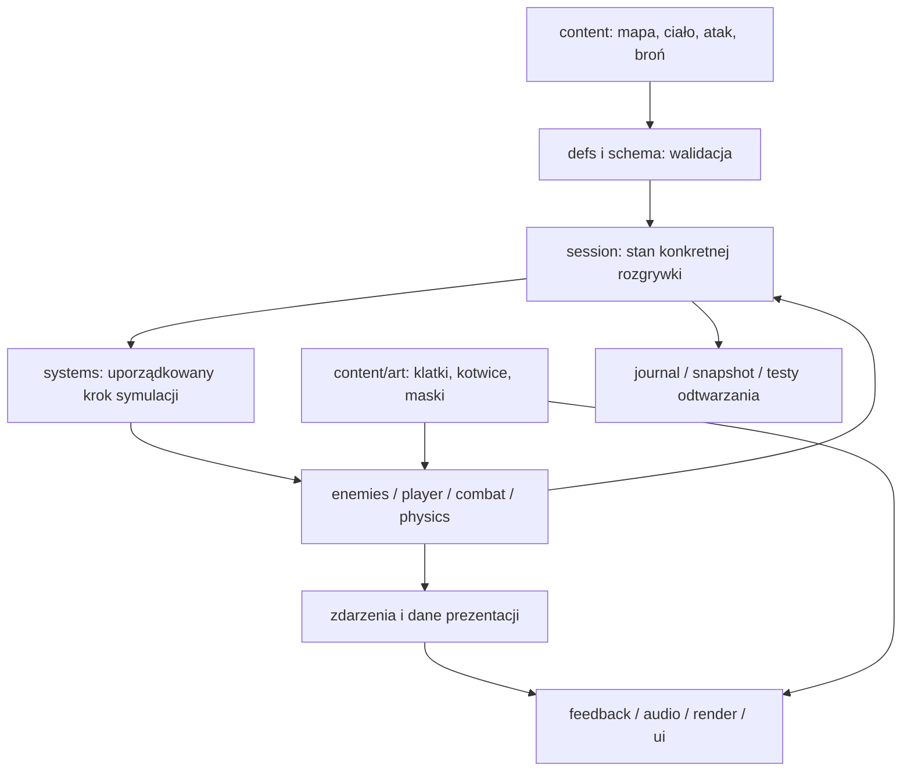

# SIGIL: BREACH — samodzielna edycja poligonu i walki

Stan kodu: `3a35b56`, 28.10.2026. Ten poradnik powstał po commitach
implementacji. Przykłady są propozycjami zmian, nie ukrytymi zmianami gry.
Katalog główny: `C:\Users\nahiko\Documents\dev\sigil-breach`.
Ścieżki poniżej liczymy od tego katalogu.

## 1. Uruchomienie i sposób pracy

Z katalogu głównego w PowerShell:

```powershell
.\RUN.ps1
```

Albo, jeśli LÖVE jest w PATH:

```powershell
cd C:\Users\nahiko\Documents\dev\sigil-breach\game
love .
```

Po edycji Lua zamknij i uruchom grę ponownie: definicje są wczytywane
i walidowane przy starcie. Sam reset poligonu nie przeładowuje plików Lua.
`F2` otwiera katalog prób, `RESET FIELD` czyści poprzednią próbę.
Właściwy odbiór trudności rób z włączonymi obrażeniami i żywym AI.
Strzelnica/fizyka używają również manekinów i nieśmiertelności — to narzędzia,
nie dowód, że boss jest łatwy.

Pracuj małymi zmianami: jedna hipoteza, jedna edycja, ta sama próba przed/po.
Przykład: „wachlarz daje za mało czasu na reakcję” → wydłuż jego `windup`,
zamiast równocześnie zmieniać HP, prędkość gracza, promień pocisków i FOV.
Przed edycją sprawdź `git status`; commituj jawnie wybrane pliki.

## 2. Mapa plików i przepływu



Definicja to wspólny przepis. Żywe ciało ma własne HP, pozycję, zegary,
magazynek i wybrany atak. Nie zmieniaj definicji współdzielonej przez wszystkie
demony, kiedy chcesz zmienić tylko jednego demona podczas starcia.

| Chcę zmienić | Pierwsze miejsce |
|---|---|
| Układ dostępnego poligonu | `game/src/content/maps/proving.lua` |
| Dostępny tryb/mapę | `game/src/app/release.lua` |
| HP, pancerz, ruch, ataki Margrabiego | `game/src/content/creatures/boss.lua` |
| Furfur | `game/src/content/creatures/furfur.lua` |
| Pozostałe demony | `game/src/content/creatures/imp.lua`, `armored.lua`, `stolas.lua`, `buer.lua` |
| Parametry broni i ruchu rycerza | `game/src/content/tuning.lua` |
| Typ dostawy, wyposażenie, odrzut konkretnej broni | `game/src/content/weapons.lua` |
| Ładunek pod Q | `game/src/content/abilities.lua` |
| Matematyka obrażeń | `game/src/combat/damage.lua` |
| Arkusze i animacje dłoni | `game/src/content/art/weapon_frames.lua` |
| Pozy demona | `game/src/content/art/sheets/<id>.lua` |
| Malowidła środowiska | `game/src/content/art/environment.lua` |
| Dźwięki | `game/src/audio/recipes.lua`, pola `sounds` i `windupSound` w treści |
| Napisy, bez zmiany wyglądu liter/HUD-u | `game/src/content/text.lua` |

## 3. Edycja mapy: podłoga, ściany, wysokość

Obecna mapa ma 49×43 komórki. Jedna jednostka to metr. `x` rośnie w prawo,
`z` w dół planu, `y` w górę świata. Środek komórki to całkowite `(x,z)`;
jej krawędzie są o 0,5 dalej. `yaw = math.pi` patrzy ku malejącemu `z`.

`rooms` otwiera prostokąty podłogi; poza nimi jest ściana. Granice są włączne:

```lua
{ 3, 12, 17, 29 }, -- x od 3 do 17, z od 12 do 29
```

To zachodnia sala pojedynku, szeroka na 15 i długa na 18 komórek.
Nie zamieniaj jej w `{3,12,18,29}` bez obejrzenia przejścia do nawy:
poszerzenie podłogi może usunąć zamierzoną ścianę/osłonę.
`pillars` dodaje rzeczywiste przeszkody, a `decor.arches` rysuje łuki.
Dekoracyjny łuk nie jest automatycznie kolizją; sklepienie ma osobną geometrię.

Mapa ma teraz następujący porządek przestrzenny:

```text
   galerie grobowe — komory mniejszych demonów — galerie grobowe
                          prezbiterium
     absyda Margrabiego                     absyda Furfura
     sala pojedynku           nawa          sala pojedynku
     kolumnady             procesyjna       kolumnady
          └── niski próg ──────┼────── niski próg ──┘
                            wejście
```

`elevations` podnosi podłogę. Obecne stopnie mają 0,16 i 0,32 m:

```lua
{ x1 = 8, z1 = 6, x2 = 12, z2 = 7, height = 0.32 }
```

`tuning.terrain.stepHeight = 0.32` jest największym stopniem pokonywanym
chodem. Większa różnica może wymagać skoku. Nie zwiększaj globalnego
progu chodzenia tylko po to, żeby naprawić jeden źle zaplanowany schodek.

Strop w `proving.lua` powstaje z lokalnej tabeli `bands`. Pierwsze pasujące
pasmo wygrywa. `spring` oznacza podstawową wysokość spodu, `rise` wybrzuszenie,
`centre` oś przekroju, `halfWidth` jego rozpiętość. Wynik to fizyczne `decks`,
z którymi spotykają się pociski i ciała. Zewnętrzny gzyms schodzi do 4,2 m,
żeby połączyć sklepienie ze ścianą. Wysoki środek sali ma 9,3 m; wąskie
progi 3,1 m. Przy rozbudowie pokoju dopasuj też pasmo stropu, łuki, lampy,
malowidła i miejsca pojawiania się przeciwników.

## 4. Przeniesienie ołtarza, bossa i stanowisk

Miejsce pieczęci Margrabiego jest w `seals`, identyfikator `asmoday`, obecnie
`x = 10, z = 7`. Powiązane stanowisko ma:

```lua
{ altar = 'asmoday', trial = 'ash', spawn = 'boss' }
```

Przenieś pieczęć, jeśli chcesz przenieść przywołanie. Nie dopisuj `x,z`
do tego stanowiska: `altar` jest jedynym właścicielem jego współrzędnych,
a walidacja celowo odrzuca dwie sprzeczne lokalizacje.

`proving.chambers` opisuje miejsce rozpoczęcia pojedynku i sloty przeciwników:

```lua
{
  id = 'ash',
  fire = courtFire(10, 1),
  entry = { x = 10, z = 25, yaw = math.pi },
  slots = { { x = 10, z = 15 }, { x = 7, z = 15 }, { x = 13, z = 17 } },
}
```

`entry` to rycerz, `slots` to miejsca demonów, a nie odwrotnie.
Na potrzeby bezpiecznego pierwszego testu przenieś pierwszy slot z `z=15`
na `z=16`; potem sprawdź dystans otwarcia, zasięg pierwszego ataku i dojście
AI. Zmiana pokoju wpływa na balans nawet bez zmiany obrażeń.

`fire` jest obwodem wizualnym aktywnej próby. Nie jest niewidzialną ścianą
ani ukrytym damage. Wyłącza się z zakończeniem/resetem walki. Jeśli kiedyś
chcesz szkodliwą granicę, potrzebuje jawnego hazardu z objętością, ostrzeżeniem
i testami. Nie dodawaj obrażeń z funkcji renderującej płomienie.

`trials` łączy gatunek i komnatę. Przykład dodatkowej próby istniejącego demona:

```lua
-- w trials; unikatowe id z podkreśleniami
{ id = 'iron_in_ash', chamber = 'ash', creature = 'armored' },
-- w pads, w wolnym miejscu nartheksu
{ x = 23, z = 35, trial = 'iron_in_ash', spawn = 'armored' },
```

Ta zmiana nie dodaje gatunku ani nowej mechaniki. Pierwsza próba danego gatunku
pozostaje jego domyślnym wyborem katalogowym. Nie nakładaj kilku stanowisk
na jedno miejsce; sprawdź fizyczne dojście i czy podpisy mieszczą się w kadrze.

`proving.stations.start` ustala reset i początek strzelnicy (obecnie 24,36).
`physics.stand`, `domino`, `slam` opisują próbę fizyki. Strzelnica i rząd
domina są obecnie skierowane ku malejącemu `z`; same współrzędne nie nadają
im dowolnego obrotu. Dystanse strzelnicy są w `content/field.lua`, `range.lanes`.
Po zmianie resetu sprawdź cały odcinek 20 m przed nim, nie tylko sam start.

Nowa osobna mapa wymaga pliku, rejestracji w `content/maps/index.lua`
i wskazania `sessionMaps.field` w `app/release.lua`. Publiczny poligon ma
`trade=false`, `waves=false`. Archiwalne `limbo`, sklep i wyprawa pozostają
biblioteką; nie trzeba usuwać ich kodu przy edycji publicznej mapy.

## 5. Zmiana demona i trudności

Definicja demona rozdziela kilka pojęć:

| Pole | Znaczenie |
|---|---|
| `body.hp` | pula życia |
| `body.armor` | rating redukujący fizyczne obrażenia, nie procent i nie druga pula HP |
| `body.locationArmor` | rating dla głowy/tułowia/dolnej części |
| `body.resist` | odporność według rodzaju obrażeń |
| `body.poise` | odporność na złamanie postawy |
| `body.mass` | odpowiedź na impuls fizyczny |
| `move.speed`, `accel` | prędkość m/s, przyspieszenie m/s² |
| `move.style` | zarejestrowany sposób poruszania AI |
| `tactics.moves` | preferencje wyboru konkretnych ataków |
| `attacks` | wykonania z zapowiedzią, dostawą i pakietem obrażeń |

Przykład: `body.hp = 1200` u Margrabiego wydłuży walkę, ale samo nie nauczy
go ścigania gracza. Jego obecne 1000 HP, wachlarz, lanca, bliski piec
i odpowiedź pociskiem należą do jednego życia. Furfur ma 1400 HP,
pchnięcie rogami, szarżę, piorun, krzyż burzowy i powrót po szarży.
Nie ma automatycznej drugiej fazy ani odnowienia HP. Biblioteka faz jest
zachowana na późniejsze świadome zaprojektowanie; nie włączaj jej przypadkiem
przy zmianie samej trudności.

`tactics.moves` używa `attack` zgodnego z `id` w `attacks`. `min/max`
ograniczają preferowany dystans, `ideal` oznacza pożądany dystans,
`weight` preferencję, `repeatPenalty` ogranicza powtórzenia. Przykład
`after = { attack = 'ash-lance', within = 1.4 }` daje okazję kontynuacji
po poprzednim ciosie. To nie gwarancja ataku przez ścianę lub poza zasięgiem.

## 6. Strojenie ataku i dodanie kolejnego

W `boss.lua`, `ember-fan` ma teraz `windup=0.65`, `speed=16`, `count=9`,
`spread=0.10`. Zwiększenie `windup` do `0.80` daje dodatkowe 0,15 s
zapowiedzi. `spread` to odstęp kątowy w radianach: większa wartość poszerza
wachlarz, ale również powiększa luki między kulami. Nie oznacza automatycznie
większej trudności.

`range` ogranicza użycie ataku, `windup` zapowiada, `duration` opisuje stan
uderzenia, `recover` odpoczynek, `cooldown` kadencję, `rest` osobny odpoczynek
konkretnego ruchu. Są różnymi zegarami, nie dowolnie wymiennymi nazwami.
Predykcja `lead` jest czasem wyprzedzenia; `aimLead` udziałem przewidywanego
przechwycenia przy celowaniu pociskiem. Po związaniu celu atak nie śledzi
gracza bez końca. Wynik zależy także od poziomu TIER i `leadFloor`.

Przykładowy nowy pocisk wykorzystujący istniejącą dostawę (wewnątrz `attacks`):

```lua
Action.bolt({
  id = 'ember_test',
  range = 10,
  minRange = 2,
  windup = 0.8,
  recover = 1.1,
  cooldown = 1.6,
  speed = 12,
  height = 1.9,
  aimHeight = 1.5,
  radius = 0.12,
  color = { 0.95, 0.38, 0.12 },
  packet = packet(18, 40, 'fire'),
})
```

Dodaj `tactics.moves` odnoszące się do `ember_test`; inaczej taktyka nie
ma powodu wybierać nowego ruchu. W `content/art/sheets/boss.lua` dopisz
`windup.ember_test` i `strike.ember_test`, korzystając z istniejących klatek,
np. wzorca `cinder-spear`. `clock='action'` wiąże pozę z postępem ataku,
`bounds` określa progi 0–1. Nie wystarczy narysować efektu, który nie
odpowiada rzeczywistej chwili wypuszczenia pocisku.

Nowy rodzaj dostawy, np. zakrzywiona ściana ognia, potrzebuje walidacji
w `content/defs/action.lua` i wykonawcy w systemie ataków. Nie należy pisać
osobnego cyklu gry dla jednego bossa. Wzory istniejących rozszerzeń są
w `tests/cases/extension.lua`, `attack_followups.lua` i `weapon_extension.lua`.

## 7. Wysokość, ślizg i hitbox

Rycerz ma promień 0,22 m i ciało od 0,08 do 1,80 m nad podłożem/skokiem.
Pełny ślizg obniża górę o 0,43 m do 1,37 m. Pocisk ze środkiem na 1,15 m
nadal może go prawidłowo trafić. Liczy się również promień pocisku,
nie tylko środek efektu i nie tylko wysokość kamery.

`height` to wysokość startu nad źródłem; `aimHeight` wysokość celowania
nad podłożem celu. Przy różnych wysokościach lot jest ukośny. Kolizja
sfery z poruszającym się ciałem jest liczona ciągle, także przy zmianie
wysokości ślizgu. Nie dodawaj sztucznego „miss, gdy slide=true”.

Hazardy mają jawne `volume`:

```lua
volume = { bottom = 0, top = 0.42, sample = 'feet', includeRadius = true }
```

To płytka strefa stóp. Piorun Furfura używa `sample='body'`, `top=2.9`.
Wybuch ładunku bada dystans 3D i osłonę. Podnoszenie obrazu płomienia
nie podnosi automatycznie zasięgu obrażeń — sprawdź dane objętości.

U demonów maski malowanych klatek, strefy obrażeń i opcjonalne bryły
mają osobne role. Rogi nie muszą zadawać obrażeń jak głowa. Politykę
materiału opisuje `content/ballistic_surfaces.lua`, anatomię
`content/art/anatomy/`, a kadry i kotwice `content/art/sheets/`.
Przy niezmienionej grafice nie regeneruj masek tylko dlatego, że zmieniasz HP.
Przy zmianie sylwetki dopasuj maski, kotwice i testy obserwowanego strzału.

## 8. Obrażenia broni: konkretna matematyka

`combat/damage.lua` liczy w uproszczeniu:

```text
f = 1 - (1 - minPower) * clamp((distance-start)/(end-start), 0, 1)
raw = base * power * f * zone * upgrade * headMultiplier * zoneDamage
effectiveArmor = rating * (1-penetration)  [tylko obrażenia physical]
damage = raw * 100/(100+effectiveArmor) * (1-resistance)
```

Mnożnik głowy działa tylko dla strefy `head` i jest ograniczony do 0–2.
Rating może pochodzić z `locationArmor`; złamanie postawy redukuje go do połowy.
Odporność mieści się w przedziale −0,25 do 0,60. Następnie mogą zadziałać
odporność całkowita, płaskie `soak` oraz materiał trafionej powierzchni.
`impact` dotyczy postawy, `push` impulsu — nie są tym samym co damage.
Pula osłony rycerza to jeszcze osobna reguła, nie rating demona.

Przykład kontrolny: Judge, baza 70, dystans ≤12 m, zwykły tułów z ratingiem
30, penetracja 0,5, pozostałe mnożniki 1, brak odporności i soak:
`70 * 100 / (100 + 15) = 60,87` HP. To wynik dla tych warunków, nie każdego
trafienia Margrabiego. Strefa, tier, efekt, materiał lub odsłonięcie mogą go zmienić.

| Parametr | Strzelba | Judge |
|---|---:|---:|
| Obrażenia jednostki | 12 na śrucinę | 70 na pocisk |
| Pełny strzał | 20 śrucin / 2 naboje | 1 pocisk / 1 nabój |
| Kadencja | 0,94 s | 0,38 s |
| Początek spadku / koniec | 4 / 18 m | 12 / 36 m |
| Minimalna moc | 0,40 | 0,65 |
| Maksymalny zasięg | 24 m | 42 m |

Wartości są w `content/tuning.lua`, profile w `content/weapons.lua`.
Strzelba rozlicza poszczególne śruciny; `20*12` nie oznacza gwarantowanych
240 obrażeń w cel. Część może chybić, trafić różne strefy albo innego demona.

## 9. Nowa broń, zmiana chwytu, odrzutu i przeładowania

Nowa broń ma stabilny `id`, definicję i stan w `player.arsenal[id]`.
`Weapons.define({ extends = Weapons.get('exorcist'), ... })` tworzy niezależny
wariant z nadpisanymi polami. Nowa broń nie powinna dodawać pól typu
`player.newGunAmmo` ani gałęzi po jej nazwie w AI.

Praktyczna kolejność:

1. Zarejestruj napisy w `content/text.lua`; definicja sprawdza ich klucze.
2. Dodaj definicję do `content/weapons.lua` albo modułu wczytywanego tam
   przy starcie. Ustaw `id`, `name`, `hud`, `capacity`, `cycle`, `range`,
   `fire`, `attack`, `delivery`, `mechanism`, `weight`.
3. Prototyp może użyć `art='judge'`. Własną grafikę rejestruj przez
   `content/weapon_art.lua`, z kompletem nazwanych klatek i kotwic.
4. Dopisz id do `Weapons.defaultLoadout`, jeśli ma być od startu,
   lub użyj `Weapons.give(g, id, actor)` w odpowiednim poleceniu gry.
   Dla stanowiska dodaj `weapon = '<id>'` w `proving.pads`.
5. Sprawdź zmianę slotu, ostatni nabój, pusty zapas, przerwane przeładowanie,
   reset, zapis/odtworzenie oraz nazwę i liczby w HUD-zie.

Gotowy wykonywany przykład wariantu strzelającego fizycznie lecącym
ognistym pociskiem: `tests/cases/weapon_extension.lua`. Pokazuje `extends`,
`delivery.kind='projectile'`, prędkość/promień i `damageType='fire'`.
Nie kopiuj automatycznie penetracji hitscan do takiej dostawy: nieobsługiwane
połączenie jest celowo odrzucane. Dla nowego modelu rozchodzenia się ataku
potrzebny jest wykonawca dostawy, nie przebudowa wszystkich broni.

Aktywne grafiki dłoni to `shotgun-iron-v16.png` i `revolver-iron-v16.png`.
Arkusze 1600×1600 mają 4×4 klatki 400×400. `weapon_frames.lua` zawiera
`rect`, `grip`, `muzzle`, `eject`, rozmiar ekranowy i nazwane fazy.
Sama podmiana PNG o innym układzie nie wystarczy: błysk lufy i łuska
muszą nadal wychodzić z właściwego miejsca. Klatki powinny zachować wspólną
perspektywę, skalę ręki i paletę demonów. Brak nowego ostrego mikrodetału.

`phases.fire` i `phases.reload` sterują wyborem obrazu; mechanizm magazynka
pozostaje w `combat/reload.lua`. W `tuning.lua` strzelba ładuje w 0,60 s,
Judge w 1,16 s, zamyka w 1,55 s, kończy w 1,85 s. Zmieniając obraz
wkładania amunicji, sprawdź zgodność z tymi chwilami. Nie dodawaj drugiego
zużycia lub doładowania nabojów w rendererze.

W `weapon.weight` `mass/momentum` wpływają na reakcję odrzutu, `wristK/wristD`
na sprężynę nadgarstka, `viewKick` na impuls kamery, `carry` na kołysanie.
Modyfikuj kilka procent i testuj podczas ruchu/obrotu, nie tylko na statycznym
arkuszu. Sprzężenie dłoni z ruchem jest prezentacją, nie dodatkowym damage.

## 10. Wyposażenie pod Q i nowy gatunek demona

`content/abilities.lua` zawiera fizyczny ładunek `powder`: pojemność 3,
początek 2, rzut 8 m/s, zapalnik 1 s, promień 4 m, obrażenia ognia 180,
własne obrażenia 45. To człowiek używający wyposażenia, bez dodanej magii.
`Abilities.define` rejestruje wyposażenie, `Abilities.give(g,id)` daje je
kontrolowanemu rycerzowi. Q wybiera slot 1; drugi slot wymaga decyzji o
sterowaniu, nie samego dopisania rekordu.

Nowy demon: plik `content/creatures/<id>.lua`, wpis i `require` w
`content/enemies.lua`, definicja wyglądu/atlasu, teksty i pozycja katalogowa.
To jawny rejestr, a nie automatyczne wczytywanie dowolnego pliku z folderu.
Nowy gatunek korzystający z istniejących ataków i ruchu jest głównie danymi.
Nowa sylwetka wymaga pracy artystycznej i anatomii; nowy rodzaj ruchu lub
dostawy może wymagać małego modułu i testów. Przykład rozszerzenia bez
zmiany rdzenia: `tests/cases/creature_extension.lua`.

## 11. Światło, nowe malowidło i dźwięk

`proving.lamps` ustala źródła ognia. Oświetlenie ma 14 wybieranych źródeł
statycznych plus dwa pobliskie pociski. Mapa może mieć więcej lamp;
renderer wybiera ich lokalny zestaw. Jasność dekoracji nie daje jej
automatycznie roli światła fizycznego.

Nowe malowidło dodaj do `content/art/environment.lua`, np. na wzór
`catacomb_loculi`. `rect` jest znormalizowane do 0–1; filtr i mipmapy należą
do definicji zasobu. Umieszczenie w `decor.murals`:

```lua
{ art = 'catacomb_loculi', x = 13.58, z = 3.5,
  yaw = math.pi / 2, y = 0.18, size = 2.65 }
```

To obraz na ścianie. Nie tworzy przejścia, grobowca 3D ani hitboxu niszy.
Najpierw pokazuj nowy wygląd w rzeczywistym kadrze; sprawdzaj odległość,
kontrast, krawędzie, światło i sąsiedztwo obecnych demonów. Wspólna konwencja
czerpie z Giovanniego da Modeny, Michała Anioła, Boscha i Memlinga; nie każdy
z tych obrazów historycznie był freskiem. Gra łączy je w jedną malarską,
przygaszoną oprawę. Obecny HUD i podstawowe demony są wzorcem.

`creature.sounds.step` wybiera krok, `sounds.windup` domyślne ostrzeżenie,
`attack.windupSound` jego szczególny wariant, `sound` głos wykonania.
Receptury są w `audio/recipes.lua`, warstwy muzyki w module score.
Kroki wynikają z zegara istniejącej animacji chodu. `audio/world_cues.lua`
nie powinno otrzymywać osobnych timerów symulacji dla każdego nowego demona.

Ostrzeżenie ma wyższy priorytet od kroku i przycisza muzykę. Pula ma limit
28 aktywnych i 28 zapasowych głosów. Osłona ściany tłumi głos, ale nie jest
pełnym modelem akustyki kościoła. Odsłuchaj ostrzeżenia przy kilku demonach
i podczas wystrzału; poprawna liczba próbek WAV nie dowodzi czytelnego miksu.

## 12. Jak sprawdzać własne zmiany

Polecenia z katalogu głównego:

```powershell
.\FORMAT.ps1
.\TEST.ps1 -Suite Architecture
.\TEST.ps1 -Suite Mechanics -TestTimeoutSeconds 600
.\TEST.ps1 -Suite Input -TestTimeoutSeconds 600
.\TEST.ps1 -Suite Render -TestTimeoutSeconds 600
.\TEST.ps1 -Suite All -TestTimeoutSeconds 600
```

Nie musisz odpalać wszystkiego po każdej korekcie opisu. Po zmianie combatu
ważne są mechanika/replay; po grafice — render i obejrzenie obrazów; po
sterowaniu/ładowaniu — rzeczywiste wejścia i startup. Przed większym commitem
uruchom All. Raporty są w `work/qa-v33`; benchmarki w All są krótkim smoke,
nie dowodem płynnych 60 FPS. Pełny koszt mierzy `MEASURE.ps1` na oddzielnych
kopiach przed/po, bez równoległych renderów i innych obciążających zadań.

Zmiana parametrów walki może prawidłowo zmienić złoty wzorzec. Najpierw
wyjaśnij różnicę (np. przywróć tylko poprzednie dane na nowym silniku
i sprawdź poprzedni wynik). Nie wpisuj bieżącego hash jako oczekiwanego,
żeby uciszyć niewyjaśniony błąd. Zamrożonych referencji 0.33 nie regeneruj.

Po zmianie mapy przejdź całą drogę od wejścia do obu ołtarzy i galerii,
wywołaj każdego demona, walcz, umrzyj, zresetuj i wróć do menu. Sprawdź
ściany/strop pociskiem oraz ślizgiem/skokiem. Obejrzyj atak z bliska
i z daleka: grafika i trafienie muszą opowiadać o tym samym zdarzeniu.
Sprawdź napisy przy 960×540 i 1024×768; brak przecięcia prostokątów nie
wystarczy, jeśli litery leżą na ornamentach, zasłaniają bossa lub zlewają
się ze sceną.

## 13. Granice obecnej bazy

Baza ma punkty rozszerzeń dla broni, dostaw, demonów, ataków, map i grafiki,
ale nie jest obietnicą „każda przyszła mechanika bez nowego kodu”. Demony
pozostają malowanymi sprite'ami z jawną regułą obserwatora, mapa jest 2.5D,
domyślne Q obsługuje jeden slot, a strzelnica ma ustaloną oś. Wielu graczy
i zapis w absolutnie dowolnym momencie to osobne wymagania produktowe.

Nową treść buduj na istniejących kontraktach. Nowy kontrakt dodawaj tam,
gdzie faktycznie potrzebuje go zachowanie — bez gałęzi `if boss == ...`
w każdym systemie i bez rozbudowy nieużywanego uniwersalnego frameworka.
Nadal oddzielamy wynik testów od ludzkiego odbioru walki i klimatu.
